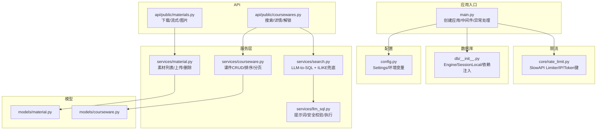
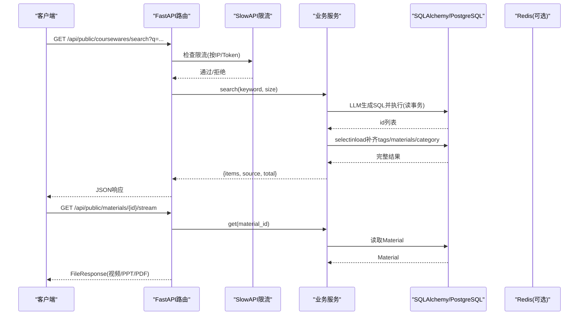
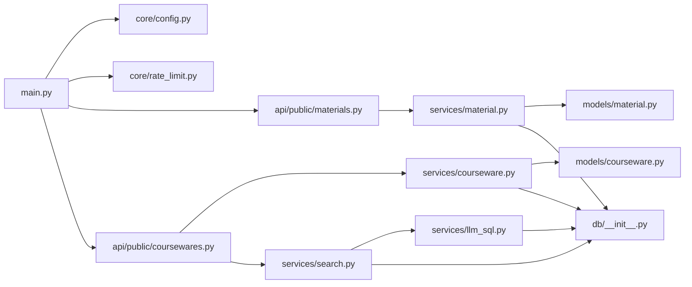

# 后端性能优化

<cite>
**本文引用的文件**   
- [backend/app/main.py](file://backend/app/main.py)
- [backend/app/core/config.py](file://backend/app/core/config.py)
- [backend/app/db/__init__.py](file://backend/app/db/__init__.py)
- [backend/app/core/rate_limit.py](file://backend/app/core/rate_limit.py)
- [backend/pyproject.toml](file://backend/pyproject.toml)
- [backend/app/services/material.py](file://backend/app/services/material.py)
- [backend/app/services/courseware.py](file://backend/app/services/courseware.py)
- [backend/app/models/material.py](file://backend/app/models/material.py)
- [backend/app/models/courseware.py](file://backend/app/models/courseware.py)
- [backend/app/api/public/materials.py](file://backend/app/api/public/materials.py)
- [backend/app/api/public/coursewares.py](file://backend/app/api/public/coursewares.py)
- [backend/app/services/search.py](file://backend/app/services/search.py)
- [backend/app/services/llm_sql.py](file://backend/app/services/llm_sql.py)
</cite>

## 目录
1. [引言](#引言)
2. [项目结构](#项目结构)
3. [核心组件](#核心组件)
4. [架构总览](#架构总览)
5. [详细组件分析](#详细组件分析)
6. [依赖关系分析](#依赖关系分析)
7. [性能考量](#性能考量)
8. [故障排查指南](#故障排查指南)
9. [结论](#结论)
10. [附录](#附录)

## 引言
本指南面向 Learning Hub 后端的性能优化，聚焦以下主题：数据库查询优化（SQLAlchemy、索引策略、N+1 与批量操作）、缓存策略（Redis 层、失效策略、热点数据）、异步处理（FastAPI 路由、任务队列、并发控制）、连接池配置（参数调优、复用、泄漏防护）、限流与熔断（SlowAPI、频率控制、降级）、内存管理（对象生命周期、大对象、泄漏检测）以及监控指标与 APM 集成。文档结合仓库现有实现进行深度剖析，并给出可落地的优化建议与可视化图示。

## 项目结构
后端采用 FastAPI + SQLAlchemy 的模块化分层：入口装配中间件与路由；配置集中管理；数据库连接与 Session 工厂统一提供；业务服务封装复杂查询与流程；模型定义表结构与关系；公共 API 暴露下载、预览、搜索等能力；限流基于 SlowAPI 并通过 Redis 或内存存储。

图表来源
- [backend/app/main.py:40-112](file://backend/app/main.py#L40-L112)
- [backend/app/core/config.py:9-88](file://backend/app/core/config.py#L9-L88)
- [backend/app/db/__init__.py:15-32](file://backend/app/db/__init__.py#L15-L32)
- [backend/app/core/rate_limit.py:40-51](file://backend/app/core/rate_limit.py#L40-L51)
- [backend/app/services/material.py:78-119](file://backend/app/services/material.py#L78-L119)
- [backend/app/services/courseware.py:396-447](file://backend/app/services/courseware.py#L396-L447)
- [backend/app/services/search.py:210-242](file://backend/app/services/search.py#L210-L242)
- [backend/app/services/llm_sql.py:443-478](file://backend/app/services/llm_sql.py#L443-L478)
- [backend/app/models/material.py:44-68](file://backend/app/models/material.py#L44-L68)
- [backend/app/models/courseware.py:21-73](file://backend/app/models/courseware.py#L21-L73)
- [backend/app/api/public/materials.py:64-146](file://backend/app/api/public/materials.py#L64-L146)
- [backend/app/api/public/coursewares.py:32-54](file://backend/app/api/public/coursewares.py#L32-L54)

章节来源
- [backend/app/main.py:40-112](file://backend/app/main.py#L40-L112)
- [backend/app/core/config.py:9-88](file://backend/app/core/config.py#L9-L88)
- [backend/app/db/__init__.py:15-32](file://backend/app/db/__init__.py#L15-L32)
- [backend/app/core/rate_limit.py:40-51](file://backend/app/core/rate_limit.py#L40-L51)

## 核心组件
- 应用装配与中间件：CORS、请求ID透传、限流异常处理、路由注册。
- 配置中心：从环境变量加载数据库、JWT、CORS、LLM、日志等设置，并提供有效数据库URL计算。
- 数据库连接：同步引擎与 sessionmaker，针对 SQLite 与 Postgres 差异化连接池参数；每个请求一个 Session 的依赖注入。
- 限流：SlowAPI 适配，支持 IP 与 Token 双键，优先使用 Redis 存储。
- 服务层：素材与课件的业务逻辑，包含分页、关联加载、排序重写、ACL 校验等。
- 搜索：LLM-to-SQL 召回优先，失败/超时/拒绝时降级为关键词 ILIKE；进程级词汇缓存减少 LLM 提示词开销。
- 模型：Courseware/Material 表结构及多对多关系，lazy 策略影响 N+1 行为。

章节来源
- [backend/app/main.py:40-112](file://backend/app/main.py#L40-L112)
- [backend/app/core/config.py:9-88](file://backend/app/core/config.py#L9-L88)
- [backend/app/db/__init__.py:15-32](file://backend/app/db/__init__.py#L15-L32)
- [backend/app/core/rate_limit.py:40-51](file://backend/app/core/rate_limit.py#L40-L51)
- [backend/app/services/material.py:78-119](file://backend/app/services/material.py#L78-L119)
- [backend/app/services/courseware.py:396-447](file://backend/app/services/courseware.py#L396-L447)
- [backend/app/services/search.py:210-242](file://backend/app/services/search.py#L210-L242)
- [backend/app/services/llm_sql.py:443-478](file://backend/app/services/llm_sql.py#L443-L478)
- [backend/app/models/courseware.py:21-73](file://backend/app/models/courseware.py#L21-L73)
- [backend/app/models/material.py:44-68](file://backend/app/models/material.py#L44-L68)

## 架构总览
下图展示关键请求路径与组件交互，包括搜索、素材流式预览与下载、限流与数据库访问。

图表来源
- [backend/app/api/public/coursewares.py:32-54](file://backend/app/api/public/coursewares.py#L32-L54)
- [backend/app/services/search.py:210-242](file://backend/app/services/search.py#L210-L242)
- [backend/app/services/llm_sql.py:443-478](file://backend/app/services/llm_sql.py#L443-L478)
- [backend/app/api/public/materials.py:84-146](file://backend/app/api/public/materials.py#L84-L146)
- [backend/app/core/rate_limit.py:40-51](file://backend/app/core/rate_limit.py#L40-L51)

## 详细组件分析

### 数据库查询优化
- SQLAlchemy 查询优化要点
  - 使用 selectinload 预加载多对多关系，避免 N+1。例如在课件列表与详情中显式加载 tags、materials、access_tokens、category。
  - 分页采用 offset/limit 配合子查询 count，注意在大偏移时的性能退化，必要时引入游标分页。
  - 条件过滤尽量走索引列；ILIKE 前缀通配会退化为全表扫描，需评估索引策略。
- 索引策略设计
  - 文本字段：title/description/author 若频繁 ILIKE，考虑GIN表达式索引或使用全文检索扩展（如 pg_trgm）。
  - 外键与过滤：category_id、access_mode 建立B-Tree索引以加速过滤与排序。
  - 关联表：courseware_tag、courseware_material、courseware_access_token 的复合索引（courseware_id, tag_id/material_id/access_token_id）提升 JOIN/IN 查询。
- N+1 问题解决方案
  - 在 Courseware 关系中设置 lazy="selectin"，并在查询中使用 selectinload 明确加载，避免隐式懒加载导致 N+1。
  - 对于仅需要 ID 的场景（如 LLM 搜索结果），先取 id 列表再批量拉取完整对象，减少往返次数。
- 批量操作优化
  - 更新 sort_order 时使用批量 UPDATE 语句而非逐条 ORM 更新，减少事务开销。
  - 批量插入/删除使用 IN 子句与一次性 flush/commit。

章节来源
- [backend/app/services/courseware.py:396-447](file://backend/app/services/courseware.py#L396-L447)
- [backend/app/services/courseware.py:105-167](file://backend/app/services/courseware.py#L105-L167)
- [backend/app/models/courseware.py:52-67](file://backend/app/models/courseware.py#L52-L67)
- [backend/app/services/material.py:78-119](file://backend/app/services/material.py#L78-L119)

### 缓存策略实现
- Redis 缓存层设计
  - 限流存储优先使用 Redis（storage_redis_url），否则回退到内存模式。
  - 可在热点数据（如分类树、标签名、热门课件元信息）增加 Redis 缓存，设置合理 TTL。
- 缓存失效策略
  - 后台增删分类/标签后主动失效相关缓存（如 llm_sql 中的词汇缓存已提供 invalidate_vocab_cache）。
  - 使用版本号或时间戳作为缓存键后缀，确保一致性。
- 热点数据缓存方案
  - 首页推荐、热门搜索结果、PPT 预览图片清单可缓存至 Redis，前端带 ETag/If-None-Match 协商缓存。
  - 对大对象（如 PPT 转 PDF）采用对象存储直链 + CDN，后端仅返回 URL。

章节来源
- [backend/app/core/rate_limit.py:40-51](file://backend/app/core/rate_limit.py#L40-L51)
- [backend/app/services/llm_sql.py:107-113](file://backend/app/services/llm_sql.py#L107-113)
- [backend/app/api/public/materials.py:149-180](file://backend/app/api/public/materials.py#L149-L180)

### 异步处理机制
- FastAPI 异步路由优化
  - 搜索接口使用 async def，内部通过 asyncio.to_thread 调用阻塞型 LLM 与 SQL 执行，避免阻塞事件循环。
  - 文件流式响应使用 FileResponse，底层由 uvicorn 高效传输。
- 任务队列集成
  - 当前未集成 Celery/RQ，可将耗时任务（PPT 转图片、视频时长探测）放入队列，异步处理并回调更新状态。
- 并发控制
  - 使用 asyncio.wait_for 限制 LLM 调用超时；对外部 I/O 设置合理的 timeout。
  - 数据库连接池大小与 max_overflow 决定并发上限，需根据压测调整。

章节来源
- [backend/app/api/public/coursewares.py:32-54](file://backend/app/api/public/coursewares.py#L32-L54)
- [backend/app/services/search.py:210-242](file://backend/app/services/search.py#L210-L242)
- [backend/app/api/public/materials.py:84-146](file://backend/app/api/public/materials.py#L84-L146)

### 连接池配置优化
- 参数调优
  - pool_size 与 max_overflow 决定最大并发连接数；建议根据 CPU 核数与数据库容量设定。
  - pool_pre_ping=True 用于健康检查，防止死连接。
- 连接复用策略
  - 每个请求一个 Session，请求结束关闭；避免跨请求共享 Session。
  - 长事务会占用连接，应缩短事务范围。
- 连接泄漏防护
  - 使用 try/finally 确保 db.close() 执行；避免异常路径下未释放连接。
  - 监控连接池使用率与等待队列长度，发现泄漏及时告警。

章节来源
- [backend/app/db/__init__.py:15-32](file://backend/app/db/__init__.py#L15-L32)

### 限流与熔断机制
- SlowAPI 配置
  - 全局 limiter 实例绑定到 app.state.limiter，并注册 RateLimitExceeded 异常处理器返回 429。
  - 路由装饰器 @limiter.limit("60/minute") 对高频接口进行保护。
- 请求频率控制
  - key_func 支持 IP 与 Token 双键，Token 基于 Authorization Bearer 解析会话标识。
- 降级策略
  - 限流触发时返回统一错误体，前端可提示“稍后再试”。
  - LLM 搜索失败/超时时自动降级为关键词 ILIKE，保证可用性。

章节来源
- [backend/app/main.py:67-89](file://backend/app/main.py#L67-L89)
- [backend/app/core/rate_limit.py:40-51](file://backend/app/core/rate_limit.py#L40-L51)
- [backend/app/api/public/materials.py:84-86](file://backend/app/api/public/materials.py#L84-86)
- [backend/app/services/search.py:210-242](file://backend/app/services/search.py#L210-L242)

### 内存管理优化
- 对象生命周期管理
  - 严格控制 ORM 对象的驻留时间，及时 commit/refresh/expired 属性，避免大对象长期持有。
  - 在 _to_item 中将 ORM 对象转为字典，减少引用。
- 大对象处理
  - 文件上传分块写入磁盘，避免内存峰值；超过阈值主动清理半文件。
  - 流式响应直接返回 FileResponse，不将大文件载入内存。
- 内存泄漏检测
  - 使用 tracemalloc 或 objgraph 定位增长对象；结合 Prometheus 指标观察 RSS/GC 统计。
  - 定期重启 Worker 进程（uvicorn --workers）作为兜底。

章节来源
- [backend/app/services/material.py:129-202](file://backend/app/services/material.py#L129-L202)
- [backend/app/services/courseware.py:290-332](file://backend/app/services/courseware.py#L290-332)
- [backend/app/api/public/materials.py:64-81](file://backend/app/api/public/materials.py#L64-81)

### 监控指标与 APM 集成
- 指标收集
  - 记录请求耗时、错误率、限流触发次数、数据库连接池使用率、LLM 调用成功率与延迟。
  - 使用 prometheus-fastapi-instrumentor 暴露 /metrics。
- APM 工具集成
  - 接入 OpenTelemetry，采集 HTTP 链路、SQL 语句、外部调用（dashscope）跨度。
  - 将 X-Request-Id 贯穿日志与追踪，便于问题定位。

[本节为通用指导，不直接分析具体文件]

## 依赖关系分析
- 外部依赖
  - fastapi、uvicorn、sqlalchemy、psycopg2-binary、asyncpg、slowapi、redis、httpx、PyJWT、dashscope。
- 模块耦合
  - main.py 依赖 core/config、core/rate_limit、各 API 路由与服务层。
  - services 层依赖 models 与 db 层；search 依赖 llm_sql。
  - API 层通过 Depends(get_db) 获取 Session，避免全局状态。

图表来源
- [backend/app/main.py:40-112](file://backend/app/main.py#L40-L112)
- [backend/app/core/config.py:9-88](file://backend/app/core/config.py#L9-L88)
- [backend/app/core/rate_limit.py:40-51](file://backend/app/core/rate_limit.py#L40-L51)
- [backend/app/api/public/materials.py:64-146](file://backend/app/api/public/materials.py#L64-L146)
- [backend/app/api/public/coursewares.py:32-54](file://backend/app/api/public/coursewares.py#L32-L54)
- [backend/app/services/material.py:78-119](file://backend/app/services/material.py#L78-L119)
- [backend/app/services/courseware.py:396-447](file://backend/app/services/courseware.py#L396-L447)
- [backend/app/services/search.py:210-242](file://backend/app/services/search.py#L210-L242)
- [backend/app/services/llm_sql.py:443-478](file://backend/app/services/llm_sql.py#L443-L478)
- [backend/app/models/material.py:44-68](file://backend/app/models/material.py#L44-L68)
- [backend/app/models/courseware.py:21-73](file://backend/app/models/courseware.py#L21-L73)
- [backend/app/db/__init__.py:15-32](file://backend/app/db/__init__.py#L15-L32)

章节来源
- [backend/pyproject.toml:8-25](file://backend/pyproject.toml#L8-L25)

## 性能考量
- 数据库
  - 合理使用索引与覆盖索引，避免 SELECT *；对 ILIKE 场景评估 pg_trgm 或全文检索。
  - 分页优化：大偏移时使用基于 last_id 的游标分页。
- 缓存
  - 热点数据加 Redis 缓存，设置短 TTL 与版本化键；CDN 缓存静态资源。
- 异步
  - 外部调用（LLM、文件IO）使用 to_thread 与超时控制；避免阻塞事件循环。
- 连接池
  - 根据 QPS 与数据库容量调整 pool_size/max_overflow；启用 pool_pre_ping。
- 限流与熔断
  - 对高频接口限流；LLM 失败/超时自动降级；对下游依赖设置熔断器（如 httpx 重试与熔断）。
- 内存
  - 流式处理大文件；及时释放 ORM 对象；监控 RSS 与 GC。

[本节为通用指导，不直接分析具体文件]

## 故障排查指南
- 限流触发
  - 检查 SlowAPI 配置与 key_func；确认 Redis 连通性；查看 429 响应体中的 requestId。
- 数据库连接问题
  - 检查 effective_database_url、pool_size/max_overflow；观察连接池等待与超时。
- LLM 搜索失败
  - 查看 is_enabled 与 generate_sql 日志；确认 dashscope 可用与安全校验规则；关注超时与降级路径。
- 文件缺失
  - 素材下载/流式接口返回“文件丢失”时，核对 storage_path 与权限；检查上传流程是否成功提交。

章节来源
- [backend/app/main.py:84-89](file://backend/app/main.py#L84-L89)
- [backend/app/core/config.py:28-38](file://backend/app/core/config.py#L28-L38)
- [backend/app/services/llm_sql.py:267-271](file://backend/app/services/llm_sql.py#L267-271)
- [backend/app/api/public/materials.py:64-81](file://backend/app/api/public/materials.py#L64-81)

## 结论
通过对现有代码的分析，Learning Hub 后端在查询加载、限流、异步与文件流式处理方面已有良好基础。进一步优化方向包括：完善索引策略、引入更细粒度的缓存与失效机制、集成任务队列与 APM、精细化连接池与内存监控。这些措施将显著提升系统在高并发下的稳定性与响应速度。

[本节为总结，不直接分析具体文件]

## 附录
- 关键配置项参考
  - 数据库：database_host/port/user/password/name/url
  - 限流/Redis：storage_redis_url
  - LLM：dashscope_api_key、llm_search_model、llm_sql_timeout_seconds、llm_sql_max_rows
  - CORS：cors_allow_origins
  - 日志：log_level

章节来源
- [backend/app/core/config.py:19-73](file://backend/app/core/config.py#L19-L73)