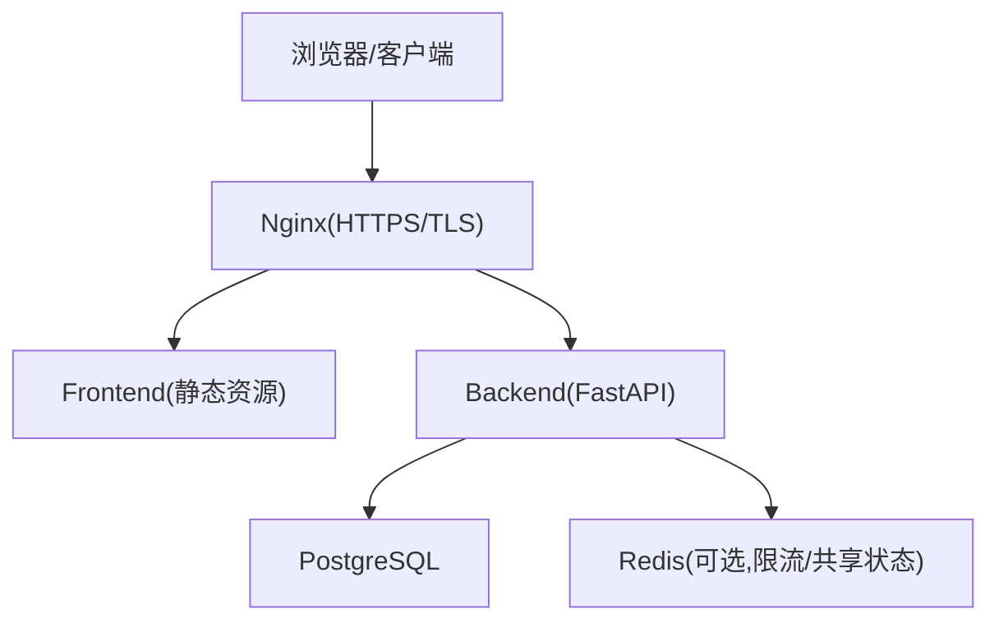
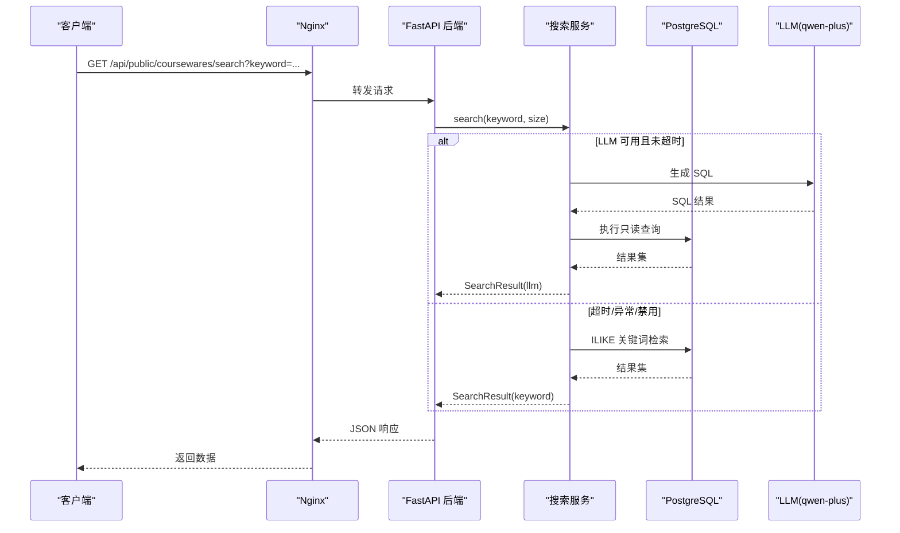
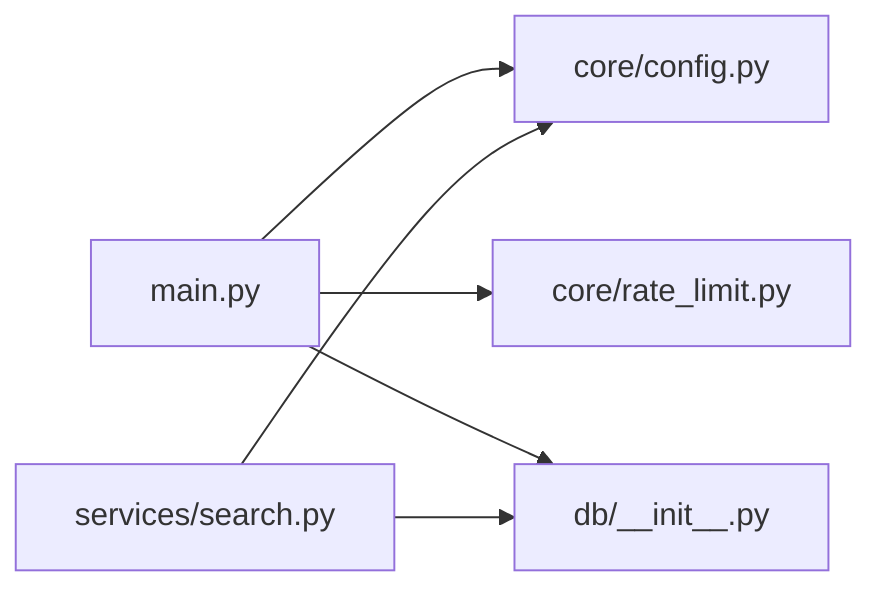

# 性能优化

<cite>
**本文引用的文件**   
- [backend/app/main.py](file://backend/app/main.py)
- [backend/app/core/config.py](file://backend/app/core/config.py)
- [backend/app/db/__init__.py](file://backend/app/db/__init__.py)
- [backend/app/core/rate_limit.py](file://backend/app/core/rate_limit.py)
- [backend/app/services/search.py](file://backend/app/services/search.py)
- [frontend/vite.config.ts](file://frontend/vite.config.ts)
- [frontend/package.json](file://frontend/package.json)
- [doc/spec/06-非功能需求.md](file://doc/spec/06-非功能需求.md)
- [doc/spec/07-技术架构.md](file://doc/spec/07-技术架构.md)
- [deploy/ecs/compose.yml](file://deploy/ecs/compose.yml)
- [deploy/ecs/nginx-vhost.snippet](file://deploy/ecs/nginx-vhost.snippet)
</cite>

## 目录
1. [引言](#引言)
2. [项目结构](#项目结构)
3. [核心组件](#核心组件)
4. [架构总览](#架构总览)
5. [详细组件分析](#详细组件分析)
6. [依赖分析](#依赖分析)
7. [性能考虑](#性能考虑)
8. [故障排查指南](#故障排查指南)
9. [结论](#结论)
10. [附录](#附录)

## 引言
本指南面向 Learning Hub 的性能优化，覆盖后端数据库与缓存、异步处理、前端构建与资源加载、系统级监控与指标、高并发调优、水平扩展与负载均衡、CDN 与静态资源优化，以及性能测试与回归检测。内容基于仓库现有实现与配置进行提炼，并给出可落地的优化建议与图示说明。

## 项目结构
Learning Hub 采用前后端分离：
- 后端：FastAPI + SQLAlchemy（同步引擎适配 Alembic）+ SlowAPI 限流 + Redis（可选）作为共享计数；通过环境变量集中配置。
- 前端：React + Vite 构建，生产产物由 Nginx 提供，反向代理 /api 到后端。
- 部署：Docker Compose/Swarm 编排，Nginx 终结 TLS 并统一入口。

图表来源
- [deploy/ecs/nginx-vhost.snippet:25-55](file://deploy/ecs/nginx-vhost.snippet#L25-L55)
- [deploy/ecs/compose.yml:38-78](file://deploy/ecs/compose.yml#L38-L78)
- [backend/app/main.py:40-112](file://backend/app/main.py#L40-L112)

章节来源
- [doc/spec/07-技术架构.md:47-94](file://doc/spec/07-技术架构.md#L47-L94)
- [deploy/ecs/compose.yml:38-78](file://deploy/ecs/compose.yml#L38-L78)

## 核心组件
- 应用装配与中间件：CORS、请求 ID、限流异常处理、路由注册。
- 配置中心：从环境变量加载，包含数据库连接串、JWT、CORS、LLM 开关与超时等。
- 数据库层：SQLAlchemy 同步引擎、连接池参数、Session 工厂与依赖注入。
- 限流模块：SlowAPI 集成，支持 IP/会话键，内存或 Redis 存储。
- 搜索服务：LLM NL2SQL 调用带超时降级为关键词检索。
- 前端构建：Vite 插件、依赖预构建优化、worker 格式、开发代理与构建目标。

章节来源
- [backend/app/main.py:40-112](file://backend/app/main.py#L40-L112)
- [backend/app/core/config.py:9-87](file://backend/app/core/config.py#L9-L87)
- [backend/app/db/__init__.py:15-32](file://backend/app/db/__init__.py#L15-L32)
- [backend/app/core/rate_limit.py:40-54](file://backend/app/core/rate_limit.py#L40-L54)
- [backend/app/services/search.py:225-242](file://backend/app/services/search.py#L225-L242)
- [frontend/vite.config.ts:12-37](file://frontend/vite.config.ts#L12-L37)

## 架构总览
下图展示一次前台 AI 搜索的关键流程，体现 LLM 调用超时与关键词兜底策略。

图表来源
- [backend/app/services/search.py:225-242](file://backend/app/services/search.py#L225-L242)
- [doc/spec/07-技术架构.md:71-77](file://doc/spec/07-技术架构.md#L71-L77)

## 详细组件分析

### 后端性能优化策略

#### 数据库连接与查询优化
- 连接池参数：针对 PostgreSQL/MySQL 启用 pool_size 与 max_overflow；SQLite 使用 StaticPool 以兼容多线程测试场景。
- 健康检查：开启 pool_pre_ping 避免僵尸连接。
- Session 生命周期：每个请求一个 Session，自动关闭释放。
- 查询优化建议：
  - 在高频过滤字段建立索引（如分类、标签、标题）。
  - 分页限制 size，避免大结果集传输。
  - 对模糊搜索优先使用 ILIKE 的合适索引策略或后续引入专用搜索引擎。

章节来源
- [backend/app/db/__init__.py:15-32](file://backend/app/db/__init__.py#L15-L32)

#### 缓存策略设计
- 当前实现中未内置通用缓存层，但具备接入条件：
  - 限流已支持 Redis 作为共享存储，可作为热点数据缓存的基础设施。
  - 建议在接口层增加多级缓存：本地内存短 TTL + Redis 长 TTL，注意一致性策略与失效机制。
  - 对搜索结果、课件详情等读多写少接口优先考虑缓存命中。

章节来源
- [backend/app/core/rate_limit.py:40-54](file://backend/app/core/rate_limit.py#L40-L54)

#### 异步处理机制
- 搜索服务将 LLM 调用封装为异步任务，设置超时时间，失败或超时时回退到关键词检索，保障可用性。
- 对于 CPU 密集或耗时操作（如 PPT 转 PDF），建议引入消息队列（Celery/RQ）与独立工作进程，避免阻塞主事件循环。

章节来源
- [backend/app/services/search.py:225-242](file://backend/app/services/search.py#L225-L242)
- [doc/spec/07-技术架构.md:201-221](file://doc/spec/07-技术架构.md#L201-L221)

#### 限流与保护
- 基于 SlowAPI 的限流，支持按 IP 或会话键，存储后端可切换至 Redis 以支持多 worker 共享计数。
- 关键接口建议精细化限流策略，防止恶意刷量与突发流量冲击。

章节来源
- [backend/app/core/rate_limit.py:40-54](file://backend/app/core/rate_limit.py#L40-L54)

### 前端性能优化技术

#### 代码分割与懒加载
- 使用 React.lazy 与动态 import 对重型页面（如 viewer 子模块）进行按需加载，减少首屏体积。
- 结合路由拆分，确保仅在访问对应路径时加载相关 chunk。

#### 资源压缩与构建优化
- Vite 构建目标 es2022，关闭 sourcemap 以减少产物大小。
- 排除 pdfjs-dist 预构建，交由运行时动态加载以避免 HMR 卡顿。
- 复制 pdf.worker.min.mjs 到 dist 根目录，确保 PDF.js worker 可被正确加载。

章节来源
- [frontend/vite.config.ts:12-37](file://frontend/vite.config.ts#L12-L37)
- [frontend/package.json:6-12](file://frontend/package.json#L6-L12)

#### 浏览器缓存优化
- 利用 Nginx 对静态资源设置长期缓存头（Cache-Control、ETag），配合 Vite 文件名哈希实现强缓存。
- 对 HTML 与 API 响应设置较短缓存或无缓存，保证更新及时。

章节来源
- [deploy/ecs/nginx-vhost.snippet:25-55](file://deploy/ecs/nginx-vhost.snippet#L25-L55)

### 系统级性能监控

#### APM 工具集成与关键指标
- 非功能需求定义了关键指标基线：HTTP 请求时长（P95）、数据库查询时长（P95）、LLM 调用时长与超时率、上传时长、错误率等。
- 建议接入 Prometheus/Grafana 采集指标，暴露 /metrics 端点，结合日志中的 X-Request-Id 进行链路追踪。

章节来源
- [doc/spec/06-非功能需求.md:125-136](file://doc/spec/06-非功能需求.md#L125-L136)

#### 性能瓶颈识别
- 通过慢查询日志定位数据库瓶颈。
- 通过 APM 查看接口耗时分布，识别热点接口与外部依赖延迟。
- 关注 LLM 超时率，必要时调整超时阈值或增强降级策略。

### 高并发场景下的性能调优

#### 连接池配置
- 根据 QPS 与平均响应时间估算所需连接数，合理设置 pool_size 与 max_overflow。
- 在多 worker 部署下，确保数据库最大连接数满足所有 worker 的峰值需求。

章节来源
- [backend/app/db/__init__.py:15-32](file://backend/app/db/__init__.py#L15-L32)

#### 线程池与进程模型
- FastAPI 基于 ASGI，建议使用多进程（uvicorn workers）提升并发能力。
- 对 CPU 密集型任务隔离到独立进程或工作节点，避免 GIL 影响。

章节来源
- [doc/spec/07-技术架构.md:201-221](file://doc/spec/07-技术架构.md#L201-L221)

#### 内存优化
- 控制单次查询结果集大小，避免大对象驻留内存。
- 合理使用缓存 TTL，避免缓存膨胀。

### 负载均衡与水平扩展

#### 无状态服务设计
- 后端保持无状态，会话与限流计数外置至 Redis，便于横向扩展。
- 通过 Swarm/Docker Compose 的 replicas 快速扩容。

章节来源
- [deploy/ecs/compose.yml:38-78](file://deploy/ecs/compose.yml#L38-L78)

#### 分布式缓存策略
- 使用 Redis 作为共享缓存与限流存储，保证多实例一致性与高可用。
- 热点数据分层缓存：本地内存 + Redis，注意一致性策略与失效。

章节来源
- [backend/app/core/rate_limit.py:40-54](file://backend/app/core/rate_limit.py#L40-L54)

### CDN 集成与静态资源优化

#### CDN 最佳实践
- 将前端静态资源（JS/CSS/图片）托管至 CDN，开启 gzip/brotli 压缩与 HTTP/2。
- 使用域名分片与预连接，降低 DNS 解析与握手开销。
- 对 HTML 使用短缓存或无缓存，确保版本更新即时生效。

章节来源
- [deploy/ecs/nginx-vhost.snippet:25-55](file://deploy/ecs/nginx-vhost.snippet#L25-L55)

### 性能测试方法与回归检测

#### 基准与压测
- 使用 JMeter/Locust 对关键接口进行压测，关注 P95/P99 延迟与错误率。
- 前端使用 Lighthouse 评估首屏性能，纳入 CI 门禁。

章节来源
- [doc/test/test-cases-integration.md:315-326](file://doc/test/test-cases-integration.md#L315-L326)

#### 回归检测机制
- 在 CI 中集成性能用例，对比历史基线，超过阈值则阻断发布。
- 结合 E2E 测试验证关键路径行为与性能表现。

章节来源
- [doc/test/test-cases-integration.md:315-326](file://doc/test/test-cases-integration.md#L315-L326)

## 依赖分析
后端依赖关系如下：

图表来源
- [backend/app/main.py:40-112](file://backend/app/main.py#L40-L112)
- [backend/app/core/config.py:9-87](file://backend/app/core/config.py#L9-L87)
- [backend/app/core/rate_limit.py:40-54](file://backend/app/core/rate_limit.py#L40-L54)
- [backend/app/db/__init__.py:15-32](file://backend/app/db/__init__.py#L15-L32)
- [backend/app/services/search.py:225-242](file://backend/app/services/search.py#L225-L242)

章节来源
- [backend/app/main.py:40-112](file://backend/app/main.py#L40-L112)
- [backend/app/core/config.py:9-87](file://backend/app/core/config.py#L9-L87)
- [backend/app/core/rate_limit.py:40-54](file://backend/app/core/rate_limit.py#L40-L54)
- [backend/app/db/__init__.py:15-32](file://backend/app/db/__init__.py#L15-L32)
- [backend/app/services/search.py:225-242](file://backend/app/services/search.py#L225-L242)

## 性能考虑
- 数据库：索引优化、分页限制、连接池容量规划、慢查询治理。
- 缓存：多级缓存、TTL 策略、热点数据预热。
- 异步：LLM 调用超时与降级、耗时任务异步化。
- 前端：代码分割、懒加载、资源压缩、浏览器缓存。
- 监控：指标采集、日志结构化、告警阈值。
- 高并发：多进程、连接池、内存管理。
- 扩展：无状态服务、分布式缓存、负载均衡。
- CDN：静态资源加速、压缩与缓存策略。
- 测试：基准压测、性能回归门禁。

[本节为通用指导，不直接分析具体文件]

## 故障排查指南
- 限流触发：检查 SlowAPI 配置与 Redis 连通性，确认 key 构造是否符合预期。
- 数据库连接异常：观察 pool_pre_ping 与健康检查，核对连接池上限与数据库最大连接数。
- LLM 超时：调整超时阈值，检查网络与外部服务状态，确认降级逻辑是否生效。
- 前端资源加载失败：确认 pdf.worker.min.mjs 路径与 Nginx 静态资源映射是否正确。

章节来源
- [backend/app/core/rate_limit.py:40-54](file://backend/app/core/rate_limit.py#L40-L54)
- [backend/app/db/__init__.py:15-32](file://backend/app/db/__init__.py#L15-L32)
- [backend/app/services/search.py:225-242](file://backend/app/services/search.py#L225-L242)
- [frontend/vite.config.ts:12-37](file://frontend/vite.config.ts#L12-L37)

## 结论
通过合理的数据库连接与查询优化、缓存策略、异步处理、前端构建与资源优化、系统监控与压测、高并发调优与水平扩展方案，Learning Hub 可在保证可用性的前提下显著提升性能与稳定性。建议在生产环境逐步落地上述优化，并结合监控与回归检测持续改进。

[本节为总结，不直接分析具体文件]

## 附录
- 非功能指标基线与告警阈值参考：
  - HTTP 请求时长（P95）、数据库查询时长（P95）、LLM 调用时长与超时率、上传时长、错误率等。
- 部署形态与演进建议：
  - 单实例 Docker 部署 → 模块化拆分 → RBAC → 独立搜索服务 → 学习者侧能力。

章节来源
- [doc/spec/06-非功能需求.md:125-136](file://doc/spec/06-非功能需求.md#L125-L136)
- [doc/spec/07-技术架构.md:201-221](file://doc/spec/07-技术架构.md#L201-L221)