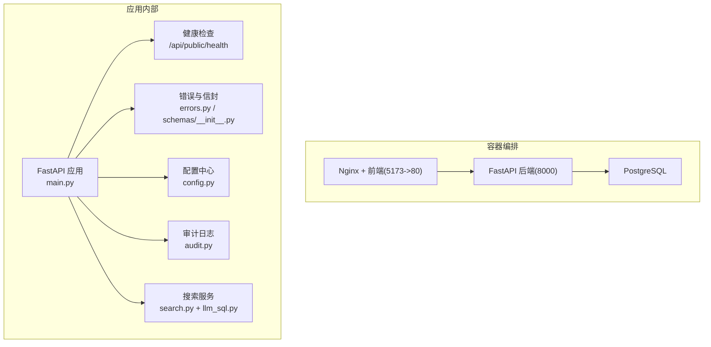
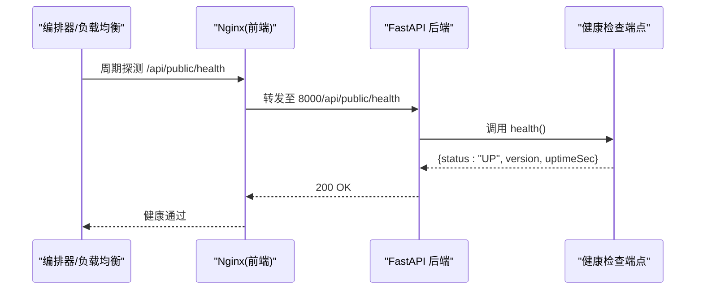
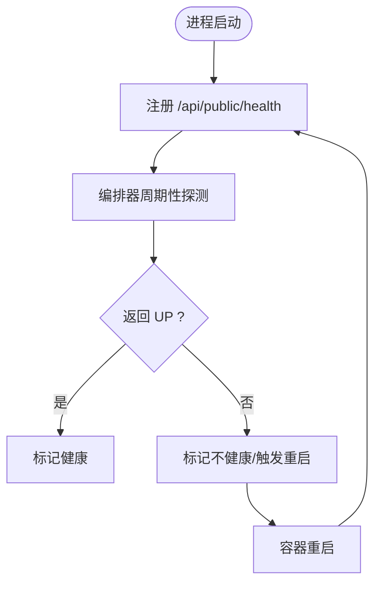
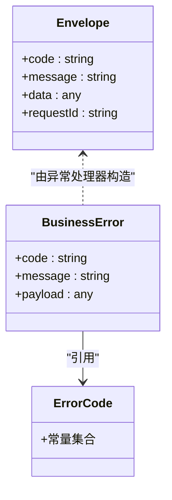
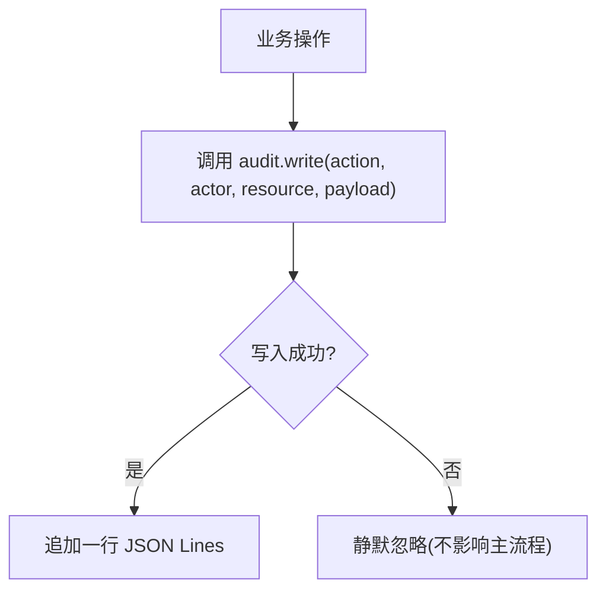
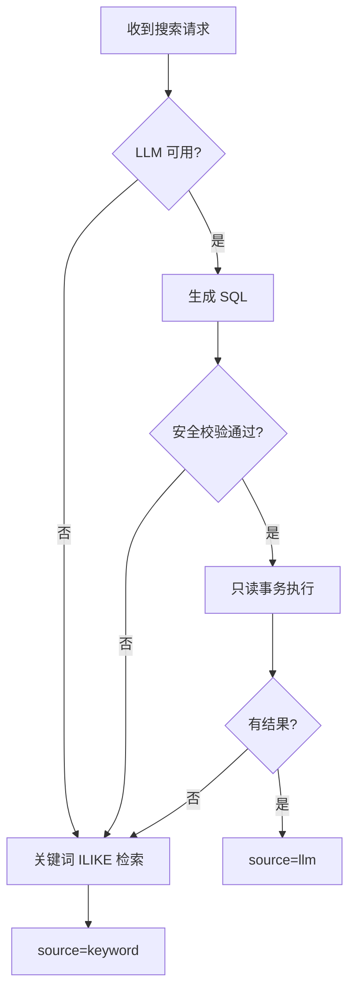
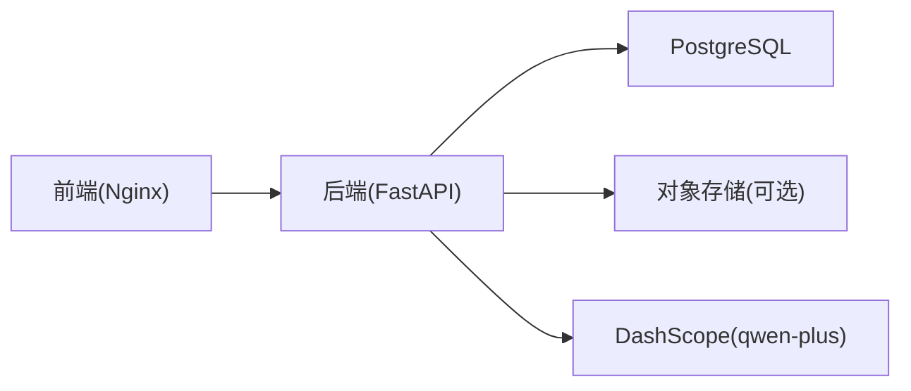

# 系统监控与诊断

<cite>
**本文引用的文件**   
- [backend/app/main.py](file://backend/app/main.py)
- [backend/app/api/public/health.py](file://backend/app/api/public/health.py)
- [backend/app/core/config.py](file://backend/app/core/config.py)
- [backend/app/core/errors.py](file://backend/app/core/errors.py)
- [backend/app/schemas/__init__.py](file://backend/app/schemas/__init__.py)
- [backend/app/services/audit.py](file://backend/app/services/audit.py)
- [backend/app/services/search.py](file://backend/app/services/search.py)
- [backend/app/services/llm_sql.py](file://backend/app/services/llm_sql.py)
- [backend/Dockerfile](file://backend/Dockerfile)
- [deploy/local/docker-compose.yml](file://deploy/local/docker-compose.yml)
- [doc/spec/06-非功能需求.md](file://doc/spec/06-非功能需求.md)
- [doc/test/test-cases-integration.md](file://doc/test/test-cases-integration.md)
</cite>

## 目录
1. [引言](#引言)
2. [项目结构](#项目结构)
3. [核心组件](#核心组件)
4. [架构总览](#架构总览)
5. [详细组件分析](#详细组件分析)
6. [依赖关系分析](#依赖关系分析)
7. [性能考量](#性能考量)
8. [故障诊断指南](#故障诊断指南)
9. [结论](#结论)
10. [附录](#附录)

## 引言
本指南面向 Learning Hub 的运维与研发人员，系统化说明当前系统的可观测性与诊断能力现状，并给出基于现有代码与规范的落地建议。内容覆盖：
- APM 集成（Prometheus 指标、Grafana 面板与告警）
- 日志管理（结构化日志、审计日志、聚合与分析）
- 健康检查端点设计（服务状态、依赖健康、自动重启）
- 性能瓶颈识别（CPU/内存、数据库慢查询、网络 I/O）
- 分布式追踪（请求链路追踪、跨服务调用、热点定位）
- 故障诊断工具与调试技巧（热重载、远程调试、剖析）
- 性能回归检测与自动化测试中的性能验证

## 项目结构
后端采用 FastAPI + SQLAlchemy + Alembic，前端为 React + Vite；本地通过 docker-compose 启动 Postgres、后端与前端。关键监控相关位置：
- 应用入口与中间件：统一请求 ID、CORS、限流异常处理、路由注册
- 健康检查：公开 /api/public/health
- 配置：日志级别、CORS、LLM 开关等
- 错误体系：业务错误码与 HTTP 映射、统一信封响应
- 审计日志：JSON Lines 格式落盘
- 搜索服务：LLM-to-SQL 优先 + ILIKE 兜底，含超时降级
- 容器化：Dockerfile 内置健康检查、端口暴露、存储卷挂载
- 编排：docker-compose 中各服务的 healthcheck 与依赖顺序

图表来源
- [backend/app/main.py:40-116](file://backend/app/main.py#L40-L116)
- [backend/app/api/public/health.py:1-26](file://backend/app/api/public/health.py#L1-L26)
- [backend/app/core/config.py:1-88](file://backend/app/core/config.py#L1-L88)
- [backend/app/core/errors.py:1-144](file://backend/app/core/errors.py#L1-L144)
- [backend/app/schemas/__init__.py:46-64](file://backend/app/schemas/__init__.py#L46-L64)
- [backend/app/services/audit.py:1-45](file://backend/app/services/audit.py#L1-L45)
- [backend/app/services/search.py:1-36](file://backend/app/services/search.py#L1-L36)

章节来源
- [backend/app/main.py:40-116](file://backend/app/main.py#L40-L116)
- [backend/app/api/public/health.py:1-26](file://backend/app/api/public/health.py#L1-L26)
- [backend/app/core/config.py:1-88](file://backend/app/core/config.py#L1-L88)
- [backend/app/core/errors.py:1-144](file://backend/app/core/errors.py#L1-L144)
- [backend/app/schemas/__init__.py:46-64](file://backend/app/schemas/__init__.py#L46-L64)
- [backend/app/services/audit.py:1-45](file://backend/app/services/audit.py#L1-L45)
- [backend/app/services/search.py:1-36](file://backend/app/services/search.py#L1-L36)

## 核心组件
- 健康检查端点
  - 提供 Liveness 探针，返回服务版本与运行时长，供 K8s/负载均衡器探测。
  - 被 Dockerfile 与 docker-compose 的 healthcheck 使用，实现自动重启策略。
- 统一错误与信封
  - 业务错误码集中定义，HTTP 状态码映射清晰；全局异常处理器将 requestId 注入响应头与信封体。
- 配置中心
  - 从环境变量加载，包含日志级别、CORS、LLM 开关等；支持 .env 覆盖。
- 审计日志
  - JSON Lines 格式写入 storage/logs/audit.jsonl，失败不阻塞主流程。
- 搜索服务
  - LLM-to-SQL 优先，失败或禁用时回退到关键词 ILIKE；记录 source 字段便于前端展示与观测。

章节来源
- [backend/app/api/public/health.py:1-26](file://backend/app/api/public/health.py#L1-L26)
- [backend/app/core/errors.py:1-144](file://backend/app/core/errors.py#L1-L144)
- [backend/app/schemas/__init__.py:46-64](file://backend/app/schemas/__init__.py#L46-L64)
- [backend/app/core/config.py:1-88](file://backend/app/core/config.py#L1-L88)
- [backend/app/services/audit.py:1-45](file://backend/app/services/audit.py#L1-L45)
- [backend/app/services/search.py:1-36](file://backend/app/services/search.py#L1-L36)

## 架构总览
下图展示了健康检查在容器编排中的应用，以及请求进入后端后的基本路径。

图表来源
- [backend/app/api/public/health.py:16-25](file://backend/app/api/public/health.py#L16-L25)
- [backend/Dockerfile:80-82](file://backend/Dockerfile#L80-L82)
- [deploy/local/docker-compose.yml:64-68](file://deploy/local/docker-compose.yml#L64-L68)

## 详细组件分析

### 健康检查与自动重启
- 健康检查端点
  - 返回统一信封，包含 status、version、uptimeSec，用于 Liveness 探测。
- 容器健康检查
  - Dockerfile 内嵌 HEALTHCHECK 定期访问 /api/public/health。
  - docker-compose 对 frontend 增加复合健康检查（同时探测根路径与健康端点），确保反向代理与后端均正常。
- 自动重启策略
  - compose 中 restart: unless-stopped 配合 healthcheck 可实现失败自愈。

图表来源
- [backend/app/api/public/health.py:16-25](file://backend/app/api/public/health.py#L16-L25)
- [backend/Dockerfile:80-82](file://backend/Dockerfile#L80-L82)
- [deploy/local/docker-compose.yml:64-68](file://deploy/local/docker-compose.yml#L64-L68)

章节来源
- [backend/app/api/public/health.py:1-26](file://backend/app/api/public/health.py#L1-L26)
- [backend/Dockerfile:80-82](file://backend/Dockerfile#L80-L82)
- [deploy/local/docker-compose.yml:64-68](file://deploy/local/docker-compose.yml#L64-L68)

### 错误处理与请求追踪
- 统一信封与业务错误码
  - BusinessError 携带 code/message/data，由全局异常处理器包装为 {code,message,data,requestId}。
- 请求 ID 透传
  - 中间件生成/透传 X-Request-Id，并在响应头与信封中附带，便于日志与链路关联。
- 限流异常处理
  - SlowAPI 限流异常统一返回 429 与友好消息。

图表来源
- [backend/app/core/errors.py:1-144](file://backend/app/core/errors.py#L1-L144)
- [backend/app/schemas/__init__.py:46-64](file://backend/app/schemas/__init__.py#L46-L64)
- [backend/app/main.py:70-89](file://backend/app/main.py#L70-L89)

章节来源
- [backend/app/core/errors.py:1-144](file://backend/app/core/errors.py#L1-L144)
- [backend/app/schemas/__init__.py:46-64](file://backend/app/schemas/__init__.py#L46-L64)
- [backend/app/main.py:70-89](file://backend/app/main.py#L70-L89)

### 日志系统与审计
- 应用日志
  - 基础日志框架按配置 log_level 初始化，输出格式包含时间、级别、模块与消息。
- 审计日志
  - audit.write 以 JSON Lines 追加写入 storage/logs/audit.jsonl，失败不抛错，避免影响主流程。
- 结构化要求
  - 规范文档要求服务端日志包含 X-Request-Id，便于跨服务对位。

图表来源
- [backend/app/services/audit.py:21-42](file://backend/app/services/audit.py#L21-L42)
- [doc/spec/06-非功能需求.md:125-136](file://doc/spec/06-非功能需求.md#L125-L136)

章节来源
- [backend/app/services/audit.py:1-45](file://backend/app/services/audit.py#L1-L45)
- [backend/app/core/config.py:72-74](file://backend/app/core/config.py#L72-L74)
- [doc/spec/06-非功能需求.md:125-136](file://doc/spec/06-非功能需求.md#L125-L136)

### 搜索服务与降级路径
- 搜索主流程
  - 优先 LLM-to-SQL 召回，校验通过后执行只读事务；失败或禁用则回退到关键词 ILIKE。
  - 返回结果包含 source 字段（llm/keyword），便于前端徽标与观测。
- 超时与不可用
  - 当外部 LLM 超时或不可用时，走降级路径，保证可用性。

图表来源
- [backend/app/services/search.py:1-36](file://backend/app/services/search.py#L1-L36)
- [backend/app/services/llm_sql.py:300-340](file://backend/app/services/llm_sql.py#L300-L340)
- [backend/app/services/llm_sql.py:400-410](file://backend/app/services/llm_sql.py#L400-L410)
- [backend/app/services/llm_sql.py:460-475](file://backend/app/services/llm_sql.py#L460-L475)

章节来源
- [backend/app/services/search.py:1-36](file://backend/app/services/search.py#L1-L36)
- [backend/app/services/llm_sql.py:300-340](file://backend/app/services/llm_sql.py#L300-L340)
- [backend/app/services/llm_sql.py:400-410](file://backend/app/services/llm_sql.py#L400-L410)
- [backend/app/services/llm_sql.py:460-475](file://backend/app/services/llm_sql.py#L460-L475)

## 依赖关系分析
- 运行时依赖
  - FastAPI、Uvicorn、SQLAlchemy、Alembic、psycopg2-binary、asyncpg、PyJWT、dashscope 等。
- 外部依赖
  - PostgreSQL、可选 Redis（限流）、LibreOffice/PDF.js/FFmpeg（素材处理）。
- 编排依赖
  - docker-compose 中 backend 依赖 postgres 健康；frontend 依赖 backend 健康。

图表来源
- [backend/pyproject.toml:8-25](file://backend/pyproject.toml#L8-L25)
- [deploy/local/docker-compose.yml:23-49](file://deploy/local/docker-compose.yml#L23-L49)

章节来源
- [backend/pyproject.toml:8-25](file://backend/pyproject.toml#L8-L25)
- [deploy/local/docker-compose.yml:23-49](file://deploy/local/docker-compose.yml#L23-L49)

## 性能考量
- 指标基线（来自规范）
  - 后台 CRUD P95 ≤ 300ms；搜索 P95 ≤ 2s（含 LLM 与降级）；单条 DB 查询 P95 ≤ 50ms；LLM 调用 P95 ≤ 1.5s；上传 P95 ≤ 60s（200MB）；5xx 错误率 ≤ 0.5%。
- 建议采集指标
  - HTTP 请求耗时分位、错误率、LLM 调用耗时与超时率、DB 查询耗时、上传耗时、令牌解锁失败率等。
- 建议告警规则
  - 5xx 错误率超过阈值持续 5 分钟；LLM 超时率超 5%；搜索 P95 超 2s；令牌解锁失败率超 30%。

章节来源
- [doc/spec/06-非功能需求.md:125-136](file://doc/spec/06-非功能需求.md#L125-L136)
- [doc/test/test-cases-integration.md:495-525](file://doc/test/test-cases-integration.md#L495-L525)

## 故障诊断指南
- 健康检查
  - 直接访问 /api/public/health 确认服务存活与运行时长；查看容器 healthcheck 日志。
- 日志排查
  - 应用日志：根据 log_level 调整输出；结合 X-Request-Id 进行请求级定位。
  - 审计日志：查看 storage/logs/audit.jsonl 获取关键管理操作轨迹。
- 错误码对照
  - 参考业务错误码与 HTTP 映射，快速定位问题类型（认证、权限、资源、限流、LLM 超时等）。
- 搜索降级
  - 若出现 source="keyword"，检查 DASHSCOPE_API_KEY 是否配置、LLM 是否超时或被安全校验拒绝。
- 容器与编排
  - 检查 docker-compose 的 healthcheck 与 restart 策略；必要时手动重启容器。

章节来源
- [backend/app/api/public/health.py:16-25](file://backend/app/api/public/health.py#L16-L25)
- [backend/app/core/config.py:72-74](file://backend/app/core/config.py#L72-L74)
- [backend/app/services/audit.py:21-42](file://backend/app/services/audit.py#L21-L42)
- [backend/app/core/errors.py:73-127](file://backend/app/core/errors.py#L73-L127)
- [backend/app/services/search.py:1-36](file://backend/app/services/search.py#L1-L36)
- [deploy/local/docker-compose.yml:64-68](file://deploy/local/docker-compose.yml#L64-L68)

## 结论
当前系统在健康检查、错误信封、审计日志与搜索降级方面具备良好基础。为满足生产级可观测性，建议：
- 引入 Prometheus 指标收集与 Grafana 可视化，建立告警规则
- 完善结构化日志（包含 requestId、userId、action、durationMs 等）
- 接入分布式追踪（如 OpenTelemetry），实现端到端链路追踪
- 建立性能回归检测与自动化测试中的性能断言

## 附录

### APM 集成建议（Prometheus + Grafana + 告警）
- 指标采集
  - 在应用层埋点：HTTP 请求耗时、错误率、LLM 调用耗时与超时率、DB 查询耗时、上传耗时、令牌解锁失败率等。
  - 暴露 /metrics 端点供 Prometheus 抓取。
- 可视化
  - 构建 Grafana 面板：概览（QPS、P95、错误率）、搜索链路（LLM vs keyword）、DB 慢查询、上传吞吐与时延。
- 告警规则
  - 5xx 错误率 > 5% 持续 5 分钟
  - LLM 超时率 > 5%（5 分钟滑动窗口）
  - 搜索 P95 > 2s
  - 令牌解锁失败率 > 30%（5 分钟滑动窗口）

章节来源
- [doc/test/test-cases-integration.md:495-525](file://doc/test/test-cases-integration.md#L495-L525)
- [doc/spec/06-非功能需求.md:125-136](file://doc/spec/06-非功能需求.md#L125-L136)

### 日志管理系统建议
- 结构化日志
  - 每条日志包含 ts、level、requestId、userId、action、durationMs 等字段，便于聚合与分析。
- 聚合与分析
  - 推荐 ELK/EFK 或 Loki+Grafana，统一采集容器 stdout 与审计日志文件。
- 审计日志
  - 保持 JSON Lines 格式，按天轮转，保留策略与脱敏规则明确。

章节来源
- [backend/app/services/audit.py:21-42](file://backend/app/services/audit.py#L21-L42)
- [doc/test/test-cases-integration.md:507-515](file://doc/test/test-cases-integration.md#L507-L515)

### 健康检查端点设计建议
- 服务状态
  - /api/public/health 返回 status、version、uptimeSec。
- 依赖健康
  - 可扩展为 readiness 探针，检查 DB、Redis、对象存储连通性。
- 自动重启
  - 容器编排中使用 healthcheck 与 restart: unless-stopped。

章节来源
- [backend/app/api/public/health.py:16-25](file://backend/app/api/public/health.py#L16-L25)
- [backend/Dockerfile:80-82](file://backend/Dockerfile#L80-L82)
- [deploy/local/docker-compose.yml:64-68](file://deploy/local/docker-compose.yml#L64-L68)

### 性能瓶颈识别方法
- CPU 与内存
  - 使用 cgroup 指标与语言剖析工具（如 py-spy、cProfile）定位热点。
- 数据库慢查询
  - 开启慢查询日志，结合 EXPLAIN 分析索引与执行计划。
- 网络 I/O
  - 关注 LLM 调用耗时与超时率，优化并发与重试策略。

[本节为通用指导，无需源码引用]

### 分布式追踪集成建议
- 请求链路追踪
  - 引入 OpenTelemetry，注入 trace_id 到请求头与日志，贯穿前端、网关、后端与下游服务。
- 跨服务调用监控
  - 对 LLM 调用、DB 查询、文件处理等关键路径打点，形成调用链图。
- 性能热点定位
  - 结合 Trace 与 Span 耗时，快速定位瓶颈环节。

[本节为通用指导，无需源码引用]

### 故障诊断工具与调试技巧
- 热重载配置
  - 开发环境启用 uvicorn 热重载；生产环境使用多 worker 提升吞吐。
- 远程调试
  - 在受控环境下启用调试端口，限制访问来源。
- 性能剖析
  - 使用 py-spy/cProfile 进行在线/离线剖析，结合 Trace 定位热点。

[本节为通用指导，无需源码引用]

### 性能回归检测与自动化测试中的性能验证
- 基准用例
  - 针对搜索、后台保存、Token 校验等接口设置 P95 阈值。
- 压测脚本
  - 使用 k6 编写场景脚本，纳入 CI 流水线，失败阻断发布。
- 指标对比
  - 与历史基线对比，发现性能回归及时回滚。

章节来源
- [doc/test/test-cases-integration.md:329-386](file://doc/test/test-cases-integration.md#L329-L386)