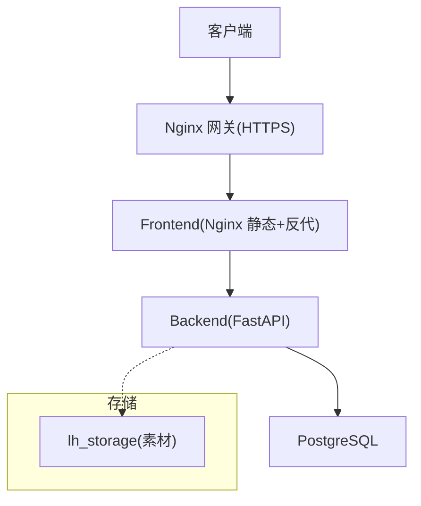
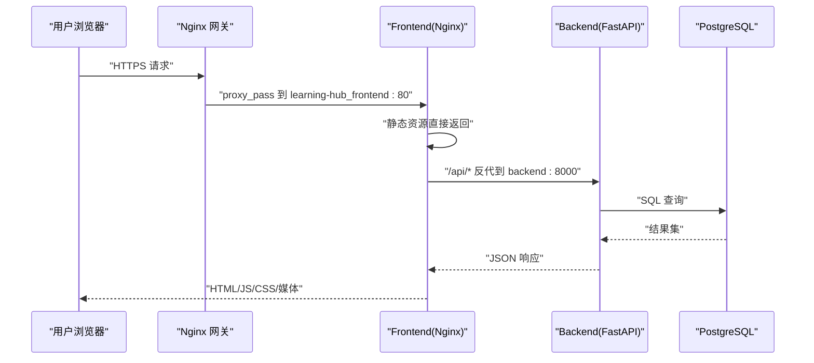
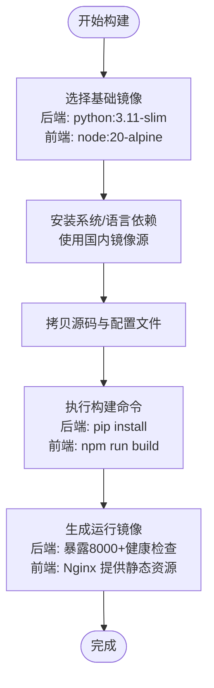
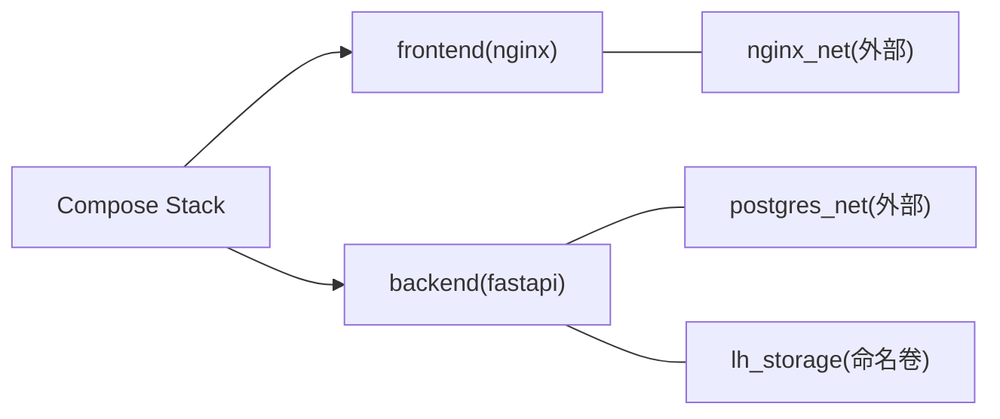
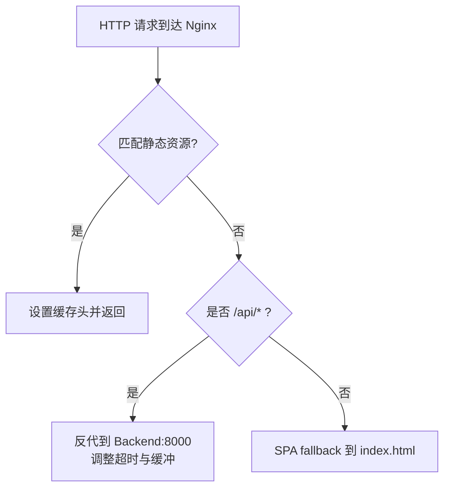
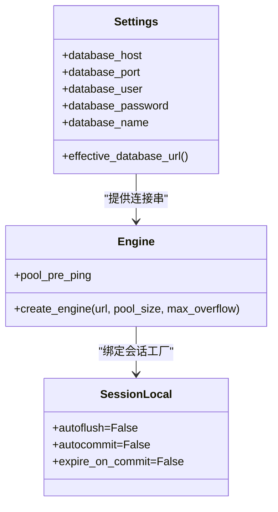
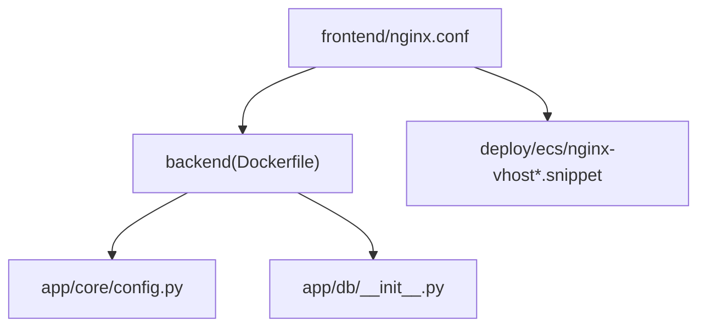

# 部署环境优化

<cite>
**本文引用的文件**   
- [backend/Dockerfile](file://backend/Dockerfile)
- [frontend/Dockerfile](file://frontend/Dockerfile)
- [frontend/nginx.conf](file://frontend/nginx.conf)
- [deploy/ecs/compose.yml](file://deploy/ecs/compose.yml)
- [deploy/local/docker-compose.yml](file://deploy/local/docker-compose.yml)
- [deploy/ecs/nginx-vhost.snippet](file://deploy/ecs/nginx-vhost.snippet)
- [deploy/ecs/nginx-vhost-http.snippet](file://deploy/ecs/nginx-vhost-http.snippet)
- [deploy/ecs/nginx-vhost-https.snippet](file://deploy/ecs/nginx-vhost-https.snippet)
- [backend/app/core/config.py](file://backend/app/core/config.py)
- [backend/app/db/__init__.py](file://backend/app/db/__init__.py)
- [deploy/ecs/db-init.sh](file://deploy/ecs/db-init.sh)
- [doc/spec/06-非功能需求.md](file://doc/spec/06-非功能需求.md)
- [doc/spec/07-技术架构.md](file://doc/spec/07-技术架构.md)
</cite>

## 目录
1. [简介](#简介)
2. [项目结构](#项目结构)
3. [核心组件](#核心组件)
4. [架构总览](#架构总览)
5. [详细组件分析](#详细组件分析)
6. [依赖关系分析](#依赖关系分析)
7. [性能考虑](#性能考虑)
8. [故障排查指南](#故障排查指南)
9. [结论](#结论)
10. [附录](#附录)

## 简介
本指南面向 Learning Hub 的部署与运维，聚焦于生产环境的稳定性、可扩展性与可观测性。内容覆盖：
- Docker 镜像优化（多阶段构建、镜像层优化、基础镜像选择）
- 容器编排优化（Docker Compose 调优、资源限制、服务通信）
- Nginx 反向代理优化（静态缓存、Gzip、大文件上传与负载均衡）
- CDN 集成方案（静态分发、边缘缓存、回源策略）
- 数据库性能调优（PostgreSQL 参数、连接池、查询计划）
- 高可用架构（主从复制、读写分离、故障转移）
- 弹性伸缩（水平扩展、自动扩缩容、容量规划）
- 部署流水线优化（CI/CD 加速、蓝绿部署、灰度发布）

## 项目结构
Learning Hub 采用前后端分离与容器化部署：
- 后端：FastAPI + SQLAlchemy + Alembic，运行在 Python 3.11 slim 基础镜像中，内置健康检查与健康探针。
- 前端：Vite + React 构建产物由 Nginx 提供静态资源，并反代 /api 到后端。
- 编排：本地使用 docker-compose；ECS 使用 Swarm v3.8 compose stack，复用外部网络与持久卷。
- 入口：Nginx 网关统一暴露 HTTPS，内部通过 upstream 转发至 frontend 服务。

**图示来源** 
- [deploy/ecs/nginx-vhost.snippet:1-56](file://deploy/ecs/nginx-vhost.snippet#L1-L56)
- [deploy/ecs/compose.yml:27-78](file://deploy/ecs/compose.yml#L27-L78)
- [frontend/nginx.conf:1-56](file://frontend/nginx.conf#L1-L56)
- [backend/Dockerfile:78-84](file://backend/Dockerfile#L78-L84)

**章节来源**
- [deploy/ecs/compose.yml:1-79](file://deploy/ecs/compose.yml#L1-L79)
- [deploy/local/docker-compose.yml:1-74](file://deploy/local/docker-compose.yml#L1-L74)
- [frontend/nginx.conf:1-56](file://frontend/nginx.conf#L1-L56)

## 核心组件
- 后端镜像：基于 python:3.11-slim，安装系统依赖（LibreOffice、Poppler、FFmpeg、字体），Python 依赖固定版本，暴露 8000 端口，内置健康检查。
- 前端镜像：Node 20 Alpine 构建，Nginx 1.27 Alpine 运行时，提供静态资源与 /api 反代。
- 配置中心：Settings 集中管理数据库、JWT、CORS、时区、存储路径、PPT 转换、限流/Redis、LLM 开关等。
- 数据库连接：SQLAlchemy 引擎根据 URL 类型动态设置连接池参数，默认 pool_size=10, max_overflow=20。

**章节来源**
- [backend/Dockerfile:1-85](file://backend/Dockerfile#L1-L85)
- [frontend/Dockerfile:1-23](file://frontend/Dockerfile#L1-L23)
- [backend/app/core/config.py:1-88](file://backend/app/core/config.py#L1-L88)
- [backend/app/db/__init__.py:1-51](file://backend/app/db/__init__.py#L1-L51)

## 架构总览
下图展示 ECS 上 Swarm Stack 的访问链路：外部流量经 Nginx 网关进入 frontend 容器，再由其内 Nginx 将 /api 请求反代到 backend 服务，最终访问 PostgreSQL。

**图示来源** 
- [deploy/ecs/nginx-vhost.snippet:24-55](file://deploy/ecs/nginx-vhost.snippet#L24-L55)
- [frontend/nginx.conf:25-42](file://frontend/nginx.conf#L25-L42)
- [deploy/ecs/compose.yml:27-78](file://deploy/ecs/compose.yml#L27-L78)

## 详细组件分析

### Docker 镜像优化
- 多阶段构建
  - 后端：构建期安装系统依赖与 Python 包，运行期仅包含应用与必要二进制，减小体积。
  - 前端：Node 构建产物复制到 Nginx 镜像，运行时仅含静态资源与 Nginx。
- 镜像层优化
  - 合并 apt-get 安装与清理，避免中间层冗余。
  - 使用国内镜像源加速 Debian 与 PyPI 下载。
  - 固定依赖版本，提升构建可重复性与缓存命中。
- 基础镜像选择
  - 后端：python:3.11-slim，兼顾体积与兼容性。
  - 前端：node:20-alpine 构建 + nginx:1.27-alpine 运行，最小化运行时。
- 健康检查
  - 后端：/api/public/health
  - 前端：/ 根路径

**图示来源** 
- [backend/Dockerfile:1-85](file://backend/Dockerfile#L1-L85)
- [frontend/Dockerfile:1-23](file://frontend/Dockerfile#L1-L23)

**章节来源**
- [backend/Dockerfile:1-85](file://backend/Dockerfile#L1-L85)
- [frontend/Dockerfile:1-23](file://frontend/Dockerfile#L1-L23)

### 容器编排优化
- 网络与持久化
  - 复用外部 overlay 网络（postgres_net、nginx_net）与命名卷 lh_storage。
- 服务通信
  - frontend 容器内 Nginx 将 /api 反代到同 stack 内的 backend 服务（Swarm DNS）。
- 健康检查与重启策略
  - 后端：镜像内置 HEALTHCHECK。
  - 前端：compose 层补充健康检查，验证静态与 API 可达。
- 部署约束
  - 当前 replicas=1，placement 约束在 manager 节点，便于单节点演示与排障。

**图示来源** 
- [deploy/ecs/compose.yml:14-26](file://deploy/ecs/compose.yml#L14-L26)
- [deploy/ecs/compose.yml:27-78](file://deploy/ecs/compose.yml#L27-L78)

**章节来源**
- [deploy/ecs/compose.yml:1-79](file://deploy/ecs/compose.yml#L1-L79)
- [deploy/local/docker-compose.yml:1-74](file://deploy/local/docker-compose.yml#L1-L74)

### Nginx 反向代理优化
- 静态资源缓存
  - 对 js/css/svg/png/jpg/woff2 等设置长期缓存与 immutable。
  - PDF.js worker 明确 MIME 并设置合理缓存。
- Gzip 压缩
  - 启用 gzip 并指定文本类 MIME 类型。
- 大文件上传
  - 提高 client_max_body_size、client_body_timeout、proxy_send/read_timeout，关闭 proxy_request_buffering 以边收边转。
- 负载均衡
  - 网关层 upstream 指向 frontend 服务，未来可按需增加多个实例实现轮询或加权。

**图示来源** 
- [frontend/nginx.conf:16-55](file://frontend/nginx.conf#L16-L55)
- [deploy/ecs/nginx-vhost-https.snippet:22-41](file://deploy/ecs/nginx-vhost-https.snippet#L22-L41)

**章节来源**
- [frontend/nginx.conf:1-56](file://frontend/nginx.conf#L1-L56)
- [deploy/ecs/nginx-vhost.snippet:1-56](file://deploy/ecs/nginx-vhost.snippet#L1-L56)
- [deploy/ecs/nginx-vhost-http.snippet:1-12](file://deploy/ecs/nginx-vhost-http.snippet#L1-L12)
- [deploy/ecs/nginx-vhost-https.snippet:1-42](file://deploy/ecs/nginx-vhost-https.snippet#L1-L42)

### CDN 集成方案
- 静态资源分发
  - 将前端构建产物托管至对象存储/CDN，域名与路径与 Nginx 一致，减少回源。
- 边缘缓存配置
  - 为静态资源设置长缓存与 immutable，确保变更时通过文件名哈希更新。
- 回源策略优化
  - 网关层保留 /api 反代到后端，静态资源全部走 CDN；必要时开启条件回源与缓存失效接口。
- 安全与一致性
  - 保持与现有 Nginx 一致的请求头与安全头策略，确保跨域与鉴权行为不变。

[本节为概念性说明，不直接分析具体代码文件]

### 数据库性能调优
- 连接池配置
  - 非 SQLite 场景下，pool_size=10, max_overflow=20，配合 pool_pre_ping 保障连接健康。
- 连接串优先级
  - 优先 DATABASE_URL，否则拼接 host/port/user/password/name。
- 迁移与初始化
  - 通过 db-init.sh 幂等创建数据库，复用已有用户，避免权限问题。
- 建议（通用指导）
  - 结合负载评估调整 pool_size/max_overflow；监控慢查询与锁等待；定期 ANALYZE 统计信息。

**图示来源** 
- [backend/app/core/config.py:19-38](file://backend/app/core/config.py#L19-L38)
- [backend/app/db/__init__.py:15-32](file://backend/app/db/__init__.py#L15-L32)

**章节来源**
- [backend/app/core/config.py:1-88](file://backend/app/core/config.py#L1-L88)
- [backend/app/db/__init__.py:1-51](file://backend/app/db/__init__.py#L1-L51)
- [deploy/ecs/db-init.sh:1-37](file://deploy/ecs/db-init.sh#L1-L37)

### 高可用架构设计
- 主从复制
  - 在独立 postgres stack 中部署主从，使用 WAL 同步保证数据一致性。
- 读写分离
  - 后端读多写少场景可将只读查询路由至从库；写操作仍走主库。
- 故障转移
  - 借助 VIP 或 DNS 切换，结合应用侧重试与熔断机制降低抖动影响。
- 注意
  - 当前仓库未内置主从配置，需在外部 postgres stack 中实施。

[本节为概念性说明，不直接分析具体代码文件]

### 弹性伸缩策略
- 水平扩展
  - 将 frontend 与 backend 的 replicas 提升至 N，利用 Swarm DNS 与服务发现进行负载均衡。
- 自动扩缩容
  - 基于 CPU/内存或自定义指标（如 QPS、队列长度）触发扩缩容。
- 容量规划
  - 参考非功能需求中的容量目标与延迟基线，结合压测确定副本数与资源配额。

**章节来源**
- [doc/spec/06-非功能需求.md:84-136](file://doc/spec/06-非功能需求.md#L84-L136)

### 部署流水线优化
- CI/CD 管道加速
  - 并行构建前后端镜像，缓存依赖层；推送镜像后远程 ECS 执行 stack deploy。
- 蓝绿部署
  - 新标签镜像部署为新 stack，切换域名或上游 upstream 指向新版本，失败快速回滚。
- 灰度发布
  - 按权重分流部分流量到新实例，观察错误率与延迟后再全量切换。

**章节来源**
- [doc/spec/07-技术架构.md:201-221](file://doc/spec/07-技术架构.md#L201-L221)

## 依赖关系分析
- 前端依赖后端 API，通过 Swarm DNS 解析 backend 服务名。
- 后端依赖 PostgreSQL 与可选 Redis（限流/缓存），通过环境变量注入连接信息。
- 外部 Nginx 网关作为统一入口，负责 TLS 终止与安全头。

**图示来源** 
- [frontend/nginx.conf:25-42](file://frontend/nginx.conf#L25-L42)
- [backend/app/core/config.py:1-88](file://backend/app/core/config.py#L1-L88)
- [backend/app/db/__init__.py:1-51](file://backend/app/db/__init__.py#L1-L51)
- [deploy/ecs/nginx-vhost.snippet:1-56](file://deploy/ecs/nginx-vhost.snippet#L1-L56)

**章节来源**
- [deploy/ecs/compose.yml:27-78](file://deploy/ecs/compose.yml#L27-L78)
- [frontend/nginx.conf:1-56](file://frontend/nginx.conf#L1-L56)
- [backend/app/core/config.py:1-88](file://backend/app/core/config.py#L1-L88)
- [backend/app/db/__init__.py:1-51](file://backend/app/db/__init__.py#L1-L51)

## 性能考虑
- 镜像体积与启动时间
  - 使用 slim/alpine 基础镜像，合并 RUN 指令，固定依赖版本。
- 网络与 I/O
  - 大文件上传禁用请求体缓冲，延长超时；静态资源启用缓存与 Gzip。
- 数据库
  - 合理设置连接池大小，监控慢查询与锁竞争；定期维护统计信息。
- 可观测性
  - 记录关键指标（请求耗时、错误率、LLM 调用耗时等），接入监控告警。

[本节提供通用指导，不直接分析具体代码文件]

## 故障排查指南
- 健康检查失败
  - 后端：检查 /api/public/health 可达性与日志。
  - 前端：确认静态资源与 /api 反代是否正常。
- 数据库连接异常
  - 校验环境变量与连接串；确认 db-init.sh 已创建数据库且权限正确。
- 大文件上传中断
  - 核对 Nginx 与后端超时配置，确认 proxy_request_buffering 关闭。
- LLM 搜索降级
  - 检查 DASHSCOPE_API_KEY 与超时阈值，确认降级到关键词检索逻辑生效。

**章节来源**
- [backend/Dockerfile:80-84](file://backend/Dockerfile#L80-L84)
- [deploy/local/docker-compose.yml:64-69](file://deploy/local/docker-compose.yml#L64-L69)
- [deploy/ecs/db-init.sh:1-37](file://deploy/ecs/db-init.sh#L1-L37)
- [frontend/nginx.conf:16-42](file://frontend/nginx.conf#L16-L42)
- [doc/spec/10-API设计规范.md:1009-1023](file://doc/spec/10-API设计规范.md#L1009-L1023)

## 结论
通过对镜像、编排、Nginx、CDN、数据库、高可用与弹性伸缩的系统性优化，Learning Hub 可在生产环境中获得更稳定的性能与更高的可用性。建议在上线前完成容量规划与压测，完善监控告警与回滚预案，逐步推进蓝绿与灰度发布，持续迭代优化。

## 附录
- 环境变量与配置项
  - 数据库：DATABASE_HOST/PORT/USER/PASSWORD/NAME 或 DATABASE_URL
  - JWT：JWT_SECRET/JWT_ALGORITHM/JWT_TTL_HOURS
  - CORS：CORS_ALLOW_ORIGINS
  - 存储：STORAGE_PATH
  - PPT 转换：LIBREOFFICE_PATH/POPPLER_PATH/PPT_CONVERT_TIMEOUT
  - 限流/Redis：STORAGE_REDIS_URL
  - LLM：DASHSCOPE_API_KEY/LLM_SEARCH_MODEL/LLM_SQL_TIMEOUT_SECONDS/LLM_SQL_MAX_ROWS
  - 日志：LOG_LEVEL

**章节来源**
- [backend/app/core/config.py:19-88](file://backend/app/core/config.py#L19-L88)