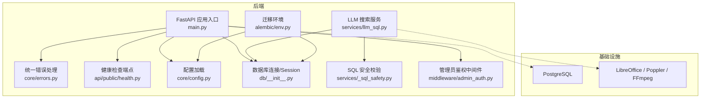
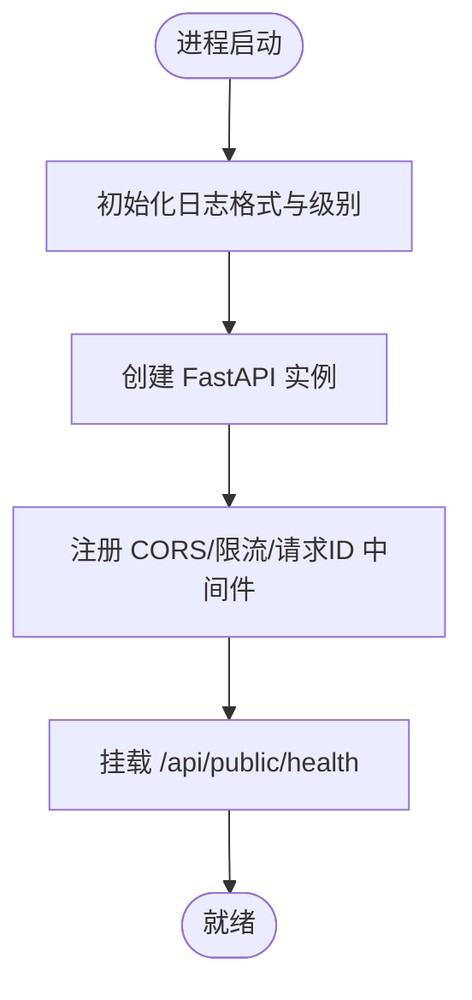
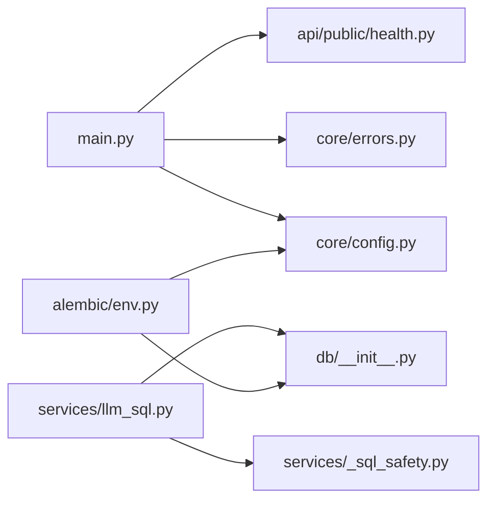

# 故障排除

<cite>
**本文引用的文件**   
- [backend/app/main.py](file://backend/app/main.py)
- [backend/app/core/errors.py](file://backend/app/core/errors.py)
- [backend/app/api/public/health.py](file://backend/app/api/public/health.py)
- [backend/app/core/config.py](file://backend/app/core/config.py)
- [backend/app/db/__init__.py](file://backend/app/db/__init__.py)
- [backend/alembic/env.py](file://backend/alembic/env.py)
- [backend/app/services/llm_sql.py](file://backend/app/services/llm_sql.py)
- [backend/app/services/_sql_safety.py](file://backend/app/services/_sql_safety.py)
- [backend/app/middleware/admin_auth.py](file://backend/app/middleware/admin_auth.py)
- [doc/spec/06-非功能需求.md](file://doc/spec/06-非功能需求.md)
- [doc/test/test-cases-integration.md](file://doc/test/test-cases-integration.md)
- [deploy/local/README.md](file://deploy/local/README.md)
- [backend/Dockerfile](file://backend/Dockerfile)
</cite>

## 目录
1. [简介](#简介)
2. [项目结构](#项目结构)
3. [核心组件](#核心组件)
4. [架构总览](#架构总览)
5. [详细组件分析](#详细组件分析)
6. [依赖关系分析](#依赖关系分析)
7. [性能考虑](#性能考虑)
8. [故障排除指南](#故障排除指南)
9. [结论](#结论)
10. [附录](#附录)

## 简介
本指南面向运维与研发人员，聚焦 Learning Hub 的常见故障定位与解决，覆盖环境、数据库连接、API 调用失败、日志分析与错误追踪、健康检查与监控告警、调试技巧与工具、生产应急响应流程以及性能问题诊断与优化建议。文档中的关键实现均映射到仓库源码位置，便于快速对照与验证。

## 项目结构
后端采用 FastAPI + SQLAlchemy（同步引擎适配 Alembic）+ Pydantic Settings 的配置体系；前端为 React + Vite；部署使用 Docker Compose/Nginx。与健康检查、错误处理、限流、配置加载、数据库连接等直接相关的代码集中在 backend/app 下。



图表来源
- [backend/app/main.py:1-116](file://backend/app/main.py#L1-L116)
- [backend/app/core/errors.py:1-144](file://backend/app/core/errors.py#L1-L144)
- [backend/app/api/public/health.py:1-26](file://backend/app/api/public/health.py#L1-L26)
- [backend/app/core/config.py:1-88](file://backend/app/core/config.py#L1-L88)
- [backend/app/db/__init__.py:1-51](file://backend/app/db/__init__.py#L1-L51)
- [backend/alembic/env.py:1-63](file://backend/alembic/env.py#L1-L63)
- [backend/app/services/llm_sql.py:1-490](file://backend/app/services/llm_sql.py#L1-L490)
- [backend/app/services/_sql_safety.py:1-220](file://backend/app/services/_sql_safety.py#L1-L220)
- [backend/app/middleware/admin_auth.py:39-65](file://backend/app/middleware/admin_auth.py#L39-L65)

章节来源
- [backend/app/main.py:1-116](file://backend/app/main.py#L1-L116)
- [backend/app/core/config.py:1-88](file://backend/app/core/config.py#L1-L88)
- [backend/app/db/__init__.py:1-51](file://backend/app/db/__init__.py#L1-L51)
- [backend/alembic/env.py:1-63](file://backend/alembic/env.py#L1-L63)

## 核心组件
- 应用入口与中间件：统一注入请求 ID、CORS、限流异常处理、业务异常封装响应信封。
- 健康检查：提供 Liveness 探针，返回版本与运行时长。
- 配置中心：从环境变量/.env 加载数据库、JWT、CORS、存储路径、PPT 转换、LLM 开关与超时等。
- 数据库连接：基于 SQLAlchemy 同步引擎，支持 SQLite 与 Postgres 连接池参数差异。
- LLM 搜索：qwen-plus NL2SQL + 7 道闸 SQL 白名单校验 + read-only 事务执行。
- 管理员鉴权：Admin JWT 签发与校验、明文 Admin Token 校验。

章节来源
- [backend/app/main.py:1-116](file://backend/app/main.py#L1-L116)
- [backend/app/api/public/health.py:1-26](file://backend/app/api/public/health.py#L1-L26)
- [backend/app/core/config.py:1-88](file://backend/app/core/config.py#L1-L88)
- [backend/app/db/__init__.py:1-51](file://backend/app/db/__init__.py#L1-L51)
- [backend/app/services/llm_sql.py:1-490](file://backend/app/services/llm_sql.py#L1-L490)
- [backend/app/services/_sql_safety.py:1-220](file://backend/app/services/_sql_safety.py#L1-L220)
- [backend/app/middleware/admin_auth.py:39-65](file://backend/app/middleware/admin_auth.py#L39-L65)

## 架构总览
下图展示一次前台自然语言搜索的关键调用链，包括 LLM 生成 SQL、安全校验、只读事务执行与降级策略。

```mermaid
sequenceDiagram
participant Client as "客户端"
participant API as "FastAPI 路由层"
participant Svc as "llm_sql.search"
participant Safety as "_sql_safety.validate_sql"
participant DB as "SQLAlchemy Session"
participant LLM as "dashscope qwen-plus"
Client->>API : "GET /api/public/coursewares/search?keyword=..."
API->>Svc : "search(keyword, size)"
alt "未启用或无关键词"
Svc-->>API : "([], 'keyword')"
else "启用且有关键词"
Svc->>LLM : "generate_sql(user_query)"
LLM-->>Svc : "raw SQL 或 None"
alt "LLM 返回为空/异常"
Svc-->>API : "([], 'keyword")
else "返回 raw SQL"
Svc->>Safety : "validate_sql(raw)"
Safety-->>Svc : "清洗后 SQL 或 None"
alt "校验失败"
Svc-->>API : "([], 'keyword') 降级"
else "校验通过"
Svc->>DB : "SET TRANSACTION READ ONLY; SELECT ..."
DB-->>Svc : "id 列表"
alt "结果为空"
Svc-->>API : "([], 'keyword') 降级"
else "有结果"
Svc-->>API : "(ids, 'llm')"
end
end
end
end
API-->>Client : "统一信封响应(含 requestId)"
```

图表来源
- [backend/app/services/llm_sql.py:443-478](file://backend/app/services/llm_sql.py#L443-L478)
- [backend/app/services/_sql_safety.py:165-210](file://backend/app/services/_sql_safety.py#L165-L210)
- [backend/app/main.py:70-90](file://backend/app/main.py#L70-L90)

## 详细组件分析

### 健康检查与可观测性
- 健康检查端点用于负载均衡/K8s 探测，返回状态、版本与运行时长。
- 应用启动时初始化日志格式并设置级别，所有响应携带 X-Request-Id，便于跨层对位。



图表来源
- [backend/app/main.py:33-37](file://backend/app/main.py#L33-L37)
- [backend/app/main.py:58-76](file://backend/app/main.py#L58-L76)
- [backend/app/api/public/health.py:16-25](file://backend/app/api/public/health.py#L16-L25)

章节来源
- [backend/app/api/public/health.py:1-26](file://backend/app/api/public/health.py#L1-L26)
- [backend/app/main.py:1-116](file://backend/app/main.py#L1-L116)

### 配置与环境变量
- 配置项涵盖数据库连接串、Admin Token、JWT、CORS、存储路径、PPT 转换、LLM 开关与超时、日志级别等。
- effective_database_url 优先使用 DATABASE_URL，否则拼接独立字段。

章节来源
- [backend/app/core/config.py:1-88](file://backend/app/core/config.py#L1-L88)

### 数据库连接与迁移
- 同步引擎用于兼容 Alembic 与部分同步路由；SQLite 使用 StaticPool 并关闭线程检查，Postgres 使用连接池。
- Alembic 环境读取 Settings 的 effective_database_url，支持在线/离线迁移。

章节来源
- [backend/app/db/__init__.py:1-51](file://backend/app/db/__init__.py#L1-L51)
- [backend/alembic/env.py:1-63](file://backend/alembic/env.py#L1-L63)

### 统一错误与限流
- BusinessError 将业务码映射到 HTTP 状态码，并由全局处理器包装为统一信封响应。
- SlowAPI 限流异常被捕获并返回 429 与统一信封。

章节来源
- [backend/app/core/errors.py:1-144](file://backend/app/core/errors.py#L1-L144)
- [backend/app/main.py:78-90](file://backend/app/main.py#L78-L90)

### LLM 搜索与安全护栏
- is_enabled 检测是否配置了 LLM 密钥；generate_sql 调用 dashscope Generation.call；validate_sql 执行 7 道闸；execute_search_sql 在 read-only 事务中仅取 id 列。
- 任一环节失败均降级为关键词检索。

章节来源
- [backend/app/services/llm_sql.py:267-344](file://backend/app/services/llm_sql.py#L267-L344)
- [backend/app/services/llm_sql.py:385-437](file://backend/app/services/llm_sql.py#L385-L437)
- [backend/app/services/_sql_safety.py:165-210](file://backend/app/services/_sql_safety.py#L165-L210)

### 管理员鉴权
- 签发与校验 Admin JWT；校验明文 Admin Token 使用常量时间比较。

章节来源
- [backend/app/middleware/admin_auth.py:39-65](file://backend/app/middleware/admin_auth.py#L39-L65)

## 依赖关系分析
- main.py 依赖 core/config、core/errors、各路由模块、SlowAPI limiter。
- llm_sql 依赖 _sql_safety 与 db Session。
- alembic/env 依赖 app.core.config 与 app.models.Base。



图表来源
- [backend/app/main.py:1-116](file://backend/app/main.py#L1-L116)
- [backend/app/services/llm_sql.py:1-490](file://backend/app/services/llm_sql.py#L1-L490)
- [backend/app/services/_sql_safety.py:1-220](file://backend/app/services/_sql_safety.py#L1-L220)
- [backend/app/db/__init__.py:1-51](file://backend/app/db/__init__.py#L1-L51)
- [backend/alembic/env.py:1-63](file://backend/alembic/env.py#L1-L63)

## 性能考虑
- 非功能指标基线包含 HTTP 请求耗时、搜索接口耗时、数据库查询耗时、LLM 调用耗时与超时率、上传耗时、解锁失败率、5xx 错误率等。
- 服务端日志需包含 X-Request-Id，便于跨服务对位。

章节来源
- [doc/spec/06-非功能需求.md:125-136](file://doc/spec/06-非功能需求.md#L125-L136)

## 故障排除指南

### 环境问题
- LibreOffice/PDF.js/FFmpeg 缺失导致 PPT 转图片/视频时长探测失败
  - 现象：PPT 预览失败、视频时长无法探测、相关警告日志。
  - 排查：容器内确认二进制存在与可执行；检查 Dockerfile 安装步骤。
  - 参考：Dockerfile 安装系统依赖；ppt_to_images 服务日志警告。
- 字体缺失导致 PDF/PPT 渲染异常
  - 现象：中文乱码或缺字。
  - 排查：确认已安装中文字体包。
- 前端静态资源缺失
  - 现象：pdf.worker.min.mjs 404。
  - 排查：构建产物是否存在，Nginx 是否正确代理。

章节来源
- [backend/Dockerfile:33-39](file://backend/Dockerfile#L33-L39)
- [doc/test/setup-teardown.md:27-36](file://doc/test/setup-teardown.md#L27-L36)

### 数据库连接问题
- 症状
  - 启动报错或迁移失败；Alembic 无法连接；运行时查询超时/拒绝连接。
- 排查步骤
  - 检查环境变量 DATABASE_URL 或 database_* 字段是否正确。
  - 确认网络可达与端口开放；Postgres 用户权限与数据库存在。
  - 验证 Alembic 使用的连接串与运行时一致。
- 恢复建议
  - 修正 .env 或编排配置；必要时重建镜像与数据卷（回滚场景）。
  - 执行迁移：alembic upgrade head。

章节来源
- [backend/app/core/config.py:19-38](file://backend/app/core/config.py#L19-L38)
- [backend/app/db/__init__.py:15-25](file://backend/app/db/__init__.py#L15-L25)
- [backend/alembic/env.py:23-24](file://backend/alembic/env.py#L23-L24)
- [deploy/local/README.md:325-333](file://deploy/local/README.md#L325-L333)

### API 调用失败
- 认证/授权
  - 症状：401/403；提示“会话已过期”或“令牌无效”。
  - 排查：Admin JWT 是否有效；Admin Token 是否匹配；CORS 是否允许来源。
- 限流
  - 症状：429 rate_limited。
  - 排查：触发频率过高；检查限流策略与 Redis 后端（如启用）。
- 业务错误
  - 症状：HTTP 4xx/5xx 但业务 code 非 ok。
  - 排查：根据统一信封中的 code/message 定位具体业务域。

章节来源
- [backend/app/middleware/admin_auth.py:39-65](file://backend/app/middleware/admin_auth.py#L39-L65)
- [backend/app/main.py:84-90](file://backend/app/main.py#L84-L90)
- [backend/app/core/errors.py:73-127](file://backend/app/core/errors.py#L73-L127)

### 日志分析与错误追踪
- 结构化日志
  - 日志格式包含时间戳、级别、模块名与消息；所有响应头携带 X-Request-Id。
  - 建议采集器解析该字段进行链路聚合。
- 关键日志点
  - LLM 调用失败/空输出/解析错误；SQL 校验失败；read-only 事务执行异常；素材处理外部命令失败。
- 操作建议
  - 以 requestId 为维度拉取全链路日志；结合非功能指标基线判断是否异常。

章节来源
- [backend/app/main.py:33-37](file://backend/app/main.py#L33-L37)
- [backend/app/main.py:70-76](file://backend/app/main.py#L70-L76)
- [backend/app/services/llm_sql.py:303-344](file://backend/app/services/llm_sql.py#L303-L344)
- [backend/app/services/llm_sql.py:405-411](file://backend/app/services/llm_sql.py#L405-L411)
- [doc/spec/06-非功能需求.md:125-136](file://doc/spec/06-非功能需求.md#L125-L136)

### 健康检查与监控告警
- 健康检查
  - GET /api/public/health 返回 UP、版本与运行时长，适合 K8s liveness/readiness。
- 监控指标
  - 关注 HTTP 请求耗时、搜索接口耗时、数据库查询耗时、LLM 调用耗时与超时率、5xx 错误率等。
- 告警建议
  - 5xx 错误率持续偏高；LLM 超时率超过阈值；搜索接口 P95 显著上升。

章节来源
- [backend/app/api/public/health.py:16-25](file://backend/app/api/public/health.py#L16-L25)
- [doc/spec/06-非功能需求.md:125-136](file://doc/spec/06-非功能需求.md#L125-L136)

### 调试技巧与工具
- 断点调试
  - 本地开发使用 Uvicorn 热重载；IDE 附加 Python 调试器至进程。
- 远程调试
  - 容器暴露调试端口；确保网络与鉴权策略允许访问。
- 性能分析
  - 结合非功能指标基线与请求级 requestId 定位热点接口；对 LLM 调用与数据库查询分别打点。
- 端到端复现
  - Playwright 记录 trace/screenshot，辅助 UI 问题定位。

章节来源
- [frontend/playwright.config.ts:17-23](file://frontend/playwright.config.ts#L17-L23)
- [doc/spec/06-非功能需求.md:125-136](file://doc/spec/06-非功能需求.md#L125-L136)

### 生产环境应急响应流程
- 问题定位
  - 通过健康检查确认服务存活；按 requestId 拉取日志；核对关键指标是否越界。
- 临时修复
  - 若 LLM 不可用，确认密钥与模型配置；必要时保持降级到关键词检索。
  - 若数据库连接异常，优先切换只读副本或回滚最近变更。
- 根本解决
  - 修复配置/依赖；补充监控告警；完善演练与回滚脚本。

[本节为通用流程说明，不直接分析具体文件]

### 性能问题诊断与优化建议
- 搜索接口耗时
  - 关注 LLM 调用耗时与超时率；合理设置超时与最大行数；避免过大 LIMIT。
- 数据库查询
  - 单条查询 P95 应满足基线；检查慢查询与索引；避免 N+1。
- 上传与转码
  - 大文件上传与 PPT 转图受外部命令与磁盘 IO 影响；评估并发与队列化。

章节来源
- [doc/spec/06-非功能需求.md:125-136](file://doc/spec/06-非功能需求.md#L125-L136)
- [backend/app/services/llm_sql.py:443-478](file://backend/app/services/llm_sql.py#L443-L478)

### 社区支持与反馈渠道
- 问题反馈
  - 提交 Issue 时附上 requestId、关键日志片段、复现步骤与期望行为。
- 文档与规范
  - 参考 API 设计规范与非功能需求文档，了解错误码体系与指标基线。

章节来源
- [doc/test/test-cases-integration.md:495-525](file://doc/test/test-cases-integration.md#L495-L525)
- [doc/spec/06-非功能需求.md:125-136](file://doc/spec/06-非功能需求.md#L125-L136)

## 结论
通过统一的健康检查、结构化日志与 requestId 追踪、严格的 LLM SQL 安全校验与只读事务、以及明确的非功能指标基线，Learning Hub 具备完善的故障发现与定位能力。配合合理的监控告警与应急响应流程，可在生产环境中快速恢复服务并逐步根因治理。

## 附录

### 常见错误码速查（节选）
- unauthenticated/forbidden/rate_limited/internal_error/service_unavailable
- courseware_not_found/category_not_found/tag_not_found/material_not_found
- token_* 系列、search_* / llm_* 系列

章节来源
- [backend/app/core/errors.py:9-127](file://backend/app/core/errors.py#L9-L127)