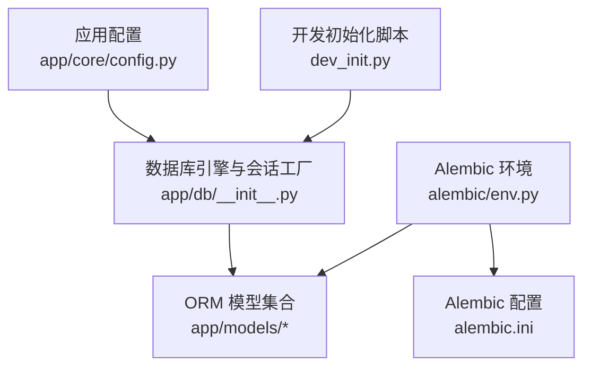
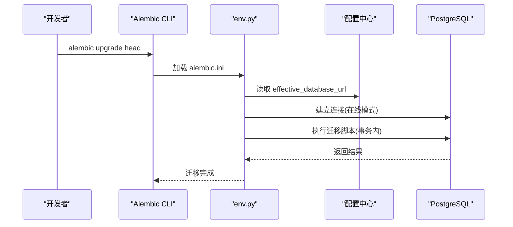
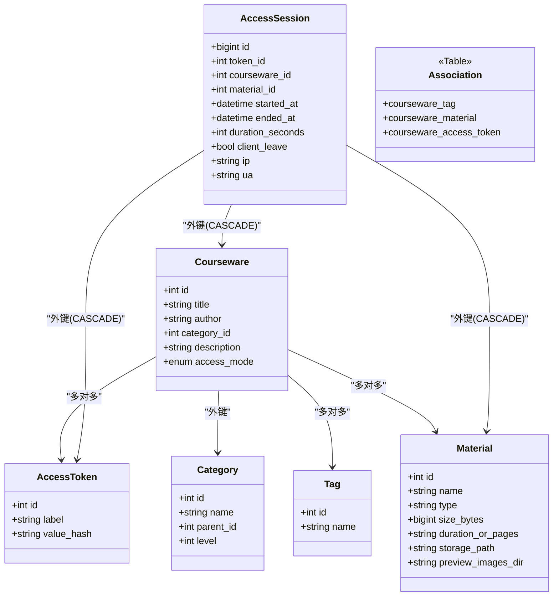
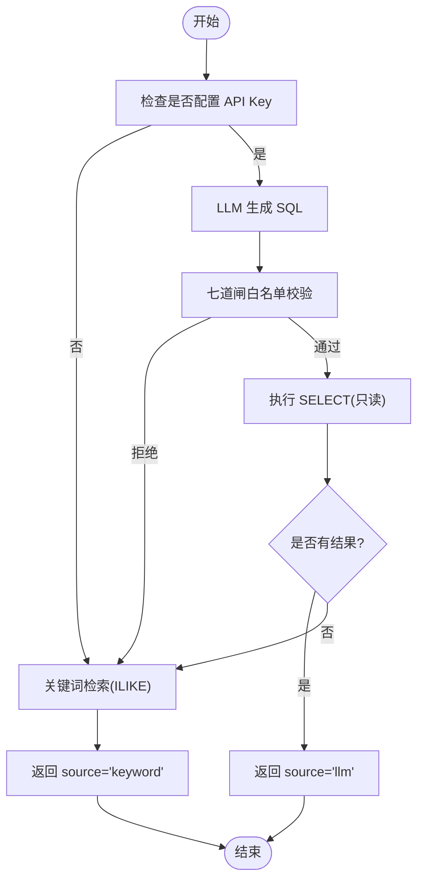
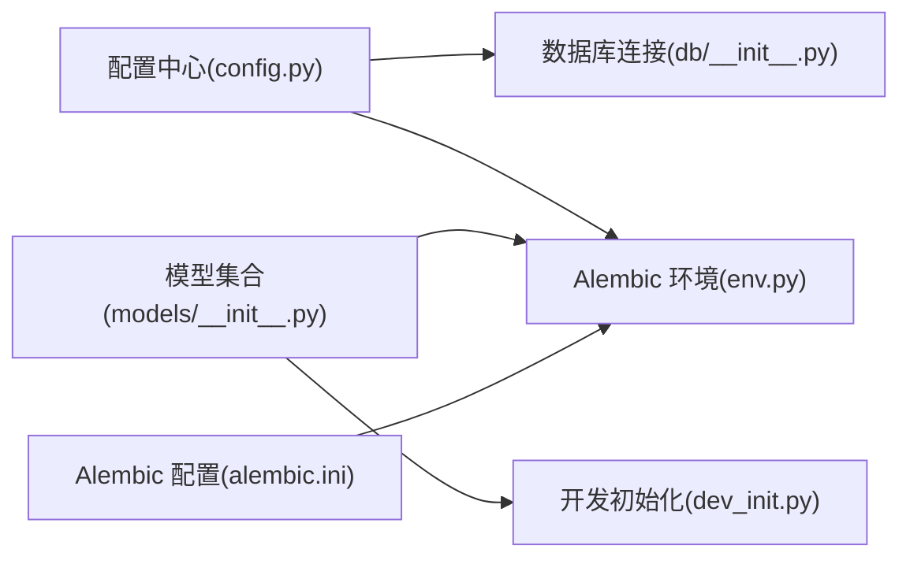

# 数据库架构

<cite>
**本文引用的文件**
- [backend/alembic.ini](file://backend/alembic.ini)
- [backend/app/core/config.py](file://backend/app/core/config.py)
- [backend/app/db/__init__.py](file://backend/app/db/__init__.py)
- [backend/alembic/env.py](file://backend/alembic/env.py)
- [backend/app/models/__init__.py](file://backend/app/models/__init__.py)
- [backend/app/models/access_token.py](file://backend/app/models/access_token.py)
- [backend/app/models/association.py](file://backend/app/models/association.py)
- [backend/app/models/category.py](file://backend/app/models/category.py)
- [backend/app/models/courseware.py](file://backend/app/models/courseware.py)
- [backend/app/models/material.py](file://backend/app/models/material.py)
- [backend/app/models/tag.py](file://backend/app/models/tag.py)
- [backend/app/models/access_session.py](file://backend/app/models/access_session.py)
- [backend/dev_init.py](file://backend/dev_init.py)
- [backend/app/services/_sql_safety.py](file://backend/app/services/_sql_safety.py)
- [backend/app/services/search.py](file://backend/app/services/search.py)
- [backend/app/services/llm_sql.py](file://backend/app/services/llm_sql.py)
- [doc/spec/06-非功能需求.md](file://doc/spec/06-非功能需求.md)
</cite>

## 目录
1. [简介](#简介)
2. [项目结构](#项目结构)
3. [核心组件](#核心组件)
4. [架构总览](#架构总览)
5. [详细组件分析](#详细组件分析)
6. [依赖关系分析](#依赖关系分析)
7. [性能考虑](#性能考虑)
8. [故障排查指南](#故障排查指南)
9. [结论](#结论)
10. [附录](#附录)

## 简介
本文件面向 Learning Hub 的 PostgreSQL 数据库架构，聚焦以下方面：
- 整体设计：表空间规划、字符集与时区设置建议
- 连接池与事务管理、并发控制策略
- Alembic 迁移系统配置与最佳实践（版本管理、回滚机制）
- 性能优化：索引设计、查询优化与缓存策略
- 监控与维护：备份恢复、日志管理与排障
- 安全配置：用户权限、SSL 连接与数据加密

说明：仓库中未显式定义表空间与字符集参数；时区通过应用层配置提供默认值。本节为总体概览，具体实现细节见后续章节。

## 项目结构
后端采用 SQLAlchemy ORM + Alembic 进行模型与迁移管理；数据库连接由统一模块创建并暴露给 FastAPI 路由与服务层。

图表来源
- [backend/app/core/config.py:1-88](file://backend/app/core/config.py#L1-L88)
- [backend/app/db/__init__.py:1-50](file://backend/app/db/__init__.py#L1-L50)
- [backend/alembic/env.py:1-63](file://backend/alembic/env.py#L1-L63)
- [backend/alembic.ini:1-40](file://backend/alembic.ini#L1-L40)
- [backend/dev_init.py:1-44](file://backend/dev_init.py#L1-L44)

章节来源
- [backend/app/core/config.py:1-88](file://backend/app/core/config.py#L1-L88)
- [backend/app/db/__init__.py:1-50](file://backend/app/db/__init__.py#L1-L50)
- [backend/alembic/env.py:1-63](file://backend/alembic/env.py#L1-L63)
- [backend/alembic.ini:1-40](file://backend/alembic.ini#L1-L40)
- [backend/dev_init.py:1-44](file://backend/dev_init.py#L1-L44)

## 核心组件
- 配置中心：集中加载环境变量，提供有效数据库 URL 计算逻辑，支持覆盖 DATABASE_URL。
- 数据库连接：基于 SQLAlchemy create_engine 创建引擎，按方言选择连接池参数；提供 SessionLocal 与请求级依赖注入 get_db。
- 模型与元数据：所有模型集中于 models 包，供 Alembic 一次性识别 metadata。
- 迁移系统：Alembic env.py 读取应用配置，动态设置 sqlalchemy.url，支持在线/离线模式。

章节来源
- [backend/app/core/config.py:1-88](file://backend/app/core/config.py#L1-L88)
- [backend/app/db/__init__.py:1-50](file://backend/app/db/__init__.py#L1-L50)
- [backend/app/models/__init__.py:1-30](file://backend/app/models/__init__.py#L1-L30)
- [backend/alembic/env.py:1-63](file://backend/alembic/env.py#L1-L63)

## 架构总览
下图展示从配置到迁移执行的端到端链路，以及运行时服务对数据库的连接方式。

图表来源
- [backend/alembic.ini:1-40](file://backend/alembic.ini#L1-L40)
- [backend/alembic/env.py:1-63](file://backend/alembic/env.py#L1-L63)
- [backend/app/core/config.py:1-88](file://backend/app/core/config.py#L1-L88)

## 详细组件分析

### 数据库连接与连接池
- 连接串来源：优先使用 DATABASE_URL；否则由 host/port/user/password/name 拼接。
- 引擎参数：启用 pool_pre_ping；SQLite 使用 StaticPool 并允许跨线程访问；Postgres/MySQL 使用 pool_size=10, max_overflow=20。
- 会话工厂：autoflush=False, autocommit=False, expire_on_commit=False，避免意外刷新与过期。
- 请求级会话：FastAPI 依赖注入在每个请求结束时关闭会话，防止连接泄漏。

章节来源
- [backend/app/core/config.py:1-88](file://backend/app/core/config.py#L1-L88)
- [backend/app/db/__init__.py:1-50](file://backend/app/db/__init__.py#L1-L50)

### 事务管理与并发控制
- 迁移事务：在线模式下在 begin_transaction 中执行迁移，保证原子性。
- 业务事务：通过 SessionLocal 创建的会话默认非自动提交，需显式 commit/rollback；结合 FastAPI 依赖注入确保每个请求独立事务边界。
- 并发控制：连接池限制最大并发连接数；SQLAlchemy 负责连接复用与回收；pool_pre_ping 检测失效连接。

章节来源
- [backend/alembic/env.py:42-56](file://backend/alembic/env.py#L42-L56)
- [backend/app/db/__init__.py:27-47](file://backend/app/db/__init__.py#L27-L47)

### Alembic 迁移系统
- 配置文件：指定脚本位置、URL、日志级别与文件名模板。
- 环境加载：env.py 导入 app.models.Base，使所有模型注册到 metadata；根据 is_offline_mode 切换在线/离线模式。
- 离线模式：仅生成 SQL 脚本，不连接数据库。
- 在线模式：使用 NullPool 临时连接执行迁移。

章节来源
- [backend/alembic.ini:1-40](file://backend/alembic.ini#L1-L40)
- [backend/alembic/env.py:1-63](file://backend/alembic/env.py#L1-L63)

### 数据模型与索引设计
- 分类 Category：自引用树形结构，父节点下名称唯一约束，parent_id 建索引。
- 标签 Tag：全局唯一 name。
- 素材 Material：类型枚举、大小、时长或页数、存储路径、预览图片目录等字段。
- 课件 Courseware：访问模式枚举、时间戳、与 Tag/Material/AccessToken 的多对多关联。
- 访问令牌 AccessToken：label 全局唯一，value_hash 索引用于快速校验。
- 访问会话 AccessSession：记录 token/courseware/material 浏览会话，包含多个复合索引以支撑按 token 和时间维度的查询。
- 关联表 courseware_material：维护 sort_order 并提供 (courseware_id, sort_order) 复合索引加速有序读取。

图表来源
- [backend/app/models/category.py:1-46](file://backend/app/models/category.py#L1-L46)
- [backend/app/models/tag.py:1-30](file://backend/app/models/tag.py#L1-L30)
- [backend/app/models/material.py:1-69](file://backend/app/models/material.py#L1-L69)
- [backend/app/models/courseware.py:1-74](file://backend/app/models/courseware.py#L1-L74)
- [backend/app/models/access_token.py:1-34](file://backend/app/models/access_token.py#L1-L34)
- [backend/app/models/access_session.py:1-129](file://backend/app/models/access_session.py#L1-L129)
- [backend/app/models/association.py:1-41](file://backend/app/models/association.py#L1-L41)

章节来源
- [backend/app/models/category.py:1-46](file://backend/app/models/category.py#L1-L46)
- [backend/app/models/tag.py:1-30](file://backend/app/models/tag.py#L1-L30)
- [backend/app/models/material.py:1-69](file://backend/app/models/material.py#L1-L69)
- [backend/app/models/courseware.py:1-74](file://backend/app/models/courseware.py#L1-L74)
- [backend/app/models/access_token.py:1-34](file://backend/app/models/access_token.py#L1-L34)
- [backend/app/models/access_session.py:1-129](file://backend/app/models/access_session.py#L1-L129)
- [backend/app/models/association.py:1-41](file://backend/app/models/association.py#L1-L41)

### LLM-to-SQL 搜索与 SQL 安全闸
- 搜索流程：优先调用 LLM 生成 SELECT 语句，经白名单校验后执行；失败或超时则降级为关键词 ILIKE 检索。
- SQL 安全：七道闸过滤（去除 markdown fence、拒绝多语句、拒绝注释、首词必须 SELECT、黑名单关键字、限定表名、强制 LIMIT），并内置硬上限 DEFAULT_LIMIT 与 HARD_LIMIT_CEIL。
- 超时与降级：可配置超时阈值，超过阈值直接降级关键词检索，不抛 504。

图表来源
- [backend/app/services/search.py:1-262](file://backend/app/services/search.py#L1-L262)
- [backend/app/services/_sql_safety.py:44-96](file://backend/app/services/_sql_safety.py#L44-L96)
- [backend/app/services/llm_sql.py:216-237](file://backend/app/services/llm_sql.py#L216-L237)

章节来源
- [backend/app/services/search.py:1-262](file://backend/app/services/search.py#L1-L262)
- [backend/app/services/_sql_safety.py:44-96](file://backend/app/services/_sql_safety.py#L44-L96)
- [backend/app/services/llm_sql.py:216-237](file://backend/app/services/llm_sql.py#L216-L237)

## 依赖关系分析
- 配置依赖：env.py 与 db/__init__.py 均依赖配置中心获取 effective_database_url。
- 模型依赖：models/__init__.py 集中导入各模型，触发 Base.metadata 注册，供 Alembic 与 dev_init 使用。
- 迁移依赖：alembic.ini 指定脚本位置与 URL；env.py 将配置注入到 Alembic 上下文。

图表来源
- [backend/app/core/config.py:1-88](file://backend/app/core/config.py#L1-L88)
- [backend/app/db/__init__.py:1-50](file://backend/app/db/__init__.py#L1-L50)
- [backend/alembic/env.py:1-63](file://backend/alembic/env.py#L1-L63)
- [backend/alembic.ini:1-40](file://backend/alembic.ini#L1-L40)
- [backend/app/models/__init__.py:1-30](file://backend/app/models/__init__.py#L1-L30)
- [backend/dev_init.py:1-44](file://backend/dev_init.py#L1-L44)

章节来源
- [backend/app/core/config.py:1-88](file://backend/app/core/config.py#L1-L88)
- [backend/app/db/__init__.py:1-50](file://backend/app/db/__init__.py#L1-L50)
- [backend/alembic/env.py:1-63](file://backend/alembic/env.py#L1-L63)
- [backend/alembic.ini:1-40](file://backend/alembic.ini#L1-L40)
- [backend/app/models/__init__.py:1-30](file://backend/app/models/__init__.py#L1-L30)
- [backend/dev_init.py:1-44](file://backend/dev_init.py#L1-L44)

## 性能考虑
- 连接池参数：生产环境建议根据 QPS 与延迟目标调整 pool_size 与 max_overflow；当前默认 pool_size=10, max_overflow=20。
- 预取与懒加载：Courseware 的 tags/materials/access_tokens 使用 selectinload 减少 N+1 查询；category 使用 joined 预加载。
- 索引设计：
  - category.parent_id 索引提升树遍历性能。
  - courseware_material(courseware_id, sort_order) 复合索引加速有序素材列表。
  - access_session 多组复合索引支持按 token 与时间维度统计。
- 查询优化：
  - LLM-to-SQL 强制 WHERE 与 LIMIT，避免全表扫描与大结果集。
  - 关键词兜底使用 ILIKE，注意前缀匹配性能；必要时引入 pg_trgm 扩展。
- 缓存策略：
  - 应用层可使用 Redis 做热点数据缓存（如分类树、热门课件列表）。
  - 数据库层面可利用物化视图或分区表（针对访问会话等时序大表）降低查询成本。

[本节为通用指导，不直接分析具体文件]

## 故障排查指南
- 连接问题：
  - 确认 effective_database_url 是否正确；DATABASE_URL 优先级高于独立字段。
  - 检查 pool_pre_ping 是否开启；观察连接断开与重连日志。
- 迁移失败：
  - 使用离线模式生成 SQL 脚本进行审查；在线模式在事务中执行，失败会回滚。
  - 核对 alembic.ini 中的 script_location 与 URL。
- 搜索异常：
  - 若 LLM 不可用或超时，将自动降级关键词检索；检查超时阈值与 API Key 配置。
  - 查看 SQL 安全闸输出，确认是否被拒绝（多语句、注释、黑名单关键字等）。
- 性能问题：
  - 关注慢查询日志与 P95 指标；结合 EXPLAIN ANALYZE 定位缺失索引或低效 JOIN。
  - 对大表（access_session）考虑分区与归档策略。

章节来源
- [backend/app/core/config.py:1-88](file://backend/app/core/config.py#L1-L88)
- [backend/alembic/env.py:1-63](file://backend/alembic/env.py#L1-L63)
- [backend/app/services/search.py:1-262](file://backend/app/services/search.py#L1-L262)
- [backend/app/services/_sql_safety.py:44-96](file://backend/app/services/_sql_safety.py#L44-L96)
- [doc/spec/06-非功能需求.md:125-136](file://doc/spec/06-非功能需求.md#L125-L136)

## 结论
Learning Hub 的数据库架构以 SQLAlchemy + Alembic 为核心，具备清晰的连接池与事务管理、完善的迁移体系与安全的 LLM-to-SQL 搜索路径。通过合理的索引设计与查询约束，系统在可扩展性与安全性之间取得平衡。生产部署建议完善 SSL、细粒度权限与备份恢复策略，并结合监控指标持续优化。

[本节为总结，不直接分析具体文件]

## 附录

### 表空间规划建议
- 将热数据（courseware、material、category、tag、access_token）与冷数据（access_session）分表空间，便于 I/O 隔离与生命周期管理。
- 为大型表（access_session）单独表空间，配合分区策略提升查询与清理效率。

[本节为概念性建议，不直接分析具体文件]

### 字符集与时区设置
- 字符集：建议使用 UTF8（PostgreSQL 默认），确保中文与多语言内容正确存储。
- 时区：应用层默认 Asia/Shanghai；建议在数据库侧也设置为 Asia/Shanghai，避免时区转换不一致。

[本节为概念性建议，不直接分析具体文件]

### 连接池与事务最佳实践
- 合理设置 pool_size 与 max_overflow，结合压测确定容量。
- 使用请求级会话并在 finally 中关闭，避免连接泄漏。
- 迁移在事务中执行，确保原子性与一致性。

章节来源
- [backend/app/db/__init__.py:1-50](file://backend/app/db/__init__.py#L1-L50)
- [backend/alembic/env.py:42-56](file://backend/alembic/env.py#L42-L56)

### Alembic 版本管理与回滚
- 版本管理：每次变更生成带时间戳与 slug 的迁移脚本；env.py 自动加载全部模型 metadata。
- 回滚机制：使用 alembic downgrade 指定目标版本；在线模式在事务中执行，失败自动回滚。
- 最佳实践：
  - 小步快跑，单职责迁移；复杂变更拆分为多个步骤。
  - 先离线生成 SQL 审阅，再上线执行。
  - 对破坏性变更（删除列/表）提供数据迁移脚本与回退方案。

章节来源
- [backend/alembic.ini:1-40](file://backend/alembic.ini#L1-L40)
- [backend/alembic/env.py:1-63](file://backend/alembic/env.py#L1-L63)

### 安全配置要点
- 用户权限：最小权限原则，读写分离账号；DDL 操作仅限管理员账号。
- SSL 连接：启用 TLS，配置证书与客户端验证；在连接串中添加 sslmode=require 等参数。
- 数据加密：敏感字段（如 value_hash）已哈希存储；传输层使用 HTTPS；静态数据可启用 TDE 或文件系统加密。

[本节为通用安全建议，不直接分析具体文件]