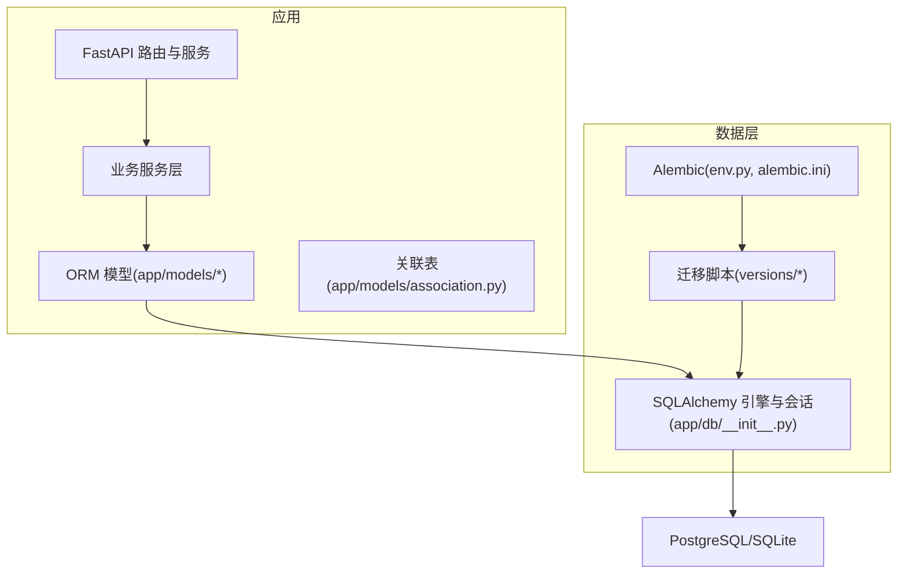
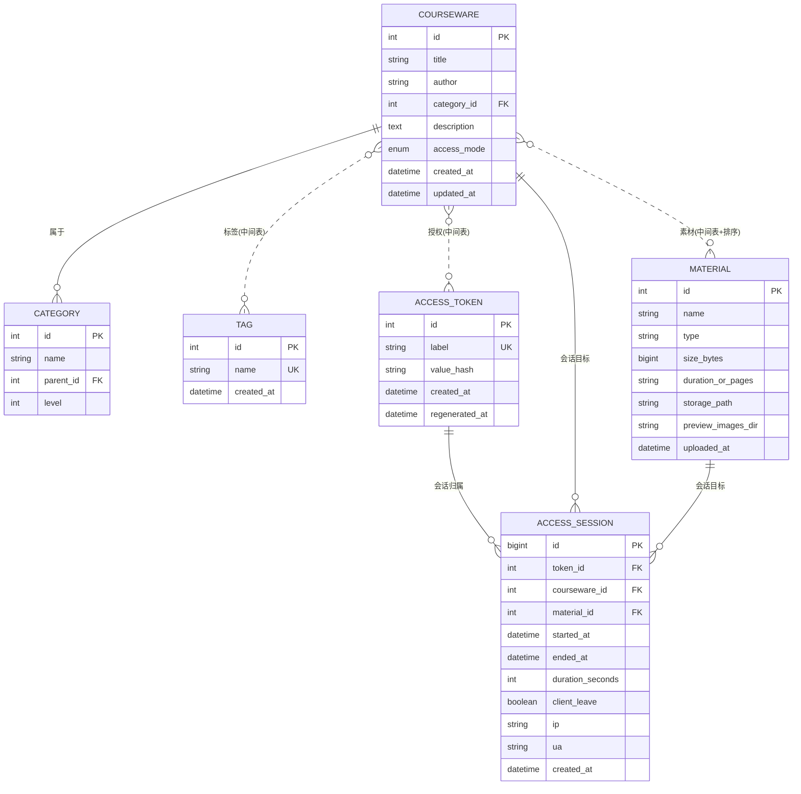
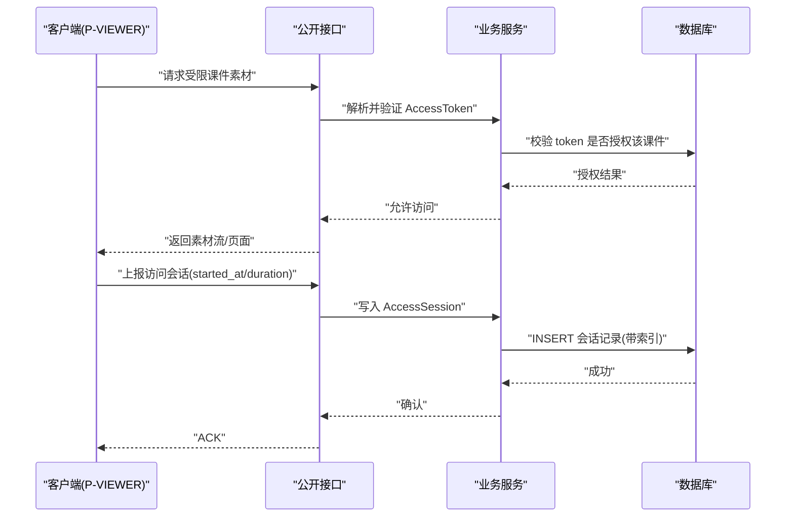
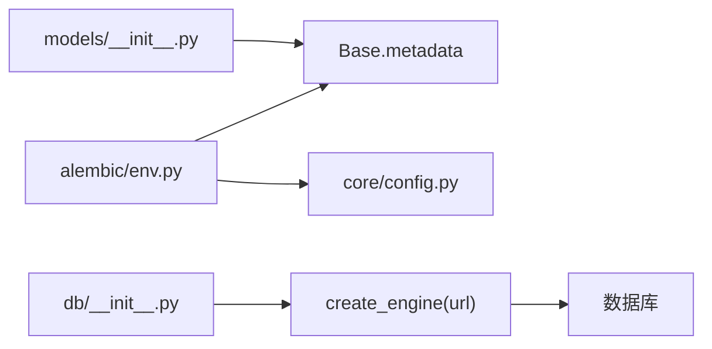
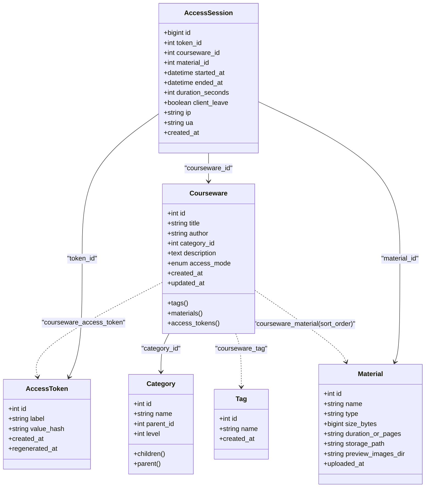

# 数据库设计

<cite>
**本文引用的文件**   
- [backend/app/models/__init__.py](file://backend/app/models/__init__.py)
- [backend/app/models/association.py](file://backend/app/models/association.py)
- [backend/app/models/category.py](file://backend/app/models/category.py)
- [backend/app/models/courseware.py](file://backend/app/models/courseware.py)
- [backend/app/models/material.py](file://backend/app/models/material.py)
- [backend/app/models/tag.py](file://backend/app/models/tag.py)
- [backend/app/models/access_token.py](file://backend/app/models/access_token.py)
- [backend/app/models/access_session.py](file://backend/app/models/access_session.py)
- [backend/app/db/__init__.py](file://backend/app/db/__init__.py)
- [backend/app/core/config.py](file://backend/app/core/config.py)
- [backend/alembic/env.py](file://backend/alembic/env.py)
- [backend/alembic.ini](file://backend/alembic.ini)
- [backend/alembic/versions/2026_07_06_1745-11f9c69846a9_init_schema.py](file://backend/alembic/versions/2026_07_06_1745-11f9c69846a9_init_schema.py)
- [backend/alembic/versions/2026_07_10_0930-c1d2e3f4a5b6_add_access_session.py](file://backend/alembic/versions/2026_07_10_0930-c1d2e3f4a5b6_add_access_session.py)
- [backend/app/core/errors.py](file://backend/app/core/errors.py)
</cite>

## 目录
1. [简介](#简介)
2. [项目结构](#项目结构)
3. [核心组件](#核心组件)
4. [架构总览](#架构总览)
5. [详细组件分析](#详细组件分析)
6. [依赖关系分析](#依赖关系分析)
7. [性能考虑](#性能考虑)
8. [故障排查指南](#故障排查指南)
9. [结论](#结论)
10. [附录](#附录)

## 简介
本文件面向 Learning Hub 的数据库设计与实现，覆盖数据模型定义、实体关系与约束、索引策略、迁移与版本管理、访问模式优化、安全与审计、备份与灾难恢复等。文档以代码级事实为依据，结合 Alembic 迁移脚本与 ORM 模型，给出可落地的工程化建议。

## 项目结构
后端采用 SQLAlchemy + Alembic 的数据层方案：
- 模型定义集中于 app/models，按领域拆分（分类、标签、素材、课件、令牌、会话）。
- 多对多关联表集中定义于 association 模块。
- 数据库连接、引擎与会话工厂位于 app/db。
- 配置通过 pydantic-settings 加载，支持环境变量覆盖。
- Alembic 负责在线/离线迁移与版本控制。

图表来源
- [backend/app/models/__init__.py:1-30](file://backend/app/models/__init__.py#L1-L30)
- [backend/app/db/__init__.py:1-51](file://backend/app/db/__init__.py#L1-L51)
- [backend/alembic/env.py:1-63](file://backend/alembic/env.py#L1-L63)
- [backend/alembic.ini:1-40](file://backend/alembic.ini#L1-L40)

章节来源
- [backend/app/models/__init__.py:1-30](file://backend/app/models/__init__.py#L1-L30)
- [backend/app/db/__init__.py:1-51](file://backend/app/db/__init__.py#L1-L51)
- [backend/alembic/env.py:1-63](file://backend/alembic/env.py#L1-L63)
- [backend/alembic.ini:1-40](file://backend/alembic.ini#L1-L40)

## 核心组件
本节概述各数据实体的职责与关键约束：
- 分类 Category：三级树形结构，父节点下名称唯一，自引用外键限制删除。
- 标签 Tag：扁平结构，name 全局唯一。
- 素材 Material：文件元数据与存储路径，类型由扩展名推断。
- 课件 Courseware：标题、作者、分类、描述、访问模式（开放/受限），时间戳自动维护。
- 访问令牌 AccessToken：label 全局唯一，value_hash 为 SHA-256 摘要，便于校验而不落盘明文。
- 访问会话 AccessSession：记录 token 持有者对受限课件素材的一次浏览会话，含起止时间、停留时长、客户端信息。

章节来源
- [backend/app/models/category.py:1-46](file://backend/app/models/category.py#L1-L46)
- [backend/app/models/tag.py:1-30](file://backend/app/models/tag.py#L1-L30)
- [backend/app/models/material.py:1-69](file://backend/app/models/material.py#L1-L69)
- [backend/app/models/courseware.py:1-74](file://backend/app/models/courseware.py#L1-L74)
- [backend/app/models/access_token.py:1-34](file://backend/app/models/access_token.py#L1-L34)
- [backend/app/models/access_session.py:1-129](file://backend/app/models/access_session.py#L1-L129)

## 架构总览
下图展示核心实体间的关系与多对多关联，以及访问控制与审计链路。

图表来源
- [backend/app/models/category.py:12-46](file://backend/app/models/category.py#L12-L46)
- [backend/app/models/tag.py:13-30](file://backend/app/models/tag.py#L13-L30)
- [backend/app/models/material.py:44-69](file://backend/app/models/material.py#L44-L69)
- [backend/app/models/courseware.py:21-74](file://backend/app/models/courseware.py#L21-L74)
- [backend/app/models/access_token.py:13-34](file://backend/app/models/access_token.py#L13-L34)
- [backend/app/models/access_session.py:56-129](file://backend/app/models/access_session.py#L56-L129)
- [backend/app/models/association.py:9-33](file://backend/app/models/association.py#L9-L33)

## 详细组件分析

### 实体与字段说明
- 分类 Category
  - 主键：id（自增）
  - 字段：name(30), parent_id(自引用外键, ondelete=RESTRICT), level(1/2/3)
  - 约束：同一父节点下 name 唯一；parent_id 建索引
  - 关系：children/parent 自引用双向关系
- 标签 Tag
  - 主键：id（自增）
  - 字段：name(30, 全局唯一), created_at
- 素材 Material
  - 主键：id（自增）
  - 字段：name(255), type(枚举字符串), size_bytes, duration_or_pages, storage_path, preview_images_dir, uploaded_at
  - 说明：二进制文件存储在文件系统，preview_images_dir 用于 PPT 转图片预览
- 课件 Courseware
  - 主键：id（自增）
  - 字段：title(100), author(50), category_id(FK->category.id, ondelete=RESTRICT), description, access_mode(OPEN/RESTRICTED), created_at, updated_at
  - 关系：tags, materials, access_tokens 多对多
- 访问令牌 AccessToken
  - 主键：id（自增）
  - 字段：label(50, 全局唯一), value_hash(SHA-256, 索引), created_at, regenerated_at
- 访问会话 AccessSession
  - 主键：id（跨方言适配 BigInteger/Integer）
  - 字段：token_id, courseware_id, material_id, started_at, ended_at, duration_seconds, client_leave, ip(INET或VARCHAR), ua, created_at
  - 约束：duration_seconds >= 0（CheckConstraint）
  - 索引：按 token_id 与时间、material_id、courseware_id 的组合索引，提升查询性能

章节来源
- [backend/app/models/category.py:12-46](file://backend/app/models/category.py#L12-L46)
- [backend/app/models/tag.py:13-30](file://backend/app/models/tag.py#L13-L30)
- [backend/app/models/material.py:44-69](file://backend/app/models/material.py#L44-L69)
- [backend/app/models/courseware.py:21-74](file://backend/app/models/courseware.py#L21-L74)
- [backend/app/models/access_token.py:13-34](file://backend/app/models/access_token.py#L13-L34)
- [backend/app/models/access_session.py:56-129](file://backend/app/models/access_session.py#L56-L129)

### 多对多关联与排序
- 课件-标签：courseware_tag（联合主键）
- 课件-素材：courseware_material（联合主键 + sort_order 有序展示；复合索引加速按课件取有序素材）
- 课件-令牌：courseware_access_token（联合主键）

章节来源
- [backend/app/models/association.py:9-33](file://backend/app/models/association.py#L9-L33)

### 访问控制与审计流程
受限课件需携带有效 AccessToken 才能访问。P-VIEWER 在浏览过程中上报访问会话，服务端进行校验并落库。

图表来源
- [backend/app/models/access_token.py:13-34](file://backend/app/models/access_token.py#L13-L34)
- [backend/app/models/access_session.py:56-129](file://backend/app/models/access_session.py#L56-L129)
- [backend/app/models/courseware.py:21-74](file://backend/app/models/courseware.py#L21-L74)

### 数据验证规则与业务约束
- 素材类型推断：根据扩展名映射到 VIDEO/PDF/PPT，不支持的类型抛出业务异常。
- 访问模式：OPEN 无需令牌；RESTRICTED 需要有效的 AccessToken。
- 会话约束：duration_seconds 非负；客户端时间与服务器偏差较大时按服务端校正。
- 删除保护：分类与课件的外键使用 RESTRICT，避免误删；令牌与课件/素材删除时，会话通过 CASCADE 清理。

章节来源
- [backend/app/models/material.py:31-41](file://backend/app/models/material.py#L31-L41)
- [backend/app/models/courseware.py:14-38](file://backend/app/models/courseware.py#L14-L38)
- [backend/app/models/access_session.py:56-129](file://backend/app/models/access_session.py#L56-L129)
- [backend/app/core/errors.py:1-144](file://backend/app/core/errors.py#L1-144)

### 索引策略与查询优化
- 分类：parent_id 索引，利于树形遍历与子节点查询。
- 令牌：value_hash 索引，快速校验令牌有效性。
- 课件-素材：courseware_id + sort_order 复合索引，加速学习路径顺序读取。
- 会话：针对 token_id 与时间、material_id、courseware_id 的多组合索引，支撑按用户/课件/素材维度的统计与回放。

章节来源
- [backend/app/models/category.py:16-20](file://backend/app/models/category.py#L16-L20)
- [backend/app/models/access_token.py:19-21](file://backend/app/models/access_token.py#L19-L21)
- [backend/app/models/association.py:25](file://backend/app/models/association.py#L25-L26)
- [backend/app/models/access_session.py:66-79](file://backend/app/models/access_session.py#L66-L79)

### 数据完整性与异常处理
- 外键约束：ondelete=RESTRICT/CASCADE 保证引用完整性与级联清理。
- CheckConstraint：会话时长非负。
- 业务异常：统一 BusinessError 与 ErrorCode，将错误码映射到 HTTP 状态码，便于前端处理。

章节来源
- [backend/app/models/access_session.py:62-65](file://backend/app/models/access_session.py#L62-L65)
- [backend/app/core/errors.py:73-144](file://backend/app/core/errors.py#L73-L144)

## 依赖关系分析
- 模型注册：app/models/__init__.py 集中导入所有模型与关联表，确保 Alembic 能识别全部 metadata。
- 引擎与会话：app/db/__init__.py 创建 engine 与 SessionLocal，提供 get_db 依赖注入。
- 配置：app/core/config.py 提供 effective_database_url，优先使用 DATABASE_URL 环境变量，否则拼接 Postgres 连接串。
- Alembic：env.py 加载 settings 与 Base.metadata，支持 online/offline 迁移；alembic.ini 指定脚本位置与默认 URL。

图表来源
- [backend/app/models/__init__.py:1-30](file://backend/app/models/__init__.py#L1-L30)
- [backend/app/db/__init__.py:1-51](file://backend/app/db/__init__.py#L1-L51)
- [backend/app/core/config.py:28-38](file://backend/app/core/config.py#L28-L38)
- [backend/alembic/env.py:16-26](file://backend/alembic/env.py#L16-L26)

章节来源
- [backend/app/models/__init__.py:1-30](file://backend/app/models/__init__.py#L1-L30)
- [backend/app/db/__init__.py:1-51](file://backend/app/db/__init__.py#L1-L51)
- [backend/app/core/config.py:1-88](file://backend/app/core/config.py#L1-88)
- [backend/alembic/env.py:1-63](file://backend/alembic/env.py#L1-L63)

## 性能考虑
- 连接池配置
  - PostgreSQL/MySQL：pool_size=10, max_overflow=20，启用 pool_pre_ping 检测死连接。
  - SQLite（测试）：StaticPool + check_same_thread=False，避免多线程访问问题。
- 查询优化
  - 利用已定义的复合索引减少全表扫描，如按 token_id + started_at 的时间序列查询。
  - 课件-素材顺序读取使用 selectin 懒加载与 order_by 排序，避免 N+1。
- 缓存策略
  - 可在服务层引入 Redis（配置项 storage_redis_url 预留）缓存热点分类树、标签列表与课件元数据。
- 大对象与预览
  - 素材二进制不落库，仅存路径；PPT 转图片预览目录独立存放，降低数据库体积。

章节来源
- [backend/app/db/__init__.py:18-25](file://backend/app/db/__init__.py#L18-L25)
- [backend/app/models/courseware.py:52-67](file://backend/app/models/courseware.py#L52-L67)
- [backend/app/models/material.py:56-59](file://backend/app/models/material.py#L56-L59)
- [backend/app/core/config.py:62-64](file://backend/app/core/config.py#L62-L64)

## 故障排查指南
- 常见错误码
  - 认证/授权：unauthenticated、forbidden、invalid_token、token_required
  - 课件：courseware_not_found、courseware_category_not_leaf、courseware_acl_locked
  - 素材：material_extension_invalid、material_storage_unavailable、material_referenced
  - 令牌：token_label_conflict、token_revoked、token_referenced
- 定位步骤
  - 检查 Alembic 版本链是否一致，必要时执行 downgrade/upgrade 回滚或升级。
  - 核对 effective_database_url 是否正确，确认连接池参数是否符合环境。
  - 查看业务异常中的 code 与 message，结合 HTTP 状态码快速定位。
- 日志与调试
  - 可通过 sqlalchemy.engine 日志级别调整 SQL 输出，辅助定位慢查询。

章节来源
- [backend/app/core/errors.py:9-127](file://backend/app/core/errors.py#L9-L127)
- [backend/alembic/env.py:29-56](file://backend/alembic/env.py#L29-L56)
- [backend/app/core/config.py:28-38](file://backend/app/core/config.py#L28-L38)

## 结论
Learning Hub 的数据库设计围绕“课件-素材-标签-分类”的核心业务展开，并通过 AccessToken 实现细粒度访问控制，AccessSession 提供完整的审计能力。借助 Alembic 的版本化管理与合理的索引策略，系统在可扩展性与性能之间取得平衡。建议在后续迭代中持续完善监控与告警，并结合业务增长动态调优连接池与索引。

## 附录

### ER 图（代码级映射）

图表来源
- [backend/app/models/category.py:12-46](file://backend/app/models/category.py#L12-L46)
- [backend/app/models/tag.py:13-30](file://backend/app/models/tag.py#L13-L30)
- [backend/app/models/material.py:44-69](file://backend/app/models/material.py#L44-L69)
- [backend/app/models/courseware.py:21-74](file://backend/app/models/courseware.py#L21-L74)
- [backend/app/models/access_token.py:13-34](file://backend/app/models/access_token.py#L13-L34)
- [backend/app/models/access_session.py:56-129](file://backend/app/models/access_session.py#L56-L129)
- [backend/app/models/association.py:9-33](file://backend/app/models/association.py#L9-L33)

### 迁移与版本管理
- 初始迁移：创建基础表与索引，建立多对多关联表。
- 新增访问会话：创建 access_session 表及多个组合索引，添加 CheckConstraint。
- 回滚机制：每个迁移均提供 downgrade，可按 revision 回退。

章节来源
- [backend/alembic/versions/2026_07_06_1745-11f9c69846a9_init_schema.py:21-113](file://backend/alembic/versions/2026_07_06_1745-11f9c69846a9_init_schema.py#L21-L113)
- [backend/alembic/versions/2026_07_10_0930-c1d2e3f4a5b6_add_access_session.py:21-125](file://backend/alembic/versions/2026_07_10_0930-c1d2e3f4a5b6_add_access_session.py#L21-L125)
- [backend/alembic/env.py:29-56](file://backend/alembic/env.py#L29-L56)
- [backend/alembic.ini:1-40](file://backend/alembic.ini#L1-L40)

### 数据安全与审计
- 敏感数据
  - AccessToken 仅存储 value_hash（SHA-256），不保存明文。
  - IP/UA 作为可选审计字段，支持 INET 类型（PostgreSQL）与文本降级（SQLite）。
- 访问控制
  - 基于 AccessToken 的课件授权，RESTRICTED 模式强制校验。
- 审计日志
  - AccessSession 记录完整浏览会话，支持按 token/courseware/material 维度统计。

章节来源
- [backend/app/models/access_token.py:13-34](file://backend/app/models/access_token.py#L13-L34)
- [backend/app/models/access_session.py:33-48](file://backend/app/models/access_session.py#L33-L48)
- [backend/app/models/access_session.py:56-129](file://backend/app/models/access_session.py#L56-L129)

### 备份与灾难恢复（建议）
- 定期逻辑备份：使用 pg_dump 导出 schema 与数据，保留历史版本。
- 增量备份：结合 WAL 归档与时间点恢复（PITR），缩短 RTO/RPO。
- 异地容灾：跨可用区复制数据库实例，定期演练切换流程。
- 迁移一致性：上线前在预发环境执行完整迁移与回滚演练，确保版本链一致。

[本节为通用实践建议，不直接分析具体代码文件]