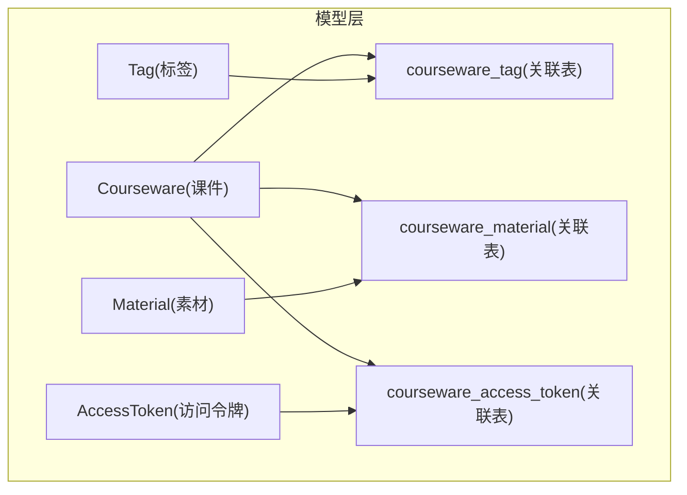
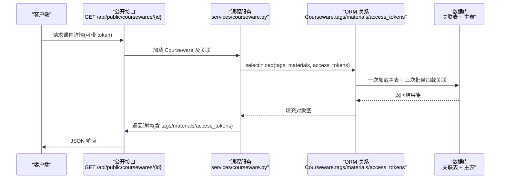

# 关联模型(Association Models)

<cite>
**本文引用的文件**   
- [backend/app/models/association.py](file://backend/app/models/association.py)
- [backend/app/models/courseware.py](file://backend/app/models/courseware.py)
- [backend/app/models/tag.py](file://backend/app/models/tag.py)
- [backend/app/models/material.py](file://backend/app/models/material.py)
- [backend/app/models/access_token.py](file://backend/app/models/access_token.py)
- [backend/app/models/__init__.py](file://backend/app/models/__init__.py)
- [backend/alembic/versions/2026_07_10_1800-d2e3f4a5b6c7_add_courseware_material_sort_order.py](file://backend/alembic/versions/2026_07_10_1800-d2e3f4a5b6c7_add_courseware_material_sort_order.py)
- [backend/app/services/courseware.py](file://backend/app/services/courseware.py)
- [backend/app/api/public/coursewares.py](file://backend/app/api/public/coursewares.py)
- [backend/app/api/admin/access_tokens.py](file://backend/app/api/admin/access_tokens.py)
- [doc/spec/05-数据模型.md](file://doc/spec/05-数据模型.md)
- [doc/spec/10-API设计规范.md](file://doc/spec/10-API设计规范.md)
</cite>

## 目录
1. [引言](#引言)
2. [项目结构](#项目结构)
3. [核心组件](#核心组件)
4. [架构总览](#架构总览)
5. [详细组件分析](#详细组件分析)
6. [依赖关系分析](#依赖关系分析)
7. [性能与索引优化](#性能与索引优化)
8. [事务与级联操作](#事务与级联操作)
9. [关联查询最佳实践](#关联查询最佳实践)
10. [故障排查指南](#故障排查指南)
11. [结论](#结论)
12. [附录：SQL 示例与 ORM 映射要点](#附录sql-示例与-orm-映射要点)

## 引言
本文件聚焦于课件系统的多对多关联模型，围绕以下三张关联表展开：
- courseware_tag：课件与标签的多对多
- courseware_material：课件与素材的多对多（含学习路径排序）
- courseware_access_token：课件与访问令牌的多对多

文档将系统阐述字段定义、外键与唯一性约束、业务规则、索引设计与查询优化策略、事务与级联行为，并提供面向生产环境的最佳实践与常见问题的排障建议。

## 项目结构
与关联模型直接相关的代码位于后端 models 层与迁移脚本中，ORM 关系在 Courseware 实体上声明，服务层通过 selectinload 批量加载避免 N+1 问题，API 层基于这些关系实现权限校验与详情返回。



图表来源
- [backend/app/models/courseware.py:21-67](file://backend/app/models/courseware.py#L21-L67)
- [backend/app/models/association.py:9-33](file://backend/app/models/association.py#L9-L33)
- [backend/app/models/tag.py:13-26](file://backend/app/models/tag.py#L13-L26)
- [backend/app/models/material.py:44-65](file://backend/app/models/material.py#L44-L65)
- [backend/app/models/access_token.py:13-30](file://backend/app/models/access_token.py#L13-L30)

章节来源
- [backend/app/models/__init__.py:1-30](file://backend/app/models/__init__.py#L1-L30)
- [backend/app/models/association.py:1-41](file://backend/app/models/association.py#L1-L41)
- [backend/app/models/courseware.py:21-67](file://backend/app/models/courseware.py#L21-L67)

## 核心组件
- 关联表定义：使用 SQLAlchemy Table 声明中间表，主键为两列复合主键，并设置 ondelete=CASCADE 保证删除一致性。
- ORM 关系：在 Courseware 上以 secondary 方式声明 tags、materials、access_tokens 三个多对多关系；其中 materials 指定 order_by 按 sort_order 排序，且 lazy="selectin" 用于批量加载。
- 迁移与索引：为 courseware_material 新增 sort_order 字段，回填连续序号，并创建复合索引加速“按课件取有序素材”的查询。

章节来源
- [backend/app/models/association.py:9-33](file://backend/app/models/association.py#L9-L33)
- [backend/app/models/courseware.py:51-67](file://backend/app/models/courseware.py#L51-L67)
- [backend/alembic/versions/2026_07_10_1800-d2e3f4a5b6c7_add_courseware_material_sort_order.py:33-104](file://backend/alembic/versions/2026_07_10_1800-d2e3f4a5b6c7_add_courseware_material_sort_order.py#L33-L104)

## 架构总览
下图展示了从 API 到 ORM 再到数据库的关键调用链，体现关联表如何参与权限校验与详情组装。



图表来源
- [backend/app/api/public/coursewares.py:72-101](file://backend/app/api/public/coursewares.py#L72-L101)
- [backend/app/services/courseware.py:55-57](file://backend/app/services/courseware.py#L55-L57)
- [backend/app/models/courseware.py:51-67](file://backend/app/models/courseware.py#L51-L67)

## 详细组件分析

### 关联表一：courseware_tag（课件-标签）
- 设计目标：支持一个课件拥有多个标签，一个标签被多个课件引用。
- 字段与约束
  - courseware_id：整数，外键指向 courseware.id，ondelete=CASCADE，复合主键之一
  - tag_id：整数，外键指向 tag.id，ondelete=CASCADE，复合主键之一
  - 复合主键确保同一课件不会重复绑定同一标签
- 业务规则
  - 标签名全局唯一，便于前端展示与管理
  - 删除标签时级联清理关联记录
- 查询优化
  - 复合主键天然提供 (courseware_id, tag_id) 的高效等值查找
  - 如需按标签反查课件，可在 tag_id 上建立普通索引（视实际查询而定）

章节来源
- [backend/app/models/association.py:9-14](file://backend/app/models/association.py#L9-L14)
- [backend/app/models/tag.py:13-26](file://backend/app/models/tag.py#L13-L26)
- [doc/spec/05-数据模型.md:97-106](file://doc/spec/05-数据模型.md#L97-L106)

### 关联表二：courseware_material（课件-素材，含顺序）
- 设计目标：维护课件内素材的学习路径顺序，支持管理员拖拽调整。
- 字段与约束
  - courseware_id：整数，外键指向 courseware.id，ondelete=CASCADE，复合主键之一
  - material_id：整数，外键指向 material.id，ondelete=CASCADE，复合主键之一
  - sort_order：整数，非空，默认 0；表示课件内的相对顺序（0..N-1）
  - 复合主键确保同一课件不重复绑定同一素材
- 迁移与回填
  - 新增 sort_order 列后，按 courseware_id 分区、material_id 升序计算行号回填
  - 收紧为非空并设置默认值 0
- 索引
  - 复合索引 ix_courseware_material_courseware_order(courseware_id, sort_order)，加速“按课件取有序素材”
- ORM 关系
  - Courseware.materials 使用 secondary 指向该表，order_by 指定按 sort_order 排序，lazy="selectin"
- 业务规则
  - 仅管理员可修改 sort_order；前台只读
  - 新增素材默认追加到末尾；删除素材保持其余顺序不变
  - 专用排序接口与更新接口语义一致：按数组下标重写 0..N-1

章节来源
- [backend/app/models/association.py:16-26](file://backend/app/models/association.py#L16-L26)
- [backend/app/models/courseware.py:55-61](file://backend/app/models/courseware.py#L55-L61)
- [backend/alembic/versions/2026_07_10_1800-d2e3f4a5b6c7_add_courseware_material_sort_order.py:33-104](file://backend/alembic/versions/2026_07_10_1800-d2e3f4a5b6c7_add_courseware_material_sort_order.py#L33-L104)
- [doc/spec/05-数据模型.md:142-159](file://doc/spec/05-数据模型.md#L142-L159)
- [doc/spec/10-API设计规范.md:586-610](file://doc/spec/10-API设计规范.md#L586-L610)

### 关联表三：courseware_access_token（课件-访问令牌）
- 设计目标：控制受限课件的访问权限，一个课件可绑定多个令牌，一个令牌可解锁多个课件。
- 字段与约束
  - courseware_id：整数，外键指向 courseware.id，ondelete=CASCADE，复合主键之一
  - access_token_id：整数，外键指向 access_token.id，ondelete=CASCADE，复合主键之一
  - 复合主键确保同一课件不重复绑定同一令牌
- 安全与校验
  - AccessToken.value_hash 存储 SHA-256 摘要，公开接口根据传入 token 哈希匹配允许列表进行鉴权
- 业务规则
  - 删除令牌或课件时级联清理关联记录
  - 受限模式需至少关联一个有效令牌

章节来源
- [backend/app/models/association.py:28-33](file://backend/app/models/association.py#L28-L33)
- [backend/app/models/access_token.py:13-30](file://backend/app/models/access_token.py#L13-L30)
- [backend/app/api/public/coursewares.py:72-101](file://backend/app/api/public/coursewares.py#L72-L101)
- [doc/spec/10-API设计规范.md:1067-1119](file://doc/spec/10-API设计规范.md#L1067-L1119)

### ORM 关系与加载策略
- Courseware.tags：secondary=courseware_tag，backref="coursewares"，lazy="selectin"
- Courseware.materials：secondary=courseware_material，backref="coursewares"，order_by=sort_order，lazy="selectin"
- Courseware.access_tokens：secondary=courseware_access_token，backref="coursewares"，lazy="selectin"
- 服务层在列表与详情查询中使用 selectinload 显式批量加载，避免 N+1

章节来源
- [backend/app/models/courseware.py:51-67](file://backend/app/models/courseware.py#L51-L67)
- [backend/app/services/courseware.py:55-57](file://backend/app/services/courseware.py#L55-L57)

## 依赖关系分析
- 模型耦合
  - association.py 仅依赖 Base 与 SQLAlchemy 基础类型，低耦合
  - courseware.py 通过 relationship 反向引用 Tag、Material、AccessToken，形成清晰的双向导航
- 外部依赖
  - Alembic 迁移负责 schema 演进与索引创建
  - API 层依赖 ORM 关系完成鉴权与数据组装

```mermaid
classDiagram
class Courseware {
+int id
+str title
+AccessMode access_mode
+tags : List[Tag]
+materials : List[Material]
+access_tokens : List[AccessToken]
}
class Tag {
+int id
+str name
+coursewares : List[Courseware]
}
class Material {
+int id
+str name
+type
+coursewares : List[Courseware]
}
class AccessToken {
+int id
+str label
+value_hash
+coursewares : List[Courseware]
}
class courseware_tag
class courseware_material
class courseware_access_token
Courseware --> Tag : "M : N via courseware_tag"
Courseware --> Material : "M : N via courseware_material"
Courseware --> AccessToken : "M : N via courseware_access_token"
```

图表来源
- [backend/app/models/courseware.py:21-67](file://backend/app/models/courseware.py#L21-L67)
- [backend/app/models/tag.py:13-26](file://backend/app/models/tag.py#L13-L26)
- [backend/app/models/material.py:44-65](file://backend/app/models/material.py#L44-L65)
- [backend/app/models/access_token.py:13-30](file://backend/app/models/access_token.py#L13-L30)
- [backend/app/models/association.py:9-33](file://backend/app/models/association.py#L9-L33)

## 性能与索引优化
- 复合主键
  - 三张关联表的 (A_id, B_id) 复合主键均提供高效等值查找与去重保障
- 专用索引
  - courseware_material 上的 ix_courseware_material_courseware_order(courseware_id, sort_order) 显著优化“按课件取有序素材”的查询
- 批量加载
  - 使用 selectinload 一次性拉取关联集合，避免 N+1 查询
- 查询建议
  - 优先使用主键/索引列过滤
  - 需要按 sort_order 读取时，利用已建复合索引
  - 列表页按需 include 关联，减少不必要的数据传输

章节来源
- [backend/app/models/association.py:25-26](file://backend/app/models/association.py#L25-L26)
- [backend/app/services/courseware.py:55-57](file://backend/app/services/courseware.py#L55-L57)
- [backend/alembic/versions/2026_07_10_1800-d2e3f4a5b6c7_add_courseware_material_sort_order.py:98-104](file://backend/alembic/versions/2026_07_10_1800-d2e3f4a5b6c7_add_courseware_material_sort_order.py#L98-L104)

## 事务与级联操作
- 外键级联
  - 三张关联表的外键均配置 ondelete=CASCADE，删除主表记录时自动清理关联行
- 业务一致性
  - 删除令牌或课件时，关联表由数据库层面同步清理，无需额外逻辑
- 事务边界
  - 建议在应用层将“主表变更 + 关联表写入/更新”包裹在同一事务中，确保原子性

章节来源
- [backend/app/models/association.py:12-13](file://backend/app/models/association.py#L12-L13)
- [backend/app/models/association.py:19-20](file://backend/app/models/association.py#L19-L20)
- [backend/app/models/association.py:31-32](file://backend/app/models/association.py#L31-L32)

## 关联查询最佳实践
- 避免 N+1
  - 使用 selectinload 批量加载 tags、materials、access_tokens
  - 列表接口尽量只返回必要字段，必要时使用 DTO 裁剪
- 排序与分页
  - 列表按 updated_at 倒序；详情页按 sort_order 渲染素材
- 批量更新
  - 更新材料顺序时，按数组下标重写 sort_order，避免逐条 UPDATE
- 权限校验
  - 公开接口根据 access_tokens 的 value_hash 白名单校验，命中则放行

章节来源
- [backend/app/services/courseware.py:55-57](file://backend/app/services/courseware.py#L55-L57)
- [backend/app/api/public/coursewares.py:72-101](file://backend/app/api/public/coursewares.py#L72-L101)
- [doc/spec/10-API设计规范.md:586-610](file://doc/spec/10-API设计规范.md#L586-L610)

## 故障排查指南
- 现象：获取课件详情时关联为空
  - 检查是否使用了 selectinload 或 lazy="selectin"
  - 确认关联表是否存在对应记录
- 现象：素材顺序不正确
  - 确认 sort_order 是否回填成功
  - 检查复合索引是否存在
  - 确认排序接口是否正确按数组下标重写
- 现象：受限课件无法访问
  - 核对传入 token 的哈希是否与任一 access_token.value_hash 匹配
  - 确认课件是否处于 RESTRICTED 模式且存在有效令牌

章节来源
- [backend/app/services/courseware.py:55-57](file://backend/app/services/courseware.py#L55-L57)
- [backend/alembic/versions/2026_07_10_1800-d2e3f4a5b6c7_add_courseware_material_sort_order.py:33-104](file://backend/alembic/versions/2026_07_10_1800-d2e3f4a5b6c7_add_courseware_material_sort_order.py#L33-L104)
- [backend/app/api/public/coursewares.py:72-101](file://backend/app/api/public/coursewares.py#L72-L101)

## 结论
通过三张关联表与合理的 ORM 关系配置，系统在表达多对多关系的同时兼顾了可读性与性能。借助复合主键、专用索引与批量加载策略，关键查询路径具备良好扩展性。配合严格的事务与级联策略，数据一致性得到可靠保障。

## 附录：SQL 示例与 ORM 映射要点
- 典型 SQL 思路（示意）
  - 按课件取有序素材：SELECT ... FROM courseware_material WHERE courseware_id = ? ORDER BY sort_order
  - 按标签筛选课件：SELECT cw.* FROM courseware cw JOIN courseware_tag ct ON cw.id = ct.courseware_id WHERE ct.tag_id = ?
  - 校验令牌：SELECT 1 FROM courseware_access_token cat JOIN access_token at ON cat.access_token_id = at.id WHERE cat.courseware_id = ? AND at.value_hash = ?
- ORM 映射要点
  - secondary 指向关联表
  - order_by 指定排序字段
  - lazy="selectin" 或 selectinload 批量加载
  - backref 提供反向导航

章节来源
- [backend/app/models/courseware.py:51-67](file://backend/app/models/courseware.py#L51-L67)
- [backend/app/models/association.py:9-33](file://backend/app/models/association.py#L9-L33)
- [backend/app/services/courseware.py:55-57](file://backend/app/services/courseware.py#L55-L57)