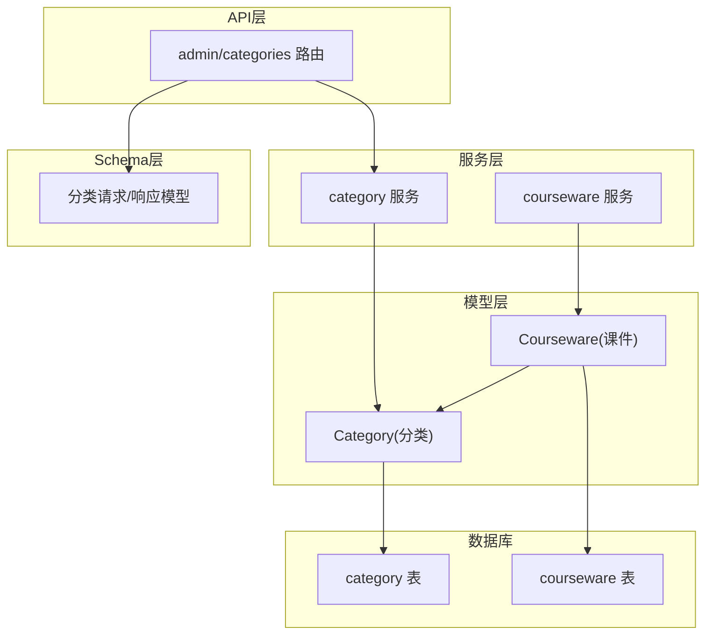
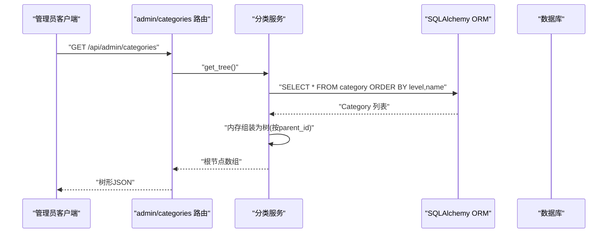
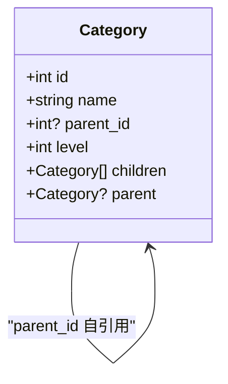
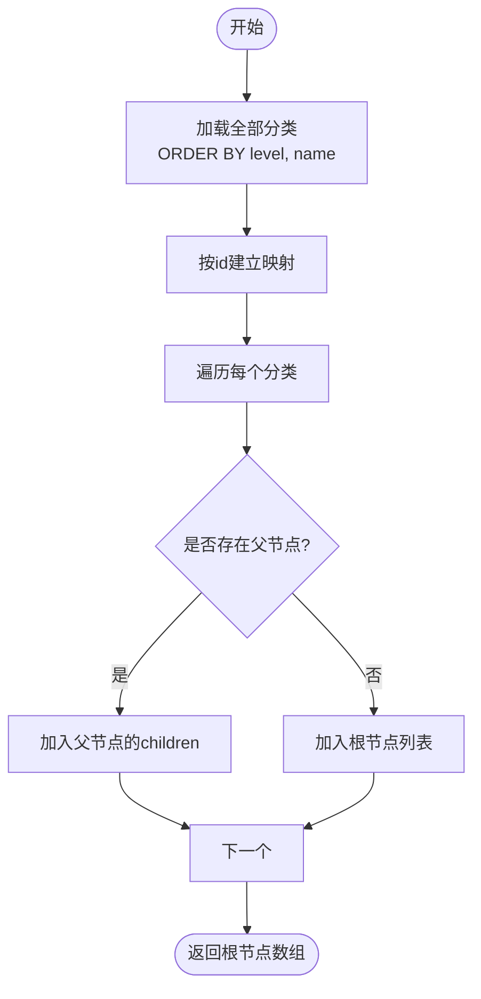
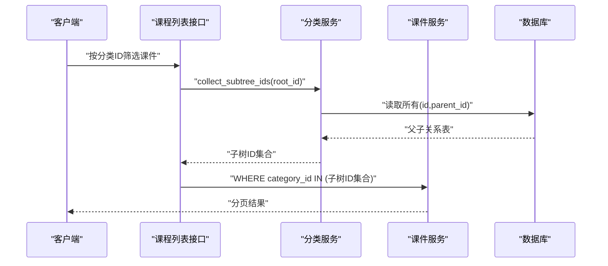
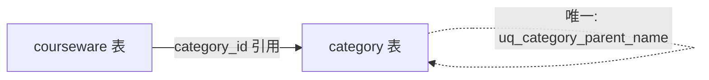

# 分类模型(Category)

<cite>
**本文引用的文件**   
- [backend/app/models/category.py](file://backend/app/models/category.py)
- [backend/app/schemas/category.py](file://backend/app/schemas/category.py)
- [backend/app/services/category.py](file://backend/app/services/category.py)
- [backend/app/api/admin/categories.py](file://backend/app/api/admin/categories.py)
- [backend/app/models/courseware.py](file://backend/app/models/courseware.py)
- [backend/alembic/versions/2026_07_06_1745-11f9c69846a9_init_schema.py](file://backend/alembic/versions/2026_07_06_1745-11f9c69846a9_init_schema.py)
- [backend/app/services/courseware.py](file://backend/app/services/courseware.py)
- [backend/app/services/llm_sql.py](file://backend/app/services/llm_sql.py)
</cite>

## 目录
1. [简介](#简介)
2. [项目结构](#项目结构)
3. [核心组件](#核心组件)
4. [架构总览](#架构总览)
5. [详细组件分析](#详细组件分析)
6. [依赖关系分析](#依赖关系分析)
7. [性能与查询优化](#性能与查询优化)
8. [故障排查指南](#故障排查指南)
9. [结论](#结论)
10. [附录](#附录)

## 简介
本文件围绕“分类(Category)”实体，系统性说明其树形结构设计、层级约束、与课件的关系及删除策略、排序与显示顺序控制、以及数据迁移与版本管理实践。文档同时提供ER图、树形示例与关键流程时序图，帮助读者快速理解并正确使用分类能力。

## 项目结构
分类相关代码主要分布在以下模块：
- 数据模型层：定义 Category 表结构与自引用关系
- 业务服务层：实现树构建、创建/更新/删除、子树ID收集等
- API 层：暴露分类的增删改查接口
- Schema 层：请求/响应校验与树节点序列化
- 关联模型：Courseware 通过外键引用 Category
- 迁移脚本：使用 Alembic 初始化 category 表结构



图表来源
- [backend/app/models/category.py:12-46](file://backend/app/models/category.py#L12-L46)
- [backend/app/models/courseware.py:21-74](file://backend/app/models/courseware.py#L21-L74)
- [backend/app/services/category.py:1-152](file://backend/app/services/category.py#L1-L152)
- [backend/app/api/admin/categories.py:1-81](file://backend/app/api/admin/categories.py#L1-L81)
- [backend/app/schemas/category.py:1-49](file://backend/app/schemas/category.py#L1-L49)

章节来源
- [backend/app/models/category.py:12-46](file://backend/app/models/category.py#L12-L46)
- [backend/app/models/courseware.py:21-74](file://backend/app/models/courseware.py#L21-L74)
- [backend/app/services/category.py:1-152](file://backend/app/services/category.py#L1-L152)
- [backend/app/api/admin/categories.py:1-81](file://backend/app/api/admin/categories.py#L1-L81)
- [backend/app/schemas/category.py:1-49](file://backend/app/schemas/category.py#L1-L49)

## 核心组件
- Category 模型：支持三级树形结构，通过 parent_id 自引用与 level 字段共同维护层级；同一父节点下 name 唯一；对父节点存在性采用 RESTRICT 保护。
- 分类服务：提供 get_tree（整树）、create/update/delete、collect_subtree_ids（子树ID集合）等能力。
- 分类 API：提供 GET/POST/PUT/DELETE 接口，返回树形结构或单条记录。
- 分类 Schema：定义创建/重命名请求体与树节点响应体。
- Courseware 模型：通过 category_id 外键指向 Category，且外键为 RESTRICT，避免误删。

章节来源
- [backend/app/models/category.py:12-46](file://backend/app/models/category.py#L12-L46)
- [backend/app/services/category.py:27-152](file://backend/app/services/category.py#L27-L152)
- [backend/app/api/admin/categories.py:33-80](file://backend/app/api/admin/categories.py#L33-L80)
- [backend/app/schemas/category.py:9-49](file://backend/app/schemas/category.py#L9-L49)
- [backend/app/models/courseware.py:21-74](file://backend/app/models/courseware.py#L21-L74)

## 架构总览
分类在系统中的角色是“导航型”维度，用于组织课件。其典型调用链如下：



图表来源
- [backend/app/api/admin/categories.py:33-36](file://backend/app/api/admin/categories.py#L33-L36)
- [backend/app/services/category.py:27-42](file://backend/app/services/category.py#L27-L42)

## 详细组件分析

### Category 实体与树形设计
- 字段与约束
  - id：主键
  - name：名称，长度限制
  - parent_id：自引用外键，NULL 表示根节点
  - level：层级，限定为 1/2/3
  - 唯一约束：同一父节点下 name 唯一
  - 索引：parent_id 索引，加速父子查询
- 自引用关系
  - children：一对多子节点
  - parent：反向一对一父节点
  - 级联：children 仅配置 save-update，不级联删除；父节点删除受 RESTRICT 保护



图表来源
- [backend/app/models/category.py:12-46](file://backend/app/models/category.py#L12-L46)

章节来源
- [backend/app/models/category.py:12-46](file://backend/app/models/category.py#L12-L46)

### 分类与课件的关系与删除策略
- 关系
  - Courseware.category_id → Category.id，N:1 关系
  - 外键 ondelete=RESTRICT，防止误删被引用的分类
- 删除策略
  - 删除分类前需确保：无子分类、无直接引用的课件
  - 若需删除分类，应先解绑或删除其下的课件，再删除分类

```mermaid
erDiagram
CATEGORY {
int id PK
string name
int? parent_id FK
int level
}
COURSEWARE {
int id PK
int category_id FK
string title
}
CATEGORY ||--o{ CATEGORY : "parent_id 自引用"
CATEGORY ||--o{ COURSEWARE : "被课件引用"
```

图表来源
- [backend/app/models/category.py:12-46](file://backend/app/models/category.py#L12-L46)
- [backend/app/models/courseware.py:21-74](file://backend/app/models/courseware.py#L21-L74)
- [backend/alembic/versions/2026_07_06_1745-11f9c69846a9_init_schema.py:34-43](file://backend/alembic/versions/2026_07_06_1745-11f9c69846a9_init_schema.py#L34-L43)
- [backend/alembic/versions/2026_07_06_1745-11f9c69846a9_init_schema.py:63-75](file://backend/alembic/versions/2026_07_06_1745-11f9c69846a9_init_schema.py#L63-L75)

章节来源
- [backend/app/models/courseware.py:21-74](file://backend/app/models/courseware.py#L21-L74)
- [backend/app/services/category.py:91-111](file://backend/app/services/category.py#L91-L111)
- [backend/alembic/versions/2026_07_06_1745-11f9c69846a9_init_schema.py:34-43](file://backend/alembic/versions/2026_07_06_1745-11f9c69846a9_init_schema.py#L34-L43)
- [backend/alembic/versions/2026_07_06_1745-11f9c69846a9_init_schema.py:63-75](file://backend/alembic/versions/2026_07_06_1745-11f9c69846a9_init_schema.py#L63-L75)

### 分类的 CRUD 与树形构建流程
- 获取整树：一次性加载所有分类，内存中按 parent_id 组装为树，并按 level、name 排序
- 创建：校验名称、计算 level（基于父节点），保证同级唯一
- 更新：仅允许重命名，仍受同级唯一约束
- 删除：检查是否有子节点或被课件引用，否则删除



图表来源
- [backend/app/services/category.py:27-42](file://backend/app/services/category.py#L27-L42)

章节来源
- [backend/app/services/category.py:27-42](file://backend/app/services/category.py#L27-L42)

### 子树过滤与课件列表联动
- 当按分类筛选课件时，先收集该分类及其所有后代 ID，再用 IN 条件批量过滤
- 叶子节点（level=3）的子树即自身，等价于精确匹配



图表来源
- [backend/app/services/category.py:113-131](file://backend/app/services/category.py#L113-L131)
- [backend/app/services/courseware.py:419-447](file://backend/app/services/courseware.py#L419-L447)

章节来源
- [backend/app/services/category.py:113-131](file://backend/app/services/category.py#L113-L131)
- [backend/app/services/courseware.py:419-447](file://backend/app/services/courseware.py#L419-L447)

### 排序机制与显示顺序控制
- 分类树展示顺序
  - 后端按 level、name 排序后在内存中组装树，前端接收到的树即为最终展示顺序
- 课件素材顺序
  - 与分类无关，但作为参考：课件的素材顺序由中间表的 sort_order 控制，并在 ORM 中通过 order_by 指定

章节来源
- [backend/app/services/category.py:27-42](file://backend/app/services/category.py#L27-L42)
- [backend/app/models/courseware.py:55-61](file://backend/app/models/courseware.py#L55-L61)

### API 行为与缓存失效
- 分类增删改后，会触发词汇缓存失效，使 LLM 搜索提示词中的分类名尽快生效
- 分类 API 返回统一的树形结构或操作结果

章节来源
- [backend/app/api/admin/categories.py:33-80](file://backend/app/api/admin/categories.py#L33-L80)
- [backend/app/services/llm_sql.py:34-71](file://backend/app/services/llm_sql.py#L34-71)

## 依赖关系分析
- Category 自引用：parent_id → category.id，ondelete=RESTRICT
- Courseware → Category：category_id → category.id，ondelete=RESTRICT
- 索引：category.parent_id 有索引，提升父子查询效率
- 唯一约束：uq_category_parent_name 保证同级名称唯一



图表来源
- [backend/app/models/category.py:12-46](file://backend/app/models/category.py#L12-L46)
- [backend/app/models/courseware.py:21-74](file://backend/app/models/courseware.py#L21-L74)
- [backend/alembic/versions/2026_07_06_1745-11f9c69846a9_init_schema.py:34-43](file://backend/alembic/versions/2026_07_06_1745-11f9c69846a9_init_schema.py#L34-L43)

章节来源
- [backend/app/models/category.py:12-46](file://backend/app/models/category.py#L12-L46)
- [backend/app/models/courseware.py:21-74](file://backend/app/models/courseware.py#L21-L74)
- [backend/alembic/versions/2026_07_06_1745-11f9c69846a9_init_schema.py:34-43](file://backend/alembic/versions/2026_07_06_1745-11f9c69846a9_init_schema.py#L34-L43)

## 性能与查询优化
- 递归查询优化
  - 当前实现采用“全量加载 + 内存组装”的方式构建整树，避免了多次递归 SQL 查询，适合分类规模不大的场景
  - 对于按分类筛选课件的场景，使用 collect_subtree_ids 一次性拉取父子关系并 BFS 收集子树ID，再以 IN 条件进行批量过滤，减少 N+1 问题
- 路径缓存机制
  - 未实现持久化的“路径缓存”字段（如 path/hierarchy）。如需更高性能的祖先/路径查询，可考虑引入冗余字段（例如存储从根到当前节点的路径字符串或数组），并在写入时维护
  - 当前系统对分类名的检索通过进程内词汇缓存（TTL）降低重复查询开销，适用于 LLM 提示词生成场景

章节来源
- [backend/app/services/category.py:27-42](file://backend/app/services/category.py#L27-L42)
- [backend/app/services/category.py:113-131](file://backend/app/services/category.py#L113-L131)
- [backend/app/services/llm_sql.py:34-71](file://backend/app/services/llm_sql.py#L34-71)

## 故障排查指南
- 无法删除分类
  - 原因：存在子分类或被课件引用
  - 处理：先删除或转移子分类/课件，再执行删除
- 同级名称冲突
  - 原因：同一父节点下已存在同名分类
  - 处理：修改名称后再提交
- 超过最大层级
  - 原因：尝试创建第 4 级分类
  - 处理：保持在 3 级以内

章节来源
- [backend/app/services/category.py:52-76](file://backend/app/services/category.py#L52-L76)
- [backend/app/services/category.py:91-111](file://backend/app/services/category.py#L91-L111)

## 结论
Category 模型以简洁的自引用与 level 字段实现了稳定的三级树结构，配合内存组装与子树ID收集，兼顾了易用性与性能。与 Courseware 的 RESTRICT 外键确保了数据一致性。建议在后续演进中按需引入路径冗余字段以进一步优化祖先/路径类查询。

## 附录

### ER 图（含自引用与课件关系）
```mermaid
erDiagram
CATEGORY {
int id PK
string name
int? parent_id FK
int level
}
COURSEWARE {
int id PK
int category_id FK
string title
}
CATEGORY ||--o{ CATEGORY : "parent_id 自引用"
CATEGORY ||--o{ COURSEWARE : "被课件引用"
```

图表来源
- [backend/app/models/category.py:12-46](file://backend/app/models/category.py#L12-L46)
- [backend/app/models/courseware.py:21-74](file://backend/app/models/courseware.py#L21-L74)
- [backend/alembic/versions/2026_07_06_1745-11f9c69846a9_init_schema.py:34-43](file://backend/alembic/versions/2026_07_06_1745-11f9c69846a9_init_schema.py#L34-L43)
- [backend/alembic/versions/2026_07_06_1745-11f9c69846a9_init_schema.py:63-75](file://backend/alembic/versions/2026_07_06_1745-11f9c69846a9_init_schema.py#L63-L75)

### 树形结构示例（根/子分类）
- 根分类（level=1）
  - 名称：技术
  - parent_id：NULL
- 一级子分类（level=2）
  - 名称：后端
  - parent_id：技术.id
- 二级子分类（level=3）
  - 名称：Python
  - parent_id：后端.id

以上结构可通过分类 API 依次创建，并在“获取整树”接口中查看完整树形输出。

章节来源
- [backend/app/api/admin/categories.py:33-80](file://backend/app/api/admin/categories.py#L33-L80)
- [backend/app/services/category.py:27-42](file://backend/app/services/category.py#L27-L42)

### 数据迁移与版本管理最佳实践
- 使用 Alembic 管理 schema 变更，确保每次迁移具备 upgrade/downgrade
- 新增字段或索引时，优先在迁移脚本中显式声明，保持模型与数据库一致
- 涉及外键或唯一约束的变更需谨慎评估数据影响，必要时分阶段迁移

章节来源
- [backend/alembic/versions/2026_07_06_1745-11f9c69846a9_init_schema.py:21-113](file://backend/alembic/versions/2026_07_06_1745-11f9c69846a9_init_schema.py#L21-L113)