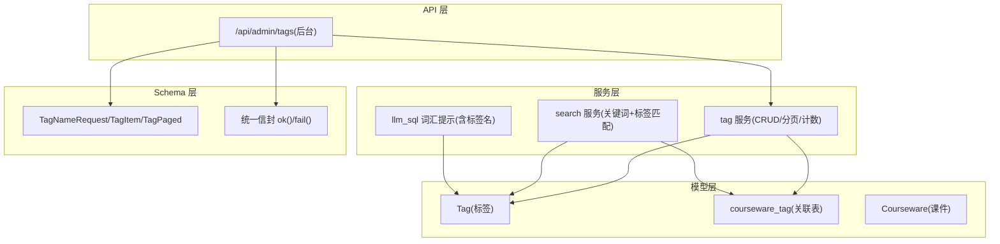
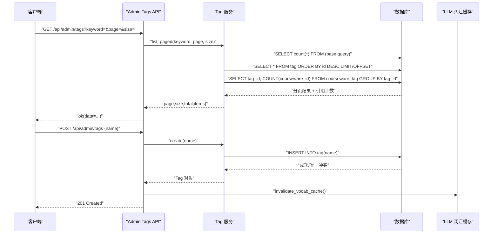
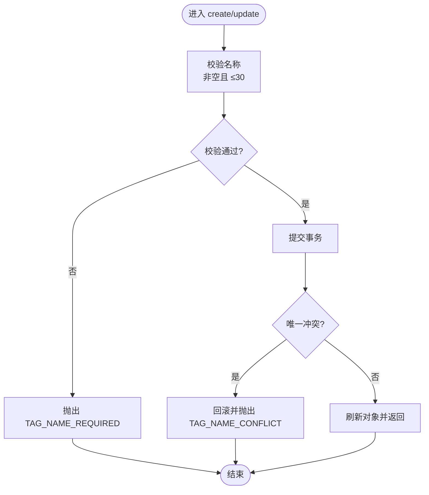
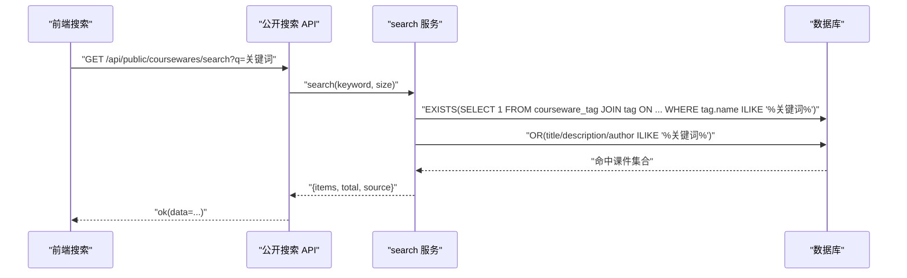
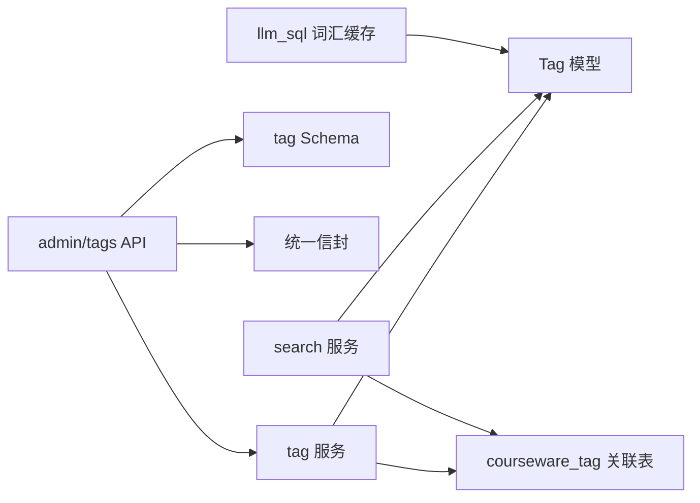

# 标签模型(Tag)

<cite>
**本文引用的文件**   
- [backend/app/models/tag.py](file://backend/app/models/tag.py)
- [backend/app/models/association.py](file://backend/app/models/association.py)
- [backend/app/models/courseware.py](file://backend/app/models/courseware.py)
- [backend/app/schemas/tag.py](file://backend/app/schemas/tag.py)
- [backend/app/services/tag.py](file://backend/app/services/tag.py)
- [backend/app/api/admin/tags.py](file://backend/app/api/admin/tags.py)
- [backend/app/core/errors.py](file://backend/app/core/errors.py)
- [backend/app/services/search.py](file://backend/app/services/search.py)
- [backend/app/services/llm_sql.py](file://backend/app/services/llm_sql.py)
- [backend/app/schemas/__init__.py](file://backend/app/schemas/__init__.py)
</cite>

## 目录
1. [简介](#简介)
2. [项目结构](#项目结构)
3. [核心组件](#核心组件)
4. [架构总览](#架构总览)
5. [详细组件分析](#详细组件分析)
6. [依赖关系分析](#依赖关系分析)
7. [性能考虑](#性能考虑)
8. [故障排查指南](#故障排查指南)
9. [结论](#结论)
10. [附录：API 与最佳实践](#附录api-与最佳实践)

## 简介
本文件围绕“标签模型(Tag)”进行系统化文档化，覆盖实体设计、唯一性与命名规范、与课件的多对多关联机制、搜索与过滤实现、增删改查与一致性保障、以及使用最佳实践与优化建议。目标是帮助读者快速理解并正确使用标签能力，同时为后续扩展提供清晰的技术参考。

## 项目结构
与标签相关的代码主要分布在以下模块：
- 数据模型层：Tag 表定义、M:N 关联表、与 Courseware 的 ORM 关系
- 业务服务层：标签的 CRUD、分页列表、引用计数
- API 层：后台管理接口（创建、重命名、删除、分页查询）
- Schema 层：请求/响应校验与数据结构
- 错误码：标签相关错误码与 HTTP 状态映射
- 搜索与 LLM 提示词：基于标签的检索策略与词汇缓存



图表来源
- [backend/app/models/tag.py:13-27](file://backend/app/models/tag.py#L13-L27)
- [backend/app/models/association.py:9-14](file://backend/app/models/association.py#L9-L14)
- [backend/app/models/courseware.py:51-54](file://backend/app/models/courseware.py#L51-L54)
- [backend/app/services/tag.py:24-60](file://backend/app/services/tag.py#L24-L60)
- [backend/app/services/search.py:129-156](file://backend/app/services/search.py#L129-L156)
- [backend/app/services/llm_sql.py:44-91](file://backend/app/services/llm_sql.py#L44-L91)
- [backend/app/api/admin/tags.py:21-66](file://backend/app/api/admin/tags.py#L21-L66)
- [backend/app/schemas/tag.py:9-33](file://backend/app/schemas/tag.py#L9-L33)
- [backend/app/schemas/__init__.py:35-42](file://backend/app/schemas/__init__.py#L35-L42)

章节来源
- [backend/app/models/tag.py:13-27](file://backend/app/models/tag.py#L13-L27)
- [backend/app/models/association.py:9-14](file://backend/app/models/association.py#L9-L14)
- [backend/app/models/courseware.py:51-54](file://backend/app/models/courseware.py#L51-L54)
- [backend/app/services/tag.py:24-60](file://backend/app/services/tag.py#L24-L60)
- [backend/app/services/search.py:129-156](file://backend/app/services/search.py#L129-L156)
- [backend/app/services/llm_sql.py:44-91](file://backend/app/services/llm_sql.py#L44-L91)
- [backend/app/api/admin/tags.py:21-66](file://backend/app/api/admin/tags.py#L21-L66)
- [backend/app/schemas/tag.py:9-33](file://backend/app/schemas/tag.py#L9-L33)
- [backend/app/schemas/__init__.py:35-42](file://backend/app/schemas/__init__.py#L35-L42)

## 核心组件
- 标签实体 Tag
  - 扁平、全局唯一的标签词条，name 字段具备唯一约束，长度限制在 30 以内。
  - 包含 id、name、created_at 三个核心字段。
- 多对多关联 courseware_tag
  - 通过联合主键(courseware_id, tag_id)建立课件与标签的 M:N 关系。
  - 外键级联删除，保证数据一致性。
- 课件实体 Courseware
  - 通过 relationship 指向 Tag，secondary 指定 courseware_tag 表，lazy="selectin" 提升加载性能。
- 标签服务 tag
  - 提供 list_paged、get、create、update、delete 等能力；list_paged 返回引用计数避免 N+1。
- 标签 API
  - 后台路由 /api/admin/tags 暴露 GET/POST/PUT/DELETE，受管理员鉴权保护。
- 标签 Schema
  - 输入校验：TagNameRequest 限制长度并自动去空白。
  - 输出结构：TagItem、TagPaged 用于分页展示。
- 错误码
  - 标签相关错误码：TAG_NOT_FOUND、TAG_NAME_REQUIRED、TAG_NAME_CONFLICT，映射到对应 HTTP 状态。

章节来源
- [backend/app/models/tag.py:13-27](file://backend/app/models/tag.py#L13-L27)
- [backend/app/models/association.py:9-14](file://backend/app/models/association.py#L9-L14)
- [backend/app/models/courseware.py:51-54](file://backend/app/models/courseware.py#L51-L54)
- [backend/app/services/tag.py:15-21](file://backend/app/services/tag.py#L15-L21)
- [backend/app/services/tag.py:24-60](file://backend/app/services/tag.py#L24-L60)
- [backend/app/services/tag.py:70-92](file://backend/app/services/tag.py#L70-L92)
- [backend/app/api/admin/tags.py:21-66](file://backend/app/api/admin/tags.py#L21-L66)
- [backend/app/schemas/tag.py:9-33](file://backend/app/schemas/tag.py#L9-L33)
- [backend/app/core/errors.py:40-43](file://backend/app/core/errors.py#L40-L43)
- [backend/app/core/errors.py:99-102](file://backend/app/core/errors.py#L99-L102)

## 架构总览
下图展示了从 API 到数据库的完整调用链，包括标签的增删改查、引用计数计算以及与搜索的联动。



图表来源
- [backend/app/api/admin/tags.py:21-42](file://backend/app/api/admin/tags.py#L21-L42)
- [backend/app/services/tag.py:24-60](file://backend/app/services/tag.py#L24-L60)
- [backend/app/services/tag.py:70-80](file://backend/app/services/tag.py#L70-L80)
- [backend/app/services/llm_sql.py:34-41](file://backend/app/services/llm_sql.py#L34-L41)

## 详细组件分析

### 实体设计与约束
- 唯一性约束
  - name 字段具有 unique=True 约束，确保全局唯一。
  - 插入或更新时若发生重复，将触发 IntegrityError，由服务层捕获并转换为业务错误 TAG_NAME_CONFLICT。
- 命名规范
  - 长度限制：≤30 字符。
  - 自动去除首尾空白，避免多余空格导致歧义。
- 时间戳
  - created_at 默认当前时间，便于审计与排序。

```mermaid
classDiagram
class Tag {
+int id
+string name
+datetime created_at
}
class Courseware {
+int id
+string title
+Tag[] tags
}
class courseware_tag {
+int courseware_id
+int tag_id
}
Courseware --> Tag : "M : N via courseware_tag"
courseware_tag --> Tag : "FK tag_id"
courseware_tag --> Courseware : "FK courseware_id"
```

图表来源
- [backend/app/models/tag.py:13-27](file://backend/app/models/tag.py#L13-L27)
- [backend/app/models/courseware.py:51-54](file://backend/app/models/courseware.py#L51-L54)
- [backend/app/models/association.py:9-14](file://backend/app/models/association.py#L9-L14)

章节来源
- [backend/app/models/tag.py:13-27](file://backend/app/models/tag.py#L13-L27)
- [backend/app/models/association.py:9-14](file://backend/app/models/association.py#L9-L14)
- [backend/app/models/courseware.py:51-54](file://backend/app/models/courseware.py#L51-L54)

### 多对多关联机制
- 关联表 courseware_tag
  - 联合主键(courseware_id, tag_id)，防止重复绑定。
  - ondelete=CASCADE，删除课件或标签时自动清理关联行。
- ORM 关系
  - Courseware.tags 使用 secondary="courseware_tag"，lazy="selectin" 减少 N+1 查询。
  - backref="coursewares" 支持反向访问。

章节来源
- [backend/app/models/association.py:9-14](file://backend/app/models/association.py#L9-L14)
- [backend/app/models/courseware.py:51-54](file://backend/app/models/courseware.py#L51-L54)

### 标签的增删改查与一致性
- 创建(create)
  - 校验名称非空且长度合规，提交后捕获唯一冲突异常，回滚事务并抛出 TAG_NAME_CONFLICT。
- 更新(update)
  - 先获取目标标签，再校验并重写 name，同样处理唯一冲突。
- 删除(delete)
  - 直接删除 Tag，由于外键级联，关联表自动清理。
- 分页列表(list_paged)
  - 支持 keyword 模糊匹配。
  - 通过子查询统计每个 tag 的引用数，避免 N+1。
  - 返回 page、size、total、items（含 coursewareCount）。



图表来源
- [backend/app/services/tag.py:15-21](file://backend/app/services/tag.py#L15-L21)
- [backend/app/services/tag.py:70-92](file://backend/app/services/tag.py#L70-L92)
- [backend/app/core/errors.py:40-43](file://backend/app/core/errors.py#L40-L43)
- [backend/app/core/errors.py:99-102](file://backend/app/core/errors.py#L99-L102)

章节来源
- [backend/app/services/tag.py:70-92](file://backend/app/services/tag.py#L70-L92)
- [backend/app/core/errors.py:40-43](file://backend/app/core/errors.py#L40-L43)
- [backend/app/core/errors.py:99-102](file://backend/app/core/errors.py#L99-L102)

### 标签的搜索与过滤
- 后台标签列表
  - 支持 keyword 模糊匹配，按 id 倒序分页。
  - 通过子查询聚合 courseware_tag 得到引用计数。
- 前台搜索中的标签匹配
  - 使用 EXISTS 子句匹配 tag.name，避免大表 JOIN 成本。
  - 与标题、作者、描述字段的 ILIKE 条件以 OR 组合，提高召回率。
- LLM 提示词中的标签词汇
  - 构建已知标签名列表，注入提示词，引导模型生成更准确的 SQL。
  - 进程级缓存 TTL 60s，后台修改标签后延迟生效。



图表来源
- [backend/app/services/search.py:129-156](file://backend/app/services/search.py#L129-L156)
- [backend/app/api/public/coursewares.py:32-54](file://backend/app/api/public/coursewares.py#L32-L54)
- [backend/app/services/llm_sql.py:44-91](file://backend/app/services/llm_sql.py#L44-L91)

章节来源
- [backend/app/services/tag.py:24-60](file://backend/app/services/tag.py#L24-L60)
- [backend/app/services/search.py:129-156](file://backend/app/services/search.py#L129-L156)
- [backend/app/services/llm_sql.py:44-91](file://backend/app/services/llm_sql.py#L44-L91)

### API 调用示例（路径与参数）
- 标签管理（后台）
  - GET /api/admin/tags
    - 查询参数：keyword、page、size
    - 响应：统一信封 data={page,size,total,items[]}
  - POST /api/admin/tags
    - 请求体：{name}
    - 响应：统一信封 data={id,name,createdAt}
  - PUT /api/admin/tags/{tag_id}
    - 请求体：{name}
    - 响应：统一信封 data={id,name,createdAt}
  - DELETE /api/admin/tags/{tag_id}
    - 响应：统一信封 data=null
- 统一信封
  - 成功：{code:"ok", message:"ok", data, requestId}
  - 失败：{code, message, data, requestId}

章节来源
- [backend/app/api/admin/tags.py:21-66](file://backend/app/api/admin/tags.py#L21-L66)
- [backend/app/schemas/tag.py:9-33](file://backend/app/schemas/tag.py#L9-L33)
- [backend/app/schemas/__init__.py:35-42](file://backend/app/schemas/__init__.py#L35-L42)

## 依赖关系分析
- 耦合与内聚
  - Tag 服务仅依赖 Tag 模型与 courseware_tag 关联表，职责单一，内聚度高。
  - API 层通过依赖注入获取 Session，并通过统一信封封装响应。
- 外部依赖
  - LLM 词汇缓存：在后台增删改标签后失效，避免提示词不一致。
- 潜在循环依赖
  - search 服务局部导入 Tag 与 association，避免循环导入问题。



图表来源
- [backend/app/api/admin/tags.py:21-66](file://backend/app/api/admin/tags.py#L21-L66)
- [backend/app/services/tag.py:24-60](file://backend/app/services/tag.py#L24-L60)
- [backend/app/services/search.py:129-156](file://backend/app/services/search.py#L129-L156)
- [backend/app/services/llm_sql.py:44-91](file://backend/app/services/llm_sql.py#L44-L91)
- [backend/app/schemas/tag.py:9-33](file://backend/app/schemas/tag.py#L9-L33)
- [backend/app/schemas/__init__.py:35-42](file://backend/app/schemas/__init__.py#L35-L42)

章节来源
- [backend/app/api/admin/tags.py:21-66](file://backend/app/api/admin/tags.py#L21-L66)
- [backend/app/services/tag.py:24-60](file://backend/app/services/tag.py#L24-L60)
- [backend/app/services/search.py:129-156](file://backend/app/services/search.py#L129-L156)
- [backend/app/services/llm_sql.py:44-91](file://backend/app/services/llm_sql.py#L44-L91)
- [backend/app/schemas/tag.py:9-33](file://backend/app/schemas/tag.py#L9-L33)
- [backend/app/schemas/__init__.py:35-42](file://backend/app/schemas/__init__.py#L35-L42)

## 性能考虑
- 引用计数优化
  - 使用子查询聚合 courseware_tag 的计数，避免 N+1 查询。
- 搜索优化
  - 使用 EXISTS 子句匹配标签，降低 JOIN 开销。
  - 关键词采用 ILIKE 模式匹配，注意索引策略（如适用）。
- 词汇缓存
  - 标签名列表缓存于进程内存，TTL 60s，后台变更时主动失效，平衡一致性与性能。

[本节为通用性能建议，不直接分析具体文件]

## 故障排查指南
- 常见错误码
  - TAG_NAME_REQUIRED：标签名为空或超长。
  - TAG_NAME_CONFLICT：标签名已存在。
  - TAG_NOT_FOUND：标签不存在。
- 排查步骤
  - 检查请求体 name 是否满足长度与非空要求。
  - 确认是否存在同名标签，必要时先查询再操作。
  - 查看数据库唯一约束与外键级联行为，确保删除顺序正确。
- 日志与定位
  - 关注 IntegrityError 捕获分支，确认唯一冲突场景。
  - 核对 LLM 词汇缓存失效时机，避免提示词不一致导致的 SQL 生成偏差。

章节来源
- [backend/app/core/errors.py:40-43](file://backend/app/core/errors.py#L40-L43)
- [backend/app/core/errors.py:99-102](file://backend/app/core/errors.py#L99-L102)
- [backend/app/services/tag.py:70-92](file://backend/app/services/tag.py#L70-L92)
- [backend/app/services/llm_sql.py:34-41](file://backend/app/services/llm_sql.py#L34-L41)

## 结论
标签模型以“扁平、全局唯一”为核心设计理念，借助 courseware_tag 实现灵活的 M:N 关联。服务层提供健壮的 CRUD 与分页能力，结合搜索与 LLM 提示词增强检索体验。通过唯一约束、外键级联与错误码体系，保证了数据一致性与可观测性。遵循命名约定与批量操作建议，可在大规模数据下保持良好性能。

[本节为总结性内容，不直接分析具体文件]

## 附录：API 与最佳实践

### 标签命名约定
- 简洁明确，尽量使用名词短语，避免过长。
- 控制长度在 30 以内，去除首尾空白。
- 避免同义词并存，维护全局唯一性。

### 批量操作建议
- 后台批量创建标签时，逐条校验并捕获冲突，记录失败原因。
- 批量删除前评估引用计数，避免误删高频标签。

### 性能优化建议
- 列表页优先使用分页与 keyword 过滤，避免一次性拉取大量数据。
- 搜索端使用 EXISTS 匹配标签，减少 JOIN 成本。
- 合理设置 LLM 词汇缓存 TTL，并在后台变更后及时失效。

### 数据库查询优化方案
- 为 tag.name 建立唯一索引（由 unique=True 自动生成），加速精确查找与冲突检测。
- 为 courseware_tag 的联合主键提供高效查找与级联删除。
- 如需频繁按标签检索课件，可考虑在应用层缓存热门标签的课件 ID 集合。

章节来源
- [backend/app/models/tag.py:13-27](file://backend/app/models/tag.py#L13-L27)
- [backend/app/models/association.py:9-14](file://backend/app/models/association.py#L9-L14)
- [backend/app/services/tag.py:24-60](file://backend/app/services/tag.py#L24-L60)
- [backend/app/services/search.py:129-156](file://backend/app/services/search.py#L129-L156)
- [backend/app/services/llm_sql.py:44-91](file://backend/app/services/llm_sql.py#L44-L91)