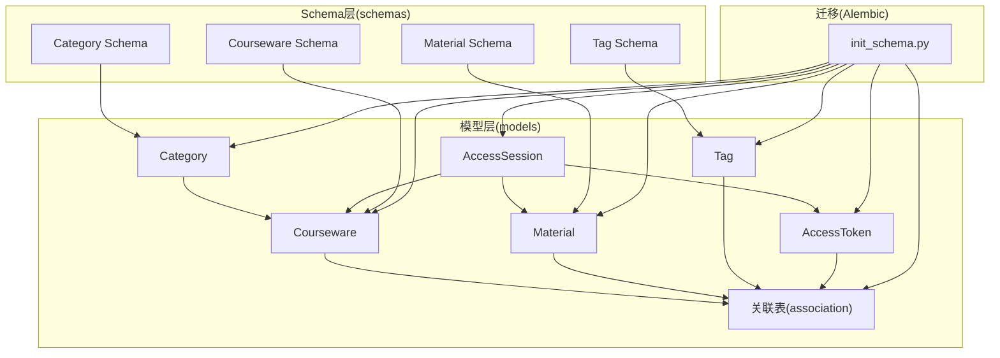
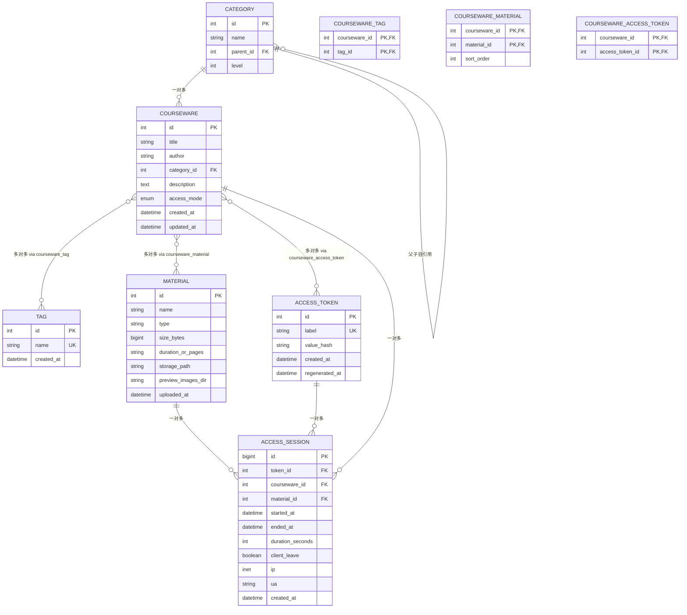
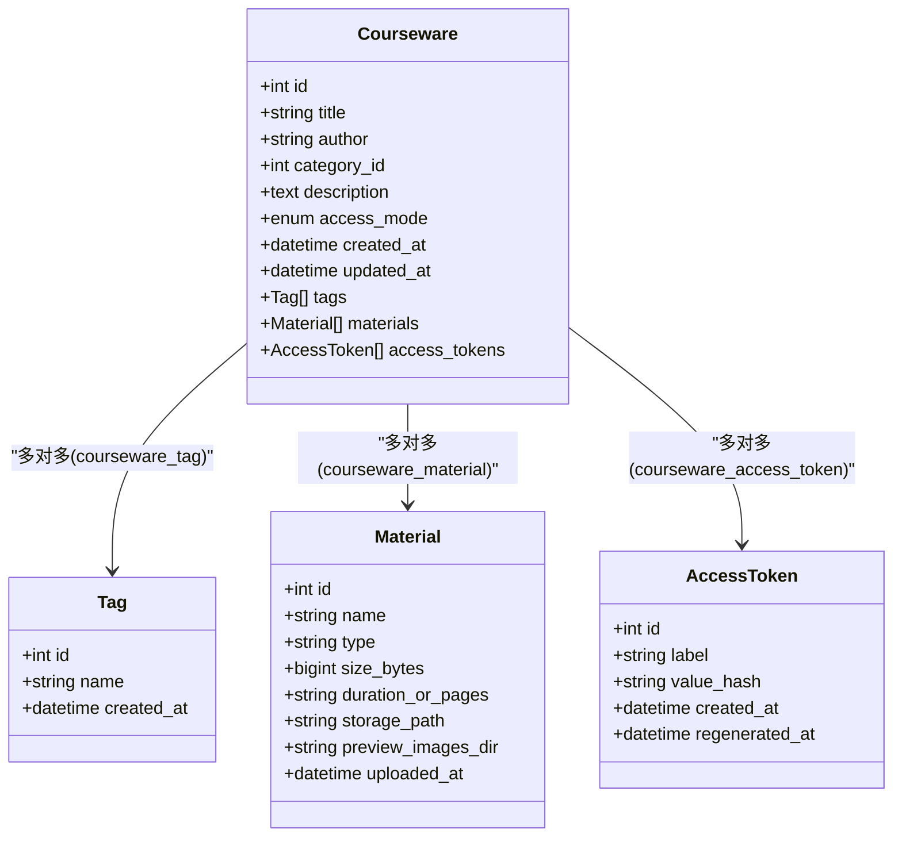
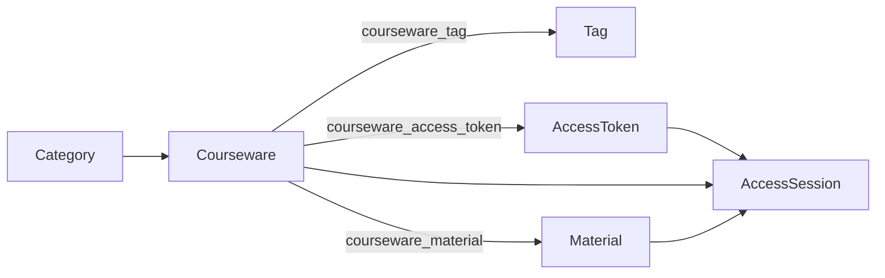
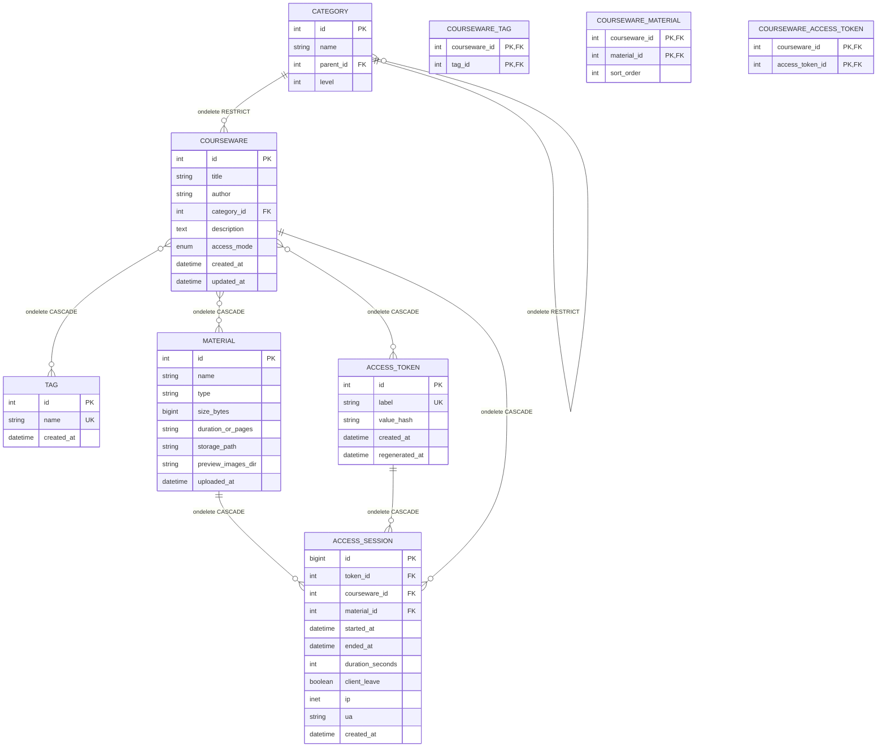

# 核心数据模型

<cite>
**本文引用的文件**   
- [backend/app/models/courseware.py](file://backend/app/models/courseware.py)
- [backend/app/models/material.py](file://backend/app/models/material.py)
- [backend/app/models/category.py](file://backend/app/models/category.py)
- [backend/app/models/tag.py](file://backend/app/models/tag.py)
- [backend/app/models/association.py](file://backend/app/models/association.py)
- [backend/app/models/access_token.py](file://backend/app/models/access_token.py)
- [backend/app/models/access_session.py](file://backend/app/models/access_session.py)
- [backend/app/schemas/courseware.py](file://backend/app/schemas/courseware.py)
- [backend/app/schemas/material.py](file://backend/app/schemas/material.py)
- [backend/app/schemas/category.py](file://backend/app/schemas/category.py)
- [backend/app/schemas/tag.py](file://backend/app/schemas/tag.py)
- [backend/alembic/versions/2026_07_06_1745-11f9c69846a9_init_schema.py](file://backend/alembic/versions/2026_07_06_1745-11f9c69846a9_init_schema.py)
</cite>

## 目录
1. [简介](#简介)
2. [项目结构](#项目结构)
3. [核心组件](#核心组件)
4. [架构总览](#架构总览)
5. [详细组件分析](#详细组件分析)
6. [依赖关系分析](#依赖关系分析)
7. [性能考量](#性能考量)
8. [故障排查指南](#故障排查指南)
9. [结论](#结论)
10. [附录](#附录)

## 简介
本文件聚焦 Learning Hub 的核心数据模型，围绕课件(Courseware)、素材(Material)、分类(Category)、标签(Tag)等实体进行系统化说明。文档涵盖：
- 字段类型、约束条件、默认值与业务规则
- 多对多关联实现（courseware_tag、courseware_material、courseware_access_token）
- 枚举 AccessMode 的使用与扩展机制
- ER 图与实体关系说明（主键、外键、级联）
- 数据验证规则与完整性约束的实现细节

## 项目结构
核心数据模型位于后端 app/models 下，配合 Pydantic schemas 完成 API 层的数据校验与序列化；数据库迁移由 Alembic 管理。

图表来源
- [backend/app/models/courseware.py:21-74](file://backend/app/models/courseware.py#L21-L74)
- [backend/app/models/material.py:44-69](file://backend/app/models/material.py#L44-L69)
- [backend/app/models/category.py:12-46](file://backend/app/models/category.py#L12-L46)
- [backend/app/models/tag.py:13-30](file://backend/app/models/tag.py#L13-L30)
- [backend/app/models/association.py:9-33](file://backend/app/models/association.py#L9-L33)
- [backend/app/models/access_token.py:13-34](file://backend/app/models/access_token.py#L13-L34)
- [backend/app/models/access_session.py:56-129](file://backend/app/models/access_session.py#L56-L129)
- [backend/app/schemas/courseware.py:22-120](file://backend/app/schemas/courseware.py#L22-L120)
- [backend/app/schemas/material.py:9-28](file://backend/app/schemas/material.py#L9-L28)
- [backend/app/schemas/category.py:9-49](file://backend/app/schemas/category.py#L9-L49)
- [backend/app/schemas/tag.py:9-34](file://backend/app/schemas/tag.py#L9-L34)
- [backend/alembic/versions/2026_07_06_1745-11f9c69846a9_init_schema.py:21-97](file://backend/alembic/versions/2026_07_06_1745-11f9c69846a9_init_schema.py#L21-L97)

章节来源
- [backend/app/models/courseware.py:1-74](file://backend/app/models/courseware.py#L1-L74)
- [backend/app/models/material.py:1-69](file://backend/app/models/material.py#L1-L69)
- [backend/app/models/category.py:1-46](file://backend/app/models/category.py#L1-L46)
- [backend/app/models/tag.py:1-30](file://backend/app/models/tag.py#L1-L30)
- [backend/app/models/association.py:1-41](file://backend/app/models/association.py#L1-L41)
- [backend/app/models/access_token.py:1-34](file://backend/app/models/access_token.py#L1-L34)
- [backend/app/models/access_session.py:1-129](file://backend/app/models/access_session.py#L1-L129)
- [backend/app/schemas/courseware.py:1-120](file://backend/app/schemas/courseware.py#L1-L120)
- [backend/app/schemas/material.py:1-28](file://backend/app/schemas/material.py#L1-L28)
- [backend/app/schemas/category.py:1-49](file://backend/app/schemas/category.py#L1-L49)
- [backend/app/schemas/tag.py:1-34](file://backend/app/schemas/tag.py#L1-L34)
- [backend/alembic/versions/2026_07_06_1745-11f9c69846a9_init_schema.py:1-113](file://backend/alembic/versions/2026_07_06_1745-11f9c69846a9_init_schema.py#L1-L113)

## 核心组件
本节概述各核心实体的职责与关键属性。

- 课件 Courseware
  - 标识与描述：标题、作者、描述
  - 分类归属：category_id（外键）
  - 访问控制：access_mode（OPEN/RESTRICTED）
  - 时间戳：created_at、updated_at
  - 关联：tags、materials、access_tokens（通过中间表）

- 素材 Material
  - 元数据：名称、类型、大小、时长或页数、存储路径、预览图片目录
  - 时间戳：uploaded_at
  - 类型推断：根据扩展名映射到 VIDEO/PDF/PPT

- 分类 Category
  - 树形结构：parent_id、level（1/2/3），同一父节点下 name 唯一
  - 自引用关系：children、parent

- 标签 Tag
  - 扁平结构：name 全局唯一
  - 时间戳：created_at

- 访问令牌 AccessToken
  - label 全局唯一，value_hash 为 SHA-256 摘要
  - 时间戳：created_at、regenerated_at

- 访问会话 AccessSession
  - 记录 token + courseware + material 的一次浏览起止时间与停留秒数
  - 客户端 IP、UA、是否主动离开等
  - 检查约束：duration_seconds >= 0

章节来源
- [backend/app/models/courseware.py:21-74](file://backend/app/models/courseware.py#L21-L74)
- [backend/app/models/material.py:44-69](file://backend/app/models/material.py#L44-L69)
- [backend/app/models/category.py:12-46](file://backend/app/models/category.py#L12-L46)
- [backend/app/models/tag.py:13-30](file://backend/app/models/tag.py#L13-L30)
- [backend/app/models/access_token.py:13-34](file://backend/app/models/access_token.py#L13-L34)
- [backend/app/models/access_session.py:56-129](file://backend/app/models/access_session.py#L56-L129)

## 架构总览
下图展示核心实体间的关系与约束，包括多对多中间表与级联策略。

图表来源
- [backend/app/models/courseware.py:21-74](file://backend/app/models/courseware.py#L21-L74)
- [backend/app/models/material.py:44-69](file://backend/app/models/material.py#L44-L69)
- [backend/app/models/category.py:12-46](file://backend/app/models/category.py#L12-L46)
- [backend/app/models/tag.py:13-30](file://backend/app/models/tag.py#L13-L30)
- [backend/app/models/association.py:9-33](file://backend/app/models/association.py#L9-L33)
- [backend/app/models/access_token.py:13-34](file://backend/app/models/access_token.py#L13-L34)
- [backend/app/models/access_session.py:56-129](file://backend/app/models/access_session.py#L56-L129)
- [backend/alembic/versions/2026_07_06_1745-11f9c69846a9_init_schema.py:21-97](file://backend/alembic/versions/2026_07_06_1745-11f9c69846a9_init_schema.py#L21-L97)

## 详细组件分析

### 课件 Courseware
- 字段与约束
  - id：整型自增主键
  - title：非空，最大长度限制
  - author：可选，最大长度限制
  - category_id：非空，外键指向 category.id，删除保护（RESTRICT）
  - description：文本，可选
  - access_mode：枚举 OPEN/RESTRICTED，非空，默认 OPEN
  - created_at/updated_at：带时区的时间戳，创建/更新自动填充
- 关联
  - 与 Tag 多对多：通过 courseware_tag 中间表
  - 与 Material 多对多：通过 courseware_material 中间表，支持排序字段 sort_order
  - 与 AccessToken 多对多：通过 courseware_access_token 中间表
- 业务规则
  - 当 access_mode=RESTRICTED 时，需通过 AccessToken 解锁
  - 素材顺序由管理员拖拽维护，按 sort_order 升序渲染

章节来源
- [backend/app/models/courseware.py:21-74](file://backend/app/models/courseware.py#L21-L74)
- [backend/app/models/association.py:9-33](file://backend/app/models/association.py#L9-L33)
- [backend/app/schemas/courseware.py:22-120](file://backend/app/schemas/courseware.py#L22-L120)

#### 类关系图（代码级）

图表来源
- [backend/app/models/courseware.py:21-74](file://backend/app/models/courseware.py#L21-L74)
- [backend/app/models/tag.py:13-30](file://backend/app/models/tag.py#L13-L30)
- [backend/app/models/material.py:44-69](file://backend/app/models/material.py#L44-L69)
- [backend/app/models/access_token.py:13-34](file://backend/app/models/access_token.py#L13-L34)
- [backend/app/models/association.py:9-33](file://backend/app/models/association.py#L9-L33)

### 素材 Material
- 字段与约束
  - id：整型自增主键
  - name：非空，最大长度限制
  - type：字符串枚举值（VIDEO/PDF/PPT），非空
  - size_bytes：大整数，非空，默认 0
  - duration_or_pages：可选，字符串
  - storage_path：非空，最大长度限制
  - preview_images_dir：可选，PPT 转 PNG 预览目录
  - uploaded_at：带时区时间戳，默认当前时间
- 类型推断
  - 根据文件名扩展名映射到 MaterialType（VIDEO/PDF/PPT）
  - 不支持的扩展名抛出业务异常

章节来源
- [backend/app/models/material.py:14-69](file://backend/app/models/material.py#L14-L69)
- [backend/app/schemas/material.py:9-28](file://backend/app/schemas/material.py#L9-L28)

### 分类 Category
- 字段与约束
  - id：整型自增主键
  - name：非空，最大长度限制
  - parent_id：可空，外键指向 category.id，删除保护（RESTRICT）
  - level：整数，取值 1/2/3
  - 唯一约束：同一父节点下 name 唯一
  - 索引：parent_id
- 自引用关系
  - children：子节点列表
  - parent：父节点对象

章节来源
- [backend/app/models/category.py:12-46](file://backend/app/models/category.py#L12-L46)
- [backend/app/schemas/category.py:9-49](file://backend/app/schemas/category.py#L9-L49)

### 标签 Tag
- 字段与约束
  - id：整型自增主键
  - name：非空，全局唯一，最大长度限制
  - created_at：带时区时间戳，默认当前时间

章节来源
- [backend/app/models/tag.py:13-30](file://backend/app/models/tag.py#L13-L30)
- [backend/app/schemas/tag.py:9-34](file://backend/app/schemas/tag.py#L9-L34)

### 访问令牌 AccessToken
- 字段与约束
  - id：整型自增主键
  - label：非空，全局唯一，最大长度限制
  - value_hash：非空，SHA-256 摘要，索引
  - created_at/regenerated_at：时间戳

章节来源
- [backend/app/models/access_token.py:13-34](file://backend/app/models/access_token.py#L13-L34)

### 访问会话 AccessSession
- 字段与约束
  - id：跨方言兼容的主键（SQLite INTEGER / PostgreSQL BIGINT）
  - token_id/courseware_id/material_id：非空，外键，均配置 CASCADE 删除
  - started_at：非空，带时区
  - ended_at：可选，带时区
  - duration_seconds：可选，非负（检查约束）
  - client_leave：布尔，默认 false
  - ip：PostgreSQL INET，其他方言降级为 VARCHAR(45)
  - ua：可选，最大长度限制
  - created_at：带时区时间戳，默认当前时间
- 索引
  - (token_id, started_at)
  - (token_id, material_id, started_at)
  - (token_id, courseware_id, started_at)

章节来源
- [backend/app/models/access_session.py:56-129](file://backend/app/models/access_session.py#L56-L129)

### 多对多关联设计
- courseware_tag
  - 复合主键：(courseware_id, tag_id)
  - 外键：courseware_id → courseware.id（CASCADE）、tag_id → tag.id（CASCADE）
- courseware_material
  - 复合主键：(courseware_id, material_id)
  - 外键：courseware_id → courseware.id（CASCADE）、material_id → material.id（CASCADE）
  - sort_order：整数，默认 0，用于定义课件内素材顺序
  - 索引：(courseware_id, sort_order) 加速有序查询
- courseware_access_token
  - 复合主键：(courseware_id, access_token_id)
  - 外键：courseware_id → courseware.id（CASCADE）、access_token_id → access_token.id（CASCADE）

章节来源
- [backend/app/models/association.py:9-33](file://backend/app/models/association.py#L9-L33)
- [backend/alembic/versions/2026_07_06_1745-11f9c69846a9_init_schema.py:76-96](file://backend/alembic/versions/2026_07_06_1745-11f9c69846a9_init_schema.py#L76-L96)

### 枚举 AccessMode 使用与扩展
- 定义
  - OPEN：开放访问
  - RESTRICTED：受限访问，需 AccessToken 解锁
- 存储
  - 使用原生枚举（native_enum=False），以字符串形式持久化，长度限制
- 默认值
  - 新建课件默认 OPEN
- 扩展机制
  - 新增模式需在枚举中追加新成员，并在业务逻辑中处理相应权限校验与解锁流程
  - 注意数据库迁移同步（Alembic）以确保 schema 一致

章节来源
- [backend/app/models/courseware.py:14-38](file://backend/app/models/courseware.py#L14-L38)
- [backend/alembic/versions/2026_07_06_1745-11f9c69846a9_init_schema.py:69](file://backend/alembic/versions/2026_07_06_1745-11f9c69846a9_init_schema.py#L69)

### 数据验证与完整性约束
- 模型层（SQLAlchemy）
  - NOT NULL、UNIQUE、FOREIGN KEY、CHECK 约束
  - 级联删除：中间表与访问会话采用 CASCADE；分类与课件采用 RESTRICT 防止误删
- Schema 层（Pydantic）
  - 字段长度、必填校验
  - 字符串去空白（strip）
  - 请求体结构化校验（如材料重排接口要求 ID 列表非空）
- 业务层
  - 素材类型推断：根据扩展名映射，非法类型抛业务异常
  - 访问会话：服务端校正客户端上报时长偏差（业务规则在注释中说明）

章节来源
- [backend/app/models/courseware.py:21-74](file://backend/app/models/courseware.py#L21-L74)
- [backend/app/models/material.py:31-41](file://backend/app/models/material.py#L31-L41)
- [backend/app/models/access_session.py:62-80](file://backend/app/models/access_session.py#L62-L80)
- [backend/app/schemas/courseware.py:22-120](file://backend/app/schemas/courseware.py#L22-L120)
- [backend/app/schemas/material.py:9-28](file://backend/app/schemas/material.py#L9-L28)
- [backend/app/schemas/category.py:9-49](file://backend/app/schemas/category.py#L9-L49)
- [backend/app/schemas/tag.py:9-34](file://backend/app/schemas/tag.py#L9-L34)

## 依赖关系分析
- 直接依赖
  - Courseware 依赖 Category（外键）
  - Courseware 通过中间表依赖 Tag、Material、AccessToken
  - AccessSession 依赖 AccessToken、Courseware、Material（外键）
- 间接依赖
  - 访问控制链：Courseware.access_mode → AccessToken → AccessSession
- 潜在循环
  - Category 自引用（parent/children）属于常见树形结构，不构成循环依赖问题
- 外部依赖
  - 数据库方言适配：AccessSession.ip 使用 TypeDecorator 兼容 PostgreSQL INET 与 SQLite

图表来源
- [backend/app/models/courseware.py:21-74](file://backend/app/models/courseware.py#L21-L74)
- [backend/app/models/association.py:9-33](file://backend/app/models/association.py#L9-L33)
- [backend/app/models/access_session.py:56-129](file://backend/app/models/access_session.py#L56-L129)

章节来源
- [backend/app/models/courseware.py:21-74](file://backend/app/models/courseware.py#L21-L74)
- [backend/app/models/association.py:9-33](file://backend/app/models/association.py#L9-L33)
- [backend/app/models/access_session.py:56-129](file://backend/app/models/access_session.py#L56-L129)

## 性能考量
- 索引优化
  - category.parent_id 索引：加速树形遍历
  - courseware_material(courseware_id, sort_order) 索引：加速按课件有序取素材
  - access_session 多个组合索引：加速按 token+时间/素材/课件的查询
- 延迟加载策略
  - 多对多关系使用 selectin 预加载，减少 N+1 查询
- 数据类型选择
  - size_bytes 使用 BigInteger 避免溢出
  - AccessSession.id 跨方言适配，保证 SQLite/PG 一致性

[本节为通用性能建议，不直接分析具体文件]

## 故障排查指南
- 素材上传失败
  - 检查扩展名是否在支持的映射中（mp4/pdf/ppt/pptx）
  - 若报错“不支持的文件类型”，确认文件名包含合法扩展名
- 分类删除失败
  - 存在子分类或被课件引用时，外键 RESTRICT 会阻止删除
- 访问受限课件无法打开
  - 确认该课件是否关联了有效的 AccessToken
  - 检查 AccessSession 是否正确记录（started_at/ended_at/duration_seconds）
- 素材顺序错乱
  - 检查 courseware_material.sort_order 是否为连续递增且无重复
  - 使用专用排序接口重写顺序并校验参数

章节来源
- [backend/app/models/material.py:31-41](file://backend/app/models/material.py#L31-L41)
- [backend/app/models/category.py:12-46](file://backend/app/models/category.py#L12-L46)
- [backend/app/models/association.py:9-33](file://backend/app/models/association.py#L9-L33)
- [backend/app/models/access_session.py:56-129](file://backend/app/models/access_session.py#L56-L129)

## 结论
Learning Hub 的核心数据模型以 Courseware 为中心，围绕 Category、Tag、Material 构建灵活的资源组织与检索能力。通过中间表实现多对多关系，结合严格的约束与索引优化，保证了数据完整性与查询性能。AccessMode 与 AccessToken 共同构成访问控制基础，AccessSession 提供细粒度的浏览审计。整体设计清晰、可扩展性强，便于后续功能演进。

[本节为总结性内容，不直接分析具体文件]

## 附录

### 完整 ER 图（含约束与级联）

图表来源
- [backend/app/models/courseware.py:21-74](file://backend/app/models/courseware.py#L21-L74)
- [backend/app/models/material.py:44-69](file://backend/app/models/material.py#L44-L69)
- [backend/app/models/category.py:12-46](file://backend/app/models/category.py#L12-L46)
- [backend/app/models/tag.py:13-30](file://backend/app/models/tag.py#L13-L30)
- [backend/app/models/association.py:9-33](file://backend/app/models/association.py#L9-L33)
- [backend/app/models/access_token.py:13-34](file://backend/app/models/access_token.py#L13-L34)
- [backend/app/models/access_session.py:56-129](file://backend/app/models/access_session.py#L56-L129)
- [backend/alembic/versions/2026_07_06_1745-11f9c69846a9_init_schema.py:21-97](file://backend/alembic/versions/2026_07_06_1745-11f9c69846a9_init_schema.py#L21-L97)