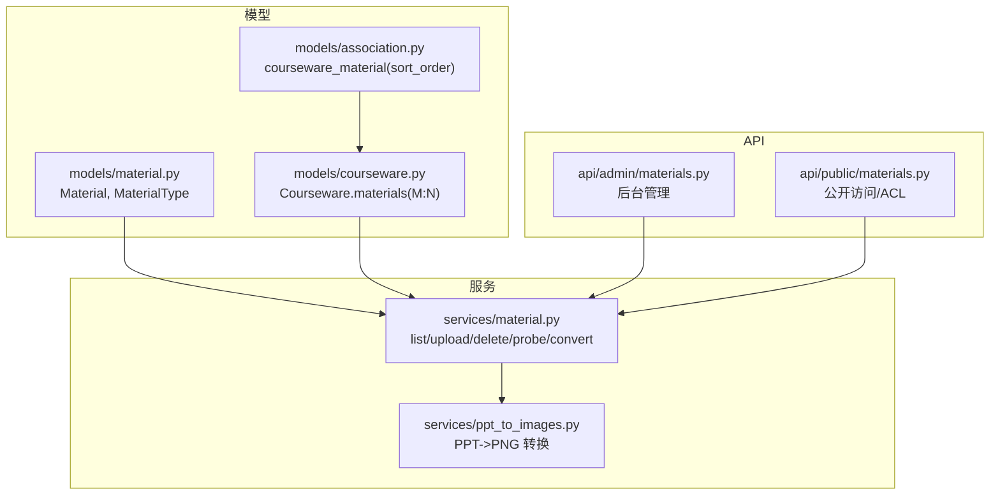
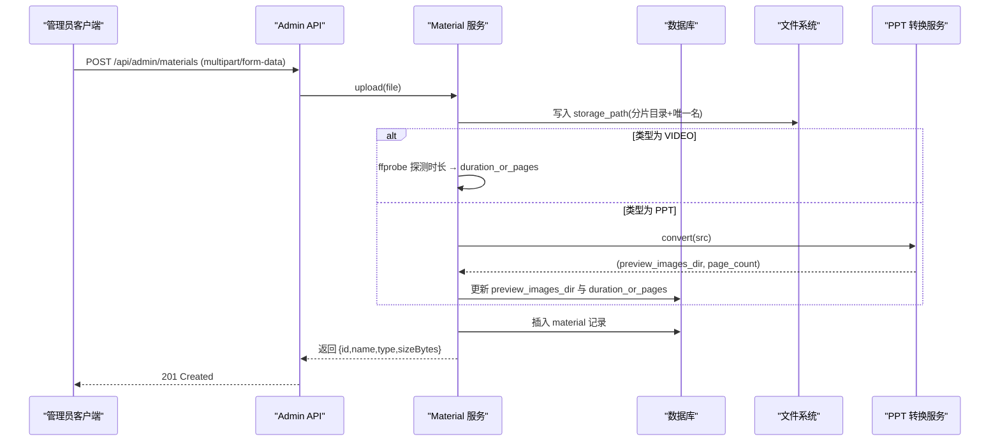
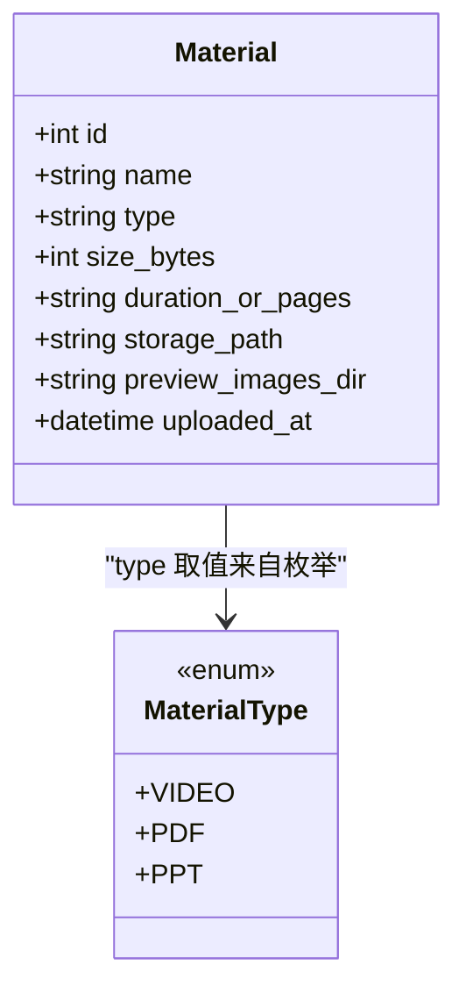
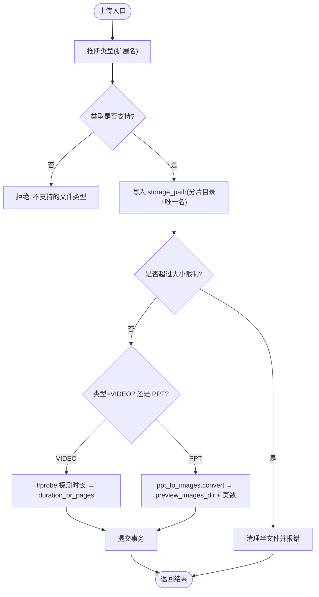
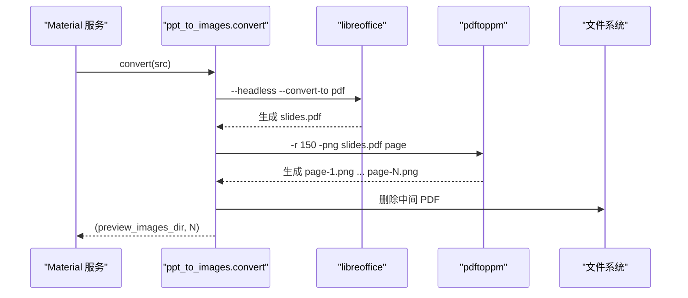
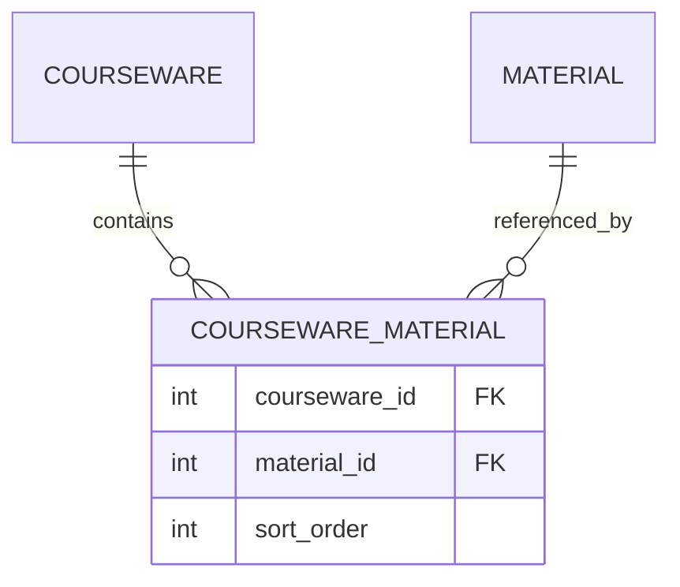
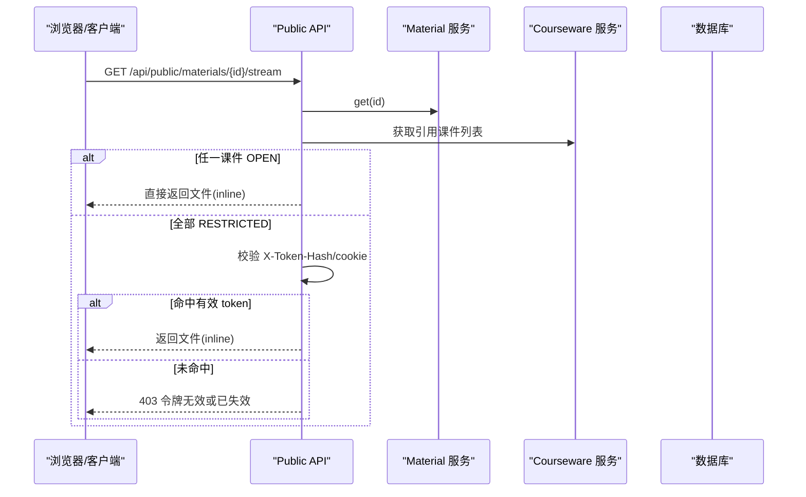
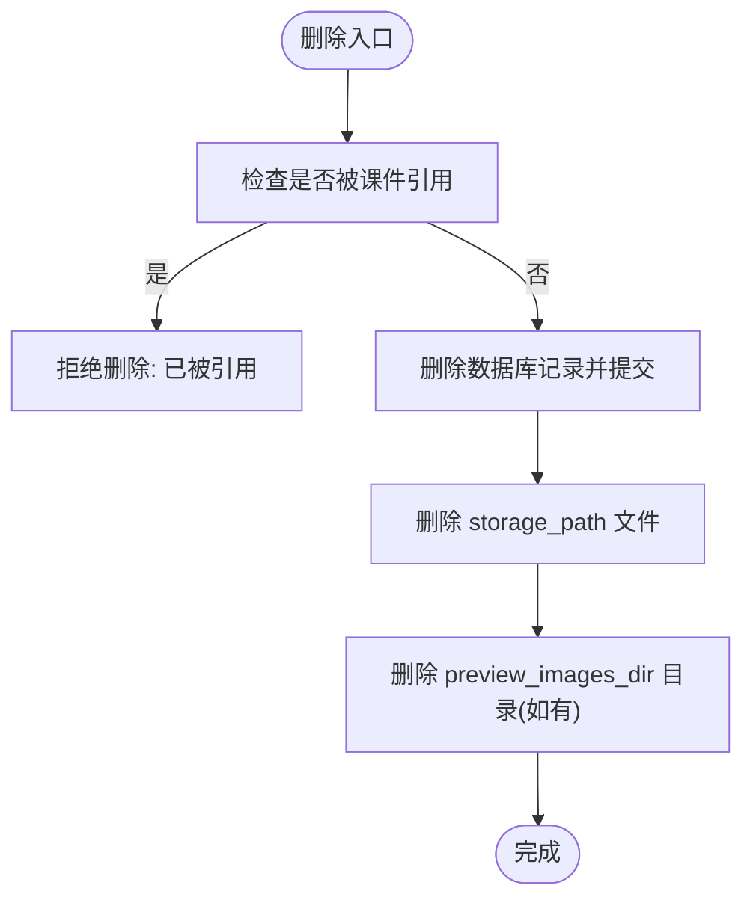
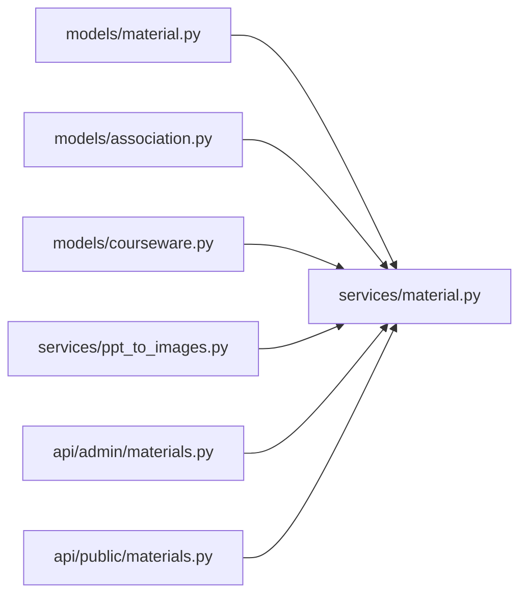

# 素材模型(Material)

<cite>
**本文引用的文件**   
- [backend/app/models/material.py](file://backend/app/models/material.py)
- [backend/app/schemas/material.py](file://backend/app/schemas/material.py)
- [backend/app/services/material.py](file://backend/app/services/material.py)
- [backend/app/api/admin/materials.py](file://backend/app/api/admin/materials.py)
- [backend/app/api/public/materials.py](file://backend/app/api/public/materials.py)
- [backend/app/models/courseware.py](file://backend/app/models/courseware.py)
- [backend/app/models/association.py](file://backend/app/models/association.py)
- [backend/app/services/ppt_to_images.py](file://backend/app/services/ppt_to_images.py)
- [backend/alembic/versions/2026_07_10_1800-d2e3f4a5b6c7_add_courseware_material_sort_order.py](file://backend/alembic/versions/2026_07_10_1800-d2e3f4a5b6c7_add_courseware_material_sort_order.py)
</cite>

## 目录
1. [简介](#简介)
2. [项目结构](#项目结构)
3. [核心组件](#核心组件)
4. [架构总览](#架构总览)
5. [详细组件分析](#详细组件分析)
6. [依赖关系分析](#依赖关系分析)
7. [性能考量](#性能考量)
8. [故障排查指南](#故障排查指南)
9. [结论](#结论)
10. [附录](#附录)

## 简介
本文件围绕“素材模型(Material)”进行系统化文档化，覆盖实体定义、类型识别机制（VIDEO/PDF/PPT）、存储路径管理、预览图处理、与课件的多对多关联及排序字段 sort_order 的作用、元数据（文件大小、MIME 类型等）的存储与管理，以及素材生命周期（上传、转换、删除）中的数据一致性保障。文末提供字段定义表与实际使用示例，帮助读者快速理解并正确使用该模型。

## 项目结构
Material 相关代码分布在以下模块：
- 模型层：material.py（Material 实体与 MaterialType 枚举）、association.py（courseware_material 关联表）、courseware.py（Courseware 与 M:N 关系）
- 服务层：services/material.py（列表、上传、删除、时长探测、PPT 图片预览生成）、services/ppt_to_images.py（PPT→PNG 转换）
- API 层：admin/materials.py（后台管理接口）、public/materials.py（公开下载/流式预览接口）
- Schema 层：schemas/material.py（对外返回的数据结构）
- 迁移脚本：alembic 版本中新增 preview_images_dir 与 courseware_material.sort_order

图表来源
- [backend/app/models/material.py:1-69](file://backend/app/models/material.py#L1-L69)
- [backend/app/models/association.py:1-41](file://backend/app/models/association.py#L1-L41)
- [backend/app/models/courseware.py:1-74](file://backend/app/models/courseware.py#L1-L74)
- [backend/app/services/material.py:1-234](file://backend/app/services/material.py#L1-L234)
- [backend/app/services/ppt_to_images.py:1-185](file://backend/app/services/ppt_to_images.py#L1-L185)
- [backend/app/api/admin/materials.py:1-74](file://backend/app/api/admin/materials.py#L1-L74)
- [backend/app/api/public/materials.py:1-224](file://backend/app/api/public/materials.py#L1-L224)

章节来源
- [backend/app/models/material.py:1-69](file://backend/app/models/material.py#L1-L69)
- [backend/app/models/association.py:1-41](file://backend/app/models/association.py#L1-L41)
- [backend/app/models/courseware.py:1-74](file://backend/app/models/courseware.py#L1-L74)
- [backend/app/services/material.py:1-234](file://backend/app/services/material.py#L1-L234)
- [backend/app/services/ppt_to_images.py:1-185](file://backend/app/services/ppt_to_images.py#L1-L185)
- [backend/app/api/admin/materials.py:1-74](file://backend/app/api/admin/materials.py#L1-L74)
- [backend/app/api/public/materials.py:1-224](file://backend/app/api/public/materials.py#L1-L224)

## 核心组件
- Material 实体：保存文件名、类型、大小、时长或页数、存储路径、预览图片目录、上传时间等元数据。
- MaterialType 枚举：统一类型标识 VIDEO/PDF/PPT，前端与数据库共用。
- 类型推断：根据扩展名映射到 MaterialType，不支持的扩展名抛出业务异常。
- 存储路径管理：按年月分片目录 + 唯一文件名，避免冲突；删除时同步清理原文件与预览图片目录。
- 预览图处理：PPT 上传后调用外部工具链转换为 PNG 序列，记录目录路径供在线浏览；失败不阻断上传。
- 与课件的多对多：通过 courseware_material 关联表维护顺序 sort_order，ORM 侧以 order_by 保证读取有序。
- 元数据：size_bytes 记录字节数；duration_or_pages 同时承载视频时长与 PPT 页数；MIME 类型由下载/流式接口基于文件名推断。

章节来源
- [backend/app/models/material.py:14-69](file://backend/app/models/material.py#L14-L69)
- [backend/app/services/material.py:129-202](file://backend/app/services/material.py#L129-L202)
- [backend/app/services/ppt_to_images.py:48-181](file://backend/app/services/ppt_to_images.py#L48-L181)
- [backend/app/models/association.py:16-26](file://backend/app/models/association.py#L16-L26)
- [backend/app/models/courseware.py:55-61](file://backend/app/models/courseware.py#L55-L61)

## 架构总览
Material 在系统中的角色是“文件元数据 + 存储路径”的中心实体，贯穿上传、转换、预览、下载、删除等流程。

图表来源
- [backend/app/api/admin/materials.py:35-48](file://backend/app/api/admin/materials.py#L35-L48)
- [backend/app/services/material.py:129-202](file://backend/app/services/material.py#L129-L202)
- [backend/app/services/ppt_to_images.py:48-181](file://backend/app/services/ppt_to_images.py#L48-L181)

## 详细组件分析

### Material 实体与 MaterialType 枚举
- 字段说明
  - id：自增主键
  - name：原始文件名
  - type：固定为 VIDEO/PDF/PPT 字符串
  - size_bytes：文件大小（字节）
  - duration_or_pages：视频时长（MM:SS 或 HH:MM:SS）或 PPT 页数（数字字符串）
  - storage_path：二进制文件在文件系统的绝对路径
  - preview_images_dir：PPT 生成的 PNG 预览目录（page-1.png, page-2.png...），NULL 表示未转换或失败
  - uploaded_at：上传时间（带时区）
- 类型识别机制
  - 仅支持 mp4/pdf/ppt/pptx 扩展名，其他扩展名拒绝上传
  - 扩展名到类型的映射集中管理，便于后续扩展新类型
- 扩展机制
  - 新增类型需在 _EXT_MAP 中添加映射，并在 infer_type 逻辑中保持一致
  - 若引入新类型，需考虑上传后的处理分支（如时长探测、预览生成）

图表来源
- [backend/app/models/material.py:14-69](file://backend/app/models/material.py#L14-L69)

章节来源
- [backend/app/models/material.py:14-69](file://backend/app/models/material.py#L14-L69)

### 文件类型识别与上传流程
- 上传入口：POST /api/admin/materials
- 类型推断：从文件名扩展名推断类型，非法扩展名直接拒绝
- 存储路径：按年月份创建子目录，生成唯一文件名，避免冲突
- 大小限制：服务端累计写入并校验上限，超限则回滚并清理半文件
- 时长探测：VIDEO 类型调用 ffprobe 解析时长，失败不阻断上传
- PPT 预览：调用 ppt_to_images.convert 将 PPT 转为 PDF 再拆成 PNG，成功则记录目录与页数；失败仅记录日志，不阻断上传
- 事务一致性：入库失败会回滚并清理已写入的文件与预览目录

图表来源
- [backend/app/services/material.py:129-202](file://backend/app/services/material.py#L129-L202)
- [backend/app/services/ppt_to_images.py:48-181](file://backend/app/services/ppt_to_images.py#L48-L181)

章节来源
- [backend/app/api/admin/materials.py:35-48](file://backend/app/api/admin/materials.py#L35-L48)
- [backend/app/services/material.py:129-202](file://backend/app/services/material.py#L129-L202)
- [backend/app/services/ppt_to_images.py:48-181](file://backend/app/services/ppt_to_images.py#L48-L181)

### 预览图处理（PPT→PNG）
- 转换流程：LibreOffice 将 PPT/PPTX 转为 PDF，再用 pdftoppm 将每页导出为 PNG，命名 page-1.png, page-2.png...
- 输出目录：与源文件同级，目录名为 <stem>；中间 PDF 产物会被删除，只保留 PNG
- 超时与错误：任一阶段失败均记录日志并返回 None，不阻断上传
- 可用性判断：若 preview_images_dir 为空，则前端走降级“下载到本地”

图表来源
- [backend/app/services/ppt_to_images.py:48-181](file://backend/app/services/ppt_to_images.py#L48-L181)
- [backend/app/services/material.py:174-186](file://backend/app/services/material.py#L174-L186)

章节来源
- [backend/app/services/ppt_to_images.py:48-181](file://backend/app/services/ppt_to_images.py#L48-L181)
- [backend/app/services/material.py:174-186](file://backend/app/services/material.py#L174-L186)

### 与课件的多对多关联与排序
- 关联表：courseware_material，包含 courseware_id、material_id、sort_order
- 排序字段：sort_order 在同一课件内为 0..N-1 连续递增，默认 0，由管理员拖拽维护
- ORM 排序：Courseware.materials 关系使用 order_by="courseware_material.c.sort_order" 保证读取顺序
- 索引优化：复合索引 (courseware_id, sort_order) 加速按课件取有序素材

图表来源
- [backend/app/models/association.py:16-26](file://backend/app/models/association.py#L16-L26)
- [backend/app/models/courseware.py:55-61](file://backend/app/models/courseware.py#L55-L61)
- [backend/alembic/versions/2026_07_10_1800-d2e3f4a5b6c7_add_courseware_material_sort_order.py:33-104](file://backend/alembic/versions/2026_07_10_1800-d2e3f4a5b6c7_add_courseware_material_sort_order.py#L33-L104)

章节来源
- [backend/app/models/association.py:16-26](file://backend/app/models/association.py#L16-L26)
- [backend/app/models/courseware.py:55-61](file://backend/app/models/courseware.py#L55-L61)
- [backend/alembic/versions/2026_07_10_1800-d2e3f4a5b6c7_add_courseware_material_sort_order.py:33-104](file://backend/alembic/versions/2026_07_10_1800-d2e3f4a5b6c7_add_courseware_material_sort_order.py#L33-L104)

### 公开访问与 ACL 控制
- 公共下载：/api/public/materials/{id}/file 始终以 attachment 返回原文件
- 流式预览：/api/public/materials/{id}/stream
  - VIDEO：video/mp4 + inline
  - PDF：application/pdf + inline
  - PPT：优先返回预览 PDF（兼容旧列 preview_pdf_path），否则降级返回原 PPT 并强制 attachment
- 单条查询：/api/public/materials/{id} 返回 streamUrl/downloadUrl/sizeBytes/duration 等，PPT 且存在预览图片时返回 imageUrls/imageCount/previewReady
- ACL 检查：若素材仅被 RESTRICTED 课件引用，需要请求携带 X-Token-Hash 或 lh_token_hash cookie，命中至少一个 token 才放行

图表来源
- [backend/app/api/public/materials.py:84-146](file://backend/app/api/public/materials.py#L84-L146)
- [backend/app/api/public/materials.py:31-62](file://backend/app/api/public/materials.py#L31-L62)

章节来源
- [backend/app/api/public/materials.py:64-224](file://backend/app/api/public/materials.py#L64-L224)

### 删除流程与数据一致性
- 删除前检查：若素材被任何课件引用，则拒绝删除
- 物理清理：删除数据库记录后，尝试删除 storage_path 指向的原文件与 preview_images_dir 目录
- 失败容忍：文件系统操作失败仅记录日志，不影响数据库删除结果

图表来源
- [backend/app/services/material.py:205-231](file://backend/app/services/material.py#L205-L231)

章节来源
- [backend/app/services/material.py:205-231](file://backend/app/services/material.py#L205-L231)

## 依赖关系分析
- 外部工具依赖
  - ffprobe：用于视频时长探测，失败不阻断上传
  - LibreOffice：PPT→PDF 转换
  - pdftoppm（poppler-utils）：PDF→PNG 分页导出
- 配置与环境
  - 可通过环境变量或设置项指定 libreoffice_path/poppler_path
  - 转换超时受 ppt_convert_timeout 控制
- 内部依赖
  - services/material.py 依赖 models/material.py、models/association.py、services/ppt_to_images.py
  - api/admin/materials.py 与 api/public/materials.py 依赖 services/material.py

图表来源
- [backend/app/models/material.py:1-69](file://backend/app/models/material.py#L1-L69)
- [backend/app/models/association.py:1-41](file://backend/app/models/association.py#L1-L41)
- [backend/app/models/courseware.py:1-74](file://backend/app/models/courseware.py#L1-L74)
- [backend/app/services/material.py:1-234](file://backend/app/services/material.py#L1-L234)
- [backend/app/services/ppt_to_images.py:1-185](file://backend/app/services/ppt_to_images.py#L1-L185)
- [backend/app/api/admin/materials.py:1-74](file://backend/app/api/admin/materials.py#L1-L74)
- [backend/app/api/public/materials.py:1-224](file://backend/app/api/public/materials.py#L1-L224)

章节来源
- [backend/app/services/material.py:1-234](file://backend/app/services/material.py#L1-L234)
- [backend/app/services/ppt_to_images.py:1-185](file://backend/app/services/ppt_to_images.py#L1-L185)

## 性能考量
- 上传限流与大小限制：MAX_SIZE_BYTES 与服务端写入累计校验，避免大文件占用内存
- 并发与 I/O：分片目录与唯一文件名减少冲突；预览图片目录独立，避免与源文件混放
- 查询优化：courseware_material 复合索引 (courseware_id, sort_order) 提升按课件取有序素材的性能
- 外部工具超时：转换过程可配置超时，防止阻塞上传链路
- 流式预览：公共接口采用 FileResponse 直接返回文件，降低内存占用

[本节为通用指导，无需具体文件分析]

## 故障排查指南
- 上传失败
  - 检查扩展名是否在支持列表中
  - 检查文件大小是否超过限制
  - 查看日志中关于 ffprobe 或转换失败的警告信息
- 预览不可用
  - 确认 preview_images_dir 是否为空
  - 检查 LibreOffice 与 pdftoppm 是否安装并可执行
  - 查看转换日志中的 returncode 与 stderr 片段
- 删除失败
  - 检查是否仍有课件引用该素材
  - 确认文件系统权限，确保可删除原文件与预览目录
- 公开访问受限
  - 检查请求是否携带有效的 X-Token-Hash 或 cookie
  - 确认课件访问模式与 token 绑定关系

章节来源
- [backend/app/services/material.py:129-202](file://backend/app/services/material.py#L129-L202)
- [backend/app/services/ppt_to_images.py:48-181](file://backend/app/services/ppt_to_images.py#L48-L181)
- [backend/app/api/public/materials.py:31-62](file://backend/app/api/public/materials.py#L31-L62)

## 结论
Material 模型作为学习平台的核心资源实体，提供了完善的类型识别、存储路径管理、预览图生成与公开访问控制能力。通过清晰的 M:N 关联与排序字段，实现了课件内素材的可编排学习路径。在服务层对上传、转换、删除等操作进行了健壮的错误处理与一致性保障，确保系统稳定运行。

[本节为总结性内容，无需具体文件分析]

## 附录

### 字段定义表
- id：整数，主键，自增
- name：字符串，原始文件名
- type：字符串，固定为 VIDEO/PDF/PPT
- size_bytes：整数，文件大小（字节）
- duration_or_pages：字符串，视频时长或 PPT 页数
- storage_path：字符串，二进制文件在文件系统的绝对路径
- preview_images_dir：字符串，PPT 生成的 PNG 预览目录（可为空）
- uploaded_at：带时区的时间戳，上传时间

章节来源
- [backend/app/models/material.py:44-69](file://backend/app/models/material.py#L44-L69)

### 实际使用示例（路径指引）
- 上传素材（后台）
  - 接口：POST /api/admin/materials
  - 参考实现路径：[backend/app/api/admin/materials.py:35-48](file://backend/app/api/admin/materials.py#L35-L48)
- 列出素材（后台）
  - 接口：GET /api/admin/materials?page=1&size=20&type=VIDEO
  - 参考实现路径：[backend/app/api/admin/materials.py:23-32](file://backend/app/api/admin/materials.py#L23-L32)
- 下载素材（后台）
  - 接口：GET /api/admin/materials/{id}/file
  - 参考实现路径：[backend/app/api/admin/materials.py:57-70](file://backend/app/api/admin/materials.py#L57-L70)
- 公开下载
  - 接口：GET /api/public/materials/{id}/file
  - 参考实现路径：[backend/app/api/public/materials.py:64-81](file://backend/app/api/public/materials.py#L64-L81)
- 公开流式预览
  - 接口：GET /api/public/materials/{id}/stream
  - 参考实现路径：[backend/app/api/public/materials.py:84-146](file://backend/app/api/public/materials.py#L84-L146)
- 公开单条查询
  - 接口：GET /api/public/materials/{id}
  - 参考实现路径：[backend/app/api/public/materials.py:183-221](file://backend/app/api/public/materials.py#L183-L221)
- 删除素材（后台）
  - 接口：DELETE /api/admin/materials/{id}
  - 参考实现路径：[backend/app/api/admin/materials.py:51-54](file://backend/app/api/admin/materials.py#L51-L54)

章节来源
- [backend/app/api/admin/materials.py:23-70](file://backend/app/api/admin/materials.py#L23-L70)
- [backend/app/api/public/materials.py:64-221](file://backend/app/api/public/materials.py#L64-L221)