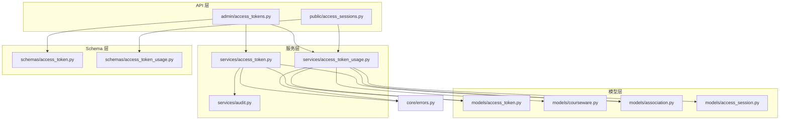
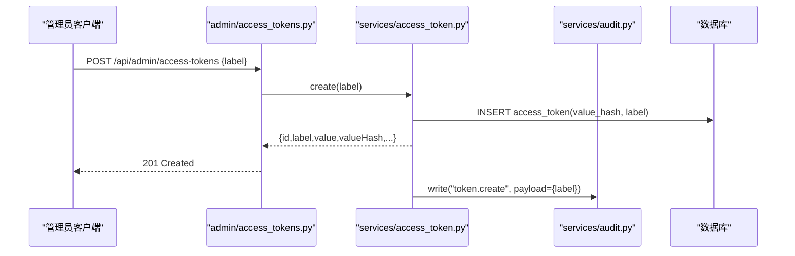
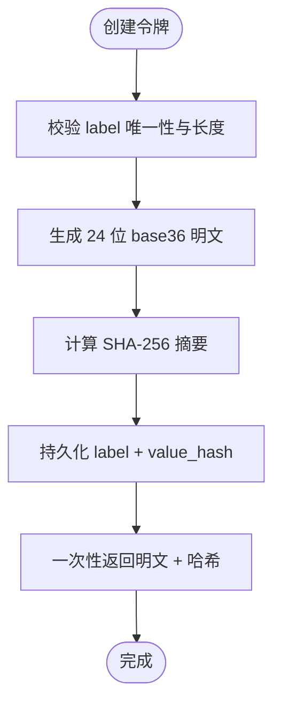
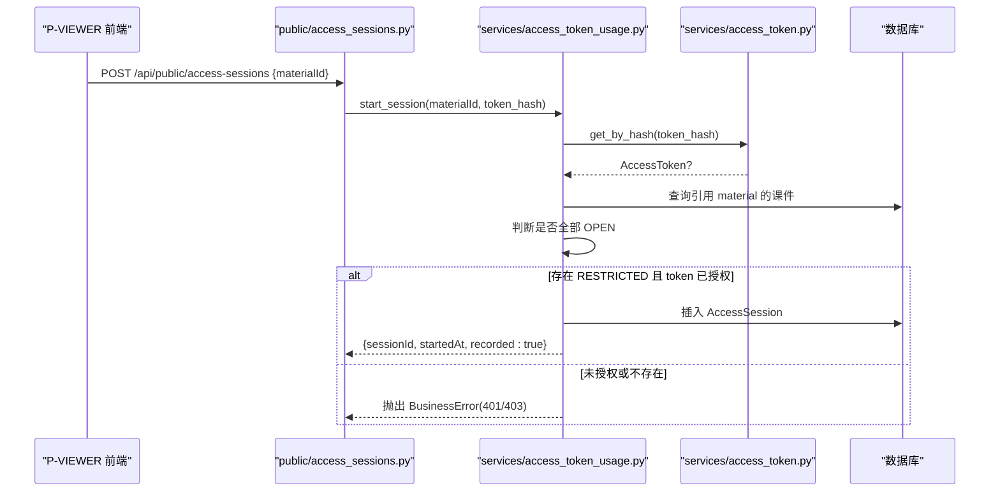
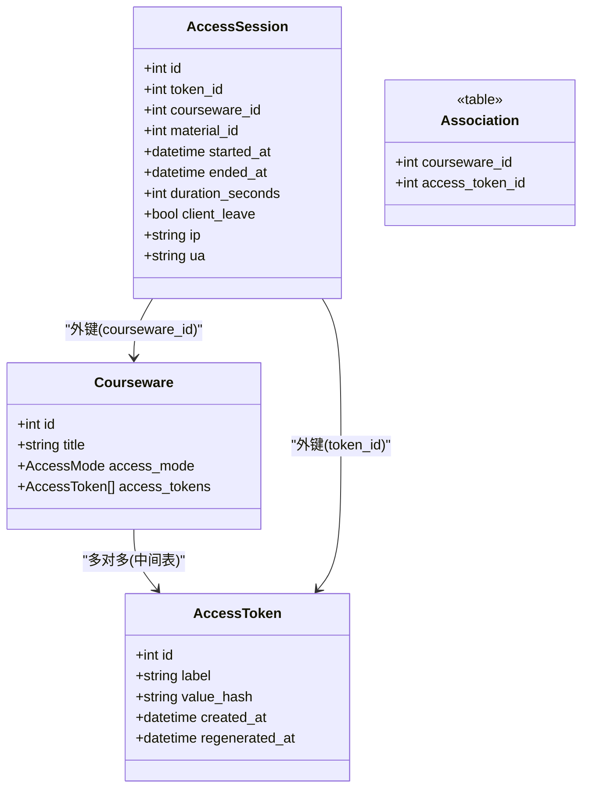
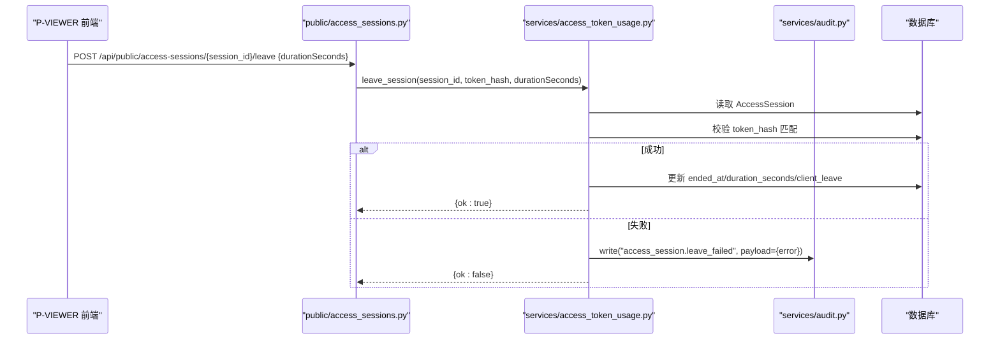
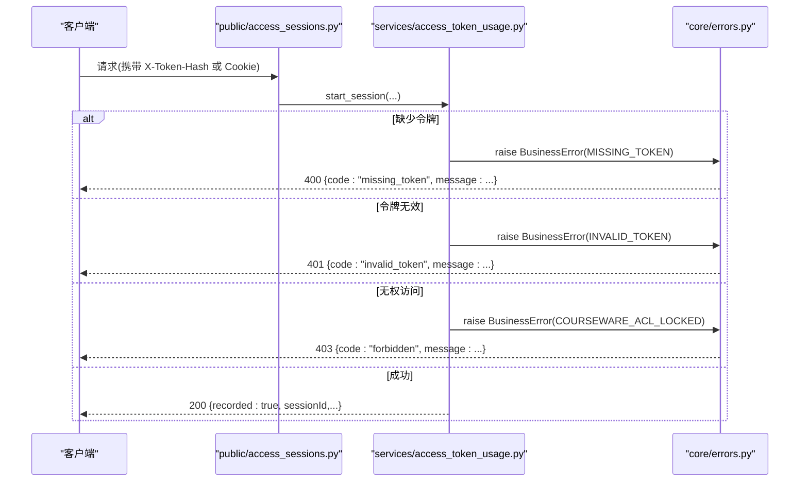
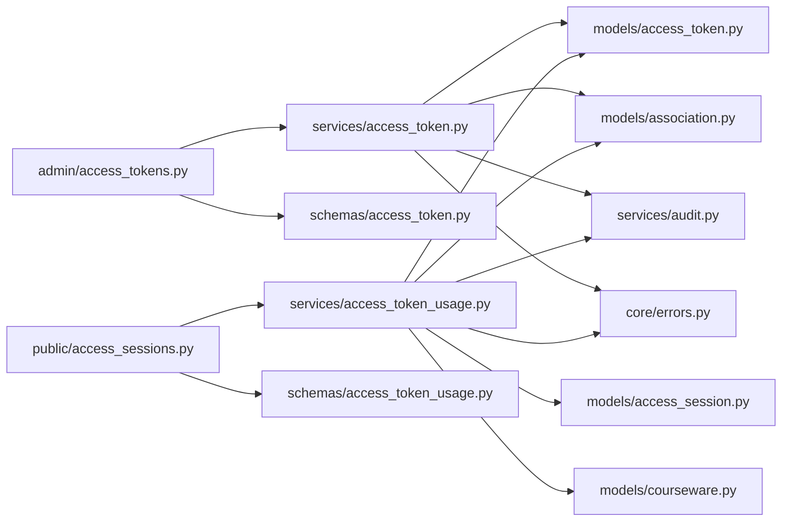

# 访问令牌模型(AccessToken)

<cite>
**本文引用的文件列表**
- [backend/app/models/access_token.py](file://backend/app/models/access_token.py)
- [backend/app/schemas/access_token.py](file://backend/app/schemas/access_token.py)
- [backend/app/services/access_token.py](file://backend/app/services/access_token.py)
- [backend/app/api/admin/access_tokens.py](file://backend/app/api/admin/access_tokens.py)
- [backend/app/models/association.py](file://backend/app/models/association.py)
- [backend/app/models/courseware.py](file://backend/app/models/courseware.py)
- [backend/app/models/access_session.py](file://backend/app/models/access_session.py)
- [backend/app/api/public/access_sessions.py](file://backend/app/api/public/access_sessions.py)
- [backend/app/services/access_token_usage.py](file://backend/app/services/access_token_usage.py)
- [backend/app/schemas/access_token_usage.py](file://backend/app/schemas/access_token_usage.py)
- [backend/app/core/errors.py](file://backend/app/core/errors.py)
- [backend/app/services/audit.py](file://backend/app/services/audit.py)
</cite>

## 目录
1. [简介](#简介)
2. [项目结构](#项目结构)
3. [核心组件](#核心组件)
4. [架构总览](#架构总览)
5. [详细组件分析](#详细组件分析)
6. [依赖关系分析](#依赖关系分析)
7. [性能考量](#性能考量)
8. [故障排查指南](#故障排查指南)
9. [结论](#结论)
10. [附录](#附录)

## 简介
本文件围绕访问令牌模型 AccessToken 的安全设计与实现进行系统化说明，涵盖：
- 令牌生成算法与存储安全（仅存哈希、明文一次性返回）
- 有效期管理与状态控制（当前无显式过期字段，通过重新生成与删除管理生命周期）
- 权限控制机制（令牌与课件的多对多关联，受限课件解锁流程）
- 令牌的 CRUD 操作与审计追踪
- 访问会话 AccessSession 的关联设计与审计能力
- 安全最佳实践（加密存储、传输安全、防重放攻击）
- 完整认证流程与错误处理示例

## 项目结构
与 AccessToken 相关的后端代码主要分布在以下模块：
- 数据模型层：access_token、courseware、association、access_session
- 服务层：access_token、access_token_usage、audit
- API 层：admin/access_tokens、public/access_sessions
- Schema 层：access_token、access_token_usage
- 错误码与异常：core/errors

图表来源
- [backend/app/api/admin/access_tokens.py:1-120](file://backend/app/api/admin/access_tokens.py#L1-L120)
- [backend/app/api/public/access_sessions.py:1-137](file://backend/app/api/public/access_sessions.py#L1-L137)
- [backend/app/services/access_token.py:1-235](file://backend/app/services/access_token.py#L1-L235)
- [backend/app/services/access_token_usage.py:1-518](file://backend/app/services/access_token_usage.py#L1-L518)
- [backend/app/services/audit.py:1-45](file://backend/app/services/audit.py#L1-L45)
- [backend/app/models/access_token.py:1-34](file://backend/app/models/access_token.py#L1-L34)
- [backend/app/models/courseware.py:1-74](file://backend/app/models/courseware.py#L1-L74)
- [backend/app/models/association.py:1-41](file://backend/app/models/association.py#L1-L41)
- [backend/app/models/access_session.py:1-129](file://backend/app/models/access_session.py#L1-L129)
- [backend/app/schemas/access_token.py:1-53](file://backend/app/schemas/access_token.py#L1-L53)
- [backend/app/schemas/access_token_usage.py:1-91](file://backend/app/schemas/access_token_usage.py#L1-L91)
- [backend/app/core/errors.py:1-144](file://backend/app/core/errors.py#L1-L144)

章节来源
- [backend/app/api/admin/access_tokens.py:1-120](file://backend/app/api/admin/access_tokens.py#L1-L120)
- [backend/app/api/public/access_sessions.py:1-137](file://backend/app/api/public/access_sessions.py#L1-L137)
- [backend/app/services/access_token.py:1-235](file://backend/app/services/access_token.py#L1-L235)
- [backend/app/services/access_token_usage.py:1-518](file://backend/app/services/access_token_usage.py#L1-L518)
- [backend/app/models/access_token.py:1-34](file://backend/app/models/access_token.py#L1-L34)
- [backend/app/models/courseware.py:1-74](file://backend/app/models/courseware.py#L1-L74)
- [backend/app/models/association.py:1-41](file://backend/app/models/association.py#L1-L41)
- [backend/app/models/access_session.py:1-129](file://backend/app/models/access_session.py#L1-L129)
- [backend/app/schemas/access_token.py:1-53](file://backend/app/schemas/access_token.py#L1-L53)
- [backend/app/schemas/access_token_usage.py:1-91](file://backend/app/schemas/access_token_usage.py#L1-L91)
- [backend/app/core/errors.py:1-144](file://backend/app/core/errors.py#L1-L144)

## 核心组件
- AccessToken 实体
  - 字段：id、label（全局唯一）、value_hash（SHA-256 摘要）、created_at、regenerated_at
  - 设计要点：数据库不存储明文，仅存储 value_hash；明文仅在创建或重新生成时一次性返回
- 多对多关联表 courseware_access_token
  - 用于将 AccessToken 与 Courseware 建立多对多关系，支持受限课件的授权集合
- AccessSession 会话记录
  - 记录 token 持有者对受限素材的一次浏览会话（起止时间、停留秒数、IP、UA 等），并受 FK CASCADE 约束自动清理
- 业务服务
  - access_token：令牌创建、重新生成、删除、分页查询、验证、按哈希查找
  - access_token_usage：会话开始/结束、聚合统计、按素材汇总
- 审计日志
  - audit.write：以 JSON Lines 格式记录关键管理操作（如 token.create、token.regenerate、token.delete）

章节来源
- [backend/app/models/access_token.py:1-34](file://backend/app/models/access_token.py#L1-L34)
- [backend/app/models/association.py:28-33](file://backend/app/models/association.py#L28-L33)
- [backend/app/models/access_session.py:56-129](file://backend/app/models/access_session.py#L56-L129)
- [backend/app/services/access_token.py:73-139](file://backend/app/services/access_token.py#L73-L139)
- [backend/app/services/access_token_usage.py:64-172](file://backend/app/services/access_token_usage.py#L64-L172)
- [backend/app/services/audit.py:21-42](file://backend/app/services/audit.py#L21-L42)

## 架构总览
AccessToken 在系统中的角色与交互如下：
- 管理员通过 admin API 创建/重新生成/删除/查询令牌
- 前端 P-VIEWER 通过 public API 上报访问会话（基于 X-Token-Hash 或 Cookie）
- 服务层校验令牌有效性、检查课件 ACL、写入会话记录
- 审计模块记录关键管理操作

图表来源
- [backend/app/api/admin/access_tokens.py:71-77](file://backend/app/api/admin/access_tokens.py#L71-L77)
- [backend/app/services/access_token.py:73-99](file://backend/app/services/access_token.py#L73-L99)
- [backend/app/services/audit.py:21-42](file://backend/app/services/audit.py#L21-L42)

## 详细组件分析

### 令牌实体与安全设计
- 令牌生成算法
  - 使用 secrets.token_bytes(16) 生成随机字节，再转换为 base36 小写字母+数字的 24 位字符串
  - 明文仅创建或重新生成时返回一次，随后只保存 SHA-256 摘要
- 存储安全
  - 数据库仅存储 value_hash，避免明文泄露风险
  - 验证时使用 hmac.compare_digest 常量时间比对，防止时序侧信道
- 有效期与状态管理
  - 当前未引入显式过期字段；通过 regenerated_at 标记重新生成时间，旧 hash 即刻失效
  - 删除前检查是否被课件引用以及是否为最后一个 active token，确保至少保留一个令牌
- 标签约束
  - label 全局唯一、非空、长度 ≤ 50，创建前做重复性校验

图表来源
- [backend/app/services/access_token.py:45-54](file://backend/app/services/access_token.py#L45-L54)
- [backend/app/services/access_token.py:73-99](file://backend/app/services/access_token.py#L73-L99)
- [backend/app/services/access_token.py:193-205](file://backend/app/services/access_token.py#L193-L205)

章节来源
- [backend/app/models/access_token.py:13-31](file://backend/app/models/access_token.py#L13-L31)
- [backend/app/services/access_token.py:32-54](file://backend/app/services/access_token.py#L32-L54)
- [backend/app/services/access_token.py:73-139](file://backend/app/services/access_token.py#L73-L139)
- [backend/app/services/access_token.py:193-205](file://backend/app/services/access_token.py#L193-L205)

### 令牌与课件的多对多关联与解锁流程
- 关联设计
  - 通过 courseware_access_token 中间表建立多对多关系
  - Courseware.access_mode 为 RESTRICTED 时需绑定至少一个 AccessToken
- 解锁流程
  - 当 P-VIEWER 请求开始访问会话时，服务端根据 material_id 找到所有引用该素材的课件
  - 若全部为 OPEN，则不记录会话
  - 若存在 RESTRICTED 课件，则校验 token_hash 是否在课件的 access_tokens 集合中
  - 校验通过后，写入 AccessSession 记录

图表来源
- [backend/app/api/public/access_sessions.py:65-106](file://backend/app/api/public/access_sessions.py#L65-L106)
- [backend/app/services/access_token_usage.py:64-125](file://backend/app/services/access_token_usage.py#L64-L125)
- [backend/app/models/association.py:28-33](file://backend/app/models/association.py#L28-L33)
- [backend/app/models/courseware.py:14-38](file://backend/app/models/courseware.py#L14-L38)

章节来源
- [backend/app/models/association.py:28-33](file://backend/app/models/association.py#L28-L33)
- [backend/app/models/courseware.py:14-38](file://backend/app/models/courseware.py#L14-L38)
- [backend/app/api/public/access_sessions.py:65-106](file://backend/app/api/public/access_sessions.py#L65-L106)
- [backend/app/services/access_token_usage.py:64-125](file://backend/app/services/access_token_usage.py#L64-L125)

### 令牌的 CRUD 与状态管理
- 创建
  - 校验 label 唯一性与长度，生成明文与哈希，持久化后返回明文与哈希，并写审计日志
- 重新生成
  - 更新 value_hash 与 regenerated_at，旧 hash 立即失效，返回新明文与哈希，并写审计日志
- 删除
  - 检查是否被课件引用，检查是否为最后一个 active token，满足条件方可删除，并写审计日志
- 查询
  - 分页查询，附带引用计数（被多少课件引用），仅暴露 value_hash
- 验证
  - verify 函数加载所有 active token，使用 hmac.compare_digest 常量时间比对

图表来源
- [backend/app/models/access_token.py:13-31](file://backend/app/models/access_token.py#L13-L31)
- [backend/app/models/courseware.py:21-74](file://backend/app/models/courseware.py#L21-L74)
- [backend/app/models/access_session.py:56-129](file://backend/app/models/access_session.py#L56-L129)
- [backend/app/models/association.py:28-33](file://backend/app/models/association.py#L28-L33)

章节来源
- [backend/app/api/admin/access_tokens.py:60-116](file://backend/app/api/admin/access_tokens.py#L60-L116)
- [backend/app/services/access_token.py:73-139](file://backend/app/services/access_token.py#L73-L139)
- [backend/app/services/access_token.py:193-205](file://backend/app/services/access_token.py#L193-L205)

### 访问会话(AccessSession)的关联设计与审计追踪
- 关联设计
  - 通过 token_id、courseware_id、material_id 与对应主表建立外键，ondelete=CASCADE 保证级联清理
  - 索引优化：按 token_id+started_at、token_id+material_id、token_id+courseware_id 加速查询
- 审计追踪
  - 会话开始/结束失败时，调用 audit.write 记录错误上下文（资源标识与错误信息）
  - 管理端可查询会话明细与聚合指标（总停留、次数、课件数、素材数）

图表来源
- [backend/app/api/public/access_sessions.py:109-133](file://backend/app/api/public/access_sessions.py#L109-L133)
- [backend/app/services/access_token_usage.py:128-172](file://backend/app/services/access_token_usage.py#L128-L172)
- [backend/app/services/audit.py:21-42](file://backend/app/services/audit.py#L21-L42)

章节来源
- [backend/app/models/access_session.py:56-129](file://backend/app/models/access_session.py#L56-L129)
- [backend/app/api/public/access_sessions.py:109-133](file://backend/app/api/public/access_sessions.py#L109-L133)
- [backend/app/services/access_token_usage.py:128-172](file://backend/app/services/access_token_usage.py#L128-L172)
- [backend/app/services/audit.py:21-42](file://backend/app/services/audit.py#L21-L42)

### 认证流程与错误处理示例
- 认证流程
  - 前端通过 X-Token-Hash 或 Cookie lh_token_hash 传递令牌哈希
  - 公共接口解析 token_hash，调用服务层验证令牌是否存在
  - 若令牌无效或缺失，返回统一信封的错误码与消息
- 错误处理
  - 使用 BusinessError 抛出业务异常，映射到 HTTP 状态码与信封响应
  - 常见错误码：missing_token、invalid_token、forbidden、internal_error 等

图表来源
- [backend/app/api/public/access_sessions.py:57-106](file://backend/app/api/public/access_sessions.py#L57-L106)
- [backend/app/services/access_token_usage.py:64-95](file://backend/app/services/access_token_usage.py#L64-L95)
- [backend/app/core/errors.py:9-144](file://backend/app/core/errors.py#L9-L144)

章节来源
- [backend/app/api/public/access_sessions.py:57-106](file://backend/app/api/public/access_sessions.py#L57-L106)
- [backend/app/services/access_token_usage.py:64-95](file://backend/app/services/access_token_usage.py#L64-L95)
- [backend/app/core/errors.py:9-144](file://backend/app/core/errors.py#L9-L144)

## 依赖关系分析
- 直接依赖
  - admin/access_tokens 依赖 services/access_token 与 schemas/access_token
  - public/access_sessions 依赖 services/access_token_usage 与 schemas/access_token_usage
  - services/access_token 依赖 models/access_token、models/association、services/audit、core/errors
  - services/access_token_usage 依赖 models/access_session、models/access_token、models/courseware、models/association、services/access_token、services/courseware、services/audit、core/errors
- 间接依赖
  - 审计日志通过配置获取存储路径，写入 logs/audit.jsonl
  - 错误码集中定义，统一映射到 HTTP 状态码

图表来源
- [backend/app/api/admin/access_tokens.py:1-120](file://backend/app/api/admin/access_tokens.py#L1-L120)
- [backend/app/api/public/access_sessions.py:1-137](file://backend/app/api/public/access_sessions.py#L1-L137)
- [backend/app/services/access_token.py:1-235](file://backend/app/services/access_token.py#L1-L235)
- [backend/app/services/access_token_usage.py:1-518](file://backend/app/services/access_token_usage.py#L1-L518)
- [backend/app/models/access_token.py:1-34](file://backend/app/models/access_token.py#L1-L34)
- [backend/app/models/access_session.py:1-129](file://backend/app/models/access_session.py#L1-L129)
- [backend/app/models/courseware.py:1-74](file://backend/app/models/courseware.py#L1-L74)
- [backend/app/models/association.py:1-41](file://backend/app/models/association.py#L1-L41)
- [backend/app/services/audit.py:1-45](file://backend/app/services/audit.py#L1-L45)
- [backend/app/core/errors.py:1-144](file://backend/app/core/errors.py#L1-L144)

章节来源
- [backend/app/api/admin/access_tokens.py:1-120](file://backend/app/api/admin/access_tokens.py#L1-L120)
- [backend/app/api/public/access_sessions.py:1-137](file://backend/app/api/public/access_sessions.py#L1-L137)
- [backend/app/services/access_token.py:1-235](file://backend/app/services/access_token.py#L1-L235)
- [backend/app/services/access_token_usage.py:1-518](file://backend/app/services/access_token_usage.py#L1-L518)
- [backend/app/models/access_token.py:1-34](file://backend/app/models/access_token.py#L1-L34)
- [backend/app/models/access_session.py:1-129](file://backend/app/models/access_session.py#L1-L129)
- [backend/app/models/courseware.py:1-74](file://backend/app/models/courseware.py#L1-L74)
- [backend/app/models/association.py:1-41](file://backend/app/models/association.py#L1-L41)
- [backend/app/services/audit.py:1-45](file://backend/app/services/audit.py#L1-L45)
- [backend/app/core/errors.py:1-144](file://backend/app/core/errors.py#L1-L144)

## 性能考量
- 令牌验证
  - verify 函数加载所有 active token 并进行常量时间比对，适用于少量活跃令牌场景
  - 建议在生产环境限制活跃令牌数量，必要时引入缓存或索引优化
- 会话写入
  - 公共接口具备进程内 IP 限流（60/分钟），降低高频写入压力
  - 数据库写入失败降级为不记录，避免阻塞前台体验
- 聚合查询
  - 提供全时段与区间聚合接口，减少前端多次拉取明细数据的开销
  - 跨方言的时间差计算通过自定义表达式适配 PostgreSQL 与 SQLite

[本节为通用性能讨论，不直接分析具体文件]

## 故障排查指南
- 常见问题
  - 令牌缺失或无效：检查请求头 X-Token-Hash 或 Cookie lh_token_hash 是否正确设置
  - 无权访问：确认令牌是否已被授权至目标课件的 access_tokens 集合
  - 会话记录失败：查看审计日志 logs/audit.jsonl 中的错误上下文
- 定位步骤
  - 使用管理端 GET /api/admin/access-tokens/{id}?withUsage=1 查看令牌的使用概览
  - 使用管理端 GET /api/admin/access-tokens/{id}/access-sessions 分页查看会话明细
  - 核对课程模式是否为 RESTRICTED，并确保令牌已正确绑定

章节来源
- [backend/app/api/public/access_sessions.py:65-106](file://backend/app/api/public/access_sessions.py#L65-L106)
- [backend/app/services/access_token_usage.py:286-312](file://backend/app/services/access_token_usage.py#L286-L312)
- [backend/app/services/audit.py:21-42](file://backend/app/services/audit.py#L21-L42)

## 结论
AccessToken 模型采用“仅存哈希”的安全设计，结合多对多关联与严格的权限校验，实现了受限课件的精细化访问控制。通过访问会话记录与审计日志，系统提供了完整的追踪与分析能力。建议在后续迭代中引入显式的有效期与状态字段，进一步增强令牌的生命周期管理能力。

[本节为总结性内容，不直接分析具体文件]

## 附录
- 安全最佳实践
  - 加密存储：数据库仅存储 value_hash，避免明文泄露
  - 传输安全：建议使用 HTTPS，并在前端安全地存储与传递 X-Token-Hash 或 Cookie
  - 防重放攻击：可在会话接口增加 nonce 或时间戳校验，并结合 IP 限流策略
  - 最小权限原则：仅将必要的令牌授予受限课件，定期审查与清理无用令牌
  - 审计与监控：持续监控审计日志与会话异常，及时响应潜在风险

[本节为通用指导，不直接分析具体文件]