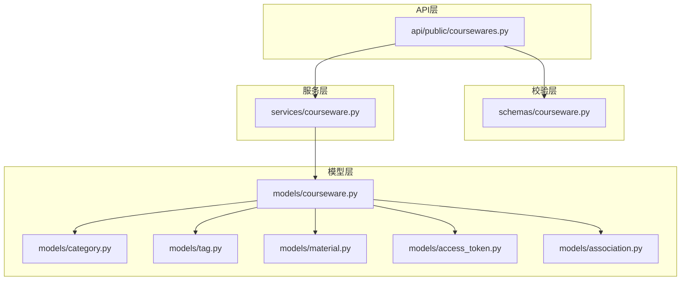
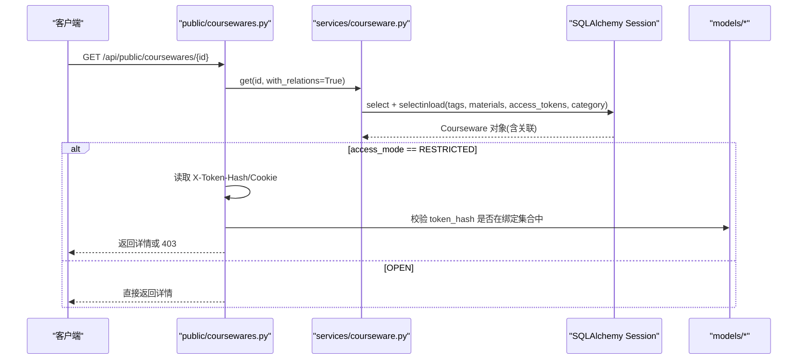
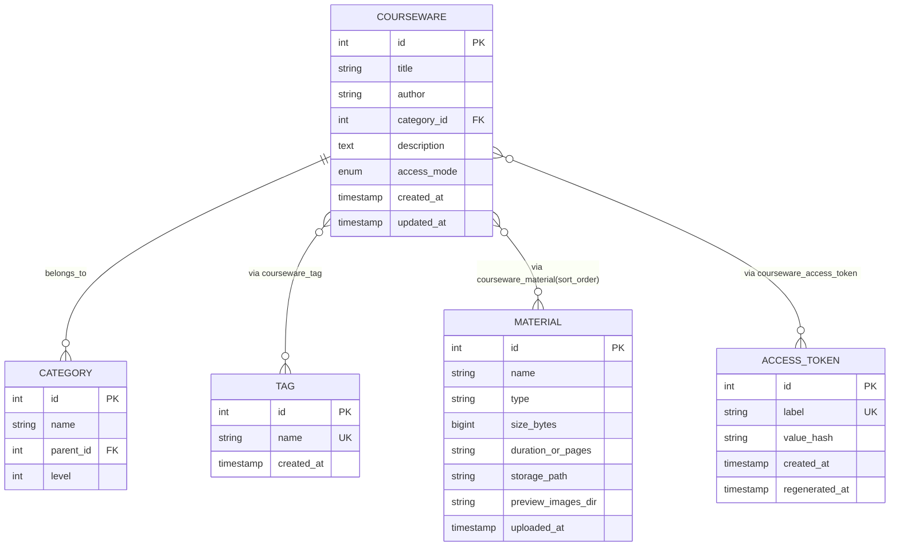

# 课件模型(Courseware)

<cite>
**本文引用的文件**   
- [backend/app/models/courseware.py](file://backend/app/models/courseware.py)
- [backend/app/models/category.py](file://backend/app/models/category.py)
- [backend/app/models/tag.py](file://backend/app/models/tag.py)
- [backend/app/models/material.py](file://backend/app/models/material.py)
- [backend/app/models/access_token.py](file://backend/app/models/access_token.py)
- [backend/app/models/association.py](file://backend/app/models/association.py)
- [backend/app/schemas/courseware.py](file://backend/app/schemas/courseware.py)
- [backend/app/services/courseware.py](file://backend/app/services/courseware.py)
- [backend/app/api/public/coursewares.py](file://backend/app/api/public/coursewares.py)
</cite>

## 目录
1. [简介](#简介)
2. [项目结构](#项目结构)
3. [核心组件](#核心组件)
4. [架构总览](#架构总览)
5. [详细组件分析](#详细组件分析)
6. [依赖关系分析](#依赖关系分析)
7. [性能考量](#性能考量)
8. [故障排查指南](#故障排查指南)
9. [结论](#结论)
10. [附录](#附录)

## 简介
本文件围绕“课件(Courseware)”实体进行系统化文档化，覆盖：
- Courseware 实体的完整字段定义、约束与业务规则
- AccessMode 枚举的实现与应用场景（OPEN 开放、RESTRICTED 受限）
- 课件与分类(Category)、标签(Tag)、素材(Material)、访问令牌(AccessToken)的多对多关系实现
- relationship 配置中的 lazy 加载策略选择(selectin vs joined)及其影响
- 完整的字段说明表（数据类型、是否必填、默认值、约束）
- 实际 SQL 建表语句与 ORM 映射示例

## 项目结构
Courseware 相关代码分布在模型层、关联表、Schema 校验层以及服务与 API 层。下图给出与 Courseware 直接相关的文件组织概览。



图表来源
- [backend/app/models/courseware.py:21-67](file://backend/app/models/courseware.py#L21-L67)
- [backend/app/models/category.py:12-46](file://backend/app/models/category.py#L12-L46)
- [backend/app/models/tag.py:13-30](file://backend/app/models/tag.py#L13-L30)
- [backend/app/models/material.py:44-69](file://backend/app/models/material.py#L44-L69)
- [backend/app/models/access_token.py:13-34](file://backend/app/models/access_token.py#L13-L34)
- [backend/app/models/association.py:9-33](file://backend/app/models/association.py#L9-L33)
- [backend/app/schemas/courseware.py:22-64](file://backend/app/schemas/courseware.py#L22-L64)
- [backend/app/services/courseware.py:105-167](file://backend/app/services/courseware.py#L105-L167)
- [backend/app/api/public/coursewares.py:57-130](file://backend/app/api/public/coursewares.py#L57-L130)

章节来源
- [backend/app/models/courseware.py:21-67](file://backend/app/models/courseware.py#L21-L67)
- [backend/app/models/association.py:9-33](file://backend/app/models/association.py#L9-L33)
- [backend/app/schemas/courseware.py:22-64](file://backend/app/schemas/courseware.py#L22-L64)
- [backend/app/services/courseware.py:105-167](file://backend/app/services/courseware.py#L105-L167)
- [backend/app/api/public/coursewares.py:57-130](file://backend/app/api/public/coursewares.py#L57-L130)

## 核心组件
- 访问模式枚举 AccessMode：用于控制课件的公开性与解锁要求
- 课件主表 Courseware：承载标题、作者、分类、描述、访问模式、时间戳等
- 多对多关联表：courseware_tag、courseware_material、courseware_access_token
- 关联实体：Category、Tag、Material、AccessToken

章节来源
- [backend/app/models/courseware.py:14-67](file://backend/app/models/courseware.py#L14-L67)
- [backend/app/models/association.py:9-33](file://backend/app/models/association.py#L9-L33)

## 架构总览
下图展示 Courseware 在系统中的位置及关键交互：API 层调用服务层，服务层通过 ORM 操作模型与关联表；前台详情接口根据 access_mode 决定是否校验令牌。



图表来源
- [backend/app/api/public/coursewares.py:57-130](file://backend/app/api/public/coursewares.py#L57-L130)
- [backend/app/services/courseware.py:47-63](file://backend/app/services/courseware.py#L47-L63)
- [backend/app/models/courseware.py:49-67](file://backend/app/models/courseware.py#L49-L67)

## 详细组件分析

### 1) AccessMode 枚举
- 取值
  - OPEN：开放访问，无需令牌即可查看
  - RESTRICTED：受限访问，需携带有效的 AccessToken 才能查看
- 默认值
  - 新建时默认为 OPEN
- 使用点
  - 创建/更新时校验：RESTRICTED 必须至少绑定一个 AccessToken
  - 降级为 OPEN 时自动清空已绑定的 AccessToken
  - 前台详情接口按该字段决定是否需要令牌校验

章节来源
- [backend/app/models/courseware.py:14-38](file://backend/app/models/courseware.py#L14-L38)
- [backend/app/services/courseware.py:129-133](file://backend/app/services/courseware.py#L129-L133)
- [backend/app/services/courseware.py:204-207](file://backend/app/services/courseware.py#L204-L207)
- [backend/app/api/public/coursewares.py:68-76](file://backend/app/api/public/coursewares.py#L68-76)

### 2) Courseware 实体与字段
- 主键 id：自增整型
- title：非空，最大长度 100
- author：可选，最大长度 50
- category_id：外键指向 category.id，不可为空，删除分类受保护(RESTRICT)
- description：文本，可选
- access_mode：枚举，非空，默认 OPEN
- created_at/updated_at：带时区的时间戳，默认当前时间，更新时自动刷新

章节来源
- [backend/app/models/courseware.py:27-47](file://backend/app/models/courseware.py#L27-L47)

#### 字段说明表
| 字段名 | 数据类型 | 是否必填 | 默认值 | 约束/备注 |
|---|---|---|---|---|
| id | Integer(PK, autoincrement) | 是 | 自动生成 | 主键 |
| title | String(100) | 是 | 无 | 非空，长度≤100 |
| author | String(50) | 否 | NULL | 长度≤50 |
| category_id | Integer(FK→category.id) | 是 | 无 | ondelete=RESTRICT |
| description | Text | 否 | NULL | 文本 |
| access_mode | Enum(OPEN, RESTRICTED) | 是 | OPEN | 数据库存储字符串，长度≤16 |
| created_at | DateTime(timezone) | 否 | server_default=now() | 记录创建时间 |
| updated_at | DateTime(timezone) | 否 | server_default=now(), onupdate=now() | 记录更新时间 |

章节来源
- [backend/app/models/courseware.py:27-47](file://backend/app/models/courseware.py#L27-L47)

### 3) 多对多关系实现
- 标签 Tag：通过 courseware_tag 关联表建立 M:N
- 素材 Material：通过 courseware_material 关联表建立 M:N，并维护 sort_order 以表达学习路径顺序
- 访问令牌 AccessToken：通过 courseware_access_token 关联表建立 M:N



图表来源
- [backend/app/models/courseware.py:49-67](file://backend/app/models/courseware.py#L49-L67)
- [backend/app/models/association.py:9-33](file://backend/app/models/association.py#L9-L33)
- [backend/app/models/category.py:12-46](file://backend/app/models/category.py#L12-L46)
- [backend/app/models/tag.py:13-30](file://backend/app/models/tag.py#L13-30)
- [backend/app/models/material.py:44-69](file://backend/app/models/material.py#L44-69)
- [backend/app/models/access_token.py:13-34](file://backend/app/models/access_token.py#L13-34)

#### 关联表要点
- courseware_tag：联合主键(courseware_id, tag_id)，级联删除
- courseware_material：联合主键(courseware_id, material_id)，包含 sort_order 列，并建有索引加速排序查询
- courseware_access_token：联合主键(courseware_id, access_token_id)，级联删除

章节来源
- [backend/app/models/association.py:9-33](file://backend/app/models/association.py#L9-L33)

### 4) lazy 加载策略：selectin vs joined
- tags、materials、access_tokens 使用 lazy="selectin"
  - 优点：避免 N+1 问题，批量拉取关联数据，适合列表/详情一次性返回
  - 注意：首次访问会触发额外 SELECT 批量加载
- category 使用 lazy="joined"
  - 优点：JOIN 一次查询，减少往返次数，适合强依赖父对象的场景
  - 注意：可能产生大结果集，但 Category 通常轻量

建议
- 若只读列表且不需要立即展开所有关联，可考虑按需 selectinload 或在查询中显式指定
- 对于频繁访问父对象且数量可控的场景，保持 joined 更高效

章节来源
- [backend/app/models/courseware.py:49-67](file://backend/app/models/courseware.py#L49-L67)
- [backend/app/services/courseware.py:54-59](file://backend/app/services/courseware.py#L54-59)

### 5) 业务规则与校验
- R-01 课件可挂载到分类树任意层级节点
- R-02 标题非空且长度≤100
- R-03 当 access_mode=RESTRICTED 时，必须至少绑定 1 个 AccessToken
- R-12 从 RESTRICTED 降级为 OPEN 时，自动清空 token 绑定
- 删除时通过 ON DELETE CASCADE 清理关联表

章节来源
- [backend/app/services/courseware.py:105-167](file://backend/app/services/courseware.py#L105-167)
- [backend/app/services/courseware.py:170-278](file://backend/app/services/courseware.py#L170-278)
- [backend/app/models/association.py:9-33](file://backend/app/models/association.py#L9-L33)

### 6) 前端/后端 Schema 与请求体
- 创建/更新请求支持 accessMode、tagIds、materialIds、tokenIds
- 详情响应包含 tagNames、materialIds、tokenIds 等
- 解锁接口 POST /unlock 返回 tokenHash 并写入 Cookie，供后续 GET 自动鉴权

章节来源
- [backend/app/schemas/courseware.py:22-64](file://backend/app/schemas/courseware.py#L22-L64)
- [backend/app/api/public/coursewares.py:79-130](file://backend/app/api/public/coursewares.py#L79-130)

## 依赖关系分析
- Courseware 依赖 Category、Tag、Material、AccessToken
- 服务层 services/courseware.py 负责业务规则与 ORM 查询构建
- API 层 public/coursewares.py 负责鉴权与对外暴露
- 关联表 models/association.py 提供 M:N 中间表定义

```mermaid
classDiagram
class Courseware {
+int id
+string title
+string author
+int category_id
+text description
+enum access_mode
+datetime created_at
+datetime updated_at
+list tags
+list materials
+list access_tokens
}
class Category
class Tag
class Material
class AccessToken
Courseware --> Category : "lazy=joined"
Courseware --> Tag : "M : N selectin"
Courseware --> Material : "M : N selectin"
Courseware --> AccessToken : "M : N selectin"
```

图表来源
- [backend/app/models/courseware.py:21-67](file://backend/app/models/courseware.py#L21-L67)

章节来源
- [backend/app/models/courseware.py:21-67](file://backend/app/models/courseware.py#L21-L67)
- [backend/app/services/courseware.py:47-63](file://backend/app/services/courseware.py#L47-63)
- [backend/app/api/public/coursewares.py:57-130](file://backend/app/api/public/coursewares.py#L57-130)

## 性能考量
- 使用 selectin 批量加载关联，避免 N+1 查询
- 针对 courseware_material 的 (courseware_id, sort_order) 建立索引，提升排序检索效率
- 列表/搜索接口使用 selectinload 预加载常用关联，减少多次往返
- 对大结果集谨慎使用 joined，必要时改为 selectin 或按需加载

章节来源
- [backend/app/models/association.py:25-26](file://backend/app/models/association.py#L25-L26)
- [backend/app/services/courseware.py:405-447](file://backend/app/services/courseware.py#L405-447)

## 故障排查指南
- 受限课件无法访问
  - 检查 access_mode 是否为 RESTRICTED
  - 确认请求头或 Cookie 是否携带有效 token_hash
  - 校验该 token_hash 是否属于该课件绑定的 AccessToken 集合
- 创建/更新报错“需至少绑定 1 个令牌”
  - 当 access_mode=RESTRICTED 时，确保 token_ids 非空且存在
- 素材顺序异常
  - 确认 courseware_material.sort_order 是否正确写入
  - 使用专用排序接口或更新接口传入 materialIds 的顺序重写顺序

章节来源
- [backend/app/api/public/coursewares.py:68-76](file://backend/app/api/public/coursewares.py#L68-76)
- [backend/app/services/courseware.py:129-133](file://backend/app/services/courseware.py#L129-L133)
- [backend/app/services/courseware.py:210-258](file://backend/app/services/courseware.py#L210-258)

## 结论
Courseware 模型通过清晰的字段定义与严格的业务规则，结合灵活的访问模式与多对多关系，实现了课件的灵活组织与精细化访问控制。合理的 lazy 策略与索引设计保障了查询性能与可扩展性。

## 附录

### A. SQL 建表语句（参考）
以下为基于模型定义的等价 DDL 参考（不同数据库方言略有差异）：

- 分类表
  - CREATE TABLE category (
      id INT PRIMARY KEY AUTO_INCREMENT,
      name VARCHAR(30) NOT NULL,
      parent_id INT,
      level INT NOT NULL,
      CONSTRAINT uq_category_parent_name UNIQUE(parent_id, name),
      INDEX ix_category_parent_id(parent_id),
      FOREIGN KEY(parent_id) REFERENCES category(id) ON DELETE RESTRICT
    );

- 标签表
  - CREATE TABLE tag (
      id INT PRIMARY KEY AUTO_INCREMENT,
      name VARCHAR(30) NOT NULL UNIQUE,
      created_at TIMESTAMP DEFAULT CURRENT_TIMESTAMP
    );

- 素材表
  - CREATE TABLE material (
      id INT PRIMARY KEY AUTO_INCREMENT,
      name VARCHAR(255) NOT NULL,
      type VARCHAR(16) NOT NULL,
      size_bytes BIGINT NOT NULL DEFAULT 0,
      duration_or_pages VARCHAR(32),
      storage_path VARCHAR(512) NOT NULL,
      preview_images_dir VARCHAR(512),
      uploaded_at TIMESTAMP DEFAULT CURRENT_TIMESTAMP
    );

- 访问令牌表
  - CREATE TABLE access_token (
      id INT PRIMARY KEY AUTO_INCREMENT,
      label VARCHAR(50) NOT NULL UNIQUE,
      value_hash VARCHAR(64) NOT NULL,
      created_at TIMESTAMP DEFAULT CURRENT_TIMESTAMP,
      regenerated_at TIMESTAMP,
      INDEX idx_value_hash(value_hash)
    );

- 课件主表
  - CREATE TABLE courseware (
      id INT PRIMARY KEY AUTO_INCREMENT,
      title VARCHAR(100) NOT NULL,
      author VARCHAR(50),
      category_id INT NOT NULL,
      description TEXT,
      access_mode ENUM('OPEN','RESTRICTED') NOT NULL DEFAULT 'OPEN',
      created_at TIMESTAMP DEFAULT CURRENT_TIMESTAMP,
      updated_at TIMESTAMP DEFAULT CURRENT_TIMESTAMP ON UPDATE CURRENT_TIMESTAMP,
      FOREIGN KEY(category_id) REFERENCES category(id) ON DELETE RESTRICT
    );

- 关联表
  - CREATE TABLE courseware_tag (
      courseware_id INT NOT NULL,
      tag_id INT NOT NULL,
      PRIMARY KEY(courseware_id, tag_id),
      FOREIGN KEY(courseware_id) REFERENCES courseware(id) ON DELETE CASCADE,
      FOREIGN KEY(tag_id) REFERENCES tag(id) ON DELETE CASCADE
    );

  - CREATE TABLE courseware_material (
      courseware_id INT NOT NULL,
      material_id INT NOT NULL,
      sort_order INT NOT NULL DEFAULT 0,
      PRIMARY KEY(courseware_id, material_id),
      INDEX ix_courseware_material_courseware_order(courseware_id, sort_order),
      FOREIGN KEY(courseware_id) REFERENCES courseware(id) ON DELETE CASCADE,
      FOREIGN KEY(material_id) REFERENCES material(id) ON DELETE CASCADE
    );

  - CREATE TABLE courseware_access_token (
      courseware_id INT NOT NULL,
      access_token_id INT NOT NULL,
      PRIMARY KEY(courseware_id, access_token_id),
      FOREIGN KEY(courseware_id) REFERENCES courseware(id) ON DELETE CASCADE,
      FOREIGN KEY(access_token_id) REFERENCES access_token(id) ON DELETE CASCADE
    );

[本节为概念性 DDL 汇总，不直接对应单一源码行]

### B. ORM 映射示例（路径引用）
- 模型定义与关系
  - [backend/app/models/courseware.py:21-67](file://backend/app/models/courseware.py#L21-L67)
  - [backend/app/models/association.py:9-33](file://backend/app/models/association.py#L9-L33)
- 查询与加载策略
  - [backend/app/services/courseware.py:47-63](file://backend/app/services/courseware.py#L47-L63)
  - [backend/app/services/courseware.py:405-447](file://backend/app/services/courseware.py#L405-447)
- 访问控制流程
  - [backend/app/api/public/coursewares.py:57-130](file://backend/app/api/public/coursewares.py#L57-L130)