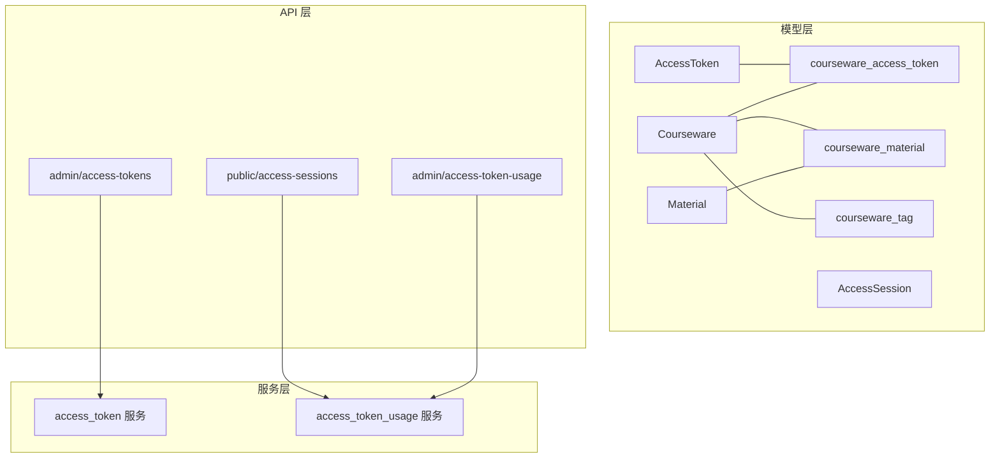
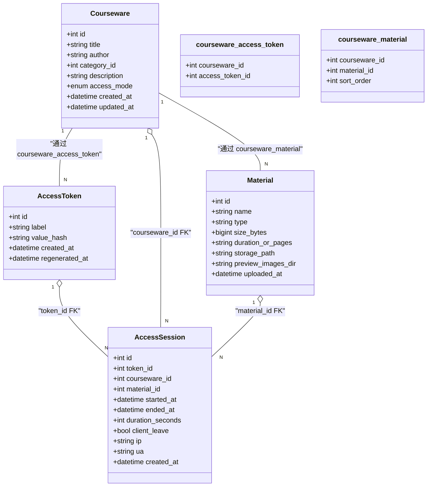
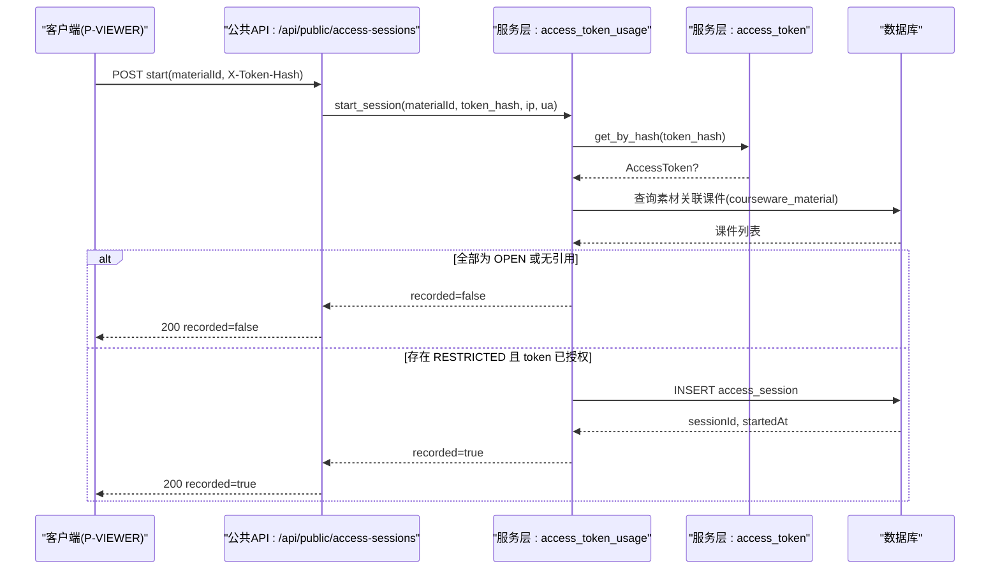
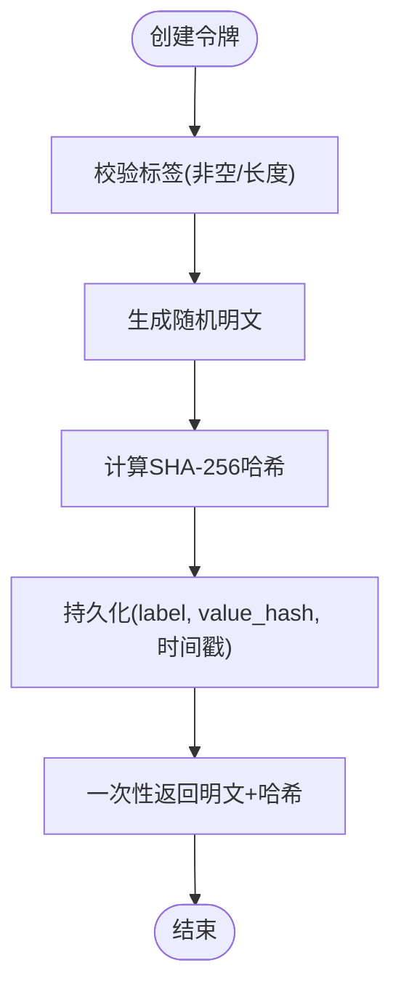
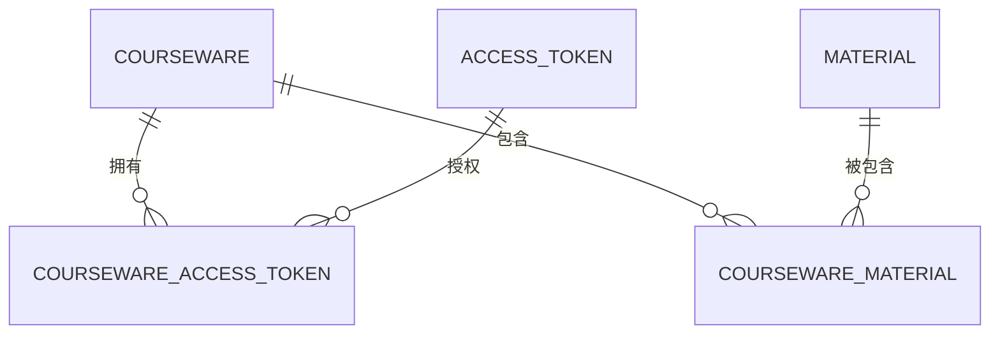
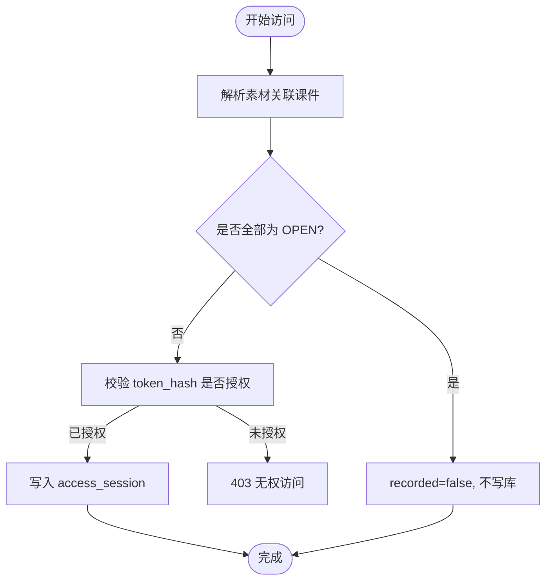
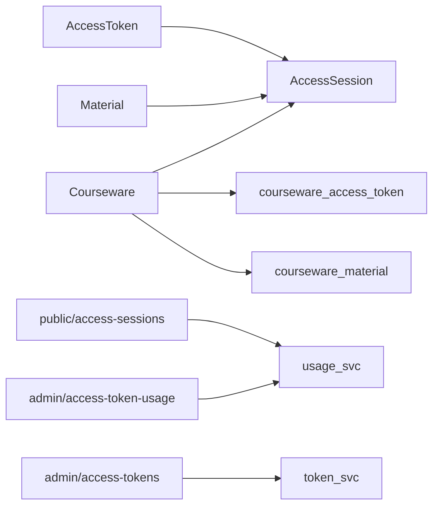

# 访问控制模型

<cite>
**本文引用的文件**   
- [access_token.py](file://backend/app/models/access_token.py)
- [access_session.py](file://backend/app/models/access_session.py)
- [association.py](file://backend/app/models/association.py)
- [courseware.py](file://backend/app/models/courseware.py)
- [material.py](file://backend/app/models/material.py)
- [__init__.py](file://backend/app/models/__init__.py)
- [2026_07_10_0930-c1d2e3f4a5b6_add_access_session.py](file://backend/alembic/versions/2026_07_10_0930-c1d2e3f4a5b6_add_access_session.py)
- [access_token.py](file://backend/app/services/access_token.py)
- [access_token_usage.py](file://backend/app/services/access_token_usage.py)
- [access_sessions.py](file://backend/app/api/public/access_sessions.py)
- [access_tokens.py](file://backend/app/api/admin/access_tokens.py)
- [access_token_usage.py](file://backend/app/api/admin/access_token_usage.py)
- [access_token.py](file://backend/app/schemas/access_token.py)
- [access_token_usage.py](file://backend/app/schemas/access_token_usage.py)
</cite>

## 目录
1. [引言](#引言)
2. [项目结构](#项目结构)
3. [核心组件](#核心组件)
4. [架构总览](#架构总览)
5. [详细组件分析](#详细组件分析)
6. [依赖关系分析](#依赖关系分析)
7. [性能与索引优化](#性能与索引优化)
8. [故障排查指南](#故障排查指南)
9. [结论](#结论)
10. [附录](#附录)

## 引言
本文件聚焦 Learning Hub 的访问控制数据模型，围绕以下目标展开：
- 详细说明访问令牌(AccessToken)与访问会话(AccessSession)的数据结构设计。
- 解释双轨鉴权机制（开放访问 OPEN 与受限访问 RESTRICTED）的数据存储方案与处理逻辑。
- 描述关联表(association)的设计模式，用于实现灵活的多对多关系管理。
- 说明访问权限在数据库层面的实现，包括外键约束与级联删除策略。
- 提供访问控制的查询优化策略与索引设计建议。
- 包含安全相关字段设计与敏感数据处理方案。

## 项目结构
与访问控制相关的代码主要分布在以下模块：
- 数据模型层：models 下的 AccessToken、AccessSession、Courseware、Material 以及 association 中间表定义。
- 迁移脚本：Alembic 版本中新增 access_session 表及索引。
- 服务层：访问令牌业务规则与会话记录、聚合统计等。
- API 层：公共接口（无需管理员鉴权）与管理接口（需管理员鉴权）。
- Schema 层：请求/响应校验模型。



图表来源
- [access_token.py:1-34](file://backend/app/models/access_token.py#L1-L34)
- [access_session.py:1-129](file://backend/app/models/access_session.py#L1-L129)
- [association.py:1-41](file://backend/app/models/association.py#L1-L41)
- [courseware.py:1-74](file://backend/app/models/courseware.py#L1-L74)
- [material.py:1-69](file://backend/app/models/material.py#L1-L69)
- [access_token.py:1-235](file://backend/app/services/access_token.py#L1-L235)
- [access_token_usage.py:1-518](file://backend/app/services/access_token_usage.py#L1-L518)
- [access_sessions.py:1-137](file://backend/app/api/public/access_sessions.py#L1-L137)
- [access_tokens.py:1-120](file://backend/app/api/admin/access_tokens.py#L1-L120)
- [access_token_usage.py:1-101](file://backend/app/api/admin/access_token_usage.py#L1-L101)

章节来源
- [__init__.py:1-30](file://backend/app/models/__init__.py#L1-L30)

## 核心组件
本节概述关键实体与关系，并给出类图。



图表来源
- [access_token.py:1-34](file://backend/app/models/access_token.py#L1-L34)
- [access_session.py:1-129](file://backend/app/models/access_session.py#L1-L129)
- [association.py:1-41](file://backend/app/models/association.py#L1-L41)
- [courseware.py:1-74](file://backend/app/models/courseware.py#L1-L74)
- [material.py:1-69](file://backend/app/models/material.py#L1-L69)

章节来源
- [access_token.py:1-34](file://backend/app/models/access_token.py#L1-L34)
- [access_session.py:1-129](file://backend/app/models/access_session.py#L1-L129)
- [association.py:1-41](file://backend/app/models/association.py#L1-L41)
- [courseware.py:1-74](file://backend/app/models/courseware.py#L1-L74)
- [material.py:1-69](file://backend/app/models/material.py#L1-L69)

## 架构总览
双轨鉴权机制由“开放访问”和“受限访问”两条路径组成：
- 开放访问(OPEN)：素材仅被 OPEN 课件引用时，不记录访问会话，直接放行。
- 受限访问(RESTRICTED)：素材被至少一个 RESTRICTED 课件引用时，需要有效的 AccessToken 授权；通过后记录访问会话。



图表来源
- [access_sessions.py:1-137](file://backend/app/api/public/access_sessions.py#L1-L137)
- [access_token_usage.py:1-518](file://backend/app/services/access_token_usage.py#L1-L518)
- [access_token.py:1-235](file://backend/app/services/access_token.py#L1-L235)
- [access_session.py:1-129](file://backend/app/models/access_session.py#L1-L129)
- [association.py:1-41](file://backend/app/models/association.py#L1-L41)

章节来源
- [access_sessions.py:1-137](file://backend/app/api/public/access_sessions.py#L1-L137)
- [access_token_usage.py:1-518](file://backend/app/services/access_token_usage.py#L1-L518)

## 详细组件分析

### 访问令牌(AccessToken)
- 设计要点
  - 唯一标识：label 全局唯一，便于人类可读的管理。
  - 安全存储：value_hash 保存 SHA-256 摘要，明文仅在创建/重新生成时一次性返回。
  - 审计时间戳：created_at、regenerated_at 用于追踪生命周期。
- 业务规则
  - 标签非空且长度限制。
  - 删除前检查是否被课件引用；至少保留一个 active token。
  - 验证采用常量时间比较，避免时序攻击。
- 典型流程
  - 创建：生成随机明文 → 计算哈希 → 落库 → 返回明文+哈希。
  - 重新生成：更新哈希与时间戳 → 旧哈希立即失效。
  - 列表：仅返回哈希，附带引用计数。
  - 验证：遍历 active tokens 进行常量时间比对。



图表来源
- [access_token.py:1-235](file://backend/app/services/access_token.py#L1-L235)
- [access_token.py:1-34](file://backend/app/models/access_token.py#L1-L34)

章节来源
- [access_token.py:1-34](file://backend/app/models/access_token.py#L1-L34)
- [access_token.py:1-235](file://backend/app/services/access_token.py#L1-L235)
- [access_token.py:1-53](file://backend/app/schemas/access_token.py#L1-L53)

### 访问会话(AccessSession)
- 设计要点
  - 记录一次完整浏览：token_id、courseware_id、material_id、started_at、ended_at、duration_seconds。
  - 客户端离开标记：client_leave 表示由客户端主动结束。
  - 环境信息：ip、ua 用于审计与风控。
  - 跨方言兼容：IP 使用自定义类型装饰器，PostgreSQL 使用 INET，SQLite 降级为 VARCHAR(45)。
- 业务规则
  - 仅在素材被至少一个 RESTRICTED 课件引用时才允许落库。
  - 客户端上报 duration_seconds 与服务端计算偏差 > 60s 时，按服务端时间校正。
  - 令牌重新生成后，旧 session 仍归属原 token_id；用旧 hash 结束旧 session 将失败。
  - 删除 token 时通过外键 CASCADE 清理其历史 session。
- 索引与约束
  - 复合索引：(token_id, started_at)、(token_id, material_id, started_at)、(token_id, courseware_id, started_at)。
  - 单列索引：token_id、courseware_id、material_id。
  - 检查约束：duration_seconds >= 0。

```mermaid
sequenceDiagram
participant Client as "客户端"
participant PublicAPI as "公共API : leave"
participant UsageSvc as "服务层 : leave_session"
participant DB as "数据库"
Client->>PublicAPI : POST /{session_id}/leave(durationSeconds?)
PublicAPI->>UsageSvc : leave_session(session_id, token_hash, duration_seconds)
UsageSvc->>DB : 读取 AccessSession
UsageSvc->>DB : 读取 AccessToken(value_hash)
alt token_hash 匹配
UsageSvc->>DB : 计算服务端时长; 若偏差>60s则校正
UsageSvc->>DB : UPDATE ended_at, duration_seconds, client_leave
DB-->>UsageSvc : OK
UsageSvc-->>PublicAPI : ok=true
PublicAPI-->>Client : 200 ok=true
else token_hash 不匹配
UsageSvc-->>PublicAPI : 抛出错误
PublicAPI-->>Client : 403
end
```

图表来源
- [access_sessions.py:1-137](file://backend/app/api/public/access_sessions.py#L1-L137)
- [access_token_usage.py:1-518](file://backend/app/services/access_token_usage.py#L1-L518)
- [access_session.py:1-129](file://backend/app/models/access_session.py#L1-L129)

章节来源
- [access_session.py:1-129](file://backend/app/models/access_session.py#L1-L129)
- [access_token_usage.py:1-518](file://backend/app/services/access_token_usage.py#L1-L518)
- [access_sessions.py:1-137](file://backend/app/api/public/access_sessions.py#L1-L137)

### 关联表(association)与多对多关系
- 设计模式
  - courseware_tag：课件与标签的多对多。
  - courseware_material：课件与素材的多对多，含 sort_order 维护学习路径顺序，并提供复合索引加速有序查询。
  - courseware_access_token：课件与令牌的授权映射，实现“哪些令牌可访问该课件”。
- 外键与级联
  - 所有关联表均设置 ondelete=CASCADE，确保主表删除时自动清理关联记录。



图表来源
- [association.py:1-41](file://backend/app/models/association.py#L1-L41)
- [courseware.py:1-74](file://backend/app/models/courseware.py#L1-L74)
- [material.py:1-69](file://backend/app/models/material.py#L1-L69)

章节来源
- [association.py:1-41](file://backend/app/models/association.py#L1-L41)
- [courseware.py:1-74](file://backend/app/models/courseware.py#L1-L74)
- [material.py:1-69](file://backend/app/models/material.py#L1-L69)

### 双轨鉴权机制的数据存储方案
- 开放访问(OPEN)
  - 当素材仅被 OPEN 课件引用时，start 接口返回 recorded=false，不写入 access_session。
- 受限访问(RESTRICTED)
  - 当素材被至少一个 RESTRICTED 课件引用时，需要有效 token 授权；通过后写入 access_session。
- 授权判定
  - 根据素材关联的课件集合，收集这些课件绑定的 token 的 value_hash 集合，判断请求的 token_hash 是否在集合内。



图表来源
- [access_token_usage.py:1-518](file://backend/app/services/access_token_usage.py#L1-L518)
- [association.py:1-41](file://backend/app/models/association.py#L1-L41)
- [courseware.py:1-74](file://backend/app/models/courseware.py#L1-L74)

章节来源
- [access_token_usage.py:1-518](file://backend/app/services/access_token_usage.py#L1-L518)

### 数据库级别实现：外键与触发器
- 外键约束
  - access_session.token_id → access_token.id (ondelete=CASCADE)
  - access_session.courseware_id → courseware.id (ondelete=CASCADE)
  - access_session.material_id → material.id (ondelete=CASCADE)
- 检查约束
  - duration_seconds >= 0
- 触发器
  - 当前实现未使用数据库触发器；业务规则在服务层与外键约束共同保证一致性。

章节来源
- [2026_07_10_0930-c1d2e3f4a5b6_add_access_session.py:1-125](file://backend/alembic/versions/2026_07_10_0930-c1d2e3f4a5b6_add_access_session.py#L1-L125)
- [access_session.py:1-129](file://backend/app/models/access_session.py#L1-L129)

## 依赖关系分析
- 模型间依赖
  - AccessSession 依赖 AccessToken、Courseware、Material。
  - Courseware 与 AccessToken 通过 courseware_access_token 建立授权关系。
  - Courseware 与 Material 通过 courseware_material 建立内容组织关系。
- 服务与API依赖
  - 公共API调用 usage_svc.start_session/leave_session。
  - 管理API调用 token_svc 与 usage_svc 提供令牌管理与使用统计。



图表来源
- [access_token.py:1-34](file://backend/app/models/access_token.py#L1-L34)
- [access_session.py:1-129](file://backend/app/models/access_session.py#L1-L129)
- [association.py:1-41](file://backend/app/models/association.py#L1-L41)
- [access_sessions.py:1-137](file://backend/app/api/public/access_sessions.py#L1-L137)
- [access_tokens.py:1-120](file://backend/app/api/admin/access_tokens.py#L1-L120)
- [access_token_usage.py:1-101](file://backend/app/api/admin/access_token_usage.py#L1-L101)
- [access_token.py:1-235](file://backend/app/services/access_token.py#L1-L235)
- [access_token_usage.py:1-518](file://backend/app/services/access_token_usage.py#L1-L518)

章节来源
- [access_token.py:1-34](file://backend/app/models/access_token.py#L1-L34)
- [access_session.py:1-129](file://backend/app/models/access_session.py#L1-L129)
- [association.py:1-41](file://backend/app/models/association.py#L1-L41)
- [access_sessions.py:1-137](file://backend/app/api/public/access_sessions.py#L1-L137)
- [access_tokens.py:1-120](file://backend/app/api/admin/access_tokens.py#L1-L120)
- [access_token_usage.py:1-101](file://backend/app/api/admin/access_token_usage.py#L1-L101)
- [access_token.py:1-235](file://backend/app/services/access_token.py#L1-L235)
- [access_token_usage.py:1-518](file://backend/app/services/access_token_usage.py#L1-L518)

## 性能与索引优化
- 现有索引
  - ix_access_session_token_started：支持按 token 和时间范围查询。
  - ix_access_session_token_material：支持按 token+素材+时间范围查询。
  - ix_access_session_token_courseware：支持按 token+课件+时间范围查询。
  - 单列索引：token_id、courseware_id、material_id。
- 建议优化
  - 针对高频聚合查询，可在 (token_id, started_at) 上覆盖索引以加速 count/sum。
  - 对于按素材聚合接口，考虑在 (material_id, started_at) 上建立覆盖索引以减少回表。
  - 大表分区：可按 started_at 进行按月分区，提升历史数据归档与查询性能。
  - 连接池与批量写入：在高并发场景下，使用批量插入减少事务开销。

章节来源
- [2026_07_10_0930-c1d2e3f4a5b6_add_access_session.py:1-125](file://backend/alembic/versions/2026_07_10_0930-c1d2e3f4a5b6_add_access_session.py#L1-L125)
- [access_token_usage.py:1-518](file://backend/app/services/access_token_usage.py#L1-L518)

## 故障排查指南
- 常见问题
  - 缺少 token_hash：公共接口返回 missing_token。
  - 无效 token_hash：返回 invalid_token。
  - 令牌无权访问：返回 courseware_acl_locked。
  - 令牌重复标签：创建时返回 token_label_conflict。
  - 最后令牌保护：删除最后一个 active token 返回 last_token_required。
  - 被引用的令牌无法删除：返回 token_referenced。
- 定位方法
  - 检查 public API 限流：进程内滑动窗口限流，命中后降级为 recorded=false。
  - 核对 token_hash 与 value_hash 一致性，确认是否重新生成导致旧 hash 失效。
  - 查看 access_session 记录是否存在，确认是否因 OPEN 课件而未落库。
  - 审查外键约束与级联删除行为，确保主表删除不会导致异常。

章节来源
- [access_sessions.py:1-137](file://backend/app/api/public/access_sessions.py#L1-L137)
- [access_token.py:1-235](file://backend/app/services/access_token.py#L1-L235)
- [access_token_usage.py:1-518](file://backend/app/services/access_token_usage.py#L1-L518)

## 结论
本模型通过清晰的实体设计与严谨的业务规则，实现了灵活的访问控制与完整的访问审计能力。双轨鉴权机制在保证安全性的同时兼顾了性能与可扩展性；关联表模式提供了强大的多对多管理能力；外键约束与检查约束确保了数据一致性。配合合理的索引与可能的分区策略，系统能够在高并发与大数据量场景下保持良好表现。

## 附录
- 安全字段与敏感数据处理
  - AccessToken.value_hash 使用 SHA-256 存储，明文仅在创建/重新生成时一次性返回。
  - IP 地址使用跨方言类型装饰器，PostgreSQL 原生 INET，SQLite 降级为字符串。
  - UA 字段限制最大长度，避免过大负载。
  - 验证过程使用常量时间比较，防止时序攻击。

章节来源
- [access_token.py:1-34](file://backend/app/models/access_token.py#L1-L34)
- [access_token.py:1-235](file://backend/app/services/access_token.py#L1-L235)
- [access_session.py:1-129](file://backend/app/models/access_session.py#L1-L129)