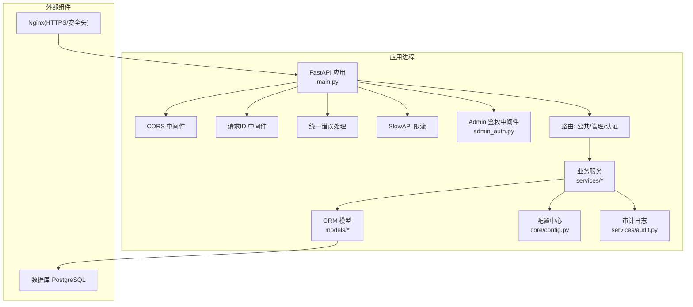
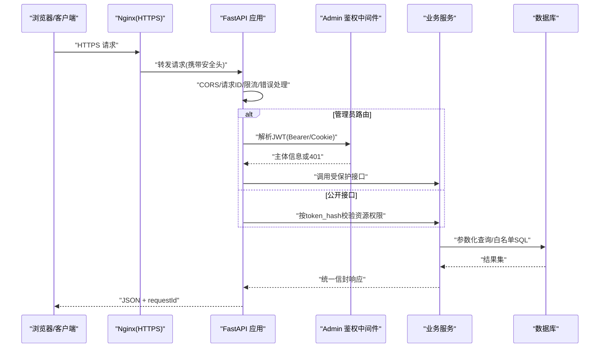
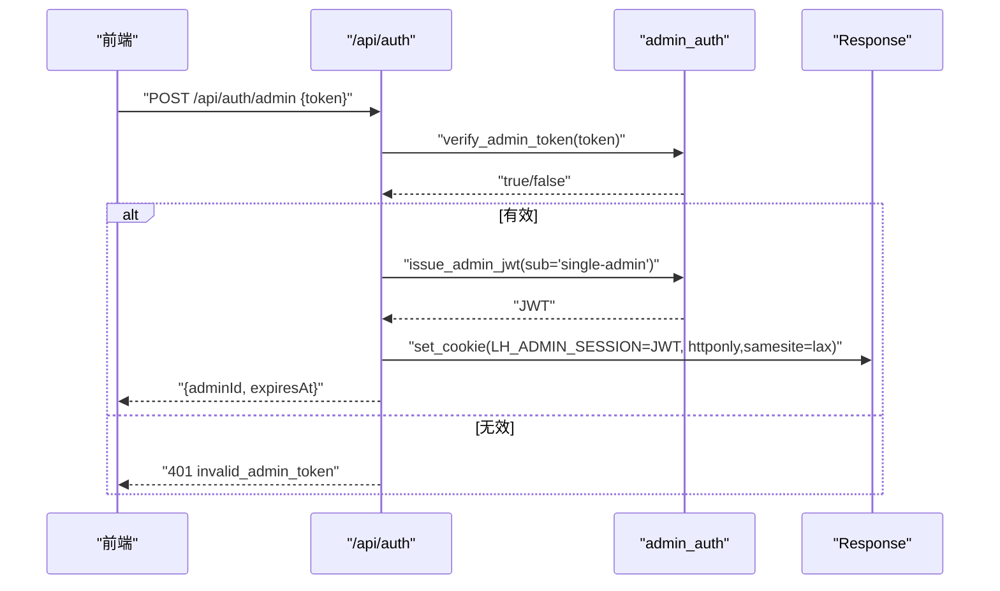
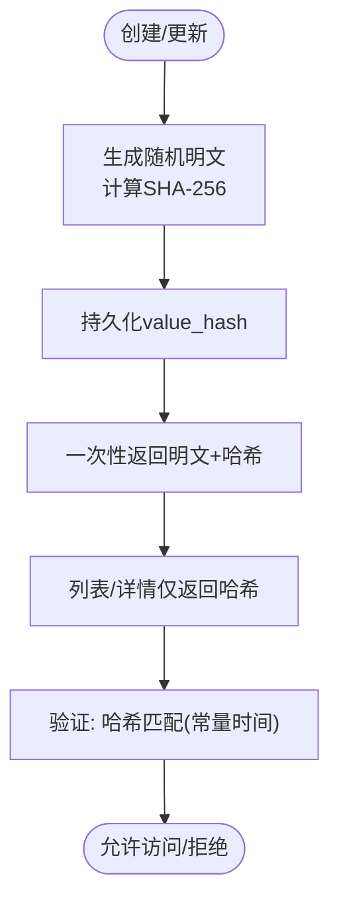
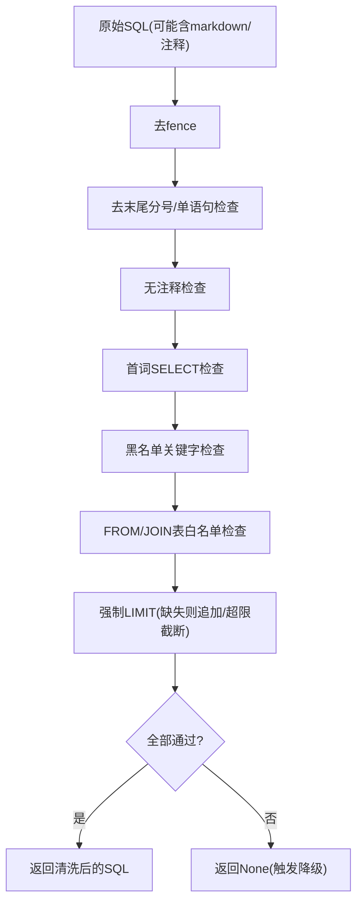
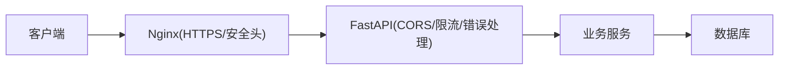
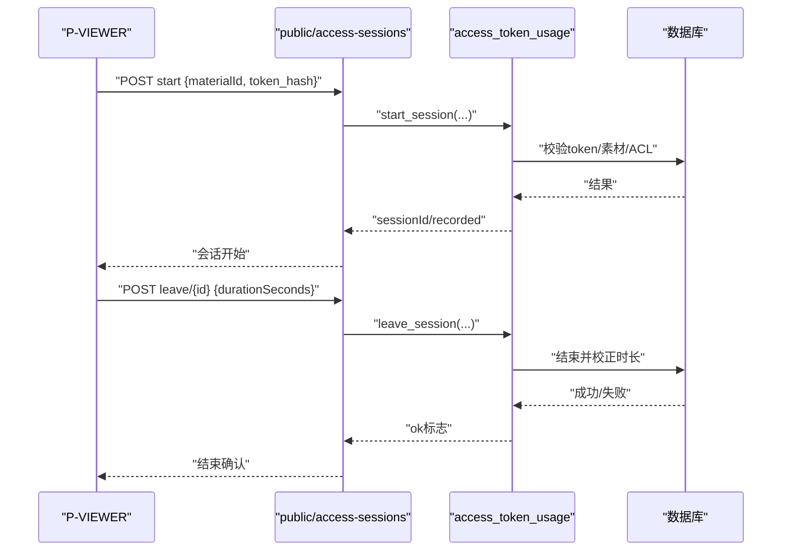
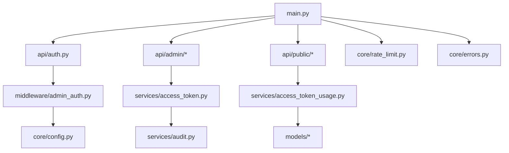

# 安全架构设计

<cite>
**本文引用的文件**   
- [backend/app/main.py](file://backend/app/main.py)
- [backend/app/api/auth.py](file://backend/app/api/auth.py)
- [backend/app/middleware/admin_auth.py](file://backend/app/middleware/admin_auth.py)
- [backend/app/core/config.py](file://backend/app/core/config.py)
- [backend/app/services/access_token.py](file://backend/app/services/access_token.py)
- [backend/app/models/access_token.py](file://backend/app/models/access_token.py)
- [backend/app/schemas/auth.py](file://backend/app/schemas/auth.py)
- [backend/app/services/_sql_safety.py](file://backend/app/services/_sql_safety.py)
- [backend/app/api/admin/access_tokens.py](file://backend/app/api/admin/access_tokens.py)
- [backend/app/services/audit.py](file://backend/app/services/audit.py)
- [backend/app/core/errors.py](file://backend/app/core/errors.py)
- [backend/app/core/rate_limit.py](file://backend/app/core/rate_limit.py)
- [deploy/ecs/nginx-vhost-https.snippet](file://deploy/ecs/nginx-vhost-https.snippet)
- [backend/app/schemas/__init__.py](file://backend/app/schemas/__init__.py)
- [backend/app/api/public/access_sessions.py](file://backend/app/api/public/access_sessions.py)
- [backend/app/models/access_session.py](file://backend/app/models/access_session.py)
- [backend/app/services/access_token_usage.py](file://backend/app/services/access_token_usage.py)
</cite>

## 目录
1. [引言](#引言)
2. [项目结构](#项目结构)
3. [核心组件](#核心组件)
4. [架构总览](#架构总览)
5. [详细组件分析](#详细组件分析)
6. [依赖关系分析](#依赖关系分析)
7. [性能与安全权衡](#性能与安全权衡)
8. [故障排查指南](#故障排查指南)
9. [结论](#结论)
10. [附录](#附录)

## 引言
本文件面向 Learning Hub 后端的安全架构，围绕认证授权、令牌与密钥管理、输入与SQL安全、网络安全、威胁分析与审计日志等维度进行系统化说明。文档以代码实现为依据，给出可落地的策略与最佳实践，并辅以图示帮助理解。

## 项目结构
后端采用 FastAPI 分层组织：入口装配中间件与路由；鉴权在中间件层完成；业务服务位于 services；数据模型位于 models；配置集中管理于 core/config；限流使用 SlowAPI；部署侧通过 Nginx 提供 HTTPS 与安全响应头。

图表来源
- [backend/app/main.py:40-116](file://backend/app/main.py#L40-L116)
- [backend/app/middleware/admin_auth.py:1-66](file://backend/app/middleware/admin_auth.py#L1-L66)
- [backend/app/core/config.py:1-88](file://backend/app/core/config.py#L1-L88)
- [backend/app/services/audit.py:1-45](file://backend/app/services/audit.py#L1-L45)
- [backend/app/core/rate_limit.py:1-55](file://backend/app/core/rate_limit.py#L1-L55)
- [deploy/ecs/nginx-vhost-https.snippet:1-42](file://deploy/ecs/nginx-vhost-https.snippet#L1-L42)

章节来源
- [backend/app/main.py:40-116](file://backend/app/main.py#L40-L116)
- [backend/app/core/config.py:1-88](file://backend/app/core/config.py#L1-L88)

## 核心组件
- 管理员认证与会话
  - 登录接口校验“管理令牌”，签发 JWT，写入 HttpOnly Cookie，并提供登出清理。
  - 受保护路由通过 Depends 解析 Authorization/Bearer 或 Cookie 中的 JWT，校验过期与签名。
- 访问令牌（Access Token）
  - 明文仅创建/重新生成时返回一次，数据库持久化 SHA-256 摘要；列表与详情只暴露哈希。
  - 删除前检查引用与“至少保留一个 active token”约束。
- SQL 安全
  - 对 LLM 生成的原始 SQL 执行“七道闸”白名单校验，强制 SELECT、表白名单、黑名单关键字、禁止注释、单语句、强制 LIMIT。
- 限流与异常
  - 全局 SlowAPI 限流器；公共接口内置滑动窗口限流兜底；统一错误信封与 requestId 透传。
- 审计日志
  - 关键管理操作以 JSON Lines 追加到本地日志目录，失败不阻塞主流程。

章节来源
- [backend/app/api/auth.py:1-49](file://backend/app/api/auth.py#L1-L49)
- [backend/app/middleware/admin_auth.py:1-66](file://backend/app/middleware/admin_auth.py#L1-L66)
- [backend/app/services/access_token.py:1-235](file://backend/app/services/access_token.py#L1-L235)
- [backend/app/services/_sql_safety.py:1-220](file://backend/app/services/_sql_safety.py#L1-L220)
- [backend/app/core/rate_limit.py:1-55](file://backend/app/core/rate_limit.py#L1-L55)
- [backend/app/services/audit.py:1-45](file://backend/app/services/audit.py#L1-L45)
- [backend/app/schemas/__init__.py:1-65](file://backend/app/schemas/__init__.py#L1-L65)

## 架构总览
下图展示从浏览器到后端的完整安全链路：Nginx 终止 TLS 并设置安全头；FastAPI 注入 CORS、请求ID、限流与统一错误处理；管理员路由受 JWT 保护；公开访问会话接口基于 token hash 做资源级鉴权；所有敏感数据落地前均经过哈希或白名单校验。

图表来源
- [backend/app/main.py:40-116](file://backend/app/main.py#L40-L116)
- [backend/app/middleware/admin_auth.py:1-66](file://backend/app/middleware/admin_auth.py#L1-L66)
- [backend/app/api/public/access_sessions.py:1-137](file://backend/app/api/public/access_sessions.py#L1-L137)
- [backend/app/services/_sql_safety.py:1-220](file://backend/app/services/_sql_safety.py#L1-L220)
- [deploy/ecs/nginx-vhost-https.snippet:1-42](file://deploy/ecs/nginx-vhost-https.snippet#L1-L42)

## 详细组件分析

### 管理员认证与JWT管理
- 登录流程
  - 校验“管理令牌”常量时间比较，通过后签发 JWT（含 exp/sub），写入 HttpOnly Cookie，并返回过期时间。
  - 登出接口删除 Cookie。
- 鉴权依赖
  - 优先从 Authorization: Bearer 提取，其次回退到 Cookie LH_ADMIN_SESSION。
  - 解码 JWT 要求 exp 与 sub，失败抛出未认证错误。
- 令牌生命周期
  - TTL 由配置控制；建议生产环境启用短 TTL 与前端刷新策略。

图表来源
- [backend/app/api/auth.py:21-45](file://backend/app/api/auth.py#L21-L45)
- [backend/app/middleware/admin_auth.py:45-62](file://backend/app/middleware/admin_auth.py#L45-L62)
- [backend/app/schemas/auth.py:7-16](file://backend/app/schemas/auth.py#L7-L16)

章节来源
- [backend/app/api/auth.py:1-49](file://backend/app/api/auth.py#L1-L49)
- [backend/app/middleware/admin_auth.py:1-66](file://backend/app/middleware/admin_auth.py#L1-L66)
- [backend/app/schemas/auth.py:1-17](file://backend/app/schemas/auth.py#L1-L17)

### 访问令牌（Access Token）安全策略
- 存储与比对
  - 数据库仅保存 value_hash(SHA-256)，明文仅在创建/重新生成时一次性返回。
  - 验证时使用常量时间比较避免时序攻击。
- 生命周期与约束
  - 标签唯一且长度受限；删除前检查是否被课件引用；保证至少保留一个 active token。
- 列表与详情
  - 列表与详情仅返回哈希，避免泄露明文。

图表来源
- [backend/app/services/access_token.py:32-55](file://backend/app/services/access_token.py#L32-L55)
- [backend/app/services/access_token.py:193-205](file://backend/app/services/access_token.py#L193-L205)
- [backend/app/models/access_token.py:13-27](file://backend/app/models/access_token.py#L13-L27)

章节来源
- [backend/app/services/access_token.py:1-235](file://backend/app/services/access_token.py#L1-L235)
- [backend/app/models/access_token.py:1-34](file://backend/app/models/access_token.py#L1-L34)
- [backend/app/api/admin/access_tokens.py:1-120](file://backend/app/api/admin/access_tokens.py#L1-L120)

### SQL 注入防护（LLM 生成 SQL 场景）
- 七道闸校验
  - 去除 Markdown 包裹、单语句、无注释、首词 SELECT、黑名单关键字、表白名单、强制 LIMIT。
- 限制与降级
  - 硬上限限制最大行数；任一闸失败则返回 None，调用方回退到关键词搜索。

图表来源
- [backend/app/services/_sql_safety.py:91-210](file://backend/app/services/_sql_safety.py#L91-L210)

章节来源
- [backend/app/services/_sql_safety.py:1-220](file://backend/app/services/_sql_safety.py#L1-L220)

### 网络安全与传输安全
- HTTPS 与安全头
  - Nginx 监听 443，加载证书，开启 HTTP/2，设置 X-Content-Type-Options、X-Frame-Options、X-XSS-Protection。
  - 大文件上传相关超时与缓冲参数已调优。
- CORS 策略
  - 应用层通过 CORSMiddleware 配置允许来源、凭据与方法头；生产建议显式指定来源而非通配符。
- 请求限流
  - 全局 SlowAPI 限流器支持 IP/会话键；公共接口内置滑动窗口限流作为兜底。

图表来源
- [deploy/ecs/nginx-vhost-https.snippet:1-42](file://deploy/ecs/nginx-vhost-https.snippet#L1-L42)
- [backend/app/main.py:57-65](file://backend/app/main.py#L57-L65)
- [backend/app/core/rate_limit.py:40-55](file://backend/app/core/rate_limit.py#L40-L55)
- [backend/app/api/public/access_sessions.py:29-54](file://backend/app/api/public/access_sessions.py#L29-L54)

章节来源
- [deploy/ecs/nginx-vhost-https.snippet:1-42](file://deploy/ecs/nginx-vhost-https.snippet#L1-L42)
- [backend/app/main.py:57-65](file://backend/app/main.py#L57-L65)
- [backend/app/core/rate_limit.py:1-55](file://backend/app/core/rate_limit.py#L1-L55)
- [backend/app/api/public/access_sessions.py:1-137](file://backend/app/api/public/access_sessions.py#L1-L137)

### 敏感数据保护与环境配置
- 密码与密钥
  - 管理员登录使用的“管理令牌”为静态口令，建议在生产中通过环境变量注入并定期轮换。
  - JWT 签名密钥与算法、TTL 均由配置项管理，生产必须替换默认值。
- API 密钥
  - LLM 相关 API Key 通过环境变量注入，留空即禁用该能力，降低风险面。
- 环境变量
  - 配置类支持 .env 覆盖，数据库连接串优先使用 DATABASE_URL，便于多环境切换。

章节来源
- [backend/app/core/config.py:1-88](file://backend/app/core/config.py#L1-L88)
- [backend/app/middleware/admin_auth.py:58-62](file://backend/app/middleware/admin_auth.py#L58-L62)

### 访问会话与资源级鉴权
- 会话开启
  - 根据 token_hash 定位 AccessToken，若素材被 RESTRICTED 课件引用且 token 未授权则拒绝；OPEN 素材不记录。
- 会话结束
  - 幂等结束，服务端校正时长偏差，防止客户端时钟篡改。
- 防重放与一致性
  - 通过 token_hash 绑定 session，确保只有持有者能结束会话。

图表来源
- [backend/app/api/public/access_sessions.py:65-133](file://backend/app/api/public/access_sessions.py#L65-L133)
- [backend/app/services/access_token_usage.py:64-171](file://backend/app/services/access_token_usage.py#L64-L171)
- [backend/app/models/access_session.py:56-129](file://backend/app/models/access_session.py#L56-L129)

章节来源
- [backend/app/api/public/access_sessions.py:1-137](file://backend/app/api/public/access_sessions.py#L1-L137)
- [backend/app/services/access_token_usage.py:1-518](file://backend/app/services/access_token_usage.py#L1-L518)
- [backend/app/models/access_session.py:1-129](file://backend/app/models/access_session.py#L1-L129)

### 安全审计与日志记录
- 审计范围
  - 访问令牌的创建、重新生成、删除等操作均写入审计日志。
- 格式与位置
  - JSON Lines 格式，追加至 storage_path 上级目录的 logs/audit.jsonl。
- 健壮性
  - 审计写入失败不影响主流程，确保可用性。

章节来源
- [backend/app/services/audit.py:1-45](file://backend/app/services/audit.py#L1-L45)
- [backend/app/services/access_token.py:92-138](file://backend/app/services/access_token.py#L92-L138)

## 依赖关系分析
- 模块耦合
  - main.py 负责中间件与路由装配，低耦合地引入各功能模块。
  - admin_auth 依赖 config 获取 JWT 参数；auth 路由依赖 admin_auth 完成签发与校验。
  - access_token 服务依赖 audit 记录操作；access_token_usage 依赖 courseware/material 模型与 ACL 规则。
- 外部依赖
  - SlowAPI 提供限流；PostgreSQL 提供持久化；Nginx 提供 TLS 与安全头。

图表来源
- [backend/app/main.py:91-102](file://backend/app/main.py#L91-L102)
- [backend/app/api/auth.py:1-49](file://backend/app/api/auth.py#L1-L49)
- [backend/app/middleware/admin_auth.py:1-66](file://backend/app/middleware/admin_auth.py#L1-L66)
- [backend/app/core/config.py:1-88](file://backend/app/core/config.py#L1-L88)
- [backend/app/services/access_token.py:1-235](file://backend/app/services/access_token.py#L1-L235)
- [backend/app/services/audit.py:1-45](file://backend/app/services/audit.py#L1-L45)
- [backend/app/api/public/access_sessions.py:1-137](file://backend/app/api/public/access_sessions.py#L1-L137)
- [backend/app/services/access_token_usage.py:1-518](file://backend/app/services/access_token_usage.py#L1-L518)
- [backend/app/core/rate_limit.py:1-55](file://backend/app/core/rate_limit.py#L1-L55)
- [backend/app/core/errors.py:1-144](file://backend/app/core/errors.py#L1-L144)

章节来源
- [backend/app/main.py:91-102](file://backend/app/main.py#L91-L102)
- [backend/app/core/errors.py:1-144](file://backend/app/core/errors.py#L1-L144)

## 性能与安全权衡
- 限流粒度
  - 全局 SlowAPI 适合跨端点通用限流；公共接口内建滑动窗口用于更细粒度的会话上报限流，兼顾稳定性与用户体验。
- 审计开销
  - 审计写入异步化或批量写入可降低影响；当前实现为同步追加，失败不抛错，保障主流程可用。
- SQL 校验成本
  - “七道闸”为纯函数正则与集合判断，开销极低；必要时可对常用模式预编译缓存。

[本节为通用指导，无需源码引用]

## 故障排查指南
- 常见错误码
  - 未认证/令牌无效/会话过期：检查 JWT 配置、Cookie 域与路径、Authorization 头是否正确。
  - 令牌不存在/无权访问：核对 token_hash 与素材 ACL 绑定关系。
  - 限流命中：检查 SlowAPI 配置与公共接口滑动窗口阈值。
- 日志与追踪
  - 统一响应包含 requestId，可在 Nginx/FastAPI 日志中串联请求。
  - 审计日志位于 storage_path 上级目录 logs/audit.jsonl，可按 action/resource 检索。

章节来源
- [backend/app/core/errors.py:73-127](file://backend/app/core/errors.py#L73-L127)
- [backend/app/schemas/__init__.py:35-61](file://backend/app/schemas/__init__.py#L35-L61)
- [backend/app/services/audit.py:13-42](file://backend/app/services/audit.py#L13-L42)

## 结论
Learning Hub 在后端实现了较为完善的安全基线：管理员认证采用 JWT + HttpOnly Cookie，访问令牌以哈希形式存储并在创建/重置时一次性返回明文；SQL 注入通过严格的白名单与语法闸口防护；网络层由 Nginx 提供 HTTPS 与安全头，应用层提供 CORS 与限流；关键操作具备审计日志。建议在后续迭代中强化以下方面：
- 将管理员令牌升级为基于用户名的账号体系与密码哈希存储。
- 引入短期访问令牌与刷新机制，缩短 JWT 有效期。
- 将审计日志接入集中式日志系统，并增加告警与留存策略。
- 对 CORS 与限流策略进行生产环境的精细化配置与压测验证。

[本节为总结，无需源码引用]

## 附录
- 术语
  - JWT：JSON Web Token，用于无状态身份传递。
  - CSRF：跨站请求伪造，可通过 SameSite Cookie 与同源策略缓解。
  - XSS：跨站脚本攻击，可通过安全响应头与输出编码缓解。
  - SQL 注入：通过构造恶意输入改变 SQL 语义，需参数化与白名单双重防护。

[本节为概念说明，无需源码引用]