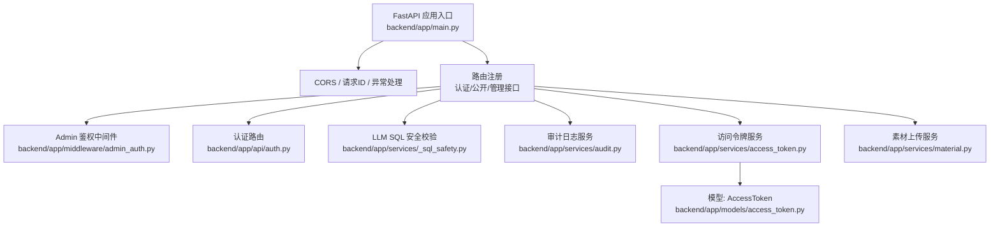
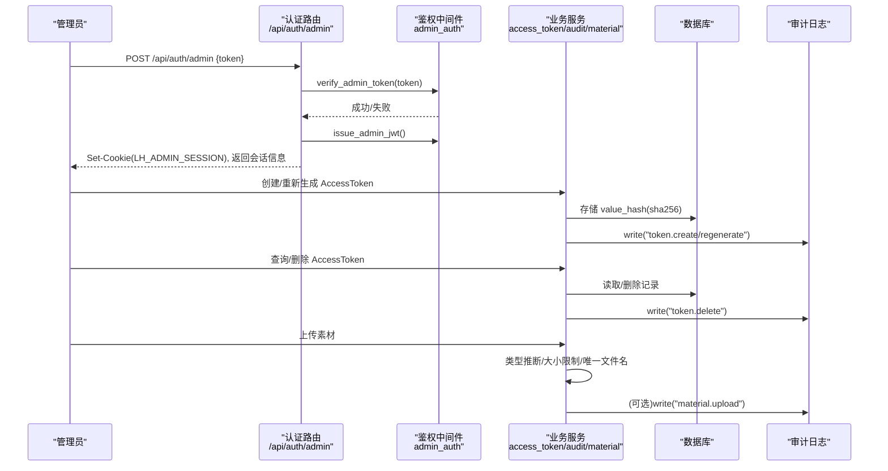
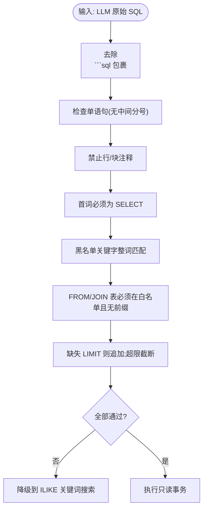
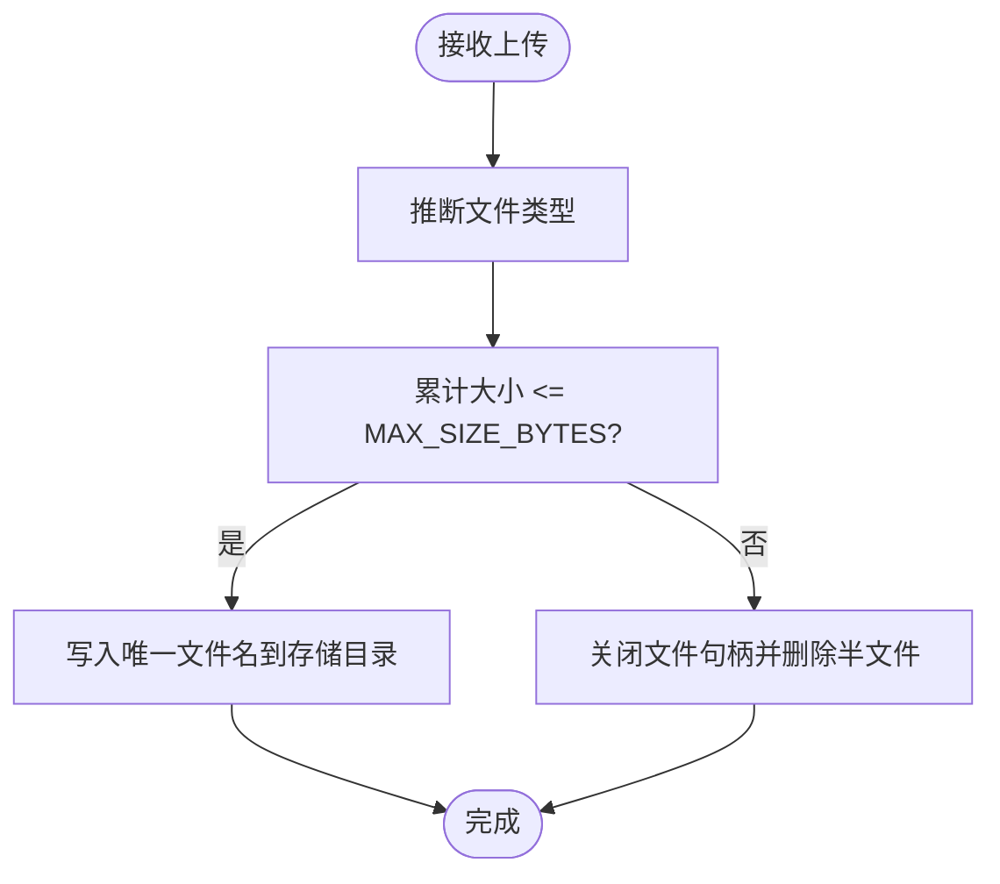
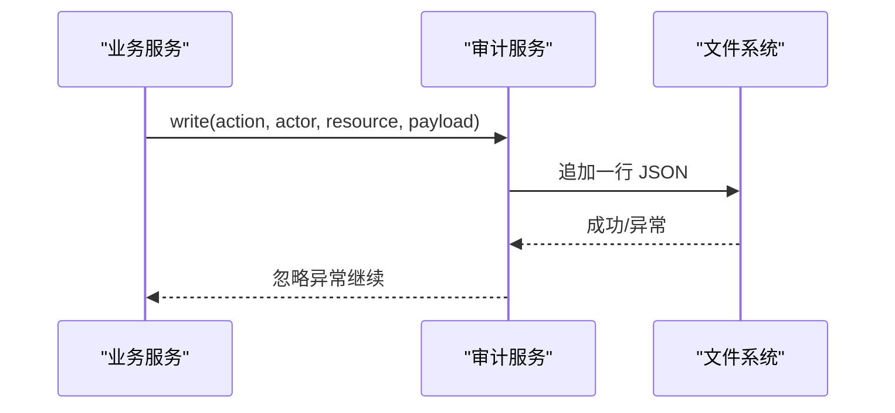
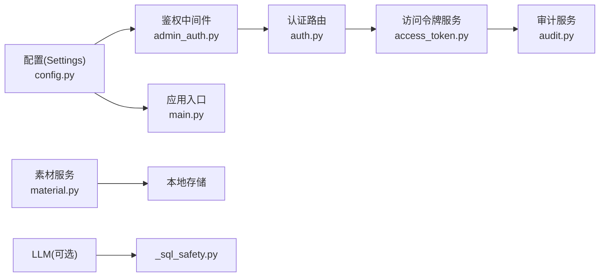

# 数据安全保护

<cite>
**本文引用的文件**   
- [backend/app/main.py](file://backend/app/main.py)
- [backend/app/core/config.py](file://backend/app/core/config.py)
- [backend/app/middleware/admin_auth.py](file://backend/app/middleware/admin_auth.py)
- [backend/app/api/auth.py](file://backend/app/api/auth.py)
- [backend/app/services/_sql_safety.py](file://backend/app/services/_sql_safety.py)
- [backend/app/services/audit.py](file://backend/app/services/audit.py)
- [backend/app/models/access_token.py](file://backend/app/models/access_token.py)
- [backend/app/services/access_token.py](file://backend/app/services/access_token.py)
- [backend/app/services/material.py](file://backend/app/services/material.py)
- [frontend/src/pages/admin/Materials.tsx](file://frontend/src/pages/admin/Materials.tsx)
- [doc/spec/10-API设计规范.md](file://doc/spec/10-API设计规范.md)
- [doc/test/test-cases-integration.md](file://doc/test/test-cases-integration.md)
</cite>

## 目录
1. [引言](#引言)
2. [项目结构](#项目结构)
3. [核心组件](#核心组件)
4. [架构总览](#架构总览)
5. [详细组件分析](#详细组件分析)
6. [依赖关系分析](#依赖关系分析)
7. [性能与安全权衡](#性能与安全权衡)
8. [故障排除指南](#故障排除指南)
9. [结论](#结论)
10. [附录：配置与示例](#附录配置与示例)

## 引言
本文件面向 Learning Hub 的数据安全保护，覆盖敏感数据加密策略、数据库安全防护、文件上传安全、数据传输安全、审计日志系统，并提供配置示例与故障排除建议。文档内容基于仓库现有实现与规范文档进行梳理与总结，确保与实际代码一致。

## 项目结构
后端采用 FastAPI 应用，集中装配中间件、路由、错误处理与限流；鉴权使用 JWT + Cookie；访问令牌（AccessToken）仅存储哈希值；LLM 生成的 SQL 需通过白名单校验；审计日志以 JSON Lines 追加写入；素材上传具备大小限制与类型推断。



图表来源
- [backend/app/main.py:40-112](file://backend/app/main.py#L40-L112)
- [backend/app/middleware/admin_auth.py:16-66](file://backend/app/middleware/admin_auth.py#L16-L66)
- [backend/app/api/auth.py:21-45](file://backend/app/api/auth.py#L21-L45)
- [backend/app/services/_sql_safety.py:165-210](file://backend/app/services/_sql_safety.py#L165-L210)
- [backend/app/services/audit.py:21-42](file://backend/app/services/audit.py#L21-L42)
- [backend/app/services/access_token.py:73-119](file://backend/app/services/access_token.py#L73-L119)
- [backend/app/models/access_token.py:13-33](file://backend/app/models/access_token.py#L13-L33)
- [backend/app/services/material.py:129-152](file://backend/app/services/material.py#L129-L152)

章节来源
- [backend/app/main.py:40-112](file://backend/app/main.py#L40-L112)

## 核心组件
- 配置中心：从环境变量加载数据库连接、JWT 密钥、CORS、存储路径等，提供缓存的全局实例。
- 认证与会话：Admin Token 登录签发 JWT，设置 HttpOnly Cookie；后续请求支持 Authorization/Bearer 或 Cookie 提取。
- 访问令牌（AccessToken）：明文仅创建/重新生成时返回一次，数据库仅存 SHA-256 哈希；验证使用常量时间比较。
- LLM SQL 安全：对 LLM 输出的原始 SQL 执行“七道闸”白名单校验，失败则降级到关键词搜索。
- 审计日志：关键操作以 JSON Lines 格式追加写入 storage_path/logs/audit.jsonl。
- 文件上传：按类型推断、累计大小限制、唯一文件名、失败清理半文件。

章节来源
- [backend/app/core/config.py:9-88](file://backend/app/core/config.py#L9-L88)
- [backend/app/middleware/admin_auth.py:16-66](file://backend/app/middleware/admin_auth.py#L16-L66)
- [backend/app/api/auth.py:21-45](file://backend/app/api/auth.py#L21-L45)
- [backend/app/services/access_token.py:73-119](file://backend/app/services/access_token.py#L73-L119)
- [backend/app/models/access_token.py:13-33](file://backend/app/models/access_token.py#L13-L33)
- [backend/app/services/_sql_safety.py:165-210](file://backend/app/services/_sql_safety.py#L165-L210)
- [backend/app/services/audit.py:21-42](file://backend/app/services/audit.py#L21-L42)
- [backend/app/services/material.py:129-152](file://backend/app/services/material.py#L129-L152)

## 架构总览
下图展示关键安全流程：管理员登录、令牌创建与验证、LLM SQL 校验、审计记录与文件上传。



图表来源
- [backend/app/api/auth.py:21-45](file://backend/app/api/auth.py#L21-L45)
- [backend/app/middleware/admin_auth.py:45-66](file://backend/app/middleware/admin_auth.py#L45-L66)
- [backend/app/services/access_token.py:73-119](file://backend/app/services/access_token.py#L73-L119)
- [backend/app/services/audit.py:21-42](file://backend/app/services/audit.py#L21-L42)
- [backend/app/services/material.py:129-152](file://backend/app/services/material.py#L129-L152)

## 详细组件分析

### 敏感数据加密策略
- 密码/口令类敏感数据
  - Admin Token 登录接口使用常量时间比较，避免时序攻击。
  - 会话令牌使用 JWT，签名密钥由配置项控制，TTL 可配。
- API 密钥与令牌
  - AccessToken 明文仅在创建/重新生成时一次性返回；数据库仅存储 SHA-256 哈希；验证时使用常量时间比较。
- 配置文件安全
  - 所有敏感配置（数据库凭据、JWT 密钥、LLM API Key 等）通过环境变量注入，默认值仅供开发环境使用。

```mermaid
classDiagram
class Settings {
+database_url
+jwt_secret
+jwt_algorithm
+jwt_ttl_hours
+dashscope_api_key
+cors_allow_origins
+storage_path
}
class AccessTokenService {
+create(label) -> {value, valueHash}
+regenerate(id) -> {value, valueHash}
+verify(plaintext) -> AccessToken?
-_hash_token(plain) -> str
}
class AdminAuth {
+issue_admin_jwt(sub) -> str
+verify_admin_token(token) -> bool
+get_admin_principal(request) -> dict
}
Settings <.. AdminAuth : "读取密钥/TTL"
AccessTokenService ..> Settings : "不直接依赖"
```

图表来源
- [backend/app/core/config.py:9-88](file://backend/app/core/config.py#L9-L88)
- [backend/app/services/access_token.py:73-119](file://backend/app/services/access_token.py#L73-L119)
- [backend/app/middleware/admin_auth.py:45-66](file://backend/app/middleware/admin_auth.py#L45-L66)

章节来源
- [backend/app/middleware/admin_auth.py:58-66](file://backend/app/middleware/admin_auth.py#L58-L66)
- [backend/app/services/access_token.py:32-34](file://backend/app/services/access_token.py#L32-L34)
- [backend/app/services/access_token.py:193-205](file://backend/app/services/access_token.py#L193-L205)
- [backend/app/core/config.py:40-47](file://backend/app/core/config.py#L40-L47)

### 数据库安全防护
- SQL 注入防护
  - LLM 生成的 SQL 必须通过“七道闸”白名单校验：去 markdown fence、单语句、无注释、首词 SELECT、黑名单关键字、表白名单、强制 LIMIT。任一失败即回退到 ILIKE 关键词搜索。
- 参数化查询
  - 当前搜索路径中 LLM 输出为字面量文本，SQLAlchemy text() 自带转义；同时通过白名单校验进一步降低风险。
- 数据脱敏
  - 响应字段级脱敏：AccessToken.value 仅创建/重新生成时返回一次；value_hash 不出现在任何响应或日志中；内部路径不暴露。



图表来源
- [backend/app/services/_sql_safety.py:165-L210](file://backend/app/services/_sql_safety.py#L165-L210)

章节来源
- [backend/app/services/_sql_safety.py:23-L69](file://backend/app/services/_sql_safety.py#L23-L69)
- [backend/app/services/_sql_safety.py:165-L210](file://backend/app/services/_sql_safety.py#L165-L210)
- [doc/spec/10-API设计规范.md:1262-L1270](file://doc/spec/10-API设计规范.md#L1262-L1270)

### 文件上传安全
- 文件格式验证
  - 根据文件名推断类型（VIDEO/PDF/PPT），前端 accept 属性限定扩展名。
- 大小限制
  - 后端累计读取并限制最大字节数，超过则主动清理半文件并返回错误；前端提示友好错误信息。
- 恶意文件检测
  - 当前未集成病毒扫描；建议在生产环境引入外部扫描或沙箱转换（如 PPT→PDF）。



图表来源
- [backend/app/services/material.py:129-L152](file://backend/app/services/material.py#L129-L152)
- [frontend/src/pages/admin/Materials.tsx:133-L148](file://frontend/src/pages/admin/Materials.tsx#L133-L148)

章节来源
- [backend/app/services/material.py:129-L152](file://backend/app/services/material.py#L129-L152)
- [frontend/src/pages/admin/Materials.tsx:133-L148](file://frontend/src/pages/admin/Materials.tsx#L133-L148)

### 数据传输安全
- HTTPS 与重定向
  - 生产环境要求强制 HTTPS，HTTP 应被重定向或拒绝；本地开发不受约束。
- CORS 配置
  - 允许来源列表由配置项控制，默认宽松模式用于开发；生产建议严格白名单。
- 请求追踪
  - 统一添加 X-Request-Id 头，便于链路追踪与排障。

章节来源
- [doc/test/test-cases-integration.md:439-L447](file://doc/test/test-cases-integration.md#L439-L447)
- [backend/app/main.py:57-L65](file://backend/app/main.py#L57-L65)
- [backend/app/main.py:70-L76](file://backend/app/main.py#L70-L76)

### 审计日志系统
- 记录范围
  - 关键管理操作（如令牌创建/重新生成/删除）均写入审计日志。
- 存储格式
  - JSON Lines，每行一条记录，包含时间戳、操作者、动作、资源与负载。
- 可靠性
  - 写入失败不影响主流程，保证可用性。



图表来源
- [backend/app/services/audit.py:21-L42](file://backend/app/services/audit.py#L21-L42)
- [backend/app/services/access_token.py:92-L138](file://backend/app/services/access_token.py#L92-L138)

章节来源
- [backend/app/services/audit.py:13-L42](file://backend/app/services/audit.py#L13-L42)
- [backend/app/services/access_token.py:92-L138](file://backend/app/services/access_token.py#L92-L138)

## 依赖关系分析
- 配置依赖
  - 鉴权中间件与认证路由依赖 Settings 中的 jwt_secret、jwt_algorithm、jwt_ttl_hours。
- 服务耦合
  - 访问令牌服务依赖审计服务记录操作；素材服务独立于鉴权，但受限于文件大小与类型。
- 外部依赖
  - LLM 调用（可选）：若启用，需通过 _sql_safety 校验后执行；失败降级到 ILIKE。



图表来源
- [backend/app/core/config.py:9-88](file://backend/app/core/config.py#L9-L88)
- [backend/app/middleware/admin_auth.py:16-66](file://backend/app/middleware/admin_auth.py#L16-L66)
- [backend/app/api/auth.py:21-45](file://backend/app/api/auth.py#L21-L45)
- [backend/app/services/access_token.py:73-119](file://backend/app/services/access_token.py#L73-L119)
- [backend/app/services/audit.py:21-42](file://backend/app/services/audit.py#L21-L42)
- [backend/app/services/material.py:129-152](file://backend/app/services/material.py#L129-L152)
- [backend/app/services/_sql_safety.py:165-210](file://backend/app/services/_sql_safety.py#L165-L210)

章节来源
- [backend/app/core/config.py:9-88](file://backend/app/core/config.py#L9-L88)
- [backend/app/middleware/admin_auth.py:16-66](file://backend/app/middleware/admin_auth.py#L16-L66)
- [backend/app/api/auth.py:21-45](file://backend/app/api/auth.py#L21-L45)
- [backend/app/services/access_token.py:73-119](file://backend/app/services/access_token.py#L73-L119)
- [backend/app/services/audit.py:21-42](file://backend/app/services/audit.py#L21-L42)
- [backend/app/services/material.py:129-152](file://backend/app/services/material.py#L129-L152)
- [backend/app/services/_sql_safety.py:165-210](file://backend/app/services/_sql_safety.py#L165-L210)

## 性能与安全权衡
- 常量时间比较
  - 在令牌验证中使用 hmac.compare_digest，避免时序侧信道，代价为微秒级额外开销。
- 白名单校验
  - “七道闸”纯函数实现，不依赖数据库，便于测试与快速失败；正则预编译提升性能。
- 审计日志
  - 异步失败不抛错，保障主流程性能；JSON Lines 追加写入适合高吞吐场景。
- 文件上传
  - 流式读取与大小限制防止内存溢出；唯一文件名避免冲突与路径遍历风险。

[本节为通用指导，无需列出具体文件来源]

## 故障排除指南
- 登录失败或会话无效
  - 检查 Admin Token 是否匹配、JWT 密钥与算法配置是否正确、Cookie 是否被浏览器拦截。
- 令牌相关错误
  - 标签重复、最后令牌保护、引用计数导致无法删除等，参考错误码与业务规则。
- LLM SQL 校验失败
  - 查看警告日志“SQL safety check failed”，确认 LLM 输出是否符合白名单；必要时调整提示词或回退到 ILIKE。
- 上传失败
  - 检查文件大小是否超过上限、类型是否受支持、Nginx client_max_body_size 是否与后端对齐。
- 审计日志缺失
  - 检查 storage_path 权限与磁盘空间；确认日志目录存在并可写。

章节来源
- [backend/app/middleware/admin_auth.py:26-42](file://backend/app/middleware/admin_auth.py#L26-L42)
- [backend/app/services/access_token.py:73-138](file://backend/app/services/access_token.py#L73-L138)
- [backend/app/services/_sql_safety.py:165-210](file://backend/app/services/_sql_safety.py#L165-L210)
- [backend/app/services/material.py:129-152](file://backend/app/services/material.py#L129-L152)
- [backend/app/services/audit.py:21-42](file://backend/app/services/audit.py#L21-L42)

## 结论
Learning Hub 在敏感数据加密、数据库安全、文件上传、传输安全与审计方面已具备基础能力。建议在生产环境中强化 HTTPS 强制、CORS 白名单、外部文件扫描与更细粒度的审计聚合，以提升整体安全水位。

[本节为总结性内容，无需列出具体文件来源]

## 附录：配置与示例
- 环境变量要点
  - 数据库连接串或独立字段、JWT 密钥与算法、TTL、CORS 允许来源、存储路径、LLM API Key 等。
- 安全基线用例
  - 生产环境强制 HTTPS、SQL 注入防御、Token 明文仅展示一次、CORS 限制、Admin Token 限流等。

章节来源
- [backend/app/core/config.py:19-73](file://backend/app/core/config.py#L19-L73)
- [doc/test/test-cases-integration.md:387-447](file://doc/test/test-cases-integration.md#L387-L447)