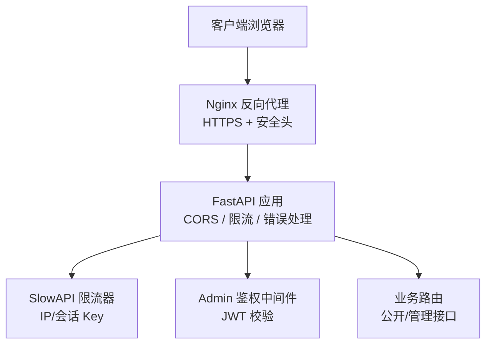
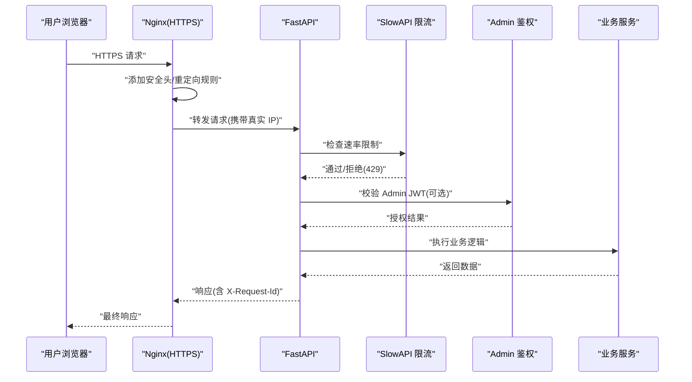
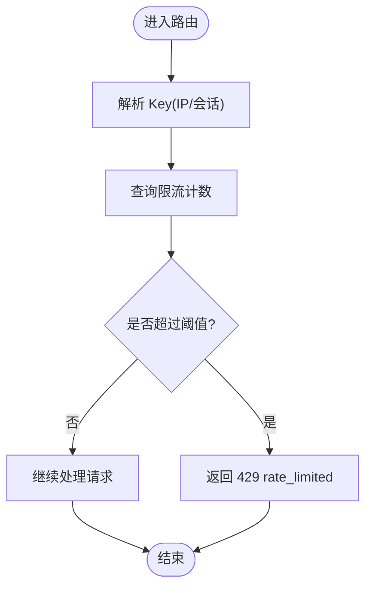
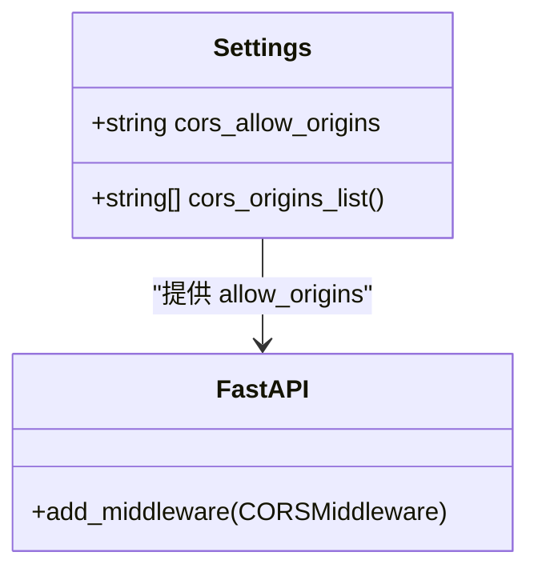
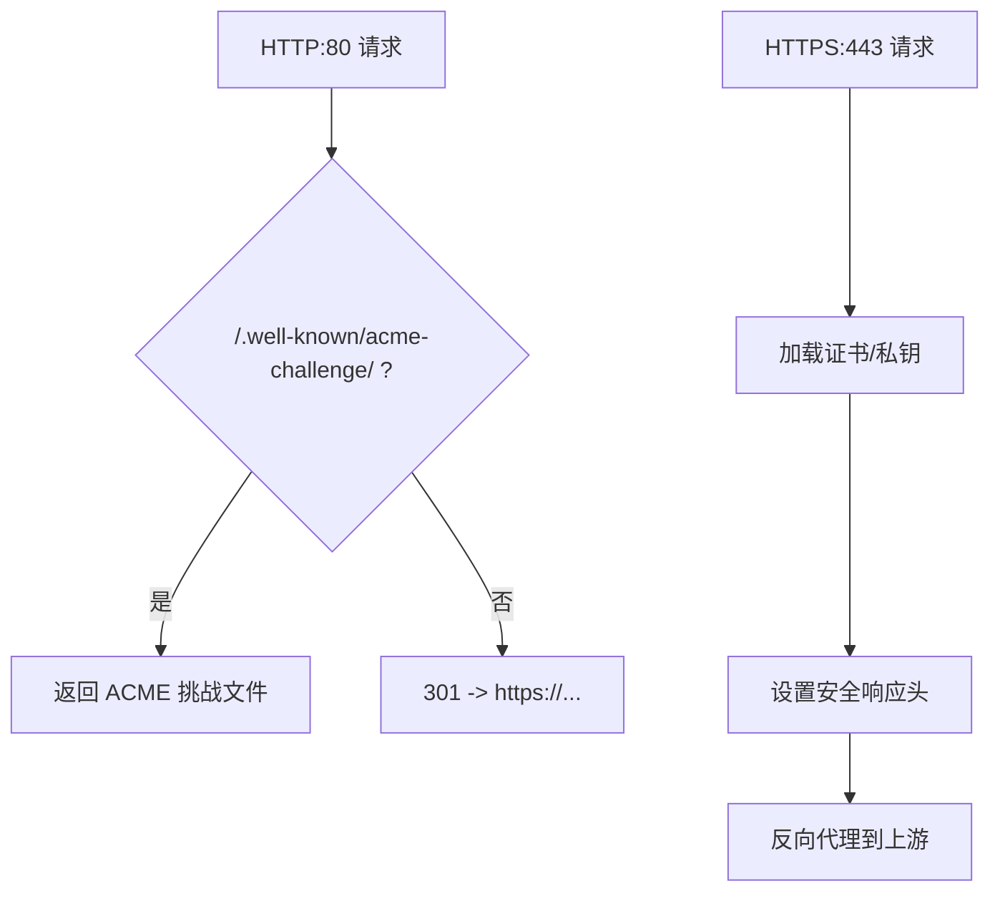
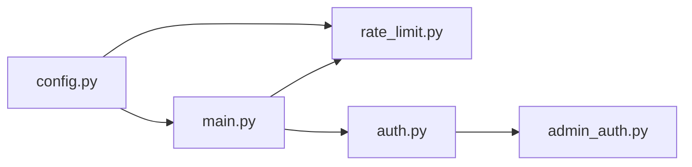

# 网络安全防护

<cite>
**本文引用的文件**   
- [backend/app/core/rate_limit.py](file://backend/app/core/rate_limit.py)
- [backend/app/main.py](file://backend/app/main.py)
- [backend/app/core/config.py](file://backend/app/core/config.py)
- [deploy/ecs/nginx-vhost.snippet](file://deploy/ecs/nginx-vhost.snippet)
- [deploy/ecs/nginx-vhost-http.snippet](file://deploy/ecs/nginx-vhost-http.snippet)
- [deploy/ecs/nginx-vhost-https.snippet](file://deploy/ecs/nginx-vhost-https.snippet)
- [backend/app/api/auth.py](file://backend/app/api/auth.py)
- [backend/app/middleware/admin_auth.py](file://backend/app/middleware/admin_auth.py)
- [doc/spec/10-API设计规范.md](file://doc/spec/10-API设计规范.md)
- [doc/test/test-cases-integration.md](file://doc/test/test-cases-integration.md)
</cite>

## 目录
1. [简介](#简介)
2. [项目结构](#项目结构)
3. [核心组件](#核心组件)
4. [架构总览](#架构总览)
5. [详细组件分析](#详细组件分析)
6. [依赖关系分析](#依赖关系分析)
7. [性能考虑](#性能考虑)
8. [故障排查指南](#故障排查指南)
9. [结论](#结论)
10. [附录](#附录)

## 简介
本文件面向 Learning Hub 的网络安全防护，覆盖请求限流、CORS 跨域、HTTPS/TLS、XSS 与 CSRF 防护、以及网络层安全配置与性能优化建议。内容基于仓库中后端应用、部署脚本与安全测试用例的实际实现与约定进行说明，帮助读者在生产环境中正确落地安全策略。

## 项目结构
围绕安全能力的相关代码与配置主要分布在以下位置：
- 后端应用入口与中间件：FastAPI 应用装配 CORS、限流异常处理、请求 ID 透传等
- 限流模块：基于 SlowAPI 的速率限制，支持 IP 与会话双键
- 配置中心：CORS 白名单、Redis 存储 URI、JWT 参数等
- Nginx 反向代理：HTTP→HTTPS 重定向、TLS 证书挂载、通用安全响应头
- 鉴权与会话：Admin 登录签发 JWT、Cookie 安全属性（HttpOnly、SameSite）



**图表来源** 
- [backend/app/main.py:57-90](file://backend/app/main.py#L57-L90)
- [backend/app/core/rate_limit.py:40-52](file://backend/app/core/rate_limit.py#L40-L52)
- [deploy/ecs/nginx-vhost.snippet:27-55](file://deploy/ecs/nginx-vhost.snippet#L27-L55)

**章节来源**
- [backend/app/main.py:40-116](file://backend/app/main.py#L40-L116)
- [backend/app/core/rate_limit.py:1-55](file://backend/app/core/rate_limit.py#L1-L55)
- [deploy/ecs/nginx-vhost.snippet:1-56](file://deploy/ecs/nginx-vhost.snippet#L1-L56)

## 核心组件
- 请求限流
  - 算法与存储：使用 SlowAPI，默认内存模式；生产可通过 Redis 共享计数
  - Key 构造：支持按 IP 或按会话（从 Authorization Bearer 中提取子串作为会话标识）
  - 全局 Limiter 注册到 FastAPI 状态，统一异常处理返回 429
- CORS 跨域
  - 通过 FastAPI CORSMiddleware 注入允许的来源、方法、头部与凭证
  - 允许来源列表由配置项解析为数组
- HTTPS/TLS
  - Nginx 监听 443，启用 HTTP/2，挂载证书与私钥
  - 80 端口统一 301 重定向至 HTTPS，并保留 ACME 验证路径
  - 设置通用安全响应头（防嗅探、点击劫持、XSS 保护）
- XSS 防护
  - 输入校验：测试用例要求对恶意输入返回 400 或经清洗后入库
  - 输出编码：前端模板渲染框架负责转义；服务端避免直接拼接 HTML
  - 安全头：Nginx 设置 X-Content-Type-Options、X-Frame-Options、X-XSS-Protection
- CSRF 防护
  - Cookie 安全属性：HttpOnly、SameSite=Lax
  - 跨站访问控制：CORS 白名单 + 仅允许必要方法与头部
  - 关键写操作建议使用幂等键与二次确认（见 API 规范）

**章节来源**
- [backend/app/core/rate_limit.py:18-52](file://backend/app/core/rate_limit.py#L18-L52)
- [backend/app/main.py:57-90](file://backend/app/main.py#L57-L90)
- [backend/app/core/config.py:48-77](file://backend/app/core/config.py#L48-L77)
- [deploy/ecs/nginx-vhost.snippet:34-37](file://deploy/ecs/nginx-vhost.snippet#L34-L37)
- [backend/app/api/auth.py:27-34](file://backend/app/api/auth.py#L27-L34)
- [doc/test/test-cases-integration.md:399-407](file://doc/test/test-cases-integration.md#L399-L407)

## 架构总览
下图展示了从浏览器到后端的关键安全路径：Nginx 强制 HTTPS 并附加安全头，FastAPI 开启 CORS 与限流，鉴权中间件校验 JWT，业务路由受限流与权限控制。



**图表来源** 
- [deploy/ecs/nginx-vhost.snippet:27-55](file://deploy/ecs/nginx-vhost.snippet#L27-L55)
- [backend/app/main.py:57-90](file://backend/app/main.py#L57-L90)
- [backend/app/core/rate_limit.py:40-52](file://backend/app/core/rate_limit.py#L40-L52)
- [backend/app/middleware/admin_auth.py:26-42](file://backend/app/middleware/admin_auth.py#L26-L42)

## 详细组件分析

### 请求限流机制
- 速率限制算法
  - 基于滑动窗口/固定窗口（由 SlowAPI 内部实现），支持按分钟/小时等时间粒度
  - 多 Worker 场景下通过 Redis 共享计数，保证一致性
- Key 构造策略
  - IP 模式：以远端地址作为 Key，适用于公开接口
  - 会话模式：从 Authorization Bearer 令牌中抽取子串作为会话标识，失败回退到 IP
- 装饰器用法
  - 在路由上使用 rate_limit(spec, key="ip|session") 指定阈值与 Key 类型
- 异常处理
  - 全局捕获 RateLimitExceeded，返回 429 与标准化错误体，附带 requestId



**图表来源** 
- [backend/app/core/rate_limit.py:18-52](file://backend/app/core/rate_limit.py#L18-L52)
- [backend/app/main.py:84-90](file://backend/app/main.py#L84-L90)

**章节来源**
- [backend/app/core/rate_limit.py:1-55](file://backend/app/core/rate_limit.py#L1-L55)
- [backend/app/main.py:67-90](file://backend/app/main.py#L67-L90)
- [doc/spec/10-API设计规范.md:109-123](file://doc/spec/10-API设计规范.md#L109-L123)

### CORS 跨域配置
- 允许的来源
  - 通过配置项 cors_allow_origins 提供逗号分隔的域名列表，解析为 allow_origins 列表
  - 未显式配置时默认允许所有来源（开发环境常见）
- 方法与头部
  - allow_methods 与 allow_headers 均设置为通配符，便于调试；生产建议收紧
- 凭证
  - allow_credentials=True，配合前端携带 Cookie 的场景
- 暴露头部
  - expose_headers 包含 X-Request-Id，便于前端追踪



**图表来源** 
- [backend/app/core/config.py:48-77](file://backend/app/core/config.py#L48-L77)
- [backend/app/main.py:57-65](file://backend/app/main.py#L57-L65)

**章节来源**
- [backend/app/core/config.py:48-77](file://backend/app/core/config.py#L48-L77)
- [backend/app/main.py:57-65](file://backend/app/main.py#L57-L65)
- [doc/test/test-cases-integration.md:419-427](file://doc/test/test-cases-integration.md#L419-L427)

### HTTPS/TLS 配置
- 证书管理
  - Nginx 通过挂载证书与私钥文件启用 SSL
- 协议版本与加密套件
  - 启用 HTTP/2；具体 TLS 版本与套件由 Nginx 全局配置决定
- 安全响应头
  - 设置 X-Content-Type-Options、X-Frame-Options、X-XSS-Protection
- 明文流量处理
  - 80 端口统一 301 重定向到 HTTPS，保留 /.well-known/acme-challenge 用于证书续期



**图表来源** 
- [deploy/ecs/nginx-vhost-http.snippet:6-11](file://deploy/ecs/nginx-vhost-http.snippet#L6-L11)
- [deploy/ecs/nginx-vhost-https.snippet:8-41](file://deploy/ecs/nginx-vhost-https.snippet#L8-L41)
- [deploy/ecs/nginx-vhost.snippet:16-55](file://deploy/ecs/nginx-vhost.snippet#L16-L55)

**章节来源**
- [deploy/ecs/nginx-vhost.snippet:1-56](file://deploy/ecs/nginx-vhost.snippet#L1-56)
- [deploy/ecs/nginx-vhost-http.snippet:1-12](file://deploy/ecs/nginx-vhost-http.snippet#L1-L12)
- [deploy/ecs/nginx-vhost-https.snippet:1-42](file://deploy/ecs/nginx-vhost-https.snippet#L1-L42)
- [doc/test/test-cases-integration.md:439-447](file://doc/test/test-cases-integration.md#L439-L447)

### XSS 攻击防护
- 输入验证
  - 对敏感字段进行严格校验，非法字符直接返回 400 或经清洗后入库
- 输出编码
  - 前端模板自动转义；后端不直接拼接 HTML
- 安全响应头
  - Nginx 设置 X-Content-Type-Options、X-Frame-Options、X-XSS-Protection
- 参考验收用例
  - 针对分类名称注入的测试用例期望被拦截或清洗

**章节来源**
- [doc/test/test-cases-integration.md:399-407](file://doc/test/test-cases-integration.md#L399-L407)
- [deploy/ecs/nginx-vhost.snippet:34-37](file://deploy/ecs/nginx-vhost.snippet#L34-L37)

### CSRF 防护措施
- Token 验证
  - 管理后台采用 JWT 会话，登录成功后写入 HttpOnly Cookie
- SameSite Cookie 策略
  - 登录接口设置 SameSite=Lax，降低跨站携带风险
- 跨域控制
  - CORS 白名单限制来源，减少跨站脚本利用面
- 最佳实践
  - 对写操作增加幂等键与二次确认，避免重复提交

```mermaid
sequenceDiagram
participant C as "浏览器"
participant S as "后端"
C->>S : "POST /api/auth/admin (凭据)"
S-->>C : "Set-Cookie : LH_ADMIN_SESSION(HttpOnly; SameSite=Lax)"
C->>S : "后续请求携带 Cookie"
S->>S : "校验 JWT 签名与过期时间"
S-->>C : "返回受保护资源"
```

**图表来源** 
- [backend/app/api/auth.py:27-34](file://backend/app/api/auth.py#L27-L34)
- [backend/app/middleware/admin_auth.py:26-42](file://backend/app/middleware/admin_auth.py#L26-L42)

**章节来源**
- [backend/app/api/auth.py:16-45](file://backend/app/api/auth.py#L16-L45)
- [backend/app/middleware/admin_auth.py:16-42](file://backend/app/middleware/admin_auth.py#L16-L42)

## 依赖关系分析
- 组件耦合
  - main.py 依赖 config.py 获取 CORS 与限流配置
  - rate_limit.py 依赖 config.py 获取 Redis 存储 URI
  - auth.py 与 admin_auth.py 共同完成登录与 JWT 校验
- 外部依赖
  - SlowAPI 限流器（内存/Redis）
  - Nginx 反向代理与 TLS 终止
- 潜在循环依赖
  - 当前未见循环导入；各模块职责清晰



**图表来源** 
- [backend/app/core/config.py:84-88](file://backend/app/core/config.py#L84-L88)
- [backend/app/main.py:27-32](file://backend/app/main.py#L27-L32)
- [backend/app/core/rate_limit.py:12-16](file://backend/app/core/rate_limit.py#L12-L16)
- [backend/app/api/auth.py:1-12](file://backend/app/api/auth.py#L1-L12)
- [backend/app/middleware/admin_auth.py:1-12](file://backend/app/middleware/admin_auth.py#L1-L12)

**章节来源**
- [backend/app/core/config.py:1-88](file://backend/app/core/config.py#L1-L88)
- [backend/app/main.py:1-116](file://backend/app/main.py#L1-L116)
- [backend/app/core/rate_limit.py:1-55](file://backend/app/core/rate_limit.py#L1-L55)
- [backend/app/api/auth.py:1-49](file://backend/app/api/auth.py#L1-L49)
- [backend/app/middleware/admin_auth.py:1-66](file://backend/app/middleware/admin_auth.py#L1-L66)

## 性能考虑
- 限流存储
  - 生产环境建议启用 Redis 作为 SlowAPI 后端，避免多实例计数不一致
- 上传与大文件
  - Nginx 调整 client_max_body_size、proxy_send_timeout、proxy_read_timeout，避免大文件上传中断
- 日志与追踪
  - 统一注入 X-Request-Id，便于定位问题与统计限流命中
- 缓存与降级
  - LLM 搜索可配置超时与最大行数，必要时降级为关键词检索

[本节为通用指导，无需特定文件引用]

## 故障排查指南
- 429 限流触发
  - 检查路由装饰器与 Key 策略是否正确
  - 查看 Redis 连接与计数是否正常
  - 确认异常处理器返回体包含 requestId
- CORS 报错
  - 核对 cors_allow_origins 是否包含实际 Origin
  - 确认 allow_credentials 与前端携带 Cookie 一致
- HTTPS 证书问题
  - 检查证书与私钥路径、权限
  - 确认 80 端口重定向与 ACME 验证路径可用
- XSS 告警
  - 检查输入校验与输出编码
  - 确认 Nginx 安全头已生效

**章节来源**
- [backend/app/main.py:84-90](file://backend/app/main.py#L84-L90)
- [backend/app/core/config.py:48-77](file://backend/app/core/config.py#L48-L77)
- [deploy/ecs/nginx-vhost.snippet:34-37](file://deploy/ecs/nginx-vhost.snippet#L34-L37)
- [doc/test/test-cases-integration.md:419-427](file://doc/test/test-cases-integration.md#L419-L427)

## 结论
Learning Hub 在后端与网关层实现了较为完整的安全基线：基于 SlowAPI 的请求限流、严格的 CORS 白名单、Nginx 强制 HTTPS 与安全头、JWT 会话与 Cookie 安全属性、以及输入校验与输出编码的协同防护。建议在多实例生产环境中启用 Redis 限流存储，进一步收紧 CORS 与方法/头部白名单，并持续完善 CSP 策略与监控告警。

[本节为总结性内容，无需特定文件引用]

## 附录
- 相关规范与用例
  - API 设计规范中的限流策略与幂等性约定
  - 集成测试用例对 HTTPS、CORS、XSS、限流的验收要求

**章节来源**
- [doc/spec/10-API设计规范.md:109-131](file://doc/spec/10-API设计规范.md#L109-L131)
- [doc/test/test-cases-integration.md:387-447](file://doc/test/test-cases-integration.md#L387-L447)