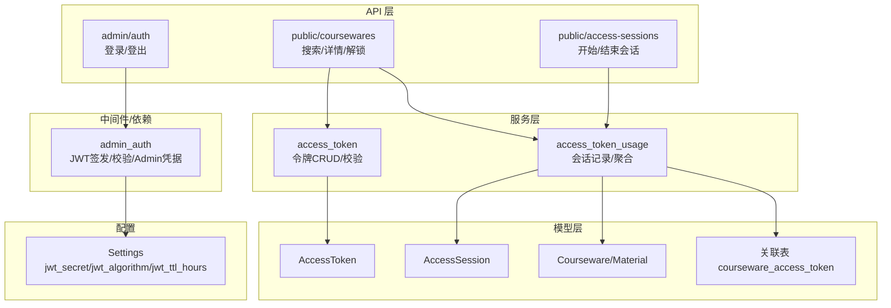
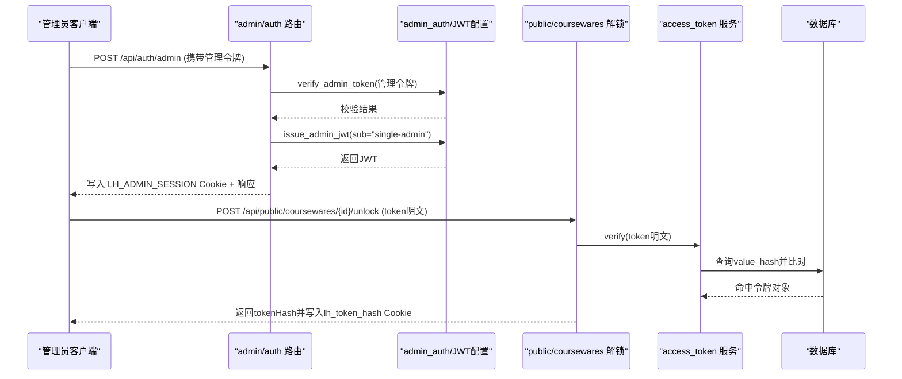
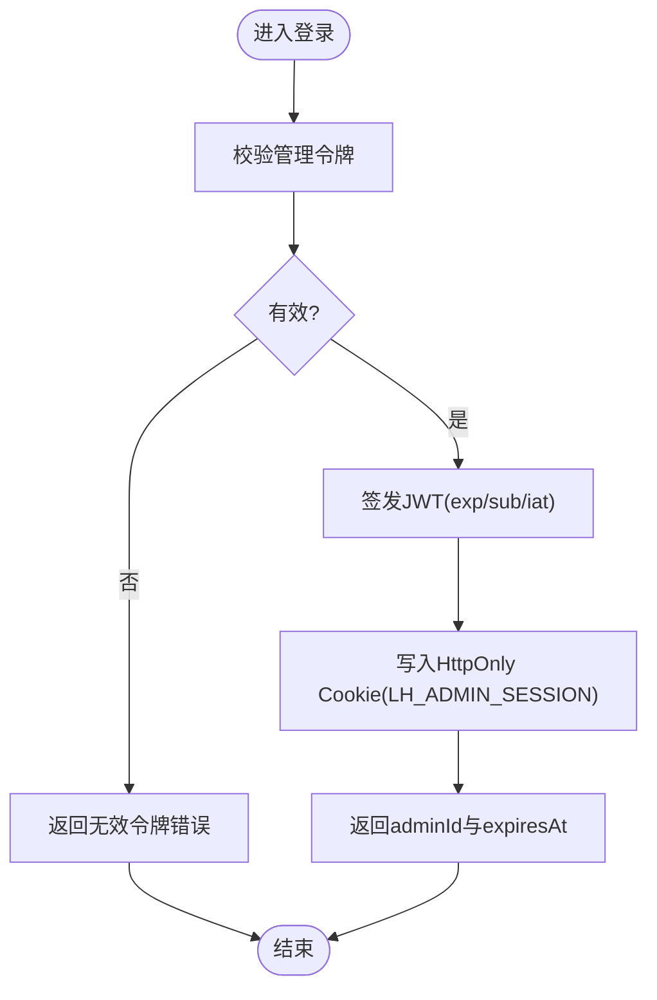
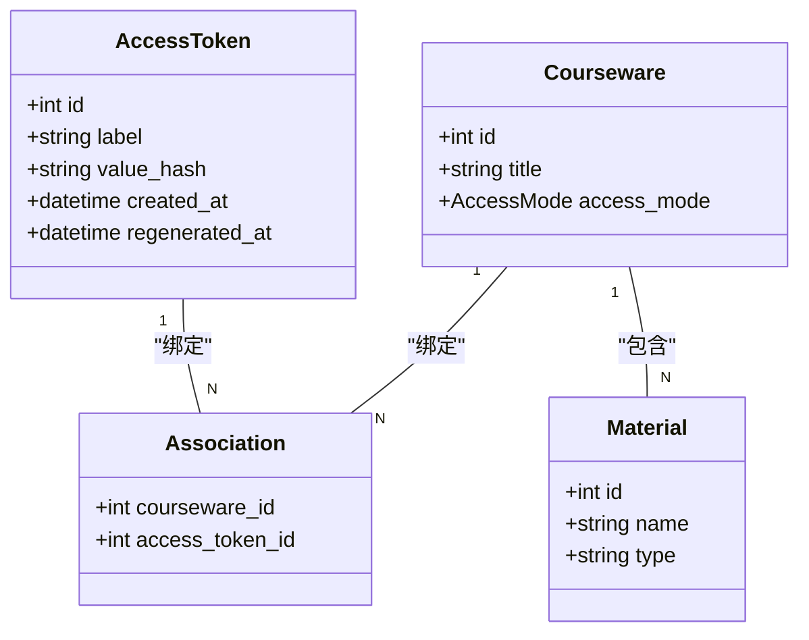
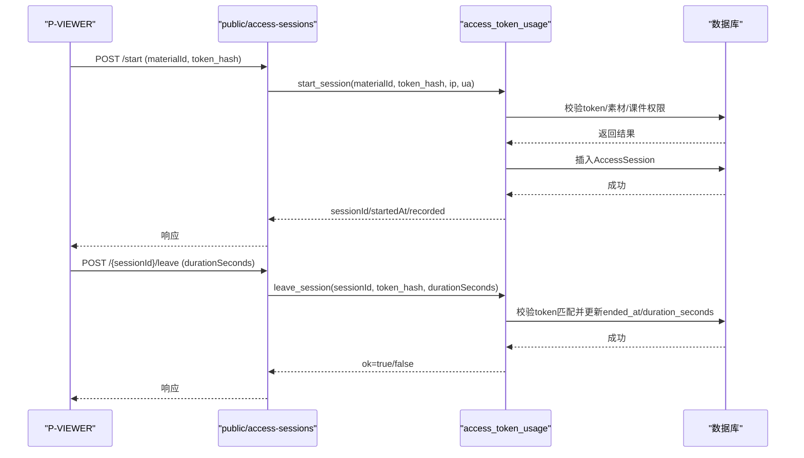
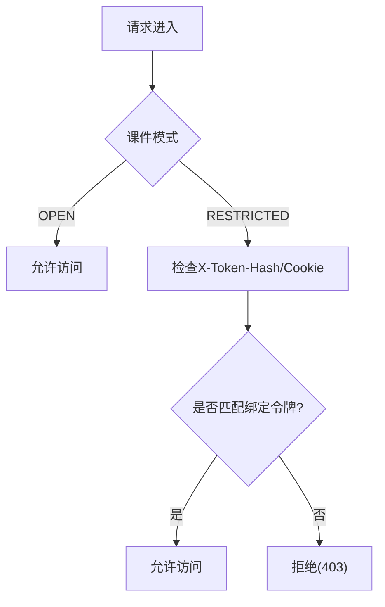
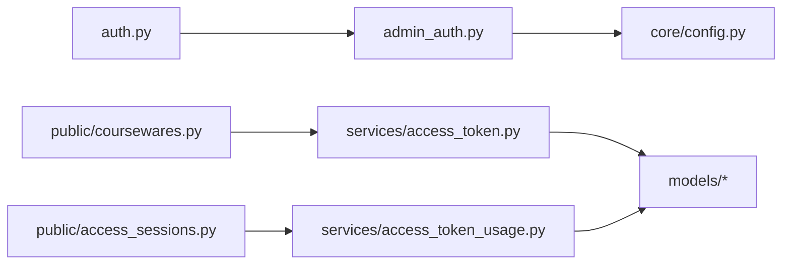

# 认证授权机制

<cite>
**本文引用的文件**   
- [backend/app/api/auth.py](file://backend/app/api/auth.py)
- [backend/app/middleware/admin_auth.py](file://backend/app/middleware/admin_auth.py)
- [backend/app/core/config.py](file://backend/app/core/config.py)
- [backend/app/schemas/auth.py](file://backend/app/schemas/auth.py)
- [backend/app/models/access_token.py](file://backend/app/models/access_token.py)
- [backend/app/models/access_session.py](file://backend/app/models/access_session.py)
- [backend/app/models/courseware.py](file://backend/app/models/courseware.py)
- [backend/app/models/material.py](file://backend/app/models/material.py)
- [backend/app/models/association.py](file://backend/app/models/association.py)
- [backend/app/api/public/coursewares.py](file://backend/app/api/public/coursewares.py)
- [backend/app/api/public/access_sessions.py](file://backend/app/api/public/access_sessions.py)
- [backend/app/services/access_token.py](file://backend/app/services/access_token.py)
- [backend/app/services/access_token_usage.py](file://backend/app/services/access_token_usage.py)
- [backend/app/schemas/access_token.py](file://backend/app/schemas/access_token.py)
- [backend/app/schemas/access_token_usage.py](file://backend/app/schemas/access_token_usage.py)
</cite>

## 目录
1. [简介](#简介)
2. [项目结构](#项目结构)
3. [核心组件](#核心组件)
4. [架构总览](#架构总览)
5. [详细组件分析](#详细组件分析)
6. [依赖关系分析](#依赖关系分析)
7. [性能考虑](#性能考虑)
8. [故障排查指南](#故障排查指南)
9. [结论](#结论)
10. [附录：常见场景与最佳实践](#附录常见场景与最佳实践)

## 简介
本文件面向 Learning Hub 的认证与授权机制，覆盖以下要点：
- 管理员认证流程：基于“管理令牌”换取会话 Cookie，签发并验证 JWT。
- 访问令牌系统：支持开放访问（OPEN）与受限访问（RESTRICTED），通过 AccessToken 控制课件解锁。
- 权限控制策略：基于资源绑定与模式（OPEN/RESTRICTED）的细粒度访问控制。
- 会话管理机制：P-VIEWER 访问会话的生命周期、时长校正与并发安全。
- 中间件与安全：JWT 校验、Cookie 安全属性、常量时间比较、限流与降级。
- 示例与最佳实践：登录、解锁、开始/结束访问会话等典型调用路径。

## 项目结构
认证授权相关代码主要分布在后端模块中，按职责分层组织：
- API 层：管理员鉴权路由、公开课件解锁与会话上报接口。
- 中间件/依赖：JWT 签发与校验、Admin 身份提取。
- 模型层：访问令牌、访问会话、课件与素材、关联表。
- 服务层：令牌创建/校验、访问会话业务逻辑、聚合统计。
- 配置层：JWT 密钥、算法、TTL、CORS、时区等。

图表来源
- [backend/app/api/auth.py:1-49](file://backend/app/api/auth.py#L1-L49)
- [backend/app/middleware/admin_auth.py:1-66](file://backend/app/middleware/admin_auth.py#L1-L66)
- [backend/app/api/public/coursewares.py:1-133](file://backend/app/api/public/coursewares.py#L1-L133)
- [backend/app/api/public/access_sessions.py:1-137](file://backend/app/api/public/access_sessions.py#L1-L137)
- [backend/app/services/access_token.py:1-235](file://backend/app/services/access_token.py#L1-L235)
- [backend/app/services/access_token_usage.py:1-518](file://backend/app/services/access_token_usage.py#L1-L518)
- [backend/app/models/access_token.py:1-34](file://backend/app/models/access_token.py#L1-L34)
- [backend/app/models/access_session.py:1-129](file://backend/app/models/access_session.py#L1-L129)
- [backend/app/models/courseware.py:1-74](file://backend/app/models/courseware.py#L1-L74)
- [backend/app/models/material.py:1-69](file://backend/app/models/material.py#L1-L69)
- [backend/app/models/association.py:1-41](file://backend/app/models/association.py#L1-L41)
- [backend/app/core/config.py:1-88](file://backend/app/core/config.py#L1-L88)

章节来源
- [backend/app/api/auth.py:1-49](file://backend/app/api/auth.py#L1-L49)
- [backend/app/middleware/admin_auth.py:1-66](file://backend/app/middleware/admin_auth.py#L1-L66)
- [backend/app/api/public/coursewares.py:1-133](file://backend/app/api/public/coursewares.py#L1-L133)
- [backend/app/api/public/access_sessions.py:1-137](file://backend/app/api/public/access_sessions.py#L1-L137)
- [backend/app/services/access_token.py:1-235](file://backend/app/services/access_token.py#L1-L235)
- [backend/app/services/access_token_usage.py:1-518](file://backend/app/services/access_token_usage.py#L1-L518)
- [backend/app/models/access_token.py:1-34](file://backend/app/models/access_token.py#L1-L34)
- [backend/app/models/access_session.py:1-129](file://backend/app/models/access_session.py#L1-L129)
- [backend/app/models/courseware.py:1-74](file://backend/app/models/courseware.py#L1-L74)
- [backend/app/models/material.py:1-69](file://backend/app/models/material.py#L1-L69)
- [backend/app/models/association.py:1-41](file://backend/app/models/association.py#L1-L41)
- [backend/app/core/config.py:1-88](file://backend/app/core/config.py#L1-L88)

## 核心组件
- 管理员认证
  - 登录：使用预置的管理令牌换取会话 Cookie，服务端签发 JWT 并写入 HttpOnly Cookie。
  - 登出：删除会话 Cookie。
  - 校验：从 Authorization 或 Cookie 中提取 JWT，校验签名、过期时间与必要字段。
- 访问令牌系统
  - 令牌生命周期：创建/重新生成/删除；明文仅一次性返回，数据库存储 SHA-256 摘要。
  - 资源绑定：课件与令牌多对多关联；OPEN 无需令牌，RESTRICTED 需匹配绑定令牌。
  - 解锁流程：前端提交明文令牌，服务端校验并回写 Cookie 供后续自动鉴权。
- 访问会话机制
  - 开始/结束：记录 token、课件、素材、起止时间与停留秒数；客户端时长偏差超过阈值则按服务端时间校正。
  - 聚合统计：全时段与区间内聚合，支持按素材维度汇总。
- 配置与安全
  - JWT 密钥、算法、TTL 由配置提供；Cookie 设置 httponly 与 samesite=lax。
  - 令牌比对采用常量时间比较，防止时序攻击。
  - 进程内滑动窗口限流作为兜底保护。

章节来源
- [backend/app/api/auth.py:1-49](file://backend/app/api/auth.py#L1-L49)
- [backend/app/middleware/admin_auth.py:1-66](file://backend/app/middleware/admin_auth.py#L1-L66)
- [backend/app/services/access_token.py:1-235](file://backend/app/services/access_token.py#L1-L235)
- [backend/app/services/access_token_usage.py:1-518](file://backend/app/services/access_token_usage.py#L1-L518)
- [backend/app/core/config.py:1-88](file://backend/app/core/config.py#L1-L88)

## 架构总览
下图展示管理员认证与访问令牌解锁的整体交互。

图表来源
- [backend/app/api/auth.py:21-45](file://backend/app/api/auth.py#L21-L45)
- [backend/app/middleware/admin_auth.py:45-62](file://backend/app/middleware/admin_auth.py#L45-L62)
- [backend/app/api/public/coursewares.py:79-130](file://backend/app/api/public/coursewares.py#L79-L130)
- [backend/app/services/access_token.py:193-205](file://backend/app/services/access_token.py#L193-L205)

## 详细组件分析

### 管理员认证流程（JWT 签发、验证与刷新）
- 登录
  - 输入：管理令牌（字符串）。
  - 处理：服务端校验管理令牌，签发 JWT（含 exp、sub、iat），写入 HttpOnly Cookie（名称 LH_ADMIN_SESSION，默认 8 小时）。
  - 输出：包含 adminId 与 expiresAt 的响应。
- 登出
  - 删除会话 Cookie。
- 校验
  - 优先从 Authorization: Bearer 提取，其次从 Cookie 读取。
  - 解码 JWT，要求 exp 与 sub 存在；异常统一转换为未认证错误。
- 刷新
  - 当前实现为固定 TTL 的无状态 JWT，未提供显式刷新接口；可通过再次登录续期。

图表来源
- [backend/app/api/auth.py:21-45](file://backend/app/api/auth.py#L21-L45)
- [backend/app/middleware/admin_auth.py:26-42](file://backend/app/middleware/admin_auth.py#L26-L42)
- [backend/app/middleware/admin_auth.py:45-55](file://backend/app/middleware/admin_auth.py#L45-L55)
- [backend/app/schemas/auth.py:7-16](file://backend/app/schemas/auth.py#L7-L16)

章节来源
- [backend/app/api/auth.py:1-49](file://backend/app/api/auth.py#L1-L49)
- [backend/app/middleware/admin_auth.py:1-66](file://backend/app/middleware/admin_auth.py#L1-L66)
- [backend/app/schemas/auth.py:1-17](file://backend/app/schemas/auth.py#L1-L17)

### 访问令牌系统（开放与受限访问）
- 数据模型
  - AccessToken：label 全局唯一；value_hash 存 SHA-256；明文仅在创建/重新生成时返回。
  - 关联表 courseware_access_token：课件与令牌的多对多绑定。
- 业务规则
  - 标签非空且长度限制；重复标签冲突；至少保留一个 active token；删除被引用令牌失败。
  - OPEN 课件无需令牌；RESTRICTED 课件必须匹配绑定的令牌哈希。
- 解锁流程
  - 前端提交明文令牌；服务端计算哈希并与数据库比对；若命中且该令牌被目标课件绑定，则返回 tokenHash 并写入 lh_token_hash Cookie（7 天）。
  - 后续 GET 请求自动携带 Cookie 完成鉴权。

图表来源
- [backend/app/models/access_token.py:13-33](file://backend/app/models/access_token.py#L13-L33)
- [backend/app/models/courseware.py:21-73](file://backend/app/models/courseware.py#L21-L73)
- [backend/app/models/association.py:28-33](file://backend/app/models/association.py#L28-L33)
- [backend/app/models/material.py:44-68](file://backend/app/models/material.py#L44-L68)

章节来源
- [backend/app/models/access_token.py:1-34](file://backend/app/models/access_token.py#L1-L34)
- [backend/app/models/association.py:1-41](file://backend/app/models/association.py#L1-L41)
- [backend/app/api/public/coursewares.py:57-130](file://backend/app/api/public/coursewares.py#L57-L130)
- [backend/app/services/access_token.py:73-139](file://backend/app/services/access_token.py#L73-L139)
- [backend/app/schemas/access_token.py:9-53](file://backend/app/schemas/access_token.py#L9-L53)

### 访问会话管理（生命周期与并发控制）
- 开始会话
  - 输入：materialId、token_hash（来自 X-Token-Hash 或 Cookie）。
  - 校验：token 存在且有权访问该素材（所属课件为 RESTRICTED 且 token 已绑定）。
  - 记录：写入 AccessSession（token_id、courseware_id、material_id、started_at、ip、ua）。
  - 降级：IP 限流命中或 DB 异常时，返回 recorded=False，不阻塞前台。
- 结束会话
  - 幂等：不存在 session 视为成功。
  - 时长校正：客户端 duration_seconds 与服务端差值超过阈值则按服务端时间校正。
  - 鉴权：请求的 token_hash 必须与 session.token_id 对应的 value_hash 一致。
- 并发与一致性
  - 单条写入/更新在事务内完成；异常捕获后回滚或降级。
  - 进程内滑动窗口限流使用线程锁保证计数正确性。

图表来源
- [backend/app/api/public/access_sessions.py:65-133](file://backend/app/api/public/access_sessions.py#L65-L133)
- [backend/app/services/access_token_usage.py:64-171](file://backend/app/services/access_token_usage.py#L64-L171)
- [backend/app/models/access_session.py:56-128](file://backend/app/models/access_session.py#L56-L128)

章节来源
- [backend/app/api/public/access_sessions.py:1-137](file://backend/app/api/public/access_sessions.py#L1-L137)
- [backend/app/services/access_token_usage.py:1-518](file://backend/app/services/access_token_usage.py#L1-L518)
- [backend/app/models/access_session.py:1-129](file://backend/app/models/access_session.py#L1-L129)

### 权限控制策略（基于角色与细粒度）
- 角色
  - 管理员：通过 JWT 校验获得受保护的管理接口访问能力。
- 资源级权限
  - 课件访问模式：OPEN 直接访问；RESTRICTED 需要匹配的 AccessToken。
  - 令牌与课件绑定：通过关联表决定哪些令牌可访问哪些课件。
- 细粒度
  - 素材维度：访问会话记录到具体 material，结合课件模式进行权限判定。
  - 令牌有效性：重新生成后旧令牌即刻失效（value_hash 变更）。

图表来源
- [backend/app/models/courseware.py:14-38](file://backend/app/models/courseware.py#L14-L38)
- [backend/app/api/public/coursewares.py:57-76](file://backend/app/api/public/coursewares.py#L57-L76)
- [backend/app/services/access_token_usage.py:84-95](file://backend/app/services/access_token_usage.py#L84-L95)

章节来源
- [backend/app/models/courseware.py:1-74](file://backend/app/models/courseware.py#L1-L74)
- [backend/app/api/public/coursewares.py:1-133](file://backend/app/api/public/coursewares.py#L1-L133)
- [backend/app/services/access_token_usage.py:1-518](file://backend/app/services/access_token_usage.py#L1-L518)

### 认证中间件与安全考虑
- JWT 校验
  - 依赖 get_admin_principal：从 Header 或 Cookie 提取令牌，校验 exp/sub，异常转 401。
- 安全属性
  - Cookie：httponly=True、samesite="lax"、path="/"，降低 XSS/CSRF 风险。
  - 令牌比对：hmac.compare_digest 常量时间比较，防时序攻击。
  - 配置：jwt_secret、jwt_algorithm、jwt_ttl_hours 集中管理。
- 限流与降级
  - 进程内滑动窗口限流（每 IP 每分钟 60 次），避免滥用；DB 异常时降级不阻塞主流程。

章节来源
- [backend/app/middleware/admin_auth.py:16-42](file://backend/app/middleware/admin_auth.py#L16-L42)
- [backend/app/middleware/admin_auth.py:58-62](file://backend/app/middleware/admin_auth.py#L58-L62)
- [backend/app/core/config.py:40-46](file://backend/app/core/config.py#L40-L46)
- [backend/app/api/public/access_sessions.py:29-54](file://backend/app/api/public/access_sessions.py#L29-L54)

## 依赖关系分析
- 组件耦合
  - API 层依赖服务层与模型层；服务层依赖模型与配置；中间件依赖配置。
- 外部依赖
  - PyJWT 用于 JWT 编解码；SQLAlchemy ORM 与数据库方言适配（PostgreSQL INET、SQLite 兼容）。
- 潜在循环
  - 当前未发现循环依赖；服务层内部导入模型与关联表，保持单向依赖。

图表来源
- [backend/app/api/auth.py:1-49](file://backend/app/api/auth.py#L1-L49)
- [backend/app/middleware/admin_auth.py:1-66](file://backend/app/middleware/admin_auth.py#L1-L66)
- [backend/app/api/public/coursewares.py:1-133](file://backend/app/api/public/coursewares.py#L1-L133)
- [backend/app/api/public/access_sessions.py:1-137](file://backend/app/api/public/access_sessions.py#L1-L137)
- [backend/app/services/access_token.py:1-235](file://backend/app/services/access_token.py#L1-L235)
- [backend/app/services/access_token_usage.py:1-518](file://backend/app/services/access_token_usage.py#L1-L518)
- [backend/app/core/config.py:1-88](file://backend/app/core/config.py#L1-L88)

章节来源
- [backend/app/api/auth.py:1-49](file://backend/app/api/auth.py#L1-L49)
- [backend/app/middleware/admin_auth.py:1-66](file://backend/app/middleware/admin_auth.py#L1-L66)
- [backend/app/api/public/coursewares.py:1-133](file://backend/app/api/public/coursewares.py#L1-L133)
- [backend/app/api/public/access_sessions.py:1-137](file://backend/app/api/public/access_sessions.py#L1-L137)
- [backend/app/services/access_token.py:1-235](file://backend/app/services/access_token.py#L1-L235)
- [backend/app/services/access_token_usage.py:1-518](file://backend/app/services/access_token_usage.py#L1-L518)
- [backend/app/core/config.py:1-88](file://backend/app/core/config.py#L1-L88)

## 性能考虑
- 令牌校验
  - verify 遍历所有 active token 并进行常量时间比对；建议保持 active token 数量较小（通常 1-5 个），以降低开销。
- 会话写入
  - 开始/结束会话均走单条写入；DB 异常时降级不阻塞前台，提升可用性。
- 聚合查询
  - 使用 SQL 聚合表达式跨方言计算持续时间；分页与索引优化（token_id+started_at、token_id+material_id 等）。
- 限流
  - 进程内滑动窗口限流作为应用层兜底；多进程部署建议结合反向代理（如 nginx limit_req）实现全局限流。

[本节为通用指导，不直接分析具体文件]

## 故障排查指南
- 未认证/会话过期
  - 现象：401 未登录或会话已失效。
  - 排查：确认 Authorization/Bearer 或 LH_ADMIN_SESSION Cookie 是否存在且未过期；检查 jwt_secret 与算法配置。
- 令牌无效/无权访问
  - 现象：403 令牌无效或已失效；解锁失败。
  - 排查：确认提交的 token 明文是否正确；检查该 token 是否与目标课件绑定；查看 value_hash 是否因重新生成而变更。
- 会话记录失败
  - 现象：recorded=False 或 leave 返回 ok=false。
  - 排查：检查 IP 限流是否命中；查看 DB 异常日志；确认 token_hash 与 session.token_id 对应关系。
- 日期与时区
  - 现象：时长统计异常。
  - 排查：确认 started_at/ended_at 时区处理；客户端 duration_seconds 与服务端差值是否超过容忍阈值。

章节来源
- [backend/app/middleware/admin_auth.py:26-42](file://backend/app/middleware/admin_auth.py#L26-L42)
- [backend/app/api/public/coursewares.py:79-130](file://backend/app/api/public/coursewares.py#L79-L130)
- [backend/app/api/public/access_sessions.py:65-133](file://backend/app/api/public/access_sessions.py#L65-L133)
- [backend/app/services/access_token_usage.py:128-171](file://backend/app/services/access_token_usage.py#L128-L171)

## 结论
Learning Hub 的认证授权体系以 JWT 会话与访问令牌为核心，结合课件访问模式与资源绑定实现细粒度权限控制。访问会话机制保障学习行为的可观测性与准确性，并通过限流与降级提升鲁棒性。建议在生产环境严格管理 JWT 密钥、合理设置 Cookie 安全属性，并结合反向代理实现全局限流与审计。

[本节为总结，不直接分析具体文件]

## 附录：常见场景与最佳实践
- 管理员登录
  - 调用：POST /api/auth/admin，携带管理令牌。
  - 期望：返回 adminId 与 expiresAt，并写入 LH_ADMIN_SESSION Cookie。
  - 参考路径：[backend/app/api/auth.py:21-39](file://backend/app/api/auth.py#L21-L39)
- 管理员登出
  - 调用：POST /api/auth/logout。
  - 期望：删除会话 Cookie。
  - 参考路径：[backend/app/api/auth.py:42-45](file://backend/app/api/auth.py#L42-L45)
- 解锁课件
  - 调用：POST /api/public/coursewares/{id}/unlock，提交 token 明文。
  - 期望：返回 tokenHash 并写入 lh_token_hash Cookie；后续 GET 自动鉴权。
  - 参考路径：[backend/app/api/public/coursewares.py:79-130](file://backend/app/api/public/coursewares.py#L79-L130)
- 开始访问会话
  - 调用：POST /api/public/access-sessions，携带 materialId 与 token_hash。
  - 期望：返回 sessionId/startedAt/recorded；若限流或 DB 异常，recorded=False。
  - 参考路径：[backend/app/api/public/access_sessions.py:65-106](file://backend/app/api/public/access_sessions.py#L65-L106)
- 结束访问会话
  - 调用：POST /api/public/access-sessions/{sessionId}/leave，携带 durationSeconds。
  - 期望：幂等结束；时长超阈按服务端校正；token_hash 必须匹配。
  - 参考路径：[backend/app/api/public/access_sessions.py:109-133](file://backend/app/api/public/access_sessions.py#L109-L133)

最佳实践
- 将 JWT 密钥与算法置于环境变量，生产环境务必替换默认值。
- 确保 Cookie 设置 httponly 与 samesite=lax，减少跨站风险。
- 定期轮换访问令牌，并在重新生成后立即通知下游系统更新缓存。
- 在多进程部署下，结合反向代理实现全局限流，避免进程内限流的局限。
- 对敏感操作开启审计日志，便于追踪与回溯。

章节来源
- [backend/app/api/auth.py:21-45](file://backend/app/api/auth.py#L21-L45)
- [backend/app/api/public/coursewares.py:79-130](file://backend/app/api/public/coursewares.py#L79-L130)
- [backend/app/api/public/access_sessions.py:65-133](file://backend/app/api/public/access_sessions.py#L65-L133)
- [backend/app/core/config.py:40-46](file://backend/app/core/config.py#L40-L46)