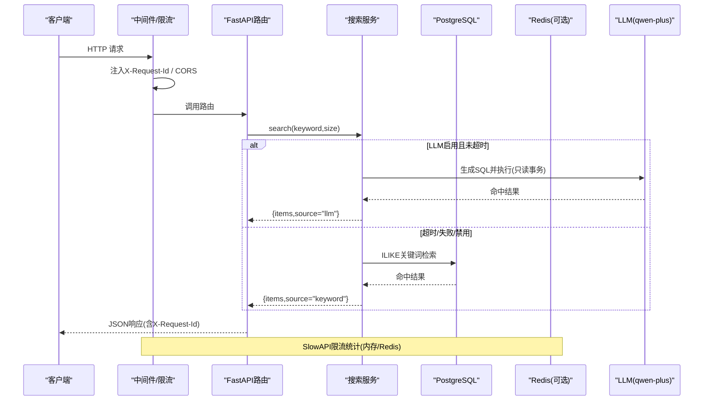
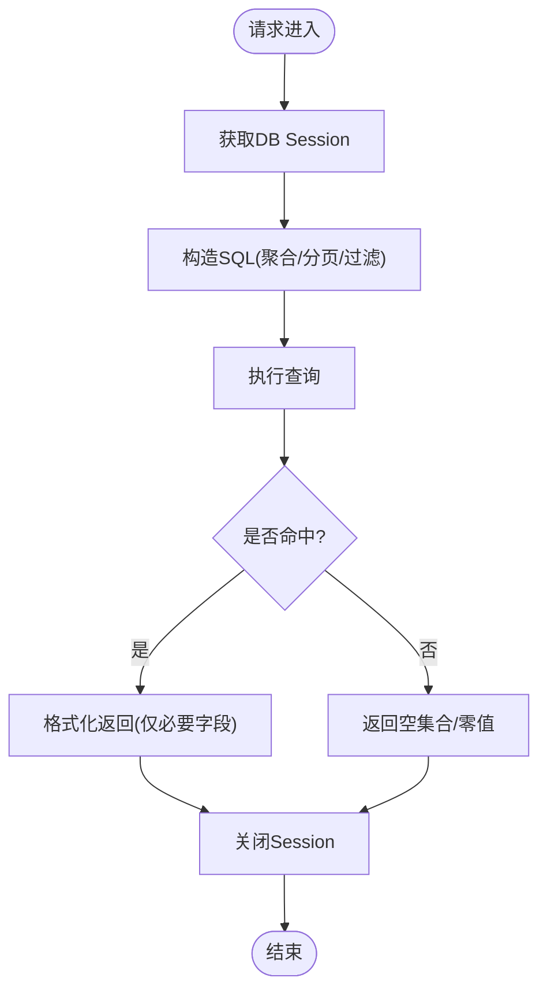
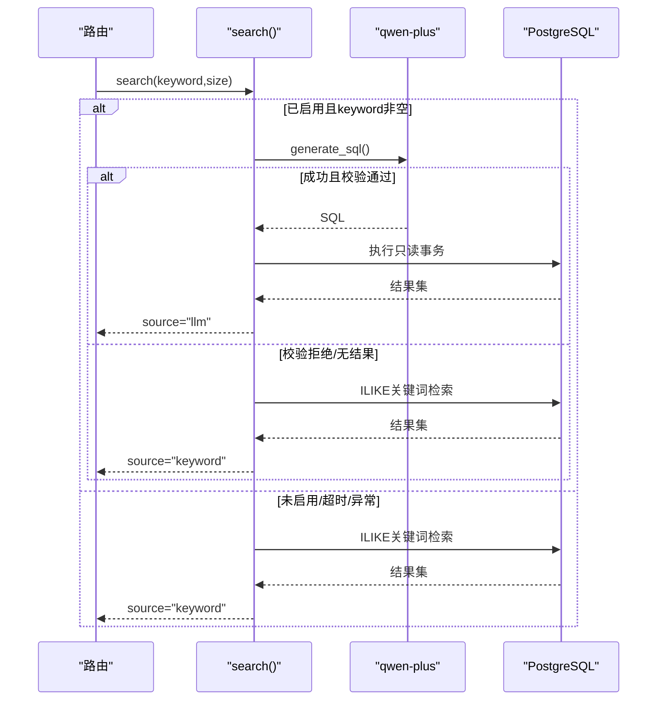
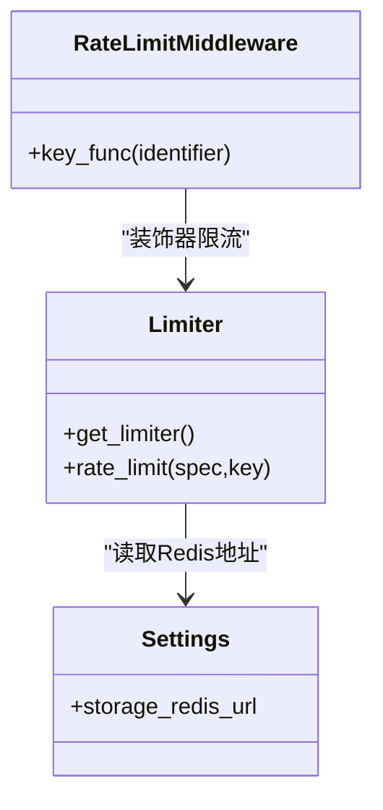
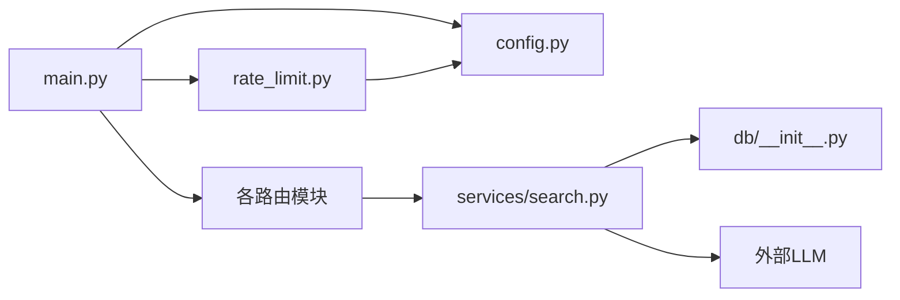
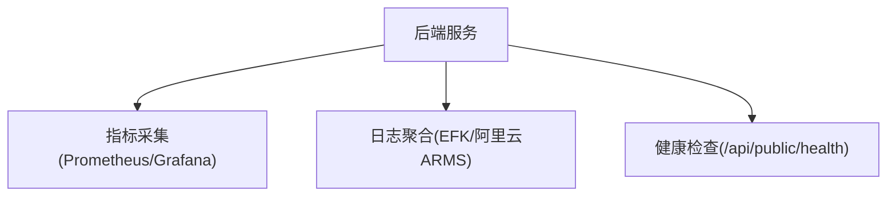

# 性能架构设计

<cite>
**本文引用的文件列表**
- [backend/app/main.py](file://backend/app/main.py)
- [backend/app/core/config.py](file://backend/app/core/config.py)
- [backend/app/db/__init__.py](file://backend/app/db/__init__.py)
- [backend/app/core/rate_limit.py](file://backend/app/core/rate_limit.py)
- [backend/app/services/search.py](file://backend/app/services/search.py)
- [backend/app/services/access_token_usage.py](file://backend/app/services/access_token_usage.py)
- [backend/app/api/admin/access_token_usage.py](file://backend/app/api/admin/access_token_usage.py)
- [backend/Dockerfile](file://backend/Dockerfile)
- [deploy/local/docker-compose.yml](file://deploy/local/docker-compose.yml)
- [doc/spec/06-非功能需求.md](file://doc/spec/06-非功能需求.md)
- [doc/spec/07-技术架构.md](file://doc/spec/07-技术架构.md)
- [doc/test/test-cases-integration.md](file://doc/test/test-cases-integration.md)
</cite>

## 目录
1. [引言](#引言)
2. [项目结构](#项目结构)
3. [核心组件](#核心组件)
4. [架构总览](#架构总览)
5. [详细组件分析](#详细组件分析)
6. [依赖关系分析](#依赖关系分析)
7. [性能考虑与优化策略](#性能考虑与优化策略)
8. [监控与可观测性](#监控与可观测性)
9. [容量规划与扩容策略](#容量规划与扩容策略)
10. [性能测试方案与基准](#性能测试方案与基准)
11. [故障排查指南](#故障排查指南)
12. [结论](#结论)

## 引言
本文件面向 Learning Hub 后端服务，聚焦性能架构设计与优化实践。内容覆盖数据库查询优化、缓存与限流、异步处理机制、系统扩展性（水平/垂直/微服务拆分）、监控与可观测性、容器化部署的资源管理、性能测试与基准、容量规划与扩容策略等。文档基于仓库现有实现进行梳理，并给出可落地的演进建议。

## 项目结构
Learning Hub 后端采用 FastAPI + SQLAlchemy 同步引擎（适配 Alembic）+ PostgreSQL 的单体架构；前端为 React + Vite 静态站点，Nginx 提供或反向代理。当前部署形态以 Docker Compose 为主，生产推荐独立数据库与对象存储。

```mermaid
graph TB
Client["客户端(浏览器/管理端)"] --> Nginx["Nginx(可选,HTTPS终结)"]
Nginx --> Backend["FastAPI 应用<br/>app/main.py"]
Backend --> DB["PostgreSQL<br/>连接池(pool_size/max_overflow)"]
Backend --> Redis["Redis(可选)<br/>SlowAPI 共享计数"]
Backend --> LLM["外部LLM(qwen-plus)<br/>超时降级到关键词检索"]
Backend --> FS["本地文件存储<br/>/app/storage/documents"]
```

图表来源
- [backend/app/main.py:40-116](file://backend/app/main.py#L40-L116)
- [backend/app/db/__init__.py:15-32](file://backend/app/db/__init__.py#L15-L32)
- [backend/app/core/rate_limit.py:40-55](file://backend/app/core/rate_limit.py#L40-L55)
- [backend/app/services/search.py:210-242](file://backend/app/services/search.py#L210-L242)
- [deploy/local/docker-compose.yml:23-50](file://deploy/local/docker-compose.yml#L23-L50)

章节来源
- [backend/app/main.py:1-116](file://backend/app/main.py#L1-L116)
- [backend/app/db/__init__.py:1-51](file://backend/app/db/__init__.py#L1-L51)
- [backend/app/core/config.py:1-88](file://backend/app/core/config.py#L1-L88)
- [deploy/local/docker-compose.yml:1-74](file://deploy/local/docker-compose.yml#L1-L74)

## 核心组件
- 应用入口与中间件：统一请求ID注入、CORS、限流异常处理、路由装配。
- 配置中心：集中从环境变量加载，支持数据库URL拼接、CORS、LLM开关与超时、日志级别等。
- 数据库层：SQLAlchemy 同步引擎，按环境区分 SQLite 与 Postgres 的连接池参数；每个请求一个 Session。
- 搜索服务：LLM-to-SQL 优先 + ILIKE 关键词兜底，带超时保护与白名单校验。
- 访问台账聚合：对访问会话进行区间聚合与分页查询，避免全量拉取。
- 限流模块：SlowAPI 适配，支持 IP/Token 双键，默认内存模式，可切换 Redis。
- 容器与编排：多阶段镜像构建，健康检查，Compose 编排依赖与卷挂载。

章节来源
- [backend/app/main.py:40-116](file://backend/app/main.py#L40-L116)
- [backend/app/core/config.py:1-88](file://backend/app/core/config.py#L1-L88)
- [backend/app/db/__init__.py:15-32](file://backend/app/db/__init__.py#L15-L32)
- [backend/app/services/search.py:190-242](file://backend/app/services/search.py#L190-L242)
- [backend/app/services/access_token_usage.py:262-365](file://backend/app/services/access_token_usage.py#L262-L365)
- [backend/app/api/admin/access_token_usage.py:39-80](file://backend/app/api/admin/access_token_usage.py#L39-L80)
- [backend/app/core/rate_limit.py:1-55](file://backend/app/core/rate_limit.py#L1-L55)
- [backend/Dockerfile:1-85](file://backend/Dockerfile#L1-L85)
- [deploy/local/docker-compose.yml:23-50](file://deploy/local/docker-compose.yml#L23-L50)

## 架构总览
下图展示关键运行时交互：请求进入后经过中间件与限流，路由分发至业务服务，数据访问通过 SQLAlchemy 连接池，搜索路径在 LLM 可用时走 NL2SQL，否则回退到 ILIKE；限流使用内存或 Redis 作为共享存储。

图表来源
- [backend/app/main.py:70-90](file://backend/app/main.py#L70-L90)
- [backend/app/services/search.py:210-242](file://backend/app/services/search.py#L210-L242)
- [backend/app/core/rate_limit.py:40-55](file://backend/app/core/rate_limit.py#L40-L55)

## 详细组件分析

### 数据库连接与查询优化
- 连接池：PostgreSQL 场景下设置 pool_size=10、max_overflow=20，并开启 pool_pre_ping 保障连接可用性；SQLite 测试场景使用 StaticPool 与线程安全参数。
- 会话生命周期：每个请求通过依赖注入获取 Session，finally 中关闭，避免泄漏。
- 查询优化要点：
  - 访问台账聚合接口仅返回必要字段，使用 count/distinct/sum 等聚合函数减少数据传输。
  - 分页查询使用 offset/limit，避免一次性拉取大量记录。
  - 关联查询按需 join，避免 N+1 问题。

图表来源
- [backend/app/db/__init__.py:15-32](file://backend/app/db/__init__.py#L15-L32)
- [backend/app/services/access_token_usage.py:262-365](file://backend/app/services/access_token_usage.py#L262-L365)
- [backend/app/api/admin/access_token_usage.py:39-80](file://backend/app/api/admin/access_token_usage.py#L39-L80)

章节来源
- [backend/app/db/__init__.py:15-32](file://backend/app/db/__init__.py#L15-L32)
- [backend/app/services/access_token_usage.py:262-365](file://backend/app/services/access_token_usage.py#L262-L365)
- [backend/app/api/admin/access_token_usage.py:39-80](file://backend/app/api/admin/access_token_usage.py#L39-L80)

### 搜索服务（LLM-to-SQL + ILIKE 兜底）
- 主流程：若启用 LLM 且未超时，则调用外部模型生成 SQL，经白名单校验后执行只读事务；若为空或失败，则降级到 ILIKE 关键词检索。
- 超时控制：通过 asyncio.wait_for 限制 LLM 调用耗时，避免阻塞事件循环。
- 错误与降级：捕获异常与超时，记录告警日志并回退到关键词路径，保证可用性。

图表来源
- [backend/app/services/search.py:210-242](file://backend/app/services/search.py#L210-L242)

章节来源
- [backend/app/services/search.py:190-242](file://backend/app/services/search.py#L190-L242)

### 限流与缓存策略
- 限流：SlowAPI 集成，支持 IP 与 Token 双键；默认内存存储，可通过 storage_redis_url 切换 Redis 以实现多 worker 共享计数。
- 缓存：当前未引入通用缓存层；可在热点数据（如分类树、热门课件元信息）上增加 Redis 缓存，配合 TTL 与失效策略。

图表来源
- [backend/app/core/rate_limit.py:40-55](file://backend/app/core/rate_limit.py#L40-L55)
- [backend/app/core/config.py:62-64](file://backend/app/core/config.py#L62-L64)

章节来源
- [backend/app/core/rate_limit.py:1-55](file://backend/app/core/rate_limit.py#L1-L55)
- [backend/app/core/config.py:62-64](file://backend/app/core/config.py#L62-L64)

### 异步处理机制
- 当前主要异步点：搜索服务将 LLM 调用封装为线程任务并通过 wait_for 控制超时，避免阻塞事件循环。
- 可扩展方向：对于大文件转码（PPT→PDF）、视频时长探测等 CPU/IO 密集型任务，后续可引入 Celery/RQ 等任务队列，解耦主请求链路。

章节来源
- [backend/app/services/search.py:210-242](file://backend/app/services/search.py#L210-L242)
- [backend/Dockerfile:33-40](file://backend/Dockerfile#L33-L40)

## 依赖关系分析
- 应用入口依赖配置、限流、路由与异常处理。
- 搜索服务依赖配置（LLM开关与超时）、数据库会话与外部 LLM。
- 数据库层依赖配置中的 effective_database_url，并按环境选择连接池策略。
- 限流模块依赖配置中的 Redis URL，决定共享存储。

图表来源
- [backend/app/main.py:40-116](file://backend/app/main.py#L40-L116)
- [backend/app/services/search.py:210-242](file://backend/app/services/search.py#L210-L242)
- [backend/app/db/__init__.py:15-32](file://backend/app/db/__init__.py#L15-L32)
- [backend/app/core/rate_limit.py:40-55](file://backend/app/core/rate_limit.py#L40-L55)

章节来源
- [backend/app/main.py:40-116](file://backend/app/main.py#L40-L116)
- [backend/app/services/search.py:210-242](file://backend/app/services/search.py#L210-L242)
- [backend/app/db/__init__.py:15-32](file://backend/app/db/__init__.py#L15-L32)
- [backend/app/core/rate_limit.py:40-55](file://backend/app/core/rate_limit.py#L40-L55)

## 性能考虑与优化策略

### 数据库查询优化
- 连接池调优：根据并发与延迟目标调整 pool_size 与 max_overflow；在高并发场景适当增大，并结合慢查询日志定位热点语句。
- 索引与扫描：针对高频过滤条件建立合适索引；避免 SELECT *，仅返回必要字段；复杂聚合尽量在数据库侧完成。
- 事务与只读：LLM 生成的 SQL 强制只读事务，降低写放大风险。

章节来源
- [backend/app/db/__init__.py:15-32](file://backend/app/db/__init__.py#L15-L32)
- [backend/app/services/access_token_usage.py:262-365](file://backend/app/services/access_token_usage.py#L262-L365)

### 缓存策略
- 现状：未内置通用缓存层。
- 建议：
  - 热点元数据（分类树、标签、热门课件摘要）加入 Redis 缓存，TTL 结合版本号或时间窗口。
  - 搜索结果可按 keyword 前缀做短 TTL 缓存，注意一致性权衡。
  - 限流存储已支持 Redis，便于横向扩展。

章节来源
- [backend/app/core/rate_limit.py:40-55](file://backend/app/core/rate_limit.py#L40-L55)
- [backend/app/core/config.py:62-64](file://backend/app/core/config.py#L62-L64)

### 异步处理机制
- 现状：搜索服务通过 to_thread + wait_for 控制 LLM 超时，避免阻塞。
- 建议：
  - 将 PPT→PDF、视频时长探测等耗时任务迁移至任务队列，主请求仅提交任务并轮询状态。
  - 对长耗时操作引入幂等令牌与重试退避。

章节来源
- [backend/app/services/search.py:210-242](file://backend/app/services/search.py#L210-L242)
- [backend/Dockerfile:33-40](file://backend/Dockerfile#L33-L40)

### 系统扩展性设计
- 水平扩展：
  - 无状态后端实例可多副本运行，依赖外部 Redis 共享限流计数；数据库读写分离后可进一步扩展读副本。
  - 文件存储抽象为对象存储（OSS/S3），消除本地磁盘耦合。
- 垂直扩展：
  - 提升单实例 CPU/内存，增大连接池上限，优化 GC 与 I/O 等待。
- 微服务拆分（演进路线）：
  - 按领域拆分为课件服务、素材服务、搜索服务；引入消息总线与任务队列；逐步替换单一 Admin Token 为 RBAC。

章节来源
- [doc/spec/07-技术架构.md:79-94](file://doc/spec/07-技术架构.md#L79-L94)
- [doc/spec/07-技术架构.md:201-221](file://doc/spec/07-技术架构.md#L201-L221)

## 监控与可观测性
- 指标基线：定义 HTTP 请求耗时、数据库查询耗时、LLM 调用耗时与超时率、上传耗时、5xx 错误率等阈值。
- 日志规范：每条日志包含 X-Request-Id，便于跨服务追踪；结构化输出便于聚合与分析。
- 健康检查：Docker HEALTHCHECK 探测 /api/public/health，确保编排层快速发现不健康实例。

图表来源
- [doc/spec/06-非功能需求.md:125-136](file://doc/spec/06-非功能需求.md#L125-L136)
- [backend/Dockerfile:80-83](file://backend/Dockerfile#L80-L83)

章节来源
- [doc/spec/06-非功能需求.md:125-136](file://doc/spec/06-非功能需求.md#L125-L136)
- [backend/Dockerfile:80-83](file://backend/Dockerfile#L80-L83)

## 容量规划与扩容策略
- 容量目标：参考非功能需求中的课件总数、素材总量、单文件大小、节点规模等约束。
- 扩容触发：
  - CPU/内存利用率持续高于阈值（如 70%）。
  - 数据库连接池耗尽或慢查询增多。
  - LLM 超时率超过阈值。
- 扩容动作：
  - 水平：增加后端实例数，扩大 Redis 集群，数据库读副本。
  - 垂直：提升单机规格，调整连接池与超时参数。
  - 存储：迁移至对象存储，分离冷热数据。

章节来源
- [doc/spec/06-非功能需求.md:85-100](file://doc/spec/06-非功能需求.md#L85-L100)
- [doc/spec/07-技术架构.md:79-94](file://doc/spec/07-技术架构.md#L79-L94)

## 性能测试方案与基准
- 端到端测试：Playwright 用例覆盖前台浏览、搜索、登录等关键路径，CI 环境下自动执行。
- 集成测试：验证 PDF.js worker 资源可达、前端产物完整性、AI 搜索降级行为等。
- 基准建议：
  - 使用压测工具（如 k6/JMeter）模拟并发用户，测量 P95/P99 延迟与吞吐。
  - 分别评估纯 ILIKE 与 LLM-to-SQL 路径的性能差异与稳定性。
  - 关注数据库慢查询与连接池占用情况。

章节来源
- [frontend/playwright.config.ts:1-34](file://frontend/playwright.config.ts#L1-L34)
- [doc/test/test-cases-integration.md:293-327](file://doc/test/test-cases-integration.md#L293-L327)
- [doc/test/test-cases-integration.md:495-552](file://doc/test/test-cases-integration.md#L495-L552)

## 故障排查指南
- 限流触发：确认 SlowAPI key 函数与存储（内存/Redis）配置；观察 429 响应与 requestId。
- LLM 超时/失败：检查 DASHSCOPE_API_KEY、网络连通性与超时阈值；确认降级到关键词检索是否生效。
- 数据库连接问题：查看连接池参数与 pool_pre_ping；核对有效数据库 URL 与环境变量。
- 健康检查失败：确认 /api/public/health 可达与端口映射。

章节来源
- [backend/app/core/rate_limit.py:1-55](file://backend/app/core/rate_limit.py#L1-L55)
- [backend/app/services/search.py:210-242](file://backend/app/services/search.py#L210-L242)
- [backend/app/core/config.py:19-38](file://backend/app/core/config.py#L19-L38)
- [backend/Dockerfile:80-83](file://backend/Dockerfile#L80-L83)

## 结论
当前 Learning Hub 后端在单体架构下具备清晰的边界与良好的可观测性基础。通过连接池调优、LLM 超时降级、限流与未来缓存/任务队列的引入，可显著提升性能与稳定性。建议在 v1.x 阶段推进微服务拆分与对象存储接入，v2.x 阶段引入专用搜索引擎与更完善的 RBAC 体系，以满足更大规模与更高可用性的要求。