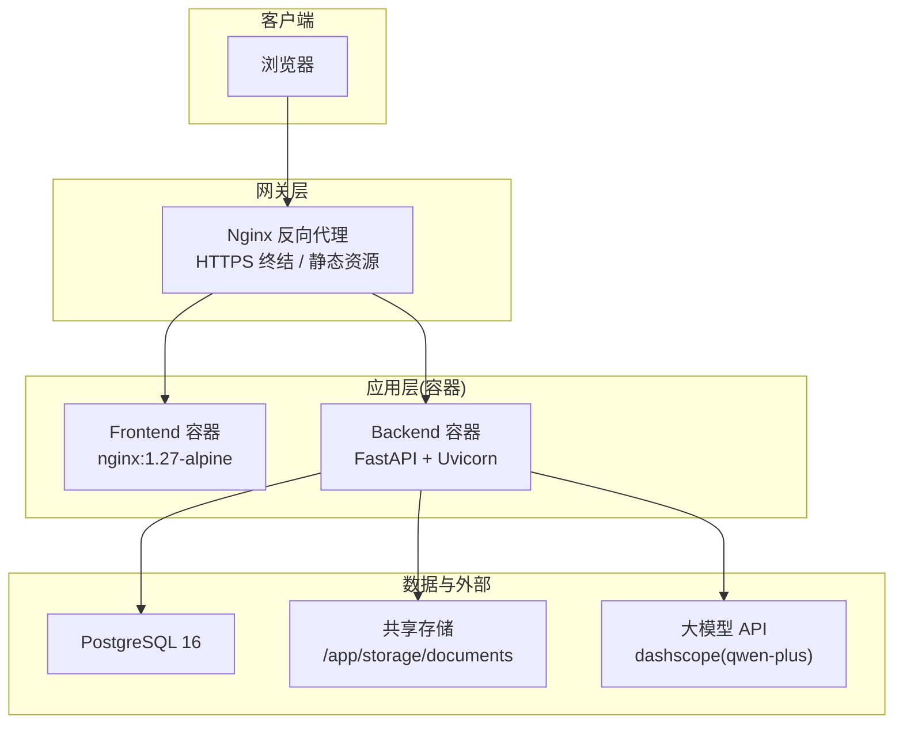
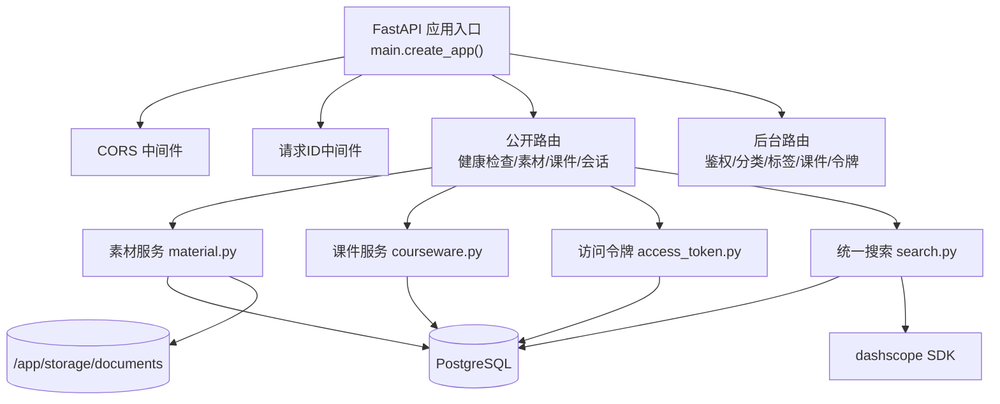
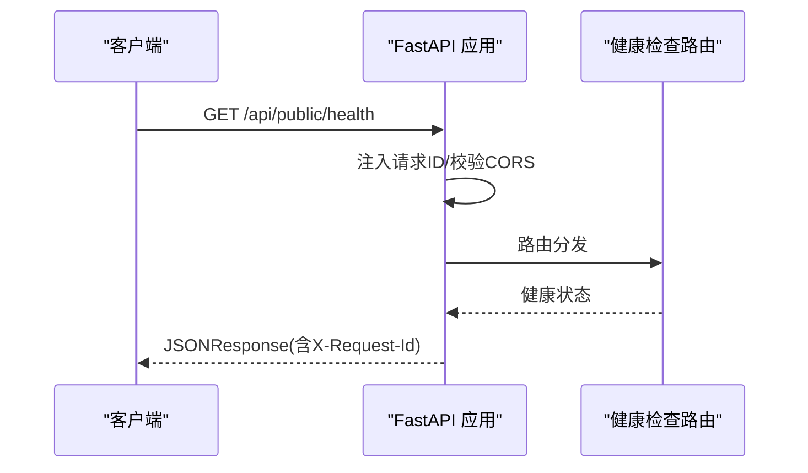
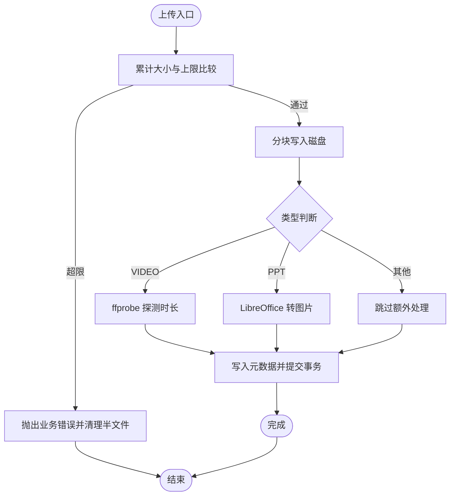
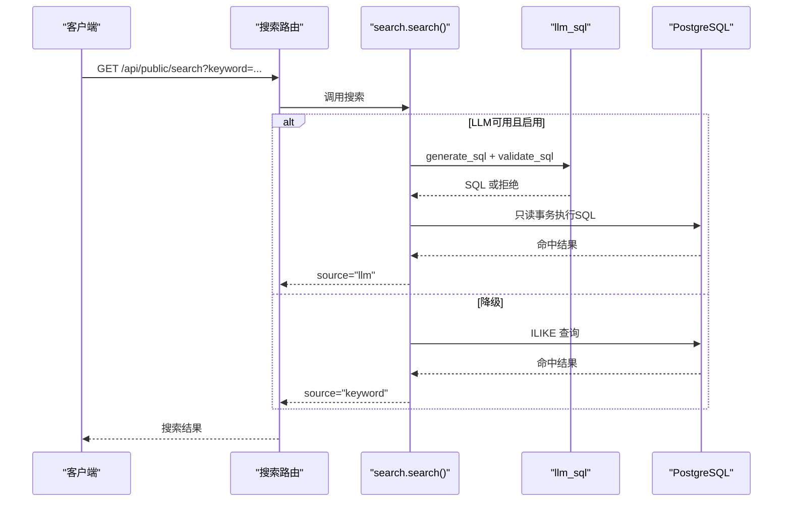
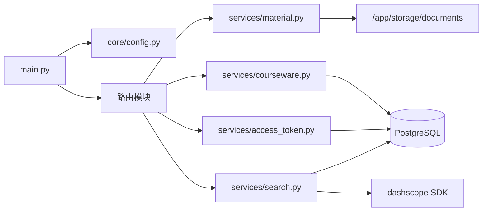
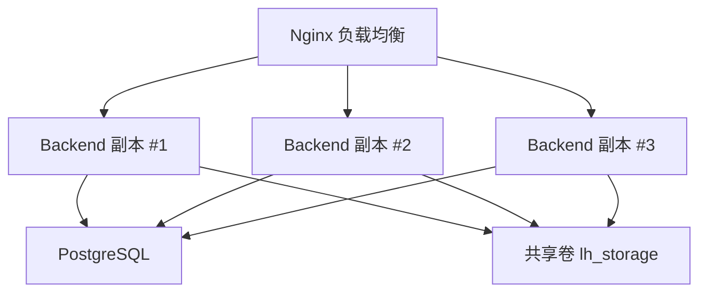

# 扩展性设计

<cite>
**本文引用的文件**   
- [backend/app/main.py](file://backend/app/main.py)
- [backend/app/core/config.py](file://backend/app/core/config.py)
- [backend/app/services/material.py](file://backend/app/services/material.py)
- [backend/app/services/courseware.py](file://backend/app/services/courseware.py)
- [backend/app/services/access_token.py](file://backend/app/services/access_token.py)
- [backend/app/services/search.py](file://backend/app/services/search.py)
- [backend/entrypoint.sh](file://backend/entrypoint.sh)
- [backend/Dockerfile](file://backend/Dockerfile)
- [deploy/ecs/compose.yml](file://deploy/ecs/compose.yml)
- [frontend/Dockerfile](file://frontend/Dockerfile)
- [doc/spec/07-技术架构.md](file://doc/spec/07-技术架构.md)
- [doc/spec/10-API设计规范.md](file://doc/spec/10-API设计规范.md)
- [doc/spec/06-非功能需求.md](file://doc/spec/06-非功能需求.md)
</cite>

## 目录
1. [引言](#引言)
2. [项目结构](#项目结构)
3. [核心组件](#核心组件)
4. [架构总览](#架构总览)
5. [详细组件分析](#详细组件分析)
6. [依赖关系分析](#依赖关系分析)
7. [性能与容量规划](#性能与容量规划)
8. [弹性伸缩与部署方案](#弹性伸缩与部署方案)
9. [微服务拆分建议](#微服务拆分建议)
10. [故障排查指南](#故障排查指南)
11. [结论](#结论)

## 引言
本设计文档面向 Learning Hub 的扩展性目标，围绕水平扩展（无状态服务、负载均衡、容器化）、垂直扩展（内存/CPU/存储优化）、微服务拆分（边界、通信、一致性）、弹性伸缩与容量规划、性能基准测试以及扩展示例与迁移路径进行系统化阐述。文档以现有代码与部署配置为依据，给出可落地的演进路线与注意事项。

## 项目结构
Learning Hub 采用前后端分离：前端为 React + Vite + TypeScript，后端为 FastAPI + SQLAlchemy + PostgreSQL，通过 Docker 多阶段构建镜像，生产使用 Docker Swarm 编排。

图表来源
- [doc/spec/07-技术架构.md:1-94](file://doc/spec/07-技术架构.md#L1-L94)
- [deploy/ecs/compose.yml:1-79](file://deploy/ecs/compose.yml#L1-L79)
- [frontend/Dockerfile:1-23](file://frontend/Dockerfile#L1-L23)
- [backend/Dockerfile:1-85](file://backend/Dockerfile#L1-L85)

章节来源
- [doc/spec/07-技术架构.md:1-94](file://doc/spec/07-技术架构.md#L1-L94)
- [deploy/ecs/compose.yml:1-79](file://deploy/ecs/compose.yml#L1-L79)
- [frontend/Dockerfile:1-23](file://frontend/Dockerfile#L1-L23)
- [backend/Dockerfile:1-85](file://backend/Dockerfile#L1-L85)

## 核心组件
- 应用装配与中间件：统一请求 ID、CORS、限流异常处理、路由注册。
- 配置中心：集中从环境变量加载数据库、JWT、CORS、存储、LLM、日志等配置。
- 业务服务：素材上传/删除、课件 CRUD 与排序、访问令牌管理、统一搜索（LLM-to-SQL + ILIKE 降级）。
- 启动脚本：等待数据库、执行 Alembic 迁移、启动 Uvicorn。
- 容器化：后端多阶段镜像（系统依赖+Python依赖），前端静态产物由 Nginx 提供。

章节来源
- [backend/app/main.py:1-116](file://backend/app/main.py#L1-L116)
- [backend/app/core/config.py:1-88](file://backend/app/core/config.py#L1-L88)
- [backend/app/services/material.py:1-234](file://backend/app/services/material.py#L1-L234)
- [backend/app/services/courseware.py:1-492](file://backend/app/services/courseware.py#L1-L492)
- [backend/app/services/access_token.py:1-235](file://backend/app/services/access_token.py#L1-L235)
- [backend/app/services/search.py:1-263](file://backend/app/services/search.py#L1-L263)
- [backend/entrypoint.sh:1-23](file://backend/entrypoint.sh#L1-L23)
- [backend/Dockerfile:1-85](file://backend/Dockerfile#L1-L85)
- [frontend/Dockerfile:1-23](file://frontend/Dockerfile#L1-L23)

## 架构总览
当前为单体 FastAPI 应用，按领域划分为 services 层；对外暴露 REST API，统一响应信封与限流策略；持久化到 PostgreSQL；文件存储挂载到共享卷；AI 搜索通过 dashscope SDK 调用外部 LLM。

图表来源
- [backend/app/main.py:1-116](file://backend/app/main.py#L1-L116)
- [backend/app/services/material.py:1-234](file://backend/app/services/material.py#L1-L234)
- [backend/app/services/courseware.py:1-492](file://backend/app/services/courseware.py#L1-L492)
- [backend/app/services/access_token.py:1-235](file://backend/app/services/access_token.py#L1-L235)
- [backend/app/services/search.py:1-263](file://backend/app/services/search.py#L1-L263)
- [doc/spec/07-技术架构.md:1-94](file://doc/spec/07-技术架构.md#L1-L94)

## 详细组件分析

### 应用装配与中间件
- 生命周期与路由：创建 FastAPI 实例，注册 CORS、限流器、请求 ID 中间件、全局异常处理器，并挂载公开与后台路由。
- 限流与错误：集成 SlowAPI，对 429 返回统一信封；BusinessError 统一封装。
- 可观测性：所有响应携带 X-Request-Id，便于跨层追踪。

图表来源
- [backend/app/main.py:1-116](file://backend/app/main.py#L1-L116)

章节来源
- [backend/app/main.py:1-116](file://backend/app/main.py#L1-L116)
- [doc/spec/10-API设计规范.md:52-108](file://doc/spec/10-API设计规范.md#L52-L108)

### 配置中心
- 集中式 Settings：数据库连接串优先、JWT、CORS、时区、存储路径、LibreOffice/PPT 转换参数、Redis 限流后端、LLM 开关与超时、日志级别。
- 缓存：get_settings 使用 lru_cache 避免重复解析。

章节来源
- [backend/app/core/config.py:1-88](file://backend/app/core/config.py#L1-L88)

### 素材服务（Material）
- 列表分页：支持关键词与类型过滤，附带引用计数。
- 上传流程：分块写入、大小限制、视频时长探测（ffprobe）、PPT 转图片预览（LibreOffice），失败回滚清理。
- 删除保护：被引用不可删；物理删除文件与预览目录。

图表来源
- [backend/app/services/material.py:1-234](file://backend/app/services/material.py#L1-L234)

章节来源
- [backend/app/services/material.py:1-234](file://backend/app/services/material.py#L1-L234)

### 课件服务（Courseware）
- 创建/更新：标题长度校验、分类树任意层级挂载、受限模式需绑定至少一个令牌、OPEN 降级自动清空 token。
- 素材排序：专用接口与更新接口均按数组下标重写 sort_order，保证拖拽顺序一致。
- 列表/搜索：支持关键词、分类子树、访问模式过滤；前台搜索走统一搜索服务。

章节来源
- [backend/app/services/courseware.py:1-492](file://backend/app/services/courseware.py#L1-L492)

### 访问令牌服务（AccessToken）
- 安全：明文仅生成时返回一次，数据库存 SHA-256；验证使用常量时间比较。
- 规则：标签唯一、删除前检查引用、至少保留一个 active token。
- 列表：返回引用计数与时间戳。

章节来源
- [backend/app/services/access_token.py:1-235](file://backend/app/services/access_token.py#L1-L235)

### 统一搜索服务（Search）
- 双轨策略：优先 LLM-to-SQL（qwen-plus），失败或禁用则降级 ILIKE 关键词检索。
- 中文清洗：正则裁剪“废话”，提取候选词提升命中率。
- 异步包装：在事件循环中通过 to_thread 执行同步 IO，避免阻塞。

图表来源
- [backend/app/services/search.py:1-263](file://backend/app/services/search.py#L1-L263)
- [doc/spec/07-技术架构.md:71-94](file://doc/spec/07-技术架构.md#L71-L94)

章节来源
- [backend/app/services/search.py:1-263](file://backend/app/services/search.py#L1-L263)
- [doc/spec/07-技术架构.md:71-94](file://doc/spec/07-技术架构.md#L71-L94)

### 启动与运行
- entrypoint：等待数据库可达 → 执行 Alembic 升级 → 启动 Uvicorn（监听 0.0.0.0:8000，转发代理头）。
- Dockerfile：安装系统依赖（LibreOffice、poppler、ffmpeg、字体），Python 依赖固定版本，暴露 8000，内置健康检查。

章节来源
- [backend/entrypoint.sh:1-23](file://backend/entrypoint.sh#L1-L23)
- [backend/Dockerfile:1-85](file://backend/Dockerfile#L1-L85)

### 前端容器
- 多阶段构建：Node 构建静态资源，Nginx 运行时提供静态页面与 PDF.js worker。
- 健康检查：wget 探测根路径。

章节来源
- [frontend/Dockerfile:1-23](file://frontend/Dockerfile#L1-L23)

## 依赖关系分析
- 应用内依赖：main 装配路由与中间件；services 层通过 config 获取配置；material/courseware/access_token/search 相互解耦，通过 Session 与模型交互。
- 外部依赖：PostgreSQL（持久化）、dashscope SDK（LLM）、文件系统（/app/storage/documents）、SlowAPI（可选 Redis 后端）。

图表来源
- [backend/app/main.py:1-116](file://backend/app/main.py#L1-L116)
- [backend/app/core/config.py:1-88](file://backend/app/core/config.py#L1-L88)
- [backend/app/services/material.py:1-234](file://backend/app/services/material.py#L1-L234)
- [backend/app/services/courseware.py:1-492](file://backend/app/services/courseware.py#L1-L492)
- [backend/app/services/access_token.py:1-235](file://backend/app/services/access_token.py#L1-L235)
- [backend/app/services/search.py:1-263](file://backend/app/services/search.py#L1-L263)

章节来源
- [backend/app/main.py:1-116](file://backend/app/main.py#L1-L116)
- [backend/app/core/config.py:1-88](file://backend/app/core/config.py#L1-L88)
- [backend/app/services/material.py:1-234](file://backend/app/services/material.py#L1-L234)
- [backend/app/services/courseware.py:1-492](file://backend/app/services/courseware.py#L1-L492)
- [backend/app/services/access_token.py:1-235](file://backend/app/services/access_token.py#L1-L235)
- [backend/app/services/search.py:1-263](file://backend/app/services/search.py#L1-L263)

## 性能与容量规划
- 非功能基线：参考规范中的 P95 指标（HTTP 请求、搜索、DB 查询、LLM 调用、上传耗时、错误率等），作为压测与扩容阈值依据。
- 关键瓶颈点：
  - 文件 I/O：素材上传与预览生成（LibreOffice/ffprobe）受磁盘吞吐影响。
  - 数据库：复杂查询与关联加载（selectinload）在高并发下可能成为热点。
  - LLM 调用：网络延迟与超时控制，需关注降级触发比例。
- 容量规划方法：
  - 以 QPS × 平均响应时间估算 CPU 占用；结合副本数与单实例线程池评估横向扩展规模。
  - 存储增长：按素材数量与平均大小预估 PV 容量，预留 30% 余量。
  - 数据库：根据慢查询与锁竞争情况评估读写分离或索引优化。

章节来源
- [doc/spec/06-非功能需求.md:125-136](file://doc/spec/06-非功能需求.md#L125-L136)

## 弹性伸缩与部署方案

### 水平扩展（无状态服务与负载均衡）
- 无状态设计要点：
  - 会话与鉴权：Admin 会话基于 Cookie/JWT，令牌哈希存储在 DB；确保多副本共享同一数据库与外部存储。
  - 限流：SlowAPI 切换至 Redis 后端实现跨实例共享计数。
  - 文件存储：将 /app/storage 挂载到共享卷（ECS named volume），保证多副本一致可见。
- 负载均衡策略：
  - 网关层（Nginx）对 backend 做反向代理与轮询；Swarm 内部 DNS 解析 service name。
  - 健康检查：后端与健康检查端点配合，剔除不健康实例。

图表来源
- [deploy/ecs/compose.yml:1-79](file://deploy/ecs/compose.yml#L1-L79)
- [backend/Dockerfile:1-85](file://backend/Dockerfile#L1-L85)

章节来源
- [deploy/ecs/compose.yml:1-79](file://deploy/ecs/compose.yml#L1-L79)
- [backend/Dockerfile:1-85](file://backend/Dockerfile#L1-L85)

### 垂直扩展（内存/CPU/存储优化）
- 内存优化：
  - 减少一次性加载的数据集（如列表分页、selectinload 范围控制）。
  - 调整 Uvicorn workers 与线程池，避免过多常驻对象。
- CPU 利用率：
  - 将 CPU 密集型任务（LibreOffice 转换、ffprobe）考虑剥离为独立 sidecar 或异步队列，降低主进程阻塞。
- 存储扩容：
  - 将本地文件迁移至对象存储（OSS/S3），通过 STORAGE_BACKEND 环境变量切换驱动（当前已预留配置项）。

章节来源
- [backend/app/core/config.py:1-88](file://backend/app/core/config.py#L1-L88)
- [backend/app/services/material.py:1-234](file://backend/app/services/material.py#L1-L234)

### 容器化部署方案
- 后端镜像：多阶段构建，安装系统依赖与 Python 依赖，暴露 8000，内置健康检查。
- 前端镜像：构建静态资源，Nginx 提供静态页面与 PDF.js worker。
- 编排：Docker Swarm compose 定义 backend/frontend 服务、外部网络与共享卷，副本数可调。

章节来源
- [backend/Dockerfile:1-85](file://backend/Dockerfile#L1-L85)
- [frontend/Dockerfile:1-23](file://frontend/Dockerfile#L1-L23)
- [deploy/ecs/compose.yml:1-79](file://deploy/ecs/compose.yml#L1-L79)

## 微服务拆分建议

### 服务边界划分
- 认证与会话服务：Admin 登录、JWT 签发与校验、会话刷新。
- 课件与素材服务：课件 CRUD、素材上传/下载/预览、排序。
- 访问令牌服务：令牌生命周期管理与校验。
- 搜索服务：LLM-to-SQL 与 ILIKE 兜底逻辑，可独立部署。
- 审计与统计服务：操作审计、访问会话统计。

### 服务间通信
- 同步：REST/JSON（当前方式），适合强一致场景。
- 异步：消息队列（如 RabbitMQ/Kafka）用于高吞吐写入（审计、统计、预览生成）。
- 事件：基于数据库变更事件或消息总线，实现最终一致性。

### 数据一致性保证
- 跨服务写：采用 Saga 或补偿事务，保证最终一致。
- 幂等：接口级 Idempotency-Key 与去重表，防止重复提交。
- 分布式锁：针对热点资源（如最后令牌保留）使用 Redis 分布式锁。

[本节为概念性内容，未直接分析具体文件]

## 故障排查指南
- 启动失败：
  - 数据库不可达：检查 DATABASE_HOST/PORT/USER/PASSWORD/NAME 环境变量与网络连通。
  - 迁移失败：查看 entrypoint 输出与 Alembic 日志。
- 健康检查失败：
  - 确认 /api/public/health 端点可达与端口映射正确。
- 限流频繁：
  - 检查 SlowAPI 后端是否为 Redis；核对各接口的限流键与阈值。
- 文件上传失败：
  - 检查共享卷挂载与权限；查看 ffprobe/LibreOffice 是否可用。
- 搜索异常：
  - 确认 DASHSCOPE_API_KEY 与网络连通；观察降级触发比例。

章节来源
- [backend/entrypoint.sh:1-23](file://backend/entrypoint.sh#L1-L23)
- [backend/Dockerfile:1-85](file://backend/Dockerfile#L1-L85)
- [doc/spec/10-API设计规范.md:109-131](file://doc/spec/10-API设计规范.md#L109-L131)
- [backend/app/services/material.py:1-234](file://backend/app/services/material.py#L1-L234)
- [backend/app/services/search.py:1-263](file://backend/app/services/search.py#L1-L263)

## 结论
Learning Hub 当前为单体架构，具备良好的模块化基础与容器化能力。通过引入共享存储与 Redis 限流后端，可实现快速水平扩展；通过剥离 CPU 密集型任务与对象存储迁移，可进一步提升稳定性与可扩展性。未来可按领域拆分为多个微服务，并以异步消息与幂等机制保障一致性。结合非功能指标与压测基线，持续优化容量与性能，满足业务增长需求。