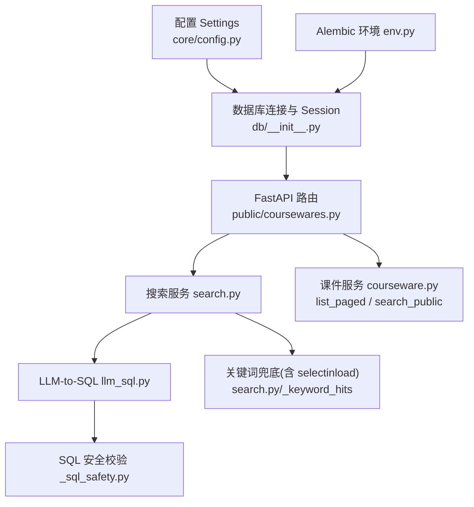
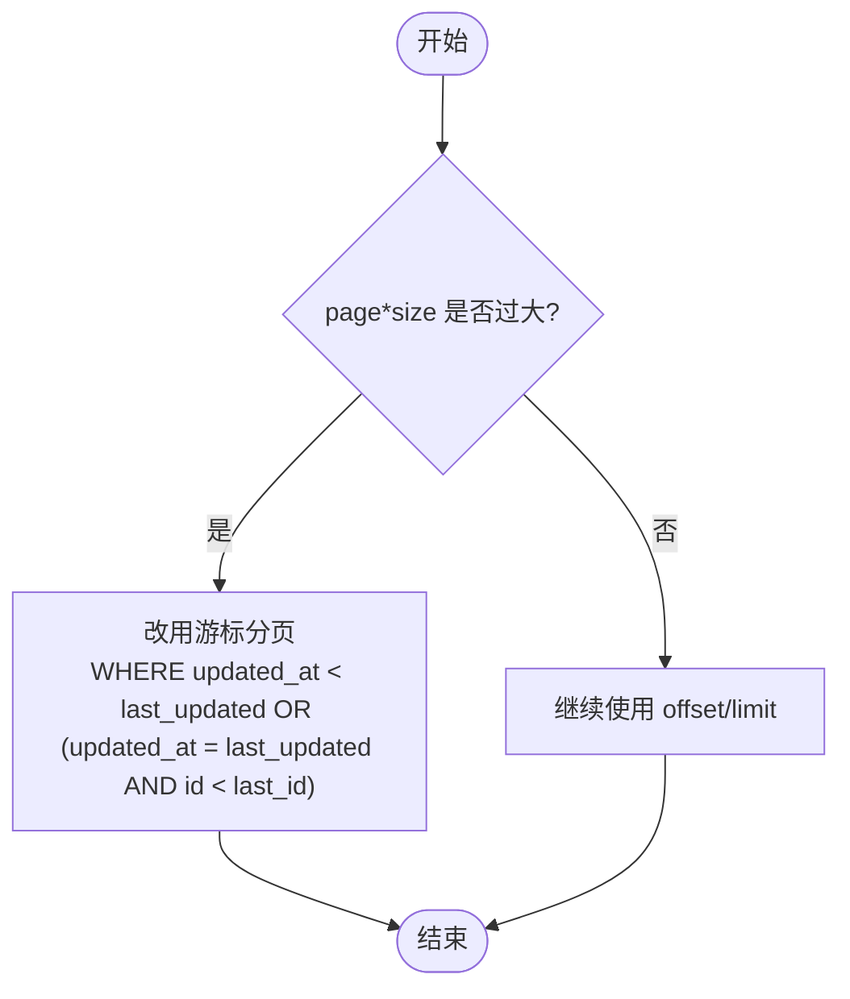
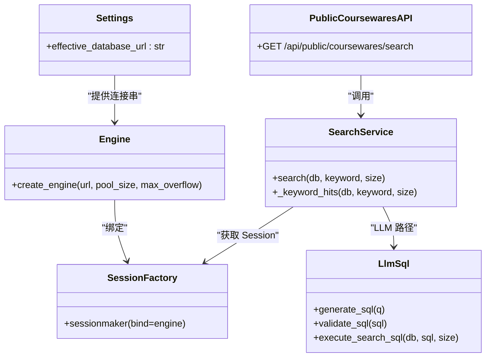

# 数据库性能优化

<cite>
**本文引用的文件**
- [backend/app/db/__init__.py](file://backend/app/db/__init__.py)
- [backend/app/core/config.py](file://backend/app/core/config.py)
- [backend/alembic/env.py](file://backend/alembic/env.py)
- [backend/alembic.ini](file://backend/alembic.ini)
- [backend/app/models/courseware.py](file://backend/app/models/courseware.py)
- [backend/app/models/category.py](file://backend/app/models/category.py)
- [backend/app/models/access_session.py](file://backend/app/models/access_session.py)
- [backend/app/services/search.py](file://backend/app/services/search.py)
- [backend/app/services/llm_sql.py](file://backend/app/services/llm_sql.py)
- [backend/app/services/_sql_safety.py](file://backend/app/services/_sql_safety.py)
- [backend/app/api/public/coursewares.py](file://backend/app/api/public/coursewares.py)
- [backend/app/services/courseware.py](file://backend/app/services/courseware.py)
</cite>

## 目录
1. [简介](#简介)
2. [项目结构](#项目结构)
3. [核心组件](#核心组件)
4. [架构总览](#架构总览)
5. [详细组件分析](#详细组件分析)
6. [依赖关系分析](#依赖关系分析)
7. [性能考量](#性能考量)
8. [故障排查指南](#故障排查指南)
9. [结论](#结论)
10. [附录](#附录)

## 简介
本文件面向 Learning Hub 的 PostgreSQL 数据库性能优化，覆盖索引设计、查询语句优化、连接池配置、N+1 查询问题治理、SQLAlchemy 异步与同步混合场景下的优化策略，以及大数据量分页、全文搜索调优、事务管理、慢查询监控与分析方法。文档同时提供具体 SQL 优化示例与性能测试方案，帮助读者在生产环境中稳定提升查询吞吐与响应时延。

## 项目结构
后端采用 FastAPI + SQLAlchemy（同步引擎）+ Alembic 迁移；搜索服务支持 LLM-to-SQL 优先、关键词 ILIKE 兜底；模型层通过 selectinload 避免 N+1；访问会话表已定义复合索引以支撑高频查询。



图表来源
- [backend/app/api/public/coursewares.py:32-54](file://backend/app/api/public/coursewares.py#L32-L54)
- [backend/app/services/search.py:210-242](file://backend/app/services/search.py#L210-L242)
- [backend/app/services/llm_sql.py:382-415](file://backend/app/services/llm_sql.py#L382-L415)
- [backend/app/services/_sql_safety.py:95-134](file://backend/app/services/_sql_safety.py#L95-L134)
- [backend/app/services/courseware.py:396-447](file://backend/app/services/courseware.py#L396-L447)
- [backend/app/db/__init__.py:15-32](file://backend/app/db/__init__.py#L15-L32)
- [backend/app/core/config.py:19-38](file://backend/app/core/config.py#L19-L38)
- [backend/alembic/env.py:23-26](file://backend/alembic/env.py#L23-L26)

章节来源
- [backend/app/api/public/coursewares.py:32-54](file://backend/app/api/public/coursewares.py#L32-L54)
- [backend/app/services/search.py:210-242](file://backend/app/services/search.py#L210-L242)
- [backend/app/services/llm_sql.py:382-415](file://backend/app/services/llm_sql.py#L382-L415)
- [backend/app/services/_sql_safety.py:95-134](file://backend/app/services/_sql_safety.py#L95-L134)
- [backend/app/services/courseware.py:396-447](file://backend/app/services/courseware.py#L396-L447)
- [backend/app/db/__init__.py:15-32](file://backend/app/db/__init__.py#L15-L32)
- [backend/app/core/config.py:19-38](file://backend/app/core/config.py#L19-L38)
- [backend/alembic/env.py:23-26](file://backend/alembic/env.py#L23-L26)

## 核心组件
- 数据库连接与 Session：基于 SQLAlchemy 同步引擎，PostgreSQL 使用连接池（pool_size、max_overflow），SQLite 使用 StaticPool；SessionLocal 关闭自动刷新与过期，减少额外开销。
- 配置：Settings 提供 effective_database_url，优先使用 DATABASE_URL，否则拼接 postgresql+psycopg2 连接串。
- 搜索服务：统一入口 search()，优先 LLM-to-SQL（带超时保护），失败或禁用时降级为关键词 ILIKE；关键词路径使用 selectinload 预加载关联，避免 N+1。
- 课件列表与公开搜索：list_paged 与 search_public 使用 offset/limit 分页，selectinload 预取关联。
- 访问会话索引：access_session 表定义多组复合索引，用于按 token/courseware/material 维度的时间范围查询。

章节来源
- [backend/app/db/__init__.py:15-32](file://backend/app/db/__init__.py#L15-L32)
- [backend/app/core/config.py:19-38](file://backend/app/core/config.py#L19-L38)
- [backend/app/services/search.py:115-160](file://backend/app/services/search.py#L115-L160)
- [backend/app/services/courseware.py:396-447](file://backend/app/services/courseware.py#L396-L447)
- [backend/app/models/access_session.py:66-79](file://backend/app/models/access_session.py#L66-L79)

## 架构总览
下图展示一次前台搜索请求从 API 到数据库的关键路径，包括 LLM 生成 SQL、白名单校验、只读事务执行与回退逻辑。

```mermaid
sequenceDiagram
participant Client as "客户端"
participant API as "public/coursewares.py"
participant Search as "services/search.py"
participant LLM as "services/llm_sql.py"
participant Safety as "services/_sql_safety.py"
participant DB as "PostgreSQL"
Client->>API : GET /api/public/coursewares/search?q=...&size=20
API->>Search : search(keyword, size)
alt LLM 启用且可用
Search->>LLM : generate_sql(q)
LLM->>Safety : validate_sql(sql)
Safety-->>LLM : 通过/拒绝
alt 通过
LLM->>DB : SET TRANSACTION READ ONLY; SELECT ... LIMIT ?
DB-->>LLM : id 列表
LLM-->>Search : ids
Search->>DB : 按 ids 拉取完整对象(selectinload)
DB-->>Search : items
Search-->>API : {items, source="llm", total}
else 拒绝或异常
Search->>Search : 降级 keyword 路径
end
else LLM 未启用/超时/异常
Search->>Search : _keyword_hits (ILIKE + selectinload)
Search-->>API : {items, source="keyword", total}
end
API-->>Client : ok(data={items, source, total, page, size})
```

图表来源
- [backend/app/api/public/coursewares.py:32-54](file://backend/app/api/public/coursewares.py#L32-L54)
- [backend/app/services/search.py:210-242](file://backend/app/services/search.py#L210-L242)
- [backend/app/services/llm_sql.py:382-415](file://backend/app/services/llm_sql.py#L382-L415)
- [backend/app/services/_sql_safety.py:95-134](file://backend/app/services/_sql_safety.py#L95-L134)

## 详细组件分析

### 连接池与事务管理
- 连接池参数
  - PostgreSQL：pool_size=10，max_overflow=20，开启 pool_pre_ping 检测死连接。
  - SQLite：StaticPool + check_same_thread=False，适配多线程测试。
- Session 工厂
  - autoflush=False、autocommit=False、expire_on_commit=False，减少不必要的刷新与二次查询。
- 事务
  - LLM 执行路径在 read-only 事务中运行，防止误写并降低锁竞争。

优化建议
- 根据并发与 CPU 核数调整 pool_size 与 max_overflow，观察连接等待与空闲比例。
- 对长事务进行拆分，避免长时间持有连接导致池耗尽。
- 在写入热点路径上显式控制 flush/commit 时机，减少重复更新。

章节来源
- [backend/app/db/__init__.py:15-32](file://backend/app/db/__init__.py#L15-L32)
- [backend/app/services/llm_sql.py:382-415](file://backend/app/services/llm_sql.py#L382-L415)

### 索引设计与数据模型
- 分类 Category
  - 唯一约束 parent_id+name，索引 parent_id，利于树形遍历与子树聚合。
- 访问会话 AccessSession
  - 复合索引 ix_access_session_token_started、ix_access_session_token_material、ix_access_session_token_courseware，支撑按 token 维度统计与明细查询。
- 课件 Courseware
  - 主键 id；排序常用 updated_at；搜索常用 title/author/description ILIKE。

优化建议
- 针对频繁过滤条件创建合适索引：
  - category.parent_id 已有索引，可考虑在父节点下大量课件时增加覆盖索引（如包含 access_mode）。
  - access_session 可按业务热点组合列建立更多复合索引（例如 token_id + material_id + started_at）。
  - 若需精确匹配 access_mode 过滤，可在 courseware(access_mode) 建索引。
- 对大表更新时间字段 updated_at 维护成本较高时，评估是否用触发器或应用层批量更新。

章节来源
- [backend/app/models/category.py:16-20](file://backend/app/models/category.py#L16-L20)
- [backend/app/models/access_session.py:66-79](file://backend/app/models/access_session.py#L66-L79)
- [backend/app/models/courseware.py:24-47](file://backend/app/models/courseware.py#L24-L47)

### 查询语句优化与 N+1 治理
- N+1 问题治理
  - 搜索与详情接口广泛使用 selectinload 预加载 tags、materials、access_tokens、category，避免逐条关联查询。
- 关键词兜底路径
  - 使用 EXISTS 联合 tag.name 匹配，避免在大表上做 JOIN 带来的额外开销。
- 列表分页
  - list_paged 使用 subquery 计数 + offset/limit 分页；注意在超大数据集下 offset 的性能退化。

优化建议
- 将 count 与分页合并为“延迟关联”或“游标分页”（见后文分页优化）。
- 对 ILIKE 命中较少的字段优先过滤，减少后续扫描范围。
- 避免 SELECT *，仅选择必要列，减少网络与序列化开销。

章节来源
- [backend/app/services/search.py:115-160](file://backend/app/services/search.py#L115-L160)
- [backend/app/services/courseware.py:396-447](file://backend/app/services/courseware.py#L396-L447)

### 全文搜索与 LLM-to-SQL 优化
- LLM-to-SQL 流程
  - 生成 SQL → 白名单校验（禁止 DDL/DML、限制表名、强制 WHERE/LIMIT、禁止注释等）→ 只读事务执行 → 返回 id 列表 → 再按 id 拉取完整对象。
- 降级策略
  - 无 API Key、调用失败、校验拒绝、空结果或超时均降级为 ILIKE 关键词检索。
- 关键词清洗
  - 中文停用词与句式裁剪，提高 ILIKE 命中率。

优化建议
- 在 PostgreSQL 中使用 pg_trgm 扩展 + gin 索引加速 ILIKE %keyword% 模糊匹配。
- 结合 tsvector/tsquery 实现更高效的全文检索（适合标题/描述）。
- 对 LLM 生成的 SQL 做 EXPLAIN ANALYZE 采样，确保走索引且 LIMIT 合理。

章节来源
- [backend/app/services/llm_sql.py:216-237](file://backend/app/services/llm_sql.py#L216-L237)
- [backend/app/services/_sql_safety.py:95-134](file://backend/app/services/_sql_safety.py#L95-L134)
- [backend/app/services/search.py:36-102](file://backend/app/services/search.py#L36-L102)
- [backend/app/services/search.py:210-242](file://backend/app/services/search.py#L210-L242)

### 大数据量分页优化
当前使用 offset/limit 分页，当 page 很大时存在性能退化。

优化建议
- 游标分页（推荐）：基于上一页最后一条记录的排序键（如 updated_at 或 id）进行下一页定位，避免全表偏移。
- 延迟关联：先查主键集合，再按需加载关联，减少首屏 IO。
- 物化视图/汇总表：对复杂统计类查询（如访问时长汇总）定期刷新。



[此图为概念流程图，不直接映射具体源码文件]

### 异步查询与 SQLAlchemy 注意事项
- 当前使用同步引擎与 sessionmaker，API 路由多为同步；搜索中的 LLM 调用通过 asyncio.to_thread 包装，避免阻塞事件循环。
- 如需全面异步，应切换至 asyncpg 驱动与异步 ORM（如 sqlalchemy.ext.asyncio），并在依赖注入中提供异步 Session。

优化建议
- 在现有同步模式下，尽量将耗时外部调用（LLM、文件处理）放入线程池，保持事件循环非阻塞。
- 对热点读取路径使用连接池复用，避免频繁创建/销毁连接。

章节来源
- [backend/app/services/search.py:196-205](file://backend/app/services/search.py#L196-L205)
- [backend/app/services/search.py:210-242](file://backend/app/services/search.py#L210-L242)
- [backend/app/db/__init__.py:15-32](file://backend/app/db/__init__.py#L15-L32)

### 事务管理优化
- LLM 执行路径使用只读事务，降低锁竞争与写放大风险。
- 写入路径（课件增删改）显式 commit/refresh，必要时 expire 相关属性以避免脏读。

优化建议
- 将多个小写操作合并为单次事务提交，减少 WAL 压力。
- 对批量写入使用 executemany 或 bulk 操作，降低往返次数。

章节来源
- [backend/app/services/llm_sql.py:382-415](file://backend/app/services/llm_sql.py#L382-L415)
- [backend/app/services/courseware.py:146-167](file://backend/app/services/courseware.py#L146-L167)

## 依赖关系分析


图表来源
- [backend/app/core/config.py:19-38](file://backend/app/core/config.py#L19-L38)
- [backend/app/db/__init__.py:15-32](file://backend/app/db/__init__.py#L15-L32)
- [backend/app/api/public/coursewares.py:32-54](file://backend/app/api/public/coursewares.py#L32-L54)
- [backend/app/services/search.py:210-242](file://backend/app/services/search.py#L210-L242)
- [backend/app/services/llm_sql.py:382-415](file://backend/app/services/llm_sql.py#L382-L415)

章节来源
- [backend/app/core/config.py:19-38](file://backend/app/core/config.py#L19-L38)
- [backend/app/db/__init__.py:15-32](file://backend/app/db/__init__.py#L15-L32)
- [backend/app/api/public/coursewares.py:32-54](file://backend/app/api/public/coursewares.py#L32-L54)
- [backend/app/services/search.py:210-242](file://backend/app/services/search.py#L210-L242)
- [backend/app/services/llm_sql.py:382-415](file://backend/app/services/llm_sql.py#L382-L415)

## 性能考量
- 连接池
  - 观察连接池使用率与等待队列，适当增大 pool_size/max_overflow；在高并发下配合连接预热。
- 索引
  - 为高频过滤/排序字段建立合适索引；对 ILIKE 模糊查询引入 pg_trgm gin 索引。
- 查询
  - 避免 SELECT *；使用 selectinload 预加载；将 count 与分页合并或改用游标分页。
- 事务
  - 缩短事务生命周期；批量写入合并提交；只读事务隔离级别明确。
- 全文检索
  - 在文本字段上使用 tsvector/tsquery 或 pg_trgm，权衡维护成本与查询性能。
- 监控
  - 开启慢查询日志与 EXPLAIN ANALYZE 采样；关注索引命中率与顺序扫描比例。

[本节为通用指导，不直接分析具体文件]

## 故障排查指南
- 连接问题
  - 检查 effective_database_url 是否正确；确认 pool_pre_ping 生效；查看连接池耗尽告警。
- 搜索异常
  - LLM 超时或校验失败会降级为关键词路径；检查日志中的降级提示与 SQL 白名单拒绝原因。
- 慢查询
  - 对热点 SQL 执行 EXPLAIN ANALYZE，确认是否命中索引；必要时调整索引或改写查询。
- 迁移与环境
  - Alembic 在线/离线模式分别使用 NullPool 与应用连接；确保 alembic.ini 与 Settings 一致。

章节来源
- [backend/app/core/config.py:19-38](file://backend/app/core/config.py#L19-L38)
- [backend/app/services/search.py:210-242](file://backend/app/services/search.py#L210-L242)
- [backend/alembic/env.py:42-56](file://backend/alembic/env.py#L42-L56)
- [backend/alembic.ini:1-39](file://backend/alembic.ini#L1-L39)

## 结论
通过对连接池、索引、查询与事务的系统性优化，并结合 LLM-to-SQL 与关键词兜底的弹性策略，Learning Hub 能够在高并发与大数据量场景下保持稳定与高性能。建议持续监控关键指标，迭代索引与查询计划，逐步引入游标分页与全文检索能力，进一步提升用户体验。

[本节为总结，不直接分析具体文件]

## 附录

### SQL 优化示例（参考）
- 模糊匹配加速（pg_trgm）
  - CREATE EXTENSION IF NOT EXISTS pg_trgm;
  - CREATE INDEX idx_courseware_title_trgm ON courseware USING gin (title gin_trgm_ops);
  - 适用：title ILIKE '%keyword%' 的高频查询。
- 全文检索（tsvector/tsquery）
  - ALTER TABLE courseware ADD COLUMN tsv tsvector GENERATED ALWAYS AS (to_tsvector('simple', coalesce(title,'') || ' ' || coalesce(author,'') || ' ' || coalesce(description,''))) STORED;
  - CREATE INDEX idx_courseware_tsv ON courseware USING gin(tsv);
  - 适用：中文分词需求较弱场景；中文建议使用 zhparser 插件。
- 游标分页（替代 offset/limit）
  - SELECT * FROM courseware WHERE updated_at < :last_updated OR (updated_at = :last_updated AND id < :last_id) ORDER BY updated_at DESC, id DESC LIMIT :size;

[本节为通用示例，不直接分析具体文件]

### 性能测试方案
- 基准目标
  - P95/P99 延迟、QPS、错误率、连接池利用率、慢查询占比。
- 工具与方法
  - 使用压测工具（如 locust/k6）模拟前台搜索与列表分页；对 LLM 路径设置超时与降级断言。
  - 采集 EXPLAIN ANALYZE 样本，对比索引命中与顺序扫描比例。
- 回归用例
  - 覆盖 LLM 命中、校验拒绝、超时降级、无 Key 降级、短关键词一致性等场景。

章节来源
- [backend/tests/test_search_llm.py:97-134](file://backend/tests/test_search_llm.py#L97-L134)