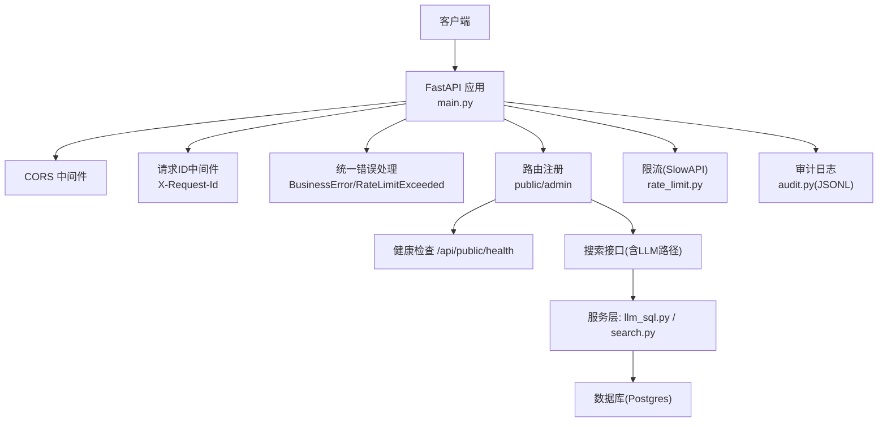
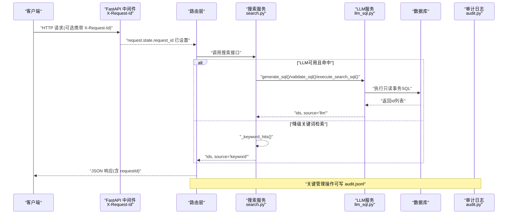
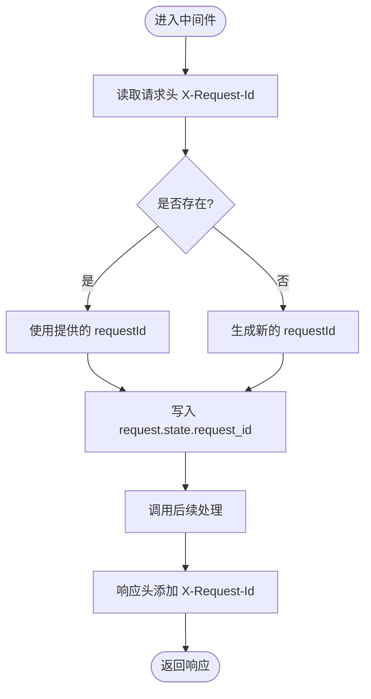
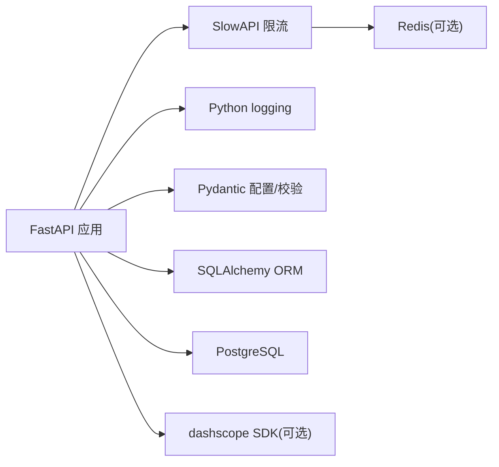

# 监控与可观测性

<cite>
**本文引用的文件**   
- [backend/app/main.py](file://backend/app/main.py)
- [backend/app/core/config.py](file://backend/app/core/config.py)
- [backend/app/core/errors.py](file://backend/app/core/errors.py)
- [backend/app/schemas/__init__.py](file://backend/app/schemas/__init__.py)
- [backend/app/api/public/health.py](file://backend/app/api/public/health.py)
- [backend/app/services/llm_sql.py](file://backend/app/services/llm_sql.py)
- [backend/app/services/search.py](file://backend/app/services/search.py)
- [backend/app/services/audit.py](file://backend/app/services/audit.py)
- [backend/app/core/rate_limit.py](file://backend/app/core/rate_limit.py)
- [doc/spec/06-非功能需求.md](file://doc/spec/06-非功能需求.md)
- [doc/test/test-cases-integration.md](file://doc/test/test-cases-integration.md)
- [deploy/local/docker-compose.yml](file://deploy/local/docker-compose.yml)
</cite>

## 目录
1. [引言](#引言)
2. [项目结构](#项目结构)
3. [核心组件](#核心组件)
4. [架构总览](#架构总览)
5. [详细组件分析](#详细组件分析)
6. [依赖分析](#依赖分析)
7. [性能考虑](#性能考虑)
8. [故障排查指南](#故障排查指南)
9. [结论](#结论)
10. [附录](#附录)

## 引言
本文件为 Learning Hub 的监控与可观测性设计文档，聚焦于应用性能监控体系、日志聚合分析、错误追踪系统。目标包括：
- 定义关键性能指标（KPI）与基线
- 结构化日志记录与审计日志输出
- 统一请求追踪（X-Request-Id）贯穿链路
- Prometheus 指标暴露方案与 Grafana 仪表板建议
- 异常监控告警策略与阈值
- 分布式请求追踪、慢查询监控、资源使用监控的配置方法
- 监控工具链集成示例与运维最佳实践

## 项目结构
后端基于 FastAPI，已具备以下与可观测性相关的基础能力：
- 健康检查端点 /api/public/health
- 全局中间件注入 X-Request-Id 并回写到响应头
- 统一错误信封与业务错误码映射
- 限流模块（SlowAPI），支持 IP/会话键
- 配置中心（环境变量 + .env）
- 审计日志 JSON Lines 输出到本地存储目录

图示来源
- [backend/app/main.py:40-112](file://backend/app/main.py#L40-L112)
- [backend/app/api/public/health.py:16-25](file://backend/app/api/public/health.py#L16-L25)
- [backend/app/core/rate_limit.py:40-51](file://backend/app/core/rate_limit.py#L40-L51)
- [backend/app/services/audit.py:21-42](file://backend/app/services/audit.py#L21-L42)

章节来源
- [backend/app/main.py:40-112](file://backend/app/main.py#L40-L112)
- [backend/app/api/public/health.py:16-25](file://backend/app/api/public/health.py#L16-L25)
- [backend/app/core/rate_limit.py:40-51](file://backend/app/core/rate_limit.py#L40-L51)
- [backend/app/services/audit.py:21-42](file://backend/app/services/audit.py#L21-L42)

## 核心组件
- 健康探针
  - 提供 /api/public/health，返回状态、版本、启动时长等，用于负载均衡/K8s 存活探测与外部监控轮询。
- 请求追踪
  - 中间件从请求头读取或生成 X-Request-Id，写入 request.state 并在响应头回填；统一错误处理与限流处理器均携带 requestId。
- 统一错误与信封
  - BusinessError 与 ErrorCode 集中管理错误码与 HTTP 状态映射；统一信封包含 code/message/data/requestId。
- 限流
  - SlowAPI 适配，支持内存/Redis 存储，key 支持 IP/会话；触发时返回 429 并带 requestId。
- 审计日志
  - 将关键管理操作以 JSON Lines 格式追加到 storage_path 上级目录下的 logs/audit.jsonl。
- 配置
  - Settings 集中管理数据库、JWT、CORS、LLM、日志级别等；log_level 控制基础日志级别。

章节来源
- [backend/app/api/public/health.py:16-25](file://backend/app/api/public/health.py#L16-L25)
- [backend/app/main.py:70-89](file://backend/app/main.py#L70-L89)
- [backend/app/core/errors.py:9-127](file://backend/app/core/errors.py#L9-L127)
- [backend/app/schemas/__init__.py:24-61](file://backend/app/schemas/__init__.py#L24-L61)
- [backend/app/core/rate_limit.py:40-51](file://backend/app/core/rate_limit.py#L40-L51)
- [backend/app/services/audit.py:21-42](file://backend/app/services/audit.py#L21-L42)
- [backend/app/core/config.py:72-73](file://backend/app/core/config.py#L72-L73)

## 架构总览
下图展示一次典型搜索请求在可观测性维度的流转：请求进入后由中间件注入 requestId，路由分发至搜索服务，若启用 LLM-to-SQL 则调用外部模型，最终返回结果；全链路日志与审计事件均可通过 requestId 关联。

图示来源
- [backend/app/main.py:70-89](file://backend/app/main.py#L70-L89)
- [backend/app/services/search.py:1-36](file://backend/app/services/search.py#L1-L36)
- [backend/app/services/llm_sql.py:443-478](file://backend/app/services/llm_sql.py#L443-L478)
- [backend/app/services/audit.py:21-42](file://backend/app/services/audit.py#L21-L42)

## 详细组件分析

### 健康检查与健康探针
- 端点：GET /api/public/health
- 返回值包含 status/version/uptimeSec，便于外部监控系统轮询判定服务可用性。
- 部署侧可通过容器 healthcheck 同时探测前端根路径与后端健康端点。

章节来源
- [backend/app/api/public/health.py:16-25](file://backend/app/api/public/health.py#L16-L25)
- [deploy/local/docker-compose.yml:64-69](file://deploy/local/docker-compose.yml#L64-L69)

### 请求追踪（X-Request-Id）
- 中间件逻辑：
  - 优先使用请求头 X-Request-Id，否则服务端生成；写入 request.state.request_id
  - 响应头回填 X-Request-Id
- 错误处理：
  - BusinessError 与 RateLimitExceeded 处理器均携带 requestId 到响应体与响应头
- 规范约定：
  - 所有响应均带 X-Request-Id；服务端日志需包含该字段以便对位

图示来源
- [backend/app/main.py:70-76](file://backend/app/main.py#L70-L76)
- [backend/app/main.py:78-89](file://backend/app/main.py#L78-L89)
- [doc/spec/10-API设计规范.md:22](file://doc/spec/10-API设计规范.md#L22)

章节来源
- [backend/app/main.py:70-89](file://backend/app/main.py#L70-L89)
- [backend/app/schemas/__init__.py:24-61](file://backend/app/schemas/__init__.py#L24-L61)
- [doc/spec/06-非功能需求.md:135](file://doc/spec/06-非功能需求.md#L135)

### 统一错误与信封
- 错误码集中管理，映射到 HTTP 状态码
- BusinessError 抛出后由全局处理器包装为统一信封 {code,message,data,requestId}
- 限流异常返回 429 并附带 requestId

章节来源
- [backend/app/core/errors.py:9-127](file://backend/app/core/errors.py#L9-L127)
- [backend/app/schemas/__init__.py:24-61](file://backend/app/schemas/__init__.py#L24-L61)
- [backend/app/main.py:84-89](file://backend/app/main.py#L84-L89)

### 限流与速率控制
- SlowAPI 集成，支持 Redis/内存存储
- key 函数支持 ip/session 两种维度
- 触发限流时返回 429，响应体包含 code=message=requestId

章节来源
- [backend/app/core/rate_limit.py:40-51](file://backend/app/core/rate_limit.py#L40-L51)
- [backend/app/main.py:84-89](file://backend/app/main.py#L84-L89)

### 审计日志（JSON Lines）
- 写入位置：storage_path 上级目录/logs/audit.jsonl
- 每条记录包含 ts/actor/action/resource/payload
- 失败不抛错，避免影响主流程

章节来源
- [backend/app/services/audit.py:21-42](file://backend/app/services/audit.py#L21-L42)

### 搜索与 LLM 可观测性要点
- 搜索主流程：
  - 若未启用 LLM 或调用失败/超时/校验拒绝 → 降级关键词检索，source="keyword"
  - 成功时 source="llm"
- LLM 调用：
  - 超时时间由配置项控制，默认 8 秒
  - 失败路径记录 WARNING 日志，便于定位
- 安全校验：
  - 7 道闸白名单校验，拒绝时记录 INFO 日志并降级

章节来源
- [backend/app/services/search.py:1-36](file://backend/app/services/search.py#L1-L36)
- [backend/app/services/llm_sql.py:443-478](file://backend/app/services/llm_sql.py#L443-L478)
- [backend/app/services/llm_sql.py:303-340](file://backend/app/services/llm_sql.py#L303-L340)
- [backend/app/services/llm_sql.py:471-473](file://backend/app/services/llm_sql.py#L471-L473)

## 依赖分析
- 运行时依赖
  - FastAPI、SlowAPI、Pydantic、SQLAlchemy、PostgreSQL
- 可观测性相关依赖
  - Python logging（基础日志）
  - 可选 dashscope SDK（LLM 调用）
- 外部集成点
  - 阿里云百炼 qwen-plus（LLM）
  - Redis（可选，作为 SlowAPI 存储后端）

图示来源
- [backend/app/core/rate_limit.py:40-43](file://backend/app/core/rate_limit.py#L40-L43)
- [backend/app/services/llm_sql.py:301-305](file://backend/app/services/llm_sql.py#L301-L305)

章节来源
- [backend/app/core/rate_limit.py:40-43](file://backend/app/core/rate_limit.py#L40-L43)
- [backend/app/services/llm_sql.py:301-305](file://backend/app/services/llm_sql.py#L301-L305)

## 性能考虑
- 指标基线与目标（来自非功能需求）
  - lh.http.request.duration（P95）≤ 300ms（后台 CRUD）
  - lh.http.request.duration.search（P95）≤ 2s（含 LLM 与降级）
  - lh.db.query.duration（P95）≤ 50ms
  - lh.llm.call.duration（P95）≤ 1.5s
  - lh.llm.timeout.rate ≤ 5%（5 分钟滑动窗口）
  - lh.material.upload.duration（P95）≤ 60s（200MB）
  - lh.token.unlock.fail_rate ≤ 30%（5 分钟滑动窗口）
  - lh.error.5xx.rate ≤ 0.5%
- 建议采集方式
  - HTTP 耗时：中间件计时，按路由/方法/状态码打标签
  - DB 耗时：SQLAlchemy event 或连接池拦截器统计
  - LLM 耗时：在 generate_sql 前后埋点
  - 上传耗时：素材上传入口/出口埋点
  - 错误率：按 HTTP 状态码分类统计
- 采样与降采样
  - 高 QPS 场景下对长尾指标进行百分位近似计算（如 HDRHistogram）
  - 对 LLM 调用失败样本保留少量样例用于排障

章节来源
- [doc/spec/06-非功能需求.md:125-136](file://doc/spec/06-非功能需求.md#L125-L136)

## 故障排查指南
- 快速定位
  - 使用 X-Request-Id 在日志中过滤同一请求的全链路记录
  - 健康检查 /api/public/health 确认服务存活与运行时长
- 常见问题
  - LLM 超时/不可用：查看 WARNING 日志，确认网络可达与 API Key 配置；必要时调大超时阈值
  - 限流触发：关注 429 响应与 rate_limited 错误码，调整限速策略或扩容
  - 5xx 错误：结合错误码映射与请求 ID 定位具体路由与服务层异常
- 审计回溯
  - 审计日志位于 logs/audit.jsonl，可按 action/resource 筛选管理操作轨迹

章节来源
- [backend/app/main.py:70-89](file://backend/app/main.py#L70-L89)
- [backend/app/api/public/health.py:16-25](file://backend/app/api/public/health.py#L16-L25)
- [backend/app/services/llm_sql.py:303-340](file://backend/app/services/llm_sql.py#L303-L340)
- [backend/app/core/errors.py:9-127](file://backend/app/core/errors.py#L9-L127)
- [backend/app/services/audit.py:21-42](file://backend/app/services/audit.py#L21-L42)

## 结论
Learning Hub 已具备可观测性的良好基础：健康探针、统一请求追踪、统一错误信封、限流与审计日志。下一步应补齐指标采集与暴露（Prometheus）、结构化日志与集中式日志平台、分布式追踪（OpenTelemetry）以及可视化与告警（Grafana/Alertmanager），形成完整的监控闭环。

## 附录

### 指标采集与暴露（Prometheus）
- 建议指标命名与标签
  - http_server_requests_seconds_count{method,path,status}
  - http_server_requests_seconds_sum{...}
  - http_server_requests_seconds_bucket{le,...}
  - db_query_duration_seconds{query_type}
  - llm_call_duration_seconds{model,status}
  - upload_duration_seconds{type}
  - error_total{status_class}
- 实现建议
  - 使用中间件在请求开始/结束处记录耗时并计数
  - 使用 SQLAlchemy events 统计单条 SQL 耗时
  - 在 LLM 调用前后埋点，区分成功/失败/超时
  - 暴露 /metrics 端点供 Prometheus 抓取

[本节为通用指导，无需代码引用]

### 结构化日志与集中式收集
- 当前基础日志格式：asctime/level/name/message
- 建议升级为 JSON 格式，至少包含：ts、level、service、requestId、userId、action、durationMs、path、method、status
- 收集方案
  - Docker Compose：sidecar 或 filebeat/fluent-bit 采集 stdout/stderr
  - Kubernetes：DaemonSet 采集容器日志到 ELK/Loki
- 审计日志
  - 将 audit.jsonl 纳入日志采集范围，便于合规审计

章节来源
- [backend/app/main.py:33-37](file://backend/app/main.py#L33-L37)
- [backend/app/services/audit.py:21-42](file://backend/app/services/audit.py#L21-L42)

### 异常监控与告警
- 建议告警规则
  - 5xx 错误率 > 0.5%（5 分钟）
  - LLM 超时率 > 5%（5 分钟）
  - 搜索 P95 > 2s（5 分钟）
  - 上传 P95 > 60s（5 分钟）
  - 健康检查失败持续 3 次
- 通知渠道
  - 企业微信/钉钉/邮件/短信等

章节来源
- [doc/spec/06-非功能需求.md:125-136](file://doc/spec/06-非功能需求.md#L125-L136)
- [doc/test/test-cases-integration.md:517-525](file://doc/test/test-cases-integration.md#L517-L525)

### 分布式请求追踪（OpenTelemetry）
- 建议接入 OpenTelemetry Python SDK
- 自动采集 HTTP、DB、外部调用（LLM）跨度
- 将 X-Request-Id 注入 traceparent 或作为 span attribute
- 导出到 Jaeger/Tempo/Zipkin 等

[本节为通用指导，无需代码引用]

### 慢查询监控（PostgreSQL）
- 开启 pg_stat_statements 扩展，统计慢查询
- 定期导出 top N 慢查询，优化索引与 SQL
- 结合应用层 DB 耗时指标联动分析

[本节为通用指导，无需代码引用]

### 资源使用监控
- 容器/主机层面：CPU、内存、磁盘、网络
- 进程级：GC、线程数、锁等待
- 推荐采集：node_exporter/cadvisor/prometheus-node-exporter

[本节为通用指导，无需代码引用]

### 监控仪表板（Grafana）
- 概览面板
  - 请求总量、QPS、P95/P99 延迟、错误率
  - LLM 调用成功率、超时率、平均耗时
  - DB 慢查询数量、连接池使用率
  - 上传吞吐与耗时分布
- 诊断面板
  - 按 requestId 过滤日志与跨度
  - 热点路由与错误码分布
  - 限流触发趋势

[本节为通用指导，无需代码引用]

### 运维最佳实践
- 环境隔离：开发/测试/生产独立配置与密钥管理
- 容量规划：根据 P95 与峰值 QPS 预估资源
- 变更灰度：新特性先小流量验证，观察指标与错误率
- 演练与复盘：定期演练告警与故障恢复流程

[本节为通用指导，无需代码引用]