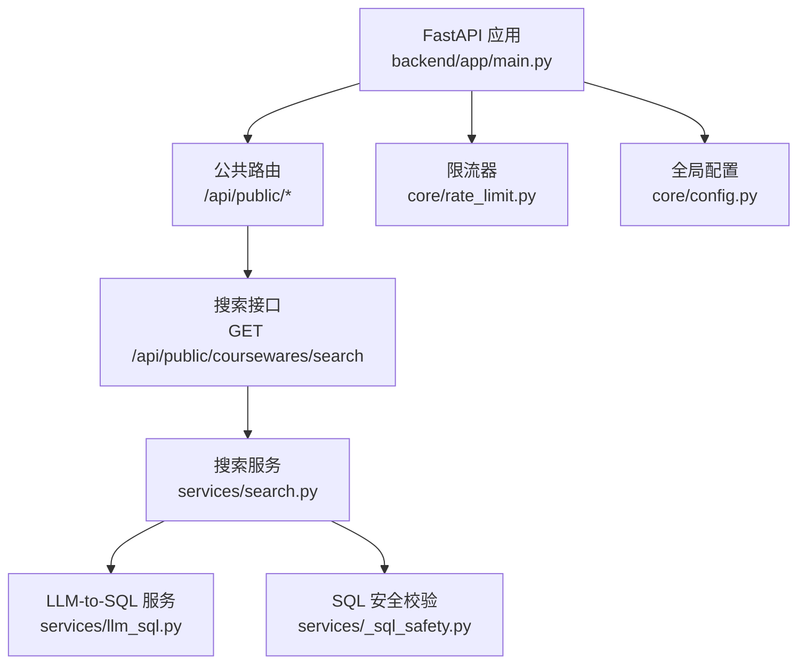
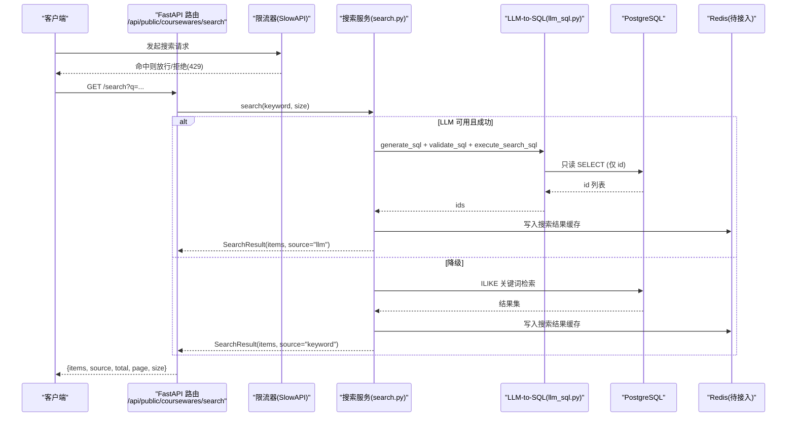
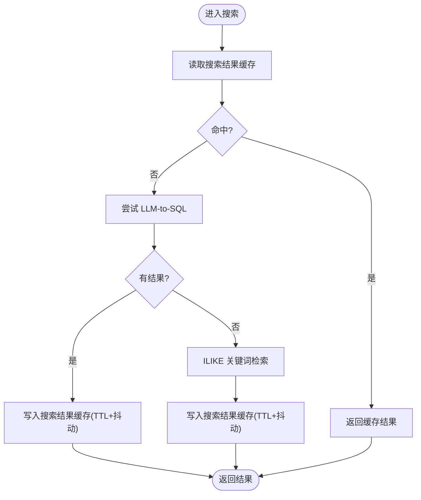
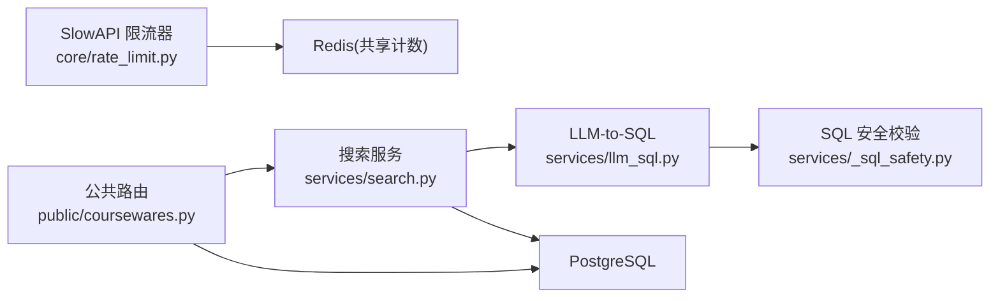

# 缓存策略设计

<cite>
**本文引用的文件**   
- [backend/app/main.py](file://backend/app/main.py)
- [backend/app/core/config.py](file://backend/app/core/config.py)
- [backend/app/core/rate_limit.py](file://backend/app/core/rate_limit.py)
- [backend/app/api/public/coursewares.py](file://backend/app/api/public/coursewares.py)
- [backend/app/services/search.py](file://backend/app/services/search.py)
- [backend/app/services/llm_sql.py](file://backend/app/services/llm_sql.py)
- [backend/app/services/_sql_safety.py](file://backend/app/services/_sql_safety.py)
- [backend/app/services/courseware.py](file://backend/app/services/courseware.py)
- [doc/spec/07-技术架构.md](file://doc/spec/07-技术架构.md)
- [doc/spec/10-API设计规范.md](file://doc/spec/10-API设计规范.md)
- [doc/spec/06-非功能需求.md](file://doc/spec/06-非功能需求.md)
</cite>

## 目录
1. [引言](#引言)
2. [项目结构](#项目结构)
3. [核心组件](#核心组件)
4. [架构总览](#架构总览)
5. [详细组件分析](#详细组件分析)
6. [依赖分析](#依赖分析)
7. [性能考虑](#性能考虑)
8. [故障排查指南](#故障排查指南)
9. [结论](#结论)
10. [附录](#附录)

## 引言
本设计文档面向 Learning Hub 的 Redis 缓存体系，目标是：
- 明确缓存层级结构与键空间规范
- 定义搜索结果、课件元数据、用户会话三类缓存方案
- 给出缓存穿透、雪崩、击穿的防护策略
- 制定预热、一致性、监控与调优实践
- 提供可落地的使用示例与最佳实践

当前代码库已具备限流（SlowAPI）与 LLM-to-SQL 搜索流程，并预留了 Redis 作为共享计数后端。本文在此基础上扩展为完整的缓存策略。

## 项目结构
从现有实现看，系统由 FastAPI 应用入口、公共 API、服务层与配置组成；限流模块支持通过环境变量切换至 Redis 存储。

图示来源
- [backend/app/main.py:40-112](file://backend/app/main.py#L40-L112)
- [backend/app/api/public/coursewares.py:32-54](file://backend/app/api/public/coursewares.py#L32-L54)
- [backend/app/services/search.py:210-242](file://backend/app/services/search.py#L210-L242)
- [backend/app/services/llm_sql.py:443-478](file://backend/app/services/llm_sql.py#L443-L478)
- [backend/app/services/_sql_safety.py:67-88](file://backend/app/services/_sql_safety.py#L67-L88)
- [backend/app/core/rate_limit.py:40-51](file://backend/app/core/rate_limit.py#L40-L51)
- [backend/app/core/config.py:62-64](file://backend/app/core/config.py#L62-L64)

章节来源
- [backend/app/main.py:40-112](file://backend/app/main.py#L40-L112)
- [backend/app/core/config.py:62-64](file://backend/app/core/config.py#L62-L64)
- [backend/app/core/rate_limit.py:40-51](file://backend/app/core/rate_limit.py#L40-L51)
- [backend/app/api/public/coursewares.py:32-54](file://backend/app/api/public/coursewares.py#L32-L54)
- [backend/app/services/search.py:210-242](file://backend/app/services/search.py#L210-L242)
- [backend/app/services/llm_sql.py:443-478](file://backend/app/services/llm_sql.py#L443-L478)
- [backend/app/services/_sql_safety.py:67-88](file://backend/app/services/_sql_safety.py#L67-L88)

## 核心组件
- 应用装配与中间件：统一请求 ID、CORS、异常处理、路由注册
- 限流器：基于 SlowAPI，支持按 IP/会话维度限流，存储后端可切换至 Redis
- 搜索服务：LLM-to-SQL 优先 + ILIKE 兜底，返回 source 标识
- LLM-to-SQL：生成 SQL → 白名单校验 → 只读事务执行 → 取 id 列表
- 配置中心：集中读取环境变量，包含 Redis URL 等开关项

章节来源
- [backend/app/main.py:40-112](file://backend/app/main.py#L40-L112)
- [backend/app/core/rate_limit.py:18-51](file://backend/app/core/rate_limit.py#L18-L51)
- [backend/app/services/search.py:115-242](file://backend/app/services/search.py#L115-L242)
- [backend/app/services/llm_sql.py:267-478](file://backend/app/services/llm_sql.py#L267-L478)
- [backend/app/core/config.py:62-64](file://backend/app/core/config.py#L62-L64)

## 架构总览
下图展示“请求→限流→搜索→数据库”的主路径，以及未来引入的 Redis 缓存层位置。

图示来源
- [backend/app/api/public/coursewares.py:32-54](file://backend/app/api/public/coursewares.py#L32-L54)
- [backend/app/services/search.py:210-242](file://backend/app/services/search.py#L210-L242)
- [backend/app/services/llm_sql.py:443-478](file://backend/app/services/llm_sql.py#L443-L478)
- [backend/app/core/rate_limit.py:40-51](file://backend/app/core/rate_limit.py#L40-L51)

## 详细组件分析

### 一、Redis 缓存架构与键空间设计
- 目标
  - 降低热点查询对 DB 的压力
  - 提升搜索与详情接口的 P95 时延
  - 支撑多 worker 分布式部署下的共享状态
- 分层
  - 本地进程内缓存：用于极短 TTL 或进程级小表提示词（如 LLM 词汇提示），避免跨进程一致性问题
  - 分布式缓存（Redis）：搜索结果、课件元数据、访问令牌解锁态与会话计数等
- 命名规范
  - 前缀：lh:<环境>:<域>:<子域>:<主键>
  - 示例
    - 搜索结果：lh:prod:search:q:{md5(q)}:p:{page}:s:{size}
    - 课件详情：lh:prod:courseware:item:{id}
    - 解锁态：lh:prod:unlock:hash:{token_hash}
    - 会话计数：lh:prod:rate:ip:{ip} / lh:prod:rate:sess:{sub_or_ip}
- 过期策略
  - 搜索结果：TTL 30~120s（可按 QPS 动态调整）
  - 课件详情：TTL 60~300s（写后主动失效）
  - 解锁态：TTL 7 天（与 Cookie 保持一致）
  - 计数类：TTL 与限流窗口一致
- 序列化
  - JSON 字符串，字段采用 snake_case，避免大对象，必要时压缩

章节来源
- [backend/app/core/config.py:62-64](file://backend/app/core/config.py#L62-L64)
- [backend/app/api/public/coursewares.py:116-130](file://backend/app/api/public/coursewares.py#L116-L130)

### 二、搜索结果缓存
- 适用场景
  - 前台搜索 GET /api/public/coursewares/search
  - 相同 q/page/size 组合在短时间内的重复请求
- 缓存键
  - lh:prod:search:q:{md5(q)}:p:{page}:s:{size}
- 写入时机
  - LLM 路径与 ILIKE 路径均写入
- 失效策略
  - 后台管理新增/修改课件后，按页范围批量失效（见“一致性保证”）
- 保护机制
  - 穿透：空结果也缓存短 TTL（如 10s），防止恶意穷举
  - 击穿：热点 key 加互斥锁（单实例用线程锁，分布式用 SETNX）
  - 雪崩：TTL 加入随机抖动（±20%）

图示来源
- [backend/app/services/search.py:210-242](file://backend/app/services/search.py#L210-L242)
- [backend/app/api/public/coursewares.py:32-54](file://backend/app/api/public/coursewares.py#L32-L54)

章节来源
- [backend/app/services/search.py:115-242](file://backend/app/services/search.py#L115-L242)
- [backend/app/api/public/coursewares.py:32-54](file://backend/app/api/public/coursewares.py#L32-L54)

### 三、课件元数据缓存
- 适用场景
  - 前台详情 GET /api/public/coursewares/{id}
  - 后台列表/详情频繁读取
- 缓存键
  - lh:prod:courseware:item:{id}
- 写入时机
  - 创建/更新/删除后主动失效对应 key
- 失效策略
  - 写后失效（Write-Invalidation）
  - 定时刷新（可选）：TTL 到期自动重建
- 保护机制
  - 穿透：不存在也缓存短 TTL（如 10s）
  - 击穿：热点课件加互斥锁重建
  - 雪崩：TTL 随机抖动

章节来源
- [backend/app/services/courseware.py:290-332](file://backend/app/services/courseware.py#L290-L332)
- [backend/app/api/public/coursewares.py:57-76](file://backend/app/api/public/coursewares.py#L57-L76)

### 四、用户会话与解锁态缓存
- 解锁态
  - 将 token_hash 与允许访问的 courseware_ids 集合缓存，TTL 7 天，减少每次解锁后的关联查询
  - 键：lh:prod:unlock:hash:{token_hash}
- 会话计数
  - 结合限流器，使用 Redis 做共享计数（SlowAPI storage_uri）
  - 键：lh:prod:rate:ip:{ip} / lh:prod:rate:sess:{sub_or_ip}
- 失效策略
  - 解锁态随 Cookie 生命周期自然过期
  - 会话计数按限流窗口过期

章节来源
- [backend/app/api/public/coursewares.py:116-130](file://backend/app/api/public/coursewares.py#L116-L130)
- [backend/app/core/rate_limit.py:40-51](file://backend/app/core/rate_limit.py#L40-L51)

### 五、缓存穿透、雪崩、击穿防护
- 穿透
  - 空结果短 TTL 缓存
  - 参数合法性校验前置（如 q 长度限制）
- 击穿
  - 热点 key 加分布式锁（SETNX）或本地锁（单实例）
  - 首次重建完成后释放锁
- 雪崩
  - TTL 随机抖动
  - 热点 key 单独设置较长 TTL
  - 限流与熔断配合

章节来源
- [backend/app/api/public/coursewares.py:32-54](file://backend/app/api/public/coursewares.py#L32-L54)
- [backend/app/core/rate_limit.py:40-51](file://backend/app/core/rate_limit.py#L40-L51)

### 六、缓存预热策略
- 启动预热
  - 热门课件详情、首页推荐、高频搜索词预加载
- 事件驱动预热
  - 后台发布/置顶课件后，主动预热相关详情页与搜索聚合页
- 定时预热
  - 每日定时构建次日热门内容缓存

[本节为概念性说明，不直接分析具体文件]

### 七、分布式缓存一致性保证
- 写后失效
  - 课件增删改后，失效对应 item key 与可能受影响的搜索结果页
- 版本化键
  - 在键中附加版本号或更新时间戳，避免脏读
- 最终一致性
  - 对于强一致要求低的场景，接受短暂不一致（TTL 控制）

章节来源
- [backend/app/services/courseware.py:105-167](file://backend/app/services/courseware.py#L105-L167)
- [backend/app/services/courseware.py:170-278](file://backend/app/services/courseware.py#L170-L278)
- [backend/app/services/courseware.py:281-286](file://backend/app/services/courseware.py#L281-L286)

### 八、缓存监控与性能调优
- 指标
  - 命中率、延迟分布、错误率、内存占用、连接池状态
- 告警
  - 命中率低于阈值、P95 延迟升高、连接失败率上升
- 调优
  - 合理设置 TTL 与抖动
  - 热点 key 独立策略
  - 序列化体积控制与压缩
  - 网络超时与重试策略

章节来源
- [doc/spec/06-非功能需求.md:125-136](file://doc/spec/06-非功能需求.md#L125-L136)

### 九、具体使用示例与最佳实践
- 示例：搜索结果缓存
  - 键：lh:prod:search:q:{md5(q)}:p:{page}:s:{size}
  - TTL：60s ± 20% 抖动
  - 写入：LLM 与 ILIKE 路径均写入
- 示例：课件详情缓存
  - 键：lh:prod:courseware:item:{id}
  - TTL：120s ± 20% 抖动
  - 失效：写后失效
- 示例：解锁态缓存
  - 键：lh:prod:unlock:hash:{token_hash}
  - TTL：7 天
- 最佳实践
  - 统一键前缀与命名规范
  - 所有缓存操作记录结构化日志（含 requestId）
  - 对关键路径增加埋点与指标上报

章节来源
- [backend/app/api/public/coursewares.py:116-130](file://backend/app/api/public/coursewares.py#L116-L130)
- [backend/app/main.py:70-76](file://backend/app/main.py#L70-L76)

## 依赖分析
- 外部依赖
  - Redis：限流共享计数（SlowAPI storage_uri）、通用缓存
  - PostgreSQL：主数据源
- 内部依赖
  - 搜索服务依赖 LLM-to-SQL 与安全校验
  - 路由层依赖限流器与服务层

图示来源
- [backend/app/core/rate_limit.py:40-51](file://backend/app/core/rate_limit.py#L40-L51)
- [backend/app/api/public/coursewares.py:32-54](file://backend/app/api/public/coursewares.py#L32-L54)
- [backend/app/services/search.py:210-242](file://backend/app/services/search.py#L210-L242)
- [backend/app/services/llm_sql.py:443-478](file://backend/app/services/llm_sql.py#L443-L478)
- [backend/app/services/_sql_safety.py:67-88](file://backend/app/services/_sql_safety.py#L67-L88)

章节来源
- [backend/app/core/rate_limit.py:40-51](file://backend/app/core/rate_limit.py#L40-L51)
- [backend/app/api/public/coursewares.py:32-54](file://backend/app/api/public/coursewares.py#L32-L54)
- [backend/app/services/search.py:210-242](file://backend/app/services/search.py#L210-L242)
- [backend/app/services/llm_sql.py:443-478](file://backend/app/services/llm_sql.py#L443-L478)
- [backend/app/services/_sql_safety.py:67-88](file://backend/app/services/_sql_safety.py#L67-L88)

## 性能考虑
- 搜索接口 P95 ≤ 2s（含 LLM 调用与降级）
- 数据库单条查询 P95 ≤ 50ms
- LLM 调用 P95 ≤ 1.5s，超时率 ≤ 5%
- 建议
  - 对热点搜索词与课件详情启用缓存
  - 对 LLM 路径增加超时与熔断
  - 对 ILIKE 路径优化索引与分页

章节来源
- [doc/spec/06-非功能需求.md:125-136](file://doc/spec/06-非功能需求.md#L125-L136)

## 故障排查指南
- 常见问题
  - 限流误伤：检查 SlowAPI key 函数与 Redis 连接
  - 缓存未命中：核对键名、TTL 与失效时机
  - 搜索结果不一致：确认写后失效是否覆盖受影响页面
- 定位手段
  - 利用 X-Request-Id 追踪全链路日志
  - 查看 Redis 命中率与延迟指标
  - 对比 LLM 与 ILIKE 路径耗时

章节来源
- [backend/app/main.py:70-76](file://backend/app/main.py#L70-L76)
- [backend/app/core/rate_limit.py:40-51](file://backend/app/core/rate_limit.py#L40-L51)

## 结论
通过在搜索与详情路径引入 Redis 缓存，并结合限流、降级与一致性策略，Learning Hub 可在高并发下保持稳定与低延迟。后续应完善监控与自动化预热，持续优化 TTL 与键空间设计。

## 附录
- 参考规范
  - 技术架构与存储选型（含 Redis 作为限流后端）
  - API 设计规范（限流策略、幂等约定、字段风格）
  - 非功能需求（性能基线与指标）

章节来源
- [doc/spec/07-技术架构.md:62-69](file://doc/spec/07-技术架构.md#L62-L69)
- [doc/spec/10-API设计规范.md:109-122](file://doc/spec/10-API设计规范.md#L109-L122)
- [doc/spec/06-非功能需求.md:125-136](file://doc/spec/06-非功能需求.md#L125-L136)