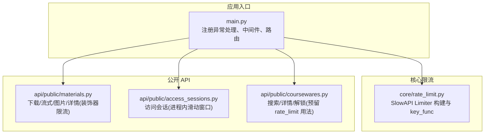
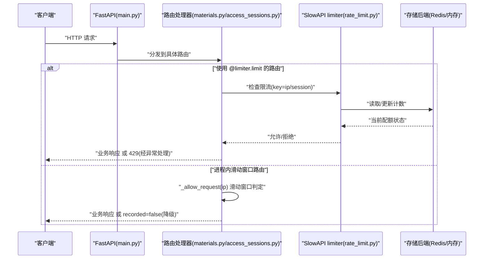
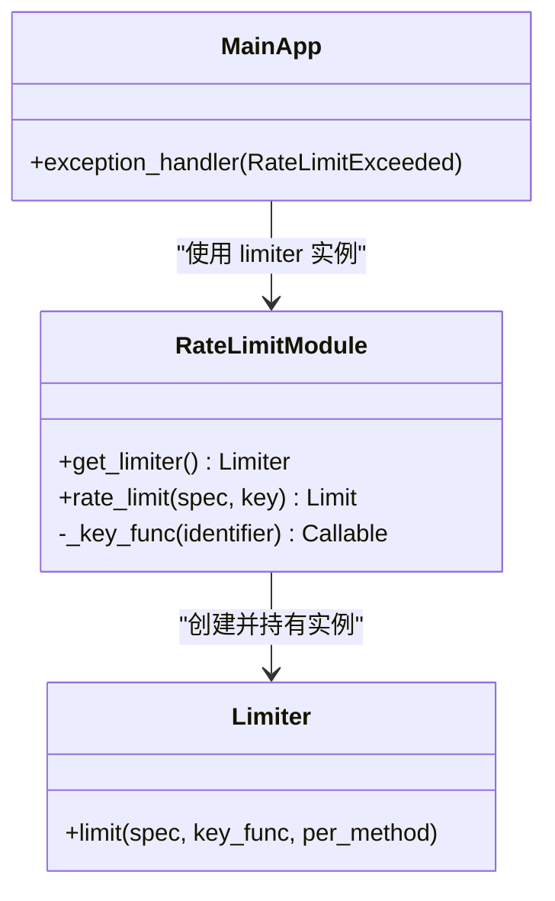
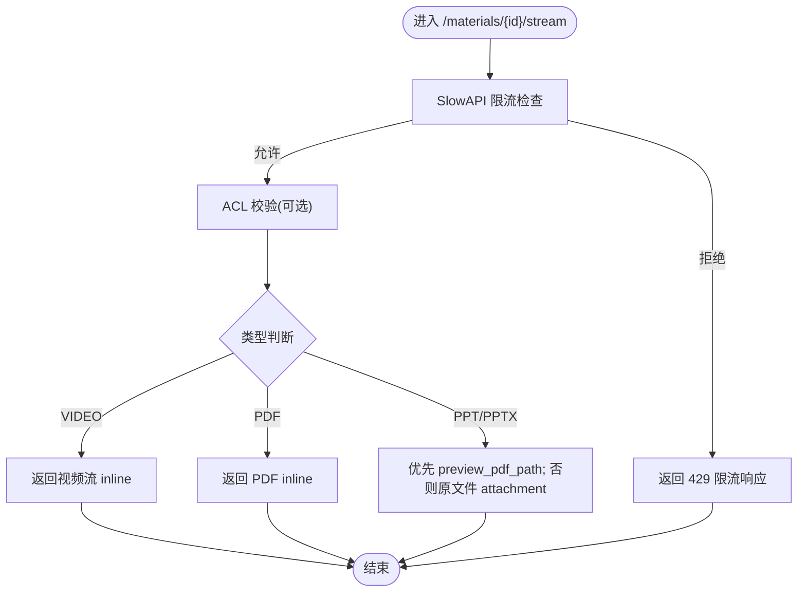
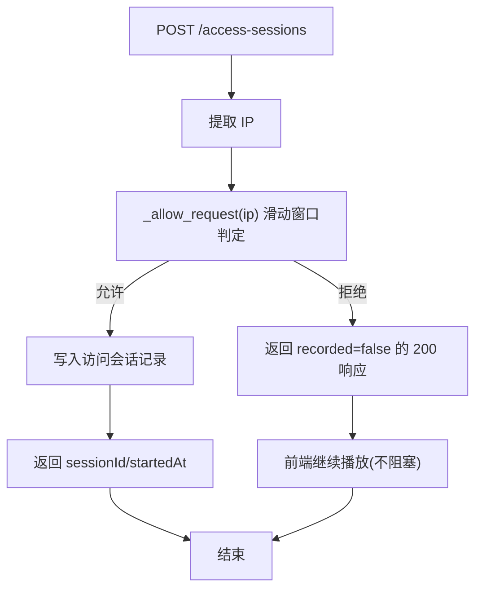
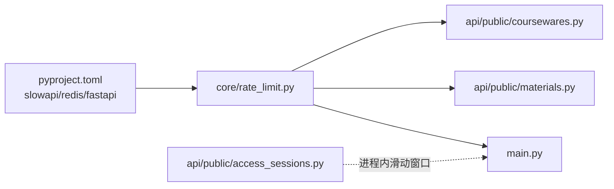

# 限流与并发控制

<cite>
**本文引用的文件列表**
- [backend/app/core/rate_limit.py](file://backend/app/core/rate_limit.py)
- [backend/app/main.py](file://backend/app/main.py)
- [backend/app/api/public/materials.py](file://backend/app/api/public/materials.py)
- [backend/app/api/public/access_sessions.py](file://backend/app/api/public/access_sessions.py)
- [backend/app/api/public/coursewares.py](file://backend/app/api/public/coursewares.py)
- [backend/pyproject.toml](file://backend/pyproject.toml)
- [doc/spec/10-API设计规范.md](file://doc/spec/10-API设计规范.md)
- [deploy/local/tests/test_stream.py](file://deploy/local/tests/test_stream.py)
- [backend/tests/test_access_session.py](file://backend/tests/test_access_session.py)
</cite>

## 目录
1. [简介](#简介)
2. [项目结构](#项目结构)
3. [核心组件](#核心组件)
4. [架构总览](#架构总览)
5. [详细组件分析](#详细组件分析)
6. [依赖关系分析](#依赖关系分析)
7. [性能考虑](#性能考虑)
8. [故障排查指南](#故障排查指南)
9. [结论](#结论)
10. [附录](#附录)

## 简介
本文件面向 Learning Hub 后端的限流与并发控制，系统性说明 SlowAPI 的集成方式、不同维度的限流策略（IP、令牌、会话）、差异化接口限流配置（搜索、下载、预览等）、算法选择与动态调整思路、监控指标与告警建议、高并发场景下的性能考量，以及配置示例与排障指引。文档同时覆盖已落地的实现细节与测试用例，确保读者既能理解整体设计，也能落地执行。

## 项目结构
后端采用 FastAPI + SlowAPI 组合，限流能力集中在 core 层，通过装饰器或依赖注入在路由上启用；部分对稳定性要求更高的接口使用进程内滑动窗口兜底限流，避免框架兼容性问题。

图表来源
- [backend/app/main.py:40-112](file://backend/app/main.py#L40-L112)
- [backend/app/core/rate_limit.py:40-54](file://backend/app/core/rate_limit.py#L40-L54)
- [backend/app/api/public/materials.py:84-86](file://backend/app/api/public/materials.py#L84-L86)
- [backend/app/api/public/access_sessions.py:29-54](file://backend/app/api/public/access_sessions.py#L29-L54)
- [backend/app/api/public/coursewares.py:19-21](file://backend/app/api/public/coursewares.py#L19-L21)

章节来源
- [backend/app/main.py:40-112](file://backend/app/main.py#L40-L112)
- [backend/app/core/rate_limit.py:40-54](file://backend/app/core/rate_limit.py#L40-L54)
- [backend/app/api/public/materials.py:84-86](file://backend/app/api/public/materials.py#L84-L86)
- [backend/app/api/public/access_sessions.py:29-54](file://backend/app/api/public/access_sessions.py#L29-L54)
- [backend/app/api/public/coursewares.py:19-21](file://backend/app/api/public/coursewares.py#L19-L21)

## 核心组件
- SlowAPI 限流器：提供基于 IP、会话（Token）的多维度 key 解析，支持内存与 Redis 存储后端切换。
- 全局异常处理：将 SlowAPI 抛出的限流异常统一转换为 429 响应体，包含 requestId。
- 进程内滑动窗口限流：针对特定接口，为避免框架兼容问题，采用本地队列实现的滑动窗口限流，作为兜底保障。

章节来源
- [backend/app/core/rate_limit.py:1-54](file://backend/app/core/rate_limit.py#L1-L54)
- [backend/app/main.py:83-89](file://backend/app/main.py#L83-L89)
- [backend/app/api/public/access_sessions.py:29-54](file://backend/app/api/public/access_sessions.py#L29-L54)

## 架构总览
下图展示请求从进入应用到触发限流、返回响应的关键路径，包括 SlowAPI 与进程内滑动窗口的两条分支。

图表来源
- [backend/app/main.py:83-89](file://backend/app/main.py#L83-L89)
- [backend/app/core/rate_limit.py:40-54](file://backend/app/core/rate_limit.py#L40-L54)
- [backend/app/api/public/materials.py:84-86](file://backend/app/api/public/materials.py#L84-L86)
- [backend/app/api/public/access_sessions.py:42-54](file://backend/app/api/public/access_sessions.py#L42-L54)

## 详细组件分析

### SlowAPI 限流器与 Key 函数
- 存储后端：优先使用 Redis（通过配置项），否则回退到内存模式，便于多 worker 共享计数。
- Key 构造：
  - IP 维度：以远端地址为键，适用于匿名访问与通用接口。
  - 会话维度：尝试从 Authorization Bearer Token 中解析子串作为会话标识，失败则回退到 IP。
- 装饰器封装：提供统一的 rate_limit(spec, key="ip") 包装，简化路由级限流声明。

图表来源
- [backend/app/core/rate_limit.py:18-54](file://backend/app/core/rate_limit.py#L18-L54)
- [backend/app/main.py:83-89](file://backend/app/main.py#L83-L89)

章节来源
- [backend/app/core/rate_limit.py:1-54](file://backend/app/core/rate_limit.py#L1-L54)
- [backend/app/main.py:83-89](file://backend/app/main.py#L83-L89)

### 公开素材接口限流（下载/流式/图片/详情）
- 流式预览 /image/{page} /{material_id}/stream：使用 SlowAPI 装饰器限流，阈值按分钟计。
- 单条查询 /{material_id}：同样受限流保护。
- 下载 /{material_id}/file：未加装饰器，不受该模块限流约束（可按需扩展）。

图表来源
- [backend/app/api/public/materials.py:84-146](file://backend/app/api/public/materials.py#L84-L146)
- [backend/app/api/public/materials.py:149-180](file://backend/app/api/public/materials.py#L149-L180)
- [backend/app/api/public/materials.py:183-221](file://backend/app/api/public/materials.py#L183-L221)

章节来源
- [backend/app/api/public/materials.py:84-86](file://backend/app/api/public/materials.py#L84-L86)
- [backend/app/api/public/materials.py:149-151](file://backend/app/api/public/materials.py#L149-L151)
- [backend/app/api/public/materials.py:183-185](file://backend/app/api/public/materials.py#L183-L185)

### 访问会话接口限流（进程内滑动窗口）
- 目的：避免因 SlowAPI 装饰器与 Pydantic body 路由的兼容性问题导致签名解析异常。
- 机制：进程内维护每个 IP 的时间戳队列，窗口大小固定，超过阈值则降级为不记录（recorded=false），但不阻塞主流程。
- 适用场景：前台访问会话开始/结束等高频写入接口，保证可用性优先。

图表来源
- [backend/app/api/public/access_sessions.py:42-54](file://backend/app/api/public/access_sessions.py#L42-L54)
- [backend/app/api/public/access_sessions.py:65-106](file://backend/app/api/public/access_sessions.py#L65-L106)

章节来源
- [backend/app/api/public/access_sessions.py:29-54](file://backend/app/api/public/access_sessions.py#L29-L54)
- [backend/app/api/public/access_sessions.py:65-106](file://backend/app/api/public/access_sessions.py#L65-L106)
- [backend/tests/test_access_session.py:566-599](file://backend/tests/test_access_session.py#L566-L599)

### 搜索与课件接口限流策略
- 规范定义：前台 AI 搜索按 IP 限制，课件详情按 IP 限制，后台写接口按会话限制，上传按会话限制等。
- 代码现状：coursewares.py 中提供了 rate_limit 的用法注释，表明可通过 Depends(rate_limit(...)) 的方式接入；当前 search 接口未显式装饰，可按需补充。

章节来源
- [doc/spec/10-API设计规范.md:109-122](file://doc/spec/10-API设计规范.md#L109-L122)
- [backend/app/api/public/coursewares.py:19-21](file://backend/app/api/public/coursewares.py#L19-L21)

## 依赖关系分析
- 运行时依赖：slowapi、redis 作为可选存储后端；FastAPI 作为 Web 框架。
- 模块耦合：
  - main.py 引入 limiter 实例并注册异常处理器。
  - materials.py 直接引用 limiter 进行装饰器限流。
  - access_sessions.py 独立实现进程内滑动窗口，降低对外部限流框架的强依赖。
  - coursewares.py 暴露 rate_limit 的依赖注入用法，便于后续扩展。

图表来源
- [backend/pyproject.toml:20-21](file://backend/pyproject.toml#L20-L21)
- [backend/app/core/rate_limit.py:40-54](file://backend/app/core/rate_limit.py#L40-L54)
- [backend/app/main.py:83-89](file://backend/app/main.py#L83-L89)
- [backend/app/api/public/materials.py:84-86](file://backend/app/api/public/materials.py#L84-L86)
- [backend/app/api/public/access_sessions.py:29-54](file://backend/app/api/public/access_sessions.py#L29-L54)
- [backend/app/api/public/coursewares.py:19-21](file://backend/app/api/public/coursewares.py#L19-L21)

章节来源
- [backend/pyproject.toml:20-21](file://backend/pyproject.toml#L20-L21)
- [backend/app/core/rate_limit.py:40-54](file://backend/app/core/rate_limit.py#L40-L54)
- [backend/app/main.py:83-89](file://backend/app/main.py#L83-L89)
- [backend/app/api/public/materials.py:84-86](file://backend/app/api/public/materials.py#L84-L86)
- [backend/app/api/public/access_sessions.py:29-54](file://backend/app/api/public/access_sessions.py#L29-L54)
- [backend/app/api/public/coursewares.py:19-21](file://backend/app/api/public/coursewares.py#L19-L21)

## 性能考虑
- 存储后端选择：
  - 生产环境建议使用 Redis 作为 SlowAPI 存储后端，确保多 worker 共享计数与一致性。
  - 开发环境可使用内存模式，减少外部依赖。
- 算法特性：
  - SlowAPI 默认基于固定窗口计数，适合大多数场景；如需更平滑的限流效果，可在网关层引入令牌桶或滑动窗口策略。
  - 进程内滑动窗口用于关键路径兜底，避免框架兼容问题导致的不可用。
- 资源占用：
  - 滑动窗口使用内存队列，注意清理过期时间戳，避免内存增长。
  - Redis 连接池与超时参数需合理配置，避免成为瓶颈。
- 可观测性：
  - 建议在网关或应用层采集 429 比率、各接口 QPS、P95 耗时等指标，结合告警规则进行容量规划。

[本节为通用指导，无需列出具体文件来源]

## 故障排查指南
- 现象：大量 429 响应
  - 检查对应路由是否启用了限流装饰器或依赖注入。
  - 确认 key_func 是否正确区分 IP/会话维度。
  - 若使用 Redis，检查连接与读写是否正常。
- 现象：访问会话接口频繁 recorded=false
  - 确认进程内滑动窗口阈值与窗口时长是否符合预期。
  - 观察同一 IP 的请求频率是否超过阈值。
- 现象：装饰器与 Pydantic body 路由冲突
  - 参考访问会话接口的实现，改用进程内滑动窗口兜底。
- 验证方法：
  - 使用测试用例模拟突发流量，验证限流生效与降级行为。

章节来源
- [backend/app/main.py:83-89](file://backend/app/main.py#L83-L89)
- [backend/app/api/public/access_sessions.py:29-54](file://backend/app/api/public/access_sessions.py#L29-L54)
- [deploy/local/tests/test_stream.py:147-165](file://deploy/local/tests/test_stream.py#L147-L165)
- [backend/tests/test_access_session.py:566-599](file://backend/tests/test_access_session.py#L566-L599)

## 结论
Learning Hub 在后端实现了基于 SlowAPI 的限流体系，并通过进程内滑动窗口对关键接口进行兜底保护。通过 IP、会话等多维度 key 构造，满足不同接口的差异化限流需求。配合 Redis 存储后端可实现多 worker 一致计数，满足高并发场景。建议在生产环境中完善限流指标采集与告警，持续优化阈值与算法策略。

[本节为总结性内容，无需列出具体文件来源]

## 附录

### 限流策略速查表（来自规范）
- 前台 AI 搜索（按 IP）：30 req/分钟
- 前台课件解锁（按 IP + Token 哈希）：10 req/分钟
- 前台课件详情（按 IP）：120 req/分钟
- 后台通用写接口（按会话）：60 req/分钟
- 素材上传（按会话）：10 req/小时

章节来源
- [doc/spec/10-API设计规范.md:109-122](file://doc/spec/10-API设计规范.md#L109-L122)

### 限流配置示例（路径参考）
- SlowAPI 初始化与存储后端切换：参见 [backend/app/core/rate_limit.py:40-46](file://backend/app/core/rate_limit.py#L40-L46)
- 装饰器限流用法（素材流式/图片/详情）：参见 [backend/app/api/public/materials.py:84-86](file://backend/app/api/public/materials.py#L84-L86)、[backend/app/api/public/materials.py:149-151](file://backend/app/api/public/materials.py#L149-L151)、[backend/app/api/public/materials.py:183-185](file://backend/app/api/public/materials.py#L183-L185)
- 依赖注入限流用法（课程搜索预留）：参见 [backend/app/api/public/coursewares.py:19-21](file://backend/app/api/public/coursewares.py#L19-L21)
- 进程内滑动窗口限流（访问会话）：参见 [backend/app/api/public/access_sessions.py:42-54](file://backend/app/api/public/access_sessions.py#L42-L54)

### 监控与告警建议
- 指标建议：
  - 429 比率（按接口维度）
  - 各接口 QPS、P95 耗时
  - Redis 连接与读写延迟
- 告警阈值：
  - 429 比率突增（如 > 1%）
  - P95 耗时超基线（如搜索接口 > 2s）
  - Redis 错误率或延迟异常

[本节为通用指导，无需列出具体文件来源]