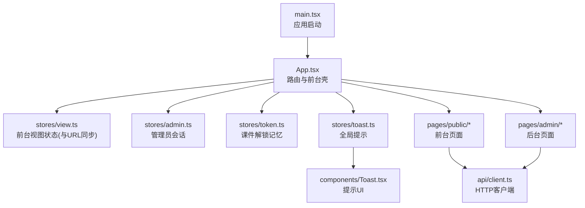
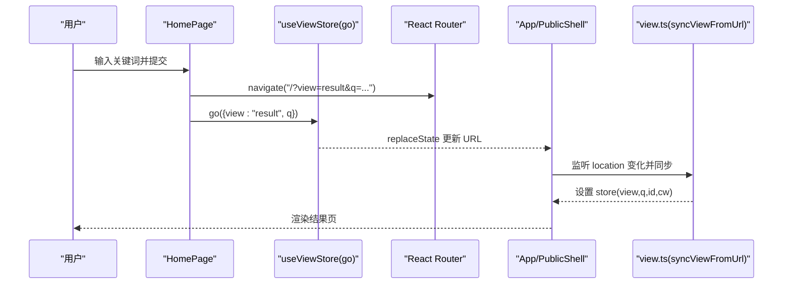
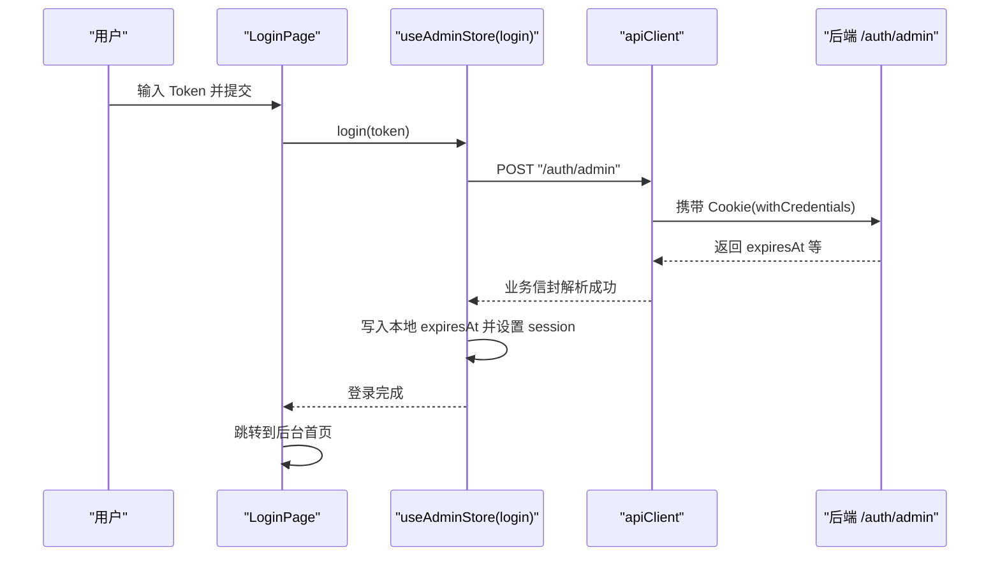
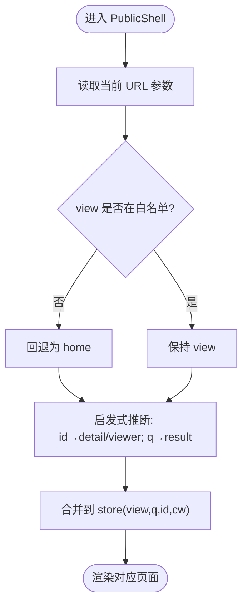
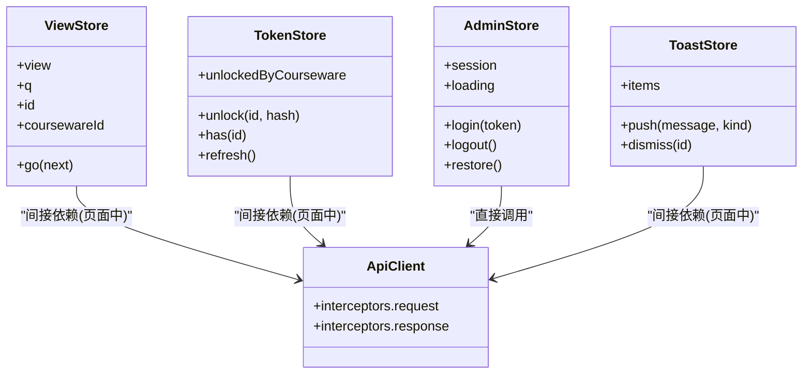
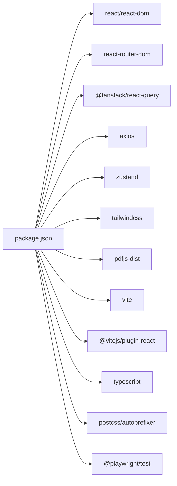

# 前端技术栈

<cite>
**本文引用的文件**   
- [frontend/package.json](file://frontend/package.json)
- [frontend/vite.config.ts](file://frontend/vite.config.ts)
- [frontend/tsconfig.json](file://frontend/tsconfig.json)
- [frontend/tailwind.config.js](file://frontend/tailwind.config.js)
- [frontend/postcss.config.js](file://frontend/postcss.config.js)
- [frontend/playwright.config.ts](file://frontend/playwright.config.ts)
- [frontend/src/main.tsx](file://frontend/src/main.tsx)
- [frontend/src/App.tsx](file://frontend/src/App.tsx)
- [frontend/src/stores/view.ts](file://frontend/src/stores/view.ts)
- [frontend/src/stores/token.ts](file://frontend/src/stores/token.ts)
- [frontend/src/stores/admin.ts](file://frontend/src/stores/admin.ts)
- [frontend/src/stores/toast.ts](file://frontend/src/stores/toast.ts)
- [frontend/src/components/Toast.tsx](file://frontend/src/components/Toast.tsx)
- [frontend/src/pages/public/Home.tsx](file://frontend/src/pages/public/Home.tsx)
- [frontend/src/pages/admin/Login.tsx](file://frontend/src/pages/admin/Login.tsx)
- [frontend/src/api/client.ts](file://frontend/src/api/client.ts)
</cite>

## 目录
1. [简介](#简介)
2. [项目结构](#项目结构)
3. [核心组件](#核心组件)
4. [架构总览](#架构总览)
5. [详细组件分析](#详细组件分析)
6. [依赖分析](#依赖分析)
7. [性能考虑](#性能考虑)
8. [故障排查指南](#故障排查指南)
9. [结论](#结论)
10. [附录](#附录)

## 简介
本文件面向 Learning Hub 前端，系统性梳理并解释技术选型与工程化实践：React 18、TypeScript、Vite、Zustand、TailwindCSS、Playwright 等。文档从“为什么选”和“怎么用”两个维度展开，结合仓库中的实际配置与源码路径，给出可落地的最佳实践、优化建议与排障要点，帮助团队在大型项目中保持一致的开发体验与质量基线。

## 项目结构
前端采用单仓多包组织，前端代码位于 frontend 目录，使用 Vite + React 18 + TypeScript 构建，样式基于 TailwindCSS，状态管理使用 Zustand，端到端测试使用 Playwright。入口由 main.tsx 初始化 React 应用与路由、数据请求客户端；App.tsx 负责前台 SPA 的视图切换与后台管理路由守卫；stores 下按领域划分轻量状态模块；pages 按前台/后台分目录组织页面；components 提供通用 UI 组件；api 封装统一 HTTP 客户端。



图表来源
- [frontend/src/main.tsx:1-26](file://frontend/src/main.tsx#L1-L26)
- [frontend/src/App.tsx:1-110](file://frontend/src/App.tsx#L1-L110)
- [frontend/src/stores/view.ts:1-127](file://frontend/src/stores/view.ts#L1-L127)
- [frontend/src/stores/admin.ts:1-71](file://frontend/src/stores/admin.ts#L1-L71)
- [frontend/src/stores/token.ts:1-54](file://frontend/src/stores/token.ts#L1-L54)
- [frontend/src/stores/toast.ts:1-30](file://frontend/src/stores/toast.ts#L1-L30)
- [frontend/src/components/Toast.tsx:1-38](file://frontend/src/components/Toast.tsx#L1-L38)
- [frontend/src/pages/public/Home.tsx:1-55](file://frontend/src/pages/public/Home.tsx#L1-L55)
- [frontend/src/pages/admin/Login.tsx:1-72](file://frontend/src/pages/admin/Login.tsx#L1-L72)
- [frontend/src/api/client.ts:1-52](file://frontend/src/api/client.ts#L1-L52)

章节来源
- [frontend/package.json:1-40](file://frontend/package.json#L1-L40)
- [frontend/src/main.tsx:1-26](file://frontend/src/main.tsx#L1-L26)
- [frontend/src/App.tsx:1-110](file://frontend/src/App.tsx#L1-L110)

## 核心组件
- 应用启动与上下文
  - React 18 根容器渲染，启用 StrictMode；集成 @tanstack/react-query 作为数据获取与缓存层；BrowserRouter 提供前端路由能力。
  - 参考路径：[frontend/src/main.tsx:1-26](file://frontend/src/main.tsx#L1-L26)
- 路由与前台壳
  - App.tsx 将前台多个视图合并到单 URL（通过 query 参数 view/q/id/cw），后台管理使用独立子路由并加登录守卫。
  - 参考路径：[frontend/src/App.tsx:1-110](file://frontend/src/App.tsx#L1-L110)
- 状态管理（Zustand）
  - view.ts：前台视图状态与 URL 双向同步，支持 go/hydrate/sync/bindPopState。
    - 参考路径：[frontend/src/stores/view.ts:1-127](file://frontend/src/stores/view.ts#L1-L127)
  - token.ts：已解锁课件 token 哈希的持久化记忆（localStorage）。
    - 参考路径：[frontend/src/stores/token.ts:1-54](file://frontend/src/stores/token.ts#L1-L54)
  - admin.ts：管理员会话（Cookie + expiresAt 本地记录），login/logout/restore。
    - 参考路径：[frontend/src/stores/admin.ts:1-71](file://frontend/src/stores/admin.ts#L1-L71)
  - toast.ts：全局消息提示队列与自动消失。
    - 参考路径：[frontend/src/stores/toast.ts:1-30](file://frontend/src/stores/toast.ts#L1-L30)
- 网络层
  - api/client.ts：Axios 实例，统一 baseURL、withCredentials、X-Request-Id、业务信封解析与错误标准化。
    - 参考路径：[frontend/src/api/client.ts:1-52](file://frontend/src/api/client.ts#L1-L52)
- 典型页面与交互
  - Home.tsx：搜索表单提交，同时更新路由与 store。
    - 参考路径：[frontend/src/pages/public/Home.tsx:1-55](file://frontend/src/pages/public/Home.tsx#L1-L55)
  - Login.tsx：管理员登录流程，调用后端认证接口并跳转。
    - 参考路径：[frontend/src/pages/admin/Login.tsx:1-72](file://frontend/src/pages/admin/Login.tsx#L1-L72)

章节来源
- [frontend/src/main.tsx:1-26](file://frontend/src/main.tsx#L1-L26)
- [frontend/src/App.tsx:1-110](file://frontend/src/App.tsx#L1-L110)
- [frontend/src/stores/view.ts:1-127](file://frontend/src/stores/view.ts#L1-L127)
- [frontend/src/stores/token.ts:1-54](file://frontend/src/stores/token.ts#L1-L54)
- [frontend/src/stores/admin.ts:1-71](file://frontend/src/stores/admin.ts#L1-L71)
- [frontend/src/stores/toast.ts:1-30](file://frontend/src/stores/toast.ts#L1-L30)
- [frontend/src/api/client.ts:1-52](file://frontend/src/api/client.ts#L1-L52)
- [frontend/src/pages/public/Home.tsx:1-55](file://frontend/src/pages/public/Home.tsx#L1-L55)
- [frontend/src/pages/admin/Login.tsx:1-72](file://frontend/src/pages/admin/Login.tsx#L1-L72)

## 架构总览
下图展示前端整体架构：浏览器发起请求，经 Vite 开发服务器代理至后端；生产环境由 Nginx 反代静态资源与 API。运行时由 React Router 控制前台单 URL 多视图与后台子路由；Zustand 管理局部与跨页状态；@tanstack/react-query 负责数据获取与缓存；axios 拦截器统一处理业务信封与错误。

```mermaid
graph TB
subgraph "浏览器"
R["React 18 + React Router"]
Z["Zustand 状态"]
Q["@tanstack/react-query"]
AX["Axios 客户端"]
end
subgraph "构建与运行"
V["Vite 开发服务器/构建产物"]
NGINX["Nginx(生产)"]
end
subgraph "后端"
API["FastAPI /api, /admin"]
end
R --> Z
R --> Q
Q --> AX
AX --> |"/api","/admin"| NGINX
NGINX --> API
V --> R
```

图表来源
- [frontend/vite.config.ts:1-39](file://frontend/vite.config.ts#L1-L39)
- [frontend/src/main.tsx:1-26](file://frontend/src/main.tsx#L1-L26)
- [frontend/src/App.tsx:1-110](file://frontend/src/App.tsx#L1-L110)
- [frontend/src/api/client.ts:1-52](file://frontend/src/api/client.ts#L1-L52)

## 详细组件分析

### 技术选型与决策
- React 18
  - 优势：并发特性、StrictMode 辅助定位问题、更好的渲染调度；配合函数式组件与 Hooks 形成一致的开发范式。
  - 在本项目中的应用：入口使用 createRoot 渲染，配合 StrictMode 提升稳定性。
  - 参考路径：[frontend/src/main.tsx:1-26](file://frontend/src/main.tsx#L1-L26)
- TypeScript
  - 重要性：在大型项目中提供强类型约束、IDE 智能提示、重构安全与契约校验；本项目开启 strict 模式、bundler 模块解析、jsx react-jsx 等，保证类型安全与构建一致性。
  - 参考路径：[frontend/tsconfig.json:1-27](file://frontend/tsconfig.json#L1-L27)
- Vite
  - 相比 Webpack 的优势：原生 ES 模块、按需预构建、更快的冷启动与热更新；本项目针对 PDF.js 大体积与 worker 进行 exclude 与 worker format 优化，避免 HMR 卡顿。
  - 参考路径：[frontend/vite.config.ts:1-39](file://frontend/vite.config.ts#L1-L39)
- Zustand
  - 与 Redux 对比：Zustand 更轻量、无样板代码、天然支持中间件与持久化扩展；适合中小型或需要快速迭代的状态场景。Redux 生态完善但样板较多，适合复杂状态流与严格时间旅行调试需求。
  - 本项目选择 Zustand 的原因：简洁直观、与 React 18 组合自然、易于拆分与测试。
  - 参考路径：[frontend/src/stores/view.ts:1-127](file://frontend/src/stores/view.ts#L1-L127), [frontend/src/stores/admin.ts:1-71](file://frontend/src/stores/admin.ts#L1-L71), [frontend/src/stores/token.ts:1-54](file://frontend/src/stores/token.ts#L1-L54), [frontend/src/stores/toast.ts:1-30](file://frontend/src/stores/toast.ts#L1-L30)
- TailwindCSS
  - 原子化 CSS 策略：以 utility-first 提升样式一致性、减少自定义 CSS 维护成本；通过 theme.extend 定义品牌色与字体族，保持设计系统可控。
  - 参考路径：[frontend/tailwind.config.js:1-21](file://frontend/tailwind.config.js#L1-L21), [frontend/postcss.config.js:1-7](file://frontend/postcss.config.js#L1-L7)
- Playwright
  - 端到端测试：基于 Chromium 的桌面 Chrome 通道执行，CI 下失败重试与截图保留，便于定位问题。
  - 参考路径：[frontend/playwright.config.ts:1-34](file://frontend/playwright.config.ts#L1-L34)

章节来源
- [frontend/tsconfig.json:1-27](file://frontend/tsconfig.json#L1-L27)
- [frontend/vite.config.ts:1-39](file://frontend/vite.config.ts#L1-L39)
- [frontend/tailwind.config.js:1-21](file://frontend/tailwind.config.js#L1-L21)
- [frontend/postcss.config.js:1-7](file://frontend/postcss.config.js#L1-L7)
- [frontend/playwright.config.ts:1-34](file://frontend/playwright.config.ts#L1-L34)
- [frontend/src/stores/view.ts:1-127](file://frontend/src/stores/view.ts#L1-L127)
- [frontend/src/stores/admin.ts:1-71](file://frontend/src/stores/admin.ts#L1-L71)
- [frontend/src/stores/token.ts:1-54](file://frontend/src/stores/token.ts#L1-L54)
- [frontend/src/stores/toast.ts:1-30](file://frontend/src/stores/toast.ts#L1-L30)

### 关键流程时序图

#### 前台搜索流程（Home -> Result）


图表来源
- [frontend/src/pages/public/Home.tsx:1-55](file://frontend/src/pages/public/Home.tsx#L1-L55)
- [frontend/src/stores/view.ts:1-127](file://frontend/src/stores/view.ts#L1-L127)
- [frontend/src/App.tsx:1-110](file://frontend/src/App.tsx#L1-L110)

#### 管理员登录流程


图表来源
- [frontend/src/pages/admin/Login.tsx:1-72](file://frontend/src/pages/admin/Login.tsx#L1-L72)
- [frontend/src/stores/admin.ts:1-71](file://frontend/src/stores/admin.ts#L1-L71)
- [frontend/src/api/client.ts:1-52](file://frontend/src/api/client.ts#L1-L52)

### 复杂逻辑流程图：前台视图与 URL 同步


图表来源
- [frontend/src/stores/view.ts:1-127](file://frontend/src/stores/view.ts#L1-L127)
- [frontend/src/App.tsx:1-110](file://frontend/src/App.tsx#L1-L110)

### 类图：状态模块关系


图表来源
- [frontend/src/stores/view.ts:1-127](file://frontend/src/stores/view.ts#L1-L127)
- [frontend/src/stores/token.ts:1-54](file://frontend/src/stores/token.ts#L1-L54)
- [frontend/src/stores/admin.ts:1-71](file://frontend/src/stores/admin.ts#L1-L71)
- [frontend/src/stores/toast.ts:1-30](file://frontend/src/stores/toast.ts#L1-L30)
- [frontend/src/api/client.ts:1-52](file://frontend/src/api/client.ts#L1-L52)

## 依赖分析
- 运行时依赖
  - React 18、react-router-dom、@tanstack/react-query、axios、zustand、tailwindcss、pdfjs-dist、dnd-kit 系列等。
- 开发依赖
  - vite、@vitejs/plugin-react、typescript、postcss、autoprefixer、eslint、@playwright/test。
- 脚本命令
  - dev/build/preview/lint/typecheck/test:e2e 等，build 阶段先 tsc -b 再 vite build，最后复制 PDF.js worker。



图表来源
- [frontend/package.json:1-40](file://frontend/package.json#L1-L40)

章节来源
- [frontend/package.json:1-40](file://frontend/package.json#L1-L40)

## 性能考虑
- 构建与打包
  - target 设置为 es2022，减少兼容 polyfill 开销；sourcemap 关闭以提升产物体积与加载速度。
  - optimizeDeps.exclude 排除 pdfjs-dist，避免其大体积与 .mjs worker 影响 HMR 与预构建。
  - worker.format 设为 es，确保 worker 以 ES 模块方式加载，提升兼容性。
  - 参考路径：[frontend/vite.config.ts:1-39](file://frontend/vite.config.ts#L1-L39)
- 样式与主题
  - Tailwind 仅扫描 index.html 与 src 下的 ts/tsx，减少无用样式生成；通过 extend 定制 primary 色系与字体族，保持设计一致性。
  - 参考路径：[frontend/tailwind.config.js:1-21](file://frontend/tailwind.config.js#L1-L21), [frontend/postcss.config.js:1-7](file://frontend/postcss.config.js#L1-L7)
- 网络与缓存
  - axios 统一 withCredentials 与 X-Request-Id，便于追踪与鉴权；业务信封解析减少上层判断分支。
  - 参考路径：[frontend/src/api/client.ts:1-52](file://frontend/src/api/client.ts#L1-L52)
- 类型检查与构建
  - typecheck 使用 tsc --noEmit，不产出 JS，仅做类型检查；build 前 tsc -b 做增量编译，缩短构建时间。
  - 参考路径：[frontend/tsconfig.json:1-27](file://frontend/tsconfig.json#L1-L27), [frontend/package.json:1-40](file://frontend/package.json#L1-L40)

章节来源
- [frontend/vite.config.ts:1-39](file://frontend/vite.config.ts#L1-L39)
- [frontend/tailwind.config.js:1-21](file://frontend/tailwind.config.js#L1-L21)
- [frontend/postcss.config.js:1-7](file://frontend/postcss.config.js#L1-L7)
- [frontend/src/api/client.ts:1-52](file://frontend/src/api/client.ts#L1-L52)
- [frontend/tsconfig.json:1-27](file://frontend/tsconfig.json#L1-L27)
- [frontend/package.json:1-40](file://frontend/package.json#L1-L40)

## 故障排查指南
- 登录失败
  - 现象：登录按钮报错或无法跳转。
  - 排查点：
    - 确认后端 /auth/admin 是否可达（开发代理 /api 与 /admin 指向 127.0.0.1:18765）。
      - 参考路径：[frontend/vite.config.ts:1-39](file://frontend/vite.config.ts#L1-L39)
    - 检查 axios 响应拦截器对业务 code 的处理与错误信息透传。
      - 参考路径：[frontend/src/api/client.ts:1-52](file://frontend/src/api/client.ts#L1-L52)
    - 查看登录页错误显示区域与 loading 状态。
      - 参考路径：[frontend/src/pages/admin/Login.tsx:1-72](file://frontend/src/pages/admin/Login.tsx#L1-L72)
- 前台视图跳转异常
  - 现象：返回首页需点击多次或回到错误页面。
  - 排查点：
    - view.ts 的 go 方法在 view===home 时重置 q/id/coursewareId，并同步 replaceState，避免 useEffect 覆盖。
      - 参考路径：[frontend/src/stores/view.ts:1-127](file://frontend/src/stores/view.ts#L1-L127)
    - PublicShell 的 useEffect 监听 location.search/pathname 变化并同步 store。
      - 参考路径：[frontend/src/App.tsx:1-110](file://frontend/src/App.tsx#L1-L110)
- 提示消息不出现或重复
  - 现象：toast 未显示或累积过多。
  - 排查点：
    - toast.ts 的 push 自动定时移除，注意 id 自增与过滤逻辑。
      - 参考路径：[frontend/src/stores/toast.ts:1-30](file://frontend/src/stores/toast.ts#L1-L30)
    - ToastViewport 渲染与 dismiss 事件绑定。
      - 参考路径：[frontend/src/components/Toast.tsx:1-38](file://frontend/src/components/Toast.tsx#L1-L38)
- E2E 测试不稳定
  - 现象：CI 偶发失败。
  - 排查点：
    - playwright.config.ts 的 retries、trace、screenshot 配置；headless 模式与超时设置。
      - 参考路径：[frontend/playwright.config.ts:1-34](file://frontend/playwright.config.ts#L1-L34)

章节来源
- [frontend/vite.config.ts:1-39](file://frontend/vite.config.ts#L1-L39)
- [frontend/src/api/client.ts:1-52](file://frontend/src/api/client.ts#L1-L52)
- [frontend/src/pages/admin/Login.tsx:1-72](file://frontend/src/pages/admin/Login.tsx#L1-L72)
- [frontend/src/stores/view.ts:1-127](file://frontend/src/stores/view.ts#L1-L127)
- [frontend/src/App.tsx:1-110](file://frontend/src/App.tsx#L1-L110)
- [frontend/src/stores/toast.ts:1-30](file://frontend/src/stores/toast.ts#L1-L30)
- [frontend/src/components/Toast.tsx:1-38](file://frontend/src/components/Toast.tsx#L1-L38)
- [frontend/playwright.config.ts:1-34](file://frontend/playwright.config.ts#L1-L34)

## 结论
Learning Hub 前端以 React 18 + TypeScript + Vite 为核心，搭配 Zustand 轻量状态管理与 TailwindCSS 原子化样式，形成高内聚、低耦合且易维护的工程体系。通过统一的 axios 客户端与 react-query 数据层，提升了网络请求的可观测性与可复用性；Playwright 保障端到端质量。建议在后续演进中持续强化类型约束、细化组件边界、完善监控与埋点，并在 CI 中引入更严格的 lint 与类型检查规则，进一步提升交付质量与团队协作效率。

## 附录

### 浏览器兼容性矩阵
- 目标平台
  - 现代桌面浏览器（Chrome/Firefox/Safari/Edge）
  - 移动端主流浏览器
- 依据
  - Vite 构建 target 设置为 es2022，TS lib 包含 ES2022/DOM/DOM.Iterable，意味着主要面向现代浏览器。
  - 参考路径：[frontend/vite.config.ts:1-39](file://frontend/vite.config.ts#L1-L39), [frontend/tsconfig.json:1-27](file://frontend/tsconfig.json#L1-L27)

### 打包优化清单
- 关闭 sourcemap（生产）
  - 参考路径：[frontend/vite.config.ts:1-39](file://frontend/vite.config.ts#L1-L39)
- 排除大体积依赖预构建（pdfjs-dist）
  - 参考路径：[frontend/vite.config.ts:1-39](file://frontend/vite.config.ts#L1-L39)
- Worker 格式设为 ES
  - 参考路径：[frontend/vite.config.ts:1-39](file://frontend/vite.config.ts#L1-L39)
- Tailwind 扫描范围限定
  - 参考路径：[frontend/tailwind.config.js:1-21](file://frontend/tailwind.config.js#L1-L21)

### 开发体验提升技巧
- 使用 tsc -b 增量编译与 typecheck 单独任务，缩短反馈周期。
  - 参考路径：[frontend/package.json:1-40](file://frontend/package.json#L1-L40), [frontend/tsconfig.json:1-27](file://frontend/tsconfig.json#L1-L27)
- 利用 Vite 别名 @ 简化导入路径。
  - 参考路径：[frontend/vite.config.ts:1-39](file://frontend/vite.config.ts#L1-L39)
- 统一错误与日志：axios 拦截器注入 X-Request-Id，便于前后端联调。
  - 参考路径：[frontend/src/api/client.ts:1-52](file://frontend/src/api/client.ts#L1-L52)

### 组件开发示例与最佳实践
- 组件职责单一：如 ToastViewport 只负责渲染与交互，状态由 zustand 管理。
  - 参考路径：[frontend/src/components/Toast.tsx:1-38](file://frontend/src/components/Toast.tsx#L1-L38), [frontend/src/stores/toast.ts:1-30](file://frontend/src/stores/toast.ts#L1-L30)
- 页面与状态解耦：Home 页面通过 useViewStore.go 与 router 共同驱动视图切换。
  - 参考路径：[frontend/src/pages/public/Home.tsx:1-55](file://frontend/src/pages/public/Home.tsx#L1-L55), [frontend/src/stores/view.ts:1-127](file://frontend/src/stores/view.ts#L1-L127)
- 状态持久化与恢复：token 与 admin 会话均提供 hydrate/restore 机制，保证刷新后状态一致。
  - 参考路径：[frontend/src/stores/token.ts:1-54](file://frontend/src/stores/token.ts#L1-L54), [frontend/src/stores/admin.ts:1-71](file://frontend/src/stores/admin.ts#L1-L71)