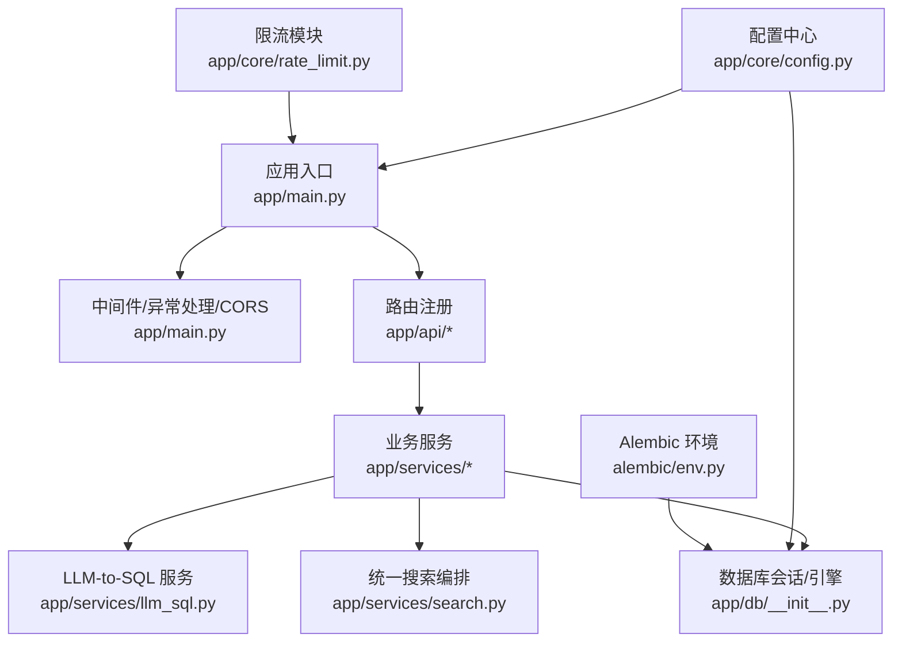
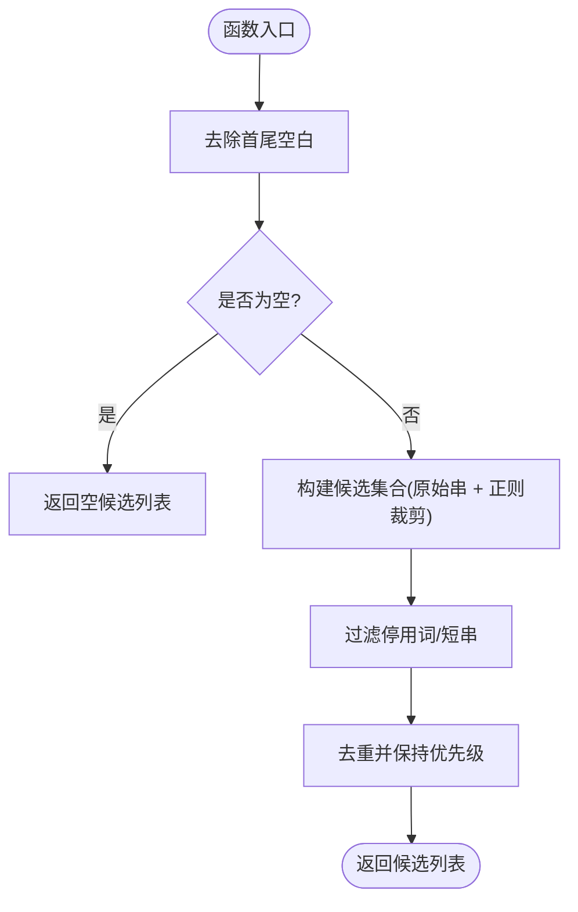

# 后端技术栈

<cite>
**本文引用的文件**   
- [backend/pyproject.toml](file://backend/pyproject.toml)
- [backend/app/main.py](file://backend/app/main.py)
- [backend/app/core/config.py](file://backend/app/core/config.py)
- [backend/app/db/__init__.py](file://backend/app/db/__init__.py)
- [backend/alembic/env.py](file://backend/alembic/env.py)
- [backend/alembic.ini](file://backend/alembic.ini)
- [backend/app/core/rate_limit.py](file://backend/app/core/rate_limit.py)
- [backend/app/services/search.py](file://backend/app/services/search.py)
- [backend/app/services/llm_sql.py](file://backend/app/services/llm_sql.py)
- [backend/Dockerfile](file://backend/Dockerfile)
- [doc/spec/07-技术架构.md](file://doc/spec/07-技术架构.md)
- [doc/spec/10-API设计规范.md](file://doc/spec/10-API设计规范.md)
- [backend/tests/test_search_llm.py](file://backend/tests/test_search_llm.py)
</cite>

## 目录
1. [简介](#简介)
2. [项目结构](#项目结构)
3. [核心组件](#核心组件)
4. [架构总览](#架构总览)
5. [详细组件分析](#详细组件分析)
6. [依赖与兼容性矩阵](#依赖与兼容性矩阵)
7. [性能考量与基准](#性能考量与基准)
8. [故障排查指南](#故障排查指南)
9. [结论](#结论)
10. [附录：最佳实践示例路径](#附录最佳实践示例路径)

## 简介
本技术栈文档聚焦 Learning Hub 后端的框架选型、异步模型、数据库与迁移、数据校验、限流与缓存、以及阿里云百炼（dashscope）AI 搜索集成。内容基于仓库实际实现，给出架构图、时序图、流程图与关键路径的源码定位，帮助读者快速理解并正确使用各组件。

## 项目结构
后端采用分层组织：入口装配（main）、配置（core/config）、数据库连接与 ORM 基类（db）、业务服务（services）、API 路由（api）、Pydantic 模式（schemas）、Alembic 迁移（alembic）。Dockerfile 提供构建与系统依赖安装。



图表来源
- [backend/app/main.py:40-112](file://backend/app/main.py#L40-L112)
- [backend/app/core/config.py:9-88](file://backend/app/core/config.py#L9-L88)
- [backend/app/db/__init__.py:15-50](file://backend/app/db/__init__.py#L15-L50)
- [backend/alembic/env.py:16-62](file://backend/alembic/env.py#L16-L62)
- [backend/app/core/rate_limit.py:40-54](file://backend/app/core/rate_limit.py#L40-L54)
- [backend/app/services/search.py:210-262](file://backend/app/services/search.py#L210-L262)
- [backend/app/services/llm_sql.py:443-478](file://backend/app/services/llm_sql.py#L443-L478)

章节来源
- [backend/app/main.py:1-116](file://backend/app/main.py#L1-L116)
- [backend/app/core/config.py:1-88](file://backend/app/core/config.py#L1-L88)
- [backend/app/db/__init__.py:1-51](file://backend/app/db/__init__.py#L1-L51)
- [backend/alembic/env.py:1-63](file://backend/alembic/env.py#L1-L63)
- [backend/app/core/rate_limit.py:1-55](file://backend/app/core/rate_limit.py#L1-L55)
- [backend/app/services/search.py:1-263](file://backend/app/services/search.py#L1-L263)
- [backend/app/services/llm_sql.py:1-490](file://backend/app/services/llm_sql.py#L1-L490)

## 核心组件
- Python 3.11+：类型注解与 Pydantic v2 强校验生态成熟，配合 FastAPI 获得高性能与良好 DX。
- FastAPI 0.115.5：ASGI 原生异步、自动 OpenAPI/Swagger、中间件与异常处理机制完善。
- SQLAlchemy 2.0.36：统一的同步引擎用于 Alembic 与同步路由；同时具备异步 API 能力，便于未来扩展。
- Alembic 1.14.0：与 SQLAlchemy 同生态，支持在线/离线迁移，生产可滚动升级。
- Pydantic v2：Rust 内核的高性能数据验证，结合 model_validator 等特性完成输入清洗与校验。
- 数据库驱动：psycopg2-binary 作为默认驱动；asyncpg 已引入以支持异步场景（当前运行使用同步引擎）。
- Redis 限流：SlowAPI 通过 storage_uri 切换至 Redis，多 worker 共享计数。
- AI 搜索：阿里云百炼 qwen-plus + dashscope SDK，NL2SQL 生成 SELECT，白名单校验后执行，失败降级 ILIKE。

章节来源
- [backend/pyproject.toml:1-47](file://backend/pyproject.toml#L1-L47)
- [doc/spec/07-技术架构.md:28-45](file://doc/spec/07-技术架构.md#L28-L45)
- [backend/app/core/config.py:62-82](file://backend/app/core/config.py#L62-L82)
- [backend/app/core/rate_limit.py:40-54](file://backend/app/core/rate_limit.py#L40-L54)
- [backend/app/services/llm_sql.py:267-271](file://backend/app/services/llm_sql.py#L267-L271)

## 架构总览
下图展示请求从进入 FastAPI 到业务层、数据库与外部 LLM 调用的整体流程，以及降级策略。

```mermaid
sequenceDiagram
participant Client as "客户端"
participant FastAPI as "FastAPI 应用<br/>app/main.py"
participant Router as "路由层<br/>app/api/*"
participant Service as "搜索服务<br/>app/services/search.py"
participant LLM as "LLM-to-SQL<br/>app/services/llm_sql.py"
participant DB as "PostgreSQL<br/>engine/session"
participant Cache as "Redis(可选)<br/>SlowAPI limiter"
Client->>FastAPI : HTTP 请求
FastAPI->>Cache : 限流检查(按 IP/会话)
FastAPI-->>Client : 429(若触发)
FastAPI->>Router : 分发到具体路由
Router->>Service : 调用 search(keyword, size)
Service->>LLM : is_enabled() / generate_sql()
alt LLM 可用且成功
LLM->>DB : SET TRANSACTION READ ONLY; 执行 SELECT
DB-->>LLM : id 列表
LLM-->>Service : ids, source="llm"
Service->>DB : 按 id 补齐完整 CoursewareItem
Service-->>Router : {items, source="llm", total}
else LLM 不可用/超时/拒绝/空结果
Service->>DB : ILIKE 关键词检索
DB-->>Service : items
Service-->>Router : {items, source="keyword", total}
end
Router-->>Client : JSON 响应
```

图表来源
- [backend/app/main.py:40-112](file://backend/app/main.py#L40-L112)
- [backend/app/core/rate_limit.py:40-54](file://backend/app/core/rate_limit.py#L40-L54)
- [backend/app/services/search.py:210-262](file://backend/app/services/search.py#L210-L262)
- [backend/app/services/llm_sql.py:443-478](file://backend/app/services/llm_sql.py#L443-L478)
- [backend/app/db/__init__.py:15-50](file://backend/app/db/__init__.py#L15-L50)

## 详细组件分析

### 配置与运行时
- Settings 集中管理数据库连接串、CORS、JWT、存储路径、PPT 转换参数、限流 Redis URL、LLM 开关与超时等。
- effective_database_url 优先读取 DATABASE_URL，否则拼接 postgresql+psycopg2://...。
- get_settings 使用 lru_cache 保证全局单例。

章节来源
- [backend/app/core/config.py:9-88](file://backend/app/core/config.py#L9-L88)

### 数据库与迁移
- 同步引擎：为 Alembic 与 FastAPI 同步路由提供 SessionLocal 与 Base。
- 连接池：非 SQLite 使用 pool_size=10, max_overflow=20；SQLite 使用 StaticPool 并允许跨线程访问。
- Alembic env.py 注入 settings.effective_database_url，并加载所有模型元数据，支持 online/offline 迁移。

章节来源
- [backend/app/db/__init__.py:15-50](file://backend/app/db/__init__.py#L15-L50)
- [backend/alembic/env.py:16-62](file://backend/alembic/env.py#L16-L62)
- [backend/alembic.ini:1-39](file://backend/alembic.ini#L1-L39)

### 限流与缓存
- SlowAPI Limiter 通过 storage_uri 选择内存或 Redis；生产建议 redis://host:port/db。
- key_func 支持 ip 与 session 两种键构造方式，session 基于 Authorization Bearer token 片段。
- 在 main 中挂载 app.state.limiter 并定义 RateLimitExceeded 处理器返回 429。

章节来源
- [backend/app/core/rate_limit.py:18-54](file://backend/app/core/rate_limit.py#L18-L54)
- [backend/app/main.py:67-89](file://backend/app/main.py#L67-L89)
- [doc/spec/10-API设计规范.md:109-122](file://doc/spec/10-API设计规范.md#L109-L122)

### 异步编程模型（FastAPI + async/await）
- 入口使用 lifespan 生命周期管理器，中间件 add_request_id 为每个请求注入 X-Request-Id。
- 搜索主流程 search 为 async，内部将阻塞型 LLM 与关键词检索放入 asyncio.to_thread 执行，避免阻塞事件循环。
- 对外提供 search_sync 兼容同步路由调用。

章节来源
- [backend/app/main.py:40-76](file://backend/app/main.py#L40-L76)
- [backend/app/services/search.py:210-262](file://backend/app/services/search.py#L210-L262)

### Pydantic v2 数据验证
- 各 Schema 使用 BaseModel + Field 约束长度/必填，model_validator(after) 做 strip 清理。
- 递归结构 CategoryNode 使用 model_rebuild 解决自引用。

章节来源
- [backend/app/schemas/category.py:9-48](file://backend/app/schemas/category.py#L9-L48)
- [backend/app/schemas/courseware.py:22-48](file://backend/app/schemas/courseware.py#L22-L48)
- [backend/app/schemas/tag.py:9-33](file://backend/app/schemas/tag.py#L9-L33)
- [backend/app/schemas/auth.py:7-16](file://backend/app/schemas/auth.py#L7-L16)

### 数据库驱动选择：psycopg2-binary vs asyncpg
- 当前运行使用 psycopg2-binary 的同步引擎，满足 Alembic 与同步路由需求。
- 依赖中包含 asyncpg，为后续异步数据库访问预留能力；如需全面异步化，可将 engine 替换为 create_async_engine 并使用 async Session。

章节来源
- [backend/pyproject.toml:8-25](file://backend/pyproject.toml#L8-L25)
- [backend/app/db/__init__.py:15-25](file://backend/app/db/__init__.py#L15-L25)

### 阿里云百炼 SDK 集成（AI 搜索）
- 启用条件：DASHSCOPE_API_KEY 非空；未配置则直接走 ILIKE 兜底。
- 流程：generate_sql → validate_sql（7 道闸）→ execute_search_sql（READ ONLY 事务）→ _fetch_coursewares 补齐详情。
- 词汇提示词：进程级缓存 category.name/tag.name，TTL 60s，降低提示词膨胀与 DB 压力。
- 超时控制：search 外层 asyncio.wait_for 限制 LLM 调用耗时，超时即降级。

章节来源
- [backend/app/services/llm_sql.py:267-271](file://backend/app/services/llm_sql.py#L267-L271)
- [backend/app/services/llm_sql.py:443-478](file://backend/app/services/llm_sql.py#L443-L478)
- [backend/app/services/llm_sql.py:385-437](file://backend/app/services/llm_sql.py#L385-L437)
- [backend/app/services/search.py:210-262](file://backend/app/services/search.py#L210-L262)
- [doc/spec/07-技术架构.md:71-77](file://doc/spec/07-技术架构.md#L71-L77)

### 搜索主流程时序
```mermaid
sequenceDiagram
participant Svc as "search.search"
participant LLM as "llm_sql.search"
participant DB as "Session"
participant KW as "_keyword_hits"
Svc->>Svc : 判断 keyword 非空且 LLM 已启用
alt LLM 可用
Svc->>LLM : search(db, keyword, size)
LLM->>DB : SET TRANSACTION READ ONLY; 执行 SELECT
DB-->>LLM : id 列表
LLM-->>Svc : (ids, "llm")
alt ids 非空
Svc->>DB : 按 id 补齐完整 CoursewareItem
Svc-->>Svc : return SearchResult(source="llm")
else ids 为空
Svc->>KW : 关键词兜底
KW-->>Svc : items
Svc-->>Svc : return SearchResult(source="keyword")
end
else LLM 不可用/失败/超时
Svc->>KW : 关键词兜底
KW-->>Svc : items
Svc-->>Svc : return SearchResult(source="keyword")
end
```

图表来源
- [backend/app/services/search.py:210-262](file://backend/app/services/search.py#L210-L262)
- [backend/app/services/llm_sql.py:443-478](file://backend/app/services/llm_sql.py#L443-L478)

### 复杂逻辑流程图（关键词清洗与兜底）


图表来源
- [backend/app/services/search.py:62-102](file://backend/app/services/search.py#L62-L102)

## 依赖与兼容性矩阵
- Python：>=3.11（要求与 Docker 基础镜像一致）
- FastAPI：0.115.5
- Uvicorn：0.32.1（标准版含 uvloop）
- SQLAlchemy：2.0.36（带 asyncio 额外依赖）
- Alembic：1.14.0
- 数据库驱动：psycopg2-binary 2.9.10（同步），asyncpg 0.30.0（异步预留）
- Pydantic：2.10.3；pydantic-settings：2.6.1
- 鉴权：python-jose[cryptography] 3.3.0；passlib[bcrypt] 1.7.4；PyJWT 2.10.1
- 限流：slowapi 0.1.9（支持 Redis 后端）
- 缓存：redis 5.2.0
- HTTP：httpx 0.28.1
- AI：dashscope >= 1.20.0（qwen-plus）

版本冲突与解决方案
- SQLAlchemy 2.x 与 Alembic 1.14.x 兼容，env.py 使用 engine_from_config 与 NullPool 适配迁移。
- psycopg2-binary 与 asyncpg 共存：当前运行使用 psycopg2；如需异步，需将 db/__init__.py 改为异步引擎与 async Session，并在路由中使用 async def。
- SlowAPI 与 FastAPI 集成：需在 app.state.limiter 注册并自定义 RateLimitExceeded 处理器。

章节来源
- [backend/pyproject.toml:1-47](file://backend/pyproject.toml#L1-L47)
- [backend/alembic/env.py:42-56](file://backend/alembic/env.py#L42-L56)
- [backend/app/core/rate_limit.py:40-54](file://backend/app/core/rate_limit.py#L40-L54)

## 性能考量与基准
- 事件循环保护：LLM 与关键词检索均通过 asyncio.to_thread 执行，避免阻塞 ASGI 事件循环。
- 连接池：非 SQLite 使用 pool_size=10, max_overflow=20，减少频繁建连开销。
- LLM 超时：默认 8 秒，可通过 llm_sql_timeout_seconds 调整；超时立即降级。
- 词汇缓存：category/tag 名称缓存 TTL 60s，降低提示词膨胀与重复查询。
- 只读事务：execute_search_sql 强制 READ ONLY，防止误写并提升一致性。
- 前端性能基线参考：N-001 首屏 Performance ≥ 80（见测试规范）。

章节来源
- [backend/app/services/search.py:225-242](file://backend/app/services/search.py#L225-L242)
- [backend/app/db/__init__.py:18-25](file://backend/app/db/__init__.py#L18-L25)
- [backend/app/services/llm_sql.py:385-437](file://backend/app/services/llm_sql.py#L385-L437)
- [backend/app/services/llm_sql.py:39-42](file://backend/app/services/llm_sql.py#L39-L42)
- [doc/test/test-cases-integration.md:315-327](file://doc/test/test-cases-integration.md#L315-L327)

## 故障排查指南
- LLM 不可用或未配置：确认环境变量 DASHSCOPE_API_KEY 非空；is_enabled 返回 False 时直接走 ILIKE。
- LLM 超时：检查 llm_sql_timeout_seconds 与网络状况；日志会记录“timeout, fallback to keyword”。
- SQL 被安全校验拒绝：查看 _sql_safety 规则；确保生成的 SELECT 仅包含必要列、含 WHERE 与 LIMIT。
- 限流命中：确认 SlowAPI storage_uri 是否指向 Redis；检查 key_func 构造是否符合预期。
- 数据库连接问题：核对 effective_database_url 与 alembic.ini 中的 sqlalchemy.url；本地开发可使用 SQLite 但注意 poolclass 差异。

章节来源
- [backend/app/services/llm_sql.py:267-271](file://backend/app/services/llm_sql.py#L267-L271)
- [backend/app/services/search.py:225-242](file://backend/app/services/search.py#L225-L242)
- [backend/app/core/rate_limit.py:40-54](file://backend/app/core/rate_limit.py#L40-L54)
- [backend/app/core/config.py:28-38](file://backend/app/core/config.py#L28-L38)
- [backend/alembic.ini:1-39](file://backend/alembic.ini#L1-L39)

## 结论
本项目以 FastAPI + SQLAlchemy 2.0 + Alembic 为核心，结合 Pydantic v2 的数据校验与 SlowAPI 的限流能力，构建了高内聚、低耦合的后端服务。AI 搜索通过 NL2SQL 增强自然语言检索体验，并以 ILIKE 兜底保障可用性。通过合理的异步封装、连接池与只读事务，系统在稳定性与性能之间取得平衡。

## 附录：最佳实践示例路径
- FastAPI 应用装配与中间件：[backend/app/main.py:40-112](file://backend/app/main.py#L40-L112)
- 配置加载与 computed_field 拼接 URL：[backend/app/core/config.py:28-38](file://backend/app/core/config.py#L28-L38)
- 同步引擎与 Session 工厂：[backend/app/db/__init__.py:15-50](file://backend/app/db/__init__.py#L15-L50)
- Alembic 在线/离线迁移：[backend/alembic/env.py:29-62](file://backend/alembic/env.py#L29-L62)
- SlowAPI 限流与 Redis 切换：[backend/app/core/rate_limit.py:40-54](file://backend/app/core/rate_limit.py#L40-L54)
- 搜索主流程（异步 + 降级）：[backend/app/services/search.py:210-262](file://backend/app/services/search.py#L210-L262)
- LLM-to-SQL 主入口与安全执行：[backend/app/services/llm_sql.py:443-478](file://backend/app/services/llm_sql.py#L443-L478)
- Pydantic 模型校验与清理：[backend/app/schemas/category.py:14-29](file://backend/app/schemas/category.py#L14-L29)
- Docker 构建与系统依赖：[backend/Dockerfile:33-39](file://backend/Dockerfile#L33-L39)
- 技术架构与 AI 能力说明：[doc/spec/07-技术架构.md:71-77](file://doc/spec/07-技术架构.md#L71-L77)
- 限流策略与幂等约定：[doc/spec/10-API设计规范.md:109-131](file://doc/spec/10-API设计规范.md#L109-L131)
- LLM 搜索用例（超时/拒绝/降级）：[backend/tests/test_search_llm.py:102-134](file://backend/tests/test_search_llm.py#L102-L134)