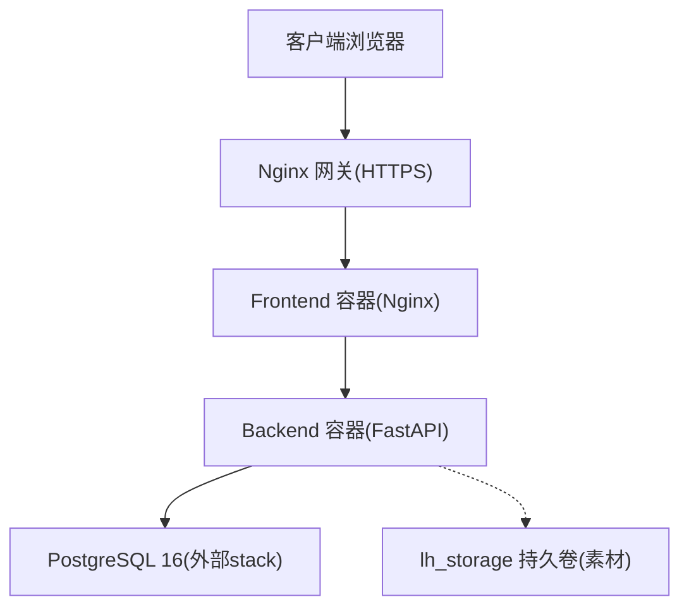
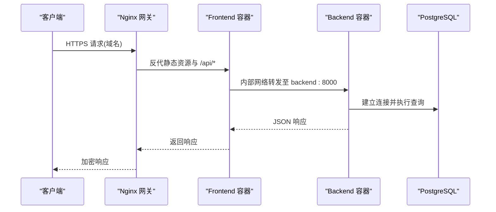
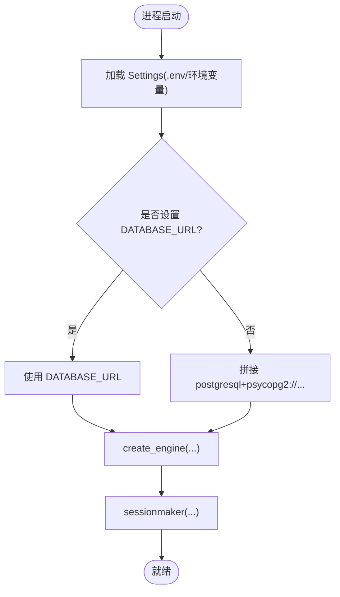
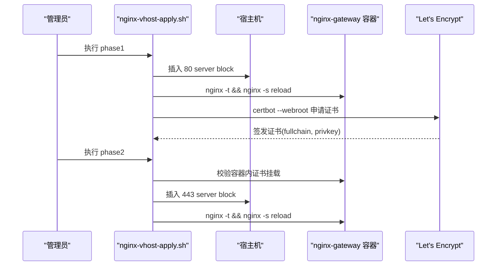
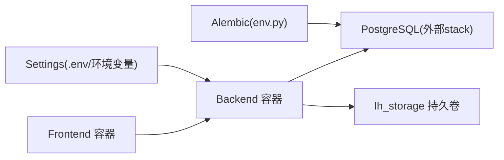

# 基础设施技术栈

<cite>
**本文引用的文件**   
- [deploy/ecs/compose.yml](file://deploy/ecs/compose.yml)
- [backend/Dockerfile](file://backend/Dockerfile)
- [frontend/Dockerfile](file://frontend/Dockerfile)
- [frontend/nginx.conf](file://frontend/nginx.conf)
- [deploy/ecs/nginx-vhost.snippet](file://deploy/ecs/nginx-vhost.snippet)
- [deploy/ecs/nginx-vhost-apply.sh](file://deploy/ecs/nginx-vhost-apply.sh)
- [deploy/ecs/db-init.sh](file://deploy/ecs/db-init.sh)
- [deploy/ecs/remote-setup.sh](file://deploy/ecs/remote-setup.sh)
- [deploy/local/docker-compose.yml](file://deploy/local/docker-compose.yml)
- [backend/app/core/config.py](file://backend/app/core/config.py)
- [backend/app/db/__init__.py](file://backend/app/db/__init__.py)
- [backend/alembic/env.py](file://backend/alembic/env.py)
- [backend/app/main.py](file://backend/app/main.py)
- [doc/spec/06-非功能需求.md](file://doc/spec/06-非功能需求.md)
- [doc/test/test-cases-integration.md](file://doc/test/test-cases-integration.md)
</cite>

## 目录
1. [引言](#引言)
2. [项目结构](#项目结构)
3. [核心组件](#核心组件)
4. [架构总览](#架构总览)
5. [详细组件分析](#详细组件分析)
6. [依赖关系分析](#依赖关系分析)
7. [性能与容量规划](#性能与容量规划)
8. [监控与告警](#监控与告警)
9. [日志收集与分析](#日志收集与分析)
10. [CI/CD 流水线设计](#cicd-流水线设计)
11. [灾难恢复与业务连续性](#灾难恢复与业务连续性)
12. [故障排查指南](#故障排查指南)
13. [结论](#结论)

## 引言
本文件面向 Learning Hub 的生产级基础设施，覆盖容器化部署、数据库与缓存、反向代理与证书自动化、ECS 资源规划、CI/CD 流水线、监控告警、日志策略以及灾备与连续性保障。文档以仓库现有配置与脚本为依据，提供可落地的架构图、流程图与排障指引，帮助读者快速理解并落地生产环境。

## 项目结构
Learning Hub 采用前后端分离的容器化架构：
- 后端：FastAPI + SQLAlchemy + Alembic，Docker 镜像内置运行健康检查与健康探针。
- 前端：Vite 构建产物由 Nginx 提供静态资源，并在容器内反代 /api 到后端服务。
- 部署：本地使用 docker-compose；生产在 ECS 上使用 Docker Swarm Stack 编排，复用外部网络与持久卷。
- 网关：通过 nginx-gateway stack 统一接入 HTTPS，自动申请与续期 Let's Encrypt 证书。

图示来源
- [deploy/ecs/compose.yml:1-79](file://deploy/ecs/compose.yml#L1-L79)
- [frontend/nginx.conf:1-56](file://frontend/nginx.conf#L1-L56)
- [deploy/ecs/nginx-vhost.snippet:1-56](file://deploy/ecs/nginx-vhost.snippet#L1-L56)

章节来源
- [deploy/ecs/compose.yml:1-79](file://deploy/ecs/compose.yml#L1-L79)
- [deploy/local/docker-compose.yml:1-74](file://deploy/local/docker-compose.yml#L1-L74)

## 核心组件
- 后端镜像：基于 Python 3.11-slim，安装系统依赖（LibreOffice、Poppler、FFmpeg、字体），Python 依赖通过 pip 安装，暴露 8000 端口，内置 /api/public/health 健康检查。
- 前端镜像：Node 20 构建 Vite 产物，Nginx 1.27-alpine 提供静态资源与 API 反代，暴露 80 端口，内置 / 健康检查。
- 应用配置：从环境变量加载，支持 DATABASE_URL 优先覆盖；包含 Admin Token、JWT、CORS、时区、存储路径、PPT 转换工具路径、限流/Redis URL、LLM 开关等。
- 数据库连接：SQLAlchemy 同步引擎，针对 SQLite 与非 SQLite 分别设置连接池参数；Alembic 读取相同配置执行迁移。

章节来源
- [backend/Dockerfile:1-85](file://backend/Dockerfile#L1-L85)
- [frontend/Dockerfile:1-23](file://frontend/Dockerfile#L1-L23)
- [backend/app/core/config.py:1-88](file://backend/app/core/config.py#L1-L88)
- [backend/app/db/__init__.py:1-50](file://backend/app/db/__init__.py#L1-L50)
- [backend/alembic/env.py:1-44](file://backend/alembic/env.py#L1-L44)

## 架构总览
生产环境采用“多 Stack”模式：
- postgres stack：提供 PostgreSQL 16 实例，learning-hub stack 通过外部 overlay 网络访问。
- nginx-gateway stack：统一入口，管理域名 vhost、HTTP→HTTPS 重定向、Let’s Encrypt 证书挂载与续期。
- learning-hub stack：包含 frontend 与 backend 两个服务，共享默认网络，并通过外部网络访问 postgres 与 nginx-gateway。

图示来源
- [deploy/ecs/nginx-vhost.snippet:1-56](file://deploy/ecs/nginx-vhost.snippet#L1-L56)
- [frontend/nginx.conf:1-56](file://frontend/nginx.conf#L1-L56)
- [deploy/ecs/compose.yml:27-79](file://deploy/ecs/compose.yml#L27-L79)

## 详细组件分析

### Docker 容器化与镜像构建
- 后端镜像
  - 基础镜像：python:3.11-slim，替换 Debian 源为国内镜像加速。
  - 系统依赖：psycopg2 编译所需头文件、LibreOffice/PDF 工具链、FFmpeg、中日文字体。
  - Python 依赖：FastAPI、Uvicorn、SQLAlchemy、Alembic、psycopg2-binary、asyncpg、Pydantic、JOSN、Passlib、SlowAPI、Redis、httpx、PyJWT、DashScope SDK。
  - 健康检查：/api/public/health，间隔 30s，超时 5s，重试 3 次，启动宽限期 10s。
- 前端镜像
  - 构建阶段：Node 20 安装依赖并构建 Vite 产物，复制 PDF.js worker 到 dist 根目录。
  - 运行阶段：Nginx 提供静态资源，暴露 80 端口，健康检查 /。

章节来源
- [backend/Dockerfile:1-85](file://backend/Dockerfile#L1-L85)
- [frontend/Dockerfile:1-23](file://frontend/Dockerfile#L1-L23)

### 应用配置与数据库连接
- 配置加载
  - Settings 类从 .env 与环境变量加载，DATABASE_URL 优先；其余字段拼接连接串。
  - 包含 Admin Token、JWT 密钥与时钟、CORS 白名单、时区、存储路径、PPT 转换工具路径、限流/Redis URL、LLM 开关与模型参数、日志级别等。
- 数据库连接
  - 根据 effective_database_url 创建 SQLAlchemy 引擎；SQLite 使用 StaticPool 并允许跨线程访问；Postgres 启用 pool_size=10、max_overflow=20。
  - Alembic 通过 env.py 注入相同 URL 执行在线/离线迁移。

图示来源
- [backend/app/core/config.py:1-88](file://backend/app/core/config.py#L1-L88)
- [backend/app/db/__init__.py:1-50](file://backend/app/db/__init__.py#L1-L50)
- [backend/alembic/env.py:1-44](file://backend/alembic/env.py#L1-L44)

章节来源
- [backend/app/core/config.py:1-88](file://backend/app/core/config.py#L1-L88)
- [backend/app/db/__init__.py:1-50](file://backend/app/db/__init__.py#L1-L50)
- [backend/alembic/env.py:1-44](file://backend/alembic/env.py#L1-L44)

### 反向代理与 SSL 证书自动化
- 前端容器内 Nginx
  - 静态资源与 SPA fallback。
  - /api/ 反代到后端服务，关闭请求体缓冲，提升大文件上传吞吐。
  - 静态资源强缓存，PDF.js worker 明确 MIME。
- 网关层 vhost
  - HTTP→HTTPS 重定向，保留 /.well-known/acme-challenge 供 ACME 验证。
  - 443 server block 开启 http2，设置安全响应头，proxy_pass 到 upstream learning_hub_frontend。
- 证书申请与续期
  - 分两阶段：phase1 插入 80 server block 并使用 certbot webroot 申请证书；phase2 校验容器内证书挂载后插入 443 server block 并 reload。
  - 所有变更点前后备份，幂等执行。

图示来源
- [deploy/ecs/nginx-vhost-apply.sh:1-123](file://deploy/ecs/nginx-vhost-apply.sh#L1-L123)
- [deploy/ecs/nginx-vhost.snippet:1-56](file://deploy/ecs/nginx-vhost.snippet#L1-L56)
- [frontend/nginx.conf:1-56](file://frontend/nginx.conf#L1-L56)

章节来源
- [frontend/nginx.conf:1-56](file://frontend/nginx.conf#L1-L56)
- [deploy/ecs/nginx-vhost.snippet:1-56](file://deploy/ecs/nginx-vhost.snippet#L1-L56)
- [deploy/ecs/nginx-vhost-apply.sh:1-123](file://deploy/ecs/nginx-vhost-apply.sh#L1-L123)

### ECS 云服务器的资源规划
- 服务放置约束：backend 与 frontend 均 placement 到 manager 节点，便于集中管理与调试。
- 网络与卷：
  - 复用外部 overlay 网络（postgres_net、nginx_net）实现跨 stack 通信。
  - 复用命名卷 lh_storage 持久化 /app/storage（素材文件）。
- 初始化与准备：
  - remote-setup.sh 创建持久卷与工作目录。
  - db-init.sh 在已有 postgres stack 上幂等创建数据库。

章节来源
- [deploy/ecs/compose.yml:1-79](file://deploy/ecs/compose.yml#L1-L79)
- [deploy/ecs/remote-setup.sh:1-18](file://deploy/ecs/remote-setup.sh#L1-L18)
- [deploy/ecs/db-init.sh:1-36](file://deploy/ecs/db-init.sh#L1-L36)

### Redis 缓存服务的集群部署策略
- 当前配置项 storage_redis_url 存在但默认留空，未启用 Redis 相关能力。
- 建议方案（概念性指导）：
  - 若需会话或限流扩展，可在独立 stack 部署 Redis Cluster 或 Sentinel，并通过环境变量注入连接串。
  - 将 storage_redis_url 指向 Redis 主节点或集群地址，确保后端限流与缓存命中。
  - 注意网络互通与凭据管理，结合 Secret 管理避免明文泄露。

[本节为概念性说明，不直接分析具体代码文件]

### CI/CD 流水线设计（概念性）
- 触发条件：推送分支或合并 PR。
- 步骤建议：
  - 单元测试与集成测试：pytest 运行后端用例；Playwright E2E 运行前端用例。
  - 镜像构建：docker buildx 构建后端与前端镜像，打标签推送到镜像仓库。
  - 发布流程：
    - 更新 ECS 远程目录与 .env。
    - 执行 remote-setup.sh 与 db-init.sh。
    - 执行 nginx-vhost-apply.sh（如首次部署）。
    - docker stack deploy -c compose.yml learning-hub。
  - 蓝绿/灰度（概念性）：
    - 双版本 stack 并行运行，通过网关切换上游或 DNS 权重逐步放量。
    - 回滚策略：快速切回旧版本 stack 并重新加载网关配置。

[本节为概念性说明，不直接分析具体代码文件]

## 依赖关系分析
- 运行时依赖
  - Frontend → Backend（同 stack 内 DNS 解析）
  - Backend → PostgreSQL（外部 stack，overlay 网络）
  - Backend → 文件系统（lh_storage 持久卷）
- 配置依赖
  - Settings 决定数据库连接串、JWT、CORS、存储路径、LLM 开关等。
  - Alembic 复用同一配置进行迁移。

图示来源
- [deploy/ecs/compose.yml:1-79](file://deploy/ecs/compose.yml#L1-L79)
- [backend/app/core/config.py:1-88](file://backend/app/core/config.py#L1-L88)
- [backend/alembic/env.py:1-44](file://backend/alembic/env.py#L1-L44)

章节来源
- [deploy/ecs/compose.yml:1-79](file://deploy/ecs/compose.yml#L1-L79)
- [backend/app/core/config.py:1-88](file://backend/app/core/config.py#L1-L88)
- [backend/alembic/env.py:1-44](file://backend/alembic/env.py#L1-L44)

## 性能与容量规划
- 接口基线（参考规范）
  - 后台 CRUD P95 ≤ 300ms
  - AI 搜索 P95 ≤ 2s（含 LLM 调用与降级）
  - 单条 DB 查询 P95 ≤ 50ms
  - LLM 调用 P95 ≤ 1.5s
  - 200MB 上传 P95 ≤ 60s
  - 5xx 错误率 ≤ 0.5%
- 容量建议（概念性）
  - ECS 规格：至少 4C8G，SSD 盘 ≥ 100GB（素材增长评估）。
  - 连接池：Postgres 连接池按并发估算，预留 max_overflow 应对突发。
  - 带宽：上行带宽需满足大文件上传峰值。

章节来源
- [doc/spec/06-非功能需求.md:125-136](file://doc/spec/06-非功能需求.md#L125-L136)

## 监控与告警
- 指标可见性（验收要求）
  - 关键指标包括 HTTP 请求耗时、内存使用、AI 搜索延迟等。
- 结构化日志
  - 每条日志包含 ts、level、requestId、userId、action、durationMs 等字段。
- 告警触发
  - 当 5xx 错误率超过阈值持续一段时间，应触发通知。

章节来源
- [doc/test/test-cases-integration.md:495-552](file://doc/test/test-cases-integration.md#L495-L552)

## 日志收集与分析
- 请求追踪
  - 中间件注入 X-Request-Id，并在响应头回写，便于跨服务对位。
- 健康检查
  - 后端 /api/public/health；前端 /；compose 中定义 healthcheck 探测。
- 日志输出
  - 容器标准输出配合 docker logs 查看；生产建议接入集中式日志系统（如 ELK/Loki）。

章节来源
- [backend/app/main.py:42-81](file://backend/app/main.py#L42-L81)
- [deploy/ecs/compose.yml:73-79](file://deploy/ecs/compose.yml#L73-L79)
- [deploy/local/docker-compose.yml:64-69](file://deploy/local/docker-compose.yml#L64-L69)

## CI/CD 流水线设计
- 本地开发脚本
  - 构建后端与前端镜像，启动三服务，等待 healthy。
- 生产发布脚本（概念性）
  - 推送镜像、更新远程目录、执行初始化脚本、部署 stack。
  - 蓝绿/灰度：双 stack 并行，网关侧切换流量。

章节来源
- [deploy/local/deploy-lh-local.ps1:87-116](file://deploy/local/deploy-lh-local.ps1#L87-L116)

## 灾难恢复与业务连续性
- 数据备份与恢复
  - 数据库：pg_dump 导出，psql 导入恢复。
  - 素材文件：打包 /app/storage/documents，恢复后重启服务。
- 证书与配置
  - nginx-vhost-apply.sh 幂等执行，失败可重试；证书路径与挂载需一致。
- 服务高可用
  - 通过副本数与重启策略提升可用性；manager 节点放置便于运维。

章节来源
- [doc/test/test-cases-integration.md:529-552](file://doc/test/test-cases-integration.md#L529-L552)
- [deploy/ecs/nginx-vhost-apply.sh:1-123](file://deploy/ecs/nginx-vhost-apply.sh#L1-L123)
- [deploy/ecs/compose.yml:42-71](file://deploy/ecs/compose.yml#L42-L71)

## 故障排查指南
- 常见问题定位
  - 数据库连通性：确认 POSTGRES_SERVICE_NAME、DATABASE_PORT、网络互通；db-init.sh 检查数据库是否存在。
  - 证书问题：确认容器内证书路径挂载正确；phase1/phase2 顺序执行。
  - 大文件上传超时：检查前端 Nginx client_body_timeout、proxy_send_timeout、proxy_read_timeout 与后端 MAX_SIZE_BYTES 对齐。
  - 健康检查失败：查看后端 /api/public/health 与前端 / 状态；检查依赖服务是否 ready。
- 诊断命令
  - docker ps、docker logs、docker exec 进入容器执行 nginx -t、curl 探测。
  - psql 连接数据库验证表结构与权限。

章节来源
- [deploy/ecs/db-init.sh:1-36](file://deploy/ecs/db-init.sh#L1-L36)
- [frontend/nginx.conf:1-56](file://frontend/nginx.conf#L1-L56)
- [deploy/ecs/nginx-vhost-apply.sh:1-123](file://deploy/ecs/nginx-vhost-apply.sh#L1-L123)
- [deploy/ecs/compose.yml:73-79](file://deploy/ecs/compose.yml#L73-L79)

## 结论
Learning Hub 的基础设施以 Docker 为核心，采用多 Stack 解耦部署，结合 Nginx 网关与证书自动化，形成稳定可控的生产环境。通过明确的配置项、健康检查与幂等脚本，降低了运维复杂度。后续可按需引入 Redis 集群、集中式监控与日志平台，并完善蓝绿/灰度发布策略，进一步提升系统的可扩展性与可靠性。