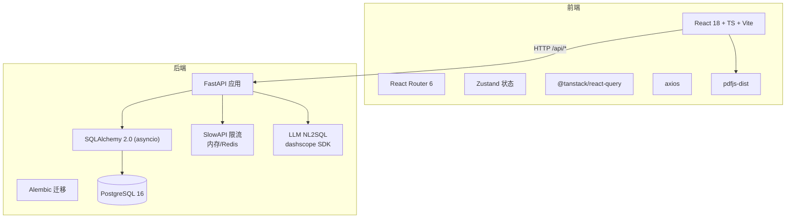
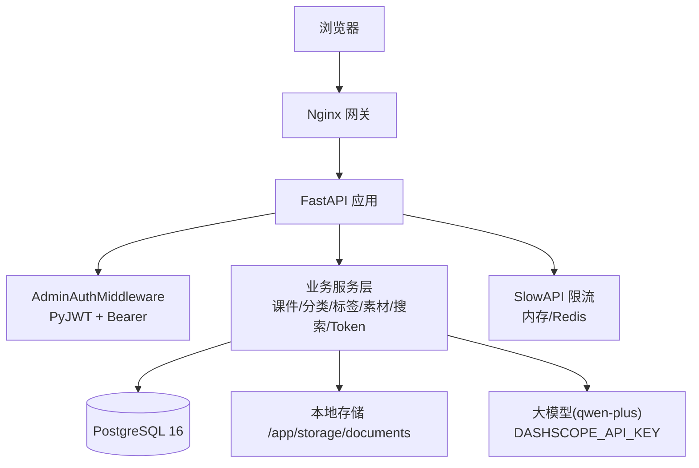
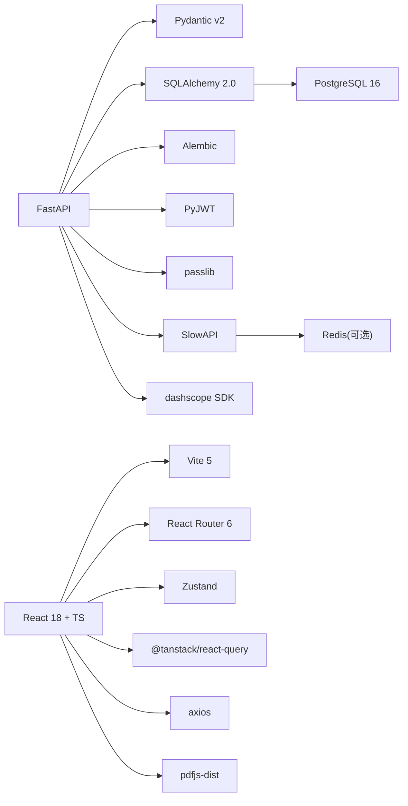

# 技术栈选型

<cite>
**本文引用的文件**   
- [backend/pyproject.toml](file://backend/pyproject.toml)
- [backend/app/main.py](file://backend/app/main.py)
- [backend/app/core/config.py](file://backend/app/core/config.py)
- [backend/app/models/__init__.py](file://backend/app/models/__init__.py)
- [frontend/package.json](file://frontend/package.json)
- [frontend/vite.config.ts](file://frontend/vite.config.ts)
- [frontend/src/main.tsx](file://frontend/src/main.tsx)
- [frontend/src/App.tsx](file://frontend/src/App.tsx)
- [doc/spec/07-技术架构.md](file://doc/spec/07-技术架构.md)
- [doc/spec/05-数据模型.md](file://doc/spec/05-数据模型.md)
- [doc/spec/10-API设计规范.md](file://doc/spec/10-API设计规范.md)
</cite>

## 目录
1. [引言](#引言)
2. [项目结构](#项目结构)
3. [核心组件](#核心组件)
4. [架构总览](#架构总览)
5. [详细组件分析](#详细组件分析)
6. [依赖关系分析](#依赖关系分析)
7. [性能与可维护性评估](#性能与可维护性评估)
8. [集成方式与兼容性](#集成方式与兼容性)
9. [演进路线与升级建议](#演进路线与升级建议)
10. [故障排查指南](#故障排查指南)
11. [结论](#结论)

## 引言
本文件面向 Learning Hub 项目的技术栈选型，系统梳理后端（Python 3.11+、FastAPI、SQLAlchemy、Alembic 等）与前端（React 18、TypeScript、Vite、Zustand 等）的决策过程、权衡考量、版本依据与兼容性策略，并给出集成方式、性能对比、社区支持度、学习曲线等多维度评估，以及未来演进路线图。

## 项目结构
Learning Hub 采用前后端分离：
- 后端位于 backend 目录，基于 Python + FastAPI，使用 SQLAlchemy 2.0 异步 API 与 Alembic 管理迁移，PostgreSQL 作为主数据库，Redis 可选用于限流共享计数。
- 前端位于 frontend 目录，基于 React 18 + TypeScript + Vite，使用 Zustand 做轻量状态管理，React Router 6 管理路由，Tailwind CSS 构建样式，Playwright 进行 E2E 测试。
- 部署通过 Docker Compose 编排本地开发环境，生产可平滑迁移至 ECS + ACR。

图表来源
- [backend/app/main.py:1-116](file://backend/app/main.py#L1-L116)
- [backend/pyproject.toml:1-47](file://backend/pyproject.toml#L1-L47)
- [frontend/package.json:1-40](file://frontend/package.json#L1-L40)
- [frontend/vite.config.ts:1-39](file://frontend/vite.config.ts#L1-L39)
- [doc/spec/07-技术架构.md:1-222](file://doc/spec/07-技术架构.md#L1-L222)

章节来源
- [doc/spec/07-技术架构.md:1-222](file://doc/spec/07-技术架构.md#L1-L222)

## 核心组件
- 后端
  - Web 框架：FastAPI（ASGI、自动 OpenAPI、高性能）。
  - ORM：SQLAlchemy 2.0（异步 API、Mapped[] 类型化风格）。
  - 迁移：Alembic（与 SQLAlchemy 同生态，滚动升级友好）。
  - 配置：Pydantic v2 + pydantic-settings（强校验、环境变量注入）。
  - 鉴权：PyJWT + passlib（HS256、bcrypt）。
  - 限流：SlowAPI（内存或 Redis 后端）。
  - AI 搜索：dashscope SDK（qwen-plus），NL2SQL + ILIKE 兜底。
  - 容器：Uvicorn（uvloop）。
- 前端
  - 框架：React 18（函数组件 + Hooks）。
  - 语言：TypeScript 5.x（前后端契约一致性强）。
  - 构建：Vite 5（ESBuild 极速、HMR 即时反馈）。
  - 状态：Zustand（轻量、无样板代码、易切片）。
  - 路由：React Router 6（路径参数与查询参数并存）。
  - HTTP：axios + @tanstack/react-query（拦截器统一错误处理 + 缓存与重试）。
  - 渲染：pdfjs-dist（PDF/PPT 预览）、Tailwind CSS（原子化样式）。
  - E2E：Playwright（内置 runner，与浏览器 DevTools 联动）。

章节来源
- [backend/pyproject.toml:1-47](file://backend/pyproject.toml#L1-L47)
- [frontend/package.json:1-40](file://frontend/package.json#L1-L40)
- [doc/spec/07-技术架构.md:28-94](file://doc/spec/07-技术架构.md#L28-L94)

## 架构总览
整体采用“Nginx 反向代理 → FastAPI 服务 → PostgreSQL/Redis/对象存储”的分层架构；前端为静态资源由 Nginx 提供或通过代理访问后端 API。AI 能力通过 dashscope SDK 调用 qwen-plus，失败时降级到关键词检索。

图表来源
- [doc/spec/07-技术架构.md:7-26](file://doc/spec/07-技术架构.md#L7-L26)
- [backend/app/main.py:40-112](file://backend/app/main.py#L40-L112)

## 详细组件分析

### 后端技术选型与权衡
- Python 3.11+
  - 选择依据：类型注解完善、Pydantic v2 强校验、性能提升显著。
  - 替代方案：Python 3.10 生态略旧；3.12 生态仍在成熟期。
- FastAPI
  - 优势：异步 ASGI、自动 OpenAPI、性能对标 Spring Boot、中间件/依赖注入体系清晰。
  - 替代方案：Flask/Django 在异步与类型安全方面不如 FastAPI 原生契合。
- SQLAlchemy 2.0
  - 优势：异步 API、Mapped[] 类型化风格、与 Alembic 无缝集成。
  - 替代方案：Tortoise ORM 生态较小；SQLModel 更偏快速原型但灵活性不及 SQLAlchemy。
- Alembic
  - 优势：官方推荐迁移工具，与 SQLAlchemy 同生态，生产滚动升级友好。
  - 替代方案：手动 SQL 脚本风险高、不可追溯。
- Pydantic v2 + pydantic-settings
  - 优势：Rust 内核性能优、配置从环境变量加载、与 FastAPI 深度集成。
  - 替代方案：dataclasses + 自定义解析复杂度高。
- PyJWT + passlib
  - 优势：HS256 签发/校验、bcrypt 哈希，满足后台会话与密码安全。
  - 替代方案：纯手写 JWT 校验不安全且易出错。
- SlowAPI
  - 优势：与 Flask-Limiter 同源，支持 IP + 业务键双键限流，内存/Redis 双后端。
  - 替代方案：自实现限流成本高、一致性差。
- Uvicorn
  - 优势：ASGI 高性能服务器，配合 uvloop 提升并发。
  - 替代方案：Gunicorn + Uvicorn Worker 模式也可，但单镜像多进程更简洁。
- dashscope SDK（qwen-plus）
  - 优势：阿里云百炼生态、NL2SQL 能力强；失败可回退 ILIKE。
  - 替代方案：OpenAI/Claude 等需额外适配成本与合规考虑。

章节来源
- [backend/pyproject.toml:1-47](file://backend/pyproject.toml#L1-L47)
- [backend/app/core/config.py:1-88](file://backend/app/core/config.py#L1-L88)
- [doc/spec/07-技术架构.md:28-94](file://doc/spec/07-技术架构.md#L28-L94)

### 前端技术选型与权衡
- React 18
  - 优势：生态成熟、企业主流、社区资源最丰富。
  - 替代方案：Vue/Svelte 生态相对小，团队迁移成本更高。
- TypeScript 5.x
  - 优势：与 Pydantic v2 等价强类型保障前后端契约，IDE 体验佳。
  - 替代方案：纯 JS 类型约束弱，大型项目维护成本高。
- Vite 5
  - 优势：启动 < 1s、HMR 即时反馈、ESBuild 极速构建。
  - 替代方案：Webpack 配置复杂、冷启动慢。
- Zustand
  - 优势：比 Redux 轻量 90%，无样板代码，易做状态机切片。
  - 替代方案：Redux/Context 样板多或性能不佳。
- React Router 6
  - 优势：同时支持路径参数与查询参数，SPA 导航体验好。
  - 替代方案：HashRouter 不利于 SEO 与分享。
- axios + @tanstack/react-query
  - 优势：拦截器统一错误处理 + 缓存与重试，减少重复请求。
  - 替代方案：fetch 无内置缓存与重试，需自行封装。
- pdfjs-dist
  - 优势：P-VIEWER 共用，PDF/PPT 预览一致性好。
  - 替代方案：第三方在线转换不稳定、隐私风险。
- Tailwind CSS
  - 优势：原子化样式、设计 token 统一管理。
  - 替代方案：CSS Modules 样式分散、维护成本高。
- Playwright
  - 优势：内置 test runner，与 Chrome DevTools MCP 联动，跨浏览器稳定。
  - 替代方案：Cypress 生态稍窄、稳定性略逊。

章节来源
- [frontend/package.json:1-40](file://frontend/package.json#L1-L40)
- [frontend/vite.config.ts:1-39](file://frontend/vite.config.ts#L1-L39)
- [frontend/src/main.tsx:1-26](file://frontend/src/main.tsx#L1-L26)
- [frontend/src/App.tsx:1-110](file://frontend/src/App.tsx#L1-L110)
- [doc/spec/07-技术架构.md:47-61](file://doc/spec/07-技术架构.md#L47-L61)

### 关键模块边界与职责
- AdminAuthMiddleware：解析 Authorization Bearer JWT、解码管理员身份，不承载业务规则。
- AccessTokenService：创建/重命名/重新生成/删除 AccessToken、Token 与课件绑定。
- 课件服务：课件 CRUD + 关联管理（分类/标签/素材/Token）。
- 分类服务：分类树维护与查询、3 级深度校验。
- 标签服务：标签 CRUD、全局唯一性约束。
- 素材服务：文件上传/删除/元数据管理、大小+扩展名校验；PPT 转 PDF 调度。
- 搜索服务：自然语言 → 课件列表，LLM NL2SQL + 关键词 ILIKE 兜底。

章节来源
- [doc/spec/07-技术架构.md:123-134](file://doc/spec/07-技术架构.md#L123-L134)

## 依赖关系分析
- 后端依赖
  - FastAPI 依赖 Uvicorn、Pydantic、SQLAlchemy、Alembic、PyJWT、passlib、SlowAPI、httpx、dashscope SDK。
  - 数据库驱动 psycopg2-binary 与 asyncpg 二选一（当前使用 psycopg2）。
  - 限流后端可选 Redis（多 worker 场景）。
- 前端依赖
  - React 18 + ReactDOM、React Router 6、Zustand、@tanstack/react-query、axios、pdfjs-dist、Tailwind CSS、Vite、TypeScript、Playwright。

图表来源
- [backend/pyproject.toml:1-47](file://backend/pyproject.toml#L1-L47)
- [frontend/package.json:1-40](file://frontend/package.json#L1-L40)
- [doc/spec/07-技术架构.md:62-78](file://doc/spec/07-技术架构.md#L62-L78)

章节来源
- [backend/pyproject.toml:1-47](file://backend/pyproject.toml#L1-L47)
- [frontend/package.json:1-40](file://frontend/package.json#L1-L40)

## 性能与可维护性评估
- 性能
  - FastAPI + Uvicorn 在高并发下表现优异，适合 I/O 密集型（LLM 调用、文件流式传输）。
  - SQLAlchemy 2.0 异步 API 降低阻塞，结合连接池提高吞吐。
  - Vite 构建与 HMR 显著提升前端开发效率与用户体验。
  - SlowAPI 支持内存/Redis 双后端，多 worker 部署时保证限流一致性。
- 可维护性
  - Pydantic v2 + TypeScript 强类型贯穿前后端，契约一致性强。
  - Alembic 迁移可追溯、可回滚，生产滚动升级友好。
  - 模块化分层（core/models/schemas/services/api）职责清晰，便于扩展与维护。
- 社区支持度
  - FastAPI、React、Vite、Zustand、SQLAlchemy、Alembic 均为活跃开源项目，文档完善、问题响应快。
- 学习曲线
  - FastAPI 与 React 生态上手较快；Zustand 相比 Redux 更易掌握；Alembic 迁移概念需熟悉。

章节来源
- [doc/spec/07-技术架构.md:28-94](file://doc/spec/07-技术架构.md#L28-L94)
- [backend/app/main.py:40-112](file://backend/app/main.py#L40-L112)
- [frontend/vite.config.ts:1-39](file://frontend/vite.config.ts#L1-L39)

## 集成方式与兼容性
- 后端集成
  - 应用入口装配中间件、路由、错误处理、CORS；限流异常统一返回 429。
  - 配置从环境变量加载，支持 DATABASE_URL 覆盖；CORS 允许源可配；时区 Asia/Shanghai。
  - 模型集中导入供 Alembic 识别 metadata；服务层按领域拆分。
- 前端集成
  - main.tsx 初始化 QueryClient、BrowserRouter、挂载 App。
  - App.tsx 定义前台 SPA 壳与后台子路由；Zustand view store 与 URL query 同步。
  - vite.config.ts 配置别名、依赖优化、开发代理（/api、/admin 指向后端）。
- 兼容性
  - Python 3.11+ 与 FastAPI 0.115.5、SQLAlchemy 2.0.36、Alembic 1.14.0 组合稳定。
  - React 18.3.1 + Vite 5.4.11 + TypeScript 5.7.2 兼容良好。
  - pdfjs-dist ^4.7.76 与 Vite worker 配置协同，避免 HMR 卡顿。

章节来源
- [backend/app/main.py:40-112](file://backend/app/main.py#L40-L112)
- [backend/app/core/config.py:1-88](file://backend/app/core/config.py#L1-L88)
- [backend/app/models/__init__.py:1-30](file://backend/app/models/__init__.py#L1-L30)
- [frontend/src/main.tsx:1-26](file://frontend/src/main.tsx#L1-L26)
- [frontend/src/App.tsx:1-110](file://frontend/src/App.tsx#L1-L110)
- [frontend/vite.config.ts:1-39](file://frontend/vite.config.ts#L1-L39)

## 演进路线与升级建议
- V1.0（当前）
  - Python 3.11 + FastAPI + React 18 单实例 Docker 部署，统一 Admin Token + AccessToken 双轨鉴权。
- V1.1
  - 引入 Celery 处理 200MB 上传转码；拆分为独立模块服务（课件/素材/搜索）。
- V1.2
  - 引入 RBAC 管理员账号，替换单一 Admin Token。
- V2.0
  - 引入独立搜索服务（Elasticsearch/Meilisearch）+ 同义词扩展，替换当前 ILIKE 关键词检索；LLM-to-SQL 保留作为长句入口。
- V2.1
  - 增加学习者侧能力：收藏、学习进度、推荐。

章节来源
- [doc/spec/07-技术架构.md:201-210](file://doc/spec/07-技术架构.md#L201-L210)

## 故障排查指南
- 限流命中
  - 现象：429 rate_limited。
  - 排查：检查 SlowAPI 后端（内存/Redis）是否可用；确认 key 构造是否符合预期（IP/会话）。
- 认证失败
  - 现象：401 unauthenticated。
  - 排查：检查 Admin 会话 Cookie/JWT 是否有效；JWT 过期时间配置是否正确。
- AI 搜索不可用
  - 现象：llm_unavailable 或 llm_timeout。
  - 排查：确认 DASHSCOPE_API_KEY 已配置；网络可达；超时阈值合理；降级到 ILIKE 是否正常。
- PPT 预览未生成
  - 现象：previewReady=false。
  - 排查：LibreOffice 安装路径与环境变量正确；转换超时设置合理；输出目录权限。
- 前端构建/运行问题
  - 现象：HMR 卡顿、pdf.worker 缺失。
  - 排查：vite.config.ts 中 exclude pdfjs-dist；确保 dist 根目录包含 pdf.worker.min.mjs。

章节来源
- [backend/app/main.py:67-90](file://backend/app/main.py#L67-L90)
- [doc/spec/07-技术架构.md:211-222](file://doc/spec/07-技术架构.md#L211-L222)
- [frontend/vite.config.ts:12-18](file://frontend/vite.config.ts#L12-L18)

## 结论
Learning Hub 的技术栈以 FastAPI + SQLAlchemy/Alembic 与 React 18 + Vite/Zustand 为核心，兼顾高性能、强类型、可维护性与生态成熟度。通过 SlowAPI 限流、PyJWT 鉴权、dashscope NL2SQL 与 ILIKE 兜底，形成稳健的前后端一体化方案。后续可按演进路线逐步引入异步任务、RBAC、独立搜索服务等能力，持续提升系统可扩展性与用户体验。