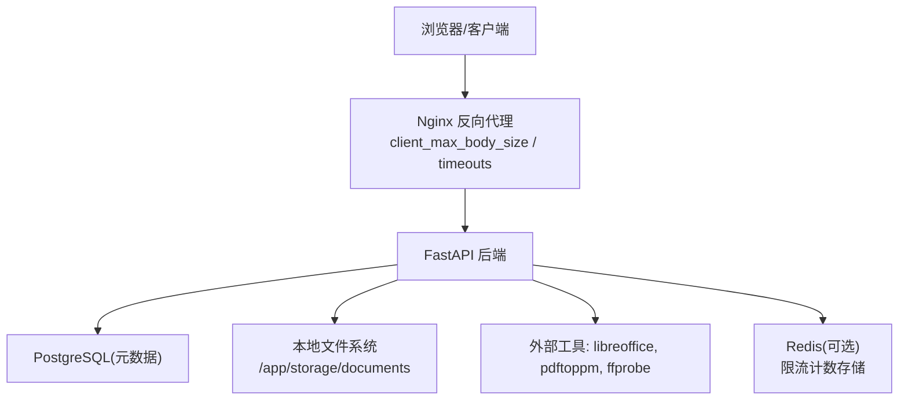
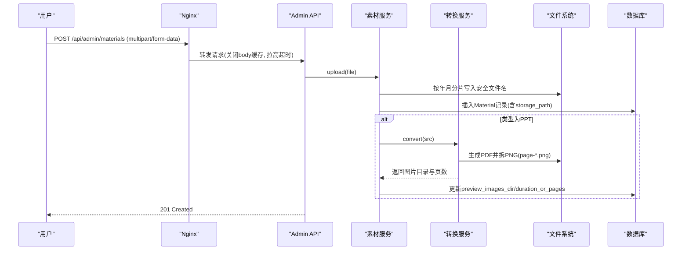
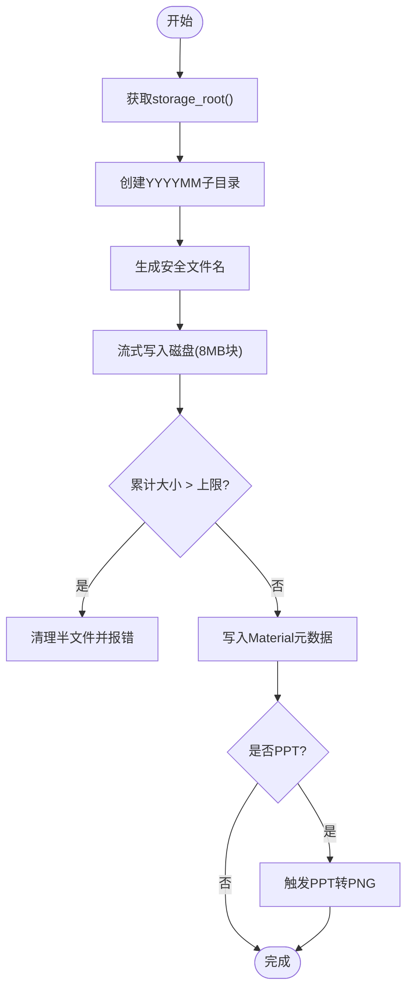
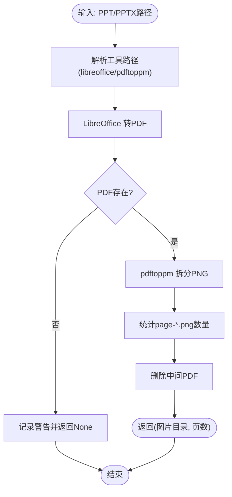
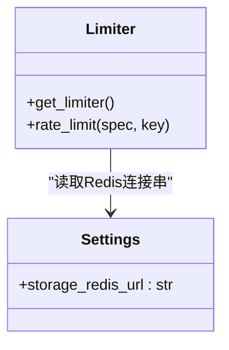
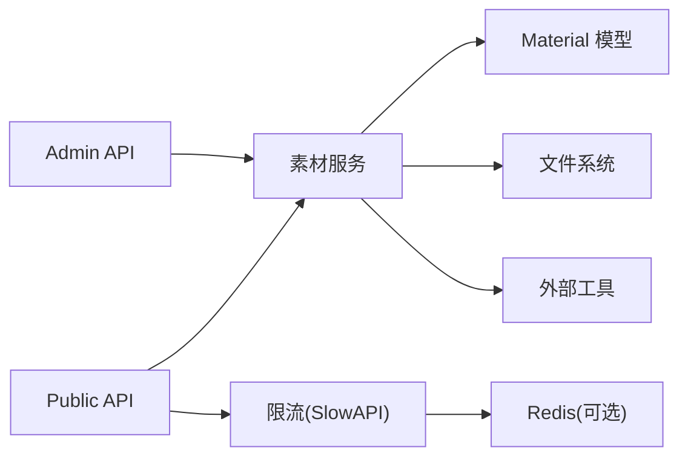

# 存储架构

<cite>
**本文引用的文件**
- [backend/app/core/config.py](file://backend/app/core/config.py)
- [backend/app/services/material.py](file://backend/app/services/material.py)
- [backend/app/services/ppt_to_images.py](file://backend/app/services/ppt_to_images.py)
- [backend/app/models/material.py](file://backend/app/models/material.py)
- [backend/app/api/public/materials.py](file://backend/app/api/public/materials.py)
- [backend/app/api/admin/materials.py](file://backend/app/api/admin/materials.py)
- [backend/app/core/rate_limit.py](file://backend/app/core/rate_limit.py)
- [frontend/nginx.conf](file://frontend/nginx.conf)
- [deploy/ecs/patch-lh-upload.py](file://deploy/ecs/patch-lh-upload.py)
- [doc/spec/07-技术架构.md](file://doc/spec/07-技术架构.md)
</cite>

## 目录
1. [简介](#简介)
2. [项目结构](#项目结构)
3. [核心组件](#核心组件)
4. [架构总览](#架构总览)
5. [详细组件分析](#详细组件分析)
6. [依赖关系分析](#依赖关系分析)
7. [性能与扩展性](#性能与扩展性)
8. [故障排查指南](#故障排查指南)
9. [结论](#结论)
10. [附录](#附录)

## 简介
本文件为 Learning Hub 的“存储架构”设计文档，聚焦于：
- 本地文件系统存储策略、路径规范与命名约定
- 多媒体上传流程、大小限制、格式校验与安全控制
- PPT 转图片（PDF 中间产物）的处理机制与超时保护
- 缓存层设计（Redis 在限流中的作用）
- 备份与恢复方案建议
- 未来迁移到对象存储（S3/OSS）的演进路线

## 项目结构
后端采用 FastAPI + SQLAlchemy，素材以本地文件系统持久化，数据库仅保存元数据。Nginx 作为反向代理统一处理大文件上传超时与缓冲策略。PPT 预览通过 LibreOffice + pdftoppm 生成 PNG 序列供前端幻灯片浏览。

图表来源
- [backend/app/api/public/materials.py:1-224](file://backend/app/api/public/materials.py#L1-L224)
- [backend/app/api/admin/materials.py:1-74](file://backend/app/api/admin/materials.py#L1-L74)
- [backend/app/services/material.py:1-234](file://backend/app/services/material.py#L1-L234)
- [backend/app/services/ppt_to_images.py:1-185](file://backend/app/services/ppt_to_images.py#L1-L185)
- [backend/app/core/rate_limit.py:1-55](file://backend/app/core/rate_limit.py#L1-L55)
- [frontend/nginx.conf:1-36](file://frontend/nginx.conf#L1-L36)
- [deploy/ecs/patch-lh-upload.py:74-104](file://deploy/ecs/patch-lh-upload.py#L74-L104)

章节来源
- [backend/app/core/config.py:54-64](file://backend/app/core/config.py#L54-L64)
- [backend/app/services/material.py:29-34](file://backend/app/services/material.py#L29-L34)
- [backend/app/models/material.py:44-69](file://backend/app/models/material.py#L44-L69)
- [backend/app/api/public/materials.py:64-146](file://backend/app/api/public/materials.py#L64-L146)
- [backend/app/api/admin/materials.py:35-70](file://backend/app/api/admin/materials.py#L35-L70)
- [frontend/nginx.conf:1-36](file://frontend/nginx.conf#L1-L36)
- [deploy/ecs/patch-lh-upload.py:74-104](file://deploy/ecs/patch-lh-upload.py#L74-L104)

## 核心组件
- 配置中心：集中管理存储根路径、转换工具路径、超时、Redis 连接等
- 素材服务：负责上传、类型推断、大小校验、时长探测、PPT 预览生成、删除清理
- 模型层：Material 表定义，包含文件名、类型、大小、时长/页数、存储路径、预览图片目录
- API 层：管理员上传/下载/删除；公开端点提供下载、流式预览、PPT 逐页图片访问
- 转换服务：调用系统工具链将 PPT 转为 PDF，再拆分为 PNG 序列
- 限流模块：基于 SlowAPI，支持内存或 Redis 存储计数

章节来源
- [backend/app/core/config.py:54-64](file://backend/app/core/config.py#L54-L64)
- [backend/app/services/material.py:129-202](file://backend/app/services/material.py#L129-L202)
- [backend/app/models/material.py:44-69](file://backend/app/models/material.py#L44-L69)
- [backend/app/api/public/materials.py:84-180](file://backend/app/api/public/materials.py#L84-L180)
- [backend/app/api/admin/materials.py:35-70](file://backend/app/api/admin/materials.py#L35-L70)
- [backend/app/services/ppt_to_images.py:48-181](file://backend/app/services/ppt_to_images.py#L48-L181)
- [backend/app/core/rate_limit.py:40-55](file://backend/app/core/rate_limit.py#L40-L55)

## 架构总览
下图展示了从上传到预览的关键链路，包括 Nginx 缓冲与超时、后端写入、外部工具转换、以及公开端点的读取路径。

图表来源
- [backend/app/api/admin/materials.py:35-48](file://backend/app/api/admin/materials.py#L35-L48)
- [backend/app/services/material.py:129-202](file://backend/app/services/material.py#L129-L202)
- [backend/app/services/ppt_to_images.py:48-181](file://backend/app/services/ppt_to_images.py#L48-L181)
- [frontend/nginx.conf:1-36](file://frontend/nginx.conf#L1-L36)

## 详细组件分析

### 本地文件系统存储策略
- 根路径：由配置项 storage_path 决定，默认 /app/storage/documents
- 分片规则：按年月份创建子目录，如 YYYYMM
- 文件命名：时间戳 + 随机串 + 原始文件名，避免冲突与覆盖
- 元数据落库：Material 表记录 name/type/size_bytes/storage_path/duration_or_pages/preview_images_dir/uploaded_at
- 删除策略：先检查引用，再物理删除原文件及预览图片目录

图表来源
- [backend/app/services/material.py:29-34](file://backend/app/services/material.py#L29-L34)
- [backend/app/services/material.py:129-202](file://backend/app/services/material.py#L129-L202)
- [backend/app/models/material.py:44-69](file://backend/app/models/material.py#L44-L69)

章节来源
- [backend/app/core/config.py:54-56](file://backend/app/core/config.py#L54-L56)
- [backend/app/services/material.py:129-202](file://backend/app/services/material.py#L129-L202)
- [backend/app/models/material.py:44-69](file://backend/app/models/material.py#L44-L69)

### 上传大小限制、格式验证与安全
- 大小限制：前后端与 Nginx 对齐，单文件最大 500MB（注释中说明与 200MB 文案一致，实际常量定义为 500MB）
- 格式白名单：仅允许 mp4/pdf/ppt/pptx，通过扩展名推断类型
- 安全检查：
  - 前端 accept 属性限制选择范围
  - 后端严格白名单校验，非法扩展名直接拒绝
  - Nginx 关闭请求体缓存，边收边转发，避免磁盘风暴
  - 上传超时与发送/读取超时提升，适配慢网络
- 错误处理：超限、写入失败、数据库异常均有明确业务错误码与提示

章节来源
- [backend/app/services/material.py:25-26](file://backend/app/services/material.py#L25-L26)
- [backend/app/models/material.py:22-41](file://backend/app/models/material.py#L22-L41)
- [frontend/nginx.conf:1-36](file://frontend/nginx.conf#L1-L36)
- [deploy/ecs/patch-lh-upload.py:74-104](file://deploy/ecs/patch-lh-upload.py#L74-L104)

### PPT 转图片（PDF 中间产物）处理机制
- 工具链：libreoffice --headless --convert-to pdf → pdftoppm -r 150 -png
- 输出目录：与原素材同级，目录名为 <stem>，PNG 命名为 page-1.png, page-2.png ...
- 超时保护：单次转换可配置超时，失败不阻断上传，仅记录日志
- 降级策略：若转换失败，公开端点仍可提供原 PPT 下载（attachment），前端走“下载到本地”

图表来源
- [backend/app/services/ppt_to_images.py:26-46](file://backend/app/services/ppt_to_images.py#L26-L46)
- [backend/app/services/ppt_to_images.py:48-181](file://backend/app/services/ppt_to_images.py#L48-L181)

章节来源
- [backend/app/services/ppt_to_images.py:48-181](file://backend/app/services/ppt_to_images.py#L48-L181)
- [backend/app/api/public/materials.py:126-146](file://backend/app/api/public/materials.py#L126-L146)

### 公开端点与访问控制
- 下载接口：返回原文件，Content-Disposition=attachment
- 流式预览：
  - VIDEO/PDF：inline 直接渲染
  - PPT：优先返回生成的预览 PDF（若存在），否则降级返回原 PPT（attachment）
- PPT 逐页图片：按 page-NN.png 排序后按 1-indexed 返回第 N 张
- ACL 校验：若素材仅被 RESTRICTED 课件引用，需携带有效 token_hash，否则拒绝

章节来源
- [backend/app/api/public/materials.py:64-180](file://backend/app/api/public/materials.py#L64-L180)

### 缓存层设计（Redis 在限流中的作用）
- 限流实现：SlowAPI，key 可为 IP 或会话标识
- 存储后端：优先使用 Redis（storage_redis_url），未配置则回退到内存模式
- 用途：对公开端点进行速率限制，防止滥用

图表来源
- [backend/app/core/rate_limit.py:40-55](file://backend/app/core/rate_limit.py#L40-L55)
- [backend/app/core/config.py:62-64](file://backend/app/core/config.py#L62-L64)

章节来源
- [backend/app/core/rate_limit.py:40-55](file://backend/app/core/rate_limit.py#L40-L55)
- [backend/app/core/config.py:62-64](file://backend/app/core/config.py#L62-L64)

### 备份策略与数据恢复方案
- 数据库备份：定期全量+增量备份 PostgreSQL，保留多版本快照
- 文件备份：
  - 对 storage_path 所在卷进行周期性快照或异地复制
  - 注意同时备份 Material 记录的 preview_images_dir 指向的目录
- 恢复流程：
  - 先恢复数据库，再挂载/恢复文件卷，确保 storage_path 与元数据一致
  - 校验关键素材完整性（文件大小、MIME 类型、可打开性）
- 一致性保障：
  - 建议在备份前停止写入或采用一致性快照（如 LVM/云盘快照）
  - 恢复后进行抽样验证与索引重建（如有）

[本节为通用实践建议，不直接分析具体代码文件]

### 存储路径规范与命名约定
- 根目录：/app/storage/documents（可通过环境变量覆盖）
- 分片目录：YYYYMM
- 文件命名：YYYYMMDDHHmmss-随机串-原始文件名
- PPT 预览目录：与原素材同级的 <stem> 目录，内部包含 page-1.png, page-2.png ...
- 视频时长字段：duration_or_pages 复用同一字符串字段，便于前端统一展示

章节来源
- [backend/app/core/config.py:54-56](file://backend/app/core/config.py#L54-L56)
- [backend/app/services/material.py:134-138](file://backend/app/services/material.py#L134-L138)
- [backend/app/services/ppt_to_images.py:78-80](file://backend/app/services/ppt_to_images.py#L78-L80)
- [backend/app/models/material.py:54-59](file://backend/app/models/material.py#L54-L59)

### 存储扩展性考虑（迁移到对象存储）
- 现状：当前实现直接读写本地文件系统，适合单机/容器卷部署
- 演进方向：
  - 抽象存储驱动接口，封装 put/get/delete/head/list 等操作
  - 通过 STORAGE_BACKEND 环境变量切换驱动（文档已提出该思路）
  - 针对 S3/OSS 实现签名直传、分片上传、CDN 加速
  - 保持 Material.storage_path 语义不变（改为对象 Key），对外 URL 通过预签名或 CDN 域名暴露
- 兼容性：
  - 公开端点与下载逻辑无需改动，仅替换底层 I/O
  - 转换产物（PPT 预览图片）同样存入对象存储，路径规范保持一致

章节来源
- [doc/spec/07-技术架构.md:79-94](file://doc/spec/07-技术架构.md#L79-L94)

## 依赖关系分析
- 组件耦合：
  - API 层依赖 services 层，services 层依赖 models 与外部工具
  - 转换服务独立，失败不影响主流程
  - 限流模块可插拔存储后端（Redis/内存）
- 外部依赖：
  - LibreOffice、pdftoppm、ffprobe 为可选工具，缺失时优雅降级
  - Nginx 负责大文件上传缓冲与超时控制
- 潜在风险：
  - 本地磁盘空间不足导致写入失败
  - 转换工具不可用导致 PPT 预览不可用
  - Redis 不可用时限流回退内存，跨节点计数不一致

图表来源
- [backend/app/api/admin/materials.py:1-74](file://backend/app/api/admin/materials.py#L1-L74)
- [backend/app/api/public/materials.py:1-224](file://backend/app/api/public/materials.py#L1-L224)
- [backend/app/services/material.py:1-234](file://backend/app/services/material.py#L1-L234)
- [backend/app/core/rate_limit.py:1-55](file://backend/app/core/rate_limit.py#L1-L55)

章节来源
- [backend/app/api/admin/materials.py:1-74](file://backend/app/api/admin/materials.py#L1-L74)
- [backend/app/api/public/materials.py:1-224](file://backend/app/api/public/materials.py#L1-L224)
- [backend/app/services/material.py:1-234](file://backend/app/services/material.py#L1-L234)
- [backend/app/core/rate_limit.py:1-55](file://backend/app/core/rate_limit.py#L1-L55)

## 性能与扩展性
- 上传性能：
  - Nginx 关闭请求体缓存，边收边转发，减少磁盘压力
  - 后端按 8MB 块流式写入，降低内存占用
- 预览性能：
  - PPT 转换为 PNG 后按需加载，避免一次性渲染大图
  - 公开端点对图片接口做限流，防止热点资源滥用
- 可扩展性：
  - 存储驱动抽象后可横向扩展至对象存储
  - 转换任务可迁移至独立 sidecar 或异步队列，解耦主进程

[本节为通用指导，不直接分析具体代码文件]

## 故障排查指南
- 上传失败：
  - 检查 Nginx client_max_body_size 与超时设置是否与后端一致
  - 确认 storage_path 所在卷有足够空间且可写
- PPT 预览不可用：
  - 检查容器内是否安装 libreoffice 与 pdftoppm
  - 查看转换日志，确认是否超时或工具执行失败
- 公开端点 404/无预览：
  - 确认 preview_images_dir 是否存在且包含 page-*.png
  - 检查 ACL 校验是否通过（token_hash 是否正确）
- 限流生效异常：
  - 检查 Redis 连接串是否配置正确
  - 未配置时回退内存模式，跨节点计数可能不一致

章节来源
- [frontend/nginx.conf:1-36](file://frontend/nginx.conf#L1-L36)
- [deploy/ecs/patch-lh-upload.py:74-104](file://deploy/ecs/patch-lh-upload.py#L74-L104)
- [backend/app/services/ppt_to_images.py:48-181](file://backend/app/services/ppt_to_images.py#L48-L181)
- [backend/app/api/public/materials.py:149-180](file://backend/app/api/public/materials.py#L149-L180)
- [backend/app/core/rate_limit.py:40-55](file://backend/app/core/rate_limit.py#L40-L55)

## 结论
Learning Hub 当前采用本地文件系统存储素材，结合数据库元数据管理，实现了稳定的上传、下载与预览能力。PPT 预览通过外部工具链生成 PNG 序列，兼顾性能与用户体验。限流模块支持 Redis 存储，具备一定的高可用基础。未来可通过抽象存储驱动平滑迁移至对象存储，进一步提升扩展性与可靠性。

[本节为总结性内容，不直接分析具体代码文件]

## 附录
- 相关环境变量与配置项
  - storage_path：存储根路径
  - libreoffice_path / poppler_path：转换工具路径
  - ppt_convert_timeout：转换超时秒数
  - storage_redis_url：限流存储后端（Redis）连接串
- 参考规格与架构文档
  - 技术架构文档中明确提出对象存储迁移方向与部署形态

章节来源
- [backend/app/core/config.py:54-64](file://backend/app/core/config.py#L54-L64)
- [doc/spec/07-技术架构.md:79-94](file://doc/spec/07-技术架构.md#L79-L94)