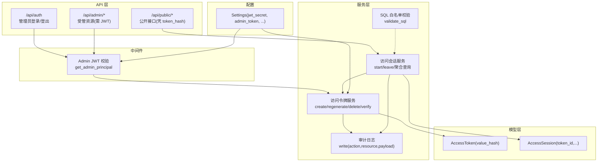
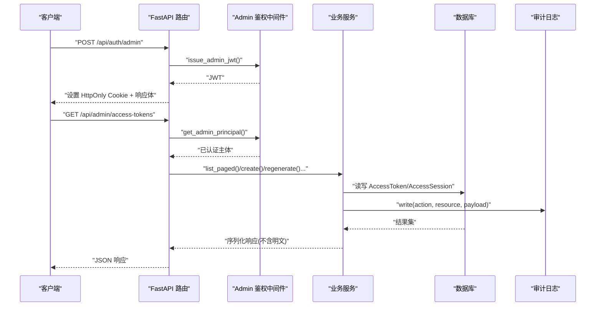
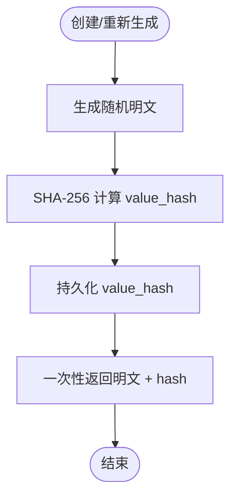
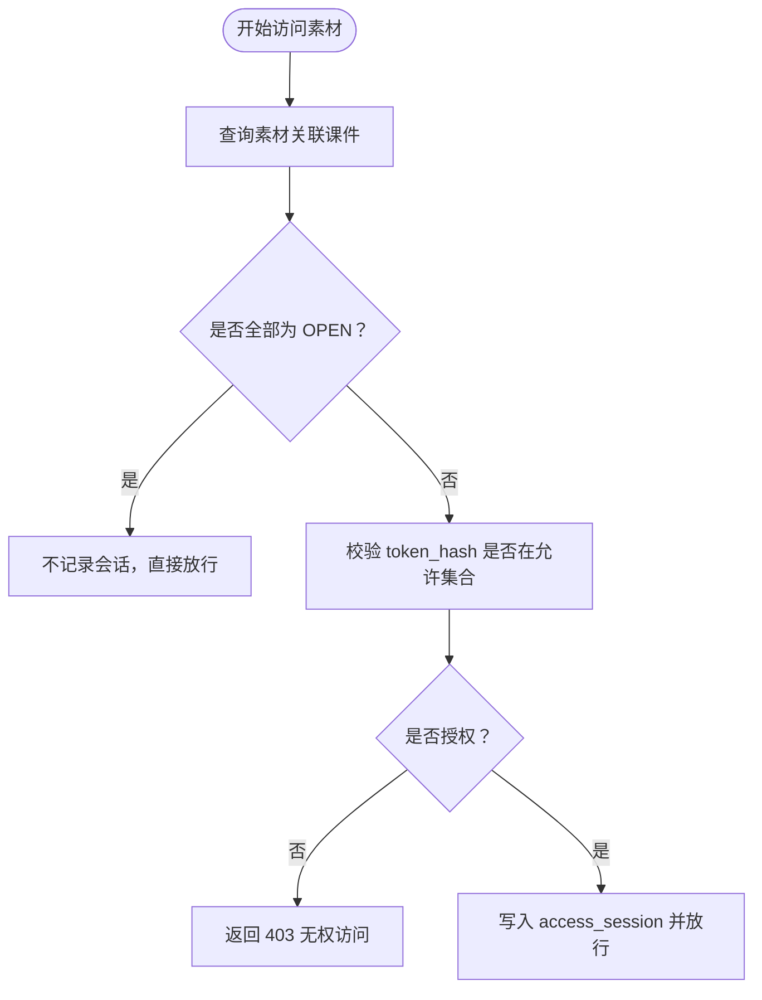
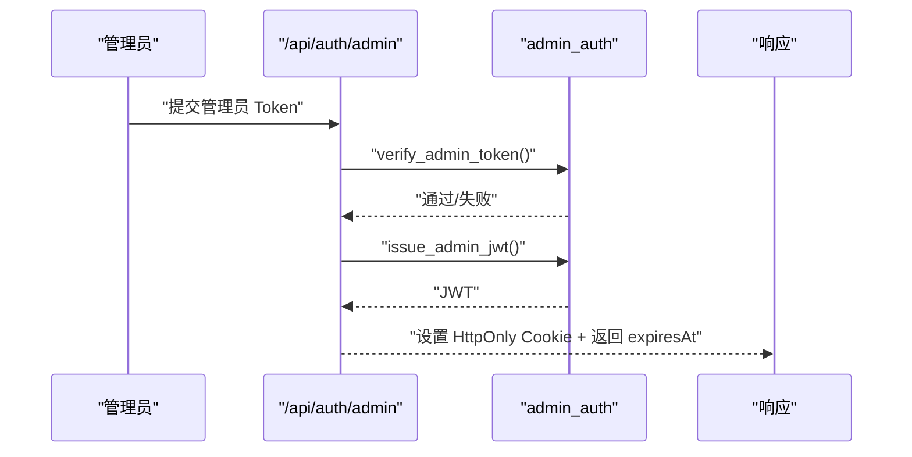
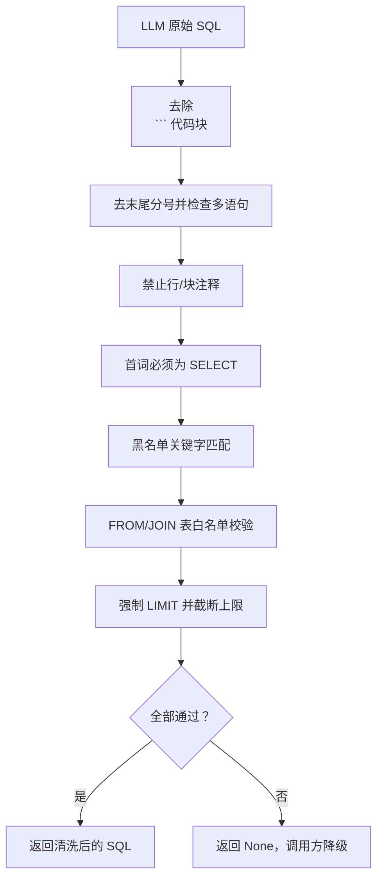
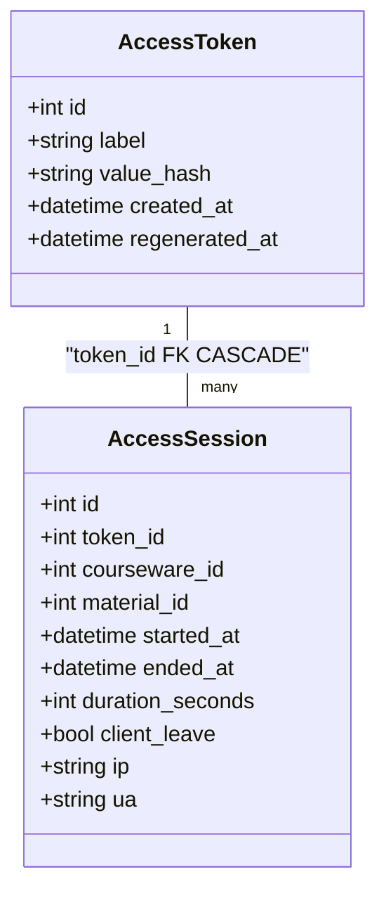
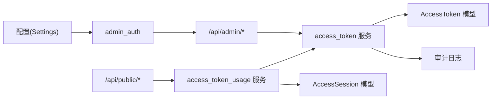

# 数据安全

<cite>
**本文引用的文件**   
- [access_token.py](file://backend/app/models/access_token.py)
- [access_token.py](file://backend/app/services/access_token.py)
- [auth.py](file://backend/app/api/auth.py)
- [admin_auth.py](file://backend/app/middleware/admin_auth.py)
- [config.py](file://backend/app/core/config.py)
- [_sql_safety.py](file://backend/app/services/_sql_safety.py)
- [audit.py](file://backend/app/services/audit.py)
- [access_session.py](file://backend/app/models/access_session.py)
- [access_sessions.py](file://backend/app/api/public/access_sessions.py)
- [access_token_usage.py](file://backend/app/services/access_token_usage.py)
- [access_tokens.py](file://backend/app/api/admin/access_tokens.py)
- [errors.py](file://backend/app/core/errors.py)
</cite>

## 目录
1. [引言](#引言)
2. [项目结构](#项目结构)
3. [核心组件](#核心组件)
4. [架构总览](#架构总览)
5. [详细组件分析](#详细组件分析)
6. [依赖关系分析](#依赖关系分析)
7. [性能与安全权衡](#性能与安全权衡)
8. [故障排查指南](#故障排查指南)
9. [结论](#结论)
10. [附录：安全配置最佳实践与漏洞防护清单](#附录安全配置最佳实践与漏洞防护清单)

## 引言
本设计文档聚焦 Learning Hub 的数据安全，围绕访问令牌的安全机制、权限控制模型（开放模式与受限模式）、敏感数据保护、SQL 注入与 XSS 防护、审计日志、以及加密与传输安全等方面展开。目标是为研发、运维与合规人员提供可落地的安全设计与实施参考。

## 项目结构
后端采用分层架构：API 路由层 → 业务服务层 → 数据模型层；中间件负责鉴权；配置集中管理；审计日志独立模块；LLM SQL 白名单校验作为专用安全组件。

图示来源
- [auth.py:1-49](file://backend/app/api/auth.py#L1-L49)
- [admin_auth.py:1-66](file://backend/app/middleware/admin_auth.py#L1-L66)
- [access_tokens.py:1-120](file://backend/app/api/admin/access_tokens.py#L1-L120)
- [access_sessions.py:1-137](file://backend/app/api/public/access_sessions.py#L1-L137)
- [access_token.py:1-235](file://backend/app/services/access_token.py#L1-L235)
- [access_token_usage.py:1-518](file://backend/app/services/access_token_usage.py#L1-L518)
- [_sql_safety.py:1-220](file://backend/app/services/_sql_safety.py#L1-L220)
- [audit.py:1-45](file://backend/app/services/audit.py#L1-L45)
- [access_token.py:1-34](file://backend/app/models/access_token.py#L1-L34)
- [access_session.py:1-129](file://backend/app/models/access_session.py#L1-L129)
- [config.py:1-88](file://backend/app/core/config.py#L1-L88)

章节来源
- [auth.py:1-49](file://backend/app/api/auth.py#L1-L49)
- [admin_auth.py:1-66](file://backend/app/middleware/admin_auth.py#L1-L66)
- [access_tokens.py:1-120](file://backend/app/api/admin/access_tokens.py#L1-L120)
- [access_sessions.py:1-137](file://backend/app/api/public/access_sessions.py#L1-L137)
- [access_token.py:1-235](file://backend/app/services/access_token.py#L1-L235)
- [access_token_usage.py:1-518](file://backend/app/services/access_token_usage.py#L1-L518)
- [_sql_safety.py:1-220](file://backend/app/services/_sql_safety.py#L1-L220)
- [audit.py:1-45](file://backend/app/services/audit.py#L1-L45)
- [access_token.py:1-34](file://backend/app/models/access_token.py#L1-L34)
- [access_session.py:1-129](file://backend/app/models/access_session.py#L1-L129)
- [config.py:1-88](file://backend/app/core/config.py#L1-L88)

## 核心组件
- 访问令牌服务：负责令牌的生成、哈希存储、验证、重新生成与删除，确保明文仅一次性返回。
- 管理员鉴权中间件：基于 JWT 的会话签发与校验，支持 Cookie 与 Bearer 两种提取方式。
- 访问会话服务：记录受限素材的访问行为，进行 ACL 校验、时长校正与聚合统计。
- SQL 白名单校验：对 LLM 生成的 SQL 执行七道闸过滤，限制表范围与操作类型，强制 LIMIT。
- 审计日志：以 JSON Lines 格式持久化关键管理操作。
- 配置中心：集中管理数据库、JWT、CORS、时区等运行参数。

章节来源
- [access_token.py:1-235](file://backend/app/services/access_token.py#L1-L235)
- [admin_auth.py:1-66](file://backend/app/middleware/admin_auth.py#L1-L66)
- [access_token_usage.py:1-518](file://backend/app/services/access_token_usage.py#L1-L518)
- [_sql_safety.py:1-220](file://backend/app/services/_sql_safety.py#L1-L220)
- [audit.py:1-45](file://backend/app/services/audit.py#L1-L45)
- [config.py:1-88](file://backend/app/core/config.py#L1-L88)

## 架构总览
下图展示了从请求进入、鉴权、业务处理到数据存储与审计的全链路安全要点。

图示来源
- [auth.py:1-49](file://backend/app/api/auth.py#L1-L49)
- [admin_auth.py:1-66](file://backend/app/middleware/admin_auth.py#L1-L66)
- [access_tokens.py:1-120](file://backend/app/api/admin/access_tokens.py#L1-L120)
- [access_token.py:1-235](file://backend/app/services/access_token.py#L1-L235)
- [audit.py:1-45](file://backend/app/services/audit.py#L1-L45)

## 详细组件分析

### 访问令牌安全机制
- 存储策略：数据库仅保存 value_hash（SHA-256），不保存明文。
- 生成算法：使用密码学安全的随机源生成固定长度 base36 字符串，再计算 SHA-256 摘要入库。
- 生命周期：创建/重新生成时一次性返回明文；后续所有接口仅返回 value_hash；支持删除与引用约束检查。
- 验证流程：将传入明文计算哈希后，使用常量时间比较函数与库中 active token 逐一比对，避免时序攻击。
- 列表展示：列表与详情接口均只返回 value_hash，不暴露明文。

图示来源
- [access_token.py:1-235](file://backend/app/services/access_token.py#L1-L235)
- [access_token.py:1-34](file://backend/app/models/access_token.py#L1-L34)

章节来源
- [access_token.py:1-235](file://backend/app/services/access_token.py#L1-L235)
- [access_token.py:1-34](file://backend/app/models/access_token.py#L1-L34)

### 权限控制模型（开放模式与受限模式）
- 开放模式（OPEN）：素材被 OPEN 课件引用时，访问会话不记录，无需 token 授权。
- 受限模式（RESTRICTED）：素材被 RESTRICTED 课件引用时，必须携带有效的 token_hash 且该 token 被至少一个引用课件绑定，否则拒绝访问并记录失败原因。
- 会话记录：仅在 RESTRICTED 场景下写入 access_session，包含 token_id、courseware_id、material_id、起止时间与停留时长等。

图示来源
- [access_token_usage.py:1-518](file://backend/app/services/access_token_usage.py#L1-L518)
- [access_session.py:1-129](file://backend/app/models/access_session.py#L1-L129)

章节来源
- [access_token_usage.py:1-518](file://backend/app/services/access_token_usage.py#L1-L518)
- [access_session.py:1-129](file://backend/app/models/access_session.py#L1-L129)

### 敏感数据保护措施
- Token 明文值：仅在创建/重新生成时一次性返回，后续不再返回；列表与详情仅返回 value_hash。
- 前端显示：建议前端对 value_hash 做掩码展示（如仅显示前后若干字符），避免完整哈希泄露。
- 临时处理：服务端在内存中持有明文的时间窗口极短，不落盘、不写日志。

章节来源
- [access_token.py:1-235](file://backend/app/services/access_token.py#L1-L235)
- [access_tokens.py:1-120](file://backend/app/api/admin/access_tokens.py#L1-L120)

### 管理员鉴权与会话管理
- 登录流程：校验管理员 Token（常量时间比较），签发 JWT，写入 HttpOnly Cookie，设置 SameSite 与过期时间。
- 鉴权中间件：优先从 Authorization: Bearer 或 Cookie LH_ADMIN_SESSION 提取令牌，解码并校验 exp/sub 字段。
- 会话失效：过期或无效令牌统一返回未认证错误。

图示来源
- [auth.py:1-49](file://backend/app/api/auth.py#L1-L49)
- [admin_auth.py:1-66](file://backend/app/middleware/admin_auth.py#L1-L66)

章节来源
- [auth.py:1-49](file://backend/app/api/auth.py#L1-L49)
- [admin_auth.py:1-66](file://backend/app/middleware/admin_auth.py#L1-L66)
- [config.py:1-88](file://backend/app/core/config.py#L1-L88)

### SQL 注入防护（LLM SQL 白名单）
- 七道闸规则：去 markdown 包裹、单语句、无注释、首词 SELECT、黑名单关键字、表白名单、强制 LIMIT。
- 表白名单：仅允许业务主表与关联表，禁止系统表前缀与 schema 限定形式。
- 限流上限：HARD_LIMIT_CEIL 硬上限，缺失 LIMIT 则追加默认值，超过上限则截断。
- 失败降级：任一闸失败返回 None，调用方回退到关键词 ILIKE 搜索。

图示来源
- [_sql_safety.py:1-220](file://backend/app/services/_sql_safety.py#L1-L220)

章节来源
- [_sql_safety.py:1-220](file://backend/app/services/_sql_safety.py#L1-L220)

### 访问会话与审计日志
- 访问会话：记录 token_id、courseware_id、material_id、started_at、ended_at、duration_seconds、client_leave、ip、ua 等；删除 token/courseware/material 时级联清理。
- 审计日志：以 JSON Lines 格式写入 storage_path 下的 logs/audit.jsonl，记录 action、resource、payload 等；失败不影响主流程。

图示来源
- [access_token.py:1-34](file://backend/app/models/access_token.py#L1-L34)
- [access_session.py:1-129](file://backend/app/models/access_session.py#L1-L129)

章节来源
- [access_session.py:1-129](file://backend/app/models/access_session.py#L1-L129)
- [audit.py:1-45](file://backend/app/services/audit.py#L1-L45)

### 公开接口限流与健壮性
- 进程内滑动窗口限流：按 IP 维度限制每分钟请求数，命中则降级为不记录，不阻塞前台。
- 健壮性：数据库异常吞错并返回 recorded=False，保证 P-VIEWER 主流程不受影响。

章节来源
- [access_sessions.py:1-137](file://backend/app/api/public/access_sessions.py#L1-L137)

## 依赖关系分析
- 组件耦合：API 路由依赖中间件与业务服务；服务层依赖模型与审计；配置集中注入。
- 外部依赖：JWT 编解码、SQLAlchemy ORM、Pydantic Settings、re 正则表达式。
- 潜在风险：若 JWT secret 泄露或过短，将导致会话伪造风险；若 CORS 配置不当，可能引发跨站请求风险。

图示来源
- [config.py:1-88](file://backend/app/core/config.py#L1-L88)
- [admin_auth.py:1-66](file://backend/app/middleware/admin_auth.py#L1-L66)
- [access_tokens.py:1-120](file://backend/app/api/admin/access_tokens.py#L1-L120)
- [access_token.py:1-235](file://backend/app/services/access_token.py#L1-L235)
- [access_token_usage.py:1-518](file://backend/app/services/access_token_usage.py#L1-L518)
- [access_sessions.py:1-137](file://backend/app/api/public/access_sessions.py#L1-L137)
- [audit.py:1-45](file://backend/app/services/audit.py#L1-L45)

章节来源
- [config.py:1-88](file://backend/app/core/config.py#L1-L88)
- [admin_auth.py:1-66](file://backend/app/middleware/admin_auth.py#L1-L66)
- [access_tokens.py:1-120](file://backend/app/api/admin/access_tokens.py#L1-L120)
- [access_token.py:1-235](file://backend/app/services/access_token.py#L1-L235)
- [access_token_usage.py:1-518](file://backend/app/services/access_token_usage.py#L1-L518)
- [access_sessions.py:1-137](file://backend/app/api/public/access_sessions.py#L1-L137)
- [audit.py:1-45](file://backend/app/services/audit.py#L1-L45)

## 性能与安全权衡
- 令牌验证：当前实现遍历 active token 并使用常量时间比较，适合少量活跃令牌场景；若令牌数量增长，建议引入索引与批量比对优化。
- 会话记录：RESTRICTED 场景才落库，降低写入压力；聚合查询使用子查询与窗口函数提升效率。
- SQL 白名单：正则与规则校验开销较小，但应避免过度复杂正则；LIMIT 强制保障查询性能。

[本节为通用指导，不涉及具体文件分析]

## 故障排查指南
- 未认证/会话过期：检查 JWT secret 与 TTL 配置，确认 Cookie 是否被浏览器拦截或跨域限制。
- 令牌无效：确认 X-Token-Hash 或 cookie lh_token_hash 是否正确传递；核对 token_hash 与数据库中 value_hash 一致。
- 无权访问：检查 token 是否被 RESTRICTED 课件引用；确认 token 未被重新生成导致旧值失效。
- 审计日志缺失：检查 storage_path 权限与磁盘空间；确认审计写入异常未阻断主流程。
- SQL 白名单失败：查看 LLM 输出是否包含注释、多语句或黑名单关键字；确认 FROM/JOIN 表名在白名单内。

章节来源
- [admin_auth.py:1-66](file://backend/app/middleware/admin_auth.py#L1-L66)
- [access_sessions.py:1-137](file://backend/app/api/public/access_sessions.py#L1-L137)
- [access_token_usage.py:1-518](file://backend/app/services/access_token_usage.py#L1-L518)
- [audit.py:1-45](file://backend/app/services/audit.py#L1-L45)
- [_sql_safety.py:1-220](file://backend/app/services/_sql_safety.py#L1-L220)

## 结论
Learning Hub 在访问令牌安全、权限控制、SQL 注入防护、审计日志与健壮性方面形成了较为完善的安全体系。通过哈希存储、常量时间比较、白名单校验与强制 LIMIT、HttpOnly Cookie 与 CORS 配置等手段，有效降低了常见安全风险。建议在规模化部署中进一步优化令牌验证与审计采集，并持续强化传输安全与密钥管理。

[本节为总结，不涉及具体文件分析]

## 附录：安全配置最佳实践与漏洞防护清单
- 令牌与密钥
  - 使用强随机源生成令牌与 JWT secret，secret 长度满足算法要求并定期轮换。
  - 令牌明文仅一次性返回，前端应做掩码展示与最小化存储。
- 传输安全
  - 生产环境强制 HTTPS，启用 HSTS，HTTP 请求重定向至 HTTPS。
  - Cookie 设置 HttpOnly、SameSite=Lax/Strict，合理设置 Path 与 Max-Age。
- 输入与查询
  - 对所有用户输入进行严格校验与长度限制；SQL 查询使用参数化或白名单校验。
  - LLM 生成的 SQL 必须通过白名单七道闸，失败即降级。
- 权限与访问控制
  - 区分开放与受限模式，受限素材仅允许授权 token 访问。
  - 管理员接口统一通过 JWT 中间件保护，未认证/过期统一返回 401。
- 审计与监控
  - 关键管理操作写入审计日志，保留必要上下文但不含敏感明文。
  - 对高频接口实施限流，防止暴力破解与滥用。
- 错误与日志
  - 统一错误码与信封响应，避免泄露堆栈与内部细节。
  - 审计失败不阻断主流程，但需告警与巡检。

[本节为通用指导，不涉及具体文件分析]