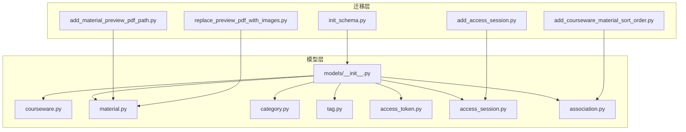
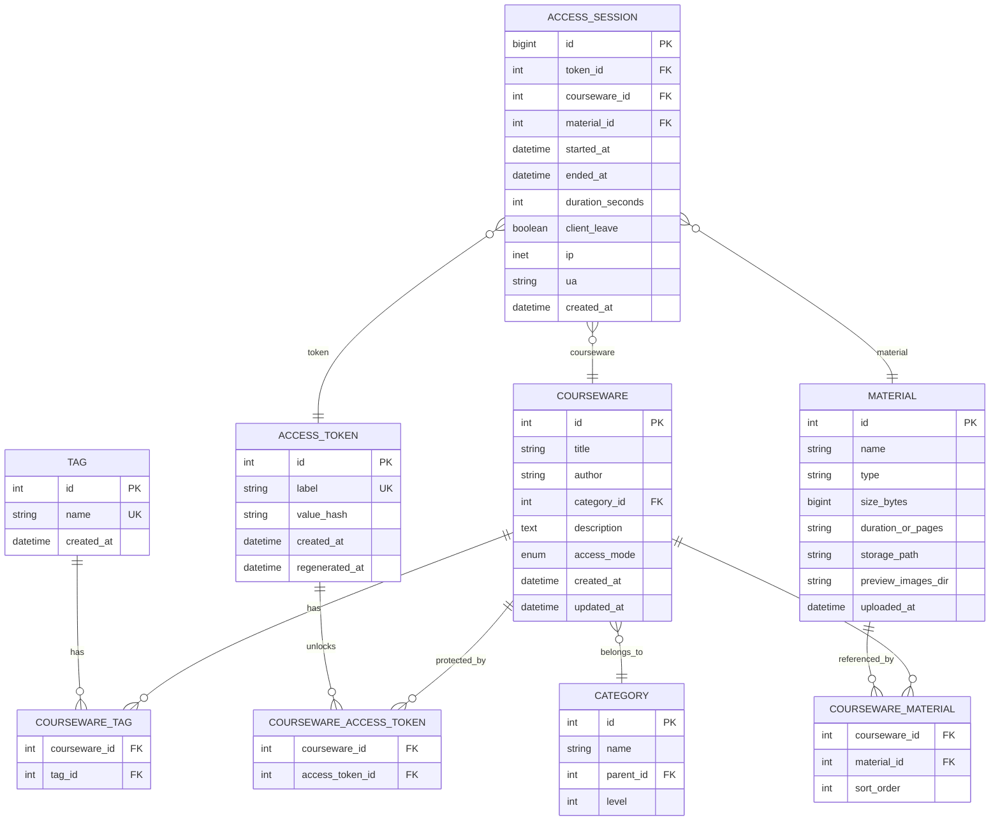
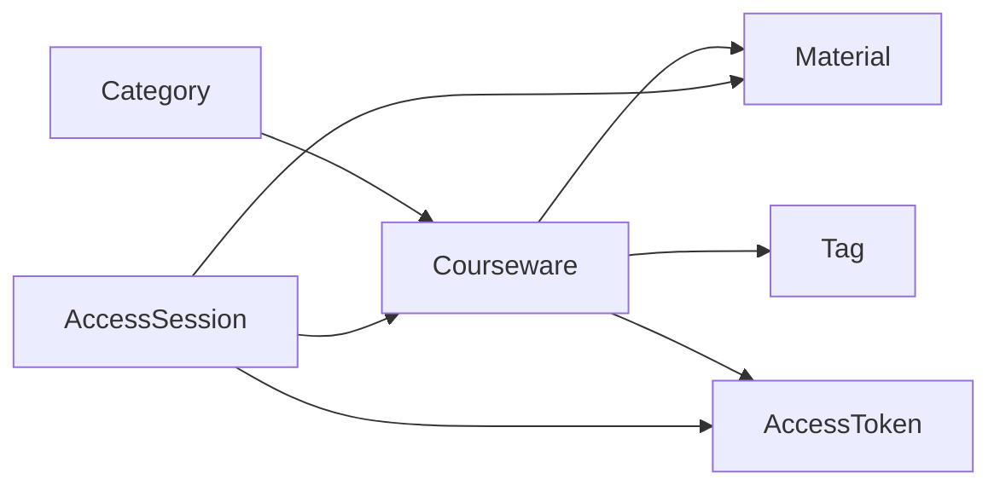

# 数据库设计

<cite>
**本文引用的文件**   
- [backend/app/models/courseware.py](file://backend/app/models/courseware.py)
- [backend/app/models/material.py](file://backend/app/models/material.py)
- [backend/app/models/category.py](file://backend/app/models/category.py)
- [backend/app/models/tag.py](file://backend/app/models/tag.py)
- [backend/app/models/access_token.py](file://backend/app/models/access_token.py)
- [backend/app/models/association.py](file://backend/app/models/association.py)
- [backend/app/models/access_session.py](file://backend/app/models/access_session.py)
- [backend/app/models/__init__.py](file://backend/app/models/__init__.py)
- [backend/alembic/versions/2026_07_06_1745-11f9c69846a9_init_schema.py](file://backend/alembic/versions/2026_07_06_1745-11f9c69846a9_init_schema.py)
- [backend/alembic/versions/2026_07_07_0900-a1b2c3d4e5f6_add_material_preview_pdf_path.py](file://backend/alembic/versions/2026_07_07_0900-a1b2c3d4e5f6_add_material_preview_pdf_path.py)
- [backend/alembic/versions/2026_07_07_1230-b2c3d4e5f607_replace_preview_pdf_with_images.py](file://backend/alembic/versions/2026_07_07_1230-b2c3d4e5f607_replace_preview_pdf_with_images.py)
- [backend/alembic/versions/2026_07_10_0930-c1d2e3f4a5b6_add_access_session.py](file://backend/alembic/versions/2026_07_10_0930-c1d2e3f4a5b6_add_access_session.py)
- [backend/alembic/versions/2026_07_10_1800-d2e3f4a5b6c7_add_courseware_material_sort_order.py](file://backend/alembic/versions/2026_07_10_1800-d2e3f4a5b6c7_add_courseware_material_sort_order.py)
- [doc/spec/05-数据模型.md](file://doc/spec/05-数据模型.md)
</cite>

## 目录
1. [引言](#引言)
2. [项目结构](#项目结构)
3. [核心组件](#核心组件)
4. [架构总览](#架构总览)
5. [详细组件分析](#详细组件分析)
6. [依赖关系分析](#依赖关系分析)
7. [性能与索引策略](#性能与索引策略)
8. [故障排查指南](#故障排查指南)
9. [结论](#结论)
10. [附录：SQL 建表语句与迁移说明](#附录sql-建表语句与迁移说明)

## 引言
本文件面向 Learning Hub 的数据库设计与实现，围绕课件（Courseware）、素材（Material）、分类（Category）、标签（Tag）、访问令牌（AccessToken）以及访问会话（AccessSession）等核心实体，给出完整的字段定义、数据类型选择原因、约束条件与业务规则；解释多对多关系的实现方式（含排序扩展），并总结索引策略、完整性保证机制与外键级联策略。文档同时提供基于 Alembic 的数据迁移路径说明，便于读者理解从初始 schema 到当前版本的演进过程。

## 项目结构
后端采用 SQLAlchemy ORM + Alembic 进行数据建模与版本化迁移。核心模型集中在 app/models 下，并通过 __init__.py 集中注册，供 Alembic 一次性识别所有元数据。迁移脚本位于 alembic/versions，按时间戳命名，记录每次 schema 变更。

图表来源
- [backend/app/models/__init__.py:1-30](file://backend/app/models/__init__.py#L1-L30)
- [backend/alembic/versions/2026_07_06_1745-11f9c69846a9_init_schema.py:21-96](file://backend/alembic/versions/2026_07_06_1745-11f9c69846a9_init_schema.py#L21-L96)
- [backend/alembic/versions/2026_07_07_0900-a1b2c3d4e5f6_add_material_preview_pdf_path.py:21-30](file://backend/alembic/versions/2026_07_07_0900-a1b2c3d4e5f6_add_material_preview_pdf_path.py#L21-L30)
- [backend/alembic/versions/2026_07_07_1230-b2c3d4e5f607_replace_preview_pdf_with_images.py:30-39](file://backend/alembic/versions/2026_07_07_1230-b2c3d4e5f607_replace_preview_pdf_with_images.py#L30-L39)
- [backend/alembic/versions/2026_07_10_0930-c1d2e3f4a5b6_add_access_session.py:21-103](file://backend/alembic/versions/2026_07_10_0930-c1d2e3f4a5b6_add_access_session.py#L21-L103)
- [backend/alembic/versions/2026_07_10_1800-d2e3f4a5b6c7_add_courseware_material_sort_order.py:33-104](file://backend/alembic/versions/2026_07_10_1800-d2e3f4a5b6c7_add_courseware_material_sort_order.py#L33-L104)

章节来源
- [backend/app/models/__init__.py:1-30](file://backend/app/models/__init__.py#L1-L30)

## 核心组件
本节概述各核心实体的职责与关键特性：
- Courseware：课件主实体，包含标题、作者、分类、描述、访问模式及时间戳；通过多对多关联 Tag、Material、AccessToken。
- Material：素材元数据，存储文件名、类型、大小、时长或页数、物理路径、预览图片目录、上传时间。
- Category：三级树形分类，支持自引用 parent_id 与 level。
- Tag：扁平标签，name 全局唯一。
- AccessToken：访问令牌，label 全局唯一，value_hash 为 SHA-256 摘要。
- AccessSession：访问会话，记录 token 持有者对受限课件素材的浏览起止时间与停留秒数等。

章节来源
- [backend/app/models/courseware.py:21-73](file://backend/app/models/courseware.py#L21-L73)
- [backend/app/models/material.py:44-68](file://backend/app/models/material.py#L44-L68)
- [backend/app/models/category.py:12-45](file://backend/app/models/category.py#L12-L45)
- [backend/app/models/tag.py:13-29](file://backend/app/models/tag.py#L13-L29)
- [backend/app/models/access_token.py:13-33](file://backend/app/models/access_token.py#L13-L33)
- [backend/app/models/access_session.py:56-128](file://backend/app/models/access_session.py#L56-L128)

## 架构总览
下图展示了核心实体间的关系与多对多关联表，以及访问会话与三张主表的关联。

图表来源
- [backend/app/models/courseware.py:21-73](file://backend/app/models/courseware.py#L21-L73)
- [backend/app/models/material.py:44-68](file://backend/app/models/material.py#L44-L68)
- [backend/app/models/category.py:12-45](file://backend/app/models/category.py#L12-L45)
- [backend/app/models/tag.py:13-29](file://backend/app/models/tag.py#L13-L29)
- [backend/app/models/access_token.py:13-33](file://backend/app/models/access_token.py#L13-L33)
- [backend/app/models/association.py:9-33](file://backend/app/models/association.py#L9-L33)
- [backend/app/models/access_session.py:56-128](file://backend/app/models/access_session.py#L56-L128)

## 详细组件分析

### 课件（Courseware）
- 设计理念：作为学习资源组织的基本单元，承载元信息与访问控制模式。
- 关键字段
  - id：整型自增主键。
  - title：非空字符串，最大长度 100。
  - author：可选字符串，最大长度 50。
  - category_id：外键指向 category.id，删除分类时 RESTRICT（防止误删）。
  - description：文本描述，可为空。
  - access_mode：枚举 OPEN/RESTRICTED，默认 OPEN。
  - created_at/updated_at：带时区的时间戳，创建/更新时间由服务端默认值维护。
- 关系
  - 与 Category：N:1，lazy="joined" 优化读取。
  - 与 Tag/Material/AccessToken：M:N，使用 association 表。
- 业务规则
  - 受限模式需至少关联一个有效 AccessToken（见规格文档 R-12）。
- 复杂度与性能
  - 列表查询常按 created_at 倒序，建议建立相应索引。

章节来源
- [backend/app/models/courseware.py:21-73](file://backend/app/models/courseware.py#L21-L73)
- [doc/spec/05-数据模型.md:71-83](file://doc/spec/05-数据模型.md#L71-L83)

### 素材（Material）
- 设计理念：以文件系统存储二进制内容，数据库仅保存元数据与预览信息。
- 关键字段
  - id：整型自增主键。
  - name：原始文件名，最大长度 255。
  - type：字符串枚举 VIDEO/PDF/PPT，用于前端渲染与处理逻辑。
  - size_bytes：文件大小（字节），BigInteger。
  - duration_or_pages：视频时长或 PDF/PPT 页数，字符串形式。
  - storage_path：物理存储路径，最大长度 512。
  - preview_images_dir：PPT 转 PNG 预览图目录路径，可为空。
  - uploaded_at：上传时间，带时区。
- 业务规则
  - 扩展名白名单与大小上限在业务层校验。
  - PPT 转换失败不阻断上传，结果写入 preview_images_dir。
- 复杂度与性能
  - 大对象不落库，避免数据库膨胀；查询主要命中元数据列。

章节来源
- [backend/app/models/material.py:44-68](file://backend/app/models/material.py#L44-L68)
- [doc/spec/05-数据模型.md:107-126](file://doc/spec/05-数据模型.md#L107-L126)

### 分类（Category）
- 设计理念：支持 3 级树形结构，parent_id 自引用，level 表示层级深度。
- 关键字段
  - id：整型自增主键。
  - name：名称，最大长度 30。
  - parent_id：父节点 ID，根为 NULL。
  - level：1/2/3。
- 约束与索引
  - 同一父节点下名称唯一（UniqueConstraint）。
  - 针对 parent_id 建立索引加速子树查询。
- 业务规则
  - 删除父节点若存在子节点或被课件引用则禁止删除（ondelete=RESTRICT）。

章节来源
- [backend/app/models/category.py:12-45](file://backend/app/models/category.py#L12-L45)
- [doc/spec/05-数据模型.md:84-96](file://doc/spec/05-数据模型.md#L84-L96)

### 标签（Tag）
- 设计理念：扁平标签，name 全局唯一，用于课件检索与筛选。
- 关键字段
  - id：整型自增主键。
  - name：唯一字符串，最大长度 30。
  - created_at：创建时间。
- 业务规则
  - 删除标签自动解绑全部课件（CASCADE）。

章节来源
- [backend/app/models/tag.py:13-29](file://backend/app/models/tag.py#L13-L29)
- [doc/spec/05-数据模型.md:97-105](file://doc/spec/05-数据模型.md#L97-L105)

### 访问令牌（AccessToken）
- 设计理念：管理受限课件的访问授权，明文值不持久化，仅存哈希。
- 关键字段
  - id：整型自增主键。
  - label：全局唯一标识，最大长度 50。
  - value_hash：SHA-256 摘要，固定长度 64，建立索引。
  - created_at/regenerated_at：创建与最近一次重新生成时间。
- 业务规则
  - 受限课件必须保持至少一个有效 Token（R-12）。
  - 原文仅在创建/重新生成瞬间返回一次。

章节来源
- [backend/app/models/access_token.py:13-33](file://backend/app/models/access_token.py#L13-L33)
- [doc/spec/05-数据模型.md:127-141](file://doc/spec/05-数据模型.md#L127-L141)

### 访问会话（AccessSession）
- 设计理念：记录 token 持有者在 P-VIEWER 中对受限课件素材的一次完整浏览，用于审计与分析。
- 关键字段
  - id：跨方言兼容的主键（PostgreSQL BIGINT，SQLite INTEGER）。
  - token_id/courseware_id/material_id：外键，均 ON DELETE CASCADE。
  - started_at/ended_at：带时区时间戳。
  - duration_seconds：停留秒数，CHECK ≥ 0。
  - client_leave：是否收到客户端关闭信号。
  - ip：IP 地址（PostgreSQL INET，其他方言降级为 VARCHAR(45)）。
  - ua：User-Agent。
  - created_at：入库时间。
- 索引
  - 针对 token_id+started_at、token_id+material_id+started_at、token_id+courseware_id+started_at 建立复合索引，支撑分页与聚合查询。
- 业务规则
  - 仅当素材被至少一个 RESTRICTED 课件引用时才允许落库。
  - 客户端上报时长与服务端计算偏差 > 60s 时，按服务端时间校正。
  - 删除 token 时级联清理其历史 session。

章节来源
- [backend/app/models/access_session.py:56-128](file://backend/app/models/access_session.py#L56-L128)
- [doc/spec/05-数据模型.md:259-291](file://doc/spec/05-数据模型.md#L259-L291)

### 多对多关联表（CoursewareTag / CoursewareMaterial / CoursewareAccessToken）
- 设计理念：将多对多关系显式化为中间表，便于扩展属性（如排序）与维护一致性。
- 关键字段与约束
  - courseware_tag：联合主键 (courseware_id, tag_id)，外键均 CASCADE。
  - courseware_material：联合主键 (courseware_id, material_id)，新增 sort_order 字段（整数，非空，默认 0），并提供复合索引 (courseware_id, sort_order) 加速有序读取。
  - courseware_access_token：联合主键 (courseware_id, access_token_id)，外键均 CASCADE。
- 业务规则
  - sort_order 在同一课件内连续递增（0..N-1），管理员可拖拽调整顺序。

章节来源
- [backend/app/models/association.py:9-33](file://backend/app/models/association.py#L9-L33)
- [doc/spec/05-数据模型.md:142-171](file://doc/spec/05-数据模型.md#L142-L171)

## 依赖关系分析
- 直接依赖
  - Courseware 依赖 Category（外键）。
  - Courseware 与 Tag/Material/AccessToken 通过 association 表形成 M:N。
  - AccessSession 依赖 AccessToken/Courseware/Material（外键）。
- 间接依赖
  - 迁移脚本依赖模型元数据，确保 Alembic 能识别所有表结构。
- 潜在循环
  - 模型间无循环导入（__init__.py 集中导入避免循环）。
- 外部依赖
  - PostgreSQL 原生 INET 类型与 SQLite 降级策略。
  - 窗口函数 ROW_NUMBER() 用于回填 sort_order。

图表来源
- [backend/app/models/courseware.py:21-73](file://backend/app/models/courseware.py#L21-L73)
- [backend/app/models/association.py:9-33](file://backend/app/models/association.py#L9-L33)
- [backend/app/models/access_session.py:56-128](file://backend/app/models/access_session.py#L56-L128)

章节来源
- [backend/app/models/__init__.py:1-30](file://backend/app/models/__init__.py#L1-L30)

## 性能与索引策略
- 主键与唯一性
  - 所有主键均为自增整型（跨方言兼容），唯一性约束保障业务语义（如 tag.name、access_token.label、category.parent_id+name）。
- 常用查询索引
  - courseware.category_id、created_at 倒序。
  - category.parent_id。
  - material.type、uploaded_at 倒序。
  - courseware_tag(courseware_id, tag_id)。
  - courseware_material(courseware_id, material_id)、(courseware_id, sort_order)。
  - courseware_access_token(courseware_id, access_token_id)。
  - access_token.value_hash。
  - access_session(token_id, started_at)、(token_id, material_id, started_at)、(token_id, courseware_id, started_at)。
- 复合索引与覆盖
  - 针对高频过滤与排序组合建立复合索引，减少回表与扫描成本。
- 大对象与全文检索
  - 二进制文件走文件系统，数据库仅存路径；如需全文检索可在应用层引入搜索引擎（推断建议，见规格文档索引建议）。

章节来源
- [doc/spec/05-数据模型.md:244-256](file://doc/spec/05-数据模型.md#L244-L256)
- [backend/alembic/versions/2026_07_10_1800-d2e3f4a5b6c7_add_courseware_material_sort_order.py:98-104](file://backend/alembic/versions/2026_07_10_1800-d2e3f4a5b6c7_add_courseware_material_sort_order.py#L98-L104)
- [backend/alembic/versions/2026_07_10_0930-c1d2e3f4a5b6_add_access_session.py:67-102](file://backend/alembic/versions/2026_07_10_0930-c1d2e3f4a5b6_add_access_session.py#L67-L102)

## 故障排查指南
- 外键冲突
  - 删除分类/素材/标签时报外键约束错误：检查是否存在下游引用（课程、关联表）。
- 唯一性冲突
  - 插入重复 tag.name 或 access_token.label：确认业务层去重或提示用户修改。
- 权限与访问控制
  - 受限课件无法访问：检查是否关联了有效的 AccessToken，且未过期或被删除。
- 预览问题
  - PPT 预览不可用：确认 preview_images_dir 是否存在且可读；若为空，前端应降级为“下载到本地”。
- 会话异常
  - 访问会话缺失或时长异常：核对客户端上报的 duration_seconds 与服务端计算差异是否超过阈值；检查 token/courseware/material 是否存在。

章节来源
- [backend/app/models/access_session.py:56-128](file://backend/app/models/access_session.py#L56-L128)
- [backend/app/models/material.py:44-68](file://backend/app/models/material.py#L44-L68)
- [backend/app/models/tag.py:13-29](file://backend/app/models/tag.py#L13-L29)
- [backend/app/models/access_token.py:13-33](file://backend/app/models/access_token.py#L13-L33)

## 结论
Learning Hub 的数据库设计以清晰的核心实体与显式的多对多关联表为基础，结合严格的约束与合理的索引策略，兼顾了功能完备性与性能表现。通过 Alembic 的版本化迁移，schema 演进具备可追溯性与可回滚能力。访问会话表进一步增强了受限资源的审计能力。整体设计遵循最小化冗余、最大化一致性的原则，适合持续迭代与扩展。

## 附录：SQL 建表语句与迁移说明

### 初始 Schema（v1.0）
- 创建以下表：access_token、category、material、tag、courseware、courseware_access_token、courseware_material、courseware_tag。
- 设置主键、外键、唯一约束与基础注释。
- 为 access_token.value_hash 建立索引。

章节来源
- [backend/alembic/versions/2026_07_06_1745-11f9c69846a9_init_schema.py:21-96](file://backend/alembic/versions/2026_07_06_1745-11f9c69846a9_init_schema.py#L21-L96)

### 增加 PPT 预览 PDF 路径（v1.1）
- 为 material 表新增 preview_pdf_path 字段，用于存放 LibreOffice 转换后的 PDF 路径。

章节来源
- [backend/alembic/versions/2026_07_07_0900-a1b2c3d4e5f6_add_material_preview_pdf_path.py:21-30](file://backend/alembic/versions/2026_07_07_0900-a1b2c3d4e5f6_add_material_preview_pdf_path.py#L21-L30)

### 替换为预览图片目录（v1.2）
- 新增 material.preview_images_dir 字段，用于存放每页 PNG 预览图目录。
- 保留旧列 preview_pdf_path 以保持向后兼容。

章节来源
- [backend/alembic/versions/2026_07_07_1230-b2c3d4e5f607_replace_preview_pdf_with_images.py:30-39](file://backend/alembic/versions/2026_07_07_1230-b2c3d4e5f607_replace_preview_pdf_with_images.py#L30-L39)

### 增加访问会话表（v1.4）
- 创建 access_session 表，包含 token_id、courseware_id、material_id、started_at、ended_at、duration_seconds、client_leave、ip、ua、created_at。
- 添加 CHECK 约束（duration_seconds ≥ 0）与多个复合索引。
- 外键均设置为 ON DELETE CASCADE。

章节来源
- [backend/alembic/versions/2026_07_10_0930-c1d2e3f4a5b6_add_access_session.py:21-103](file://backend/alembic/versions/2026_07_10_0930-c1d2e3f4a5b6_add_access_session.py#L21-L103)

### 增加素材排序字段（v1.5）
- 为 courseware_material 新增 sort_order 字段（整数，非空，默认 0）。
- 回填逻辑：按 courseware_id 分区，依据 material_id 升序计算行号，得到 0..N-1 连续编号。
- 新增复合索引 (courseware_id, sort_order) 加速有序读取。

章节来源
- [backend/alembic/versions/2026_07_10_1800-d2e3f4a5b6c7_add_courseware_material_sort_order.py:33-104](file://backend/alembic/versions/2026_07_10_1800-d2e3f4a5b6c7_add_courseware_material_sort_order.py#L33-L104)