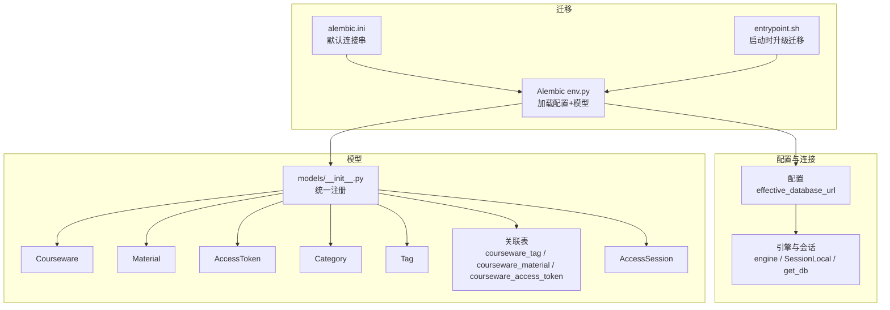
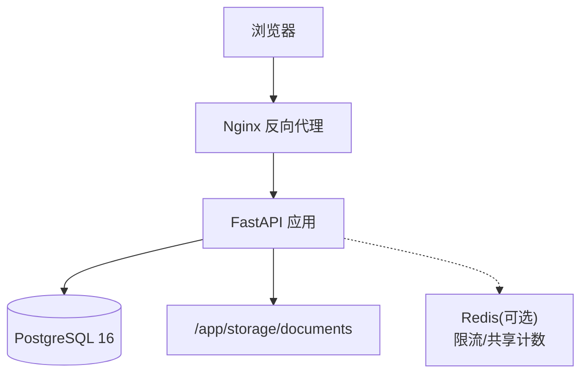
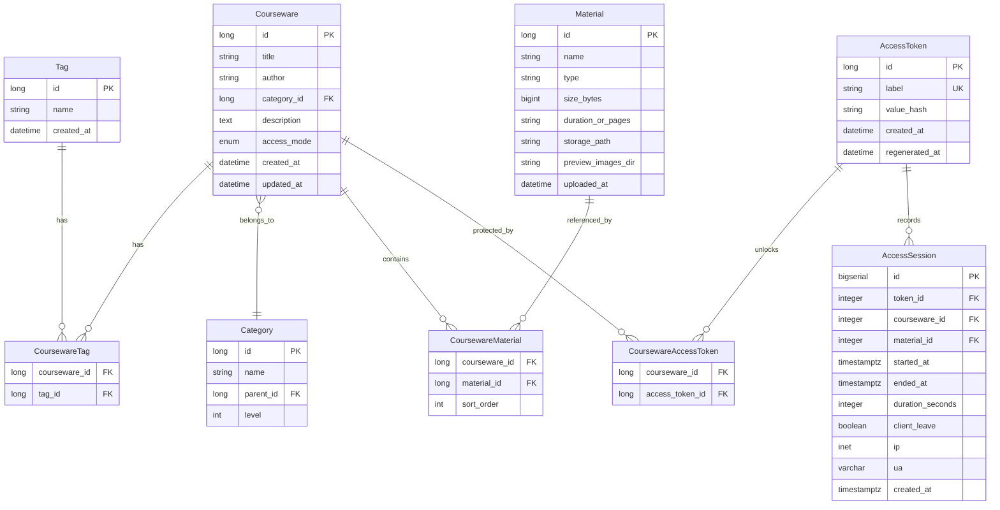
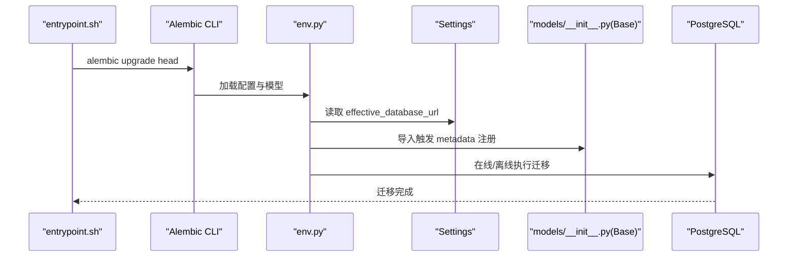
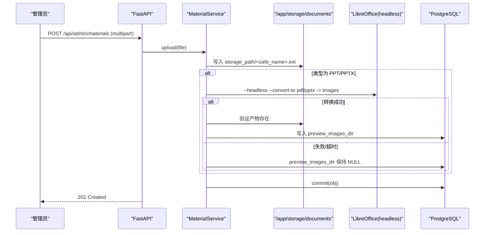
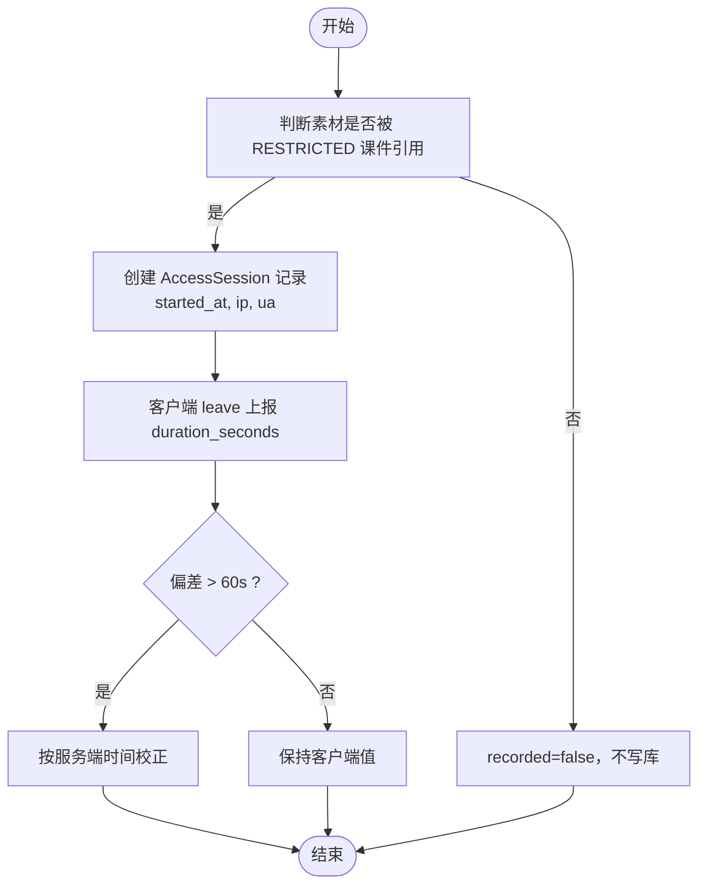
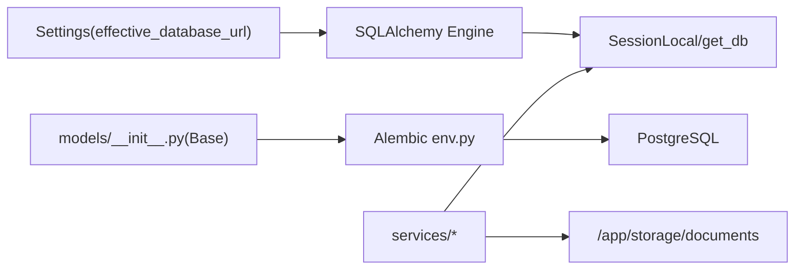

# 数据架构设计

<cite>
**本文引用的文件**   
- [backend/app/core/config.py](file://backend/app/core/config.py)
- [backend/app/db/__init__.py](file://backend/app/db/__init__.py)
- [backend/alembic/env.py](file://backend/alembic/env.py)
- [backend/alembic.ini](file://backend/alembic.ini)
- [backend/entrypoint.sh](file://backend/entrypoint.sh)
- [backend/app/models/__init__.py](file://backend/app/models/__init__.py)
- [backend/app/models/courseware.py](file://backend/app/models/courseware.py)
- [backend/app/models/material.py](file://backend/app/models/material.py)
- [backend/app/models/access_token.py](file://backend/app/models/access_token.py)
- [backend/app/models/category.py](file://backend/app/models/category.py)
- [backend/app/models/tag.py](file://backend/app/models/tag.py)
- [backend/app/models/association.py](file://backend/app/models/association.py)
- [backend/app/models/access_session.py](file://backend/app/models/access_session.py)
- [backend/app/services/access_token_usage.py](file://backend/app/services/access_token_usage.py)
- [backend/app/services/material.py](file://backend/app/services/material.py)
- [doc/spec/05-数据模型.md](file://doc/spec/05-数据模型.md)
- [doc/spec/07-技术架构.md](file://doc/spec/07-技术架构.md)
</cite>

## 目录
1. [引言](#引言)
2. [项目结构](#项目结构)
3. [核心组件](#核心组件)
4. [架构总览](#架构总览)
5. [详细组件分析](#详细组件分析)
6. [依赖关系分析](#依赖关系分析)
7. [性能与一致性](#性能与一致性)
8. [故障排查指南](#故障排查指南)
9. [结论](#结论)
10. [附录](#附录)

## 引言
本文件面向 Learning Hub 的数据架构，聚焦数据库设计理念、模式选择、分层策略、一致性与迁移管理，并给出实体关系图与关键数据流图。目标读者包括后端开发、DBA、运维与产品/测试人员。

## 项目结构
Learning Hub 后端采用 FastAPI + SQLAlchemy ORM + Alembic 的常见分层：配置集中、模型声明式、服务层封装业务、API 路由暴露接口。数据相关的关键位置如下：
- 配置与连接：应用配置与数据库连接串构造、引擎与会话工厂
- 迁移：Alembic 环境加载、在线/离线迁移执行
- 模型：课程、分类、标签、素材、访问令牌、访问会话及关联表
- 服务：访问会话记录、素材上传与预览处理等

图表来源
- [backend/app/core/config.py:28-38](file://backend/app/core/config.py#L28-L38)
- [backend/app/db/__init__.py:15-32](file://backend/app/db/__init__.py#L15-L32)
- [backend/alembic/env.py:16-26](file://backend/alembic/env.py#L16-L26)
- [backend/alembic.ini:1-6](file://backend/alembic.ini#L1-L6)
- [backend/entrypoint.sh:18-19](file://backend/entrypoint.sh#L18-L19)
- [backend/app/models/__init__.py:1-13](file://backend/app/models/__init__.py#L1-L13)

章节来源
- [backend/app/core/config.py:1-88](file://backend/app/core/config.py#L1-L88)
- [backend/app/db/__init__.py:1-50](file://backend/app/db/__init__.py#L1-L50)
- [backend/alembic/env.py:1-63](file://backend/alembic/env.py#L1-L63)
- [backend/alembic.ini:1-39](file://backend/alembic.ini#L1-L39)
- [backend/entrypoint.sh:1-22](file://backend/entrypoint.sh#L1-L22)
- [backend/app/models/__init__.py:1-30](file://backend/app/models/__init__.py#L1-L30)

## 核心组件
- 配置中心：提供 effective_database_url，优先使用 DATABASE_URL，否则拼接 postgresql+psycopg2 连接串；同时承载存储路径、LLM 开关等。
- 数据库连接：基于 SQLAlchemy 同步引擎（适配 Alembic 与同步路由），按方言区分连接池参数；提供每个请求一个 Session 的依赖注入。
- 迁移系统：Alembic 在容器入口自动 upgrade head；env.py 动态注入 URL 并加载全部模型元数据，支持在线/离线模式。
- 数据模型：以 DeclarativeBase 为基类，集中导入触发 metadata 注册；通过 association 表表达多对多关系；新增 AccessSession 用于访问统计。
- 服务层：封装访问会话写入、素材上传与预览生成等跨持久化与文件系统操作。

章节来源
- [backend/app/core/config.py:19-38](file://backend/app/core/config.py#L19-L38)
- [backend/app/db/__init__.py:15-47](file://backend/app/db/__init__.py#L15-L47)
- [backend/alembic/env.py:23-26](file://backend/alembic/env.py#L23-L26)
- [backend/alembic/env.py:29-56](file://backend/alembic/env.py#L29-L56)
- [backend/entrypoint.sh:18-19](file://backend/entrypoint.sh#L18-L19)
- [backend/app/models/__init__.py:1-13](file://backend/app/models/__init__.py#L1-L13)

## 架构总览
整体数据架构围绕 PostgreSQL 主数据存储，辅以本地文件存储（后续可抽象为对象存储）与可选 Redis（限流）。数据分层职责清晰：
- 主数据存储：PostgreSQL 16，承载所有结构化数据与约束
- 缓存层：当前未引入独立缓存；搜索降级走 ILIKE；限流可使用 Redis（可选）
- 文件存储：/app/storage/documents，存放视频、PDF、PPT 及其转换产物

图表来源
- [doc/spec/07-技术架构.md:7-26](file://doc/spec/07-技术架构.md#L7-L26)

章节来源
- [doc/spec/07-技术架构.md:62-70](file://doc/spec/07-技术架构.md#L62-L70)

## 详细组件分析

### 数据库设计与模式选择
- 为什么选择 PostgreSQL
  - 原生类型丰富（如 INET）、外键与级联约束完善、复合索引与全文检索能力成熟
  - 与 SQLAlchemy/Alembic 生态契合度高，生产滚动升级稳定
  - 文档明确将 PG 作为 v1.0 的主库选型
- 关系型设计原则
  - 规范化建模：主实体与维度分离，多对多通过中间表表达
  - 强约束：唯一性、非空、外键 ON DELETE CASCADE/RESTRICT 控制删除语义
  - 时间字段带时区，避免跨时区歧义
  - 派生字段不入库，由 API 层计算返回

章节来源
- [doc/spec/07-技术架构.md:62-70](file://doc/spec/07-技术架构.md#L62-L70)
- [backend/app/models/access_session.py:33-48](file://backend/app/models/access_session.py#L33-L48)
- [backend/app/models/courseware.py:39-47](file://backend/app/models/courseware.py#L39-L47)

### 实体关系与 ER 图

图表来源
- [doc/spec/05-数据模型.md:7-67](file://doc/spec/05-数据模型.md#L7-L67)
- [backend/app/models/courseware.py:21-67](file://backend/app/models/courseware.py#L21-L67)
- [backend/app/models/material.py:44-62](file://backend/app/models/material.py#L44-L62)
- [backend/app/models/access_token.py:13-27](file://backend/app/models/access_token.py#L13-L27)
- [backend/app/models/category.py:12-27](file://backend/app/models/category.py#L12-L27)
- [backend/app/models/tag.py:13-23](file://backend/app/models/tag.py#L13-L23)
- [backend/app/models/association.py:9-33](file://backend/app/models/association.py#L9-L33)
- [backend/app/models/access_session.py:56-119](file://backend/app/models/access_session.py#L56-L119)

### 数据分层与职责划分
- 主数据存储（PostgreSQL）
  - 承载 Courseware、Category、Tag、Material、AccessToken、AccessSession 及其关联表
  - 通过外键与唯一约束保证引用完整性与业务规则
- 文件存储（/app/storage/documents）
  - 存放原始素材与 PPT 转 PDF/PNG 产物；Material.preview_images_dir 指向转换产物目录
  - 删除素材时需同步清理物理文件
- 缓存层（可选）
  - 当前未引入通用缓存；限流可通过 Redis（SlowAPI）实现多 worker 共享计数

章节来源
- [backend/app/models/material.py:56-59](file://backend/app/models/material.py#L56-L59)
- [backend/app/services/material.py:205-221](file://backend/app/services/material.py#L205-L221)
- [doc/spec/07-技术架构.md:62-70](file://doc/spec/07-技术架构.md#L62-L70)

### 数据一致性机制
- 事务管理
  - 服务层显式 db.commit()/rollback()，异常回滚并抛出业务错误码
  - 删除素材前检查引用，防止破坏一致性
- 并发控制
  - 利用数据库唯一约束（如标签名、Token label）与外键约束保障并发安全
  - 访问会话写入遵循 B-1/B-2 规则，必要时按服务端时间校正
- 备份策略（建议）
  - 生产建议启用 PG 逻辑/物理备份（如 pg_basebackup、pg_dump 定时任务或云厂商托管备份）
  - 结合 WAL 归档与 PITR 恢复点，满足 RPO/RTO 要求

章节来源
- [backend/app/services/material.py:205-221](file://backend/app/services/material.py#L205-L221)
- [backend/app/services/access_token_usage.py:44-61](file://backend/app/services/access_token_usage.py#L44-L61)
- [backend/app/services/access_token_usage.py:31-41](file://backend/app/services/access_token_usage.py#L31-L41)

### 数据迁移策略与版本管理（Alembic）
- 迁移入口与环境
  - entrypoint.sh 启动时执行 alembic upgrade head，确保容器启动即完成迁移
  - alembic.ini 定义脚本位置与默认连接串
  - env.py 从 Settings 读取 effective_database_url，并加载 Base.metadata 以识别全部模型
- 最佳实践
  - 每次变更仅生成一个原子迁移，包含 create/drop/alter 等最小集合
  - 使用 compare_type=True 检测类型差异，减少遗漏
  - 大表 DDL 尽量使用 Online 模式（PG 支持）降低锁影响
  - 回滚策略：保留历史迁移，谨慎编写 down_revision；必要时提供数据修复脚本

图表来源
- [backend/entrypoint.sh:18-19](file://backend/entrypoint.sh#L18-L19)
- [backend/alembic.ini:1-6](file://backend/alembic.ini#L1-L6)
- [backend/alembic/env.py:23-26](file://backend/alembic/env.py#L23-L26)
- [backend/alembic/env.py:29-56](file://backend/alembic/env.py#L29-L56)
- [backend/app/models/__init__.py:1-13](file://backend/app/models/__init__.py#L1-L13)

章节来源
- [backend/entrypoint.sh:1-22](file://backend/entrypoint.sh#L1-L22)
- [backend/alembic/env.py:1-63](file://backend/alembic/env.py#L1-L63)
- [backend/alembic.ini:1-39](file://backend/alembic.ini#L1-L39)

### 数据流图（关键流程）

#### 素材上传与预览生成

图表来源
- [doc/spec/07-技术架构.md:139-165](file://doc/spec/07-技术架构.md#L139-L165)
- [backend/app/services/material.py:181-202](file://backend/app/services/material.py#L181-L202)

#### 访问会话记录（受限课件）

图表来源
- [backend/app/services/access_token_usage.py:44-61](file://backend/app/services/access_token_usage.py#L44-L61)
- [backend/app/services/access_token_usage.py:31-41](file://backend/app/services/access_token_usage.py#L31-L41)

### 安全性设计与访问控制
- 令牌安全
  - AccessToken.value 仅创建/重新生成瞬间明文返回一次，持久化仅存 SHA-256 摘要
  - label 全局唯一，重复创建返回冲突错误码
- 权限校验
  - 后台管理通过 AdminAuthMiddleware 校验 JWT；前台受限课件通过 Token 哈希鉴权
- 输入与 SQL 安全
  - LLM 生成的 SQL 需经白名单校验（去 markdown、单语句、首词 SELECT、黑名单关键字、强制 LIMIT 等），失败则降级到 ILIKE
  - 所有查询使用参数化，避免注入

章节来源
- [backend/app/models/access_token.py:13-27](file://backend/app/models/access_token.py#L13-L27)
- [backend/tests/test_access_tokens.py:39-44](file://backend/tests/test_access_tokens.py#L39-L44)
- [doc/spec/07-技术架构.md:71-78](file://doc/spec/07-技术架构.md#L71-L78)

## 依赖关系分析
- 模块耦合
  - models/__init__.py 集中导入，确保 Alembic 能发现全部模型
  - env.py 依赖 Settings 与 Base.metadata，形成“配置→模型→迁移”的单向依赖
  - 服务层依赖模型与数据库会话，不直接耦合 API 层
- 外部依赖
  - PostgreSQL 驱动 psycopg2
  - LibreOffice（可选，PPT 转 PDF/PNG）
  - Redis（可选，限流）

图表来源
- [backend/app/core/config.py:28-38](file://backend/app/core/config.py#L28-L38)
- [backend/app/db/__init__.py:15-32](file://backend/app/db/__init__.py#L15-L32)
- [backend/alembic/env.py:23-26](file://backend/alembic/env.py#L23-L26)
- [backend/app/models/__init__.py:1-13](file://backend/app/models/__init__.py#L1-L13)

章节来源
- [backend/app/core/config.py:1-88](file://backend/app/core/config.py#L1-L88)
- [backend/app/db/__init__.py:1-50](file://backend/app/db/__init__.py#L1-L50)
- [backend/alembic/env.py:1-63](file://backend/alembic/env.py#L1-L63)
- [backend/app/models/__init__.py:1-30](file://backend/app/models/__init__.py#L1-L30)

## 性能与一致性
- 索引建议
  - courseware(category_id)、(created_at DESC)
  - category(parent_id)、(name, parent_id) UNIQUE
  - tag(name) UNIQUE
  - material(type)、(uploaded_at DESC)
  - courseware_material(courseware_id, sort_order)
  - courseware_access_token(courseware_id, access_token_id) UNIQUE
  - access_token(value_hash) INDEX
  - access_session(token_id, started_at)、(token_id, material_id, started_at)、(token_id, courseware_id, started_at)
- 事务与锁
  - 删除类操作先查引用再删，避免长事务
  - 大表 DDL 使用 PG 在线模式，减少锁等待
- 可用性
  - LLM 调用设置超时与降级策略，确保搜索可用
  - 文件写入失败时回滚并清理临时产物

章节来源
- [doc/spec/05-数据模型.md:244-255](file://doc/spec/05-数据模型.md#L244-L255)
- [backend/app/services/material.py:181-202](file://backend/app/services/material.py#L181-L202)
- [doc/spec/07-技术架构.md:71-78](file://doc/spec/07-技术架构.md#L71-L78)

## 故障排查指南
- 迁移失败
  - 检查 alembic.ini 的 sqlalchemy.url 是否正确
  - 确认 env.py 已正确注入 effective_database_url
  - 查看 entrypoint.sh 中 alembic upgrade head 日志
- 连接问题
  - 确认数据库可达（host/port/user/password/dbname）
  - 观察 engine 连接池参数是否符合部署形态
- 文件缺失
  - 删除素材后确认 preview_images_dir 与 storage_path 均被清理
- 会话不一致
  - 核对 B-1/B-2 规则：仅 RESTRICTED 素材落库；duration 偏差阈值校正

章节来源
- [backend/alembic.ini:1-6](file://backend/alembic.ini#L1-L6)
- [backend/alembic/env.py:23-26](file://backend/alembic/env.py#L23-L26)
- [backend/entrypoint.sh:18-19](file://backend/entrypoint.sh#L18-L19)
- [backend/app/db/__init__.py:15-25](file://backend/app/db/__init__.py#L15-L25)
- [backend/app/services/material.py:205-221](file://backend/app/services/material.py#L205-L221)
- [backend/app/services/access_token_usage.py:44-61](file://backend/app/services/access_token_usage.py#L44-L61)

## 结论
Learning Hub 的数据架构以 PostgreSQL 为核心，配合 SQLAlchemy/Alembic 构建稳健的关系模型与迁移体系；通过外键与唯一约束、显式事务与业务校验保障一致性；文件存储与主库解耦，便于后续扩展至对象存储。未来可在缓存层、读写分离与审计方面持续演进。

## 附录
- 术语
  - 主数据存储：PostgreSQL 中的结构化数据
  - 文件存储：/app/storage/documents 下的二进制与转换产物
  - 缓存层：当前未引入通用缓存，限流可选 Redis
- 参考规范
  - 数据模型与业务规则详见规格文档
  - 技术栈与部署形态详见技术架构文档