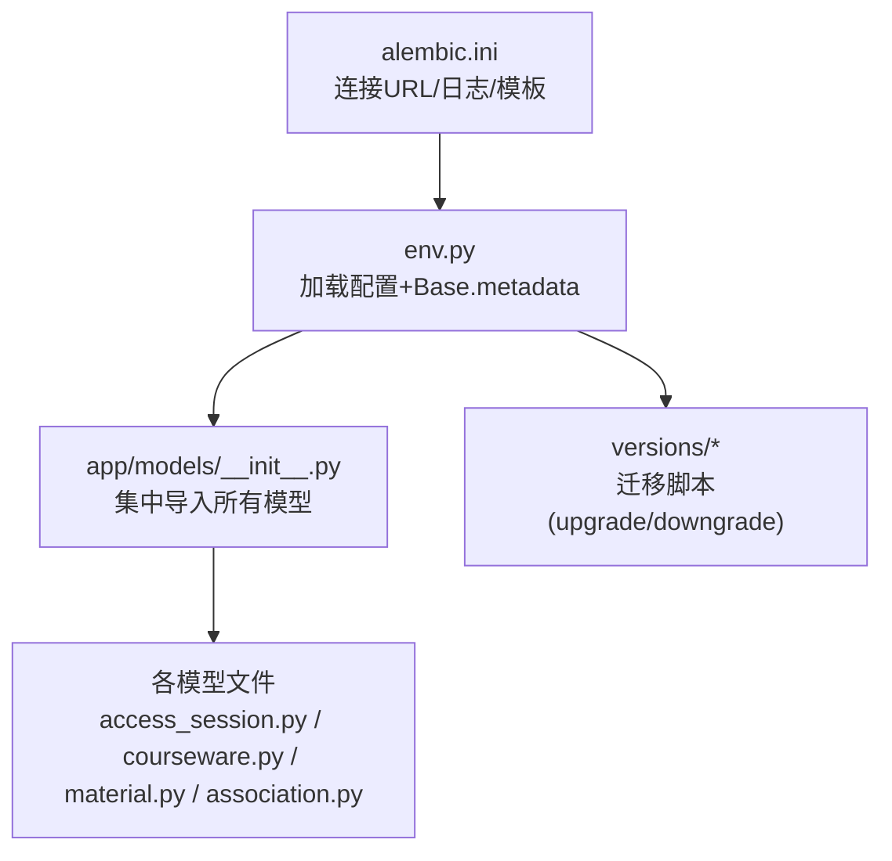
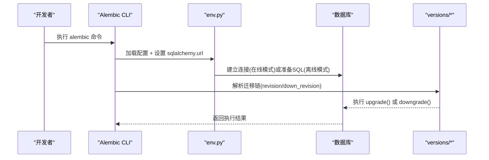
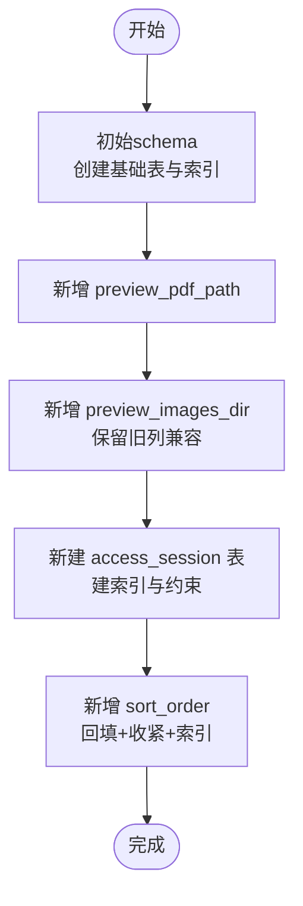
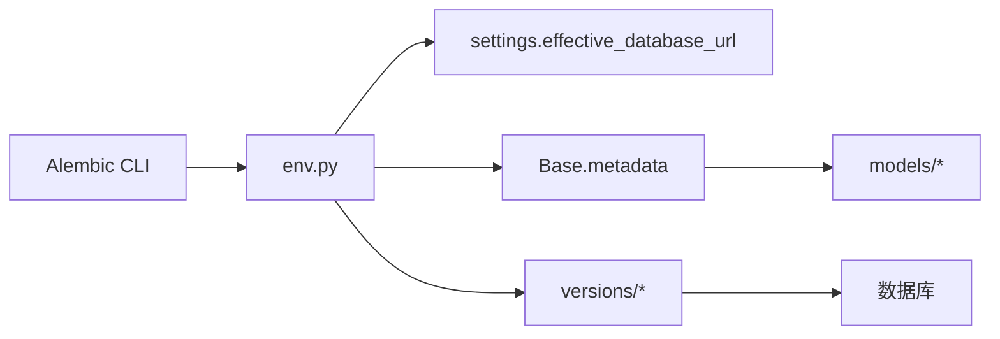

# 数据迁移

<cite>
**本文引用的文件**
- [backend/alembic.ini](file://backend/alembic.ini)
- [backend/alembic/env.py](file://backend/alembic/env.py)
- [backend/alembic/script.py.mako](file://backend/alembic/script.py.mako)
- [backend/app/models/__init__.py](file://backend/app/models/__init__.py)
- [backend/alembic/versions/2026_07_06_1745-11f9c69846a9_init_schema.py](file://backend/alembic/versions/2026_07_06_1745-11f9c69846a9_init_schema.py)
- [backend/alembic/versions/2026_07_07_0900-a1b2c3d4e5f6_add_material_preview_pdf_path.py](file://backend/alembic/versions/2026_07_07_0900-a1b2c3d4e5f6_add_material_preview_pdf_path.py)
- [backend/alembic/versions/2026_07_07_1230-b2c3d4e5f607_replace_preview_pdf_with_images.py](file://backend/alembic/versions/2026_07_07_1230-b2c3d4e5f607_replace_preview_pdf_with_images.py)
- [backend/alembic/versions/2026_07_10_0930-c1d2e3f4a5b6_add_access_session.py](file://backend/alembic/versions/2026_07_10_0930-c1d2e3f4a5b6_add_access_session.py)
- [backend/alembic/versions/2026_07_10_1800-d2e3f4a5b6c7_add_courseware_material_sort_order.py](file://backend/alembic/versions/2026_07_10_1800-d2e3f4a5b6c7_add_courseware_material_sort_order.py)
- [backend/app/models/access_session.py](file://backend/app/models/access_session.py)
- [backend/app/models/courseware.py](file://backend/app/models/courseware.py)
- [backend/app/models/material.py](file://backend/app/models/material.py)
- [backend/app/models/association.py](file://backend/app/models/association.py)
</cite>

## 目录
1. [简介](#简介)
2. [项目结构](#项目结构)
3. [核心组件](#核心组件)
4. [架构总览](#架构总览)
5. [详细组件分析](#详细组件分析)
6. [依赖关系分析](#依赖关系分析)
7. [性能考量](#性能考量)
8. [故障排查与回滚指南](#故障排查与回滚指南)
9. [结论](#结论)
10. [附录：命令速查](#附录命令速查)

## 简介
本文件面向 Learning Hub 后端的数据迁移管理，聚焦 Alembic 的配置、版本控制策略、迁移脚本编写规范，以及从初始 schema 到 access_session 表演进的完整历史。文档同时提供升级、降级、回滚等常用命令的使用说明，给出向后兼容性与数据一致性维护的最佳实践，并覆盖测试环境数据同步策略与生产部署流程建议，最后给出迁移失败的处理方案与恢复步骤。

## 项目结构
后端使用 Alembic 进行数据库版本化管理，配置位于 backend/alembic.ini，运行时环境在 backend/alembic/env.py 中加载应用配置与 ORM 模型元数据，迁移脚本存放于 backend/alembic/versions。ORM 模型集中在 app/models 下，通过集中导入触发 Base.metadata 注册，供 Alembic 自动检测差异生成迁移。

图表来源
- [backend/alembic.ini:1-40](file://backend/alembic.ini#L1-L40)
- [backend/alembic/env.py:1-63](file://backend/alembic/env.py#L1-L63)
- [backend/app/models/__init__.py:1-30](file://backend/app/models/__init__.py#L1-L30)

章节来源
- [backend/alembic.ini:1-40](file://backend/alembic.ini#L1-L40)
- [backend/alembic/env.py:1-63](file://backend/alembic/env.py#L1-L63)
- [backend/app/models/__init__.py:1-30](file://backend/app/models/__init__.py#L1-L30)

## 核心组件
- Alembic 配置与环境
  - alembic.ini：定义脚本位置、SQLAlchemy URL、文件命名模板、日志级别等。
  - env.py：注入 settings.effective_database_url，设置 target_metadata=Base.metadata，支持在线/离线两种运行模式。
  - script.py.mako：迁移脚本模板，包含 revision、down_revision、upgrade/downgrade 骨架。
- ORM 模型与元数据
  - models/__init__.py：集中导入所有模型，确保 Alembic 能发现全部 metadata。
  - 关键模型：AccessSession、Courseware、Material、关联表（courseware_material 含 sort_order）。

章节来源
- [backend/alembic.ini:1-40](file://backend/alembic.ini#L1-L40)
- [backend/alembic/env.py:1-63](file://backend/alembic/env.py#L1-L63)
- [backend/alembic/script.py.mako:1-27](file://backend/alembic/script.py.mako#L1-L27)
- [backend/app/models/__init__.py:1-30](file://backend/app/models/__init__.py#L1-L30)
- [backend/app/models/access_session.py:1-129](file://backend/app/models/access_session.py#L1-L129)
- [backend/app/models/courseware.py:1-74](file://backend/app/models/courseware.py#L1-L74)
- [backend/app/models/material.py:1-69](file://backend/app/models/material.py#L1-L69)
- [backend/app/models/association.py:1-41](file://backend/app/models/association.py#L1-L41)

## 架构总览
Alembic 在执行迁移时，会读取 alembic.ini 的数据库连接信息，由 env.py 将 SQLAlchemy URL 设置为 effective_database_url，并通过集中导入的 Base.metadata 获取当前代码中的目标 schema。随后根据 versions 下的迁移链执行 upgrade/downgrade。

图表来源
- [backend/alembic.ini:1-40](file://backend/alembic.ini#L1-L40)
- [backend/alembic/env.py:1-63](file://backend/alembic/env.py#L1-L63)
- [backend/alembic/versions/2026_07_06_1745-11f9c69846a9_init_schema.py:1-113](file://backend/alembic/versions/2026_07_06_1745-11f9c69846a9_init_schema.py#L1-L113)

## 详细组件分析

### Alembic 配置与环境
- 连接与日志
  - sqlalchemy.url 默认指向 PostgreSQL；env.py 会用 settings.effective_database_url 覆盖，便于多环境切换。
  - 日志级别：alembic INFO，sqlalchemy.engine WARNING，避免过多 SQL 输出。
- 元数据与比较类型
  - target_metadata = Base.metadata，启用 compare_type=True，可检测字段类型变更。
- 在线/离线模式
  - is_offline_mode() 为真时仅生成 SQL，不连库；否则建立连接执行迁移。

章节来源
- [backend/alembic.ini:1-40](file://backend/alembic.ini#L1-L40)
- [backend/alembic/env.py:1-63](file://backend/alembic/env.py#L1-L63)

### 迁移脚本模板
- 模板变量：revision、down_revision、branch_labels、depends_on。
- 自动生成 upgrade()/downgrade() 骨架，便于扩展。

章节来源
- [backend/alembic/script.py.mako:1-27](file://backend/alembic/script.py.mako#L1-L27)

### 现有迁移历史与演进
- 初始 schema（创建基础表）
  - 创建访问令牌、分类、素材、标签、课件主表及 M:N 关联表。
  - 索引与约束：唯一约束、外键级联删除、评论注释等。
- 新增 PPT 预览 PDF 路径
  - 为素材表增加 preview_pdf_path 列，用于存储转换后的 PDF 路径。
- 以图片替代 PDF 预览
  - 新增 preview_images_dir 列，保留旧列以兼容；迁移策略强调“先加列、再弃用”，避免破坏性变更。
- 新增访问会话表
  - 创建 access_session 表，记录 token、课件、素材、起止时间、停留秒数、客户端离开标志、IP/UA 等。
  - 添加多个复合索引，优化按 token 和资源的查询。
  - 包含非负时长检查约束。
- 为课件素材排序引入 sort_order
  - 在 courseware_material 新增 sort_order 列，分阶段回填并收紧为非空，新增复合索引加速有序读取。
  - 兼容 PostgreSQL 与 SQLite 的窗口函数写法。

图表来源
- [backend/alembic/versions/2026_07_06_1745-11f9c69846a9_init_schema.py:1-113](file://backend/alembic/versions/2026_07_06_1745-11f9c69846a9_init_schema.py#L1-L113)
- [backend/alembic/versions/2026_07_07_0900-a1b2c3d4e5f6_add_material_preview_pdf_path.py:1-30](file://backend/alembic/versions/2026_07_07_0900-a1b2c3d4e5f6_add_material_preview_pdf_path.py#L1-L30)
- [backend/alembic/versions/2026_07_07_1230-b2c3d4e5f607_replace_preview_pdf_with_images.py:1-39](file://backend/alembic/versions/2026_07_07_1230-b2c3d4e5f607_replace_preview_pdf_with_images.py#L1-L39)
- [backend/alembic/versions/2026_07_10_0930-c1d2e3f4a5b6_add_access_session.py:1-125](file://backend/alembic/versions/2026_07_10_0930-c1d2e3f4a5b6_add_access_session.py#L1-L125)
- [backend/alembic/versions/2026_07_10_1800-d2e3f4a5b6c7_add_courseware_material_sort_order.py:1-118](file://backend/alembic/versions/2026_07_10_1800-d2e3f4a5b6c7_add_courseware_material_sort_order.py#L1-L118)

章节来源
- [backend/alembic/versions/2026_07_06_1745-11f9c69846a9_init_schema.py:1-113](file://backend/alembic/versions/2026_07_06_1745-11f9c69846a9_init_schema.py#L1-L113)
- [backend/alembic/versions/2026_07_07_0900-a1b2c3d4e5f6_add_material_preview_pdf_path.py:1-30](file://backend/alembic/versions/2026_07_07_0900-a1b2c3d4e5f6_add_material_preview_pdf_path.py#L1-L30)
- [backend/alembic/versions/2026_07_07_1230-b2c3d4e5f607_replace_preview_pdf_with_images.py:1-39](file://backend/alembic/versions/2026_07_07_1230-b2c3d4e5f607_replace_preview_pdf_with_images.py#L1-L39)
- [backend/alembic/versions/2026_07_10_0930-c1d2e3f4a5b6_add_access_session.py:1-125](file://backend/alembic/versions/2026_07_10_0930-c1d2e3f4a5b6_add_access_session.py#L1-L125)
- [backend/alembic/versions/2026_07_10_1800-d2e3f4a5b6c7_add_courseware_material_sort_order.py:1-118](file://backend/alembic/versions/2026_07_10_1800-d2e3f4a5b6c7_add_courseware_material_sort_order.py#L1-L118)

### 模型与迁移的一致性
- AccessSession 模型定义了 INET 类型降级为字符串的策略，并在迁移中创建了相同名称的索引与约束，保证模型与迁移一致。
- Courseware.materials 关系通过 courseware_material 表的 sort_order 排序，迁移中已创建对应复合索引。
- Material.preview_images_dir 与迁移新增列保持一致，旧列 preview_pdf_path 保留用于兼容。

章节来源
- [backend/app/models/access_session.py:1-129](file://backend/app/models/access_session.py#L1-L129)
- [backend/app/models/courseware.py:1-74](file://backend/app/models/courseware.py#L1-L74)
- [backend/app/models/material.py:1-69](file://backend/app/models/material.py#L1-L69)
- [backend/app/models/association.py:1-41](file://backend/app/models/association.py#L1-L41)

## 依赖关系分析
- Alembic 依赖 SQLAlchemy 引擎与连接池；env.py 使用 NullPool 简化单进程迁移场景。
- 迁移脚本依赖 op 与 sa.text 执行 DDL/DML；复杂回填逻辑使用方言判断实现跨库兼容。
- 模型层通过 __init__.py 集中导入，确保 Alembic 能识别所有表结构与索引。

图表来源
- [backend/alembic/env.py:1-63](file://backend/alembic/env.py#L1-L63)
- [backend/app/models/__init__.py:1-30](file://backend/app/models/__init__.py#L1-L30)

章节来源
- [backend/alembic/env.py:1-63](file://backend/alembic/env.py#L1-L63)
- [backend/app/models/__init__.py:1-30](file://backend/app/models/__init__.py#L1-L30)

## 性能考量
- 大表回填与锁
  - 对 courseware_material.sort_order 的回填采用分步策略：先允许 NULL，再回填，最后收紧 NOT NULL，降低长事务锁表风险。
- 索引设计
  - access_session 针对 token_id 与资源维度建立复合索引，提升按 token 统计与过滤的性能。
  - courseware_material 新增 (courseware_id, sort_order) 复合索引，加速有序素材列表查询。
- 数据类型选择
  - AccessSession.id 使用 BigInteger 并在 SQLite 下降级为 Integer，兼顾跨库自增行为。
  - IP 地址使用自定义 TypeDecorator，PostgreSQL 使用原生 INET，SQLite 使用 VARCHAR(45)，减少类型冲突。

章节来源
- [backend/alembic/versions/2026_07_10_1800-d2e3f4a5b6c7_add_courseware_material_sort_order.py:1-118](file://backend/alembic/versions/2026_07_10_1800-d2e3f4a5b6c7_add_courseware_material_sort_order.py#L1-L118)
- [backend/alembic/versions/2026_07_10_0930-c1d2e3f4a5b6_add_access_session.py:1-125](file://backend/alembic/versions/2026_07_10_0930-c1d2e3f4a5b6_add_access_session.py#L1-L125)
- [backend/app/models/access_session.py:1-129](file://backend/app/models/access_session.py#L1-L129)

## 故障排查与回滚指南
- 常见错误定位
  - 连接失败：检查 alembic.ini 的 sqlalchemy.url 与 env.py 的 effective_database_url 是否一致，确认数据库可达。
  - 模型未生效：确认 models/__init__.py 已导入新模型，确保 Base.metadata 包含最新表结构。
  - 迁移冲突：查看 alembic history 与 current，确认 head 与 down_revision 是否正确。
- 回滚与修复
  - 降级到上一版本：使用降级命令回到上一个稳定状态。
  - 指定版本回滚：直接降级到某个 revision。
  - 修正后重新迁移：修复迁移脚本或模型后，再次执行升级。
- 生产注意事项
  - 先在测试环境验证迁移脚本与业务兼容性。
  - 发布前备份数据库，确保可快速回滚。
  - 对于涉及数据回填的迁移，建议在低峰期执行并监控锁等待与慢查询。

章节来源
- [backend/alembic/versions/2026_07_10_0930-c1d2e3f4a5b6_add_access_session.py:1-125](file://backend/alembic/versions/2026_07_10_0930-c1d2e3f4a5b6_add_access_session.py#L1-L125)
- [backend/alembic/versions/2026_07_10_1800-d2e3f4a5b6c7_add_courseware_material_sort_order.py:1-118](file://backend/alembic/versions/2026_07_10_1800-d2e3f4a5b6c7_add_courseware_material_sort_order.py#L1-L118)

## 结论
Learning Hub 的后端数据迁移基于 Alembic，采用“先加列、再回填、后收紧”的稳健策略，结合合理的索引设计与跨库兼容处理，保证了从初始 schema 到访问会话与素材排序功能的平滑演进。通过集中导入模型与在线/离线双模式，迁移过程具备良好可观测性与可维护性。在生产环境中，应遵循严格的版本控制与回滚预案，确保数据一致性与服务可用性。

## 附录：命令速查
- 初始化与生成
  - 生成迁移脚本：在修改模型后，使用 Alembic 命令生成新的迁移文件。
  - 查看迁移历史：列出所有迁移及其依赖关系。
  - 查看当前版本：显示数据库当前所处的 revision。
- 升级与降级
  - 升级到最新版本：执行升级命令，使数据库结构与代码一致。
  - 降级到上一版本：回退一个迁移。
  - 指定版本回滚：直接降级到某个 revision。
- 离线模式
  - 仅生成 SQL：在不连接数据库的情况下生成迁移 SQL 脚本，便于审查与审计。

[本节为通用操作说明，不直接分析具体文件]