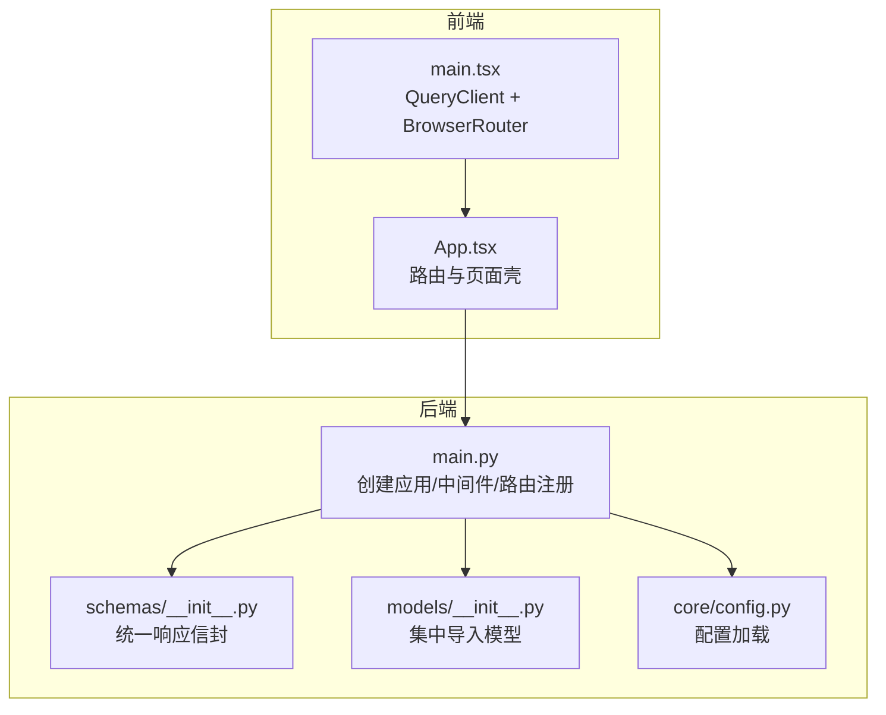
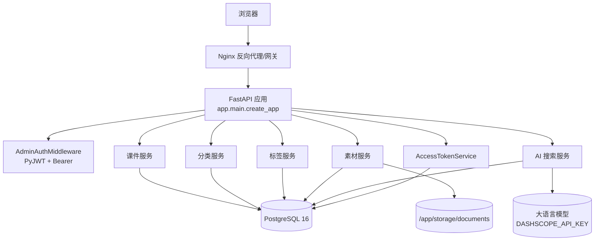
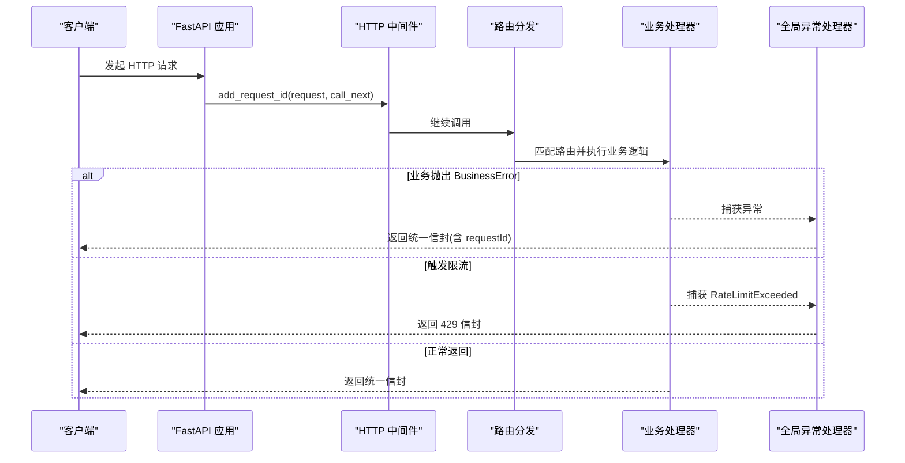
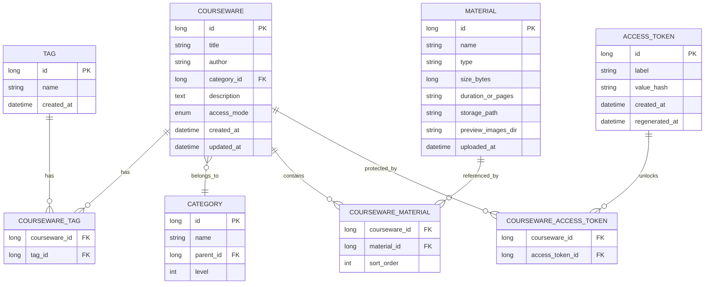
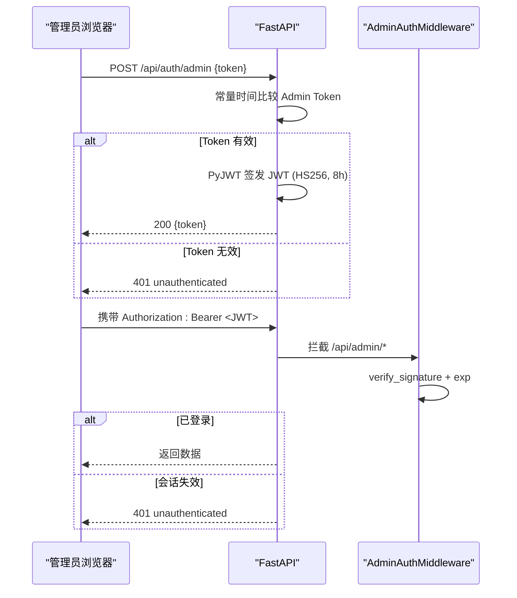
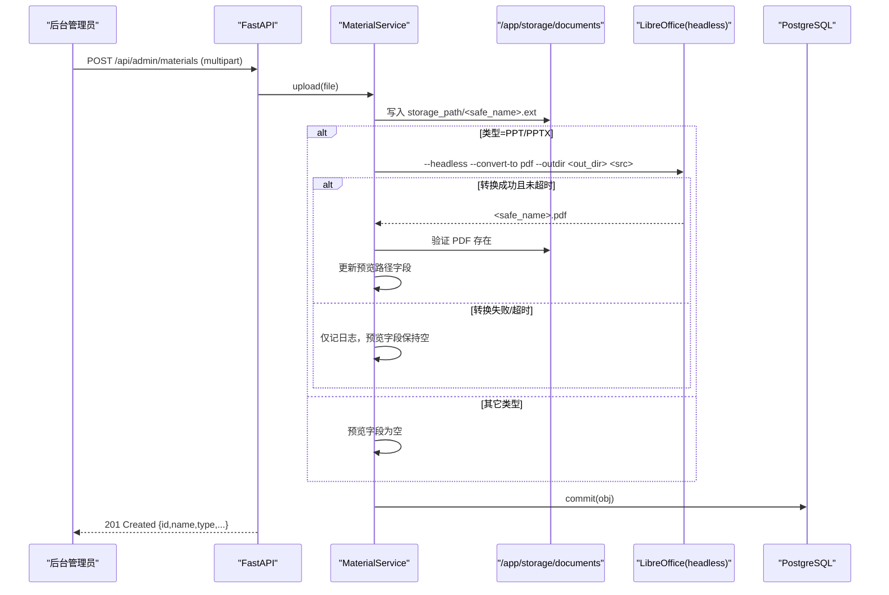
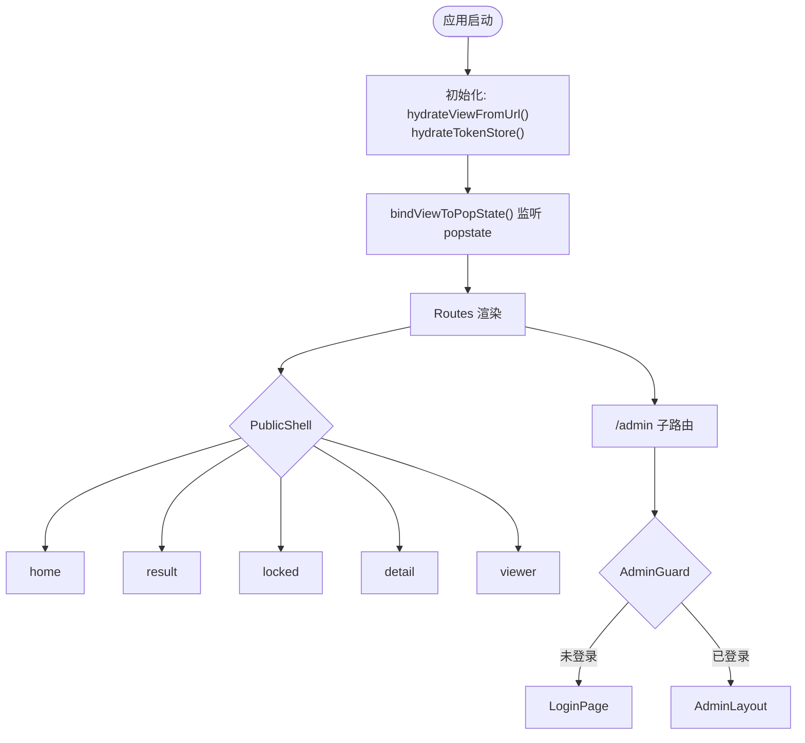
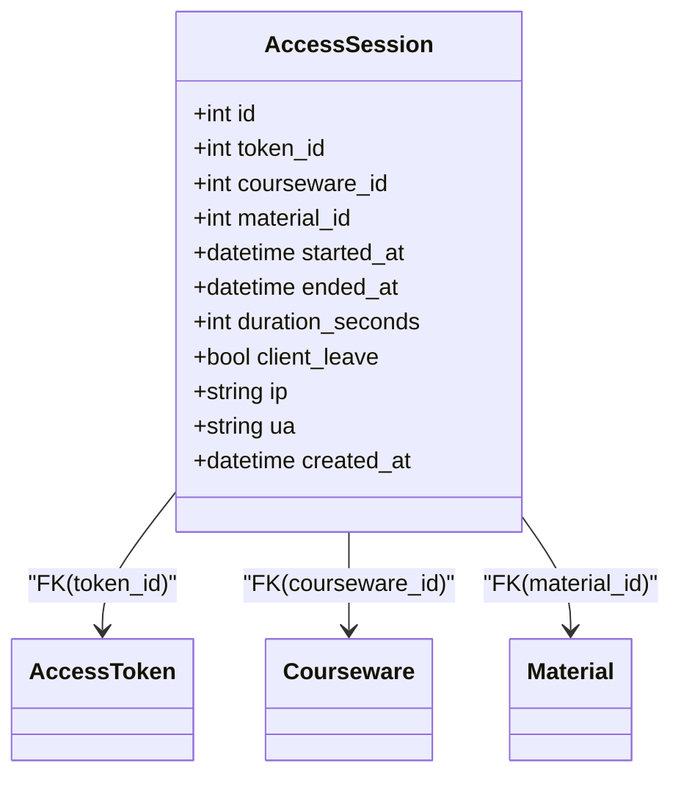
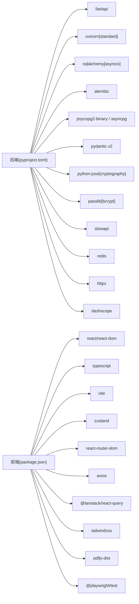
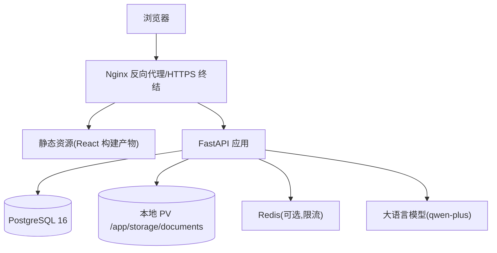

# 架构设计

<cite>
**本文引用的文件**   
- [backend/app/main.py](file://backend/app/main.py)
- [backend/app/core/config.py](file://backend/app/core/config.py)
- [backend/app/schemas/__init__.py](file://backend/app/schemas/__init__.py)
- [backend/app/models/__init__.py](file://backend/app/models/__init__.py)
- [backend/app/models/courseware.py](file://backend/app/models/courseware.py)
- [backend/app/models/material.py](file://backend/app/models/material.py)
- [backend/app/models/category.py](file://backend/app/models/category.py)
- [backend/app/models/tag.py](file://backend/app/models/tag.py)
- [backend/app/models/access_token.py](file://backend/app/models/access_token.py)
- [backend/app/models/access_session.py](file://backend/app/models/access_session.py)
- [frontend/src/App.tsx](file://frontend/src/App.tsx)
- [frontend/src/main.tsx](file://frontend/src/main.tsx)
- [doc/spec/07-技术架构.md](file://doc/spec/07-技术架构.md)
- [doc/spec/05-数据模型.md](file://doc/spec/05-数据模型.md)
- [backend/pyproject.toml](file://backend/pyproject.toml)
- [frontend/package.json](file://frontend/package.json)
</cite>

## 目录
1. [引言](#引言)
2. [项目结构](#项目结构)
3. [核心组件](#核心组件)
4. [架构总览](#架构总览)
5. [详细组件分析](#详细组件分析)
6. [依赖关系分析](#依赖关系分析)
7. [性能考虑](#性能考虑)
8. [故障排查指南](#故障排查指南)
9. [结论](#结论)
10. [附录](#附录)

## 引言
本文件为 Learning Hub 的架构设计文档，面向前后端分离、可演进的多容器部署形态。内容涵盖系统总体架构、分层与边界划分、关键数据流与控制流、技术选型权衡、核心架构模式落地（分层架构、依赖注入、策略模式）、部署架构图、组件交互图、数据库 ER 图、扩展点与插件机制、性能优化与安全监控方案等。

## 项目结构
Learning Hub 采用前后端分离：
- 后端：FastAPI + SQLAlchemy 异步 ORM + Alembic 迁移，统一响应信封与全局异常处理，按 core / models / schemas / services / api 分层组织。
- 前端：React 18 + TypeScript + Vite，使用 Zustand 做状态管理、React Router 6 做路由、@tanstack/react-query 做请求缓存与重试控制。
- 部署：Docker Compose 多容器；生产可通过 Nginx 反向代理终结 TLS，静态资源由 Nginx 提供或挂载到 FastAPI 静态路径。

图表来源
- [backend/app/main.py:40-112](file://backend/app/main.py#L40-L112)
- [backend/app/schemas/__init__.py:24-61](file://backend/app/schemas/__init__.py#L24-L61)
- [backend/app/models/__init__.py:1-30](file://backend/app/models/__init__.py#L1-L30)
- [backend/app/core/config.py:9-88](file://backend/app/core/config.py#L9-L88)
- [frontend/src/App.tsx:60-109](file://frontend/src/App.tsx#L60-L109)
- [frontend/src/main.tsx:1-26](file://frontend/src/main.tsx#L1-L26)

章节来源
- [backend/app/main.py:40-112](file://backend/app/main.py#L40-L112)
- [backend/app/schemas/__init__.py:24-61](file://backend/app/schemas/__init__.py#L24-L61)
- [backend/app/models/__init__.py:1-30](file://backend/app/models/__init__.py#L1-L30)
- [backend/app/core/config.py:9-88](file://backend/app/core/config.py#L9-L88)
- [frontend/src/App.tsx:60-109](file://frontend/src/App.tsx#L60-L109)
- [frontend/src/main.tsx:1-26](file://frontend/src/main.tsx#L1-L26)

## 核心组件
- 应用装配与中间件
  - 统一 CORS、限流、请求 ID 透传、业务异常与限流异常的统一处理。
  - 路由注册将公开接口与管理后台接口解耦。
- 配置中心
  - 基于 pydantic-settings 的环境变量配置，支持数据库连接串覆盖、CORS 白名单、JWT 参数、存储路径、LibreOffice 路径、LLM 开关与超时等。
- 统一响应信封
  - 所有 API 返回统一信封结构，包含 code/message/data/requestId，便于前端一致化处理与链路追踪。
- 数据模型层
  - 通过集中导入使 Alembic 一次性识别全部模型元数据，定义课件、分类、标签、素材、访问令牌与会话等实体及关联。

章节来源
- [backend/app/main.py:40-112](file://backend/app/main.py#L40-L112)
- [backend/app/core/config.py:9-88](file://backend/app/core/config.py#L9-L88)
- [backend/app/schemas/__init__.py:24-61](file://backend/app/schemas/__init__.py#L24-L61)
- [backend/app/models/__init__.py:1-30](file://backend/app/models/__init__.py#L1-L30)

## 架构总览
整体采用前后端分离与分层架构，后端以 FastAPI 作为 HTTP 入口，结合中间件完成鉴权、限流、跨域与错误处理；服务层按领域拆分（课件、素材、分类、标签、搜索、访问令牌），持久层使用 PostgreSQL，文件存储走本地 PV（后续抽象为对象存储）。

图表来源
- [doc/spec/07-技术架构.md:7-26](file://doc/spec/07-技术架构.md#L7-L26)
- [backend/app/main.py:40-112](file://backend/app/main.py#L40-L112)

## 详细组件分析

### 后端应用装配与中间件
- 生命周期与实例化
  - 通过 create_app 构建 FastAPI 实例，设置 OpenAPI 文档地址与版本信息。
- 中间件与异常处理
  - CORS 中间件根据配置动态允许来源。
  - SlowAPI 限流器绑定至 app.state.limiter。
  - 自定义 HTTP 中间件注入 request_id，并在响应头回写，用于全链路追踪。
  - 全局异常处理器统一 BusinessError 与 RateLimitExceeded，并封装为统一信封。
- 路由注册
  - 将公开接口（健康检查、课件、素材、访问会话）与管理后台接口（认证、分类、标签、素材、课件、访问令牌、使用统计）分别注册。

图表来源
- [backend/app/main.py:40-112](file://backend/app/main.py#L40-L112)
- [backend/app/schemas/__init__.py:24-61](file://backend/app/schemas/__init__.py#L24-L61)

章节来源
- [backend/app/main.py:40-112](file://backend/app/main.py#L40-L112)
- [backend/app/schemas/__init__.py:24-61](file://backend/app/schemas/__init__.py#L24-L61)

### 配置与环境
- 配置项覆盖
  - 优先 DATABASE_URL，否则拼接 host/port/user/password/db。
  - CORS 白名单、JWT 密钥/算法/TTL、时区、存储路径、LibreOffice/pdftoppm 路径、PPT 转换超时、Redis 限流后端 URL、LLM 开关与超时等。
- 运行时行为
  - llm_enabled 判断是否启用 AI 搜索；cors_origins_list 解析逗号分隔的域名列表。

章节来源
- [backend/app/core/config.py:9-88](file://backend/app/core/config.py#L9-L88)

### 数据模型与关系
- 核心实体
  - 课件（Courseware）：标题、作者、分类、描述、访问模式（OPEN/RESTRICTED）、时间戳。
  - 分类（Category）：自引用树形结构，最大深度 3，父节点下名称唯一。
  - 标签（Tag）：扁平且全局唯一。
  - 素材（Material）：视频/PDF/PPT，记录大小、时长或页数、存储路径、预览图片目录。
  - 访问令牌（AccessToken）：label 全局唯一，value_hash 存 SHA-256，仅创建/重新生成时返回明文。
  - 访问会话（AccessSession）：记录 token 持有者对受限课件素材的一次浏览起止与停留秒数。
- 关联关系
  - 课件-标签 M:N（courseware_tag）
  - 课件-素材 M:N（courseware_material，含 sort_order）
  - 课件-访问令牌 M:N（courseware_access_token）

图表来源
- [doc/spec/05-数据模型.md:7-67](file://doc/spec/05-数据模型.md#L7-L67)
- [backend/app/models/courseware.py:21-74](file://backend/app/models/courseware.py#L21-L74)
- [backend/app/models/category.py:12-46](file://backend/app/models/category.py#L12-L46)
- [backend/app/models/tag.py:13-30](file://backend/app/models/tag.py#L13-L30)
- [backend/app/models/material.py:44-69](file://backend/app/models/material.py#L44-L69)
- [backend/app/models/access_token.py:13-34](file://backend/app/models/access_token.py#L13-L34)
- [backend/app/models/access_session.py:56-129](file://backend/app/models/access_session.py#L56-L129)

章节来源
- [doc/spec/05-数据模型.md:7-67](file://doc/spec/05-数据模型.md#L7-L67)
- [backend/app/models/courseware.py:21-74](file://backend/app/models/courseware.py#L21-L74)
- [backend/app/models/category.py:12-46](file://backend/app/models/category.py#L12-L46)
- [backend/app/models/tag.py:13-30](file://backend/app/models/tag.py#L13-L30)
- [backend/app/models/material.py:44-69](file://backend/app/models/material.py#L44-L69)
- [backend/app/models/access_token.py:13-34](file://backend/app/models/access_token.py#L13-L34)
- [backend/app/models/access_session.py:56-129](file://backend/app/models/access_session.py#L56-L129)

### 鉴权流程（管理员登录与受保护接口）
- 管理员登录
  - 常量时间比较 Admin Token，签发 HS256 JWT（默认 8h）。
- 受保护接口访问
  - 中间件拦截 /api/admin/*，校验 Authorization Bearer 签名与过期时间，失败则返回 401 并引导前端跳转登录页。

图表来源
- [doc/spec/07-技术架构.md:98-121](file://doc/spec/07-技术架构.md#L98-L121)

章节来源
- [doc/spec/07-技术架构.md:98-121](file://doc/spec/07-技术架构.md#L98-L121)

### 素材上传与 PPT 转 PDF 预览
- 上传流程
  - 写入 storage_path/<safe_name>.ext，若为 PPT/PPTX 则调用 LibreOffice headless 转换为 PDF，成功后记录 preview_pdf_path（当前实现中该字段在模型中已演进为 preview_images_dir，但文档仍沿用 preview_pdf_path 语义说明）。
- 前台预览
  - VIDEO：直接 Range 流式播放。
  - PDF：pdfjs-dist worker 渲染连续页。
  - PPT：若 previewReady=true，使用转换后的 PDF 单页翻页；否则提示下载原文件。

图表来源
- [doc/spec/07-技术架构.md:139-165](file://doc/spec/07-技术架构.md#L139-L165)

章节来源
- [doc/spec/07-技术架构.md:139-165](file://doc/spec/07-技术架构.md#L139-L165)

### 前台 SPA 路由与状态同步
- 单 URL 多视图
  - 前台通过 store/view 切换 home/result/locked/detail/viewer 五个视图，URL 变化时同步 store。
- 管理后台
  - /admin 子路由独立，配合 AdminGuard 守卫登录态。

图表来源
- [frontend/src/App.tsx:40-109](file://frontend/src/App.tsx#L40-L109)
- [frontend/src/main.tsx:1-26](file://frontend/src/main.tsx#L1-L26)

章节来源
- [frontend/src/App.tsx:40-109](file://frontend/src/App.tsx#L40-L109)
- [frontend/src/main.tsx:1-26](file://frontend/src/main.tsx#L1-L26)

### 访问会话记录（v1.4）
- 规则要点
  - 仅当素材被至少一个 RESTRICTED 课件引用时才记录。
  - 服务端校正客户端上报的停留时长偏差。
  - token 重新生成后历史 session 归属旧 token_id。
  - 删除 token 时级联清理其 session。

图表来源
- [backend/app/models/access_session.py:56-129](file://backend/app/models/access_session.py#L56-L129)
- [backend/app/models/access_token.py:13-34](file://backend/app/models/access_token.py#L13-L34)
- [backend/app/models/courseware.py:21-74](file://backend/app/models/courseware.py#L21-L74)
- [backend/app/models/material.py:44-69](file://backend/app/models/material.py#L44-L69)

章节来源
- [backend/app/models/access_session.py:56-129](file://backend/app/models/access_session.py#L56-L129)

## 依赖关系分析
- 后端依赖
  - FastAPI、Uvicorn、SQLAlchemy 异步、Alembic、psycopg2-binary、asyncpg、Pydantic v2、python-jose、passlib、python-multipart、SlowAPI、redis、httpx、PyJWT、dashscope。
- 前端依赖
  - React 18、TypeScript、Vite、Zustand、React Router 6、axios、@tanstack/react-query、Tailwind CSS、pdfjs-dist、Playwright。

图表来源
- [backend/pyproject.toml:1-47](file://backend/pyproject.toml#L1-L47)
- [frontend/package.json:1-40](file://frontend/package.json#L1-L40)

章节来源
- [backend/pyproject.toml:1-47](file://backend/pyproject.toml#L1-L47)
- [frontend/package.json:1-40](file://frontend/package.json#L1-L40)

## 性能考虑
- 后端
  - ASGI 高性能服务器（Uvicorn + uvloop），异步 I/O 提升并发能力。
  - SlowAPI 限流（内存或 Redis 共享计数），防止滥用与雪崩。
  - 数据库索引建议：按规范文档中的索引策略建立复合索引，减少 ILIKE 与排序开销。
- 前端
  - Vite 极速构建与 HMR；React Query 缓存与去抖减少重复请求。
  - PDF 渲染使用 pdfjs-dist worker，避免主线程阻塞。
- 文件与转码
  - PPT 转 PDF 超时控制与失败降级，避免阻塞上传链路。

章节来源
- [doc/spec/07-技术架构.md:28-78](file://doc/spec/07-技术架构.md#L28-L78)
- [doc/spec/05-数据模型.md:244-256](file://doc/spec/05-数据模型.md#L244-L256)

## 故障排查指南
- 统一错误信封
  - 所有异常均返回统一信封，包含 code/message/data/requestId，便于前端定位与日志关联。
- 限流异常
  - 429 响应携带 requestId，确认是否为限流导致。
- 业务异常
  - BusinessError 携带业务码与消息，结合 requestId 快速定位问题。
- 常见场景
  - 登录失败：检查 Admin Token 与 JWT 配置。
  - 素材上传失败：检查 storage_path 权限与 LibreOffice 安装路径。
  - AI 搜索不可用：检查 DASHSCOPE_API_KEY 与网络连通性，确认已降级到 ILIKE。

章节来源
- [backend/app/main.py:78-90](file://backend/app/main.py#L78-L90)
- [backend/app/schemas/__init__.py:45-61](file://backend/app/schemas/__init__.py#L45-L61)

## 结论
Learning Hub 采用清晰的前后端分离与分层架构，后端以 FastAPI 为核心，结合统一信封、中间件与全局异常处理，形成高内聚低耦合的服务边界；前端以 React + Vite + Zustand + React Query 构建高效 SPA。数据模型与关系明确，具备可扩展性与演进空间（如引入对象存储、独立搜索服务、RBAC 等）。在生产环境可通过 Nginx 终结 TLS、Docker Compose 多容器部署，并平滑迁移至云原生平台。

## 附录

### 技术选型决策与权衡
- 后端为何选择 FastAPI 而非 Django
  - 异步 ASGI、自动 OpenAPI、与 Pydantic v2 同生态，性能与 Spring Boot 对标，适合高并发 I/O 密集场景。
- 前端为何选择 React 而非 Vue
  - 企业生态成熟、社区资源丰富、与 TypeScript 集成良好，利于团队规模化协作。
- 状态管理与请求库
  - Zustand 轻量无样板代码，易于切片与状态机建模；@tanstack/react-query 提供缓存、重试与一致性保障。
- 搜索与 AI
  - 当前使用 PostgreSQL ILIKE 关键词检索满足 v1.0；v1.1 引入 LLM NL2SQL（qwen-plus）+ 安全白名单校验，失败自动降级。

章节来源
- [doc/spec/07-技术架构.md:28-78](file://doc/spec/07-技术架构.md#L28-L78)

### 部署架构图（概念）

[此图为概念性部署示意，不直接映射具体源码文件]

### 扩展点与插件机制
- 服务层扩展
  - 新增领域服务模块（如推荐、学习进度），遵循“API -> Service -> Model”的分层契约，通过路由注册接入。
- 存储后端抽象
  - 文件存储可在 v1.1 抽象为 S3 兼容对象存储（阿里云 OSS），通过环境变量 STORAGE_BACKEND 切换驱动实现。
- 搜索策略
  - 保留 ILIKE 兜底，未来可引入独立搜索引擎服务（Elasticsearch/Meilisearch），通过策略模式替换检索实现。
- 鉴权策略
  - 从单一 Admin Token 演进为 RBAC，增加细粒度权限控制与审计。

章节来源
- [doc/spec/07-技术架构.md:79-94](file://doc/spec/07-技术架构.md#L79-L94)
- [doc/spec/07-技术架构.md:201-222](file://doc/spec/07-技术架构.md#L201-L222)