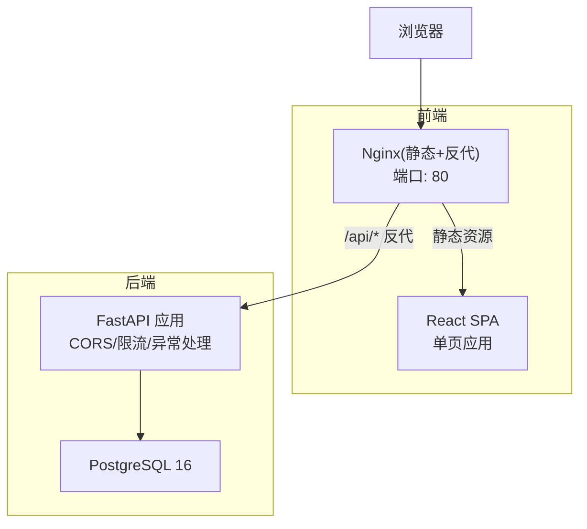
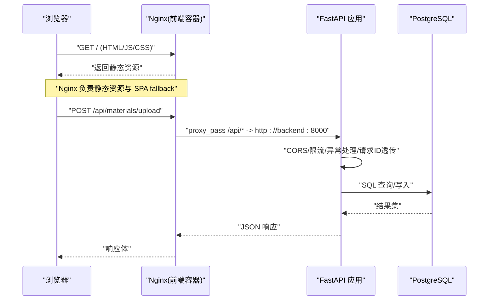
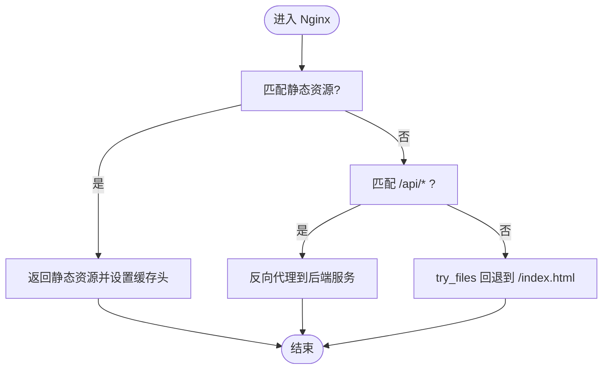
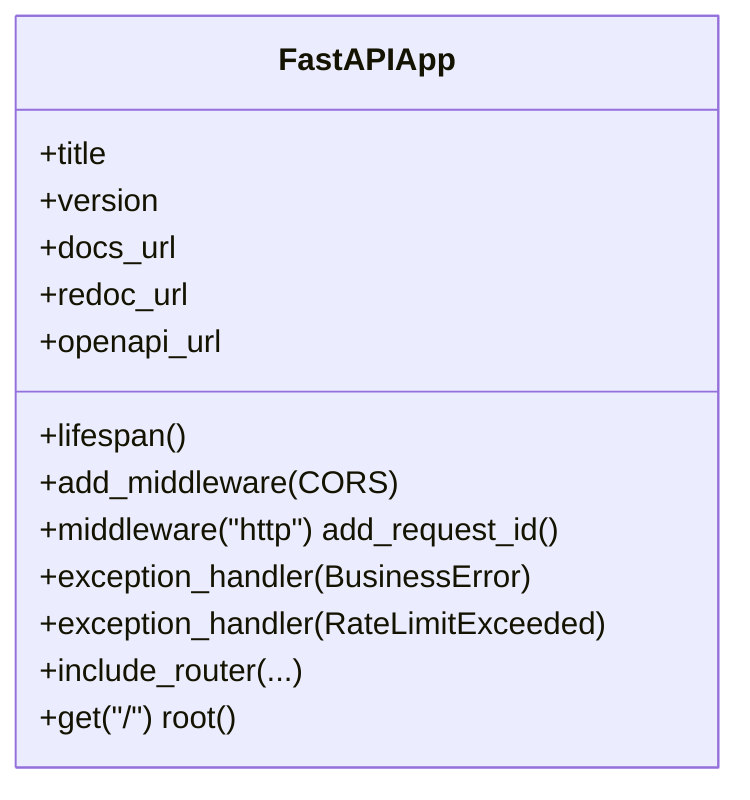
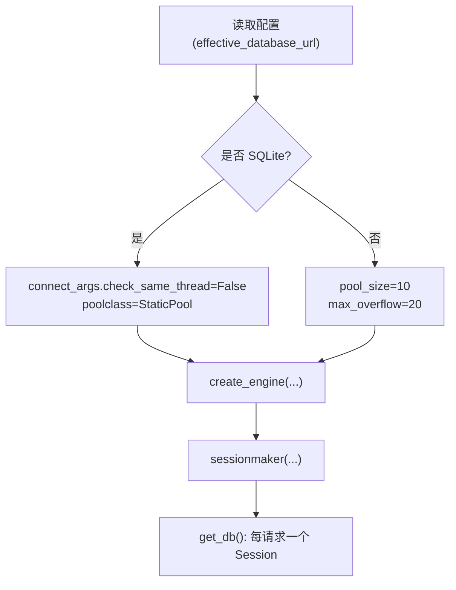
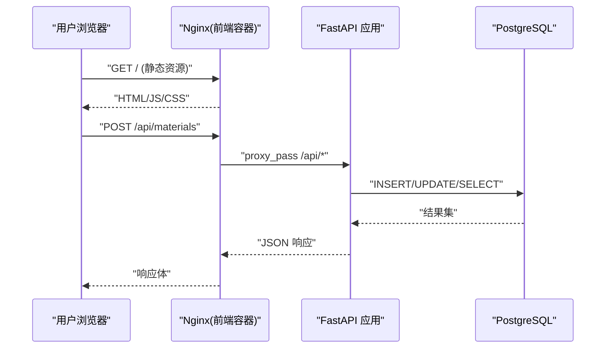
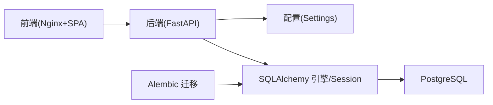

# 系统架构概览

<cite>
**本文引用的文件**   
- [backend/app/main.py](file://backend/app/main.py)
- [frontend/nginx.conf](file://frontend/nginx.conf)
- [deploy/local/docker-compose.yml](file://deploy/local/docker-compose.yml)
- [deploy/ecs/compose.yml](file://deploy/ecs/compose.yml)
- [deploy/ecs/nginx-vhost-https.snippet](file://deploy/ecs/nginx-vhost-https.snippet)
- [backend/app/core/config.py](file://backend/app/core/config.py)
- [backend/app/db/__init__.py](file://backend/app/db/__init__.py)
- [backend/alembic/env.py](file://backend/alembic/env.py)
- [frontend/src/App.tsx](file://frontend/src/App.tsx)
</cite>

## 目录
1. [简介](#简介)
2. [项目结构](#项目结构)
3. [核心组件](#核心组件)
4. [架构总览](#架构总览)
5. [详细组件分析](#详细组件分析)
6. [依赖关系分析](#依赖关系分析)
7. [性能与可扩展性](#性能与可扩展性)
8. [故障排查指南](#故障排查指南)
9. [结论](#结论)

## 简介
本文件面向 Learning Hub 的系统架构，给出前后端分离、Nginx 反向代理、FastAPI 应用层与 PostgreSQL 数据库层的整体设计说明。文档覆盖：
- 请求链路：浏览器 → Nginx → FastAPI → PostgreSQL
- 部署拓扑：本地开发环境与生产环境的差异
- 核心设计原则：微服务思想但单体部署、前后端解耦策略
- 架构图与组件依赖图

## 项目结构
Learning Hub 采用前后端分离的仓库组织方式：
- backend：FastAPI 后端，包含路由、中间件、配置、数据模型与服务层
- frontend：React SPA + Nginx 静态资源与反向代理
- deploy：本地与 ECS 生产部署脚本与编排文件
- doc：需求、规格与设计文档（含技术架构）

图表来源
- [frontend/nginx.conf:1-56](file://frontend/nginx.conf#L1-L56)
- [backend/app/main.py:40-112](file://backend/app/main.py#L40-L112)
- [deploy/local/docker-compose.yml:1-74](file://deploy/local/docker-compose.yml#L1-L74)

章节来源
- [frontend/src/App.tsx:1-110](file://frontend/src/App.tsx#L1-L110)
- [frontend/nginx.conf:1-56](file://frontend/nginx.conf#L1-L56)
- [backend/app/main.py:1-116](file://backend/app/main.py#L1-L116)
- [deploy/local/docker-compose.yml:1-74](file://deploy/local/docker-compose.yml#L1-L74)

## 核心组件
- 浏览器与前端 SPA
  - React SPA 通过路由在单 URL 下切换页面；管理后台使用 /admin 子路由。
- Nginx 反向代理与静态资源服务
  - 提供静态资源缓存、Gzip 压缩、SPA fallback、大文件上传超时优化，并将 /api/* 转发到后端。
- FastAPI 应用层
  - 统一入口创建应用实例，注册 CORS、限流、全局异常处理、请求 ID 透传，挂载公共与管理路由。
- 数据库层
  - PostgreSQL 作为持久化存储，通过 SQLAlchemy 连接池与 Alembic 迁移管理。

章节来源
- [frontend/src/App.tsx:1-110](file://frontend/src/App.tsx#L1-L110)
- [frontend/nginx.conf:1-56](file://frontend/nginx.conf#L1-L56)
- [backend/app/main.py:40-112](file://backend/app/main.py#L40-L112)
- [backend/app/core/config.py:1-88](file://backend/app/core/config.py#L1-L88)
- [backend/app/db/__init__.py:1-51](file://backend/app/db/__init__.py#L1-L51)
- [backend/alembic/env.py:1-62](file://backend/alembic/env.py#L1-L62)

## 架构总览
下图展示从浏览器到数据库的完整请求链路，以及各组件的职责边界。

图表来源
- [frontend/nginx.conf:20-42](file://frontend/nginx.conf#L20-L42)
- [backend/app/main.py:57-90](file://backend/app/main.py#L57-L90)
- [backend/app/db/__init__.py:15-32](file://backend/app/db/__init__.py#L15-L32)

章节来源
- [frontend/nginx.conf:1-56](file://frontend/nginx.conf#L1-L56)
- [backend/app/main.py:40-112](file://backend/app/main.py#L40-L112)
- [backend/app/db/__init__.py:1-51](file://backend/app/db/__init__.py#L1-L51)

## 详细组件分析

### 前端与 Nginx 层
- 职责
  - 提供静态资源并启用 Gzip 与长期缓存
  - SPA fallback 确保前端路由正常工作
  - 将 /api/* 请求反向代理至后端服务
  - 针对大文件上传调整超时与缓冲策略
- 关键实现要点
  - location / 使用 try_files 回退到 index.html
  - location /api/ 设置 Host/X-Real-IP/X-Forwarded-For/X-Forwarded-Proto/X-Request-Id 等头部
  - 关闭请求体缓存以边收边转，避免磁盘 IO 瓶颈
  - 为 PDF.js worker 指定 MIME 类型

图表来源
- [frontend/nginx.conf:20-56](file://frontend/nginx.conf#L20-L56)

章节来源
- [frontend/nginx.conf:1-56](file://frontend/nginx.conf#L1-L56)

### FastAPI 应用层
- 职责
  - 应用生命周期管理、CORS 跨域、限流、全局异常处理、请求 ID 透传
  - 挂载公共接口与管理接口路由
- 关键实现要点
  - 统一错误封装与限流异常处理
  - 暴露 OpenAPI/Redoc 文档路径
  - 根路径返回服务信息

图表来源
- [backend/app/main.py:40-112](file://backend/app/main.py#L40-L112)

章节来源
- [backend/app/main.py:1-116](file://backend/app/main.py#L1-L116)

### 数据库层与 ORM
- 职责
  - 提供数据库连接池与 Session 工厂
  - 支持 SQLite（测试）与 Postgres（生产）两种引擎参数
  - 通过 Alembic 进行在线/离线迁移
- 关键实现要点
  - 根据 effective_database_url 选择连接串或拼接字段
  - 非 SQLite 场景开启连接池大小与溢出配置
  - get_db 依赖注入保证每个请求一个 Session

图表来源
- [backend/app/core/config.py:19-38](file://backend/app/core/config.py#L19-L38)
- [backend/app/db/__init__.py:15-32](file://backend/app/db/__init__.py#L15-L32)
- [backend/alembic/env.py:23-26](file://backend/alembic/env.py#L23-L26)

章节来源
- [backend/app/core/config.py:1-88](file://backend/app/core/config.py#L1-L88)
- [backend/app/db/__init__.py:1-51](file://backend/app/db/__init__.py#L1-L51)
- [backend/alembic/env.py:1-62](file://backend/alembic/env.py#L1-L62)

### 部署拓扑与环境差异

#### 本地开发环境
- 使用 docker-compose 启动三个服务：
  - postgres：PostgreSQL 16，健康检查
  - backend：FastAPI，映射 8000 端口，挂载 storage 卷
  - frontend：Nginx + SPA，映射 5173 端口，健康检查同时探测 / 与 /api/public/health
- 特点
  - 简单直连，便于调试
  - 环境变量集中配置，便于快速迭代

章节来源
- [deploy/local/docker-compose.yml:1-74](file://deploy/local/docker-compose.yml#L1-L74)

#### 生产环境（ECS Swarm）
- 使用 docker stack compose 部署：
  - 复用外部网络：postgres_net、nginx_net
  - 复用命名卷：lh_storage
  - backend 接入 postgres_net，frontend 接入 nginx_net
  - frontend 容器内 Nginx 将 /api/* 反代到同 stack 的 backend 服务
  - 外部网关 Nginx 通过 HTTPS vhost 将流量转发到 learning-hub_frontend
- 特点
  - 多网络隔离，前后端与数据库分层
  - 通过外部网关统一证书与安全头
  - 通过 publish.ps1 完成构建、推送与部署流程

章节来源
- [deploy/ecs/compose.yml:1-79](file://deploy/ecs/compose.yml#L1-L79)
- [deploy/ecs/nginx-vhost-https.snippet:1-42](file://deploy/ecs/nginx-vhost-https.snippet#L1-L42)

### 请求链路详解（端到端）
- 浏览器访问首页
  - 请求到达 Nginx，返回静态 HTML/JS/CSS
  - 前端路由由 SPA 内部维护，无需服务端参与
- 浏览器调用 API
  - Nginx 将 /api/* 请求转发到后端服务
  - FastAPI 执行中间件（CORS、限流、异常处理、请求 ID）
  - 业务逻辑通过 SQLAlchemy 访问 PostgreSQL
  - 响应经 Nginx 返回给浏览器

图表来源
- [frontend/nginx.conf:20-42](file://frontend/nginx.conf#L20-L42)
- [backend/app/main.py:57-102](file://backend/app/main.py#L57-L102)
- [backend/app/db/__init__.py:15-32](file://backend/app/db/__init__.py#L15-L32)

## 依赖关系分析
- 前端依赖
  - Nginx 提供静态资源与反向代理
  - SPA 通过 /api/* 与后端交互
- 后端依赖
  - 配置中心：Settings 从环境变量加载
  - 数据库：SQLAlchemy 引擎与 SessionLocal
  - 迁移：Alembic 基于 Settings 生成连接串
- 部署依赖
  - 本地：docker-compose 编排三服务
  - 生产：Swarm Stack 复用外部网络与卷，外部网关 Nginx 提供 HTTPS

图表来源
- [frontend/nginx.conf:20-42](file://frontend/nginx.conf#L20-L42)
- [backend/app/main.py:40-112](file://backend/app/main.py#L40-L112)
- [backend/app/core/config.py:1-88](file://backend/app/core/config.py#L1-L88)
- [backend/app/db/__init__.py:15-32](file://backend/app/db/__init__.py#L15-L32)
- [backend/alembic/env.py:23-26](file://backend/alembic/env.py#L23-L26)

章节来源
- [frontend/nginx.conf:1-56](file://frontend/nginx.conf#L1-L56)
- [backend/app/main.py:1-116](file://backend/app/main.py#L1-L116)
- [backend/app/core/config.py:1-88](file://backend/app/core/config.py#L1-L88)
- [backend/app/db/__init__.py:1-51](file://backend/app/db/__init__.py#L1-L51)
- [backend/alembic/env.py:1-62](file://backend/alembic/env.py#L1-L62)

## 性能与可扩展性
- 大文件上传
  - Nginx 侧提高 client_max_body_size、client_body_timeout、proxy_send/read_timeout，并关闭请求体缓存，避免磁盘 IO 成为瓶颈
- 静态资源优化
  - Gzip 压缩与长期缓存提升首屏与二次访问性能
- 后端并发与连接池
  - 非 SQLite 场景使用连接池（pool_size/max_overflow），配合 pool_pre_ping 增强健壮性
- 限流与稳定性
  - SlowAPI 限流保护后端免受突发流量冲击，异常统一封装便于前端友好提示
- 扩展建议
  - 多副本部署时，SlowAPI 存储切换到 Redis 共享计数
  - 对热点静态资源可引入 CDN 加速
  - 数据库读写分离与只读副本可按需引入

[本节为通用指导，不直接分析具体文件]

## 故障排查指南
- 前端无法访问 API
  - 检查 Nginx 的 /api/* 反向代理目标是否正确（本地 vs Swarm 服务名）
  - 确认 healthcheck 能同时访问 / 与 /api/public/health
- 上传失败或中断
  - 核对 Nginx 的超时与 body size 配置是否与后端一致
  - 确认 proxy_request_buffering 已关闭以避免磁盘缓存
- 后端报错无上下文
  - 查看 X-Request-Id 透传链，定位请求在 Nginx/FastAPI 中的日志
- 数据库连接异常
  - 校验 effective_database_url 与连接池参数
  - 确认 Alembic 迁移是否成功执行

章节来源
- [frontend/nginx.conf:10-42](file://frontend/nginx.conf#L10-L42)
- [deploy/local/docker-compose.yml:60-69](file://deploy/local/docker-compose.yml#L60-L69)
- [backend/app/main.py:70-90](file://backend/app/main.py#L70-L90)
- [backend/app/db/__init__.py:15-32](file://backend/app/db/__init__.py#L15-L32)
- [backend/alembic/env.py:42-56](file://backend/alembic/env.py#L42-L56)

## 结论
Learning Hub 采用前后端分离与 Nginx 反向代理的清晰分层架构，结合 FastAPI 的统一中间件与异常处理、SQLAlchemy 的连接池与 Alembic 的迁移能力，实现了高内聚低耦合的服务边界。在生产环境中通过外部网关 Nginx 提供 HTTPS 与统一安全头，并通过 Swarm Stack 复用网络与卷，兼顾了安全性与可运维性。尽管采用微服务思想划分职责，当前仍保持单体部署形态，有利于简化运维与降低协作成本，同时为未来逐步拆分服务预留了清晰的演进路径。