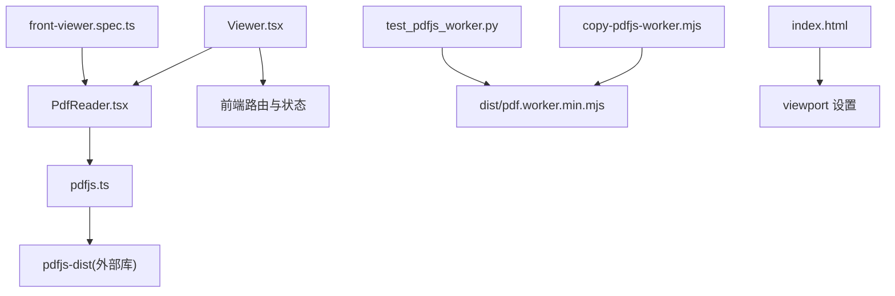
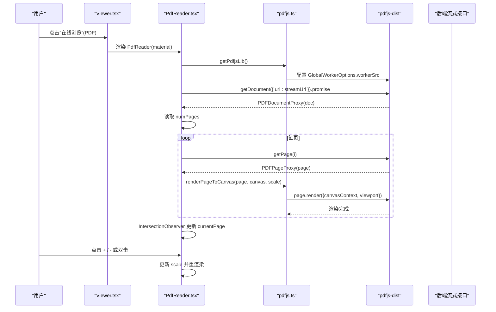
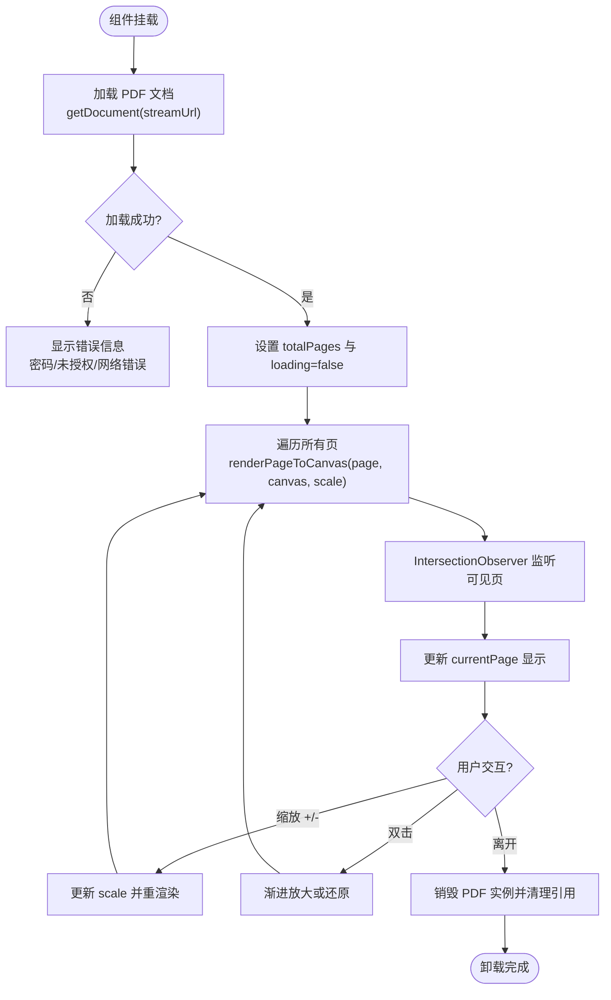
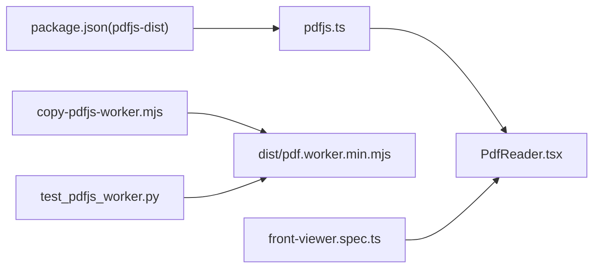

# PDF阅读器

<cite>
**本文引用的文件列表**
- [PdfReader.tsx](file://frontend/src/pages/public/viewer/PdfReader.tsx)
- [pdfjs.ts](file://frontend/src/lib/pdfjs.ts)
- [Viewer.tsx](file://frontend/src/pages/public/Viewer.tsx)
- [front-viewer.spec.ts](file://frontend/e2e/front-viewer.spec.ts)
- [copy-pdfjs-worker.mjs](file://frontend/scripts/copy-pdfjs-worker.mjs)
- [index.html](file://frontend/index.html)
- [package.json](file://frontend/package.json)
- [test_pdfjs_worker.py](file://deploy/local/tests/test_pdfjs_worker.py)
</cite>

## 目录
1. [简介](#简介)
2. [项目结构](#项目结构)
3. [核心组件](#核心组件)
4. [架构总览](#架构总览)
5. [详细组件分析](#详细组件分析)
6. [依赖关系分析](#依赖关系分析)
7. [性能与优化](#性能与优化)
8. [移动端适配与手势](#移动端适配与手势)
9. [安全限制与错误恢复](#安全限制与错误恢复)
10. [故障排查指南](#故障排查指南)
11. [结论](#结论)

## 简介
本技术文档聚焦于 Learning Hub 前端的 PDF 阅读器组件，围绕 pdf.js 的集成与使用展开，涵盖以下方面：
- PDF 加载、页面渲染与缩放控制
- Canvas 渲染优化策略（分页加载、内存管理、性能调优）
- 用户交互实现（页面导航、搜索高亮、书签管理）
- 移动端适配方案与触摸手势支持
- PDF 安全限制处理与错误恢复机制

该组件以“Word 式阅读”体验为目标，提供连续滚动、页码气泡、工具条缩放等能力，同时遵循 P-VIEWER 的安全约束：不提供任何下载入口。

## 项目结构
PDF 阅读器相关的前端代码主要位于以下位置：
- 页面路由分发：Viewer.tsx
- PDF 阅读器子组件：PdfReader.tsx
- pdf.js 单例封装与渲染辅助：pdfjs.ts
- 构建脚本：copy-pdfjs-worker.mjs
- E2E 测试：front-viewer.spec.ts
- 部署验证：test_pdfjs_worker.py
- 应用入口与 viewport 配置：index.html
- 依赖声明：package.json

图表来源
- [Viewer.tsx:1-170](file://frontend/src/pages/public/Viewer.tsx#L1-L170)
- [PdfReader.tsx:1-270](file://frontend/src/pages/public/viewer/PdfReader.tsx#L1-L270)
- [pdfjs.ts:1-57](file://frontend/src/lib/pdfjs.ts#L1-L57)
- [copy-pdfjs-worker.mjs:1-30](file://frontend/scripts/copy-pdfjs-worker.mjs#L1-L30)
- [index.html:1-14](file://frontend/index.html#L1-L14)
- [front-viewer.spec.ts:1-341](file://frontend/e2e/front-viewer.spec.ts#L1-L341)
- [test_pdfjs_worker.py:34-70](file://deploy/local/tests/test_pdfjs_worker.py#L34-L70)

章节来源
- [Viewer.tsx:1-170](file://frontend/src/pages/public/Viewer.tsx#L1-L170)
- [PdfReader.tsx:1-270](file://frontend/src/pages/public/viewer/PdfReader.tsx#L1-L270)
- [pdfjs.ts:1-57](file://frontend/src/lib/pdfjs.ts#L1-L57)
- [copy-pdfjs-worker.mjs:1-30](file://frontend/scripts/copy-pdfjs-worker.mjs#L1-L30)
- [index.html:1-14](file://frontend/index.html#L1-L14)
- [front-viewer.spec.ts:1-341](file://frontend/e2e/front-viewer.spec.ts#L1-L341)
- [test_pdfjs_worker.py:34-70](file://deploy/local/tests/test_pdfjs_worker.py#L34-L70)

## 核心组件
- Viewer.tsx：根据素材类型将请求分发到具体子组件（VIDEO/PDF/PPT），并负责访问会话埋点与返回逻辑。
- PdfReader.tsx：PDF 阅读器的 UI 与交互逻辑，包括加载、渲染、缩放、页码指示器、双击放大等。
- pdfjs.ts：对 pdfjs-dist 的单例封装，统一 worker 路径配置与高 DPI 渲染辅助函数。

章节来源
- [Viewer.tsx:1-170](file://frontend/src/pages/public/Viewer.tsx#L1-L170)
- [PdfReader.tsx:1-270](file://frontend/src/pages/public/viewer/PdfReader.tsx#L1-L270)
- [pdfjs.ts:1-57](file://frontend/src/lib/pdfjs.ts#L1-L57)

## 架构总览
PDF 阅读器的整体流程如下：
- 路由层根据 URL 参数进入 Viewer.tsx，按 material.type 分发到 PdfReader.tsx。
- PdfReader.tsx 通过 getPdfjsLib() 初始化 pdf.js，使用 getDocument(url).promise 加载 PDF。
- 获取 doc.numPages 后，遍历所有页调用 renderPageToCanvas(page, canvas, scale) 渲染到 canvas。
- 使用 IntersectionObserver 监听各页可见性，更新当前页码显示。
- 工具条提供缩放 +/- 按钮，双击容器触发渐进放大或还原。

图表来源
- [Viewer.tsx:142-166](file://frontend/src/pages/public/Viewer.tsx#L142-L166)
- [PdfReader.tsx:37-107](file://frontend/src/pages/public/viewer/PdfReader.tsx#L37-L107)
- [pdfjs.ts:18-30](file://frontend/src/lib/pdfjs.ts#L18-L30)
- [pdfjs.ts:39-55](file://frontend/src/lib/pdfjs.ts#L39-L55)

## 详细组件分析

### PdfReader 组件
职责与特性：
- 加载 PDF：基于 streamUrl 使用 pdf.js 加载文档，记录 totalPages，处理加载失败与权限错误。
- 渲染策略：默认按原始尺寸(100%)渲染，单页以其 canvas 实际宽度水平居中；窄屏允许横向滚动查看完整内容。
- 缩放控制：工具条提供预设缩放档位，双击容器渐进放大或还原。
- 页码指示器：右下角圆角气泡显示“第 N / M 页”，基于 IntersectionObserver 计算最靠近视口中心的可见页。
- 安全约束：不暴露任何下载入口，material.downloadUrl 不被引用。

关键实现要点：
- 生命周期与清理：在 useEffect 中异步加载 PDF，并在卸载时销毁 PDF 实例，避免内存泄漏。
- 渲染循环：scale 变化时重渲染所有页，单页渲染失败不阻塞整体。
- 可见性检测：使用 IntersectionObserver 监听 data-page-number 标记的元素，更新 currentPage。
- 事件处理：handleZoom 切换预设缩放，handleDoubleClick 渐进放大或还原。

图表来源
- [PdfReader.tsx:37-82](file://frontend/src/pages/public/viewer/PdfReader.tsx#L37-L82)
- [PdfReader.tsx:84-107](file://frontend/src/pages/public/viewer/PdfReader.tsx#L84-L107)
- [PdfReader.tsx:109-134](file://frontend/src/pages/public/viewer/PdfReader.tsx#L109-L134)
- [PdfReader.tsx:144-157](file://frontend/src/pages/public/viewer/PdfReader.tsx#L144-L157)

章节来源
- [PdfReader.tsx:1-270](file://frontend/src/pages/public/viewer/PdfReader.tsx#L1-L270)

### pdfjs.ts 模块
职责与特性：
- 单例封装：懒加载 pdfjs-dist，统一 worker 路径配置，生产环境固定路径，开发环境动态 URL。
- 版本导出：导出 PDFJS_VERSION 便于诊断。
- 渲染辅助：renderPageToCanvas 根据设备像素比做高 DPI 适配，确保清晰度与性能平衡。

关键点：
- workerSrc 配置：生产使用 /pdf.worker.min.mjs，开发使用 vite dev server 动态 URL，末尾带缓存破坏参数。
- 高 DPI 渲染：根据 window.devicePixelRatio 调整 canvas 宽高与样式宽高，避免模糊。

章节来源
- [pdfjs.ts:1-57](file://frontend/src/lib/pdfjs.ts#L1-L57)

### Viewer.tsx 分发逻辑
职责与特性：
- 根据 material.type 分发到 VideoPlayer、PdfReader、SlideshowViewer。
- 屏蔽 downloadUrl 透传，防止子组件误用导致下载入口泄露。
- 访问会话埋点：开始访问时记录 sessionId，离开时上报 durationSeconds。

章节来源
- [Viewer.tsx:1-170](file://frontend/src/pages/public/Viewer.tsx#L1-L170)

## 依赖关系分析
- 外部依赖：pdfjs-dist 用于 PDF 解析与渲染。
- 构建产物：copy-pdfjs-worker.mjs 将 worker 复制到 dist 根目录，供生产环境直接访问。
- 测试覆盖：E2E 用例验证 PDF 阅读器的基本功能与安全约束。

图表来源
- [package.json:14-27](file://frontend/package.json#L14-L27)
- [copy-pdfjs-worker.mjs:1-30](file://frontend/scripts/copy-pdfjs-worker.mjs#L1-L30)
- [front-viewer.spec.ts:1-341](file://frontend/e2e/front-viewer.spec.ts#L1-L341)
- [test_pdfjs_worker.py:34-70](file://deploy/local/tests/test_pdfjs_worker.py#L34-L70)

章节来源
- [package.json:14-27](file://frontend/package.json#L14-L27)
- [copy-pdfjs-worker.mjs:1-30](file://frontend/scripts/copy-pdfjs-worker.mjs#L1-L30)
- [front-viewer.spec.ts:1-341](file://frontend/e2e/front-viewer.spec.ts#L1-L341)
- [test_pdfjs_worker.py:34-70](file://deploy/local/tests/test_pdfjs_worker.py#L34-L70)

## 性能与优化
当前实现的关键性能特征与优化点：
- 全量渲染：当前对所有页进行渲染，适合页数较少的场景。对于大文档，建议引入分页加载与可视区域预取，减少首屏压力。
- 高 DPI 适配：通过 devicePixelRatio 提升清晰度，但会增加内存占用。可考虑在低 DPR 设备上降低 scale。
- 重渲染策略：scale 变化时重渲染所有页，可改为仅重渲染可见页或增量更新。
- 内存管理：组件卸载时销毁 PDF 实例，避免内存泄漏。可进一步清理 canvas 引用与 observer。
- Worker 加载：生产环境固定路径，开发环境动态 URL，附带缓存破坏参数，避免旧缓存影响。

优化建议：
- 引入 IntersectionObserver 驱动的按需渲染：仅在页面进入可视区域时渲染，离开时释放资源。
- 使用 requestIdleCallback 或分片渲染，避免主线程长时间阻塞。
- 对超大 PDF 启用虚拟滚动，仅维护少量页的 DOM 与 canvas。
- 针对移动端，适当降低默认 scale 或 DPR，以减少内存峰值。

[本节为通用性能讨论，不直接分析具体文件]

## 移动端适配与手势
当前适配情况：
- viewport 设置：index.html 包含 width=device-width, initial-scale=1.0，确保移动端基础布局正确。
- 响应式断点：UI 规格定义了 sm/md/lg 断点，PDF 阅读器在窄屏下允许横向滚动查看完整内容。
- 交互方式：双击放大/还原，工具条缩放按钮，均兼容移动端触摸操作。

待增强方向：
- 触摸手势：支持双指捏合缩放、滑动翻页、长按选择文本等。
- 自适应缩放：根据屏幕宽度自动调整默认 scale，提升小屏可读性。
- 无障碍：ARIA 标签与键盘导航完善，如左右箭头翻页、Esc 退出全屏等。

章节来源
- [index.html:1-14](file://frontend/index.html#L1-L14)
- [PdfReader.tsx:21-23](file://frontend/src/pages/public/viewer/PdfReader.tsx#L21-L23)
- [doc/spec/09-UI规格.md:380-388](file://doc/spec/09-UI规格.md#L380-L388)

## 安全限制与错误恢复
安全限制：
- 禁止下载入口：Viewer.tsx 剥离 downloadUrl，PdfReader.tsx 不暴露任何下载链接，符合 P-VIEWER 安全要求。
- 访问控制：后端通过流式接口与权限校验，前端错误处理区分密码保护、未授权访问与网络错误。

错误恢复机制：
- 加载失败：捕获异常并显示友好提示，支持刷新重试。
- 单页渲染失败：不影响其他页渲染，控制台输出详细错误便于排查。
- 会话埋点：访问开始与结束上报，失败静默处理，不影响用户体验。

章节来源
- [Viewer.tsx:137-140](file://frontend/src/pages/public/Viewer.tsx#L137-L140)
- [PdfReader.tsx:49-68](file://frontend/src/pages/public/viewer/PdfReader.tsx#L49-L68)
- [PdfReader.tsx:96-101](file://frontend/src/pages/public/viewer/PdfReader.tsx#L96-L101)

## 故障排查指南
常见问题与定位方法：
- Worker 缺失或路径错误：检查 dist/pdf.worker.min.mjs 是否存在，确认 copy-pdfjs-worker.mjs 构建步骤是否执行。
- 401/403 错误：确认材料访问权限与会话令牌有效。
- 密码保护 PDF：前端会识别 PasswordException 并提示用户。
- 渲染模糊：检查 devicePixelRatio 与 scale 设置，必要时调整默认缩放。
- 内存溢出：大文档建议启用分页加载与虚拟滚动，减少同时渲染的页面数量。

验证手段：
- E2E 测试：front-viewer.spec.ts 覆盖 PDF 阅读器基本功能与安全约束。
- 部署验证：test_pdfjs_worker.py 校验 worker 文件存在性与格式。

章节来源
- [front-viewer.spec.ts:136-173](file://frontend/e2e/front-viewer.spec.ts#L136-L173)
- [test_pdfjs_worker.py:34-70](file://deploy/local/tests/test_pdfjs_worker.py#L34-L70)
- [copy-pdfjs-worker.mjs:17-25](file://frontend/scripts/copy-pdfjs-worker.mjs#L17-L25)

## 结论
Learning Hub 的 PDF 阅读器组件基于 pdf.js 实现了稳定可靠的在线阅读体验，具备缩放控制、页码指示、双击放大等常用功能，并严格遵循安全约束不提供下载入口。当前实现采用全量渲染策略，适用于中小规模文档；对于大文档，建议引入分页加载与虚拟滚动以提升性能。移动端适配已具备基础能力，未来可进一步增强触摸手势与自适应缩放，提升多端一致性体验。