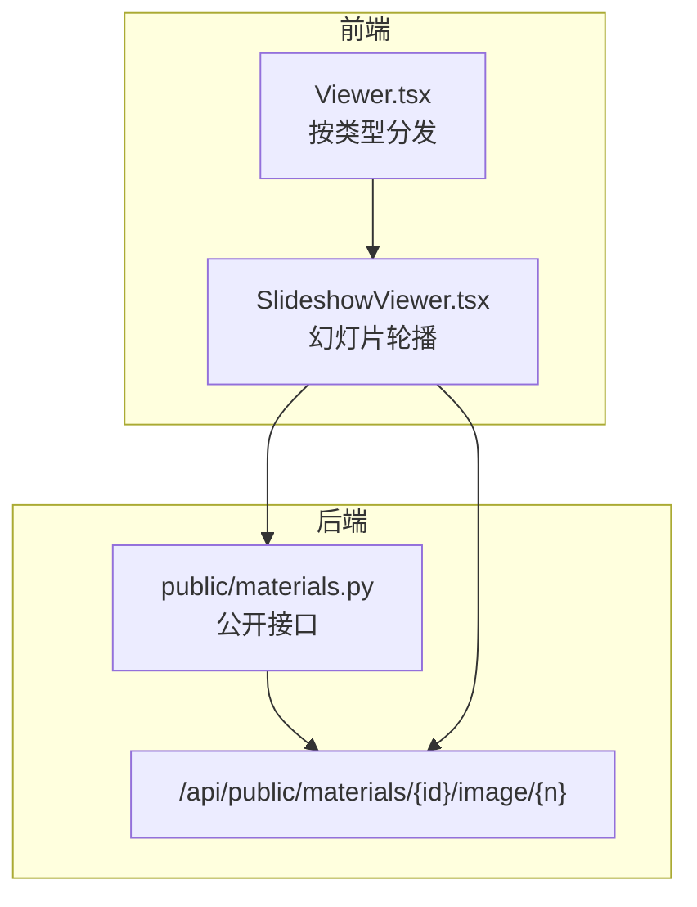
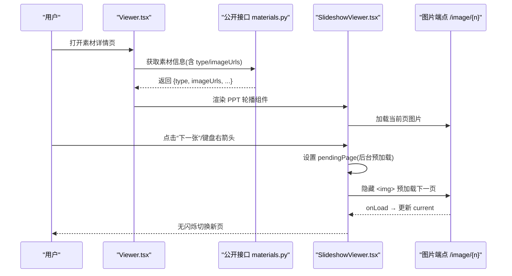
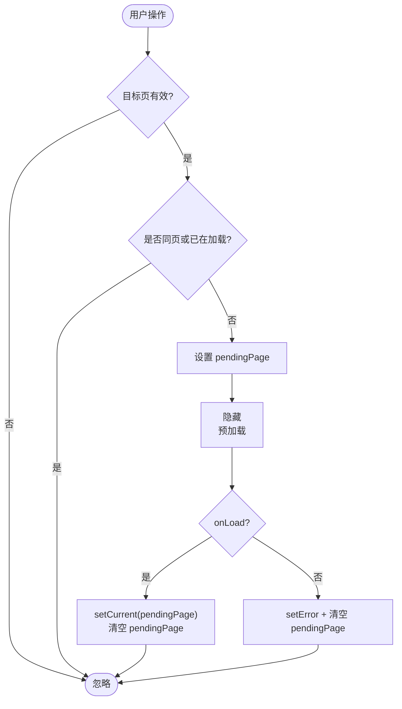

# PPT幻灯片轮播

<cite>
**本文引用的文件列表**
- [SlideshowViewer.tsx](file://frontend/src/pages/public/viewer/SlideshowViewer.tsx)
- [Viewer.tsx](file://frontend/src/pages/public/Viewer.tsx)
- [materials.py](file://backend/app/api/public/materials.py)
- [material.py](file://backend/app/services/material.py)
- [regen_ppt_images.py](file://deploy/local/regen_ppt_images.py)
</cite>

## 目录
1. [简介](#简介)
2. [项目结构](#项目结构)
3. [核心组件](#核心组件)
4. [架构总览](#架构总览)
5. [详细组件分析](#详细组件分析)
6. [依赖关系分析](#依赖关系分析)
7. [性能与内存优化](#性能与内存优化)
8. [故障排查指南](#故障排查指南)
9. [结论](#结论)
10. [附录](#附录)

## 简介
本技术文档聚焦 Learning Hub 的 PPT 幻灯片轮播播放器，围绕图片序列加载与管理、预加载策略、内存优化与缓存方案、轮播控制（自动播放、手动切换、进度指示、键盘导航）、过渡动画与用户体验设计（淡入淡出、滑动切换、响应式适配）、全屏模式与触摸手势、加载状态管理与错误处理机制进行系统化解析。目标是帮助开发者快速理解实现细节并指导后续演进。

## 项目结构
PPT 幻灯片轮播由前端“素材在线浏览页”根据素材类型分发到对应子组件，其中 PPT 类型交由 SlideshowViewer 渲染。后端在公开接口中为 PPT 素材返回 imageUrls 与 imageCount，供前端直接按页加载 PNG 预览图。

图表来源
- [Viewer.tsx:142-158](file://frontend/src/pages/public/Viewer.tsx#L142-L158)
- [SlideshowViewer.tsx:18-27](file://frontend/src/pages/public/viewer/SlideshowViewer.tsx#L18-L27)
- [materials.py:208-221](file://backend/app/api/public/materials.py#L208-L221)

章节来源
- [Viewer.tsx:1-170](file://frontend/src/pages/public/Viewer.tsx#L1-L170)
- [SlideshowViewer.tsx:1-277](file://frontend/src/pages/public/viewer/SlideshowViewer.tsx#L1-L277)
- [materials.py:208-221](file://backend/app/api/public/materials.py#L208-L221)

## 核心组件
- 素材分发器：根据 material.type 将请求路由至视频、PDF 或 PPT 子组件。
- 幻灯片轮播器：负责单页图片居中显示、上一张/下一张切换、键盘导航、全屏、预加载下一页、错误提示与加载态展示。
- 公开接口：为 PPT 素材生成 imageUrls 列表与页数统计，并提供逐页图片流式读取端点。

章节来源
- [Viewer.tsx:142-158](file://frontend/src/pages/public/Viewer.tsx#L142-L158)
- [SlideshowViewer.tsx:18-27](file://frontend/src/pages/public/viewer/SlideshowViewer.tsx#L18-L27)
- [materials.py:208-221](file://backend/app/api/public/materials.py#L208-L221)

## 架构总览
下图展示了从页面进入、获取素材信息、分发到 PPT 轮播组件，再到按需加载图片的完整流程。

图表来源
- [Viewer.tsx:66-87](file://frontend/src/pages/public/Viewer.tsx#L66-L87)
- [Viewer.tsx:142-158](file://frontend/src/pages/public/Viewer.tsx#L142-L158)
- [SlideshowViewer.tsx:30-81](file://frontend/src/pages/public/viewer/SlideshowViewer.tsx#L30-L81)
- [materials.py:208-221](file://backend/app/api/public/materials.py#L208-L221)

## 详细组件分析

### 幻灯片轮播器（SlideshowViewer）
- 数据源：从 props.material.imageUrls 获取图片 URL 数组；total 为图片总数。
- 状态管理：
  - current：当前可见页码（1-based）。
  - pendingPage：待切换的目标页（用于后台预加载）。
  - error：加载失败时的提示信息。
- 交互控制：
  - 上一张/下一张按钮调用 goto(current±1)。
  - 键盘左右箭头触发 prev/next。
  - 全屏按钮通过 imgRef 调用 requestFullscreen/exitFullscreen。
- 预加载策略：
  - 当用户请求切换时，不立即改变 current，而是设置 pendingPage。
  - 使用隐藏的  预加载目标页图片，onLoad 成功后才更新 current，避免中间闪烁。
  - onError 时设置 error 提示并清空 pendingPage。
- 加载状态与错误处理：
  - 当 total=0 时，显示“预览尚未生成，请稍后重试”。
  - 切换过程中显示“正在加载幻灯片…”浮动提示。
  - 切换失败时显示具体错误信息。
- 响应式与防下载：
  - 图片最大宽高限制，object-contain 自适应。
  - 禁用右键保存、拖拽，防止下载泄露。
- 未实现功能说明：
  - 自动播放：当前未实现定时器自动切换。
  - 触摸手势：当前未实现滑动手势切换。
  - 过渡动画：当前采用瞬时切换，未实现淡入淡出或滑动效果。

图表来源
- [SlideshowViewer.tsx:30-81](file://frontend/src/pages/public/viewer/SlideshowViewer.tsx#L30-L81)

章节来源
- [SlideshowViewer.tsx:18-27](file://frontend/src/pages/public/viewer/SlideshowViewer.tsx#L18-L27)
- [SlideshowViewer.tsx:30-81](file://frontend/src/pages/public/viewer/SlideshowViewer.tsx#L30-L81)
- [SlideshowViewer.tsx:102-147](file://frontend/src/pages/public/viewer/SlideshowViewer.tsx#L102-L147)
- [SlideshowViewer.tsx:186-233](file://frontend/src/pages/public/viewer/SlideshowViewer.tsx#L186-L233)
- [SlideshowViewer.tsx:235-272](file://frontend/src/pages/public/viewer/SlideshowViewer.tsx#L235-L272)

### 素材分发器（Viewer）
- 职责：
  - 根据 material.type 选择 VideoPlayer、PdfReader 或 SlideshowViewer。
  - 屏蔽 downloadUrl 透传，避免子组件误用导致下载入口泄露。
  - 访问会话埋点：开始/离开时上报 session，best-effort 记录。
- 错误与加载态：
  - 加载失败或缺少参数时显示统一错误页。
  - 加载中显示“正在加载预览…”。

章节来源
- [Viewer.tsx:1-170](file://frontend/src/pages/public/Viewer.tsx#L1-L170)

### 公开接口（materials.py）
- 针对 PPT 素材：
  - 扫描 preview_images_dir 下 page-*.png，排序后生成 imageUrls 列表与 imageCount。
  - 返回 previewReady 标志位，表示是否有可用预览。
- 非 PPT 素材：
  - imageUrls 为空，previewReady 根据类型判断。

章节来源
- [materials.py:208-221](file://backend/app/api/public/materials.py#L208-L221)

## 依赖关系分析
- 前端 Viewer 依赖公开接口获取素材元数据，并根据类型渲染相应子组件。
- SlideshowViewer 依赖浏览器原生能力（requestFullscreen、keydown）与 HTMLImageElement 生命周期（onLoad/onError）。
- 后端公开接口依赖文件系统扫描与路径拼接，提供逐页图片端点。

图表来源
- [Viewer.tsx:142-158](file://frontend/src/pages/public/Viewer.tsx#L142-L158)
- [SlideshowViewer.tsx:18-27](file://frontend/src/pages/public/viewer/SlideshowViewer.tsx#L18-L27)
- [materials.py:208-221](file://backend/app/api/public/materials.py#L208-L221)

章节来源
- [Viewer.tsx:142-158](file://frontend/src/pages/public/Viewer.tsx#L142-L158)
- [SlideshowViewer.tsx:18-27](file://frontend/src/pages/public/viewer/SlideshowViewer.tsx#L18-L27)
- [materials.py:208-221](file://backend/app/api/public/materials.py#L208-L221)

## 性能与内存优化
- 预加载策略
  - 使用隐藏  预加载下一页，onLoad 后才切换 current，避免中间闪烁与二次渲染。
  - 同一页或重复请求会被忽略，减少冗余网络请求。
- 内存优化
  - 仅维护两个  节点（当前页与预加载页），避免大量 DOM 节点累积。
  - 图片尺寸受 max-w/max-h 约束，object-contain 自适应，降低重排开销。
- 缓存方案
  - 利用浏览器 HTTP 缓存与图片解码缓存，相同 URL 不会重复解码。
  - 若需更激进缓存，可在服务端对图片端点启用强缓存头（如 Cache-Control），或在 CDN 层配置。
- 扩展建议
  - 引入 LRU 图片缓存池，保留最近 N 页的 Image 对象，避免频繁解码。
  - 对超大图片进行服务端缩放或分块传输，降低首屏与切换延迟。
  - 增加并发上限，避免同时预加载过多图片导致带宽拥塞。

[本节为通用性能讨论，无需特定文件引用]

## 故障排查指南
- 预览尚未生成
  - 现象：total=0 时显示“预览尚未生成，请稍后重试”。
  - 原因：后端未生成 PPT 预览图片。
  - 处理：检查转换服务日志，必要时运行一次性脚本重新生成预览。
- 某页加载失败
  - 现象：切换时出现“第 X 页加载失败，请刷新重试”。
  - 原因：图片端点不可用或网络异常。
  - 处理：确认 /api/public/materials/{id}/image/{n} 可达，检查服务端权限与存储路径。
- 全屏无效
  - 现象：点击全屏无反应。
  - 原因：浏览器安全策略限制或元素不可进入全屏。
  - 处理：确保在用户交互事件中调用 requestFullscreen，且元素可全屏。
- 批量重建预览
  - 工具：deploy/local/regen_ppt_images.py 可遍历已有 PPT 素材并生成 PNG 预览。
  - 注意：仅在环境具备 LibreOffice/pdftoppm 等依赖时执行。

章节来源
- [SlideshowViewer.tsx:102-147](file://frontend/src/pages/public/viewer/SlideshowViewer.tsx#L102-L147)
- [SlideshowViewer.tsx:77-81](file://frontend/src/pages/public/viewer/SlideshowViewer.tsx#L77-L81)
- [SlideshowViewer.tsx:60-68](file://frontend/src/pages/public/viewer/SlideshowViewer.tsx#L60-L68)
- [regen_ppt_images.py:1-44](file://deploy/local/regen_ppt_images.py#L1-L44)

## 结论
当前 PPT 幻灯片轮播以“单页图片+后台预加载”为核心，实现了稳定、低闪烁的切换体验，并通过隐藏  与最小化 DOM 节点控制内存占用。现有实现已覆盖基本的手动切换、键盘导航、全屏与错误提示，但尚未实现自动播放、触摸手势与过渡动画。建议在保持轻量化的前提下，逐步引入 LRU 缓存、服务端缩放与可选的过渡动画，以提升大课件场景下的流畅度与可用性。

[本节为总结性内容，无需特定文件引用]

## 附录

### 关键实现要点速查
- 预加载与切换
  - 参考路径：[goto/setPendingPage/onLoad:30-81](file://frontend/src/pages/public/viewer/SlideshowViewer.tsx#L30-L81)
- 键盘导航
  - 参考路径：[keydown 监听:44-58](file://frontend/src/pages/public/viewer/SlideshowViewer.tsx#L44-58)
- 全屏模式
  - 参考路径：[handleFullscreen:60-68](file://frontend/src/pages/public/viewer/SlideshowViewer.tsx#L60-68)
- 公开接口 imageUrls 生成
  - 参考路径：[imageUrls/imageCount/previewReady:208-221](file://backend/app/api/public/materials.py#L208-L221)
- 素材分发与下载屏蔽
  - 参考路径：[type 分支与剥离 downloadUrl:137-158](file://frontend/src/pages/public/Viewer.tsx#L137-158)

[本节为索引型内容，无需额外引用]