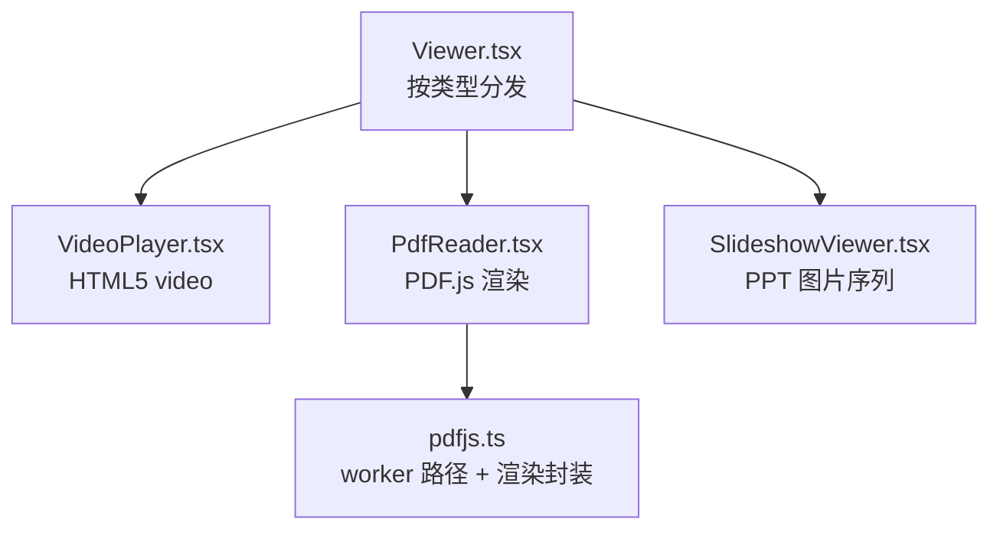
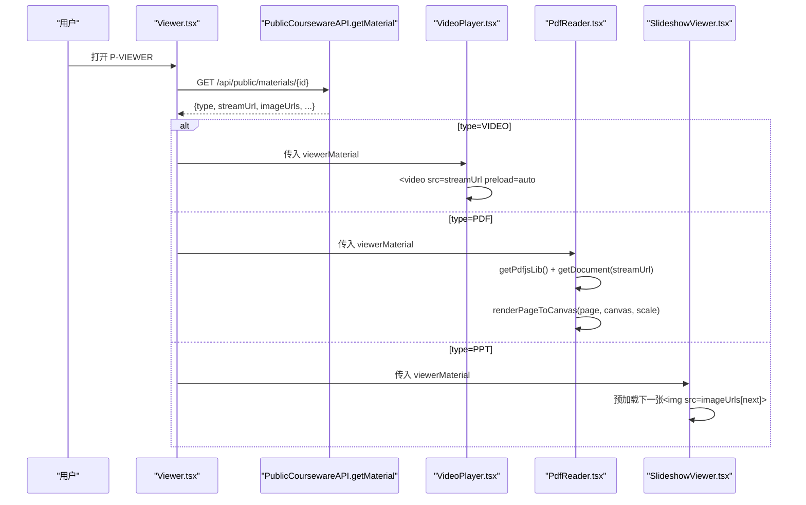
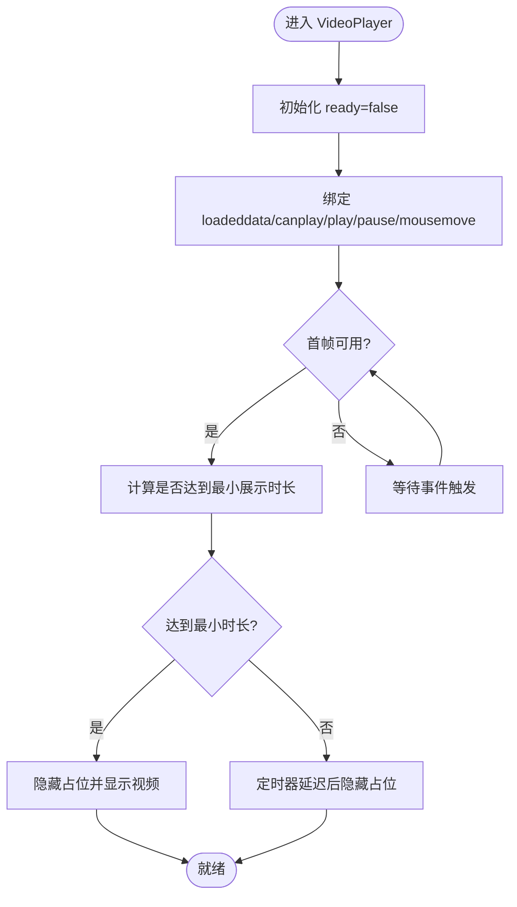
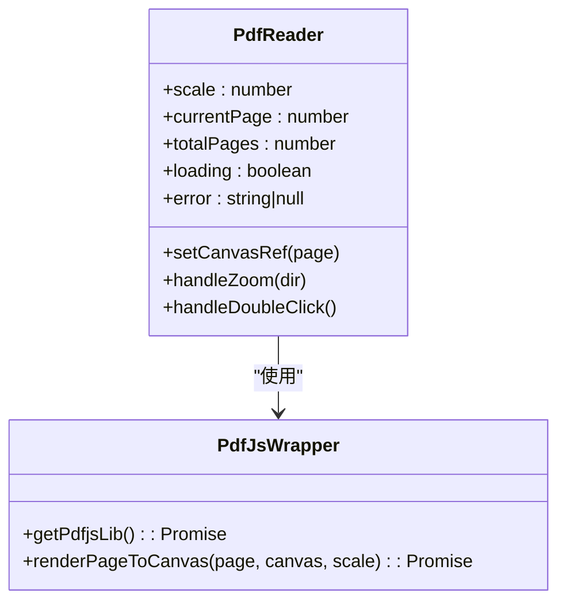
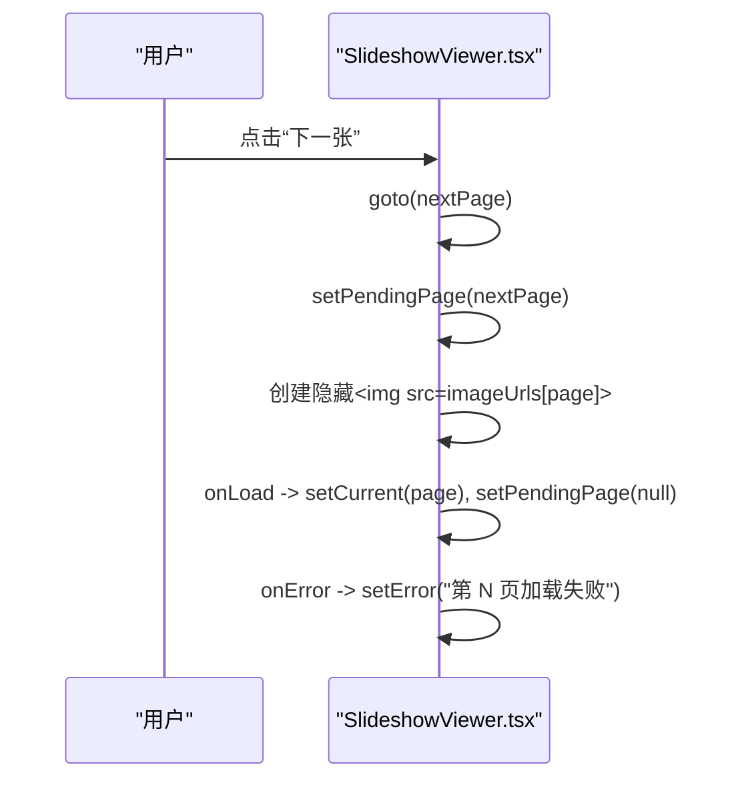
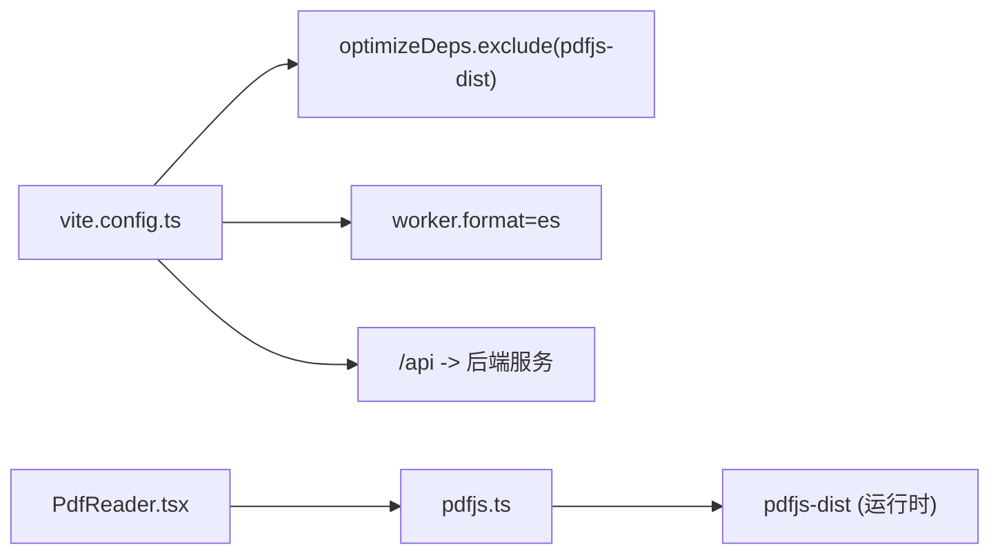

# 在线播放器

<cite>
**本文引用的文件列表**
- [Viewer.tsx](file://frontend/src/pages/public/Viewer.tsx)
- [VideoPlayer.tsx](file://frontend/src/pages/public/viewer/VideoPlayer.tsx)
- [PdfReader.tsx](file://frontend/src/pages/public/viewer/PdfReader.tsx)
- [pdfjs.ts](file://frontend/src/lib/pdfjs.ts)
- [SlideshowViewer.tsx](file://frontend/src/pages/public/viewer/SlideshowViewer.tsx)
- [vite.config.ts](file://frontend/vite.config.ts)
- [10-API设计规范.md](file://doc/spec/10-API设计规范.md)
- [test_stream.py](file://deploy/local/tests/test_stream.py)
- [front-viewer.spec.ts](file://frontend/e2e/front-viewer.spec.ts)
- [pptx-20slides.py](file://frontend/e2e/fixtures/pptx-20slides.py)
</cite>

## 目录
1. [简介](#简介)
2. [项目结构](#项目结构)
3. [核心组件](#核心组件)
4. [架构总览](#架构总览)
5. [详细组件分析](#详细组件分析)
6. [依赖关系分析](#依赖关系分析)
7. [性能与体验优化](#性能与体验优化)
8. [故障排查指南](#故障排查指南)
9. [结论](#结论)

## 简介
本技术文档聚焦 Learning Hub 的在线播放器，覆盖三类内容：
- 视频播放器：基于 HTML5 Video API 的流式播放、首帧可见策略、右键与下载限制。
- PDF 在线阅读器：集成 pdf.js，实现按页渲染、缩放、滚动驱动页码更新、高 DPI 适配。
- PPT 幻灯片轮播：后端将 PPT 转为图片序列，前端以图片预加载方式实现无闪烁翻页、键盘导航与全屏。

同时给出响应式设计与跨浏览器兼容方案、性能优化策略与用户体验改进建议。

## 项目结构
在线播放器位于前端 public 路由下，由统一入口根据素材类型分发到具体子组件。

图表来源
- [Viewer.tsx:142-166](file://frontend/src/pages/public/Viewer.tsx#L142-L166)
- [VideoPlayer.tsx:1-250](file://frontend/src/pages/public/viewer/VideoPlayer.tsx#L1-L250)
- [PdfReader.tsx:1-270](file://frontend/src/pages/public/viewer/PdfReader.tsx#L1-L270)
- [pdfjs.ts:1-57](file://frontend/src/lib/pdfjs.ts#L1-L57)
- [SlideshowViewer.tsx:1-277](file://frontend/src/pages/public/viewer/SlideshowViewer.tsx#L1-L277)

章节来源
- [Viewer.tsx:1-170](file://frontend/src/pages/public/Viewer.tsx#L1-L170)

## 核心组件
- Viewer（路由分发）：从公开接口获取素材元信息，屏蔽 downloadUrl，按 type 分发给对应播放器。
- VideoPlayer：使用 HTML5 video 标签，禁用 Picture-in-Picture 与下载控件，监听 loadeddata/canplay 控制占位显示，自动隐藏光标提升沉浸感。
- PdfReader：懒加载 pdfjs-dist，设置 workerSrc，逐页渲染至 canvas，支持缩放、双击放大、IntersectionObserver 驱动页码气泡。
- SlideshowViewer：后端已生成图片序列，前端通过隐藏 img 预加载下一页，完成后一次性替换当前图，避免闪烁；支持键盘切换与全屏。

章节来源
- [Viewer.tsx:137-166](file://frontend/src/pages/public/Viewer.tsx#L137-L166)
- [VideoPlayer.tsx:34-250](file://frontend/src/pages/public/viewer/VideoPlayer.tsx#L34-L250)
- [PdfReader.tsx:25-270](file://frontend/src/pages/public/viewer/PdfReader.tsx#L25-L270)
- [pdfjs.ts:18-55](file://frontend/src/lib/pdfjs.ts#L18-L55)
- [SlideshowViewer.tsx:18-277](file://frontend/src/pages/public/viewer/SlideshowViewer.tsx#L18-L277)

## 架构总览
在线播放器整体数据流：前端通过公开接口拉取素材详情（含 streamUrl/imageUrls），再由各子组件按需消费。

图表来源
- [Viewer.tsx:66-106](file://frontend/src/pages/public/Viewer.tsx#L66-L106)
- [VideoPlayer.tsx:202-216](file://frontend/src/pages/public/viewer/VideoPlayer.tsx#L202-L216)
- [PdfReader.tsx:41-107](file://frontend/src/pages/public/viewer/PdfReader.tsx#L41-L107)
- [pdfjs.ts:18-55](file://frontend/src/lib/pdfjs.ts#L18-L55)
- [SlideshowViewer.tsx:70-81](file://frontend/src/pages/public/viewer/SlideshowViewer.tsx#L70-L81)

## 详细组件分析

### 视频播放器（HTML5 Video API）
- 流式传输：src 指向公开流地址，Content-Type 为 video/mp4，支持 Range 分段请求，适合长视频。
- 首帧可见策略：监听 loadeddata/canplay，结合最小展示时长 POSTER_MIN_MS，避免缓存命中导致占位一闪而过。
- 交互与保护：controlsList="nodownload"、disablePictureInPicture、onContextMenu 阻止右键菜单，防止直接下载。
- 自动隐藏光标：播放时 2 秒无操作隐藏，提升沉浸体验。
- 错误处理：onError 提示“视频加载失败，请检查网络”。

图表来源
- [VideoPlayer.tsx:52-84](file://frontend/src/pages/public/viewer/VideoPlayer.tsx#L52-L84)
- [VideoPlayer.tsx:87-116](file://frontend/src/pages/public/viewer/VideoPlayer.tsx#L87-L116)
- [VideoPlayer.tsx:202-216](file://frontend/src/pages/public/viewer/VideoPlayer.tsx#L202-L216)

章节来源
- [VideoPlayer.tsx:1-250](file://frontend/src/pages/public/viewer/VideoPlayer.tsx#L1-L250)
- [10-API设计规范.md:1181-1206](file://doc/spec/10-API设计规范.md#L1181-L1206)
- [test_stream.py:32-41](file://deploy/local/tests/test_stream.py#L32-L41)

### PDF 在线阅读器（pdf.js 集成）
- 懒加载与 Worker：getPdfjsLib 在首次调用时配置 GlobalWorkerOptions.workerSrc，生产固定路径，开发动态 URL，并带 cache-bust 参数。
- 文档加载：getDocument({ url: material.streamUrl }).promise，捕获密码保护、未授权等错误并友好提示。
- 页面渲染：renderPageToCanvas 根据 devicePixelRatio 计算 viewport，设置 canvas 宽高与样式尺寸，确保高 DPI 清晰。
- 缩放与交互：工具条缩放按钮、双击放大/还原；默认 100% 原始尺寸，窄屏允许横向滚动。
- 滚动驱动页码：IntersectionObserver 观察各页容器，更新右下角页码气泡。

图表来源
- [PdfReader.tsx:25-156](file://frontend/src/pages/public/viewer/PdfReader.tsx#L25-L156)
- [pdfjs.ts:18-55](file://frontend/src/lib/pdfjs.ts#L18-L55)

章节来源
- [PdfReader.tsx:1-270](file://frontend/src/pages/public/viewer/PdfReader.tsx#L1-L270)
- [pdfjs.ts:1-57](file://frontend/src/lib/pdfjs.ts#L1-L57)

### PPT 幻灯片轮播（图片序列）
- 图片序列：后端将 PPT 转换为 PNG 图片序列，前端通过 material.imageUrls 访问。
- 预加载策略：点击“下一张”时，先设置 pendingPage，并在隐藏的  中预加载；加载完成后才切换 current，避免中间闪烁。
- 键盘与全屏：←/→ 切换页；全屏按钮调用 requestFullscreen/exitFullscreen。
- 错误降级：单页加载失败提示重试，不阻塞其他页。

图表来源
- [SlideshowViewer.tsx:30-81](file://frontend/src/pages/public/viewer/SlideshowViewer.tsx#L30-L81)
- [SlideshowViewer.tsx:60-68](file://frontend/src/pages/public/viewer/SlideshowViewer.tsx#L60-L68)

章节来源
- [SlideshowViewer.tsx:1-277](file://frontend/src/pages/public/viewer/SlideshowViewer.tsx#L1-L277)
- [pptx-20slides.py:1-79](file://frontend/e2e/fixtures/pptx-20slides.py#L1-L79)

## 依赖关系分析
- 运行时依赖：pdfjs-dist 作为外部库，通过 vite.optimizeDeps.exclude 交由运行时动态加载，避免 HMR 卡顿。
- 构建期配置：vite worker.format=es，便于 pdf.worker.min.mjs 以 ES 模块形式加载。
- 开发代理：/api 与 /admin 代理到后端服务，便于本地调试。

图表来源
- [vite.config.ts:12-18](file://frontend/vite.config.ts#L12-L18)
- [vite.config.ts:19-32](file://frontend/vite.config.ts#L19-L32)
- [PdfReader.tsx:41-44](file://frontend/src/pages/public/viewer/PdfReader.tsx#L41-L44)
- [pdfjs.ts:18-30](file://frontend/src/lib/pdfjs.ts#L18-L30)

章节来源
- [vite.config.ts:1-38](file://frontend/vite.config.ts#L1-L38)

## 性能与体验优化
- 视频
  - 使用 preload="auto" 与 Range 分段，减少首屏等待。
  - 首帧可见策略避免占位闪烁，提升感知速度。
  - 自动隐藏光标增强沉浸感。
- PDF
  - 懒加载 pdfjs-dist，减少初始包体积。
  - 高 DPI 渲染提升清晰度，避免模糊。
  - IntersectionObserver 仅关注可视区域，降低重绘压力。
- PPT
  - 预加载下一页图片，切换时无闪烁。
  - 隐藏 img 异步加载，避免主线程阻塞。
- 通用
  - 屏蔽下载与右键菜单，保障版权与合规。
  - 错误提示友好，提供重试或返回入口。

[本节为通用指导，无需源码引用]

## 故障排查指南
- 视频无法播放
  - 检查 Content-Type 是否为 video/mp4，Content-Disposition 是否为 inline。
  - 确认流地址可被浏览器直接渲染，且支持 Range。
  - 参考 e2e 用例断言与后端测试脚本验证响应头。
- PDF 加载失败
  - 查看控制台错误日志，区分 worker 加载失败、PDF 损坏、权限 401/403。
  - 确认 worker 路径在生产环境可达，并带有 cache-bust 参数。
- PPT 预览缺失
  - 若 imageUrls 为空，说明后端尚未生成图片预览，需等待转换完成。
  - 单页加载失败会提示重试，不影响其他页。

章节来源
- [front-viewer.spec.ts:119-134](file://frontend/e2e/front-viewer.spec.ts#L119-L134)
- [test_stream.py:32-41](file://deploy/local/tests/test_stream.py#L32-L41)
- [PdfReader.tsx:49-68](file://frontend/src/pages/public/viewer/PdfReader.tsx#L49-L68)
- [SlideshowViewer.tsx:102-147](file://frontend/src/pages/public/viewer/SlideshowViewer.tsx#L102-L147)

## 结论
Learning Hub 的在线播放器通过统一的 Viewer 分发机制，分别实现了视频、PDF 与 PPT 的高效阅读体验：
- 视频采用标准 HTML5 能力与首帧可见策略，兼顾流畅与防下载。
- PDF 借助 pdf.js 的高清渲染与懒加载，配合滚动驱动页码，获得类 Word 的阅读体验。
- PPT 通过图片序列与预加载策略，实现无闪烁翻页与全屏演示。

整体设计注重性能与用户体验，并通过 e2e 与后端测试保障行为正确性。后续可在自适应布局、错误上报与监控方面继续完善。