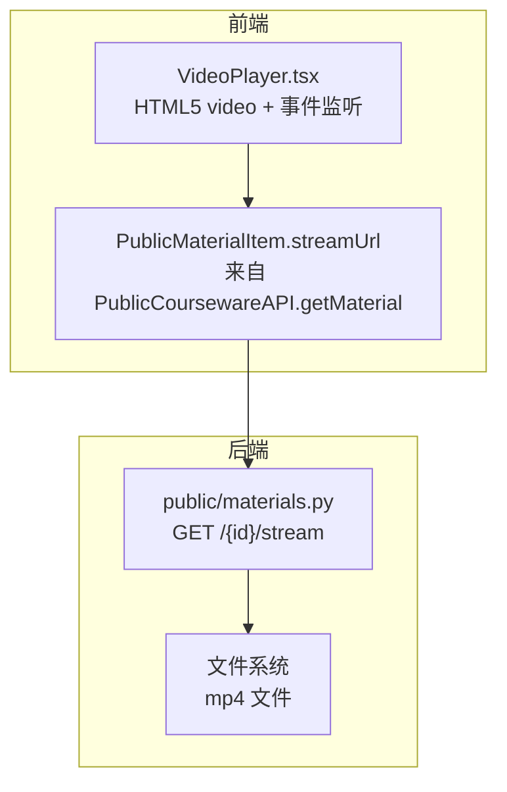
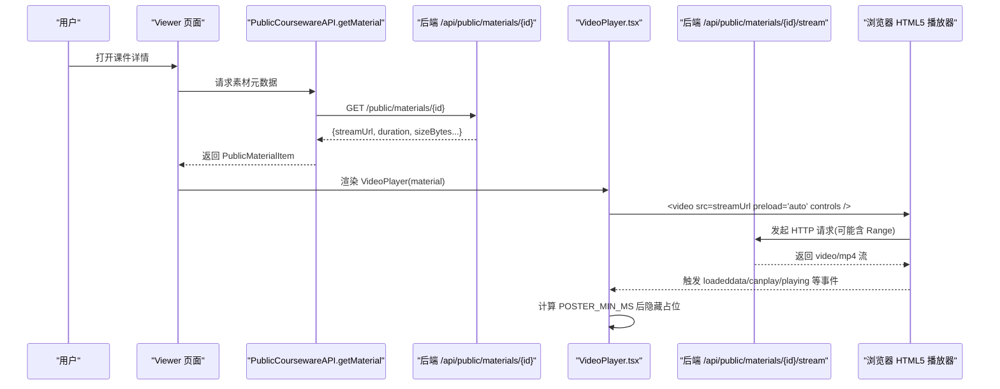
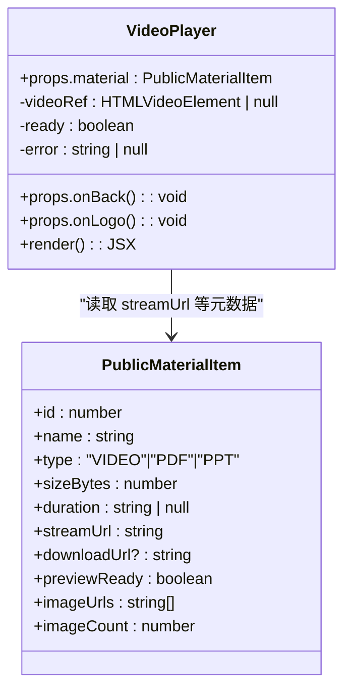
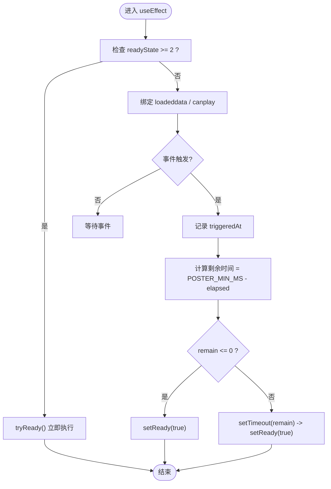
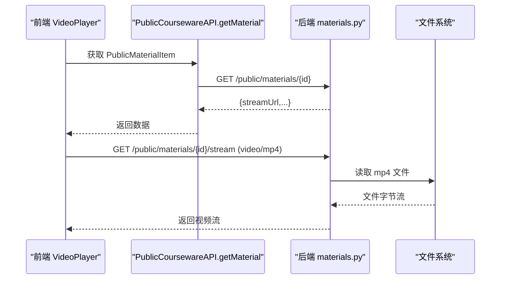
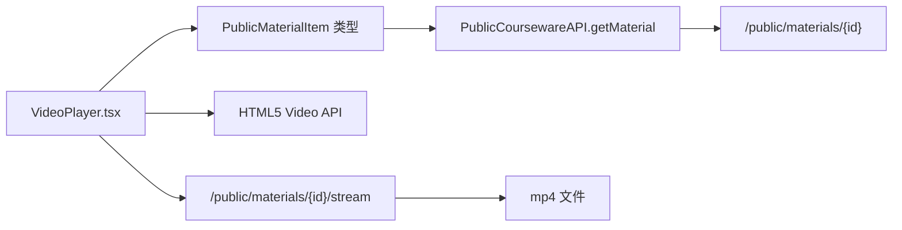

# 视频播放器

<cite>
**本文引用的文件列表**
- [VideoPlayer.tsx](file://frontend/src/pages/public/viewer/VideoPlayer.tsx)
- [index.ts（前端 API 类型与公开接口）](file://frontend/src/api/index.ts)
- [materials.py（公共素材流式预览接口）](file://backend/app/api/public/materials.py)
</cite>

## 目录
1. [简介](#简介)
2. [项目结构](#项目结构)
3. [核心组件](#核心组件)
4. [架构总览](#架构总览)
5. [详细组件分析](#详细组件分析)
6. [依赖关系分析](#依赖关系分析)
7. [性能考量](#性能考量)
8. [故障排查指南](#故障排查指南)
9. [结论](#结论)
10. [附录](#附录)

## 简介
本技术文档聚焦 Learning Hub 的“视频播放器”组件，围绕 HTML5 Video API 的使用实现进行系统化解析。内容涵盖：
- 视频流媒体传输路径与后端支持
- 播放控制接口与事件处理机制
- 加载状态管理（loadeddata、canplay 等）
- 首帧显示优化策略（POSTER_MIN_MS 最小展示时长与占位动画）
- 响应式布局设计与跨浏览器兼容性要点
- 错误处理、自动隐藏光标与用户体验优化建议

## 项目结构
前端通过公开素材查询接口获取 streamUrl，并在 VideoPlayer 组件中以 HTML5 video 标签直接播放；后端提供 /api/public/materials/{id}/stream 端点以 inline 方式返回视频文件，供浏览器原生播放器渲染。

图示来源
- [VideoPlayer.tsx:202-215](file://frontend/src/pages/public/viewer/VideoPlayer.tsx#L202-L215)
- [index.ts（前端 API 类型与公开接口）:429-439](file://frontend/src/api/index.ts#L429-L439)
- [materials.py（公共素材流式预览接口）:84-111](file://backend/app/api/public/materials.py#L84-L111)

章节来源
- [VideoPlayer.tsx:1-250](file://frontend/src/pages/public/viewer/VideoPlayer.tsx#L1-L250)
- [index.ts（前端 API 类型与公开接口）:315-332](file://frontend/src/api/index.ts#L315-L332)
- [materials.py（公共素材流式预览接口）:84-111](file://backend/app/api/public/materials.py#L84-L111)

## 核心组件
- 组件职责
  - 使用 HTML5 video 元素加载并播放视频流
  - 管理加载状态与错误提示
  - 实现首帧可见的最小展示时长策略，避免占位闪烁
  - 在播放期间自动隐藏鼠标光标以提升沉浸体验
  - 提供响应式布局与无障碍基础属性
- 关键数据与状态
  - material：包含 id、name、type、sizeBytes、duration、streamUrl 等字段
  - ready：是否已满足“首帧可见且达到最小展示时长”，用于隐藏占位
  - error：错误信息字符串，用于切换占位样式与文案

章节来源
- [VideoPlayer.tsx:19-44](file://frontend/src/pages/public/viewer/VideoPlayer.tsx#L19-L44)
- [VideoPlayer.tsx:118-216](file://frontend/src/pages/public/viewer/VideoPlayer.tsx#L118-L216)
- [index.ts（前端 API 类型与公开接口）:315-332](file://frontend/src/api/index.ts#L315-L332)

## 架构总览
从用户打开课件到视频开始播放的关键流程如下：

图示来源
- [index.ts（前端 API 类型与公开接口）:429-439](file://frontend/src/api/index.ts#L429-L439)
- [materials.py（公共素材流式预览接口）:183-221](file://backend/app/api/public/materials.py#L183-L221)
- [VideoPlayer.tsx:202-215](file://frontend/src/pages/public/viewer/VideoPlayer.tsx#L202-L215)
- [materials.py（公共素材流式预览接口）:84-111](file://backend/app/api/public/materials.py#L84-L111)

## 详细组件分析

### 组件类图（代码级）

图示来源
- [VideoPlayer.tsx:19-44](file://frontend/src/pages/public/viewer/VideoPlayer.tsx#L19-L44)
- [index.ts（前端 API 类型与公开接口）:315-332](file://frontend/src/api/index.ts#L315-L332)

章节来源
- [VideoPlayer.tsx:19-44](file://frontend/src/pages/public/viewer/VideoPlayer.tsx#L19-L44)
- [index.ts（前端 API 类型与公开接口）:315-332](file://frontend/src/api/index.ts#L315-L332)

### 首帧显示优化与加载状态管理
- 最小展示时长策略
  - 常量 POSTER_MIN_MS 定义占位层的最短展示时间，防止因缓存命中导致 loadeddata/canplay 过快触发而“一闪而过”。
  - 当任一事件（loadeddata、canplay）触发时记录时间戳，若未达到最小时长则延迟至达标后再将 ready 置为 true，从而淡出占位。
- 事件监听与边界处理
  - 监听 loadeddata（第一帧可用）与 canplay（缓冲足够可播放），二者互为兜底。
  - 若视频已具备第一帧数据（readyState >= 2），则跳过事件等待，直接尝试满足最小时长条件。
- 生命周期清理
  - 组件卸载或 material.id 变化时移除事件监听器与定时器，避免内存泄漏与重复计时。

图示来源
- [VideoPlayer.tsx:52-84](file://frontend/src/pages/public/viewer/VideoPlayer.tsx#L52-L84)

章节来源
- [VideoPlayer.tsx:13-17](file://frontend/src/pages/public/viewer/VideoPlayer.tsx#L13-L17)
- [VideoPlayer.tsx:52-84](file://frontend/src/pages/public/viewer/VideoPlayer.tsx#L52-L84)

### 自动隐藏光标与交互增强
- 行为说明
  - 播放开始时重置显示，随后 2 秒无操作自动隐藏光标；暂停或鼠标移动时恢复显示。
- 实现要点
  - 通过 play/pause/mousemove 事件驱动，使用父容器 style.cursor 控制。
  - 清理逻辑确保离开组件或停止播放时不再持有定时器。

章节来源
- [VideoPlayer.tsx:86-116](file://frontend/src/pages/public/viewer/VideoPlayer.tsx#L86-L116)

### 错误处理与降级
- 错误捕获
  - video.onerror 设置错误文案，同时切换占位背景与图标，提升可感知性。
- 兼容性与安全
  - 禁用右键菜单与画中画，避免非预期的下载或悬浮窗口。
  - 提供“不支持 HTML5 视频”的降级提示文本。

章节来源
- [VideoPlayer.tsx:202-215](file://frontend/src/pages/public/viewer/VideoPlayer.tsx#L202-L215)

### 响应式布局与跨浏览器兼容性
- 布局
  - 主区域与右侧信息面板采用网格布局，在小屏下堆叠，在大屏下左右分栏（右侧固定宽度）。
  - 视频容器限制最大高度，适配不同屏幕尺寸。
- 兼容性
  - 使用标准 HTML5 video 控件与属性，结合 Tailwind 样式实现一致体验。
  - 对移动端与桌面端均有效，无需额外 polyfill。

章节来源
- [VideoPlayer.tsx:152-216](file://frontend/src/pages/public/viewer/VideoPlayer.tsx#L152-L216)

### 流媒体传输与后端支持
- 前端
  - 通过 PublicCoursewareAPI.getMaterial 获取 PublicMaterialItem，其中 streamUrl 指向后端流式端点。
  - 将 streamUrl 赋给 video.src，由浏览器负责分段请求与解码。
- 后端
  - /api/public/materials/{id}/stream 针对 VIDEO 类型返回 video/mp4，Content-Disposition 为 inline，便于内嵌播放。
  - 该端点受速率限制保护，避免滥用。

图示来源
- [index.ts（前端 API 类型与公开接口）:429-439](file://frontend/src/api/index.ts#L429-L439)
- [materials.py（公共素材流式预览接口）:183-221](file://backend/app/api/public/materials.py#L183-L221)
- [materials.py（公共素材流式预览接口）:84-111](file://backend/app/api/public/materials.py#L84-L111)

章节来源
- [index.ts（前端 API 类型与公开接口）:315-332](file://frontend/src/api/index.ts#L315-L332)
- [materials.py（公共素材流式预览接口）:84-111](file://backend/app/api/public/materials.py#L84-L111)
- [materials.py（公共素材流式预览接口）:183-221](file://backend/app/api/public/materials.py#L183-L221)

## 依赖关系分析
- 组件依赖
  - VideoPlayer 依赖 PublicMaterialItem 类型中的 streamUrl、duration、sizeBytes 等字段。
  - 通过 React hooks 管理本地状态与副作用（事件监听、定时器）。
- 外部依赖
  - 浏览器 HTML5 Video API（事件模型、preload、controls、onError 等）。
  - 后端 FastAPI FileResponse 提供的流式响应能力。

图示来源
- [VideoPlayer.tsx:202-215](file://frontend/src/pages/public/viewer/VideoPlayer.tsx#L202-L215)
- [index.ts（前端 API 类型与公开接口）:429-439](file://frontend/src/api/index.ts#L429-L439)
- [materials.py（公共素材流式预览接口）:84-111](file://backend/app/api/public/materials.py#L84-L111)

章节来源
- [VideoPlayer.tsx:19-44](file://frontend/src/pages/public/viewer/VideoPlayer.tsx#L19-L44)
- [index.ts（前端 API 类型与公开接口）:315-332](file://frontend/src/api/index.ts#L315-L332)
- [materials.py（公共素材流式预览接口）:84-111](file://backend/app/api/public/materials.py#L84-L111)

## 性能考量
- 预加载策略
  - 使用 preload="auto" 让浏览器根据网络状况与用户行为决定预加载程度，平衡首开速度与带宽占用。
- 事件选择
  - 优先使用 loadeddata 作为“首帧可见”信号，canplay 作为兜底，减少黑屏与闪烁。
- 最小展示时长
  - POSTER_MIN_MS 避免极短时间内的占位闪烁，提升观感一致性。
- 资源释放
  - 在 effect 清理中移除事件监听与定时器，防止内存泄漏与重复触发。

[本节为通用指导，不直接分析具体文件]

## 故障排查指南
- 常见问题
  - 视频无法加载：检查 network 中 /api/public/materials/{id}/stream 是否返回 200 与正确的 content-type。
  - 权限问题：受限课件需携带 X-Token-Hash 头或 cookie lh_token_hash，否则后端会拒绝访问。
  - 首帧闪烁：确认 POSTER_MIN_MS 配置合理，避免过短导致占位闪退。
  - 移动端播放异常：确认浏览器支持 mp4 编码格式，必要时提供多格式回退。
- 定位步骤
  - 在浏览器开发者工具中观察 video 元素的 readyState、network 请求与错误事件。
  - 在后端日志中查看 /stream 端点的访问与限流情况。
  - 校验 PublicMaterialItem.streamUrl 是否正确拼接。

章节来源
- [VideoPlayer.tsx:202-215](file://frontend/src/pages/public/viewer/VideoPlayer.tsx#L202-L215)
- [materials.py（公共素材流式预览接口）:84-111](file://backend/app/api/public/materials.py#L84-L111)
- [materials.py（公共素材流式预览接口）:183-221](file://backend/app/api/public/materials.py#L183-L221)

## 结论
VideoPlayer 组件基于 HTML5 Video API 实现了简洁可靠的视频播放体验，结合后端 inline 流式响应与前端事件驱动的首帧优化策略，兼顾了性能与可用性。通过合理的错误处理、自动隐藏光标与响应式布局，进一步提升了用户体验。建议在后续迭代中持续监控网络与事件时序，并根据实际业务需求微调 POSTER_MIN_MS 与预加载策略。

[本节为总结性内容，不直接分析具体文件]

## 附录
- 相关术语
  - loadeddata：第一帧数据可用，通常代表首帧可渲染
  - canplay：缓冲足够可以开始播放
  - readyState：视频缓冲状态，>=2 表示已有第一帧数据
  - Content-Disposition: inline：使浏览器以内联方式渲染媒体，而非下载
- 参考实现位置
  - 前端组件与事件处理：[VideoPlayer.tsx](file://frontend/src/pages/public/viewer/VideoPlayer.tsx)
  - 公开素材元数据与 streamUrl：[index.ts（前端 API 类型与公开接口）](file://frontend/src/api/index.ts)
  - 后端流式端点与 ACL 校验：[materials.py（公共素材流式预览接口）](file://backend/app/api/public/materials.py)