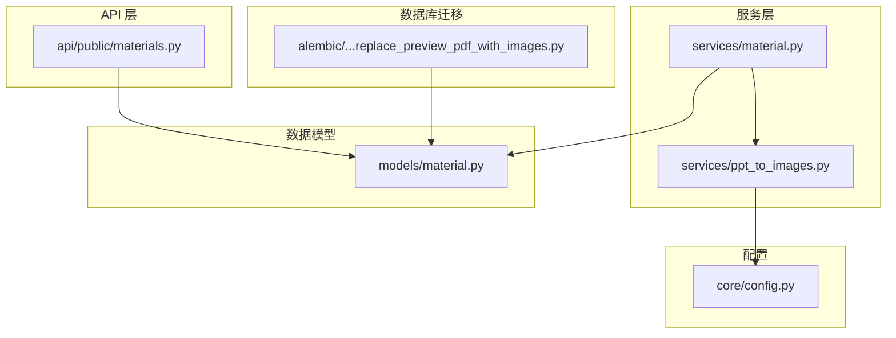
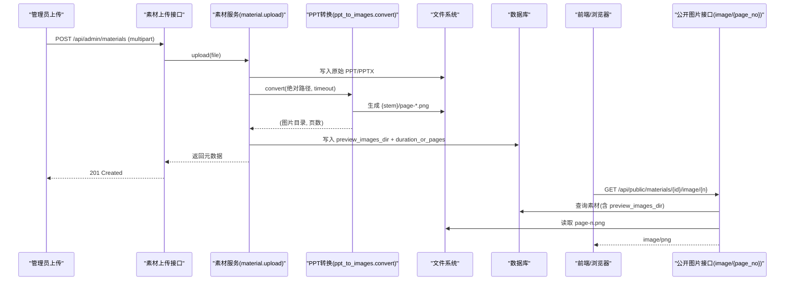
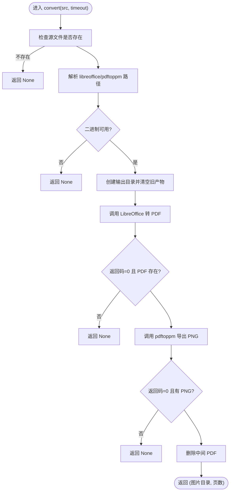
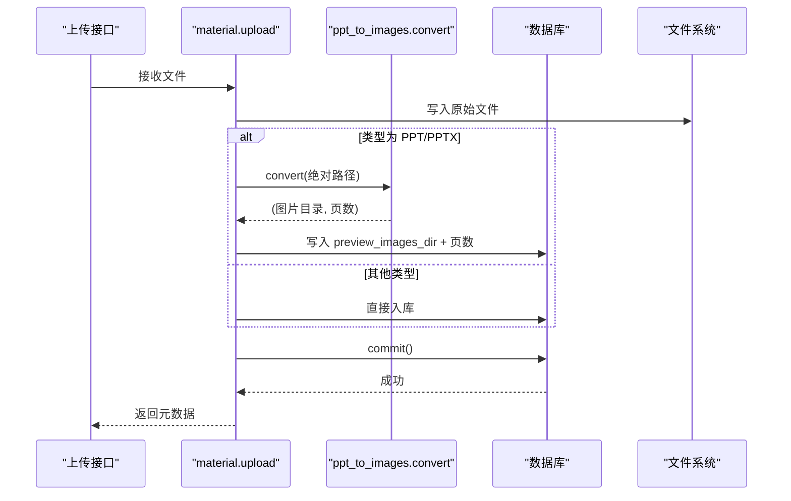
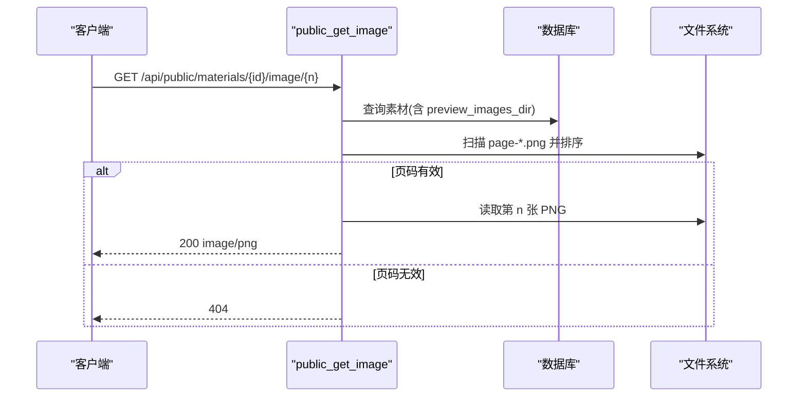
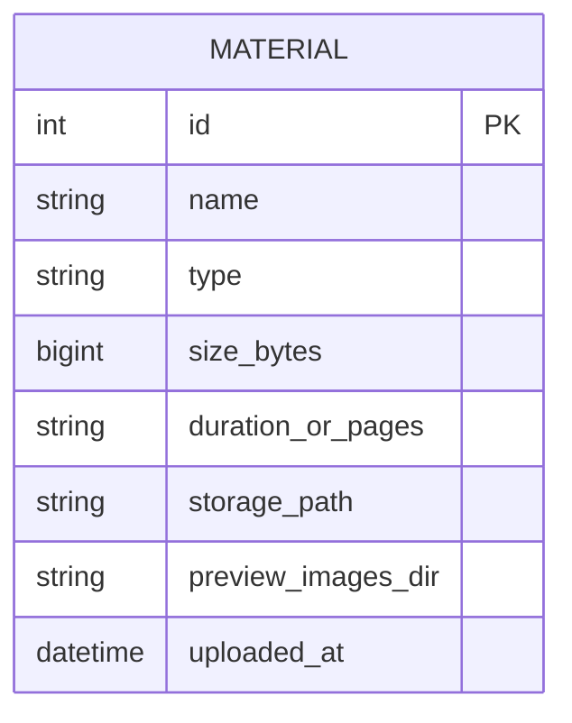
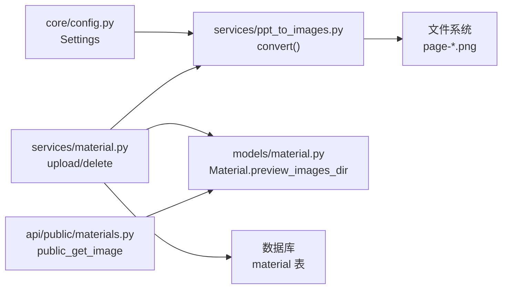

# PPT转换与图片提取

<cite>
**本文引用的文件列表**
- [ppt_to_images.py](file://backend/app/services/ppt_to_images.py)
- [config.py](file://backend/app/core/config.py)
- [material.py](file://backend/app/models/material.py)
- [material.py](file://backend/app/services/material.py)
- [materials.py](file://backend/app/api/public/materials.py)
- [2026_07_07_1230-b2c3d4e5f607_replace_preview_pdf_with_images.py](file://backend/alembic/versions/2026_07_07_1230-b2c3d4e5f607_replace_preview_pdf_with_images.py)
- [test_materials.py](file://backend/tests/test_materials.py)
</cite>

## 目录
1. [简介](#简介)
2. [项目结构](#项目结构)
3. [核心组件](#核心组件)
4. [架构总览](#架构总览)
5. [详细组件分析](#详细组件分析)
6. [依赖关系分析](#依赖关系分析)
7. [性能考虑](#性能考虑)
8. [故障排查指南](#故障排查指南)
9. [结论](#结论)
10. [附录](#附录)

## 简介
本技术文档聚焦于 Learning Hub 的“PPT 转图片”能力，涵盖以下关键主题：
- LibreOffice 集成与 PPT→PDF→PNG 的完整转换流程
- 进程管理、资源清理与错误处理策略
- PDF 到 PNG 的批量页面分割、图像质量与压缩优化
- 预览图片目录结构与命名规范
- LibreOffice 环境配置、字体支持与跨平台兼容性方案
- 转换失败的回滚机制与性能调优策略

该功能在上传 PPT/PPTX 素材后，后台自动调用外部工具链将每页幻灯片转换为高质量 PNG 图片，供前端以幻灯片形式浏览。

## 项目结构
与 PPT 转换与图片提取相关的后端代码主要分布在 services、models、api 与 core 四个层次：
- services/ppt_to_images.py：封装 PPT→PDF→PNG 的转换逻辑
- services/material.py：素材上传流程中触发转换并持久化结果
- models/material.py：定义素材模型及预览图片目录字段
- api/public/materials.py：对外提供图片流式访问接口
- core/config.py：LibreOffice 与 Poppler 可执行路径、超时等配置
- alembic 迁移：从 preview_pdf_path 演进为 preview_images_dir

图表来源
- [ppt_to_images.py:1-185](file://backend/app/services/ppt_to_images.py#L1-L185)
- [material.py:1-234](file://backend/app/services/material.py#L1-L234)
- [material.py:1-69](file://backend/app/models/material.py#L1-L69)
- [materials.py:1-224](file://backend/app/api/public/materials.py#L1-L224)
- [config.py:1-88](file://backend/app/core/config.py#L1-L88)
- [2026_07_07_1230-b2c3d4e5f607_replace_preview_pdf_with_images.py:1-39](file://backend/alembic/versions/2026_07_07_1230-b2c3d4e5f607_replace_preview_pdf_with_images.py#L1-L39)

章节来源
- [ppt_to_images.py:1-185](file://backend/app/services/ppt_to_images.py#L1-L185)
- [material.py:1-234](file://backend/app/services/material.py#L1-L234)
- [material.py:1-69](file://backend/app/models/material.py#L1-L69)
- [materials.py:1-224](file://backend/app/api/public/materials.py#L1-L224)
- [config.py:1-88](file://backend/app/core/config.py#L1-L88)
- [2026_07_07_1230-b2c3d4e5f607_replace_preview_pdf_with_images.py:1-39](file://backend/alembic/versions/2026_07_07_1230-b2c3d4e5f607_replace_preview_pdf_with_images.py#L1-L39)

## 核心组件
- PPT 转换服务（convert）
  - 负责调用 LibreOffice 将 PPT/PPTX 转为 PDF，再调用 pdftoppm 将 PDF 逐页导出为 PNG
  - 输出目录位于源文件同级，目录名为源文件名（不含扩展名），内部文件命名为 page-1.png、page-2.png 等
  - 失败或超时时仅记录日志，不抛异常，避免阻塞上传流程
- 素材服务（upload/delete）
  - 上传时根据类型判断是否触发转换；成功则写入 preview_images_dir 与页数
  - 删除时级联清理原文件与预览图片目录
- 公开 API（image/{page_no}）
  - 按 1-indexed 返回第 N 张 PNG，兼容不同前缀命名（如 page-1.png 或 page-01.png）
- 配置（Settings）
  - 提供 libreoffice_path、poppler_path、ppt_convert_timeout 等可调参数

章节来源
- [ppt_to_images.py:1-185](file://backend/app/services/ppt_to_images.py#L1-L185)
- [material.py:129-202](file://backend/app/services/material.py#L129-L202)
- [materials.py:149-180](file://backend/app/api/public/materials.py#L149-L180)
- [config.py:54-61](file://backend/app/core/config.py#L54-L61)

## 架构总览
下图展示了从上传到图片生成的端到端流程，以及对外提供的图片访问接口。

图表来源
- [material.py:129-202](file://backend/app/services/material.py#L129-L202)
- [ppt_to_images.py:48-181](file://backend/app/services/ppt_to_images.py#L48-L181)
- [materials.py:149-180](file://backend/app/api/public/materials.py#L149-L180)

## 详细组件分析

### 组件一：PPT 转换服务（ppt_to_images.convert）
职责与行为
- 解析可执行路径：优先使用 Settings 中的绝对路径，其次 PATH 查找，最后回退默认路径
- 创建输出目录：与源文件同级，目录名为 <stem>，并清空旧产物
- 第一步：调用 LibreOffice 无头模式将 PPT/PPTX 转为 PDF（固定输出 <stem>.pdf）
- 第二步：调用 pdftoppm 将 PDF 按页导出为 PNG，分辨率 150dpi，输出前缀 page，最终文件名为 page-1.png、page-2.png 等
- 统计 PNG 数量并删除中间 PDF，返回（图片目录绝对路径, 页数）
- 所有外部调用均设置超时，捕获异常并记录日志，不向上抛出

图表来源
- [ppt_to_images.py:48-181](file://backend/app/services/ppt_to_images.py#L48-L181)

章节来源
- [ppt_to_images.py:1-185](file://backend/app/services/ppt_to_images.py#L1-L185)

### 组件二：素材服务（material.upload / delete）
职责与行为
- 上传流程：
  - 校验扩展名与大小限制
  - 落盘原始文件
  - 若类型为 PPT/PPTX，调用 ppt_to_images.convert 进行转换
  - 成功则将 preview_images_dir 与页数写入数据库
  - 提交事务失败时，回滚并清理已写入的文件与图片目录
- 删除流程：
  - 检查是否被课件引用
  - 物理删除原文件与预览图片目录

图表来源
- [material.py:129-202](file://backend/app/services/material.py#L129-L202)
- [ppt_to_images.py:48-181](file://backend/app/services/ppt_to_images.py#L48-L181)

章节来源
- [material.py:129-202](file://backend/app/services/material.py#L129-L202)

### 组件三：公开图片接口（public_get_image）
职责与行为
- 仅对 PPT 类型且已生成 preview_images_dir 的素材开放
- 通过 glob 匹配 page-*.png，按文件名数字排序，支持 page-1.png 与 page-01.png 等变体
- 1-indexed 取第 N 张，越界返回 404
- 返回 image/png 内容，inline 显示

图表来源
- [materials.py:149-180](file://backend/app/api/public/materials.py#L149-L180)

章节来源
- [materials.py:149-180](file://backend/app/api/public/materials.py#L149-L180)

### 组件四：数据模型与迁移
- 模型 Material
  - 新增 preview_images_dir 字段用于存放 PNG 目录路径
  - 保留 preview_pdf_path 字段用于版本兼容（不再读写）
- Alembic 迁移
  - 新增列 preview_images_dir，保持向下兼容

图表来源
- [material.py:44-69](file://backend/app/models/material.py#L44-L69)
- [2026_07_07_1230-b2c3d4e5f607_replace_preview_pdf_with_images.py:30-34](file://backend/alembic/versions/2026_07_07_1230-b2c3d4e5f607_replace_preview_pdf_with_images.py#L30-L34)

章节来源
- [material.py:44-69](file://backend/app/models/material.py#L44-L69)
- [2026_07_07_1230-b2c3d4e5f607_replace_preview_pdf_with_images.py:1-39](file://backend/alembic/versions/2026_07_07_1230-b2c3d4e5f607_replace_preview_pdf_with_images.py#L1-L39)

## 依赖关系分析
- 外部依赖
  - LibreOffice：用于 PPT/PPTX → PDF 转换
  - Poppler-utils（pdftoppm）：用于 PDF → PNG 分页导出
- 内部依赖
  - 配置中心（Settings）：提供可执行路径与超时
  - 文件系统：存储原始文件与预览图片目录
  - 数据库：持久化素材元数据与预览图片目录路径

图表来源
- [config.py:54-61](file://backend/app/core/config.py#L54-L61)
- [ppt_to_images.py:1-185](file://backend/app/services/ppt_to_images.py#L1-L185)
- [material.py:1-234](file://backend/app/services/material.py#L1-L234)
- [material.py:1-69](file://backend/app/models/material.py#L1-L69)
- [materials.py:1-224](file://backend/app/api/public/materials.py#L1-L224)

章节来源
- [config.py:54-61](file://backend/app/core/config.py#L54-L61)
- [ppt_to_images.py:1-185](file://backend/app/services/ppt_to_images.py#L1-L185)
- [material.py:1-234](file://backend/app/services/material.py#L1-L234)
- [material.py:1-69](file://backend/app/models/material.py#L1-L69)
- [materials.py:1-224](file://backend/app/api/public/materials.py#L1-L224)

## 性能考虑
- 分辨率与体积平衡
  - pdftoppm 使用 -r 150 控制渲染分辨率，兼顾清晰度与文件大小
  - 如需更高清晰度，可在配置层调整分辨率参数（当前实现为固定值）
- 超时与并发
  - 单次转换使用统一超时（ppt_convert_timeout），避免长时间占用线程
  - 建议在生产环境结合任务队列（如 Celery/RQ）异步处理，避免阻塞上传接口
- I/O 与磁盘空间
  - 每个 PPT 会生成一个同名目录，包含多张 PNG；需评估存储容量
  - 删除素材时会级联清理预览目录，防止残留
- 前端加载优化
  - 按需懒加载图片，避免一次性请求全部 PNG
  - 可使用 CDN 缓存静态图片，降低后端压力

[本节为通用指导，无需特定文件引用]

## 故障排查指南
常见问题与定位要点
- LibreOffice 未安装或不可执行
  - 现象：转换失败，日志提示找不到或不可执行
  - 处理：通过环境变量或配置项指定正确路径，确保可执行权限
- Poppler-utils 未安装
  - 现象：pdftoppm 不可用，无法导出 PNG
  - 处理：安装 poppler-utils 或通过配置项指定 pdftoppm 路径
- 转换超时
  - 现象：日志提示超时
  - 处理：增大 ppt_convert_timeout，或优化 PPT 复杂度（减少超大图片/动画）
- 无 PNG 产出
  - 现象：目录为空或仅有中间 PDF
  - 处理：检查 LibreOffice 输出与 pdftoppm 命令参数，确认 PDF 是否生成
- 图片顺序错乱
  - 现象：前端翻页顺序异常
  - 处理：确认文件名遵循 page-NN.png 约定，或确保 glob 排序键能正确解析数字
- 删除失败或残留
  - 现象：删除素材后仍留有图片目录
  - 处理：检查删除逻辑是否覆盖 preview_images_dir，必要时手动清理

章节来源
- [ppt_to_images.py:69-181](file://backend/app/services/ppt_to_images.py#L69-L181)
- [material.py:205-231](file://backend/app/services/material.py#L205-L231)
- [materials.py:149-180](file://backend/app/api/public/materials.py#L149-L180)

## 结论
Learning Hub 的 PPT 转换与图片提取功能通过稳定的外部工具链（LibreOffice + Poppler）实现了可靠的 PPT→PDF→PNG 流水线。其设计强调健壮性与非阻塞性：转换失败不会阻断上传，同时提供完善的资源清理与错误日志。配合清晰的目录结构与命名规范，前端可以高效地按需加载图片，提升用户体验。生产部署时建议关注外部依赖安装、路径配置、超时与并发策略，并结合任务队列进一步优化吞吐与稳定性。

[本节为总结性内容，无需特定文件引用]

## 附录

### 预览图片目录结构与命名规范
- 目录位置：与源 PPT/PPTX 同级的 <stem> 目录
- 文件命名：page-1.png、page-2.png …（也兼容 page-01.png 等变体）
- 中间产物：转换过程中会生成 <stem>.pdf，但最终会被删除，仅保留 PNG

章节来源
- [ppt_to_images.py:78-181](file://backend/app/services/ppt_to_images.py#L78-L181)
- [materials.py:167-180](file://backend/app/api/public/materials.py#L167-L180)

### LibreOffice 环境配置与跨平台兼容
- 配置项
  - libreoffice_path：LibreOffice 可执行路径（默认 /usr/bin/libreoffice）
  - poppler_path：pdftoppm 可执行路径（默认 /usr/bin/pdftoppm）
  - ppt_convert_timeout：转换超时秒数（默认 60）
- 路径解析优先级
  - Settings 绝对路径 > PATH 查找 > 默认路径兜底
- Windows 本地开发
  - 可通过环境变量或配置项指向本机安装的 LibreOffice 与 Poppler 路径

章节来源
- [config.py:54-61](file://backend/app/core/config.py#L54-L61)
- [ppt_to_images.py:26-45](file://backend/app/services/ppt_to_images.py#L26-L45)

### 字体支持与渲染一致性
- 建议在服务器安装常用中文字体，以确保中文文本渲染一致
- 若出现缺字或乱码，优先检查系统字体库与 LibreOffice 字体路径

[本节为通用指导，无需特定文件引用]

### 转换失败的回滚机制
- 上传事务失败：回滚数据库并清理已写入的原文件与预览图片目录
- 转换失败：不抛异常，仅记录日志；素材仍可正常上传，但 preview_images_dir 为空，前端走降级策略

章节来源
- [material.py:188-202](file://backend/app/services/material.py#L188-L202)
- [ppt_to_images.py:102-181](file://backend/app/services/ppt_to_images.py#L102-L181)

### 测试与验证参考
- 单元测试覆盖了上传 PDF/PPT 的基本路径与错误场景，确保转换失败不阻塞上传

章节来源
- [test_materials.py:41-52](file://backend/tests/test_materials.py#L41-L52)