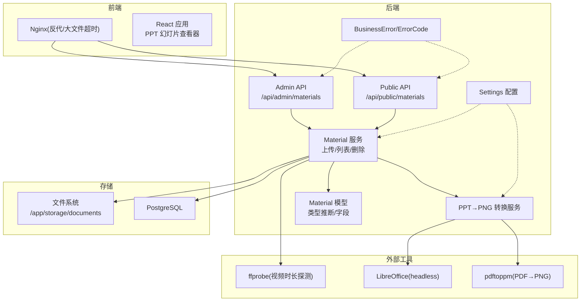
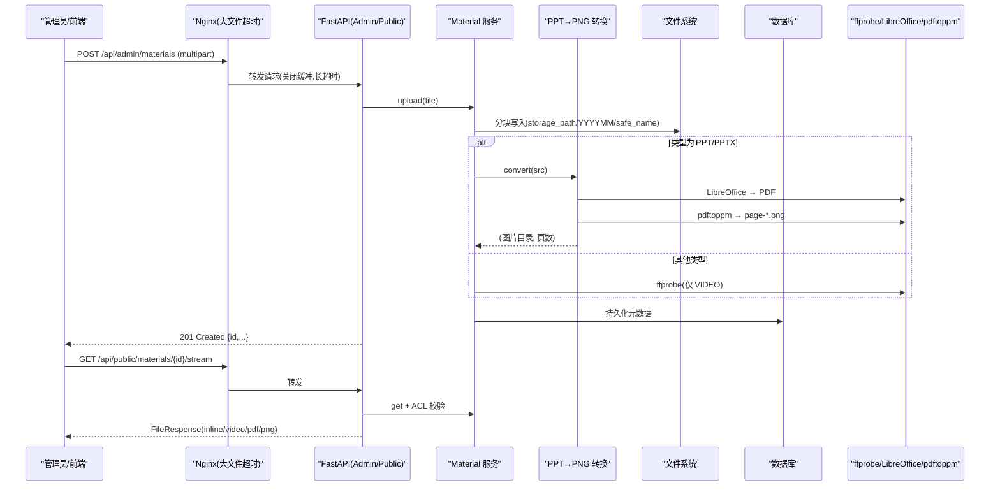
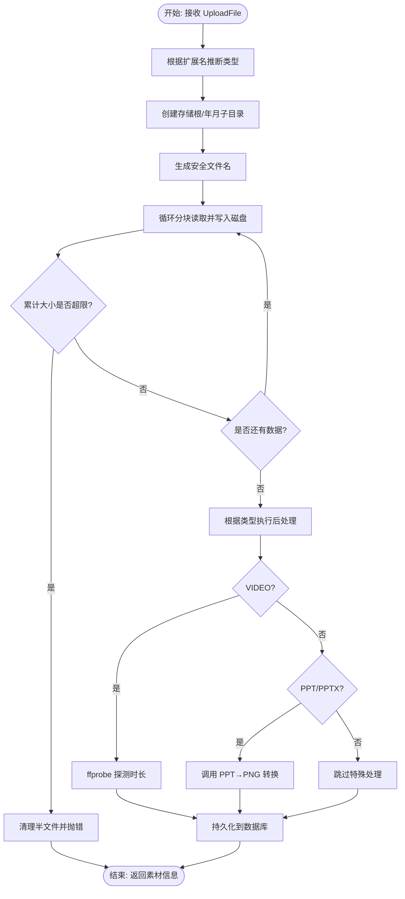
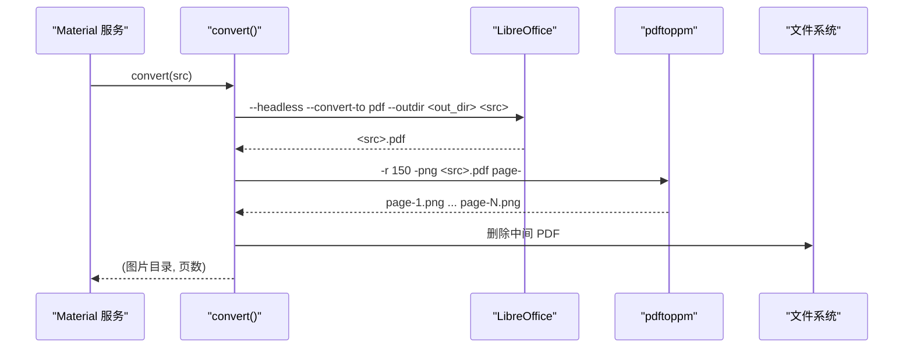
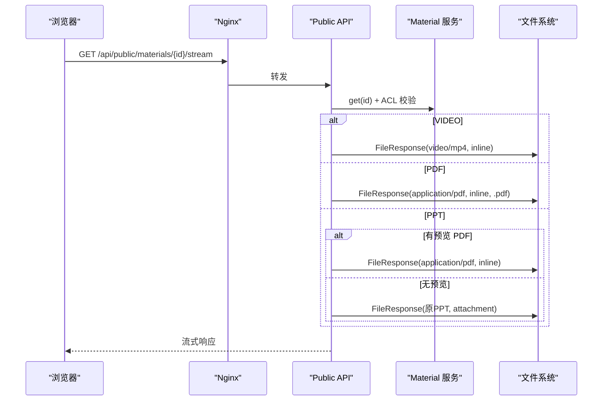
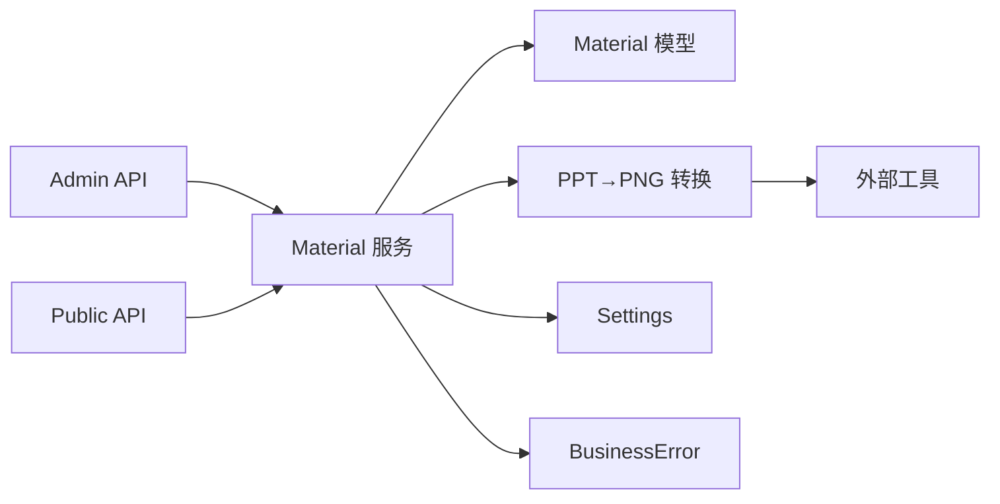

# 多媒体处理系统

<cite>
**本文引用的文件**   
- [backend/app/services/material.py](file://backend/app/services/material.py)
- [backend/app/services/ppt_to_images.py](file://backend/app/services/ppt_to_images.py)
- [backend/app/models/material.py](file://backend/app/models/material.py)
- [backend/app/api/public/materials.py](file://backend/app/api/public/materials.py)
- [backend/app/api/admin/materials.py](file://backend/app/api/admin/materials.py)
- [backend/app/core/config.py](file://backend/app/core/config.py)
- [backend/app/core/errors.py](file://backend/app/core/errors.py)
- [frontend/nginx.conf](file://frontend/nginx.conf)
- [deploy/ecs/patch-lh-upload.py](file://deploy/ecs/patch-lh-upload.py)
- [backend/tests/test_materials_stream.py](file://backend/tests/test_materials_stream.py)
- [frontend/src/pages/public/viewer/SlideshowViewer.tsx](file://frontend/src/pages/public/viewer/SlideshowViewer.tsx)
</cite>

## 目录
1. [简介](#简介)
2. [项目结构](#项目结构)
3. [核心组件](#核心组件)
4. [架构总览](#架构总览)
5. [详细组件分析](#详细组件分析)
6. [依赖关系分析](#依赖关系分析)
7. [性能考量](#性能考量)
8. [故障排查指南](#故障排查指南)
9. [结论](#结论)
10. [附录](#附录)

## 简介
本技术文档聚焦 Learning Hub 的多媒体处理子系统，围绕“上传与存储、格式检测与类型推断、PPT 转 PDF 及图片提取、流式传输与性能优化、错误处理与异常恢复”展开。系统支持视频（mp4）、PDF、PPT/PPTX 三类素材：
- 上传阶段进行大小限制与类型推断；
- PPT 通过 LibreOffice 转 PDF，再由 pdftoppm 拆分为 PNG 预览图；
- 公共接口提供下载与流式预览，并基于课件访问控制策略校验令牌；
- 前端针对 PPT 采用逐页图片渲染，避免 PDF.js 的内存与延迟问题。

## 项目结构
后端以 FastAPI 为框架，按功能分层组织：
- API 层：admin/public 路由分别暴露管理端与公开端能力
- 服务层：material、ppt_to_images 等实现业务逻辑
- 模型层：Material 表结构与类型推断
- 配置层：Settings 集中管理路径、超时、外部工具路径等
- 错误层：统一业务错误码与 HTTP 映射

图表来源
- [backend/app/api/admin/materials.py:1-74](file://backend/app/api/admin/materials.py#L1-L74)
- [backend/app/api/public/materials.py:1-224](file://backend/app/api/public/materials.py#L1-L224)
- [backend/app/services/material.py:1-234](file://backend/app/services/material.py#L1-L234)
- [backend/app/services/ppt_to_images.py:1-185](file://backend/app/services/ppt_to_images.py#L1-L185)
- [backend/app/models/material.py:1-69](file://backend/app/models/material.py#L1-L69)
- [backend/app/core/config.py:1-88](file://backend/app/core/config.py#L1-L88)
- [backend/app/core/errors.py:1-144](file://backend/app/core/errors.py#L1-L144)
- [frontend/nginx.conf:1-56](file://frontend/nginx.conf#L1-L56)

章节来源
- [backend/app/api/admin/materials.py:1-74](file://backend/app/api/admin/materials.py#L1-L74)
- [backend/app/api/public/materials.py:1-224](file://backend/app/api/public/materials.py#L1-L224)
- [backend/app/services/material.py:1-234](file://backend/app/services/material.py#L1-L234)
- [backend/app/services/ppt_to_images.py:1-185](file://backend/app/services/ppt_to_images.py#L1-L185)
- [backend/app/models/material.py:1-69](file://backend/app/models/material.py#L1-L69)
- [backend/app/core/config.py:1-88](file://backend/app/core/config.py#L1-L88)
- [backend/app/core/errors.py:1-144](file://backend/app/core/errors.py#L1-L144)
- [frontend/nginx.conf:1-56](file://frontend/nginx.conf#L1-L56)

## 核心组件
- 素材服务（upload/list/delete）：负责分块写入磁盘、大小校验、类型推断、时长探测、PPT 预览生成、数据库持久化与失败回滚清理。
- PPT 转换服务：调用 LibreOffice 生成 PDF，再用 pdftoppm 将每页导出为 PNG，输出到与源同名的目录中。
- 公开接口：提供下载、流式预览（inline）、PPT 单页图片获取，以及基于课件 ACL 的令牌解锁校验。
- 模型与类型推断：根据扩展名映射 VIDEO/PDF/PPT，定义 Material 表字段（含 duration_or_pages、preview_images_dir）。
- 配置与错误：集中管理 storage_path、外部工具路径与超时；统一业务错误码与 HTTP 状态映射。

章节来源
- [backend/app/services/material.py:1-234](file://backend/app/services/material.py#L1-L234)
- [backend/app/services/ppt_to_images.py:1-185](file://backend/app/services/ppt_to_images.py#L1-L185)
- [backend/app/models/material.py:1-69](file://backend/app/models/material.py#L1-L69)
- [backend/app/api/public/materials.py:1-224](file://backend/app/api/public/materials.py#L1-L224)
- [backend/app/core/config.py:1-88](file://backend/app/core/config.py#L1-L88)
- [backend/app/core/errors.py:1-144](file://backend/app/core/errors.py#L1-L144)

## 架构总览
下图展示从上传到预览的关键数据流，包括 Nginx 大文件超时设置、后端分块写入、PPT 转换与图片预览、以及公开接口的流式返回。

图表来源
- [frontend/nginx.conf:1-56](file://frontend/nginx.conf#L1-L56)
- [backend/app/api/admin/materials.py:1-74](file://backend/app/api/admin/materials.py#L1-L74)
- [backend/app/api/public/materials.py:1-224](file://backend/app/api/public/materials.py#L1-L224)
- [backend/app/services/material.py:1-234](file://backend/app/services/material.py#L1-L234)
- [backend/app/services/ppt_to_images.py:1-185](file://backend/app/services/ppt_to_images.py#L1-L185)

## 详细组件分析

### 上传与存储机制
- 分块写入与大小限制
  - 服务端以固定大小分块读取上传流，累计字节数并与上限比较，超限则主动清理半文件并抛出业务错误。
  - 存储根目录由配置项决定，按年月创建子目录，文件名加入时间戳与随机串保证唯一性。
- 类型推断
  - 基于扩展名映射至 VIDEO/PDF/PPT，不支持的类型直接拒绝。
- 时长探测与 PPT 预览
  - VIDEO：调用 ffprobe 解析时长，失败不阻断上传。
  - PPT：后台异步触发 PPT→PNG 转换，失败仅记录日志，不影响上传成功。
- 事务与回滚清理
  - 入库失败时回滚并清理已落盘的文件与图片目录，确保一致性。

图表来源
- [backend/app/services/material.py:129-202](file://backend/app/services/material.py#L129-L202)
- [backend/app/models/material.py:22-41](file://backend/app/models/material.py#L22-L41)

章节来源
- [backend/app/services/material.py:129-202](file://backend/app/services/material.py#L129-L202)
- [backend/app/models/material.py:22-41](file://backend/app/models/material.py#L22-L41)

### 格式检测与类型推断算法
- 规则
  - 仅允许 mp4、pdf、ppt、pptx 四类扩展名；
  - 忽略大小写，无扩展名或未知扩展名直接拒绝。
- 复杂度
  - O(1) 查找映射表，极轻量。
- 可扩展性
  - 新增类型只需在映射表中添加扩展名与枚举值。

章节来源
- [backend/app/models/material.py:22-41](file://backend/app/models/material.py#L22-L41)

### PPT 转 PDF 与图片提取
- 流程
  - 使用 LibreOffice headless 模式将 PPT/PPTX 转为 PDF；
  - 使用 pdftoppm 将 PDF 每页导出为 PNG，命名约定为 page-1.png、page-2.png...；
  - 输出目录与源文件同名，位于源文件同级目录；
  - 转换失败/超时仅记录日志，不抛异常，避免阻塞上传。
- 可配置项
  - 可通过 Settings 指定 libreoffice_path、poppler_path、ppt_convert_timeout；
  - Windows 本地开发可通过环境变量覆盖默认路径。
- 产物管理
  - 中间 PDF 会被删除，仅保留 PNG；若转换失败，不产生图片目录。

图表来源
- [backend/app/services/ppt_to_images.py:48-181](file://backend/app/services/ppt_to_images.py#L48-L181)
- [backend/app/services/material.py:174-186](file://backend/app/services/material.py#L174-L186)

章节来源
- [backend/app/services/ppt_to_images.py:48-181](file://backend/app/services/ppt_to_images.py#L48-L181)
- [backend/app/services/material.py:174-186](file://backend/app/services/material.py#L174-L186)

### 流式传输与性能优化
- 公开接口行为
  - VIDEO：返回 video/mp4，Content-Disposition=inline，启用 Range 支持（浏览器侧边栏/播放器可直接跳转）。
  - PDF：返回 application/pdf，强制 .pdf 后缀，inline 显示。
  - PPT：优先返回生成的 PDF（若存在），否则降级返回原 PPT（attachment）。
  - PPT 图片：/image/{page_no} 返回第 N 张 PNG，越界返回 404。
- 限流
  - 公开接口对 /stream 与 /image 做了每分钟 60 次的速率限制。
- Nginx 大文件上传优化
  - 关闭请求体缓存（proxy_request_buffering off），边收边转发，避免二次落盘；
  - 提高 client_max_body_size、client_body_timeout、proxy_send/read_timeout，适配 500MB 级上传。
- 前端体验
  - PPT 采用逐页图片加载，预加载下一页，切换时无闪烁；
  - 禁止右键保存/拖拽，降低泄露风险。

图表来源
- [backend/app/api/public/materials.py:84-146](file://backend/app/api/public/materials.py#L84-L146)
- [frontend/nginx.conf:1-56](file://frontend/nginx.conf#L1-L56)
- [frontend/src/pages/public/viewer/SlideshowViewer.tsx:1-277](file://frontend/src/pages/public/viewer/SlideshowViewer.tsx#L1-L277)

章节来源
- [backend/app/api/public/materials.py:84-146](file://backend/app/api/public/materials.py#L84-L146)
- [frontend/nginx.conf:1-56](file://frontend/nginx.conf#L1-L56)
- [frontend/src/pages/public/viewer/SlideshowViewer.tsx:1-277](file://frontend/src/pages/public/viewer/SlideshowViewer.tsx#L1-L277)

### 访问控制与令牌解锁
- 当素材仅被 RESTRICTED 课件引用时，需携带 X-Token-Hash 或 lh_token_hash cookie；
- 任一引用课件为 OPEN 则放行；
- 未命中任何允许 token 哈希则返回 403。

章节来源
- [backend/app/api/public/materials.py:31-62](file://backend/app/api/public/materials.py#L31-L62)

### 错误处理与异常恢复
- 统一业务错误码
  - 素材相关：不存在、扩展名无效、大小超限、存储不可用、被引用无法删除、上传失败等；
  - 课件相关：ACL 锁定、缺失令牌等；
  - 错误码到 HTTP 状态映射集中维护。
- 上传失败回滚
  - 入库失败时清理已落盘的文件与图片目录，避免脏数据。
- 外部工具异常隔离
  - ffprobe、LibreOffice、pdftoppm 异常均捕获并记录日志，不中断主流程。

章节来源
- [backend/app/core/errors.py:1-144](file://backend/app/core/errors.py#L1-L144)
- [backend/app/services/material.py:188-202](file://backend/app/services/material.py#L188-L202)
- [backend/app/services/ppt_to_images.py:102-181](file://backend/app/services/ppt_to_images.py#L102-L181)

## 依赖关系分析
- 模块耦合
  - API 层依赖服务层；服务层依赖模型与配置；转换服务依赖外部二进制；
  - 公开接口在服务层之上增加 ACL 校验与限流。
- 外部依赖
  - ffprobe、LibreOffice、pdftoppm 均为可选增强能力，缺失时降级但不影响基础上传/下载。
- 潜在环依赖
  - 当前未发现循环导入；转换服务独立于上传主流程。

图表来源
- [backend/app/api/admin/materials.py:1-74](file://backend/app/api/admin/materials.py#L1-L74)
- [backend/app/api/public/materials.py:1-224](file://backend/app/api/public/materials.py#L1-L224)
- [backend/app/services/material.py:1-234](file://backend/app/services/material.py#L1-L234)
- [backend/app/services/ppt_to_images.py:1-185](file://backend/app/services/ppt_to_images.py#L1-L185)
- [backend/app/models/material.py:1-69](file://backend/app/models/material.py#L1-L69)
- [backend/app/core/config.py:1-88](file://backend/app/core/config.py#L1-L88)
- [backend/app/core/errors.py:1-144](file://backend/app/core/errors.py#L1-L144)

章节来源
- [backend/app/api/admin/materials.py:1-74](file://backend/app/api/admin/materials.py#L1-L74)
- [backend/app/api/public/materials.py:1-224](file://backend/app/api/public/materials.py#L1-L224)
- [backend/app/services/material.py:1-234](file://backend/app/services/material.py#L1-L234)
- [backend/app/services/ppt_to_images.py:1-185](file://backend/app/services/ppt_to_images.py#L1-L185)
- [backend/app/models/material.py:1-69](file://backend/app/models/material.py#L1-L69)
- [backend/app/core/config.py:1-88](file://backend/app/core/config.py#L1-L88)
- [backend/app/core/errors.py:1-144](file://backend/app/core/errors.py#L1-L144)

## 性能考量
- 上传链路
  - Nginx 关闭请求体缓冲，减少一次磁盘 I/O；
  - 提升超时阈值，适应慢网络环境；
  - 后端分块写入，避免一次性占用过多内存。
- 预览链路
  - VIDEO 利用 Range 支持，按需拉取片段；
  - PPT 图片直出，避免 PDF.js 渲染开销；
  - 公开接口限流，保护后端资源。
- 存储布局
  - 按年/月分目录，便于归档与清理；
  - 图片目录与源文件同级，便于定位与批量清理。

[本节为通用指导，无需特定文件来源]

## 故障排查指南
- 上传失败
  - 检查文件大小是否超过 500MB；
  - 确认 Nginx 的 client_max_body_size 与超时配置；
  - 查看后端日志中的上传失败与回滚清理记录。
- PPT 预览不可用
  - 确认 LibreOffice 与 pdftoppm 安装路径正确且可执行；
  - 检查转换超时配置，必要时增大 ppt_convert_timeout；
  - 观察转换服务日志，确认是否因外部工具报错导致失败。
- 流式播放异常
  - 检查 Content-Type 与 Content-Disposition 是否正确；
  - 验证浏览器是否支持 Range 请求；
  - 确认公开接口限流未被触发。
- 权限问题
  - 对于受限课件，确认 X-Token-Hash 或 cookie 是否携带且有效；
  - 核对课件关联的 token 哈希集合。

章节来源
- [frontend/nginx.conf:1-56](file://frontend/nginx.conf#L1-L56)
- [deploy/ecs/patch-lh-upload.py:74-104](file://deploy/ecs/patch-lh-upload.py#L74-L104)
- [backend/app/services/ppt_to_images.py:102-181](file://backend/app/services/ppt_to_images.py#L102-L181)
- [backend/app/api/public/materials.py:84-146](file://backend/app/api/public/materials.py#L84-L146)
- [backend/tests/test_materials_stream.py:1-263](file://backend/tests/test_materials_stream.py#L1-L263)

## 结论
本多媒体处理系统在上传、类型推断、PPT 预览生成与流式传输方面形成了稳定闭环。通过 Nginx 与大文件超时优化、后端分块写入与失败回滚、外部工具异常隔离、以及前端图片化 PPT 渲染，兼顾了性能与用户体验。后续可在以下方向持续优化：
- 引入分片上传与断点续传，进一步提升超大文件上传成功率与体验；
- 对 PPT 转换引入任务队列与重试机制，避免瞬时峰值阻塞；
- 完善对象存储迁移方案，解耦文件系统与业务逻辑。

[本节为总结性内容，无需特定文件来源]

## 附录
- 关键配置项
  - storage_path：文件存储根目录
  - libreoffice_path/poppler_path：外部工具绝对路径
  - ppt_convert_timeout：PPT 转换超时秒数
  - nginx client_max_body_size/client_body_timeout/proxy_send/read_timeout：大文件上传与代理超时

章节来源
- [backend/app/core/config.py:54-61](file://backend/app/core/config.py#L54-L61)
- [frontend/nginx.conf:1-56](file://frontend/nginx.conf#L1-L56)