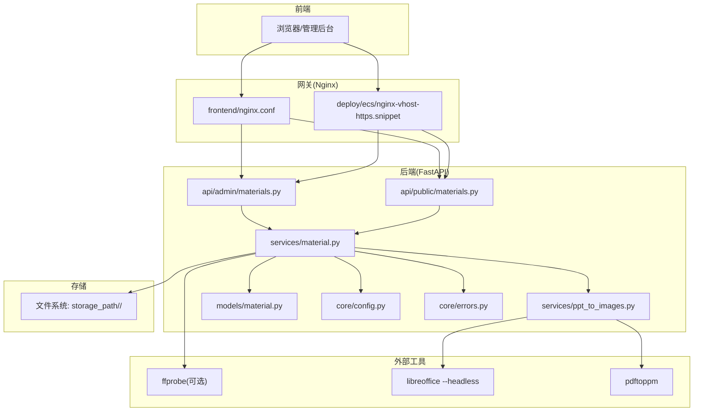
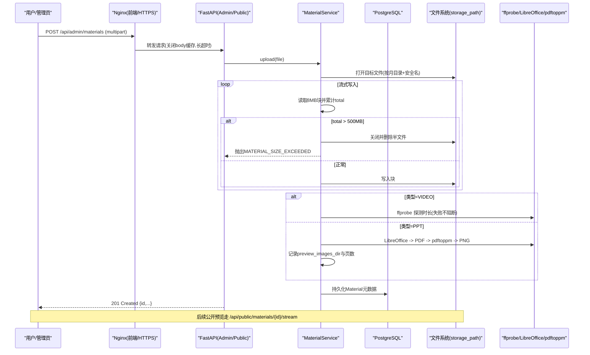
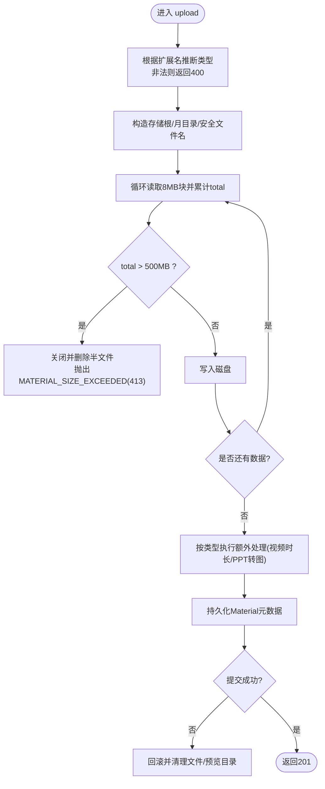
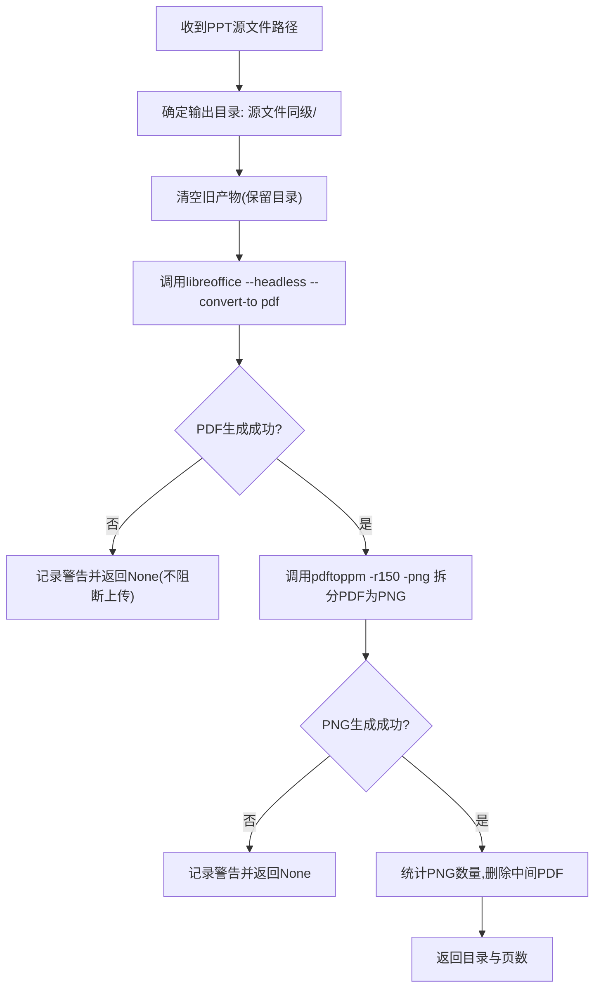
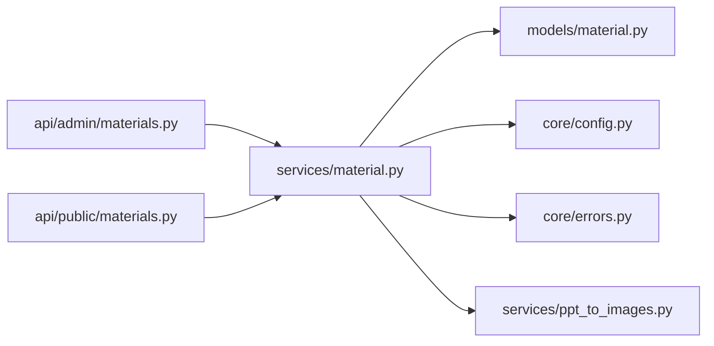
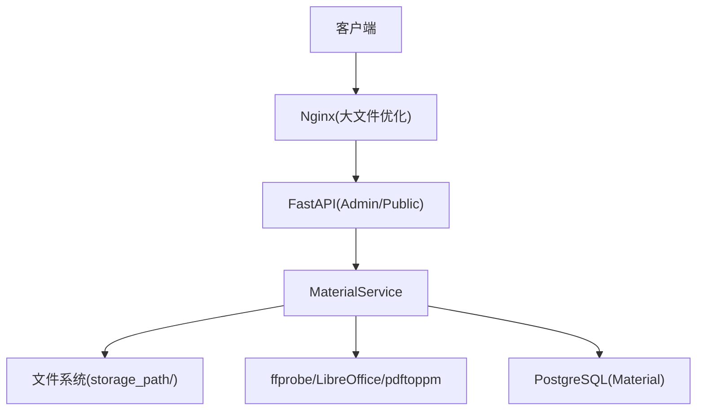

# 文件上传与存储

<cite>
**本文引用的文件**   
- [backend/app/services/material.py](file://backend/app/services/material.py)
- [backend/app/models/material.py](file://backend/app/models/material.py)
- [backend/app/api/admin/materials.py](file://backend/app/api/admin/materials.py)
- [backend/app/api/public/materials.py](file://backend/app/api/public/materials.py)
- [backend/app/core/config.py](file://backend/app/core/config.py)
- [backend/app/core/errors.py](file://backend/app/core/errors.py)
- [backend/app/services/ppt_to_images.py](file://backend/app/services/ppt_to_images.py)
- [frontend/nginx.conf](file://frontend/nginx.conf)
- [deploy/ecs/nginx-vhost-https.snippet](file://deploy/ecs/nginx-vhost-https.snippet)
- [doc/spec/07-技术架构.md](file://doc/spec/07-技术架构.md)
- [doc/spec/10-API设计规范.md](file://doc/spec/10-API设计规范.md)
</cite>

## 目录
1. [简介](#简介)
2. [项目结构](#项目结构)
3. [核心组件](#核心组件)
4. [架构总览](#架构总览)
5. [详细组件分析](#详细组件分析)
6. [依赖关系分析](#依赖关系分析)
7. [性能考量](#性能考量)
8. [故障排查指南](#故障排查指南)
9. [结论](#结论)
10. [附录](#附录)

## 简介
本文件为 Learning Hub 的“文件上传与存储”子系统技术文档，聚焦以下目标：
- 解析文件上传流程：流式写入、内存控制、大小限制与异常处理。
- 说明存储路径组织策略：按月份分目录、唯一文件名生成与安全命名规范。
- 解释文件大小限制机制（500MB）及前后端一致性配置。
- 提供文件类型验证、安全检查与错误恢复机制的实现细节。
- 覆盖 PPT 转图片预览能力及其对在线浏览的影响。
- 给出存储配置管理与性能优化建议。

## 项目结构
围绕素材上传与存储的关键代码分布如下：
- 业务服务层：material.py（上传、列表、删除、视频时长探测、PPT 转图片集成）。
- 数据模型层：material.py（Material 表结构与类型推断）。
- API 层：admin/materials.py（管理员上传/下载）、public/materials.py（公开下载/流式预览/单条查询）。
- 转换服务：ppt_to_images.py（LibreOffice + pdftoppm 将 PPT 转为 PNG 序列）。
- 配置与错误：config.py（storage_path 等）、errors.py（统一业务码映射）。
- 网关与前端 Nginx：frontend/nginx.conf、deploy/ecs/nginx-vhost-https.snippet（大文件上传超时与缓冲策略）。
- 规格文档：07-技术架构.md、10-API设计规范.md（接口契约与错误码约定）。

图表来源
- [backend/app/api/admin/materials.py:1-74](file://backend/app/api/admin/materials.py#L1-L74)
- [backend/app/api/public/materials.py:1-224](file://backend/app/api/public/materials.py#L1-L224)
- [backend/app/services/material.py:1-234](file://backend/app/services/material.py#L1-L234)
- [backend/app/services/ppt_to_images.py:1-185](file://backend/app/services/ppt_to_images.py#L1-L185)
- [backend/app/models/material.py:1-69](file://backend/app/models/material.py#L1-L69)
- [backend/app/core/config.py:1-88](file://backend/app/core/config.py#L1-L88)
- [frontend/nginx.conf:1-56](file://frontend/nginx.conf#L1-L56)
- [deploy/ecs/nginx-vhost-https.snippet:1-42](file://deploy/ecs/nginx-vhost-https.snippet#L1-L42)

章节来源
- [backend/app/services/material.py:1-234](file://backend/app/services/material.py#L1-L234)
- [backend/app/models/material.py:1-69](file://backend/app/models/material.py#L1-L69)
- [backend/app/api/admin/materials.py:1-74](file://backend/app/api/admin/materials.py#L1-L74)
- [backend/app/api/public/materials.py:1-224](file://backend/app/api/public/materials.py#L1-L224)
- [backend/app/core/config.py:1-88](file://backend/app/core/config.py#L1-L88)
- [frontend/nginx.conf:1-56](file://frontend/nginx.conf#L1-L56)
- [deploy/ecs/nginx-vhost-https.snippet:1-42](file://deploy/ecs/nginx-vhost-https.snippet#L1-L42)

## 核心组件
- 上传入口（管理员）：POST /api/admin/materials，接收 multipart/form-data，返回 {id, name, type, sizeBytes}。
- 公开访问：GET /api/public/materials/{id}/file（attachment 下载）、GET /api/public/materials/{id}/stream（inline 预览）、GET /api/public/materials/{id}（元信息+streamUrl/downloadUrl）。
- 存储实现：按当前 UTC 年月创建子目录，使用“时间戳-随机串-原始文件名”的安全命名；流式写入并累计字节数，超过上限主动清理半文件并抛出业务错误。
- 类型推断与校验：基于扩展名白名单（mp4/pdf/ppt/pptx），非法类型直接拒绝。
- 辅助处理：
  - VIDEO：调用 ffprobe 探测时长，失败不阻断上传。
  - PPT/PPTX：异步调用 LibreOffice 转 PDF，再用 pdftoppm 拆成 page-1.png…，记录图片目录与页数；失败仅记日志，不阻断上传。
- 配置项：storage_path、libreoffice_path、poppler_path、ppt_convert_timeout 等通过 Settings 注入。
- 错误码：统一 ErrorCode 映射到 HTTP 状态码，如 MATERIAL_SIZE_EXCEEDED→413、MATERIAL_EXTENSION_INVALID→400、MATERIAL_STORAGE_UNAVAILABLE→500 等。

章节来源
- [backend/app/api/admin/materials.py:35-48](file://backend/app/api/admin/materials.py#L35-L48)
- [backend/app/api/public/materials.py:64-146](file://backend/app/api/public/materials.py#L64-L146)
- [backend/app/services/material.py:129-202](file://backend/app/services/material.py#L129-L202)
- [backend/app/models/material.py:31-41](file://backend/app/models/material.py#L31-L41)
- [backend/app/core/errors.py:9-144](file://backend/app/core/errors.py#L9-L144)
- [backend/app/core/config.py:54-61](file://backend/app/core/config.py#L54-L61)

## 架构总览
下图展示从浏览器到后端再到文件系统的端到端上传与预览流程，以及 PPT 转图片的旁路处理。

图表来源
- [backend/app/api/admin/materials.py:35-48](file://backend/app/api/admin/materials.py#L35-L48)
- [backend/app/services/material.py:129-202](file://backend/app/services/material.py#L129-L202)
- [backend/app/services/ppt_to_images.py:48-181](file://backend/app/services/ppt_to_images.py#L48-L181)
- [frontend/nginx.conf:10-14](file://frontend/nginx.conf#L10-L14)
- [deploy/ecs/nginx-vhost-https.snippet:22-40](file://deploy/ecs/nginx-vhost-https.snippet#L22-L40)

## 详细组件分析

### 上传流程与内存管理
- 流式写入：以 8MB 为单位循环读取 UploadFile，边读边写磁盘，避免一次性加载到内存。
- 大小限制：累计 total 超过 500MB 时立即关闭文件句柄、删除半文件并抛出业务错误。
- 异常处理：
  - 业务错误（如超限、类型非法）直接上抛，由全局错误处理器转换为标准信封响应。
  - 非预期异常（IO 错误等）包装为 MATERIAL_UPLOAD_FAILED，确保事务回滚后清理残留文件。
- 数据库事务：入库失败时回滚并尝试删除已落盘的文件与生成的预览目录，保证一致性。

图表来源
- [backend/app/services/material.py:129-202](file://backend/app/services/material.py#L129-L202)
- [backend/app/models/material.py:31-41](file://backend/app/models/material.py#L31-L41)
- [backend/app/core/errors.py:103-109](file://backend/app/core/errors.py#L103-L109)

章节来源
- [backend/app/services/material.py:129-202](file://backend/app/services/material.py#L129-L202)
- [backend/app/core/errors.py:9-144](file://backend/app/core/errors.py#L9-L144)

### 存储路径组织与命名规范
- 根目录：从配置 storage_path 获取，默认 /app/storage/documents。
- 目录策略：按 UTC 年月的 YYYYMM 子目录归档，便于按时间检索与清理。
- 文件名策略：{YYYYMMDDHHmmss}-{随机十六进制4段}-{原始文件名}，兼顾唯一性与可追溯性。
- 安全性：
  - 使用 os.path.basename 剥离路径注入风险。
  - 严格扩展名白名单校验，防止恶意后缀绕过。
  - 写入前确保目录存在，避免权限问题导致失败。

章节来源
- [backend/app/services/material.py:29-33](file://backend/app/services/material.py#L29-L33)
- [backend/app/services/material.py:133-138](file://backend/app/services/material.py#L133-L138)
- [backend/app/models/material.py:22-41](file://backend/app/models/material.py#L22-L41)

### 文件类型验证与安全策略
- 类型推断：仅允许 mp4/pdf/ppt/pptx，其他扩展名直接拒绝。
- 内容类型：下载/预览时使用 mimetypes.guess_type 或显式设置 Content-Type，确保浏览器正确渲染。
- ACL 保护：公开接口在受限课件场景下需携带 X-Token-Hash 或 Cookie lh_token_hash，否则返回 403。
- 限流：公开接口采用 60次/分钟/IP 的速率限制，防止滥用。

章节来源
- [backend/app/models/material.py:22-41](file://backend/app/models/material.py#L22-L41)
- [backend/app/api/public/materials.py:23-62](file://backend/app/api/public/materials.py#L23-L62)
- [backend/app/api/public/materials.py:84-146](file://backend/app/api/public/materials.py#L84-L146)

### 公开预览与下载接口
- GET /api/public/materials/{id}/file：attachment 下载原文件，Content-Disposition 为 attachment。
- GET /api/public/materials/{id}/stream：
  - VIDEO：video/mp4 + inline，支持 Range（由底层 FileResponse 提供）。
  - PDF：application/pdf + inline，重命名为 .pdf 以避免浏览器误判。
  - PPT/PPTX：若存在预览产物则返回 PDF（inline）；否则降级为 attachment 原文件，提示“预览生成中”。
- GET /api/public/materials/{id}：返回 streamUrl/downloadUrl、sizeBytes、duration、imageUrls（PPT 预览图片列表）等元信息。

章节来源
- [backend/app/api/public/materials.py:64-146](file://backend/app/api/public/materials.py#L64-L146)
- [backend/app/api/public/materials.py:183-221](file://backend/app/api/public/materials.py#L183-L221)

### PPT 转图片预览（旁路处理）
- 流程：LibreOffice headless 将 PPT/PPTX 转为 PDF，再用 pdftoppm 将每页导出为 PNG（page-1.png…）。
- 输出：与源文件同级的 <stem>/ 目录，包含若干 PNG 与中间 PDF（最终会删除中间 PDF）。
- 健壮性：任何阶段失败/超时均记录日志且不抛异常，不影响上传主流程；前端据此判断 previewReady。
- 配置：可通过环境变量或 Settings 指定 libreoffice_path/poppler_path 与 ppt_convert_timeout。

图表来源
- [backend/app/services/ppt_to_images.py:48-181](file://backend/app/services/ppt_to_images.py#L48-L181)

章节来源
- [backend/app/services/ppt_to_images.py:1-185](file://backend/app/services/ppt_to_images.py#L1-L185)
- [backend/app/services/material.py:174-186](file://backend/app/services/material.py#L174-L186)

### 错误处理与恢复
- 统一错误码：ErrorCode 集中定义，BusinessError 将其映射为 HTTP 状态码与 JSON 信封。
- 典型错误：
  - 类型非法：400 material_extension_invalid
  - 超出大小：413 material_size_exceeded
  - 存储不可用：500 material_storage_unavailable
  - 上传失败：500 material_upload_failed
  - 被引用无法删除：422 material_referenced
- 恢复策略：
  - 上传中途超限：主动删除半文件，避免脏数据。
  - 入库失败：回滚事务并清理物理文件与预览目录。
  - 外部工具失败：仅记录日志，不阻断主流程。

章节来源
- [backend/app/core/errors.py:9-144](file://backend/app/core/errors.py#L9-L144)
- [backend/app/services/material.py:147-202](file://backend/app/services/material.py#L147-L202)

## 依赖关系分析
- 模块耦合：
  - API 层仅依赖服务层与模型层，保持薄控制器职责。
  - 服务层依赖模型、配置、错误模块与外部工具（ffprobe、LibreOffice、pdftoppm）。
  - 转换服务独立封装，失败不抛异常，提升上传鲁棒性。
- 外部依赖：
  - Nginx 作为反向代理，负责大文件上传超时与缓冲策略。
  - 外部二进制工具用于媒体探测与格式转换。
- 潜在环依赖：无直接循环导入；错误码与配置均为单向依赖。

图表来源
- [backend/app/api/admin/materials.py:1-74](file://backend/app/api/admin/materials.py#L1-L74)
- [backend/app/api/public/materials.py:1-224](file://backend/app/api/public/materials.py#L1-L224)
- [backend/app/services/material.py:1-234](file://backend/app/services/material.py#L1-L234)
- [backend/app/services/ppt_to_images.py:1-185](file://backend/app/services/ppt_to_images.py#L1-L185)
- [backend/app/models/material.py:1-69](file://backend/app/models/material.py#L1-L69)
- [backend/app/core/config.py:1-88](file://backend/app/core/config.py#L1-L88)
- [backend/app/core/errors.py:1-144](file://backend/app/core/errors.py#L1-L144)

章节来源
- [backend/app/api/admin/materials.py:1-74](file://backend/app/api/admin/materials.py#L1-L74)
- [backend/app/api/public/materials.py:1-224](file://backend/app/api/public/materials.py#L1-L224)
- [backend/app/services/material.py:1-234](file://backend/app/services/material.py#L1-L234)
- [backend/app/services/ppt_to_images.py:1-185](file://backend/app/services/ppt_to_images.py#L1-L185)
- [backend/app/models/material.py:1-69](file://backend/app/models/material.py#L1-L69)
- [backend/app/core/config.py:1-88](file://backend/app/core/config.py#L1-L88)
- [backend/app/core/errors.py:1-144](file://backend/app/core/errors.py#L1-L144)

## 性能考量
- 网络与代理层
  - Nginx 关闭请求体缓存（proxy_request_buffering off），边收边转发，避免二次落盘。
  - 提高 client_max_body_size 至 500MB，拉长 client_body_timeout/proxy_send_timeout/proxy_read_timeout 至 600s，适配慢速上行链路。
- 服务端写入
  - 固定 8MB 块大小，降低内存峰值占用，同时减少系统调用次数。
  - 预分配目录与原子写入，失败快速回滚与清理。
- 预览与下载
  - 视频支持 Range，利于断点续播与快进。
  - PPT 转图片离线进行，避免阻塞上传；图片直出，减少 PDF.js 开销。
- 资源释放
  - 上传失败与入库失败均触发文件与预览目录清理，避免磁盘泄漏。

章节来源
- [frontend/nginx.conf:10-14](file://frontend/nginx.conf#L10-L14)
- [frontend/nginx.conf:28-42](file://frontend/nginx.conf#L28-L42)
- [deploy/ecs/nginx-vhost-https.snippet:22-40](file://deploy/ecs/nginx-vhost-https.snippet#L22-L40)
- [backend/app/services/material.py:141-155](file://backend/app/services/material.py#L141-L155)

## 故障排查指南
- 上传失败（413/500）
  - 检查 Nginx 的 client_max_body_size 与超时配置是否与后端一致。
  - 查看后端日志中的 MATERIAL_SIZE_EXCEEDED/MATERIAL_UPLOAD_FAILED 错误码。
- 文件丢失（500 material_storage_unavailable）
  - 确认 storage_path 挂载卷可用且权限正确。
  - 核对 Material.storage_path 指向的物理路径是否存在。
- PPT 预览不可用
  - 检查容器内是否安装 libreoffice 与 poppler-utils（pdftoppm）。
  - 调整 ppt_convert_timeout 或指定绝对路径（libreoffice_path/poppler_path）。
- 视频时长未显示
  - 确认 ffprobe 可用；失败不会阻断上传，但会影响 duration_or_pages 字段。

章节来源
- [backend/app/api/public/materials.py:64-146](file://backend/app/api/public/materials.py#L64-L146)
- [backend/app/services/material.py:36-76](file://backend/app/services/material.py#L36-L76)
- [backend/app/services/ppt_to_images.py:69-76](file://backend/app/services/ppt_to_images.py#L69-L76)
- [backend/app/core/errors.py:103-109](file://backend/app/core/errors.py#L103-L109)

## 结论
本系统通过“流式写入 + 严格大小限制 + 安全命名 + 类型白名单 + 外部工具旁路处理”的组合，实现了稳定、可扩展的大文件上传与预览能力。Nginx 与后端协同保障大文件传输稳定性，PPT 转图片方案提升了在线浏览体验与前端渲染效率。统一的错误码与完善的清理策略确保了系统在异常场景下的健壮性。

## 附录

### 关键配置与环境变量
- storage_path：文件存储根目录（默认 /app/storage/documents）。
- libreoffice_path/poppler_path：外部工具可执行路径（优先使用配置，其次 PATH，最后默认路径）。
- ppt_convert_timeout：PPT 转换超时秒数（默认 60）。
- Nginx 上传相关：client_max_body_size、client_body_timeout、proxy_send_timeout、proxy_read_timeout、proxy_request_buffering。

章节来源
- [backend/app/core/config.py:54-61](file://backend/app/core/config.py#L54-L61)
- [frontend/nginx.conf:10-14](file://frontend/nginx.conf#L10-L14)
- [frontend/nginx.conf:28-42](file://frontend/nginx.conf#L28-L42)
- [deploy/ecs/nginx-vhost-https.snippet:22-40](file://deploy/ecs/nginx-vhost-https.snippet#L22-L40)

### 接口与错误码参考
- 上传：POST /api/admin/materials（multipart），返回 201。
- 公开下载：GET /api/public/materials/{id}/file（attachment）。
- 公开预览：GET /api/public/materials/{id}/stream（inline，按类型设置 Content-Type）。
- 公开元信息：GET /api/public/materials/{id}（含 streamUrl/downloadUrl/imageUrls）。
- 错误码：material_extension_invalid、material_size_exceeded、material_storage_unavailable、material_upload_failed、material_not_found、courseware_acl_locked 等。

章节来源
- [doc/spec/10-API设计规范.md:743-830](file://doc/spec/10-API设计规范.md#L743-L830)
- [doc/spec/10-API设计规范.md:1139-1180](file://doc/spec/10-API设计规范.md#L1139-L1180)
- [doc/spec/10-API设计规范.md:1183-1206](file://doc/spec/10-API设计规范.md#L1183-L1206)
- [doc/spec/10-API设计规范.md:351-361](file://doc/spec/10-API设计规范.md#L351-L361)

### 架构图（概念）

[本图为概念示意，无需源码对应]