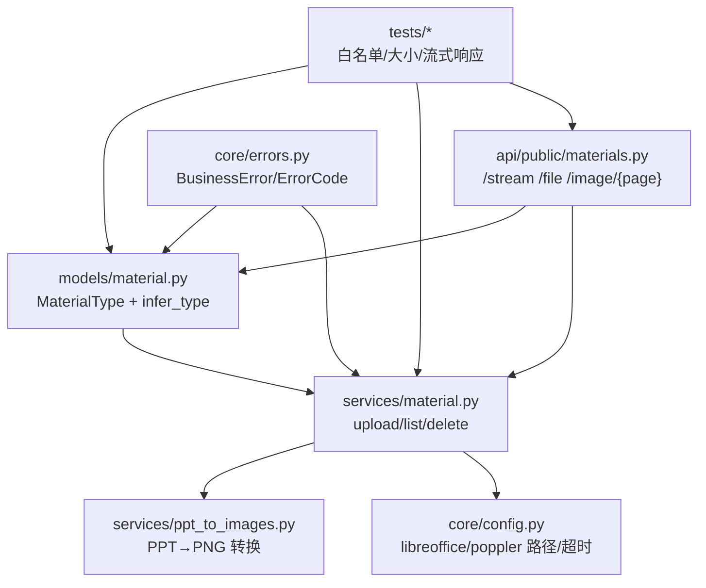
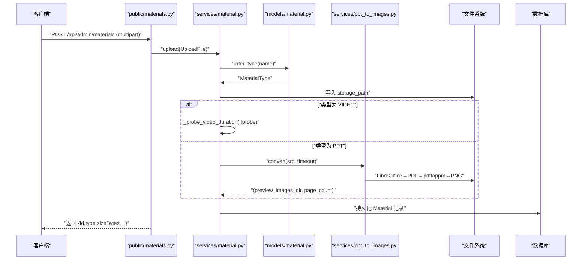
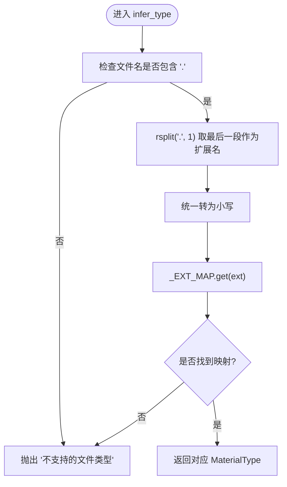
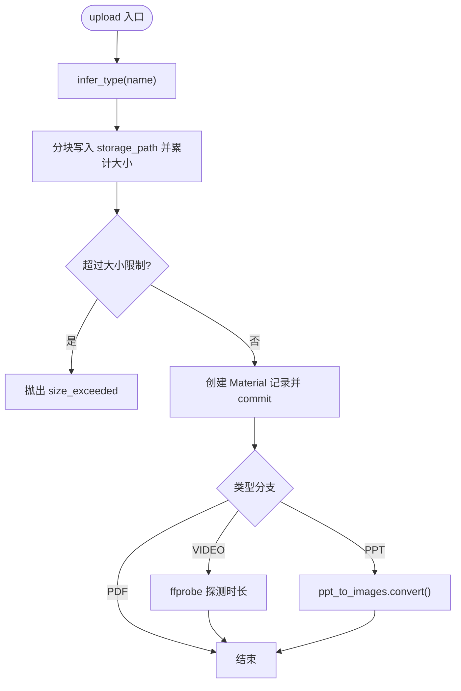
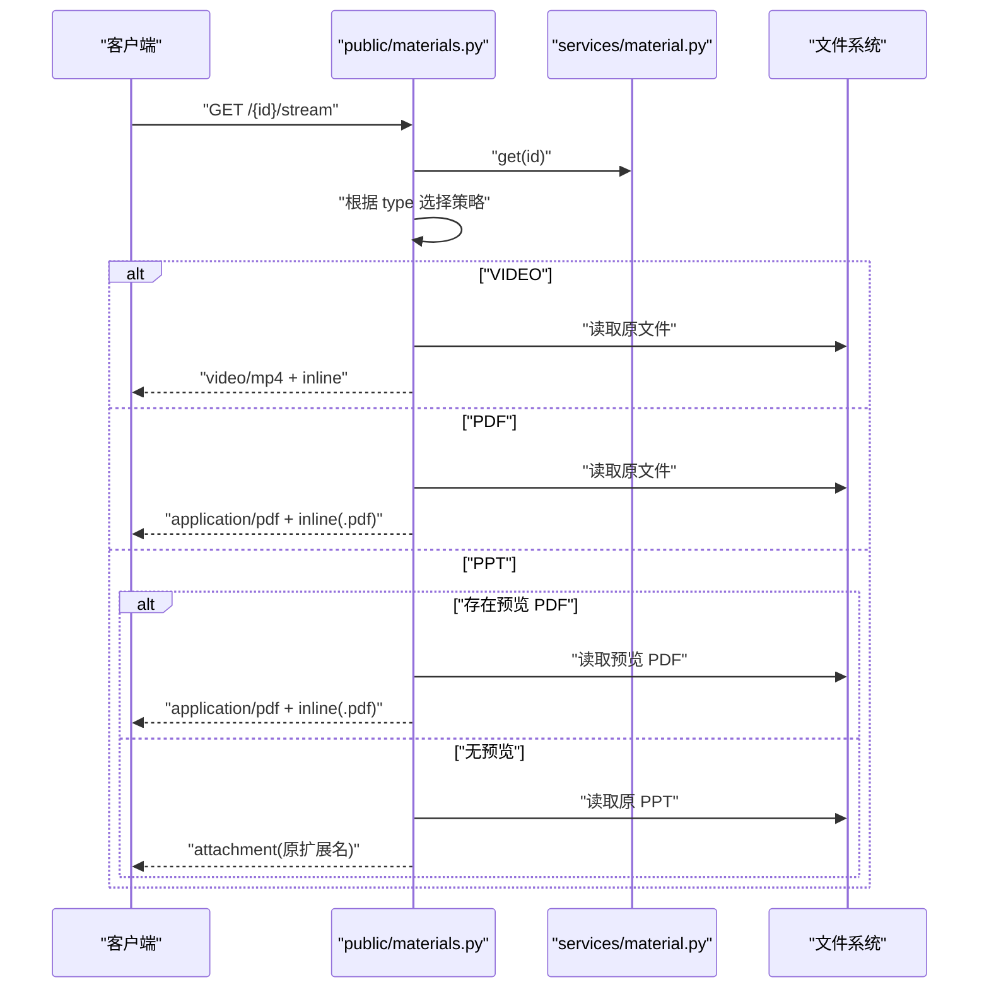
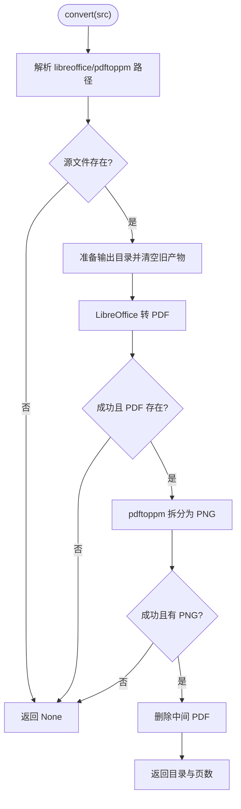
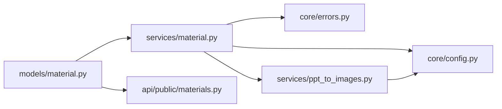

# 格式检测与类型推断

<cite>
**本文引用的文件**   
- [backend/app/models/material.py](file://backend/app/models/material.py)
- [backend/app/core/errors.py](file://backend/app/core/errors.py)
- [backend/app/services/material.py](file://backend/app/services/material.py)
- [backend/app/services/ppt_to_images.py](file://backend/app/services/ppt_to_images.py)
- [backend/app/api/public/materials.py](file://backend/app/api/public/materials.py)
- [backend/app/core/config.py](file://backend/app/core/config.py)
- [backend/tests/test_materials.py](file://backend/tests/test_materials.py)
- [backend/tests/test_materials_stream.py](file://backend/tests/test_materials_stream.py)
</cite>

## 目录
1. [简介](#简介)
2. [项目结构](#项目结构)
3. [核心组件](#核心组件)
4. [架构总览](#架构总览)
5. [详细组件分析](#详细组件分析)
6. [依赖关系分析](#依赖关系分析)
7. [性能考量](#性能考量)
8. [故障排查指南](#故障排查指南)
9. [结论](#结论)
10. [附录](#附录)

## 简介
本技术文档聚焦 Learning Hub 的“格式检测与类型推断系统”，围绕以下目标展开：
- 深入解析文件类型自动识别算法，说明基于扩展名的判断策略与边界处理。
- 详细说明支持的媒体类型（视频、PDF、PPT）及其对应的处理策略（上传、预览、下载）。
- 解释 MaterialType 枚举设计与 infer_type 函数的实现逻辑。
- 提供自定义格式扩展的方法与最佳实践。
- 包含格式验证规则与兼容性考虑（浏览器行为、外部工具依赖等）。

## 项目结构
与格式检测与类型推断相关的后端代码主要分布在如下模块：
- 模型与类型定义：material.py
- 业务服务（上传/列表/删除）：services/material.py
- PPT 转图片转换服务：services/ppt_to_images.py
- 公开 API（流式预览/下载/单条查询）：api/public/materials.py
- 配置项（外部工具路径、超时等）：core/config.py
- 错误码与异常封装：core/errors.py
- 测试用例（覆盖白名单、大小限制、流式响应头）：tests/*

图表来源
- [backend/app/models/material.py:14-41](file://backend/app/models/material.py#L14-L41)
- [backend/app/services/material.py:129-202](file://backend/app/services/material.py#L129-L202)
- [backend/app/services/ppt_to_images.py:48-181](file://backend/app/services/ppt_to_images.py#L48-L181)
- [backend/app/api/public/materials.py:84-146](file://backend/app/api/public/materials.py#L84-L146)
- [backend/app/core/config.py:58-60](file://backend/app/core/config.py#L58-L60)
- [backend/app/core/errors.py:130-141](file://backend/app/core/errors.py#L130-L141)

章节来源
- [backend/app/models/material.py:14-41](file://backend/app/models/material.py#L14-L41)
- [backend/app/services/material.py:129-202](file://backend/app/services/material.py#L129-L202)
- [backend/app/api/public/materials.py:84-146](file://backend/app/api/public/materials.py#L84-L146)
- [backend/app/core/config.py:58-60](file://backend/app/core/config.py#L58-L60)
- [backend/app/core/errors.py:130-141](file://backend/app/core/errors.py#L130-L141)

## 核心组件
本节对关键类型与函数进行概览性说明，并给出后续详细分析的入口。

- MaterialType 枚举：统一表示素材类型（VIDEO/PDF/PPT），贯穿数据库字段与前端展示。
- _EXT_MAP 映射表：维护“扩展名 → 类型”的白名单，当前支持 mp4/pdf/ppt/pptx。
- infer_type(filename)：从文件名提取扩展名并查表返回类型；不合法时抛出业务异常。
- services/material.upload：调用 infer_type 完成类型判定，随后按类型执行差异化处理（视频时长探测、PPT 预览图生成）。
- api/public.materials.stream/file/image：根据类型决定 Content-Type、Content-Disposition 与是否走预览产物。

章节来源
- [backend/app/models/material.py:14-41](file://backend/app/models/material.py#L14-L41)
- [backend/app/services/material.py:129-202](file://backend/app/services/material.py#L129-L202)
- [backend/app/api/public/materials.py:84-146](file://backend/app/api/public/materials.py#L84-L146)

## 架构总览
下图展示了“上传—类型推断—存储—预览/下载”的关键流程，以及各组件间的交互。

图表来源
- [backend/app/api/public/materials.py:84-146](file://backend/app/api/public/materials.py#L84-L146)
- [backend/app/services/material.py:129-202](file://backend/app/services/material.py#L129-L202)
- [backend/app/models/material.py:31-41](file://backend/app/models/material.py#L31-L41)
- [backend/app/services/ppt_to_images.py:48-181](file://backend/app/services/ppt_to_images.py#L48-L181)

## 详细组件分析

### 类型枚举与推断函数
- MaterialType 设计为字符串枚举，便于与数据库 VARCHAR 字段一致，同时在前端可直读。
- _EXT_MAP 集中管理扩展名白名单，新增类型只需在此处添加映射。
- infer_type 实现要点：
  - 若文件名不含点号，直接拒绝。
  - 使用 rsplit(".", 1) 取最后一个后缀，避免带多点的文件名误判。
  - 统一转为小写后查表，未命中则拒绝。
  - 失败时抛出 BusinessError，错误码为 MATERIAL_EXTENSION_INVALID。

图表来源
- [backend/app/models/material.py:31-41](file://backend/app/models/material.py#L31-L41)
- [backend/app/core/errors.py:130-141](file://backend/app/core/errors.py#L130-L141)

章节来源
- [backend/app/models/material.py:14-41](file://backend/app/models/material.py#L14-L41)
- [backend/app/core/errors.py:130-141](file://backend/app/core/errors.py#L130-L141)

### 上传与差异化处理
- upload 流程：
  - 通过 infer_type 确定类型。
  - 将文件分块写入磁盘，累计大小并进行上限校验。
  - 创建 Material 记录并持久化。
  - 针对类型执行额外处理：
    - VIDEO：调用 ffprobe 探测时长，格式化后写入 duration_or_pages。
    - PPT：调用 ppt_to_images.convert 生成 PNG 预览图，成功后回填 preview_images_dir 与页数。
- 错误与回滚：
  - 写入失败或入库失败会清理已落盘文件与生成的预览目录。

图表来源
- [backend/app/services/material.py:129-202](file://backend/app/services/material.py#L129-L202)
- [backend/app/services/material.py:36-76](file://backend/app/services/material.py#L36-76)
- [backend/app/services/ppt_to_images.py:48-181](file://backend/app/services/ppt_to_images.py#L48-L181)

章节来源
- [backend/app/services/material.py:129-202](file://backend/app/services/material.py#L129-L202)
- [backend/app/services/material.py:36-76](file://backend/app/services/material.py#L36-76)

### 公开接口：流式预览与下载
- /{id}/file：以 attachment 方式返回原文件，Content-Type 由 mimetypes.guess_type 推导。
- /{id}/stream：以 inline 方式供浏览器渲染：
  - VIDEO：强制 video/mp4 + inline。
  - PDF：强制 application/pdf + inline，并重命名 filename 为 .pdf。
  - PPT：优先返回预览 PDF（若存在），否则降级返回原 PPT（attachment）。
- /{id}/image/{page_no}：仅 PPT 且已生成预览图可用，按页码返回 PNG。

图表来源
- [backend/app/api/public/materials.py:84-146](file://backend/app/api/public/materials.py#L84-L146)

章节来源
- [backend/app/api/public/materials.py:84-146](file://backend/app/api/public/materials.py#L84-L146)

### PPT 预览图生成服务
- 依赖外部工具：
  - LibreOffice：PPT/PPTX → PDF。
  - Poppler pdftoppm：PDF → 多张 PNG（默认分辨率 150dpi）。
- 输出约定：
  - 输出目录：与源文件同名目录，命名为 page-1.png、page-2.png …
  - 中间 PDF 会被删除，只保留 PNG。
- 健壮性：
  - 找不到二进制或执行失败/超时均记录日志并返回 None，不阻断上传。
  - 可通过配置覆盖可执行路径与超时时间。

图表来源
- [backend/app/services/ppt_to_images.py:48-181](file://backend/app/services/ppt_to_images.py#L48-L181)
- [backend/app/core/config.py:58-60](file://backend/app/core/config.py#L58-L60)

章节来源
- [backend/app/services/ppt_to_images.py:48-181](file://backend/app/services/ppt_to_images.py#L48-L181)
- [backend/app/core/config.py:58-60](file://backend/app/core/config.py#L58-L60)

## 依赖关系分析
- 模块耦合：
  - models/material.py 被 services/material.py 与 api/public/materials.py 引用。
  - services/material.py 依赖 core/config.py（外部工具路径）、core/errors.py（错误码）。
  - services/ppt_to_images.py 依赖 core/config.py 与操作系统外部命令。
- 外部依赖：
  - LibreOffice、Poppler pdftoppm、ffprobe。
  - 这些工具缺失或不可执行会导致预览/时长探测降级，但不影响基础上传。

图表来源
- [backend/app/models/material.py:14-41](file://backend/app/models/material.py#L14-L41)
- [backend/app/services/material.py:129-202](file://backend/app/services/material.py#L129-L202)
- [backend/app/api/public/materials.py:84-146](file://backend/app/api/public/materials.py#L84-L146)
- [backend/app/core/config.py:58-60](file://backend/app/core/config.py#L58-L60)
- [backend/app/core/errors.py:130-141](file://backend/app/core/errors.py#L130-L141)

章节来源
- [backend/app/models/material.py:14-41](file://backend/app/models/material.py#L14-L41)
- [backend/app/services/material.py:129-202](file://backend/app/services/material.py#L129-L202)
- [backend/app/api/public/materials.py:84-146](file://backend/app/api/public/materials.py#L84-L146)
- [backend/app/core/config.py:58-60](file://backend/app/core/config.py#L58-L60)
- [backend/app/core/errors.py:130-141](file://backend/app/core/errors.py#L130-L141)

## 性能考量
- 上传阶段：
  - 采用分块写入，避免一次性加载大文件到内存。
  - 在写入过程中累计字节数，超限即中断并清理半文件。
- 预览生成：
  - PPT 转 PNG 属于 CPU/IO 密集型操作，建议合理设置超时与并发策略（当前为同步调用，失败不阻塞上传）。
  - 分辨率固定 150dpi，兼顾清晰度与体积。
- 流式响应：
  - 使用 FileResponse 直接发送文件，减少内存占用。
  - 对 PDF 强制重命名 .pdf 以避免部分浏览器嗅探问题。

[本节为通用指导，无需具体文件引用]

## 故障排查指南
- 无法识别的文件类型：
  - 现象：上传返回 material_extension_invalid。
  - 原因：扩展名不在白名单或文件名不含点号。
  - 处理：确认扩展名是否在 _EXT_MAP 中；如需支持新格式，见“自定义格式扩展”。
- 文件大小超限：
  - 现象：返回 material_size_exceeded。
  - 原因：超过 MAX_SIZE_BYTES 限制。
  - 处理：调整服务端与网关的 client_max_body_size 与服务端常量。
- PPT 预览不可用：
  - 现象：/stream 返回原 PPT（attachment），/image/{page} 报无可用预览。
  - 原因：LibreOffice 或 pdftoppm 未安装/不可执行/超时。
  - 处理：检查配置中的路径与环境变量，确保二进制可执行；查看日志定位具体失败阶段。
- 视频时长为空：
  - 现象：duration_or_pages 为空。
  - 原因：ffprobe 未安装或文件损坏/超时。
  - 处理：安装 ffprobe 或修复文件；该步骤失败不影响上传。

章节来源
- [backend/app/core/errors.py:130-141](file://backend/app/core/errors.py#L130-L141)
- [backend/app/services/material.py:129-202](file://backend/app/services/material.py#L129-L202)
- [backend/app/services/ppt_to_images.py:48-181](file://backend/app/services/ppt_to_images.py#L48-L181)
- [backend/tests/test_materials.py:54-59](file://backend/tests/test_materials.py#L54-L59)
- [backend/tests/test_materials_stream.py:101-127](file://backend/tests/test_materials_stream.py#L101-L127)

## 结论
Learning Hub 的类型推断系统以“扩展名白名单 + 严格异常”为核心，配合类型差异化的上传后处理（视频时长探测、PPT 预览图生成）与统一的公开接口策略，实现了稳定可靠的格式检测与预览能力。通过集中化的映射表与配置项，系统在可扩展性与可运维性之间取得平衡。

[本节为总结性内容，无需具体文件引用]

## 附录

### 支持的媒体类型与处理策略
- 视频（VIDEO）
  - 扩展名：mp4
  - 上传：可选探测时长，写入 duration_or_pages
  - 预览：/stream 返回 video/mp4 + inline
  - 下载：/file 返回原文件
- PDF（PDF）
  - 扩展名：pdf
  - 上传：不进行额外转换
  - 预览：/stream 返回 application/pdf + inline，filename 强制 .pdf
  - 下载：/file 返回原文件
- PPT（PPT）
  - 扩展名：ppt、pptx
  - 上传：尝试转换为 PNG 预览图，失败不阻断
  - 预览：/stream 优先返回预览 PDF（若存在），否则降级返回原 PPT（attachment）
  - 分页图片：/image/{page_no} 返回第 N 张 PNG

章节来源
- [backend/app/models/material.py:23-28](file://backend/app/models/material.py#L23-L28)
- [backend/app/services/material.py:167-186](file://backend/app/services/material.py#L167-L186)
- [backend/app/api/public/materials.py:102-146](file://backend/app/api/public/materials.py#L102-L146)

### 自定义格式扩展方法与最佳实践
- 新增扩展名与类型：
  - 在 _EXT_MAP 中添加“扩展名 → MaterialType”的映射。
  - 如需要新的类型值，先在 MaterialType 中新增枚举项，再完善映射与下游处理逻辑。
- 新增类型后的必要改动点：
  - services/material.upload：为该类型补充必要的后处理（例如时长探测、缩略图/预览图生成）。
  - api/public/materials.stream/file/image：为该类型补充 Content-Type、Content-Disposition 与预览策略。
  - 相关测试：补充白名单、大小限制、流式响应头的断言。
- 最佳实践：
  - 保持扩展名小写规范化，避免大小写不一致导致误判。
  - 对外部工具（LibreOffice、pdftoppm、ffprobe）的路径与可用性进行运行时检查与优雅降级。
  - 对超大文件或复杂文档设置合理的超时与资源限制，避免阻塞主流程。

章节来源
- [backend/app/models/material.py:23-28](file://backend/app/models/material.py#L23-L28)
- [backend/app/services/material.py:129-202](file://backend/app/services/material.py#L129-L202)
- [backend/app/api/public/materials.py:84-146](file://backend/app/api/public/materials.py#L84-L146)
- [backend/tests/test_materials.py:54-59](file://backend/tests/test_materials.py#L54-L59)
- [backend/tests/test_materials_stream.py:101-127](file://backend/tests/test_materials_stream.py#L101-L127)

### 格式验证规则与兼容性考虑
- 验证规则：
  - 文件名必须包含扩展名；扩展名需位于白名单。
  - 文件大小受 MAX_SIZE_BYTES 限制。
  - 未知扩展名一律拒绝，返回 material_extension_invalid。
- 兼容性：
  - 浏览器行为：PDF 强制 .pdf 扩展名与 inline 响应，避免某些浏览器按原始扩展名触发下载。
  - 外部工具：LibreOffice、pdftoppm、ffprobe 缺失或不可执行时，相应功能降级但不影响上传。
  - 幂等与容错：PPT 转换失败仅记录日志，不抛异常，保证上传链路稳定。

章节来源
- [backend/app/models/material.py:31-41](file://backend/app/models/material.py#L31-L41)
- [backend/app/services/material.py:129-202](file://backend/app/services/material.py#L129-L202)
- [backend/app/api/public/materials.py:113-146](file://backend/app/api/public/materials.py#L113-L146)
- [backend/app/services/ppt_to_images.py:48-181](file://backend/app/services/ppt_to_images.py#L48-L181)