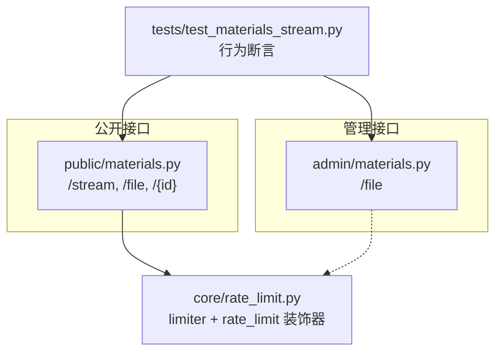
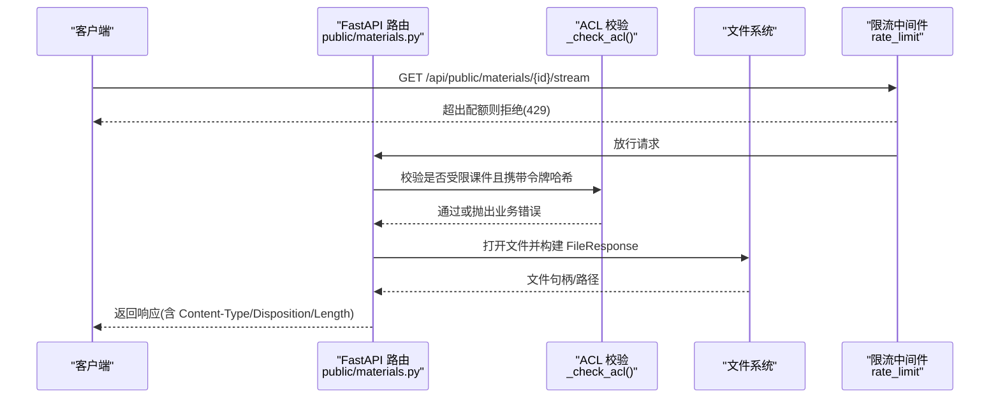
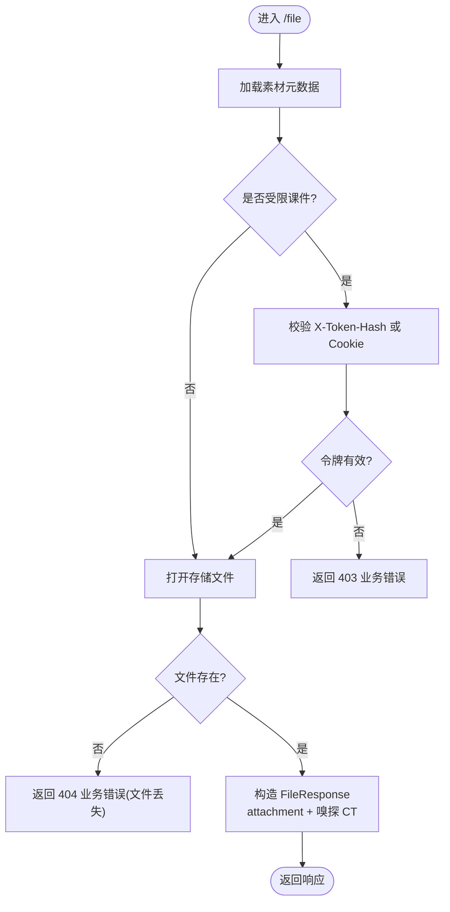
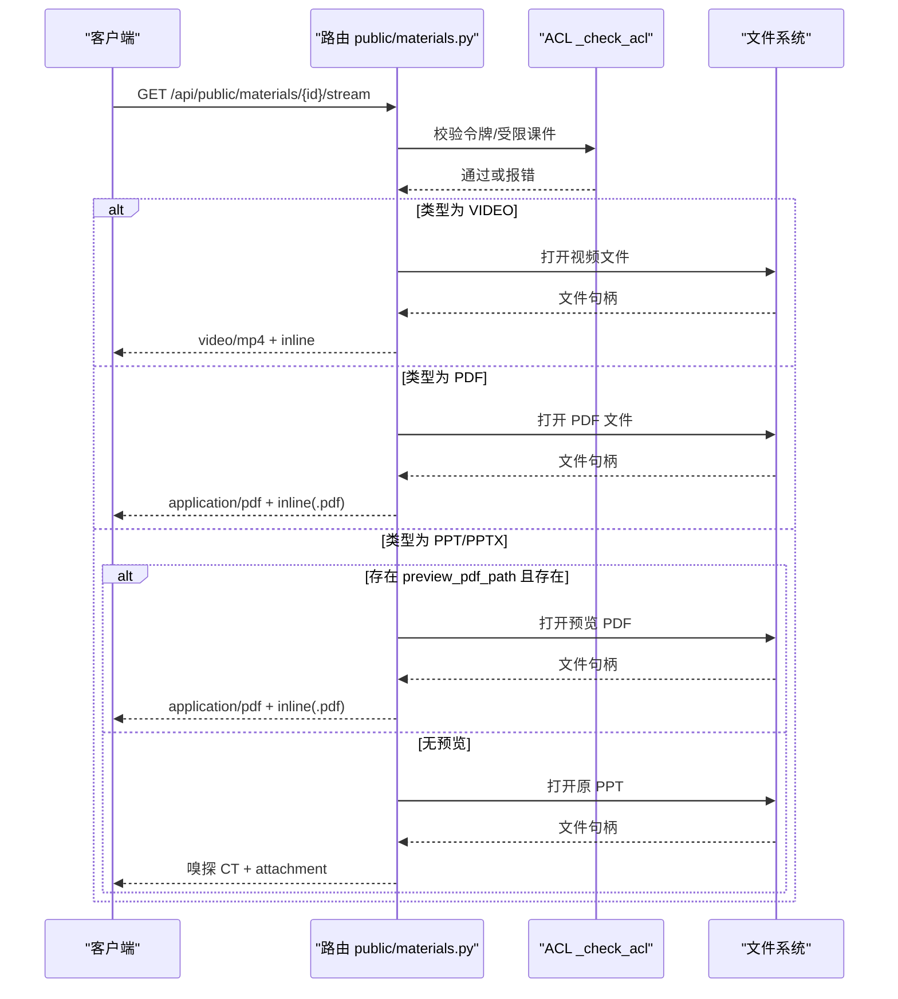
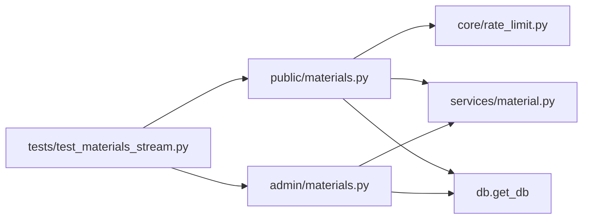

# 流式传输与下载

<cite>
**本文引用的文件**   
- [backend/app/api/public/materials.py](file://backend/app/api/public/materials.py)
- [backend/app/api/admin/materials.py](file://backend/app/api/admin/materials.py)
- [backend/app/core/rate_limit.py](file://backend/app/core/rate_limit.py)
- [backend/tests/test_materials_stream.py](file://backend/tests/test_materials_stream.py)
</cite>

## 目录
1. [简介](#简介)
2. [项目结构](#项目结构)
3. [核心组件](#核心组件)
4. [架构总览](#架构总览)
5. [详细组件分析](#详细组件分析)
6. [依赖关系分析](#依赖关系分析)
7. [性能考量](#性能考量)
8. [故障排查指南](#故障排查指南)
9. [结论](#结论)
10. [附录](#附录)

## 简介
本技术文档聚焦 Learning Hub 的“流式传输与下载”能力，围绕 FastAPI 的文件响应实现、分块传输、进度监控、断点续传支持、大文件内存优化策略、HTTP 响应头设置（Content-Type、Content-Length、缓存控制）、下载权限验证、访问日志记录与带宽限制机制，以及网络异常处理与重试策略进行系统化说明。文档同时结合现有代码路径与测试用例，给出可落地的最佳实践建议。

## 项目结构
与流式传输和下载相关的后端代码主要位于以下模块：
- 公开接口：素材的流式预览与下载、单条查询返回 streamUrl/downloadUrl
- 管理接口：管理员侧的素材下载
- 限流：基于 SlowAPI 的全局限流器与装饰器
- 测试：覆盖 Content-Type、Content-Disposition、ACL 解锁、PPT 降级等关键行为

图表来源
- [backend/app/api/public/materials.py:64-146](file://backend/app/api/public/materials.py#L64-L146)
- [backend/app/api/admin/materials.py:57-70](file://backend/app/api/admin/materials.py#L57-L70)
- [backend/app/core/rate_limit.py:40-52](file://backend/app/core/rate_limit.py#L40-L52)
- [backend/tests/test_materials_stream.py:33-104](file://backend/tests/test_materials_stream.py#L33-L104)

章节来源
- [backend/app/api/public/materials.py:64-146](file://backend/app/api/public/materials.py#L64-L146)
- [backend/app/api/admin/materials.py:57-70](file://backend/app/api/admin/materials.py#L57-L70)
- [backend/app/core/rate_limit.py:40-52](file://backend/app/core/rate_limit.py#L40-L52)
- [backend/tests/test_materials_stream.py:33-104](file://backend/tests/test_materials_stream.py#L33-L104)

## 核心组件
- 公开下载接口：以 attachment 方式返回原文件，自动嗅探 Content-Type，适合浏览器直接触发下载。
- 公开流式预览接口：根据素材类型返回 inline 内容；视频与 PDF 直接内联渲染；PPT 优先返回已生成的预览 PDF，否则降级为原 PPT 并强制 attachment。
- 公开单条查询接口：返回 streamUrl/downloadUrl 及 sizeBytes/duration 等元信息，供前端播放器/阅读器使用。
- 管理下载接口：管理员侧下载素材原文件。
- 限流：对公开流式接口启用每分钟 60 次的速率限制，防止滥用。

章节来源
- [backend/app/api/public/materials.py:64-146](file://backend/app/api/public/materials.py#L64-L146)
- [backend/app/api/public/materials.py:183-221](file://backend/app/api/public/materials.py#L183-L221)
- [backend/app/api/admin/materials.py:57-70](file://backend/app/api/admin/materials.py#L57-L70)
- [backend/app/core/rate_limit.py:40-52](file://backend/app/core/rate_limit.py#L40-L52)

## 架构总览
下图展示了从客户端到后端的请求链路，包括鉴权/ACL、限流、文件读取与响应头的生成过程。

图表来源
- [backend/app/api/public/materials.py:84-146](file://backend/app/api/public/materials.py#L84-L146)
- [backend/app/api/public/materials.py:31-62](file://backend/app/api/public/materials.py#L31-L62)
- [backend/app/core/rate_limit.py:40-52](file://backend/app/core/rate_limit.py#L40-L52)

## 详细组件分析

### 公开下载接口 /file
- 功能：以 attachment 方式返回原文件，便于浏览器触发下载。
- 权限：先解析当前会话的已解锁 token 哈希，再校验素材是否仅出现在受限课件中；若是，需命中至少一个有效令牌哈希。
- 响应头：
  - Content-Type：由文件名自动嗅探，未识别时回退为 application/octet-stream。
  - Content-Disposition：attachment；filename 使用原始文件名。
  - Content-Length：由底层 FileResponse 自动计算并写入。
- 错误处理：若存储文件不存在，抛出业务错误（文件丢失）。

图表来源
- [backend/app/api/public/materials.py:64-81](file://backend/app/api/public/materials.py#L64-L81)
- [backend/app/api/public/materials.py:31-62](file://backend/app/api/public/materials.py#L31-L62)

章节来源
- [backend/app/api/public/materials.py:64-81](file://backend/app/api/public/materials.py#L64-L81)
- [backend/app/api/public/materials.py:31-62](file://backend/app/api/public/materials.py#L31-L62)

### 公开流式预览接口 /stream
- 功能：按素材类型返回 inline 内容，供浏览器/Iframe/Video 直接渲染。
- 类型分支：
  - VIDEO：video/mp4 + inline。
  - PDF：application/pdf + inline，并将 filename 后缀统一为 .pdf。
  - PPT/PPTX：若存在 preview_pdf_path 且文件存在，返回该 PDF（inline）；否则降级返回原 PPT（attachment），避免浏览器乱触发下载。
- 限流：每分钟 60 次。
- 权限：与 /file 一致的 ACL 校验逻辑。

图表来源
- [backend/app/api/public/materials.py:84-146](file://backend/app/api/public/materials.py#L84-L146)
- [backend/app/api/public/materials.py:31-62](file://backend/app/api/public/materials.py#L31-L62)

章节来源
- [backend/app/api/public/materials.py:84-146](file://backend/app/api/public/materials.py#L84-L146)
- [backend/app/api/public/materials.py:31-62](file://backend/app/api/public/materials.py#L31-L62)

### 公开单条查询接口 /{id}
- 功能：返回 streamUrl/downloadUrl、sizeBytes、duration 等元信息，不包含 storage_path。
- PPT 专属：若已生成图片预览，返回 imageUrls/imageCount/previewReady。

章节来源
- [backend/app/api/public/materials.py:183-221](file://backend/app/api/public/materials.py#L183-L221)

### 管理下载接口 /api/admin/materials/{id}/file
- 功能：管理员侧下载素材原文件。
- 响应头：同公开下载，attachment + 嗅探 CT。

章节来源
- [backend/app/api/admin/materials.py:57-70](file://backend/app/api/admin/materials.py#L57-L70)

### 限流机制
- 实现：基于 SlowAPI 的 Limiter，提供 limiter 实例与 rate_limit 装饰器。
- 键函数：默认按 IP 区分；可扩展为 session 模式（从 Authorization 头提取子串作为 key）。
- 应用：公开流式接口使用 @limiter.limit("60/minute") 进行限速。

章节来源
- [backend/app/core/rate_limit.py:40-52](file://backend/app/core/rate_limit.py#L40-L52)
- [backend/app/api/public/materials.py:84-90](file://backend/app/api/public/materials.py#L84-L90)

## 依赖关系分析
- 公开接口依赖：
  - 数据库会话：get_db
  - 业务服务：material/courseware 服务用于获取素材与课件信息
  - 限流：limiter
  - 系统库：mimetypes、pathlib、fastapi.responses.FileResponse
- 管理接口依赖：
  - 数据库会话：get_db
  - 业务服务：material 服务
  - 认证中间件：get_admin_principal（路由级依赖）
- 测试依赖：
  - TestClient 发起请求并断言响应头与业务码

图表来源
- [backend/app/api/public/materials.py:1-20](file://backend/app/api/public/materials.py#L1-L20)
- [backend/app/api/admin/materials.py:1-20](file://backend/app/api/admin/materials.py#L1-L20)
- [backend/app/core/rate_limit.py:1-15](file://backend/app/core/rate_limit.py#L1-L15)
- [backend/tests/test_materials_stream.py:1-20](file://backend/tests/test_materials_stream.py#L1-L20)

章节来源
- [backend/app/api/public/materials.py:1-20](file://backend/app/api/public/materials.py#L1-L20)
- [backend/app/api/admin/materials.py:1-20](file://backend/app/api/admin/materials.py#L1-L20)
- [backend/app/core/rate_limit.py:1-15](file://backend/app/core/rate_limit.py#L1-L15)
- [backend/tests/test_materials_stream.py:1-20](file://backend/tests/test_materials_stream.py#L1-L20)

## 性能考量
- 分块传输与内存占用
  - 当前实现使用 FileResponse 返回静态文件，通常由 ASGI 服务器在操作系统层面进行零拷贝或内核缓冲的分块发送，避免将整文件读入 Python 进程内存，从而降低内存峰值。
  - 对于超大文件，建议确保部署环境（如 Uvicorn/Gunicorn）开启合适的 sendfile 支持，并在反向代理层（Nginx）启用 proxy_buffering 与合理的 buffer 大小，减少应用层内存压力。
- 进度监控
  - 当前接口未暴露实时进度回调。若需进度上报，可在前端基于 Range 请求分段拉取并累计已接收字节数，或在服务端引入 SSE/WebSocket 推送进度事件（需改造为自定义 StreamingResponse）。
- 断点续传
  - 当前未显式处理 HTTP Range 请求。如需断点续传，应在路由中解析 Range 头，定位文件偏移与长度，设置 Accept-Ranges、Content-Range 等响应头，并以分块方式返回指定范围的数据。
- 缓存控制
  - 当前未设置 Cache-Control/ETag/Last-Modified。对于静态资源，建议根据文件变更策略设置合适的缓存头，减少重复传输与服务器负载。
- 带宽限制
  - 当前采用请求级限流（每分钟次数），未做字节级带宽限制。若需更细粒度控制，可在网关层（Nginx）配置 limit_rate，或在应用层使用异步生成器配合 sleep 控制发送速率。

[本节为通用指导，不直接分析具体文件]

## 故障排查指南
- 常见错误码与场景
  - 404 material_not_found：请求的素材不存在。
  - 403 courseware_acl_locked：受限课件中的素材缺少有效令牌哈希。
  - 404 MATERIAL_STORAGE_UNAVAILABLE：素材文件在存储路径下缺失。
- 典型问题定位
  - 检查 Content-Type 是否正确：视频应为 video/mp4，PDF 应为 application/pdf；PPT 若无预览 PDF 会降级为 attachment。
  - 检查 Content-Disposition：流式预览应包含 inline；下载应包含 attachment。
  - 检查令牌解锁流程：受限课件需携带 X-Token-Hash 或通过解锁接口获得并注入。
  - 检查限流：超过 60/分钟将被拒绝，需等待或扩容。
- 参考测试用例
  - 视频 inline 与 Content-Type 断言
  - PDF inline 与 .pdf 重命名断言
  - PPT 无预览时的降级行为
  - 受限课件 ACL 解锁前后行为对比
  - 公开单条查询字段集不含 storage_path

章节来源
- [backend/tests/test_materials_stream.py:33-104](file://backend/tests/test_materials_stream.py#L33-L104)
- [backend/tests/test_materials_stream.py:113-146](file://backend/tests/test_materials_stream.py#L113-L146)
- [backend/tests/test_materials_stream.py:149-198](file://backend/tests/test_materials_stream.py#L149-L198)

## 结论
Learning Hub 的流式传输与下载基于 FastAPI 的 FileResponse 实现了高效、稳定的文件响应，并通过 ACL 校验与限流保障安全与可用性。针对大文件场景，当前方案在内存占用方面表现良好；若需增强体验，可在网关与应用层补充断点续传、进度上报与缓存控制等能力。

[本节为总结性内容，不直接分析具体文件]

## 附录

### HTTP 响应头规范（当前实现要点）
- Content-Type
  - 视频：video/mp4
  - PDF：application/pdf
  - PPT：未生成预览时按文件名嗅探，失败回退为 application/octet-stream
- Content-Disposition
  - 流式预览：inline；下载：attachment
- Content-Length
  - 由 FileResponse 自动计算并写入
- 缓存控制
  - 当前未显式设置，可按需扩展

章节来源
- [backend/app/api/public/materials.py:102-146](file://backend/app/api/public/materials.py#L102-L146)
- [backend/app/api/public/materials.py:64-81](file://backend/app/api/public/materials.py#L64-L81)