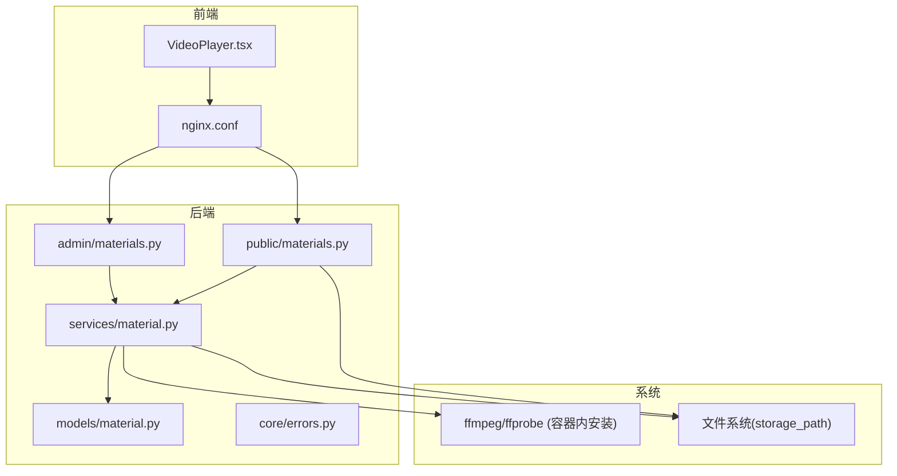
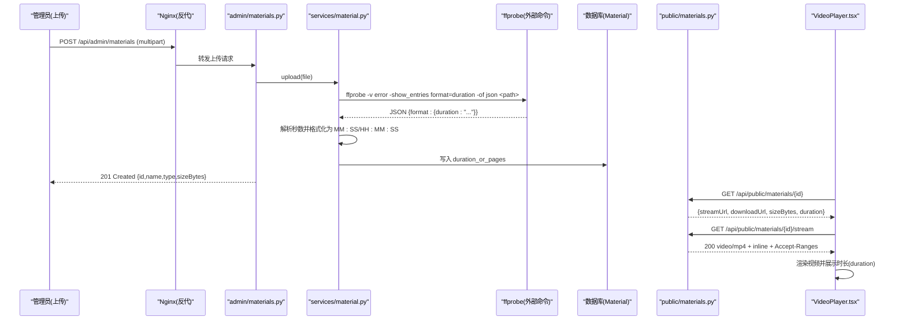
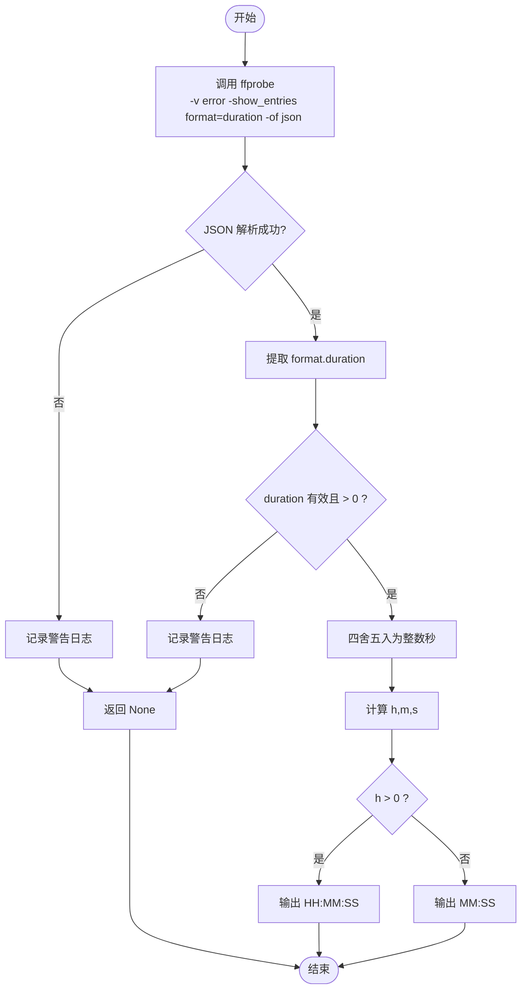
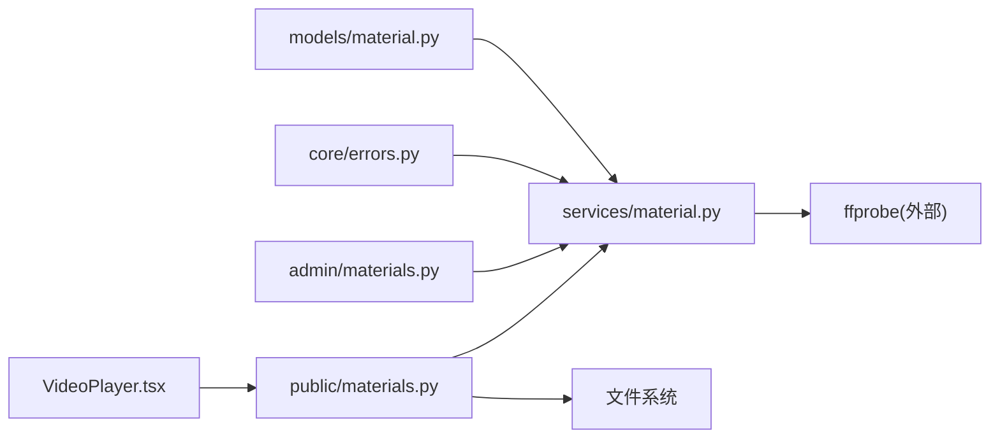

# 视频处理功能

<cite>
**本文引用的文件列表**
- [backend/app/services/material.py](file://backend/app/services/material.py)
- [backend/backfill_video_durations.py](file://backend/backfill_video_durations.py)
- [backend/app/models/material.py](file://backend/app/models/material.py)
- [backend/app/api/admin/materials.py](file://backend/app/api/admin/materials.py)
- [backend/app/api/public/materials.py](file://backend/app/api/public/materials.py)
- [backend/app/core/errors.py](file://backend/app/core/errors.py)
- [frontend/src/pages/public/viewer/VideoPlayer.tsx](file://frontend/src/pages/public/viewer/VideoPlayer.tsx)
- [frontend/nginx.conf](file://frontend/nginx.conf)
- [backend/Dockerfile](file://backend/Dockerfile)
- [deploy/local/tests/test_stream.py](file://deploy/local/tests/test_stream.py)
- [backend/tests/test_materials_stream.py](file://backend/tests/test_materials_stream.py)
</cite>

## 目录
1. [简介](#简介)
2. [项目结构](#项目结构)
3. [核心组件](#核心组件)
4. [架构总览](#架构总览)
5. [详细组件分析](#详细组件分析)
6. [依赖关系分析](#依赖关系分析)
7. [性能考虑](#性能考虑)
8. [故障排除指南](#故障排除指南)
9. [结论](#结论)
10. [附录](#附录)

## 简介
本技术文档聚焦 Learning Hub 的视频处理功能，重点解析 ffprobe 集成与视频时长探测机制（命令行调用、参数配置、超时处理），说明视频时长格式化算法（支持 MM:SS 与 HH:MM:SS），阐述视频文件验证、损坏检测与错误恢复策略，并提供 FFmpeg 工具链的安装配置与故障排除指南。同时给出视频处理性能优化与异步处理建议，帮助读者在生产环境中稳定高效地运行视频上传与播放链路。

## 项目结构
围绕视频处理的关键代码分布在后端服务、API 路由、模型定义、前端播放器以及部署配置中：
- 后端服务层负责视频上传、时长探测与存储路径管理
- API 层提供公开流式接口与下载接口，并返回 duration 字段
- 数据模型定义素材类型与时长/页数字段
- 前端播放器通过公开流式接口加载视频并展示时长
- 部署配置包含 Nginx 大文件上传与代理超时设置、Docker 镜像安装 ffmpeg

图表来源
- [backend/app/api/public/materials.py:84-146](file://backend/app/api/public/materials.py#L84-L146)
- [backend/app/api/admin/materials.py:35-48](file://backend/app/api/admin/materials.py#L35-L48)
- [backend/app/services/material.py:129-202](file://backend/app/services/material.py#L129-L202)
- [backend/app/models/material.py:44-68](file://backend/app/models/material.py#L44-L68)
- [frontend/nginx.conf:1-56](file://frontend/nginx.conf#L1-L56)
- [frontend/src/pages/public/viewer/VideoPlayer.tsx:202-246](file://frontend/src/pages/public/viewer/VideoPlayer.tsx#L202-L246)

章节来源
- [backend/app/services/material.py:1-234](file://backend/app/services/material.py#L1-L234)
- [backend/app/api/public/materials.py:1-224](file://backend/app/api/public/materials.py#L1-L224)
- [backend/app/api/admin/materials.py:1-74](file://backend/app/api/admin/materials.py#L1-L74)
- [backend/app/models/material.py:1-69](file://backend/app/models/material.py#L1-L69)
- [frontend/nginx.conf:1-56](file://frontend/nginx.conf#L1-L56)
- [frontend/src/pages/public/viewer/VideoPlayer.tsx:1-250](file://frontend/src/pages/public/viewer/VideoPlayer.tsx#L1-L250)

## 核心组件
- 视频时长探测与服务逻辑
  - 使用 ffprobe 以 JSON 输出格式读取 format.duration，失败时记录警告日志且不阻断上传流程
  - 将秒数四舍五入为整数后按 HH:MM:SS 或 MM:SS 规则格式化
- 公开流式接口
  - 对 VIDEO 类型返回 inline 的 video/mp4 响应，支持 Range 请求（由底层 FileResponse 默认启用）
  - 返回 duration 字段供前端展示
- 模型与错误码
  - Material 表包含 duration_or_pages 字段用于统一存储时长或页数
  - 错误码集中管理，如文件大小超限、存储不可用等
- 前端播放器
  - 通过公开流式接口加载视频，显示名称、类型、时长与大小
  - 首帧可见前展示占位，避免黑屏闪烁

章节来源
- [backend/app/services/material.py:36-76](file://backend/app/services/material.py#L36-L76)
- [backend/app/api/public/materials.py:183-221](file://backend/app/api/public/materials.py#L183-L221)
- [backend/app/models/material.py:44-68](file://backend/app/models/material.py#L44-L68)
- [backend/app/core/errors.py:45-52](file://backend/app/core/errors.py#L45-L52)
- [frontend/src/pages/public/viewer/VideoPlayer.tsx:218-246](file://frontend/src/pages/public/viewer/VideoPlayer.tsx#L218-L246)

## 架构总览
下图展示了从上传到播放的端到端流程，包括 ffprobe 探测与时长格式化、公开流式接口返回、前端播放器渲染。

图表来源
- [backend/app/api/admin/materials.py:35-48](file://backend/app/api/admin/materials.py#L35-L48)
- [backend/app/services/material.py:129-202](file://backend/app/services/material.py#L129-L202)
- [backend/app/api/public/materials.py:183-221](file://backend/app/api/public/materials.py#L183-L221)
- [frontend/src/pages/public/viewer/VideoPlayer.tsx:202-246](file://frontend/src/pages/public/viewer/VideoPlayer.tsx#L202-L246)

## 详细组件分析

### ffprobe 集成与视频时长探测机制
- 命令行调用
  - 使用 subprocess 调用外部命令 ffprobe，参数包括 -v error、-show_entries format=duration、-of json 与目标文件路径
  - 捕获 stderr 到 stdout，设置超时时间以避免长时间阻塞
- 参数配置
  - 仅读取 format.duration 字段，忽略其他元信息以减少解析开销
  - 超时设置为固定秒数，防止异常文件导致进程挂起
- 超时处理
  - 捕获 FileNotFoundError、TimeoutExpired、CalledProcessError 等异常，记录警告日志并返回 None
  - 解析 JSON 失败或 duration 无效（NaN、0、负数）时同样返回 None
- 结果处理
  - 将浮点秒数四舍五入为整数，计算小时、分钟、秒
  - 当小时大于 0 时输出 HH:MM:SS，否则输出 MM:SS
  - 返回值与 PPT 页数同型（字符串），便于前端统一展示

图表来源
- [backend/app/services/material.py:36-76](file://backend/app/services/material.py#L36-L76)

章节来源
- [backend/app/services/material.py:36-76](file://backend/app/services/material.py#L36-L76)

### 视频时长格式化算法
- 输入：浮点秒数（来自 ffprobe）
- 步骤：
  - 四舍五入为整数秒
  - 使用 divmod 计算小时、剩余秒；再对剩余秒计算分钟与秒
  - 根据是否超过一小时选择 HH:MM:SS 或 MM:SS 格式
- 复杂度：O(1)，仅涉及基本算术运算与字符串格式化
- 边界条件：
  - 秒数为 NaN、0 或负数时直接丢弃
  - 不足一小时的视频不显示小时部分

章节来源
- [backend/app/services/material.py:71-75](file://backend/app/services/material.py#L71-L75)

### 视频文件验证、损坏检测与错误恢复策略
- 文件存在性检查
  - 在公开流式接口与下载接口中，若 storage_path 不存在则抛出业务错误
- 类型推断与扩展名校验
  - 基于文件名扩展名推断素材类型，不支持的类型会抛出业务错误
- 文件大小限制
  - 上传过程中累计字节数，超过阈值主动清理半文件并抛出业务错误
- 损坏检测与降级
  - ffprobe 失败（未安装、文件损坏、超时）不会阻断上传，仅记录警告并将 duration 置空
  - 前端在缺少 duration 时显示占位符“--”，不影响播放
- 错误恢复
  - 入库失败时回滚并尝试删除已写入的文件与预览目录
  - 提供一次性 backfill 脚本补齐存量视频的 duration_or_pages

章节来源
- [backend/app/api/public/materials.py:99-111](file://backend/app/api/public/materials.py#L99-L111)
- [backend/app/models/material.py:31-41](file://backend/app/models/material.py#L31-L41)
- [backend/app/services/material.py:129-202](file://backend/app/services/material.py#L129-L202)
- [backend/backfill_video_durations.py:68-117](file://backend/backfill_video_durations.py#L68-L117)

### 公开流式接口与 Range 支持
- 行为
  - VIDEO 类型返回 Content-Type: video/mp4，Content-Disposition: inline，filename 为原文件名
  - 底层 FileResponse 默认启用 Range 支持，浏览器可分段请求以提升大文件播放体验
- 测试覆盖
  - 针对 stream 接口的媒体类型、disposition、Range 头进行断言

章节来源
- [backend/app/api/public/materials.py:102-111](file://backend/app/api/public/materials.py#L102-L111)
- [deploy/local/tests/test_stream.py:130-138](file://deploy/local/tests/test_stream.py#L130-L138)
- [backend/tests/test_materials_stream.py:33-44](file://backend/tests/test_materials_stream.py#L33-L44)

### 前端播放器与时长展示
- 数据来源
  - 通过公开单条查询接口获取 material.duration（即 duration_or_pages）
- 展示逻辑
  - 右侧信息面板显示类型、时长、大小；时长为空时显示“--”
- 用户体验
  - 首帧可见前展示占位，避免黑屏闪烁；错误时提示网络问题

章节来源
- [backend/app/api/public/materials.py:183-221](file://backend/app/api/public/materials.py#L183-L221)
- [frontend/src/pages/public/viewer/VideoPlayer.tsx:218-246](file://frontend/src/pages/public/viewer/VideoPlayer.tsx#L218-L246)

## 依赖关系分析
- 模块耦合
  - services/material.py 依赖 models/material.py 与 core/errors.py
  - public/admin materials API 依赖 services/material.py
  - 前端 VideoPlayer 依赖公开 API 返回的 duration 字段
- 外部依赖
  - Dockerfile 安装 ffmpeg，确保 ffprobe 可用
  - Nginx 配置调整大文件上传与代理超时，保障上传稳定性
- 潜在循环依赖
  - 当前未发现循环导入；各模块职责清晰

图表来源
- [backend/app/models/material.py:44-68](file://backend/app/models/material.py#L44-L68)
- [backend/app/core/errors.py:45-52](file://backend/app/core/errors.py#L45-L52)
- [backend/app/services/material.py:129-202](file://backend/app/services/material.py#L129-L202)
- [backend/app/api/public/materials.py:183-221](file://backend/app/api/public/materials.py#L183-L221)
- [frontend/src/pages/public/viewer/VideoPlayer.tsx:202-246](file://frontend/src/pages/public/viewer/VideoPlayer.tsx#L202-L246)

章节来源
- [backend/app/services/material.py:1-234](file://backend/app/services/material.py#L1-L234)
- [backend/app/api/public/materials.py:1-224](file://backend/app/api/public/materials.py#L1-L224)
- [backend/app/api/admin/materials.py:1-74](file://backend/app/api/admin/materials.py#L1-L74)
- [backend/app/models/material.py:1-69](file://backend/app/models/material.py#L1-L69)
- [backend/app/core/errors.py:1-144](file://backend/app/core/errors.py#L1-L144)
- [frontend/src/pages/public/viewer/VideoPlayer.tsx:1-250](file://frontend/src/pages/public/viewer/VideoPlayer.tsx#L1-L250)

## 性能考虑
- 上传阶段
  - 分块写入磁盘，边收边写，避免内存峰值
  - 实时累计大小并在超过阈值时立即终止与清理
- 时长探测
  - 仅读取 format.duration，减少 ffprobe 输出体积
  - 设置合理超时，避免异常文件导致进程阻塞
- 流式播放
  - 使用 inline 与 Range 支持，提升大文件播放流畅度
  - Nginx 关闭请求体缓存，边收边转发，降低磁盘 I/O
- 建议优化
  - 将 ffprobe 探测改为异步任务队列（如 Celery/RQ），避免同步阻塞主线程
  - 引入缓存层（Redis）缓存 duration 结果，减少重复探测
  - 批量补全时使用并发控制与重试机制，提高吞吐与容错

[本节为通用指导，无需具体文件引用]

## 故障排除指南
- ffprobe 未安装或不可用
  - 现象：上传成功但 duration 为空，日志出现 ffprobe failed
  - 排查：确认容器内已安装 ffmpeg（见 Dockerfile），检查 PATH 与权限
  - 参考：[backend/Dockerfile:33-40](file://backend/Dockerfile#L33-L40)
- 文件损坏或无法解析
  - 现象：ffprobe 返回错误或 JSON 解析失败
  - 处理：记录警告日志，duration 置空，上传继续；前端显示“--”
  - 参考：[backend/app/services/material.py:55-69](file://backend/app/services/material.py#L55-L69)
- 存储文件丢失
  - 现象：公开接口返回 500 并提示“素材文件已丢失”
  - 处理：检查 storage_path 是否存在，必要时恢复备份
  - 参考：[backend/app/api/public/materials.py:102-111](file://backend/app/api/public/materials.py#L102-L111)
- 上传超时或被截断
  - 现象：Nginx 报 413 或连接中断
  - 处理：调整 client_max_body_size、client_body_timeout、proxy_send_timeout 等
  - 参考：[frontend/nginx.conf:7-14](file://frontend/nginx.conf#L7-L14)
- 历史数据缺失 duration
  - 处理：执行 backfill 脚本补齐
  - 参考：[backend/backfill_video_durations.py:68-117](file://backend/backfill_video_durations.py#L68-L117)

章节来源
- [backend/Dockerfile:33-40](file://backend/Dockerfile#L33-L40)
- [backend/app/services/material.py:55-69](file://backend/app/services/material.py#L55-L69)
- [backend/app/api/public/materials.py:102-111](file://backend/app/api/public/materials.py#L102-L111)
- [frontend/nginx.conf:7-14](file://frontend/nginx.conf#L7-L14)
- [backend/backfill_video_durations.py:68-117](file://backend/backfill_video_durations.py#L68-L117)

## 结论
Learning Hub 的视频处理功能通过 ffprobe 实现轻量级时长探测，结合稳健的错误处理与降级策略，保证上传流程不被外部依赖异常阻断。公开流式接口提供 inline 的 video/mp4 响应并支持 Range，满足浏览器原生播放需求。前端播放器直观展示时长与大小，提升用户体验。生产环境需确保 ffmpeg 安装、Nginx 超时配置合理，并可考虑异步化与缓存进一步优化性能与可靠性。

[本节为总结，无需具体文件引用]

## 附录

### FFmpeg 工具链安装与配置
- 容器内安装
  - 在 Dockerfile 中通过 apt 安装 ffmpeg，确保 ffprobe 可用
  - 参考：[backend/Dockerfile:33-40](file://backend/Dockerfile#L33-L40)
- Nginx 上传与代理超时
  - 调整 client_max_body_size、client_body_timeout、proxy_send_timeout、proxy_read_timeout
  - 参考：[frontend/nginx.conf:7-14](file://frontend/nginx.conf#L7-L14)

章节来源
- [backend/Dockerfile:33-40](file://backend/Dockerfile#L33-L40)
- [frontend/nginx.conf:7-14](file://frontend/nginx.conf#L7-L14)

### 异步处理建议
- 将 ffprobe 探测放入后台任务队列，避免同步阻塞
- 使用 Redis 缓存 duration 结果，减少重复探测
- 批量补全脚本增加并发控制与重试机制，提高吞吐与容错

[本节为通用指导，无需具体文件引用]