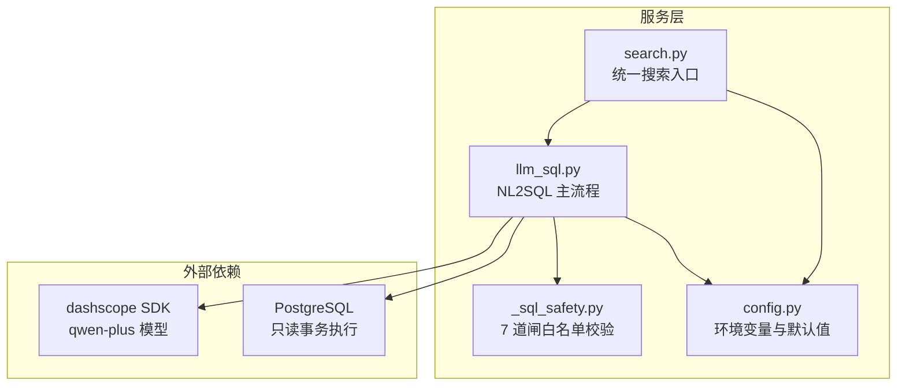
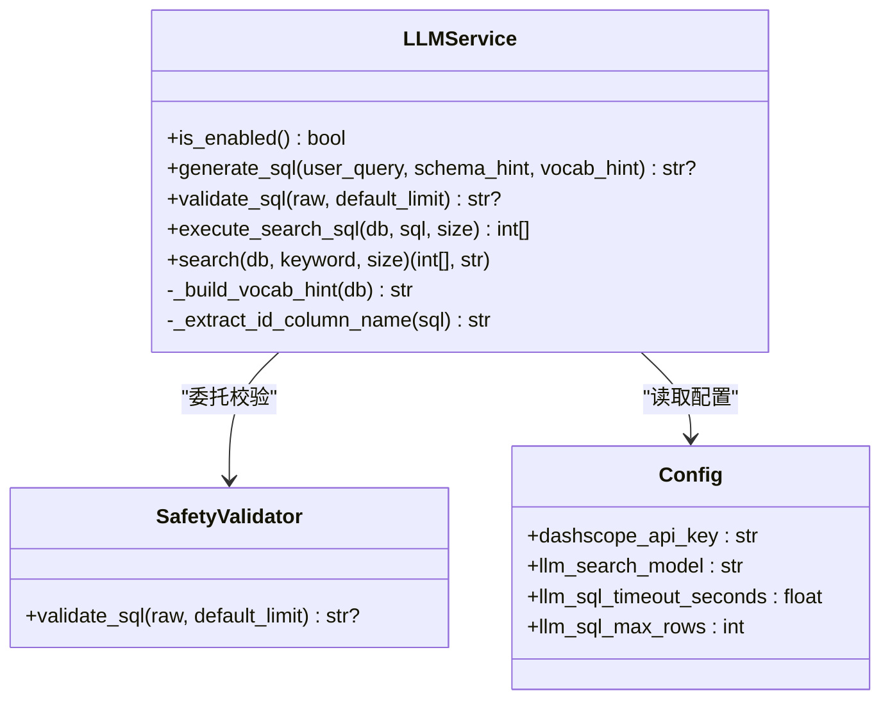
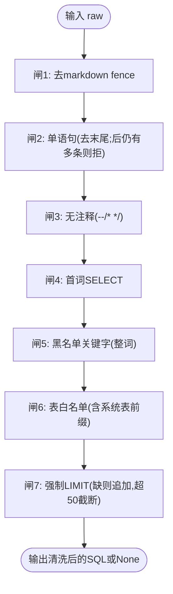
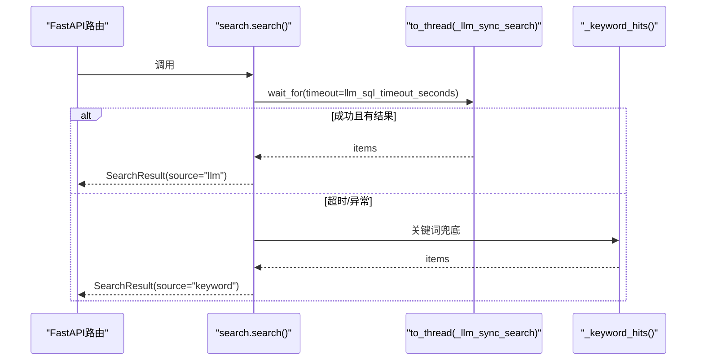
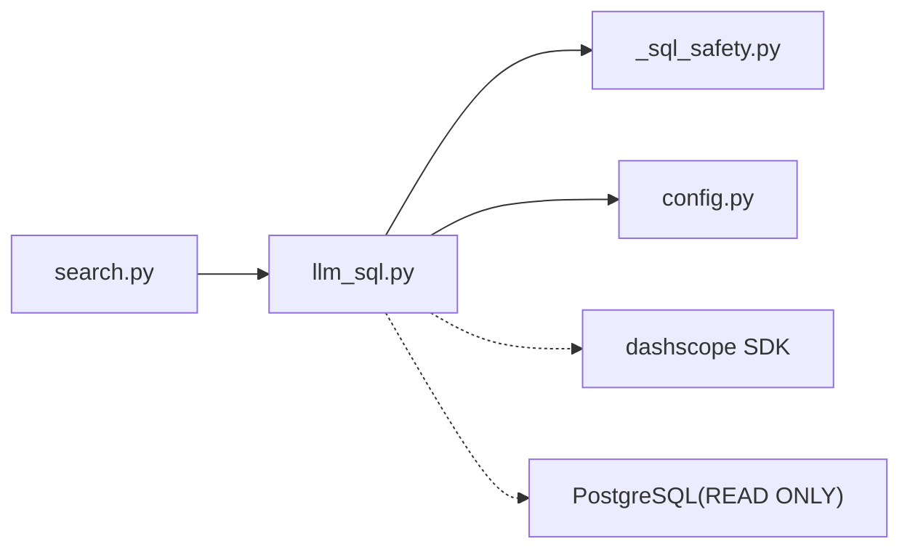

# LLM-to-SQL转换机制

<cite>
**本文引用的文件**   
- [llm_sql.py](file://backend/app/services/llm_sql.py)
- [_sql_safety.py](file://backend/app/services/_sql_safety.py)
- [search.py](file://backend/app/services/search.py)
- [config.py](file://backend/app/core/config.py)
- [test_llm_sql.py](file://backend/tests/test_llm_sql.py)
- [test_search_llm.py](file://backend/tests/test_search_llm.py)
- [07-技术架构.md](file://doc/spec/07-技术架构.md)
- [10-API设计规范.md](file://doc/spec/10-API设计规范.md)
</cite>

## 目录
1. [简介](#简介)
2. [项目结构](#项目结构)
3. [核心组件](#核心组件)
4. [架构总览](#架构总览)
5. [详细组件分析](#详细组件分析)
6. [依赖关系分析](#依赖关系分析)
7. [性能与调优](#性能与调优)
8. [故障排查指南](#故障排查指南)
9. [结论](#结论)
10. [附录：配置与使用示例](#附录配置与使用示例)

## 简介
本文件面向 Learning Hub 的“LLM-to-SQL”自然语言搜索能力，系统性解析基于阿里云百炼 Qwen（qwen-plus）的 NL2SQL 实现。内容涵盖：
- API 调用流程、提示词工程设计与 SQL 生成策略
- 7 道闸白名单校验的安全验证逻辑（语法检查、危险操作拦截、权限控制）
- 异步执行模型与超时控制（事件循环集成、错误处理与降级）
- 环境变量配置、重试与降级策略
- 性能调优建议与常见问题解决方案

## 项目结构
围绕 LLM-to-SQL 的核心代码位于后端 services 层，配合配置模块与安全校验模块，形成“生成 → 校验 → 执行 → 补齐结果”的流水线。



图示来源
- [search.py:1-263](file://backend/app/services/search.py#L1-L263)
- [llm_sql.py:1-490](file://backend/app/services/llm_sql.py#L1-L490)
- [_sql_safety.py:1-220](file://backend/app/services/_sql_safety.py#L1-L220)
- [config.py:1-88](file://backend/app/core/config.py#L1-L88)

章节来源
- [search.py:1-263](file://backend/app/services/search.py#L1-L263)
- [llm_sql.py:1-490](file://backend/app/services/llm_sql.py#L1-L490)
- [_sql_safety.py:1-220](file://backend/app/services/_sql_safety.py#L1-L220)
- [config.py:1-88](file://backend/app/core/config.py#L1-L88)

## 核心组件
- 统一搜索服务 search.search：优先走 LLM-to-SQL，失败或禁用时降级到关键词 ILIKE；提供异步接口与同步包装。
- NL2SQL 服务 llm_sql：负责启用检测、提示词构建、调用 qwen-plus、安全校验、read-only 事务执行与 id 提取。
- 安全校验 _sql_safety：纯函数实现的 7 道闸白名单校验，不依赖数据库。
- 配置 config：从环境变量加载 dashscope_api_key、模型名、超时、最大行数等参数。

章节来源
- [search.py:1-263](file://backend/app/services/search.py#L1-L263)
- [llm_sql.py:1-490](file://backend/app/services/llm_sql.py#L1-L490)
- [_sql_safety.py:1-220](file://backend/app/services/_sql_safety.py#L1-L220)
- [config.py:1-88](file://backend/app/core/config.py#L1-L88)

## 架构总览
整体数据流与控制流如下：

```mermaid
sequenceDiagram
participant Client as "调用方(路由/测试)"
participant Search as "search.search()"
participant Thread as "asyncio.to_thread(_llm_sync_search)"
participant LLM as "llm_sql.search()"
participant Gen as "llm_sql.generate_sql()"
participant Safe as "_sql_safety.validate_sql()"
participant Exec as "llm_sql.execute_search_sql()"
participant DB as "PostgreSQL(READ ONLY)"
participant Fetch as "search._fetch_coursewares()"
Client->>Search : 传入 keyword, size
alt 已启用且 keyword 非空
Search->>Thread : 异步线程执行 LLM 路径
Thread->>LLM : search(db, keyword, size)
LLM->>Gen : generate_sql(user_query, schema_hint, vocab_hint)
Gen-->>LLM : 原始 SQL 字符串
LLM->>Safe : validate_sql(raw, default_limit)
Safe-->>LLM : 清洗后的 SQL 或 None
alt 通过校验
LLM->>Exec : execute_search_sql(sql, size)
Exec->>DB : SET TRANSACTION READ ONLY; SELECT ... LIMIT
DB-->>Exec : 行集(id列)
Exec-->>LLM : id 列表
LLM-->>Thread : (ids, source="llm")
Thread->>Fetch : _fetch_coursewares(ids_in_order, size)
Fetch-->>Search : items
Search-->>Client : SearchResult(source="llm", total=len(items))
else 校验拒绝/无结果
LLM-->>Thread : (ids=[], source="keyword")
Thread-->>Search : []
Search->>Search : 降级关键词 ILIKE
Search-->>Client : SearchResult(source="keyword", total=...)
end
else 未启用或空 keyword
Search->>Search : 直接关键词 ILIKE
Search-->>Client : SearchResult(source="keyword", total=...)
end
```

图示来源
- [search.py:210-242](file://backend/app/services/search.py#L210-L242)
- [llm_sql.py:443-478](file://backend/app/services/llm_sql.py#L443-L478)
- [llm_sql.py:276-344](file://backend/app/services/llm_sql.py#L276-L344)
- [_sql_safety.py:165-210](file://backend/app/services/_sql_safety.py#L165-L210)
- [llm_sql.py:385-437](file://backend/app/services/llm_sql.py#L385-L437)

## 详细组件分析

### 组件 A：NL2SQL 主流程（llm_sql.py）
- 启用检测 is_enabled：读取配置中的 dashscope_api_key，为空则禁用。
- 词汇缓存 _build_vocab_hint：进程级 TTL 缓存 category.name/tag.name，注入到 schema_hint 提升识别准确率。
- 提示词工程 SYSTEM_PROMPT + SCHEMA_HINT：明确业务背景、字段优先级、匹配策略（ILIKE）、禁止项（DDL/DML/注释/多语句/敏感列）。
- 生成 SQL generate_sql：构造 messages，设置 temperature=0.0、top_p=0.9，按配置选择模型与超时。
- 安全校验 validate_sql：委托 _sql_safety.validate_sql。
- 执行 execute_search_sql：在 read-only 事务中执行，仅取 id 列，去重并限制上限。
- 主入口 search：串联上述步骤，失败/超时/校验拒绝均返回 ([], 'keyword')。



图示来源
- [llm_sql.py:267-478](file://backend/app/services/llm_sql.py#L267-L478)
- [_sql_safety.py:165-210](file://backend/app/services/_sql_safety.py#L165-L210)
- [config.py:65-71](file://backend/app/core/config.py#L65-L71)

章节来源
- [llm_sql.py:1-490](file://backend/app/services/llm_sql.py#L1-L490)

### 组件 B：7 道闸白名单校验（_sql_safety.py）
- 闸 1：剥离 markdown fence（```sql ... ``` / ``` ... ```）。
- 闸 2：单语句（去除末尾分号后仍允许多个分号则拒绝）。
- 闸 3：无注释（拒绝 -- 与 /* */）。
- 闸 4：首词必须为 SELECT。
- 闸 5：黑名单关键字整词匹配（DROP/DELETE/UPDATE/INSERT/ALTER/CREATE/TRUNCATE/GRANT/REVOKE/EXEC/COPY/VACUUM/LOCK/COMMENT/SET/RESET/CALL/DO/UNION/INTERSECT/EXCEPT）。
- 闸 6：表白名单（FROM/JOIN 表名必须在允许集合，拒绝系统表前缀与 schema.table 限定）。
- 闸 7：强制 LIMIT（缺失追加；显式 > 50 截断至 50）。



图示来源
- [_sql_safety.py:91-210](file://backend/app/services/_sql_safety.py#L91-L210)

章节来源
- [_sql_safety.py:1-220](file://backend/app/services/_sql_safety.py#L1-L220)
- [test_llm_sql.py:1-193](file://backend/tests/test_llm_sql.py#L1-L193)

### 组件 C：异步执行与超时控制（search.py）
- 主流程 async def search：若启用且 keyword 非空，使用 asyncio.wait_for 包裹 asyncio.to_thread 执行的同步 LLM 路径，支持超时。
- 超时与异常捕获：TimeoutError 或其他异常均记录日志并降级到关键词 ILIKE。
- 同步包装 search_sync：兼容 FastAPI 同步路由场景，自动判断是否已在事件循环中运行。



图示来源
- [search.py:210-242](file://backend/app/services/search.py#L210-L242)

章节来源
- [search.py:1-263](file://backend/app/services/search.py#L1-L263)
- [test_search_llm.py:1-168](file://backend/tests/test_search_llm.py#L1-L168)

### 组件 D：配置与环境变量（config.py）
- dashscope_api_key：留空则禁用 LLM 路径，自动降级到 ILIKE。
- llm_search_model：默认 qwen-plus。
- llm_sql_timeout_seconds：默认 8.0 秒。
- llm_sql_max_rows：默认 20，作为缺省 LIMIT 的上限参考。

章节来源
- [config.py:65-71](file://backend/app/core/config.py#L65-L71)

## 依赖关系分析
- 模块耦合
  - search.py 依赖 llm_sql.py 与 _sql_safety.py（间接），并通过 config.py 获取运行时参数。
  - llm_sql.py 依赖 _sql_safety.py 进行纯函数校验，依赖 config.py 获取模型与超时。
  - _sql_safety.py 无外部依赖，便于单元测试覆盖。
- 外部依赖
  - dashscope SDK：仅在 generate_sql 内部局部导入，避免未安装时的启动失败。
  - PostgreSQL：以只读事务执行，确保安全性。



图示来源
- [search.py:1-263](file://backend/app/services/search.py#L1-L263)
- [llm_sql.py:1-490](file://backend/app/services/llm_sql.py#L1-L490)
- [_sql_safety.py:1-220](file://backend/app/services/_sql_safety.py#L1-L220)
- [config.py:1-88](file://backend/app/core/config.py#L1-L88)

章节来源
- [search.py:1-263](file://backend/app/services/search.py#L1-L263)
- [llm_sql.py:1-490](file://backend/app/services/llm_sql.py#L1-L490)
- [_sql_safety.py:1-220](file://backend/app/services/_sql_safety.py#L1-L220)
- [config.py:1-88](file://backend/app/core/config.py#L1-L88)

## 性能与调优
- 词汇缓存
  - 进程级缓存 _VOCAB_CACHE，TTL 60s，减少每次请求对 category/tag 表的查询开销。
  - 后台管理增删分类/标签后可调用 invalidate_vocab_cache 立即刷新。
- 提示词长度控制
  - 仅拼接前 50 个分类名与标签名，避免 prompt 过长影响延迟与成本。
- 超时与降级
  - 外层 asyncio.wait_for 控制总耗时，避免阻塞事件循环；超时即降级 ILIKE。
- 只读事务与最小列集
  - 执行层仅取 id 列，后续再按需补齐完整对象，降低网络与序列化开销。
- 并发与线程池
  - 将同步 LLM 调用放入 to_thread 执行，避免阻塞异步事件循环。

[本节为通用指导，无需特定文件引用]

## 故障排查指南
- 现象：搜索始终返回 source="keyword"
  - 检查环境变量 DASHSCOPE_API_KEY 是否为空或未配置。
  - 查看日志关键字：“LLM disabled”、“LLM SQL search failed”、“LLM SQL search timeout”。
- 现象：LLM 返回 SQL 被拒绝
  - 确认是否命中 7 道闸（如包含注释、多语句、黑名单关键字、未知表、缺少 LIMIT 等）。
  - 参考测试用例定位具体闸失败原因。
- 现象：执行报错或结果为空
  - 确认 read-only 事务是否生效；检查生成的 SQL 是否符合白名单与 LIMIT 约束。
- 现象：响应过慢
  - 调整 llm_sql_timeout_seconds；优化提示词与词汇缓存命中率；评估网络抖动。

章节来源
- [test_search_llm.py:1-168](file://backend/tests/test_search_llm.py#L1-L168)
- [test_llm_sql.py:1-193](file://backend/tests/test_llm_sql.py#L1-L193)
- [10-API设计规范.md:1025-1046](file://doc/spec/10-API设计规范.md#L1025-L1046)

## 结论
Learning Hub 的 LLM-to-SQL 方案通过“强约束提示词 + 7 道闸白名单 + 只读事务 + 异步超时 + 关键词兜底”的组合，实现了高可用、高安全的自然语言搜索体验。该设计在保证安全性的同时，兼顾了性能与可维护性，并为后续扩展提供了清晰的演进空间。

[本节为总结性内容，无需特定文件引用]

## 附录：配置与使用示例

### 环境变量与默认值
- DASHSCOPE_API_KEY：留空则禁用 LLM 路径，自动降级到 ILIKE。
- LLM_SEARCH_MODEL：可选，默认 qwen-plus。
- LLM_SQL_TIMEOUT_SECONDS：默认 8.0 秒。
- LLM_SQL_MAX_ROWS：默认 20，用于缺省 LIMIT。

章节来源
- [config.py:65-71](file://backend/app/core/config.py#L65-L71)

### 调用流程与降级策略
- 主入口 search.search：
  - 若启用且 keyword 非空，尝试 LLM-to-SQL；任一环节失败或超时，降级到关键词 ILIKE。
  - 返回 SearchResult，source 指示实际路径（llm 或 keyword）。
- 同步包装 search_sync：
  - 适配 FastAPI 同步路由，自动判断是否在事件循环中运行。

章节来源
- [search.py:210-242](file://backend/app/services/search.py#L210-L242)

### 安全护栏与白名单
- 7 道闸校验：
  - 去 markdown、单语句、无注释、首词 SELECT、黑名单关键字、表白名单、强制 LIMIT。
- 只读事务：
  - 执行前 SET TRANSACTION READ ONLY，防止意外 DML。

章节来源
- [_sql_safety.py:91-210](file://backend/app/services/_sql_safety.py#L91-L210)
- [llm_sql.py:385-437](file://backend/app/services/llm_sql.py#L385-L437)
- [10-API设计规范.md:1025-1046](file://doc/spec/10-API设计规范.md#L1025-L1046)

### 提示词工程要点
- 业务背景与字段优先级：title/description/author 为主战场，category/tag 仅在用户明确提及时考虑 JOIN。
- 匹配策略：文本匹配使用 ILIKE，避免精确匹配；多关键词用 OR 组合提高召回。
- 硬性规则：禁止 DDL/DML、注释、多语句、敏感列、系统表访问；强制 LIMIT。

章节来源
- [llm_sql.py:126-261](file://backend/app/services/llm_sql.py#L126-L261)

### 测试与验证
- 单元测试：
  - test_llm_sql.py：覆盖 7 道闸全部场景。
  - test_search_llm.py：覆盖主流程（LLM 命中、校验拒绝、超时、无 key、空查询、关键词兜底）。
- 端到端脚本：
  - deploy/local/scripts/verify-llm-search.ps1：一键验证测试、冒烟与 e2e。

章节来源
- [test_llm_sql.py:1-193](file://backend/tests/test_llm_sql.py#L1-L193)
- [test_search_llm.py:1-168](file://backend/tests/test_search_llm.py#L1-L168)
- [07-技术架构.md:71-77](file://doc/spec/07-技术架构.md#L71-L77)