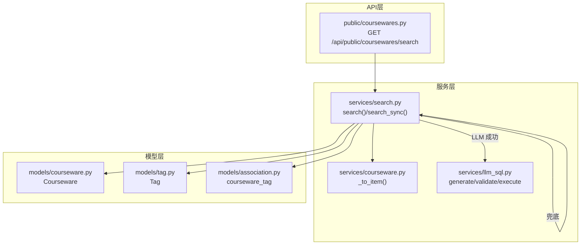
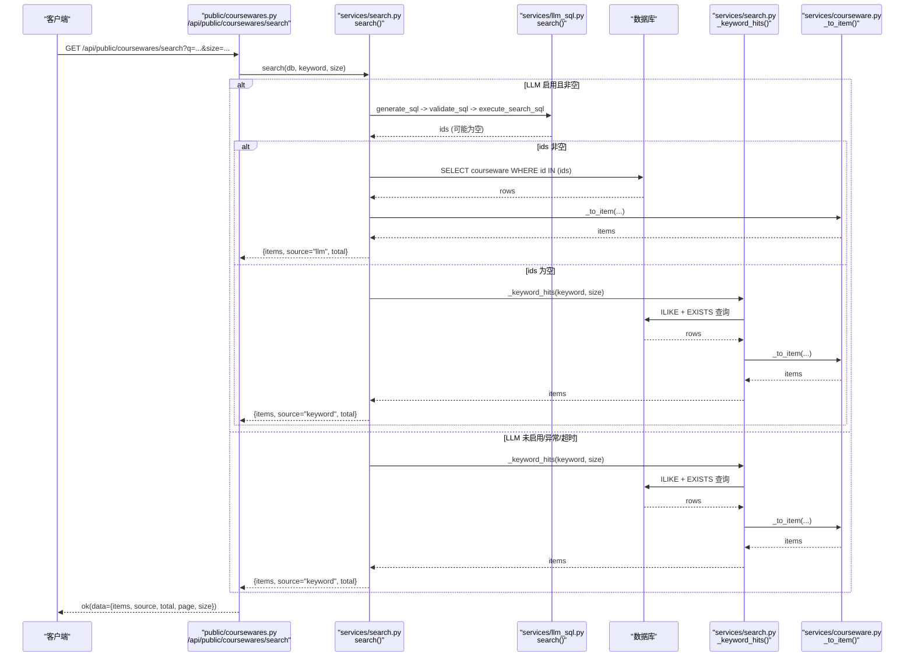
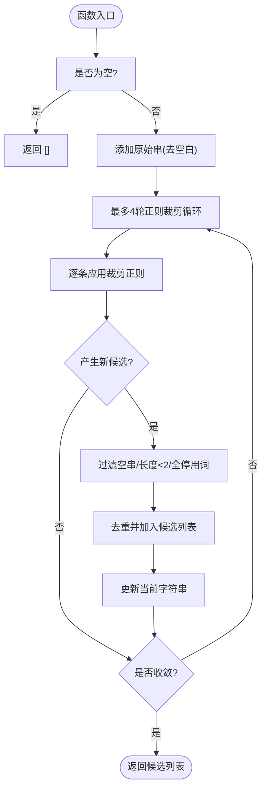
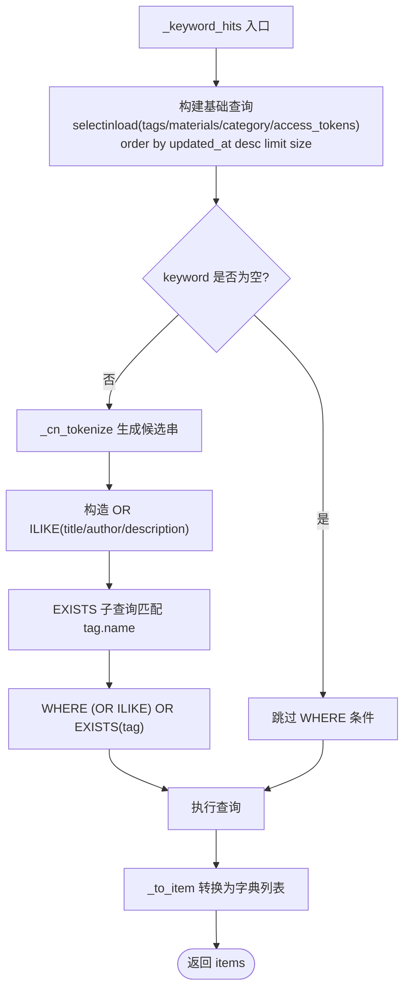
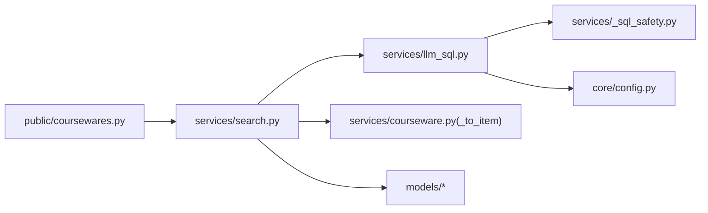

# 关键词兜底搜索

<cite>
**本文引用的文件列表**
- [search.py](file://backend/app/services/search.py)
- [llm_sql.py](file://backend/app/services/llm_sql.py)
- [_sql_safety.py](file://backend/app/services/_sql_safety.py)
- [courseware.py](file://backend/app/models/courseware.py)
- [tag.py](file://backend/app/models/tag.py)
- [association.py](file://backend/app/models/association.py)
- [courseware_service.py](file://backend/app/services/courseware.py)
- [public_coursewares_api.py](file://backend/app/api/public/coursewares.py)
- [config.py](file://backend/app/core/config.py)
- [test_search_llm.py](file://backend/tests/test_search_llm.py)
</cite>

## 目录
1. [简介](#简介)
2. [项目结构](#项目结构)
3. [核心组件](#核心组件)
4. [架构总览](#架构总览)
5. [详细组件分析](#详细组件分析)
6. [依赖关系分析](#依赖关系分析)
7. [性能与索引优化](#性能与索引优化)
8. [故障排查指南](#故障排查指南)
9. [结论](#结论)
10. [附录：配置与使用示例](#附录配置与使用示例)

## 简介
本技术文档聚焦 Learning Hub 的“关键词兜底搜索”子系统，围绕以下目标展开：
- 中文查询清洗算法：正则模式匹配、停用词过滤、候选字符串提取策略
- ILIKE 搜索优化：多字段联合查询、EXISTS 子查询优化、索引利用策略
- 搜索结果排序与去重：优先级排序、重复项处理
- 完整配置与使用示例：查询预处理、性能监控、调试技巧
- 效果优化指南与常见问题解决方案

该子系统在 LLM-to-SQL 不可用或失败时自动降级为关键词 ILIKE 检索，确保前台搜索始终可用。

## 项目结构
与关键词兜底搜索相关的后端代码主要分布在 services、models、api 三个层次：
- services/search.py：统一搜索入口，LLM 优先 + 关键词兜底
- services/llm_sql.py：NL2SQL 生成与执行（兜底路径不依赖）
- services/courseware.py：课件数据模型转换与公共搜索接口
- models/*：Courseware、Tag、关联表定义
- api/public/coursewares.py：对外公开搜索 API
- core/config.py：LLM 开关与超时等配置
- tests/test_search_llm.py：主流程测试用例

图表来源
- [public_coursewares_api.py:32-54](file://backend/app/api/public/coursewares.py#L32-L54)
- [search.py:210-242](file://backend/app/services/search.py#L210-L242)
- [courseware_service.py:290-332](file://backend/app/services/courseware.py#L290-L332)
- [llm_sql.py:443-478](file://backend/app/services/llm_sql.py#L443-L478)
- [courseware.py:21-67](file://backend/app/models/courseware.py#L21-L67)
- [tag.py:13-27](file://backend/app/models/tag.py#L13-L27)
- [association.py:9-14](file://backend/app/models/association.py#L9-L14)

章节来源
- [public_coursewares_api.py:32-54](file://backend/app/api/public/coursewares.py#L32-L54)
- [search.py:210-242](file://backend/app/services/search.py#L210-L242)
- [courseware_service.py:290-332](file://backend/app/services/courseware.py#L290-L332)
- [llm_sql.py:443-478](file://backend/app/services/llm_sql.py#L443-L478)
- [courseware.py:21-67](file://backend/app/models/courseware.py#L21-L67)
- [tag.py:13-27](file://backend/app/models/tag.py#L13-L27)
- [association.py:9-14](file://backend/app/models/association.py#L9-L14)

## 核心组件
- 统一搜索入口 search.search：优先尝试 LLM-to-SQL；失败或禁用则走关键词兜底
- 关键词兜底 _keyword_hits：基于 _cn_tokenize 生成的候选串，对标题/作者/描述进行 OR ILIKE，并通过 EXISTS 匹配标签名
- 中文查询清洗 _cn_tokenize：正则裁剪 + 停用词过滤 + 候选去重与优先级排序
- 结果组装 _fetch_coursewares：按 LLM 返回的 id 顺序补齐 CoursewareItem
- 外部接口 GET /api/public/coursewares/search：封装 SearchResult 并返回 items/source/total/page/size

章节来源
- [search.py:115-160](file://backend/app/services/search.py#L115-L160)
- [search.py:166-190](file://backend/app/services/search.py#L166-L190)
- [search.py:210-242](file://backend/app/services/search.py#L210-L242)
- [public_coursewares_api.py:32-54](file://backend/app/api/public/coursewares.py#L32-L54)

## 架构总览
下图展示了从请求到结果的完整调用链，包括 LLM 路径与关键词兜底路径的分流逻辑。

图表来源
- [public_coursewares_api.py:32-54](file://backend/app/api/public/coursewares.py#L32-L54)
- [search.py:210-242](file://backend/app/services/search.py#L210-L242)
- [llm_sql.py:443-478](file://backend/app/services/llm_sql.py#L443-L478)
- [search.py:115-160](file://backend/app/services/search.py#L115-L160)
- [courseware_service.py:290-332](file://backend/app/services/courseware.py#L290-L332)

## 详细组件分析

### 中文查询清洗算法（_cn_tokenize）
- 输入：原始用户问题（如“帮我找一下与项目管理相关的课件”）
- 步骤：
  - 保留原始 strip 后的字符串作为第一候选
  - 应用一组正则裁剪规则，逐步去除礼貌/求助语气、“一下”软化语、相关句式包裹、平台术语等，得到多个净化变体
  - 过滤空串、长度小于 2 的项、全由停用词组成的项
  - 去重并保持“原始串在前”的优先级顺序
- 输出：候选关键字符串列表，用于后续 ILIKE 依次尝试

图表来源
- [search.py:62-102](file://backend/app/services/search.py#L62-L102)

章节来源
- [search.py:40-59](file://backend/app/services/search.py#L40-L59)
- [search.py:62-102](file://backend/app/services/search.py#L62-L102)

### ILIKE 搜索优化（_keyword_hits）
- 多字段联合查询：对 title、author、description 三字段构建 OR ILIKE 条件
- 标签匹配优化：通过 EXISTS 子查询匹配 tag.name，避免大表 JOIN 成本
- 候选串并行命中：将 _cn_tokenize 输出的多个候选串组合成 OR 条件，提高命中率
- 默认排序：无关键词时按 updated_at DESC 返回最新；有关键词时仍保持默认排序（由基础查询决定）

图表来源
- [search.py:115-160](file://backend/app/services/search.py#L115-L160)
- [search.py:62-102](file://backend/app/services/search.py#L62-L102)
- [courseware_service.py:290-332](file://backend/app/services/courseware.py#L290-L332)

章节来源
- [search.py:115-160](file://backend/app/services/search.py#L115-L160)
- [search.py:62-102](file://backend/app/services/search.py#L62-L102)
- [courseware_service.py:290-332](file://backend/app/services/courseware.py#L290-L332)

### 搜索结果排序与去重机制
- LLM 路径：
  - 由 LLM 生成的 SQL 负责排序（通常 ORDER BY updated_at DESC LIMIT N）
  - 执行后仅取 id 列表，并在内存中按原顺序去重，再按顺序补齐完整 CoursewareItem
- 关键词路径：
  - 基础查询默认 order_by(updated_at DESC)，limit(size)
  - 由于 OR ILIKE 与 EXISTS 的组合，可能存在重复行；但 SQLAlchemy scalars().all() 会返回 ORM 对象集合，天然去重
- 去重细节：
  - LLM 路径在执行层显式去重（seen set），防止 SQL 重复行导致 id 重复
  - 关键词路径依赖 ORM 对象去重

章节来源
- [llm_sql.py:385-437](file://backend/app/services/llm_sql.py#L385-L437)
- [search.py:166-190](file://backend/app/services/search.py#L166-L190)
- [search.py:115-160](file://backend/app/services/search.py#L115-L160)

### 统一搜索入口（search.search）
- 若 keyword 非空且 LLM 启用：
  - 异步线程执行 LLM 流程（生成 SQL → 校验 → 执行）
  - 设置超时时间（可配置）
  - 若成功返回 items，source="llm"
- 否则：
  - 降级到关键词兜底，source="keyword"
- 同步包装 search_sync：兼容 FastAPI 同步路由场景

章节来源
- [search.py:210-242](file://backend/app/services/search.py#L210-L242)
- [search.py:246-255](file://backend/app/services/search.py#L246-L255)

### 对外 API（GET /api/public/coursewares/search）
- 参数：q（可选）、page、size
- 响应 envelope：data.items、data.source、data.total、data.page、data.size
- 当 LLM 不可用时，前端根据 source="keyword" 显示“降级中”徽标

章节来源
- [public_coursewares_api.py:32-54](file://backend/app/api/public/coursewares.py#L32-L54)

## 依赖关系分析
- search.py 依赖 llm_sql.py（LLM 路径）、courseware_service._to_item（结果组装）、models（ORM 映射）
- llm_sql.py 依赖 _sql_safety（安全校验）、core.config（超时/模型/最大行数）
- public/coursewares.py 依赖 search.py 和 courseware_service._to_item

图表来源
- [public_coursewares_api.py:32-54](file://backend/app/api/public/coursewares.py#L32-L54)
- [search.py:210-242](file://backend/app/services/search.py#L210-L242)
- [llm_sql.py:443-478](file://backend/app/services/llm_sql.py#L443-L478)
- [courseware_service.py:290-332](file://backend/app/services/courseware.py#L290-L332)
- [config.py:65-71](file://backend/app/core/config.py#L65-L71)

章节来源
- [public_coursewares_api.py:32-54](file://backend/app/api/public/coursewares.py#L32-L54)
- [search.py:210-242](file://backend/app/services/search.py#L210-L242)
- [llm_sql.py:443-478](file://backend/app/services/llm_sql.py#L443-L478)
- [courseware_service.py:290-332](file://backend/app/services/courseware.py#L290-L332)
- [config.py:65-71](file://backend/app/core/config.py#L65-L71)

## 性能与索引优化
- 现有索引
  - association.courseware_material 上存在复合索引 ix_courseware_material_courseware_order，用于素材排序查询
- ILIKE 性能建议
  - 当前实现使用 %keyword% 前缀通配，无法有效利用 B-tree 索引
  - 建议在 PostgreSQL 上使用 pg_trgm 扩展，并对常用文本列创建 trigram 索引：
    - CREATE EXTENSION IF NOT EXISTS pg_trgm;
    - CREATE INDEX idx_courseware_title_trgm ON courseware USING gin (title gin_trgm_ops);
    - CREATE INDEX idx_courseware_description_trgm ON courseware USING gin (description gin_trgm_ops);
    - CREATE INDEX idx_courseware_author_trgm ON courseware USING gin (author gin_trgm_ops);
    - CREATE INDEX idx_tag_name_trgm ON tag USING gin (name gin_trgm_ops);
  - 使用 trigram 索引可显著加速 LIKE '%...%' 查询
- 查询结构优化
  - 已采用 EXISTS 子查询匹配 tag.name，避免大表 JOIN 带来的开销
  - 多候选串 OR ILIKE 提升召回率，但会增加解析复杂度；建议控制候选数量（当前最多 4 轮裁剪）
- 连接加载优化
  - 使用 selectinload 预加载 tags/materials/category/access_tokens，减少 N+1 查询
- 分页与限制
  - 关键词路径默认 limit(size)，避免一次性返回过多数据
- 监控与调优
  - 可在 _keyword_hits 前后记录耗时，结合数据库慢查询日志定位热点
  - 关注 EXPLAIN ANALYZE 输出，确认 trigram 索引是否被使用

章节来源
- [association.py:25](file://backend/app/models/association.py#L25)
- [search.py:115-160](file://backend/app/services/search.py#L115-L160)
- [search.py:117-127](file://backend/app/services/search.py#L117-L127)

## 故障排查指南
- LLM 路径失败常见原因
  - DASHSCOPE_API_KEY 未配置或为空 → is_enabled() 返回 False，直接降级
  - dashscope SDK 导入失败或网络异常 → 捕获异常并降级
  - 生成 SQL 被安全校验拒绝（包含黑名单关键字）→ 降级
  - 执行超时（llm_sql_timeout_seconds）→ 降级
- 关键词路径无结果
  - 检查 _cn_tokenize 是否生成有效候选串（停用词过滤过严、候选串长度不足）
  - 确认数据库中是否存在对应文本片段（title/author/description/tag.name）
- 结果重复或顺序异常
  - LLM 路径：检查 execute_search_sql 的去重逻辑与 id 列别名解析
  - 关键词路径：确认基础查询排序与 limit 行为
- 性能问题
  - 查看数据库慢查询日志，确认是否命中 trigram 索引
  - 评估候选串数量与 OR 条件复杂度

章节来源
- [llm_sql.py:267-271](file://backend/app/services/llm_sql.py#L267-L271)
- [llm_sql.py:350-354](file://backend/app/services/llm_sql.py#L350-L354)
- [llm_sql.py:385-437](file://backend/app/services/llm_sql.py#L385-L437)
- [search.py:210-242](file://backend/app/services/search.py#L210-L242)
- [search.py:115-160](file://backend/app/services/search.py#L115-L160)

## 结论
关键词兜底搜索在保证高可用的前提下，通过中文查询清洗与多候选 ILIKE 命中、EXISTS 子查询优化以及合理的排序与去重策略，实现了稳定可靠的检索体验。配合 trigram 索引与连接预加载，可在大数据量下维持良好性能。建议在生产环境部署 pg_trgm 扩展并持续监控慢查询，以进一步优化搜索效果。

## 附录：配置与使用示例
- 环境变量配置（部分）
  - DASHSCOPE_API_KEY：留空即禁用 LLM，自动降级关键词搜索
  - LLM_SEARCH_MODEL：模型名称（默认 qwen-plus）
  - LLM_SQL_TIMEOUT_SECONDS：LLM 调用超时秒数（默认 8.0）
  - LLM_SQL_MAX_ROWS：最大返回行数（默认 20）
- 调用方式
  - HTTP：GET /api/public/coursewares/search?q=关键词&page=1&size=20
  - 响应 data.source 指示本次来源（llm 或 keyword）
- 调试技巧
  - 打印 _cn_tokenize 的候选串，验证清洗效果
  - 在 _keyword_hits 前后记录耗时，观察 OR ILIKE 与 EXISTS 的执行计划
  - 使用 EXPLAIN ANALYZE 验证 trigram 索引命中情况
- 单元测试参考
  - 覆盖 LLM 禁用、生成失败、校验拒绝、超时、空关键词等分支

章节来源
- [config.py:65-71](file://backend/app/core/config.py#L65-L71)
- [public_coursewares_api.py:32-54](file://backend/app/api/public/coursewares.py#L32-L54)
- [test_search_llm.py:27-174](file://backend/tests/test_search_llm.py#L27-L174)