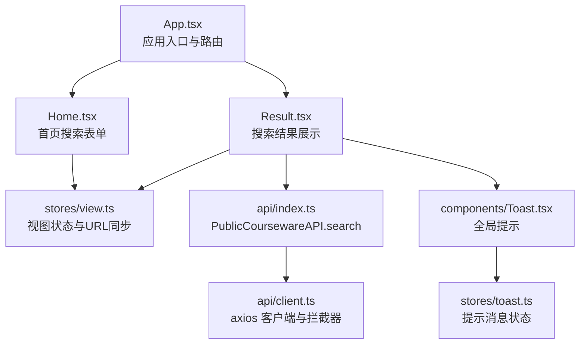
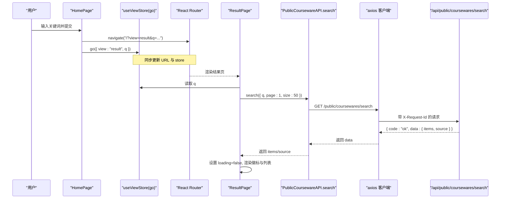
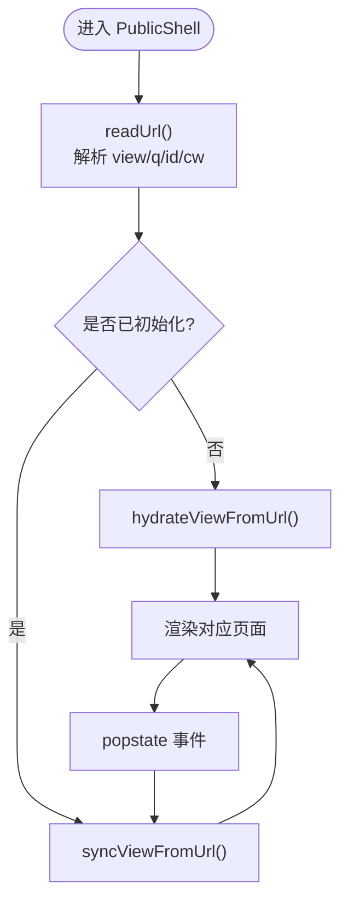
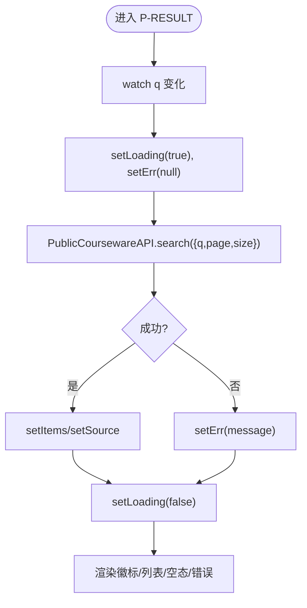
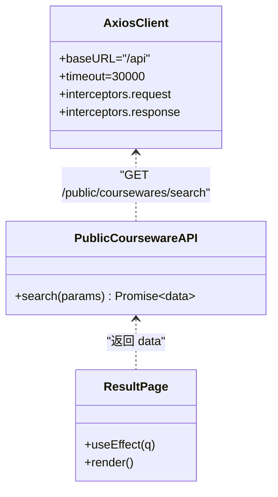
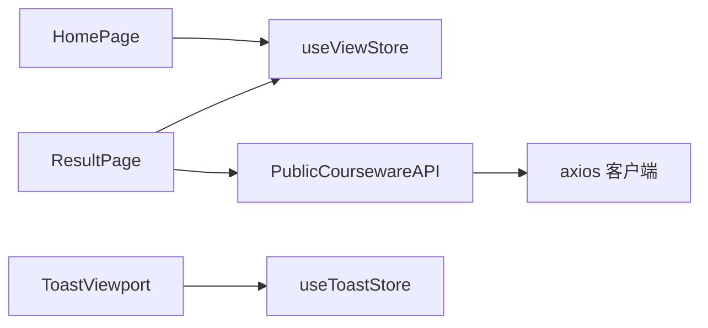

# 前端搜索集成

<cite>
**本文引用的文件**   
- [frontend/src/App.tsx](file://frontend/src/App.tsx)
- [frontend/src/pages/public/Home.tsx](file://frontend/src/pages/public/Home.tsx)
- [frontend/src/pages/public/Result.tsx](file://frontend/src/pages/public/Result.tsx)
- [frontend/src/stores/view.ts](file://frontend/src/stores/view.ts)
- [frontend/src/api/client.ts](file://frontend/src/api/client.ts)
- [frontend/src/api/index.ts](file://frontend/src/api/index.ts)
- [frontend/src/components/Toast.tsx](file://frontend/src/components/Toast.tsx)
- [frontend/src/stores/toast.ts](file://frontend/src/stores/toast.ts)
</cite>

## 目录
1. [简介](#简介)
2. [项目结构](#项目结构)
3. [核心组件](#核心组件)
4. [架构总览](#架构总览)
5. [详细组件分析](#详细组件分析)
6. [依赖关系分析](#依赖关系分析)
7. [性能与可用性考虑](#性能与可用性考虑)
8. [故障排查指南](#故障排查指南)
9. [结论](#结论)
10. [附录：扩展指南](#附录扩展指南)

## 简介
本技术文档聚焦 Learning Hub 前台“搜索”能力的前端实现，围绕以下目标展开：
- 解析 React 组件中的搜索状态管理（Zustand store、URL 同步、视图切换）
- 说明异步请求处理与用户交互反馈（加载态、错误态、空态）
- 解释 API 客户端封装与错误处理机制（统一拦截器、业务码校验、超时控制）
- 提供扩展方案（自定义筛选条件、搜索历史、性能优化）
- 给出用户体验优化建议与常见问题解决方案

## 项目结构
与搜索相关的前端代码主要分布在以下位置：
- 页面层：首页（P-HOME）、结果页（P-RESULT）
- 状态层：视图状态 store（view store）、提示消息 store（toast store）
- 网络层：axios 客户端封装、公共 API 包装（含搜索接口）
- 应用壳：单 URL 路由分发与初始化

图示来源
- [frontend/src/App.tsx:40-58](file://frontend/src/App.tsx#L40-L58)
- [frontend/src/pages/public/Home.tsx:12-23](file://frontend/src/pages/public/Home.tsx#L12-L23)
- [frontend/src/pages/public/Result.tsx:14-42](file://frontend/src/pages/public/Result.tsx#L14-L42)
- [frontend/src/stores/view.ts:58-96](file://frontend/src/stores/view.ts#L58-L96)
- [frontend/src/api/index.ts:405-415](file://frontend/src/api/index.ts#L405-L415)
- [frontend/src/api/client.ts:13-49](file://frontend/src/api/client.ts#L13-L49)
- [frontend/src/components/Toast.tsx:9-36](file://frontend/src/components/Toast.tsx#L9-L36)
- [frontend/src/stores/toast.ts:15-25](file://frontend/src/stores/toast.ts#L15-L25)

章节来源
- [frontend/src/App.tsx:40-58](file://frontend/src/App.tsx#L40-L58)
- [frontend/src/pages/public/Home.tsx:12-23](file://frontend/src/pages/public/Home.tsx#L12-L23)
- [frontend/src/pages/public/Result.tsx:14-42](file://frontend/src/pages/public/Result.tsx#L14-L42)
- [frontend/src/stores/view.ts:58-96](file://frontend/src/stores/view.ts#L58-L96)
- [frontend/src/api/index.ts:405-415](file://frontend/src/api/index.ts#L405-L415)
- [frontend/src/api/client.ts:13-49](file://frontend/src/api/client.ts#L13-L49)
- [frontend/src/components/Toast.tsx:9-36](file://frontend/src/components/Toast.tsx#L9-L36)
- [frontend/src/stores/toast.ts:15-25](file://frontend/src/stores/toast.ts#L15-L25)

## 核心组件
- 视图状态管理（Zustand）
  - 负责 view/q/id/coursewareId 的读写与 URL 同步
  - go() 方法在设置新状态的同时更新浏览器地址栏，避免二次渲染导致的竞态
- 首页搜索表单
  - 本地受控输入，提交时编码关键词并跳转至 /?view=result&q=...
  - 同时调用 go({ view: "result", q }) 驱动结果页
- 结果页搜索
  - 监听 q 变化发起搜索请求，维护 items/source/loading/err 状态
  - 根据 source 显示“AI 智能搜索”或“降级中”徽标
- API 客户端
  - axios 实例统一 baseURL、withCredentials、timeout
  - 请求拦截注入 X-Request-Id；响应拦截解包 envelope.data 并将业务非 ok 转为 Error
- Toast 提示
  - 轻量全局提示，支持自动消失与手动关闭

章节来源
- [frontend/src/stores/view.ts:58-96](file://frontend/src/stores/view.ts#L58-L96)
- [frontend/src/pages/public/Home.tsx:17-23](file://frontend/src/pages/public/Home.tsx#L17-L23)
- [frontend/src/pages/public/Result.tsx:14-42](file://frontend/src/pages/public/Result.tsx#L14-L42)
- [frontend/src/api/client.ts:13-49](file://frontend/src/api/client.ts#L13-L49)
- [frontend/src/components/Toast.tsx:9-36](file://frontend/src/components/Toast.tsx#L9-L36)
- [frontend/src/stores/toast.ts:15-25](file://frontend/src/stores/toast.ts#L15-L25)

## 架构总览
下图展示了从用户输入到结果展示的完整链路，包括状态同步、网络请求与 UI 反馈。

图示来源
- [frontend/src/pages/public/Home.tsx:17-23](file://frontend/src/pages/public/Home.tsx#L17-L23)
- [frontend/src/stores/view.ts:63-96](file://frontend/src/stores/view.ts#L63-L96)
- [frontend/src/pages/public/Result.tsx:24-42](file://frontend/src/pages/public/Result.tsx#L24-L42)
- [frontend/src/api/index.ts:405-415](file://frontend/src/api/index.ts#L405-L415)
- [frontend/src/api/client.ts:19-49](file://frontend/src/api/client.ts#L19-L49)

## 详细组件分析

### 视图状态管理（Zustand + URL 同步）
- 设计要点
  - 白名单校验 view，防止非法值
  - readUrl/hydrate/sync/bindPopState 保证首次加载与前进后退一致性
  - go() 在 view==="home" 时显式重置 q/id/coursewareId，避免“返回首页需点击两次”的竞态问题
- 复杂度
  - 时间 O(1)，空间 O(1)
- 依赖链
  - App 启动时 hydrateViewFromUrl 与 bindViewToPopState
  - PublicShell 监听 location 变化触发 syncViewFromUrl

图示来源
- [frontend/src/stores/view.ts:26-56](file://frontend/src/stores/view.ts#L26-L56)
- [frontend/src/stores/view.ts:99-127](file://frontend/src/stores/view.ts#L99-L127)
- [frontend/src/App.tsx:44-47](file://frontend/src/App.tsx#L44-L47)
- [frontend/src/App.tsx:63-68](file://frontend/src/App.tsx#L63-L68)

章节来源
- [frontend/src/stores/view.ts:26-56](file://frontend/src/stores/view.ts#L26-L56)
- [frontend/src/stores/view.ts:58-96](file://frontend/src/stores/view.ts#L58-L96)
- [frontend/src/stores/view.ts:99-127](file://frontend/src/stores/view.ts#L99-L127)
- [frontend/src/App.tsx:44-47](file://frontend/src/App.tsx#L44-L47)
- [frontend/src/App.tsx:63-68](file://frontend/src/App.tsx#L63-L68)

### 首页搜索表单（P-HOME）
- 行为
  - 本地受控输入，提交时进行 trim 校验
  - 使用 router 导航到 /?view=result&q=...
  - 调用 useViewStore.go 同步 store 与 URL
- 可访问性
  - 提供 placeholder 文案与按钮文本，便于测试定位

章节来源
- [frontend/src/pages/public/Home.tsx:17-23](file://frontend/src/pages/public/Home.tsx#L17-L23)
- [frontend/src/pages/public/Home.tsx:32-51](file://frontend/src/pages/public/Home.tsx#L32-L51)

### 结果页搜索（P-RESULT）
- 数据流
  - useEffect 监听 q，发起搜索请求
  - 维护 items/source/loading/err 四个状态
  - 根据 source 显示不同徽标（llm/keyword）
- 取消竞态
  - 使用 cancel 标记避免旧请求覆盖新结果
- 交互
  - 点击卡片根据 accessMode 跳转到 detail 或 locked

图示来源
- [frontend/src/pages/public/Result.tsx:24-42](file://frontend/src/pages/public/Result.tsx#L24-L42)
- [frontend/src/pages/public/Result.tsx:44-94](file://frontend/src/pages/public/Result.tsx#L44-L94)
- [frontend/src/api/index.ts:405-415](file://frontend/src/api/index.ts#L405-L415)

章节来源
- [frontend/src/pages/public/Result.tsx:14-42](file://frontend/src/pages/public/Result.tsx#L14-L42)
- [frontend/src/pages/public/Result.tsx:44-94](file://frontend/src/pages/public/Result.tsx#L44-L94)

### API 客户端与错误处理
- 统一客户端
  - baseURL=/api，withCredentials=true，timeout=30s
  - 请求拦截注入 X-Request-Id
  - 响应拦截：
    - 若 envelope.code !== "ok"，抛出包含 code/status 的 Error
    - 否则将 resp.data 替换为 body.data，简化上层调用
- 公共 API 包装
  - PublicCoursewareAPI.search 直接返回 data（items/source/page/size/total）
- 错误传播
  - Result 组件 catch 后设置 err 并渲染错误信息
  - 可在更高层接入 toast 统一提示（当前结果页未使用 toast）

图示来源
- [frontend/src/api/client.ts:13-49](file://frontend/src/api/client.ts#L13-L49)
- [frontend/src/api/index.ts:405-415](file://frontend/src/api/index.ts#L405-L415)
- [frontend/src/pages/public/Result.tsx:24-42](file://frontend/src/pages/public/Result.tsx#L24-L42)

章节来源
- [frontend/src/api/client.ts:13-49](file://frontend/src/api/client.ts#L13-L49)
- [frontend/src/api/index.ts:405-415](file://frontend/src/api/index.ts#L405-L415)
- [frontend/src/pages/public/Result.tsx:24-42](file://frontend/src/pages/public/Result.tsx#L24-L42)

### Toast 提示系统
- 功能
  - push(message, kind) 自动 3.5s 后消失
  - dismiss(id) 手动关闭
- 使用场景
  - 当前结果页未直接使用 toast，但可在错误分支中接入以增强反馈

章节来源
- [frontend/src/stores/toast.ts:15-25](file://frontend/src/stores/toast.ts#L15-L25)
- [frontend/src/components/Toast.tsx:9-36](file://frontend/src/components/Toast.tsx#L9-L36)

## 依赖关系分析
- 组件耦合
  - HomePage 与 ResultPage 通过 useViewStore 共享状态，低耦合高内聚
  - ResultPage 依赖 PublicCoursewareAPI，后者依赖 apiClient
- 外部依赖
  - axios 用于 HTTP 请求
  - react-router-dom 用于导航
  - zustand 用于状态管理
- 潜在循环
  - 无循环依赖；store 不依赖页面组件，API 不依赖页面组件

图示来源
- [frontend/src/pages/public/Home.tsx:12-23](file://frontend/src/pages/public/Home.tsx#L12-L23)
- [frontend/src/pages/public/Result.tsx:14-42](file://frontend/src/pages/public/Result.tsx#L14-L42)
- [frontend/src/api/index.ts:405-415](file://frontend/src/api/index.ts#L405-L415)
- [frontend/src/api/client.ts:13-49](file://frontend/src/api/client.ts#L13-L49)
- [frontend/src/components/Toast.tsx:9-36](file://frontend/src/components/Toast.tsx#L9-L36)
- [frontend/src/stores/toast.ts:15-25](file://frontend/src/stores/toast.ts#L15-L25)

章节来源
- [frontend/src/pages/public/Home.tsx:12-23](file://frontend/src/pages/public/Home.tsx#L12-L23)
- [frontend/src/pages/public/Result.tsx:14-42](file://frontend/src/pages/public/Result.tsx#L14-L42)
- [frontend/src/api/index.ts:405-415](file://frontend/src/api/index.ts#L405-L415)
- [frontend/src/api/client.ts:13-49](file://frontend/src/api/client.ts#L13-L49)
- [frontend/src/components/Toast.tsx:9-36](file://frontend/src/components/Toast.tsx#L9-L36)
- [frontend/src/stores/toast.ts:15-25](file://frontend/src/stores/toast.ts#L15-L25)

## 性能与可用性考虑
- 请求级优化
  - 使用 cancel 标记避免旧请求覆盖新结果
  - 合理 size 参数（当前固定 50），可按需分页
- 渲染级优化
  - 首屏避免闪烁：source 初始为 null，拿到响应后再设置
  - 列表项 key 使用稳定 id
- 网络级优化
  - 统一 timeout 30s，必要时对大资源上传单独覆盖
  - 可引入去抖（debounce）减少频繁输入触发的请求
- 可用性与体验
  - 明确加载/错误/空态三种中间态
  - 徽标清晰区分 LLM 与降级路径
  - 受限课件在结果中可见并标注，点击后按策略跳转

[本节为通用指导，无需列出具体文件来源]

## 故障排查指南
- 症状：搜索结果不刷新或重复渲染
  - 检查 useEffect 依赖是否为 q，是否存在多余依赖导致重复触发
  - 确认 cancel 标记是否正确清理
- 症状：返回首页需要点击两次
  - 确认 go({ view:"home" }) 是否重置了 q/id/coursewareId
  - 确认 PublicShell 的 location 监听与 store 同步顺序
- 症状：网络异常无提示
  - 当前结果页仅设置 err 字符串，如需全局提示，可在 catch 分支调用 toast
- 症状：后端返回业务错误码
  - 检查 apiClient 响应拦截是否已将 code/message 注入 Error
  - 在上层捕获 error.code/error.status 做差异化处理

章节来源
- [frontend/src/pages/public/Result.tsx:24-42](file://frontend/src/pages/public/Result.tsx#L24-L42)
- [frontend/src/stores/view.ts:63-96](file://frontend/src/stores/view.ts#L63-L96)
- [frontend/src/api/client.ts:25-49](file://frontend/src/api/client.ts#L25-L49)
- [frontend/src/stores/toast.ts:15-25](file://frontend/src/stores/toast.ts#L15-L25)

## 结论
该搜索集成采用“Zustand + URL 同步”的状态模型，结合统一的 axios 客户端与清晰的错误处理，实现了从输入到结果的稳定链路。通过合理的加载/错误/空态与徽标语义化，提升了用户体验。后续可在输入去抖、缓存、重试与全局提示等方面进一步增强鲁棒性与性能。

[本节为总结，无需列出具体文件来源]

## 附录：扩展指南

### 扩展一：添加自定义筛选条件（如分类、标签）
- 步骤
  - 在 Result 组件增加筛选状态（例如 selectedCategoryIds/tagIds）
  - 在 PublicCoursewareAPI.search 的参数中追加筛选字段
  - 在 URL 中持久化筛选条件（go 时写入 view/q/... 以及筛选参数）
  - 在 readUrl 中解析这些参数，并在 useEffect 中作为搜索参数传入
- 注意
  - 保持 URL 可读性与可分享性
  - 避免过多筛选导致查询过慢，必要时增加服务端分页与索引

章节来源
- [frontend/src/pages/public/Result.tsx:24-42](file://frontend/src/pages/public/Result.tsx#L24-L42)
- [frontend/src/api/index.ts:405-415](file://frontend/src/api/index.ts#L405-L415)
- [frontend/src/stores/view.ts:26-56](file://frontend/src/stores/view.ts#L26-L56)

### 扩展二：搜索历史管理
- 方案
  - 使用 localStorage 存储最近 N 条搜索词（去重、限制长度）
  - 在输入框下方展示历史下拉，支持一键回填与删除
  - 在 go() 之前记录历史，或在结果页成功后记录
- 注意
  - 隐私与合规：避免存储敏感内容
  - 容量与性能：限制条目数量与大小

[本节为概念性扩展，无需列出具体文件来源]

### 扩展三：性能优化清单
- 输入去抖：在输入变更时延迟 200–300ms 再触发搜索
- 请求合并：相同关键词短时间内只保留一个请求
- 结果缓存：基于 q 的简单内存缓存，配合失效策略
- 懒加载：长列表虚拟滚动（当结果量较大时）
- 预取：热门关键词预取结果

[本节为通用指导，无需列出具体文件来源]

### 扩展四：错误处理与降级
- 网络异常：catch 分支弹出 toast 提示，并提供“重试”按钮
- 业务错误：根据 error.code 显示友好文案（如“请求过于频繁”）
- 超时控制：默认 30s，必要时针对特定接口调整
- 降级显示：当 source="keyword" 时显示“降级中”，引导用户理解

章节来源
- [frontend/src/api/client.ts:25-49](file://frontend/src/api/client.ts#L25-L49)
- [frontend/src/pages/public/Result.tsx:24-42](file://frontend/src/pages/public/Result.tsx#L24-L42)
- [frontend/src/stores/toast.ts:15-25](file://frontend/src/stores/toast.ts#L15-L25)