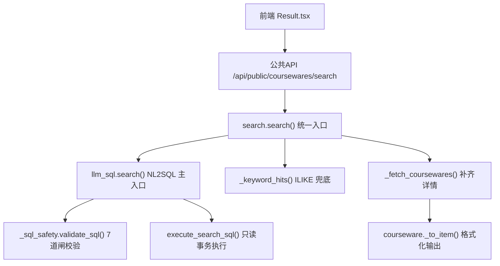
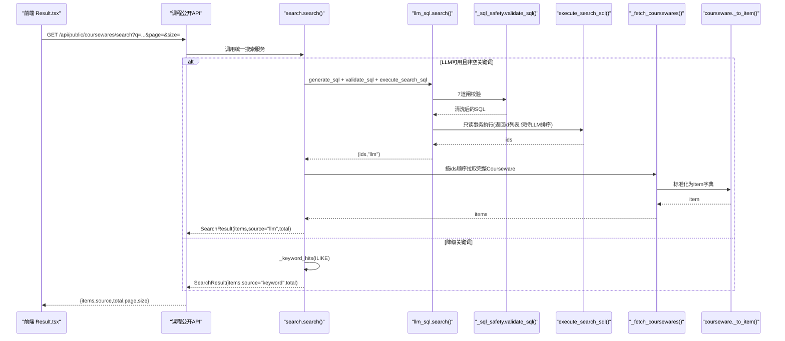
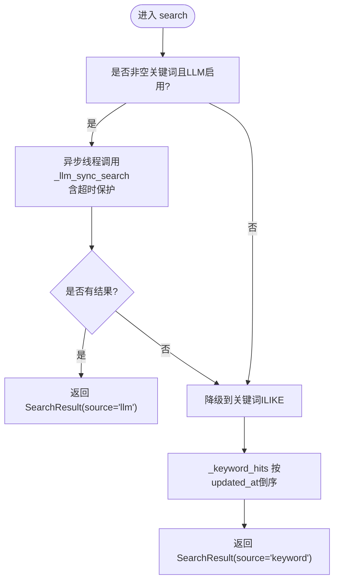
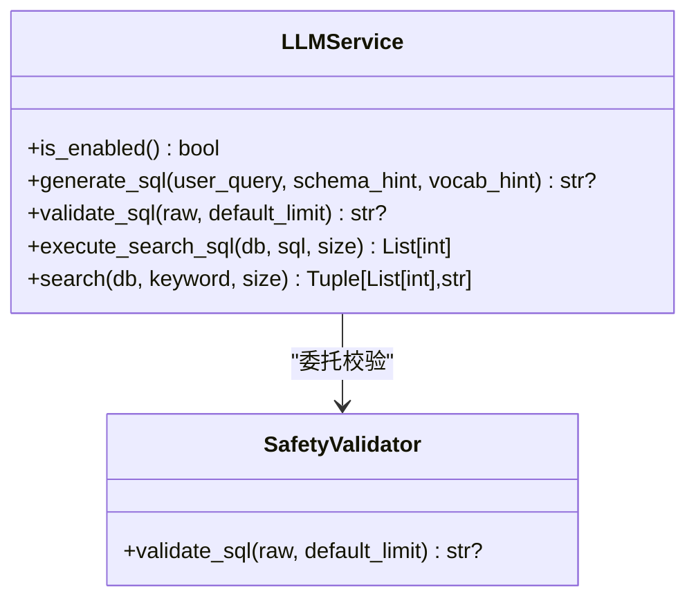
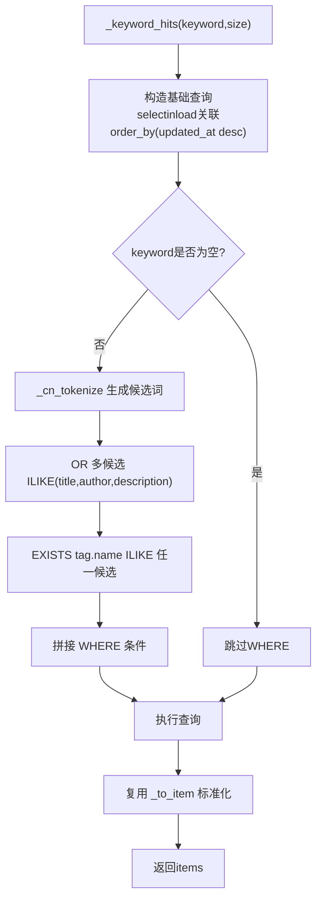
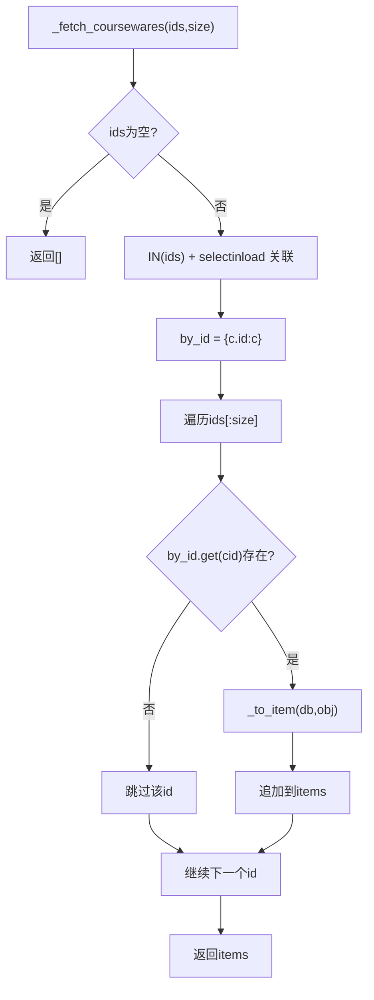
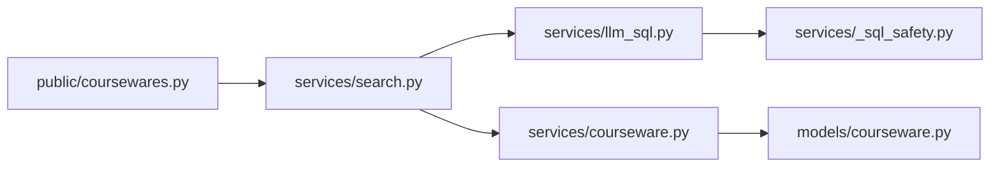

# 搜索结果排序与优化

<cite>
**本文引用的文件**
- [backend/app/services/search.py](file://backend/app/services/search.py)
- [backend/app/services/llm_sql.py](file://backend/app/services/llm_sql.py)
- [backend/app/services/_sql_safety.py](file://backend/app/services/_sql_safety.py)
- [backend/app/api/public/coursewares.py](file://backend/app/api/public/coursewares.py)
- [backend/app/models/courseware.py](file://backend/app/models/courseware.py)
- [backend/app/services/courseware.py](file://backend/app/services/courseware.py)
- [frontend/src/pages/public/Result.tsx](file://frontend/src/pages/public/Result.tsx)
- [doc/spec/06-非功能需求.md](file://doc/spec/06-非功能需求.md)
</cite>

## 目录
1. [简介](#简介)
2. [项目结构](#项目结构)
3. [核心组件](#核心组件)
4. [架构总览](#架构总览)
5. [详细组件分析](#详细组件分析)
6. [依赖关系分析](#依赖关系分析)
7. [性能考量](#性能考量)
8. [故障排查指南](#故障排查指南)
9. [结论](#结论)
10. [附录](#附录)

## 简介
本技术文档聚焦 Learning Hub 的“搜索结果排序与优化系统”，围绕以下目标展开：
- 解析不同搜索来源的排序策略：LLM-to-SQL 路径按 LLM 返回顺序（通常基于 updated_at 倒序）；关键词 ILIKE 兜底路径按更新时间倒序。
- 说明结果集合并与去重机制：ID 映射、数据完整性检查、格式标准化。
- 解释性能优化技术：数据库查询优化、N+1 问题避免、内存使用控制。
- 提供自定义排序规则的实现思路：业务权重调整、分页处理、缓存策略。
- 给出性能监控指标与调优建议。

## 项目结构
与搜索排序相关的关键代码位于后端 services 层与 API 路由，前端仅消费统一接口并展示 source 徽标。

图表来源
- [backend/app/api/public/coursewares.py:32-54](file://backend/app/api/public/coursewares.py#L32-L54)
- [backend/app/services/search.py:210-242](file://backend/app/services/search.py#L210-L242)
- [backend/app/services/llm_sql.py:443-478](file://backend/app/services/llm_sql.py#L443-L478)
- [backend/app/services/_sql_safety.py:165-210](file://backend/app/services/_sql_safety.py#L165-L210)
- [backend/app/services/llm_sql.py:385-437](file://backend/app/services/llm_sql.py#L385-L437)
- [backend/app/services/search.py:115-160](file://backend/app/services/search.py#L115-L160)
- [backend/app/services/search.py:166-190](file://backend/app/services/search.py#L166-L190)
- [backend/app/services/courseware.py:290-332](file://backend/app/services/courseware.py#L290-L332)

章节来源
- [backend/app/api/public/coursewares.py:32-54](file://backend/app/api/public/coursewares.py#L32-L54)
- [backend/app/services/search.py:210-242](file://backend/app/services/search.py#L210-L242)

## 核心组件
- 统一搜索服务 search.search：对外暴露异步入口，优先走 LLM-to-SQL，失败或空命中则降级到关键词 ILIKE。
- LLM-to-SQL 服务 llm_sql.search：生成 SQL → 安全校验 → 只读事务执行 → 返回 id 列表（保持 LLM 排序）。
- 关键词兜底 _keyword_hits：对标题/作者/描述/标签名进行 ILIKE 匹配，默认按 updated_at 倒序。
- 结果补齐 _fetch_coursewares：按 LLM 返回的 id 顺序拉取完整 Courseware 对象，再调用 courseware._to_item 做字段标准化。
- 安全校验 _sql_safety.validate_sql：7 道闸白名单校验，确保只读、单语句、限制表集合、强制 LIMIT。
- 公共 API /api/public/coursewares/search：封装请求参数 page/size，返回 items/source/total/page/size。

章节来源
- [backend/app/services/search.py:105-110](file://backend/app/services/search.py#L105-L110)
- [backend/app/services/search.py:115-160](file://backend/app/services/search.py#L115-L160)
- [backend/app/services/search.py:166-190](file://backend/app/services/search.py#L166-L190)
- [backend/app/services/llm_sql.py:443-478](file://backend/app/services/llm_sql.py#L443-L478)
- [backend/app/services/_sql_safety.py:165-210](file://backend/app/services/_sql_safety.py#L165-L210)
- [backend/app/api/public/coursewares.py:32-54](file://backend/app/api/public/coursewares.py#L32-L54)

## 架构总览
下图展示了从前端发起搜索到最终返回结果的完整时序，包括 LLM 路径与关键词兜底的分支逻辑。

图表来源
- [backend/app/api/public/coursewares.py:32-54](file://backend/app/api/public/coursewares.py#L32-L54)
- [backend/app/services/search.py:210-242](file://backend/app/services/search.py#L210-L242)
- [backend/app/services/llm_sql.py:443-478](file://backend/app/services/llm_sql.py#L443-L478)
- [backend/app/services/_sql_safety.py:165-210](file://backend/app/services/_sql_safety.py#L165-L210)
- [backend/app/services/llm_sql.py:385-437](file://backend/app/services/llm_sql.py#L385-L437)
- [backend/app/services/search.py:166-190](file://backend/app/services/search.py#L166-L190)
- [backend/app/services/courseware.py:290-332](file://backend/app/services/courseware.py#L290-L332)

## 详细组件分析

### 组件A：统一搜索服务 search.search
- 职责：协调 LLM 与关键词两条路径，保证超时与异常时稳定降级。
- 排序策略：
  - LLM 路径：由 LLM 生成的 SQL 决定排序（示例中常为 updated_at DESC），_fetch_coursewares 严格按 ids 顺序组装结果，不二次排序。
  - 关键词路径：默认按 updated_at 倒序。
- 降级条件：未配置 DASHSCOPE_API_KEY、LLM 调用超时/异常、SQL 被安全校验拒绝、LLM 返回空结果。
- 数据契约：SearchResult{items, source, total}，source ∈ {"llm","keyword"}。

图表来源
- [backend/app/services/search.py:210-242](file://backend/app/services/search.py#L210-L242)
- [backend/app/services/search.py:196-204](file://backend/app/services/search.py#L196-L204)
- [backend/app/services/search.py:115-160](file://backend/app/services/search.py#L115-L160)

章节来源
- [backend/app/services/search.py:210-242](file://backend/app/services/search.py#L210-L242)
- [backend/app/services/search.py:105-110](file://backend/app/services/search.py#L105-L110)

### 组件B：LLM-to-SQL 服务 llm_sql.search
- 流程：is_enabled → 构建词汇提示 → generate_sql → validate_sql → execute_search_sql。
- 排序策略：execute_search_sql 返回的 id 列表保持 SQL 输出顺序（通常为 updated_at DESC）。
- 安全约束：7 道闸校验，禁止 DDL/DML、限制表集合、强制 LIMIT。
- 只读事务：SET TRANSACTION READ ONLY，防止意外写入。

图表来源
- [backend/app/services/llm_sql.py:267-270](file://backend/app/services/llm_sql.py#L267-L270)
- [backend/app/services/llm_sql.py:276-344](file://backend/app/services/llm_sql.py#L276-L344)
- [backend/app/services/llm_sql.py:350-354](file://backend/app/services/llm_sql.py#L350-L354)
- [backend/app/services/llm_sql.py:385-437](file://backend/app/services/llm_sql.py#L385-L437)
- [backend/app/services/llm_sql.py:443-478](file://backend/app/services/llm_sql.py#L443-L478)
- [backend/app/services/_sql_safety.py:165-210](file://backend/app/services/_sql_safety.py#L165-L210)

章节来源
- [backend/app/services/llm_sql.py:443-478](file://backend/app/services/llm_sql.py#L443-L478)
- [backend/app/services/_sql_safety.py:165-210](file://backend/app/services/_sql_safety.py#L165-L210)

### 组件C：关键词兜底 _keyword_hits
- 匹配范围：title、author、description、tag.name（通过 EXISTS 子句避免大表 JOIN）。
- 中文预处理：_cn_tokenize 去除礼貌用语、平台术语等噪声，生成多个候选词依次尝试。
- 排序策略：默认按 updated_at 倒序。
- 关联加载：selectinload tags/materials/access_tokens/category，避免 N+1。

图表来源
- [backend/app/services/search.py:115-160](file://backend/app/services/search.py#L115-L160)
- [backend/app/services/search.py:62-102](file://backend/app/services/search.py#L62-L102)
- [backend/app/models/courseware.py:49-67](file://backend/app/models/courseware.py#L49-L67)

章节来源
- [backend/app/services/search.py:115-160](file://backend/app/services/search.py#L115-L160)
- [backend/app/services/search.py:62-102](file://backend/app/services/search.py#L62-L102)

### 组件D：结果补齐与标准化 _fetch_coursewares 与 _to_item
- ID 映射与去重：_fetch_coursewares 以 by_id 字典按 ids_in_order 顺序组装，天然去重并保持顺序。
- 数据完整性检查：若某 id 不存在，直接跳过，不会破坏整体顺序。
- 格式标准化：_to_item 将 ORM 对象转为前端所需字典，包含分类名、标签名、素材信息、时间戳等。

图表来源
- [backend/app/services/search.py:166-190](file://backend/app/services/search.py#L166-L190)
- [backend/app/services/courseware.py:290-332](file://backend/app/services/courseware.py#L290-L332)

章节来源
- [backend/app/services/search.py:166-190](file://backend/app/services/search.py#L166-L190)
- [backend/app/services/courseware.py:290-332](file://backend/app/services/courseware.py#L290-L332)

### 组件E：公共 API 与前端展示
- API 封装：/api/public/coursewares/search 接收 q/page/size，返回 data={items,source,total,page,size}。
- 前端徽标：根据 source 显示“AI 智能搜索”或“AI 智能搜索 · 降级中”。

章节来源
- [backend/app/api/public/coursewares.py:32-54](file://backend/app/api/public/coursewares.py#L32-L54)
- [frontend/src/pages/public/Result.tsx:1-42](file://frontend/src/pages/public/Result.tsx#L1-L42)

## 依赖关系分析
- 模块耦合：
  - search.py 依赖 llm_sql.py 与 courseware.py。
  - llm_sql.py 依赖 _sql_safety.py 与配置 get_settings。
  - API 路由依赖 search.py。
- 外部依赖：
  - dashscope SDK（可选，未安装时自动降级）。
  - PostgreSQL（只读事务、ILIKE、EXISTS）。
- 潜在循环依赖：无。

图表来源
- [backend/app/api/public/coursewares.py:32-54](file://backend/app/api/public/coursewares.py#L32-L54)
- [backend/app/services/search.py:210-242](file://backend/app/services/search.py#L210-L242)
- [backend/app/services/llm_sql.py:443-478](file://backend/app/services/llm_sql.py#L443-L478)
- [backend/app/services/_sql_safety.py:165-210](file://backend/app/services/_sql_safety.py#L165-L210)
- [backend/app/services/courseware.py:290-332](file://backend/app/services/courseware.py#L290-L332)
- [backend/app/models/courseware.py:21-47](file://backend/app/models/courseware.py#L21-L47)

章节来源
- [backend/app/services/search.py:210-242](file://backend/app/services/search.py#L210-L242)
- [backend/app/services/llm_sql.py:443-478](file://backend/app/services/llm_sql.py#L443-L478)

## 性能考量
- 数据库查询优化
  - 关键词路径使用 selectinload 预加载关联，避免 N+1。
  - 标签匹配采用 EXISTS 子句，避免大表 JOIN 成本。
  - LLM 路径仅 SELECT id，后续批量 IN 拉取，减少网络与序列化开销。
- 只读事务与白名单
  - SET TRANSACTION READ ONLY 保障安全性与一致性。
  - 7 道闸校验限制表集合与强制 LIMIT，降低慢查询风险。
- 内存使用控制
  - _fetch_coursewares 按 ids_in_order[:size] 切片，避免一次性加载过多对象。
  - by_id 字典在函数作用域内释放，GC 友好。
- 并发与超时
  - asyncio.to_thread 包装同步 LLM 调用，配合 wait_for 超时保护，避免阻塞事件循环。
- 监控指标（参考规范）
  - lh.http.request.duration.search（P95 ≤ 2s）
  - lh.llm.call.duration（P95 ≤ 1.5s）
  - lh.db.query.duration（P95 ≤ 50ms）
  - lh.llm.timeout.rate（≤ 5%）

章节来源
- [backend/app/services/search.py:115-160](file://backend/app/services/search.py#L115-L160)
- [backend/app/services/llm_sql.py:385-437](file://backend/app/services/llm_sql.py#L385-L437)
- [backend/app/services/_sql_safety.py:165-210](file://backend/app/services/_sql_safety.py#L165-L210)
- [doc/spec/06-非功能需求.md:125-136](file://doc/spec/06-非功能需求.md#L125-L136)

## 故障排查指南
- LLM 不可用或未配置
  - 现象：source 始终为 "keyword"。
  - 排查：确认 DASHSCOPE_API_KEY 已设置；查看 is_enabled 返回值。
- LLM 超时或异常
  - 现象：日志出现 timeout/fallback；source 为 "keyword"。
  - 排查：检查 llm_sql_timeout_seconds 配置；观察 dashscope 响应时间与错误码。
- SQL 被安全校验拒绝
  - 现象：validate_sql 返回 None；触发降级。
  - 排查：核对黑名单关键字、表白名单、LIMIT 限制；必要时调整 prompt 或 schema_hint。
- 结果为空
  - 现象：total=0。
  - 排查：确认关键词清洗逻辑是否过度裁剪；验证 ILIKE 模式与索引情况。
- 前端徽标不一致
  - 现象：徽标未正确显示“降级中”。
  - 排查：确认 API 返回 source 字段；检查前端 Result.tsx 状态更新逻辑。

章节来源
- [backend/app/services/search.py:210-242](file://backend/app/services/search.py#L210-L242)
- [backend/app/services/llm_sql.py:267-270](file://backend/app/services/llm_sql.py#L267-L270)
- [backend/app/services/_sql_safety.py:165-210](file://backend/app/services/_sql_safety.py#L165-L210)
- [frontend/src/pages/public/Result.tsx:1-42](file://frontend/src/pages/public/Result.tsx#L1-L42)

## 结论
Learning Hub 的搜索系统以“LLM-to-SQL 优先 + 关键词 ILIKE 兜底”为核心策略，在保证高可用性的同时兼顾了排序质量与性能。通过严格的安全校验、只读事务、预加载与分批拉取等手段，有效避免了 N+1 与内存膨胀问题。未来可在不改变现有契约的前提下，扩展业务权重排序、引入更丰富的缓存策略与可观测性指标，进一步提升用户体验与系统稳定性。

## 附录

### 自定义排序规则实现建议
- 业务权重调整
  - 在 LLM 生成的 SQL 中增加加权表达式（如 title 命中加分、author 次之），并在 ORDER BY 中组合 updated_at 与权重分。
  - 在关键词路径中，可通过计算匹配得分（如命中字段优先级、命中位置靠前加分）后在内存中排序，但需注意性能影响。
- 分页处理
  - 当前 API 支持 page/size；LLM 路径需确保 SQL 中包含 LIMIT/OFFSET 或在应用层切片。
  - 注意：LLM 路径返回的是 id 列表，建议在 SQL 层面完成分页，避免额外内存拷贝。
- 缓存策略
  - 词汇提示缓存：_build_vocab_hint 已实现进程级 TTL 缓存（默认 60s），可在管理后台增删分类/标签后主动失效。
  - 搜索结果缓存：可按 keyword+size 作为键，结合 Redis 缓存热点查询结果，注意过期策略与一致性。
  - 注意：缓存需考虑 source 差异与 ACL 可见性（RESTRICTED 课件仍应出现在搜索结果中，但访问时需鉴权）。

章节来源
- [backend/app/services/llm_sql.py:44-104](file://backend/app/services/llm_sql.py#L44-L104)
- [backend/app/api/public/coursewares.py:32-54](file://backend/app/api/public/coursewares.py#L32-L54)